# 麻省理工学院【中英⚡深度学习｜6.7960-Fall-2024,-Deep-Learning】-p07-P7-优化的缩放规则--BV15QZ4B1E6v_p7-

Okay， I'm going to start thanks everyone for coming to the seventh lecture。😊，So in the lecture。

This is the plan。嗯。I'm going to introduce what。The deep learning optimization probably looks like。

 which I think you already know。嗯。I want to cover some classical approaches to it's optimization。

And these are things that。Oftentimes， people in deep learning know about them and sort of want them to work。

 but。In practice， we don't use these things really to do deep learning optimization。

So we want to kind of introduce them and how we think about them and then think about maybe why we perhaps don't use them。

嗯。And then towards the end of the lecture， I'll talk a bit about making the training really scalable and making the optimizational algorithm scale well as you scale the architecture of your neural network。

嗯。And then at the end， I just want to talk a little bit about。

Because this is kind of my research area also working on it with Phil。嗯。

So I want to just tell you a little bit about some of the things that we're thinking about。

 but you can be a little skeptical or。You know， ask the difficult questionsca's that's。

 that's what you should do。嗯。Okay。So this is a reminder that， you know， so far。

 we've looked at this puzzle。 and I think， you know。

 we've looked at the first piece of the puzzle approximation。The third one， generalization。

So these were the questions of， does that exist in neural network in my model family that fits the training data。

 if it does exist， can I find it。And does it do well。On uneen data。But。

perspective people sort of have at the moment， we could argue you know， it may not be true。

 but just for the sake of argument， you know people are kind of like， okay。

 approximation we've kind of solved that now because we you know。

 you just use a transformer for everything， really big transformer。Generalization。

 weve kind of solved because you just get so much data that everything generalizes。 Like if you。

 if you have enough， if you have the whole universe of training data， you'll never overfit。

and something， something， well， that we could probably those are slightly too extreme positions。

 but just for the sake of argument and for the sake of argument。

 the thing that is we can improve upon is optimization and this is like if this is the mindset you have if you're at a。

 you know， if you're at like a，Deep learning starter。

 and you just wan to make the optimization as efficient as possible。 And then you。

 you just like throw the big neural network at the problem and and collect lots of data But okay。

 maybe to car what's the caricature the the take。 But that's anyway。

 this lecture was just gonna talk about the second question of optimization。嗯。

So Ive wanted to write it down in a kind of formal way where we have a a neural network， which。

Is a function F， and it takes inputs and weights， and it gives you an output。

And we have an error measure， which I'll call L。 And you think of this as like cross entropy or square error。

And you think of why hat as your prediction and why as your target。

And it somehow just measures the difference between them， in some way。

And then we collect here trading data。 So here， I'm thinking about like kind of paths of data with inputs and targets。

And and capital N is the number of data points in my data set。And then I'm gonna write down you know。

 an example of a kind of classic machine learning or deep learning loss function。

 which is something like the average over the data set of like。

 let me just call it L I to be the error on the I data point。And L I would be。

It would be what that means。 It's shorthand for the loss between。You know。

 the output of the neuraln net， on example， I。With weight， W。And you。

 it's the discrepancy between that and the， the I target。嗯。

So this is kind of what a last function oftentimes looks like in machine learning。嗯。And you know。

 you pick F these days， we pick A to be a really big， really big transformer and we pick you know。

 and we make it really， really large。And then we just try to find the W that minimizes this。

 this loss function。So there's two features I want to point out at this stage。

1 is that the loss function has a kind of compositional structure where we have an error measure。

And in neural network。 And we sort of glue them together。 So theres， there's。

 there's two things that error measuring the neural network and， and that compose with each other。

 So that's like an interesting part of the last function。 And you。

 the other is that we average over the。😊，Over the training set。嗯。

And this is a picture of what we're doing。 So we， we set up this loss function。 and， you know。

 we start at some weight setting that has a， you know， a large loss。 And then we try to like。

 move the weights to the place with the small loss。 And we， we think about going you know。

 downhill on this。 And and we compute the gradients。

 and we try to get closer and closer and eventually like stop at this point， hopefully。

And so that that's just saying that we iterate this， this gradient descent operation。And。Let's see。

And this is the learning rate or the step size， which I just call Eta。 and this is the gradient。嗯。

Okay， so what makes this hard， In a sense， it's not hard because， you know， we。

 we do it all the time and we can train really big machine learning models。

 And it doesn't seem to be， you know， we can do it。 But what are some of the things which。

Which make this like challenging in a way， like some of the examples are。嗯。There are。

 there are lots of weights。It's like， really high dimensional optimization。嗯。Another thing is like。

 the neural network may be very deep。It has lots of layers。 And， and that can make for a while。

 we couldn't train really， really deep neural networks。 But you know， with some advances， now we can。

What else is hard， There's lots of data。嗯。So， usually。We do like stochastic gradients。

 We like compute gradients on a handful of data points。 And then on the next iteration。

 we pick another handful of data points。 and we see that sort of means that we just have noisy estimates of the full gradient across all the data points。

嗯。But what for the purpose of this， lecture， I actually kind of want to ignore this problem and。

 and like these two first problems are already kind of like， if you just。Just think about those ones。

 There's really a lot of interesting things to say and things to think about。 So we， in other words。

For the sake of this lecture， that's just like， assume。That we're in the full batch setting。I。e。

 we can like evaluate the true gradient of the whole loss function on all the day every step。

 Let's just assume that we can do that。嗯。Okay。So towards the end of the lecture。

 I want to talk a little bit about some of the problems that we have when we do scaling。

 when we like scale up scale up our neural network。 So I， I want you to think that like。

 this is a neural network where I pass in an input here and I get the output。

And I'm either going to be interested in kind of scaling the width。

 like making the network wider or potentially scaling the depth than making the network deeper。

And we kind of run into two kind of nuisances when we do this。 if you do it naively。嗯。

And the first one is actually a little bit explored in the， in this homework。

But so this is a plot of training laws。And I'm， I'm training networks with with a range of learning routes on the X axis。

And the different curves are sort of increasing width。 So， So as I go down， it's getting wider。

And what you typically see is that if you make your neural network wider。

 you see that the best loss you achieve kind of， you see it kind of。

You get a better loss as you make the network wearer， which is good。

 That's why people want to scale their network because they it improves the performance。嗯。

But you sort of see that。On the other hand， if you look at the the learning rate， which。

 which gets the best loss， it sort of changes as I scale my， as I scale my model。

 the best learning rate changes。 So that means like。Typically， if you trade on neural network。

 you don't run this full sweep of learning rate。 You just pick a learning rate。

 and then maybe you try to scale your model and you try to run the training again and you find， oh。

 my training isn't working because just because I made my neural network bigger。

 But and then then you have to re the learning rate at the large scale。

So this was just like a kind of nuisance that as we scale the whole lost kind of landscape as a function of step sizes kind of drifting。

That's a nuisance。 And similarly， if we scale depth， then we make the network deeper。

 So it's the same。 the different curves here are。As I go down， it's increasing depth。

And we're plotting training loss against learning rate。And something you can say。

 if you do this naively， you just find that like。Performance gets worse as I make my model deeper。

 which is， that's like undesirable， yeah。

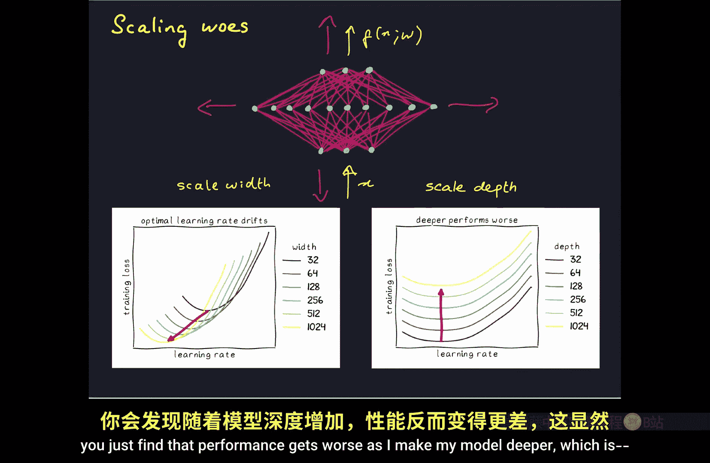

Pomal landing wages。Dressed but it。Saendship。不。快啲两分钟。Oh， yeah。

 let's just pick two points and just compare them。 So let's say that we， we're with 32。

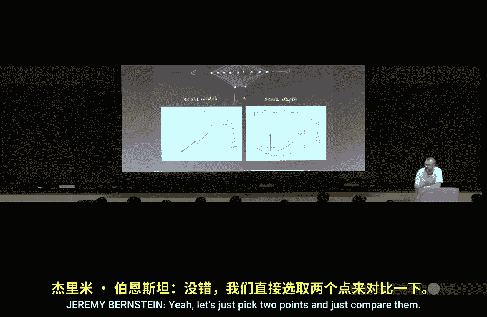

Like， the best loss is about here on the dark blue curve。

 And that corresponds to like this learning rate。Which is if， if， if we're at a larger width 1024。

 the best loss occurs is here。 And it just corresponds to a different learning rate。

 It's the fact that the minima occur at like different points on that X axis。That's。

 that's what I'm trying to point out。Do we have any intuition of why the optimal learning rate changes has be skill bit Yeah。

 that's the the towards the end of the I'll try to like explain why。诶有晒。So I'm just scared。Back。Our。

うだ。Lo is worse。あつ？Yeah， so this is basically like pre， let's say， 2015。People。

 the max depth people went to it was like， let's say 16 or something。

 Then people figured out techniques you can train the network with thousands of layers。

 So I'm just saying if you do things very naively， like。

 if you don't know that much about deep learning， this is like you would see this type of behavior。

 Then as you learn more and more， then you like know how to fix these problems。

 So I'll talk a little bit about how to fix some of these problems。

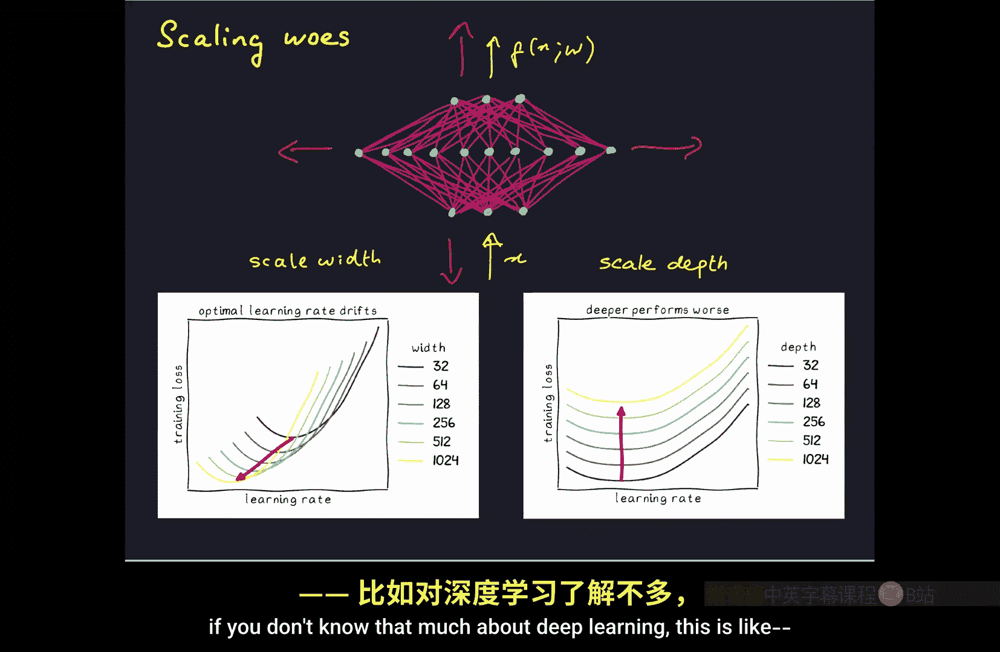

Yes， essentially， the fix for depth is like use a residual architecture and set up the residual blocks in a good way。

 And like you could use a residual architecture and set up the residual blocks back badly。

 and you'd still see this kind of behavior or set up the interaction between the optimization algorithm and the residual blocks。

 So like if you solve at least enough of the problems， you can fix this behavior。

 And if you solve all the problems， then you can fix it in a kind of really really nice way where everything。

😊，The optimal learning rate always transfers across scales or。

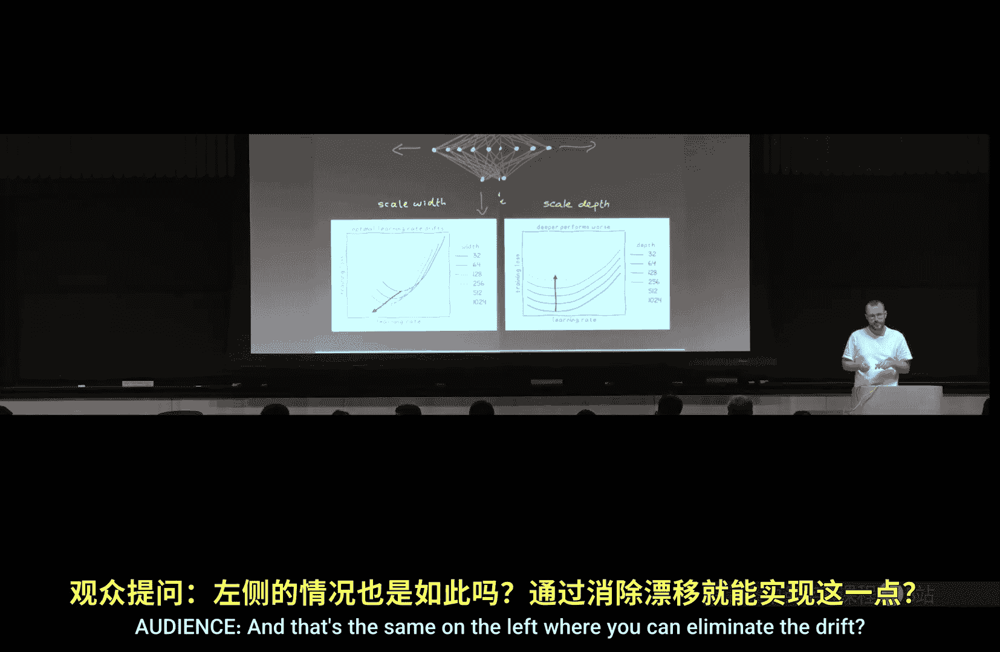

Yeah， what the point on the left is that even with all the all the latest fixes prior to like 2021。

 it had， it had that drift。 But then if you know all the literature from 2021 until now。

 then you can fix it for sure。어 안。

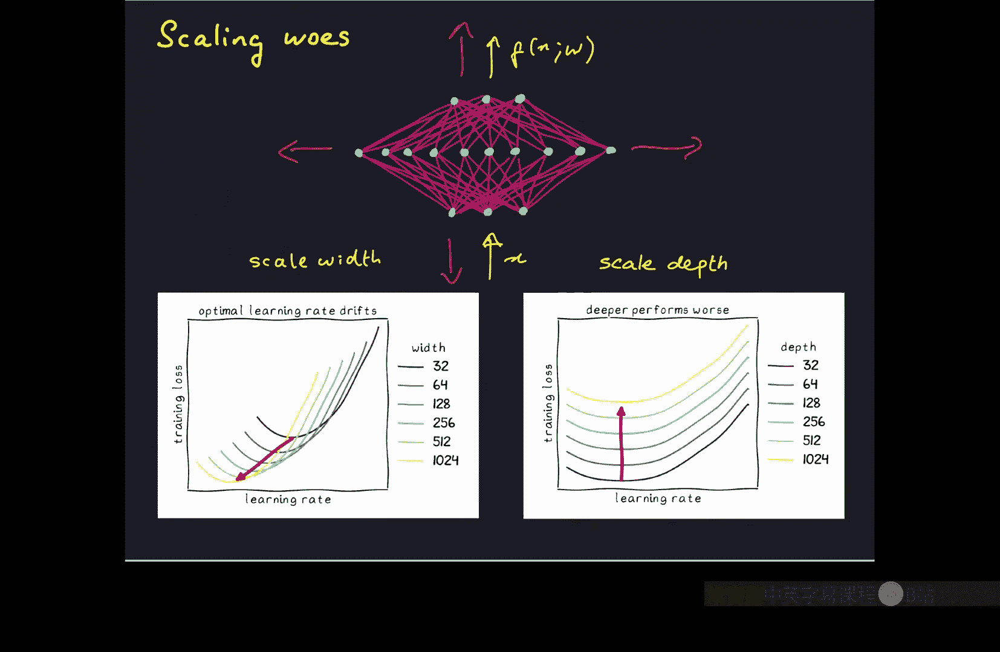

So anyway， these are just some examples of some problems， how things can go badly when we scale。

 and like if if you're trying to scale massive transformers。

 you may not even have the resources to tune all the hyperparameters of a really big model。

 So you may be like in this regime where you can only tune things at small scale and then try to transfer them。

 So that's like one of the applications of like fixing this type of problem。😊，Okay。

 but that was just some。That was just kind of teaser for the end of the lecture。

 Now I want to just let's go back to basics and just how do we。

 how should we think about designing optimization algorithms and solving optimization problems。

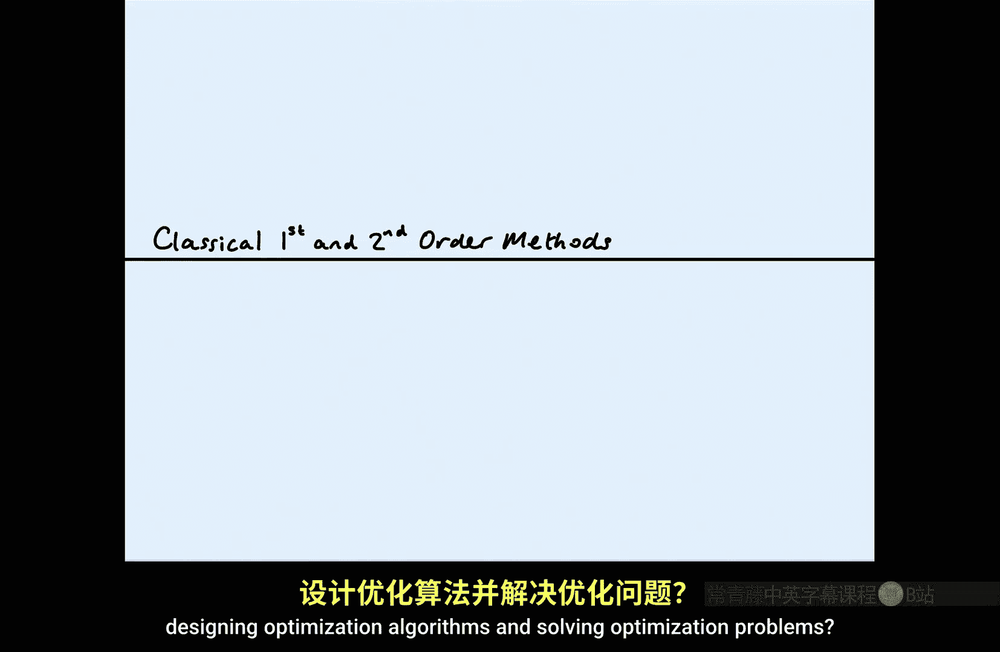

So I wanted to look up。A couple different types of methods。The first is first order methods。

 which only use first derivatives。 And so they basically only use gradients。

 which if you think about it， is kind of what we do in deep learning。

And I'm going to use this symbol G as a shorthand for the derivative of the last。

 with respect to its weights。So G G is always going to mean the gradient of the last with respect to the weights。

 are the thing that you get by doing back propag。And then there's also second order methods。

 which in addition to first derivatives， they also use the second derivatives of the。

 of the loss function。嗯。So that that， that called second order methods。Ans。

That this symbol H is going to be a shorthand for the second derivatives of the last。

 with respect for the ways。So it's a big matrix of second derivatives。

 So if you can think of the gradient as being one big vector has seen as like a matrix of second derivatives corresponding to all pairs of second derivatives。

嗯。Okay， and the thing that I hope to。呃。Kind of get at is to kind of explain the modeling assumptions that different approaches make。

嗯。And then also think about like， kind of potential shortcomings。Of these modeling or sun machiness。

嗯。So hopefully， so you should always ask if I present something to you， you should always say， like。

 well， why don't we do this， Why don't we actually do this in practice。

That should be the question that you have。Okay。So all of these different methods。

 I would argue start by Taylor expanding the lost function。

So different classical approaches do take the Taylor expansion。 Theres a starting point。

 And I'm writing， I'm writing this tail expansion like this。But because we introduce the shorthand。

 I can。I can rewrite it like this。 See， the first order term is gradient in a products。Delta W。

And then the second or term is。You know， it's this like hessian turn。嗯。

So the tailor expansion up to second order is like a quadratic form。 And then， you know。

 it's like a multivariate tailor expansion。嗯。So again。

 just this is the last evaluator that a kind of perturbed weight vector or a weight vector plus a delta W。

 And then we can just write out the Taylor expansion。And I wna give this， these two terms。

 I want to give them a name， and we'll call them the linearization。Of our loss function。

 And then all the higher ordered things。Well sort of call like the non nonlinear part。And。And again。

 you know， we're using this shorthand。 The gradient is this and the Hassian matrix。 is this thing。嗯。

And I just wanted to just visually give you， like。The picture see the gradient we can think of as this big vector。

And the Hasian we can think of as a big matrix。if there are D parameters in the whole neural network。

 if the size of the weight space is like D dimensions。嗯。The gradient is like。D by one。

 and the Hasian is like D by D。 So it's it's a D by D matrix trace。

So our first method that we that I want to talk about。It's called Newton's method。

 Do people already know。I it like something that people have， have heard about， yeah。Well， okay。

 let's just quickly talk about it， so。The， the idea of Newton's method is we kind of drop or remember there were all those higher order terms in the tail expansion。

 We just kind of forget about them。 Let's just ignore them。

And take the Tayloror expansion up to first order。 And then we're gonna think about picking our optimization step as as choosing a delta W。

 Like we think of W as our current weight。 And we're gonna pick a delta W to add to them。

And the way we're gonna do that is we're gonna minimize this quadratic form。

With respect to the wheat per the beach and Delta W。Wait， does anyone know how to。

 how do I minimize that quadratic form。

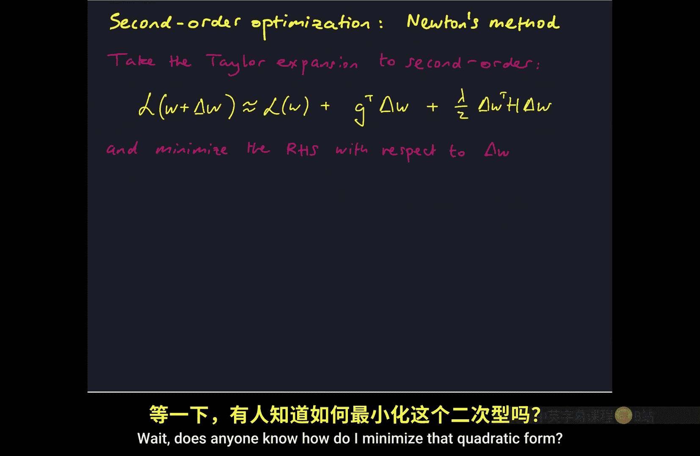

Can someone。Told me， how do I do it。Yeah's so we differentiate with respect to Delta W。

 which gives me。😊。

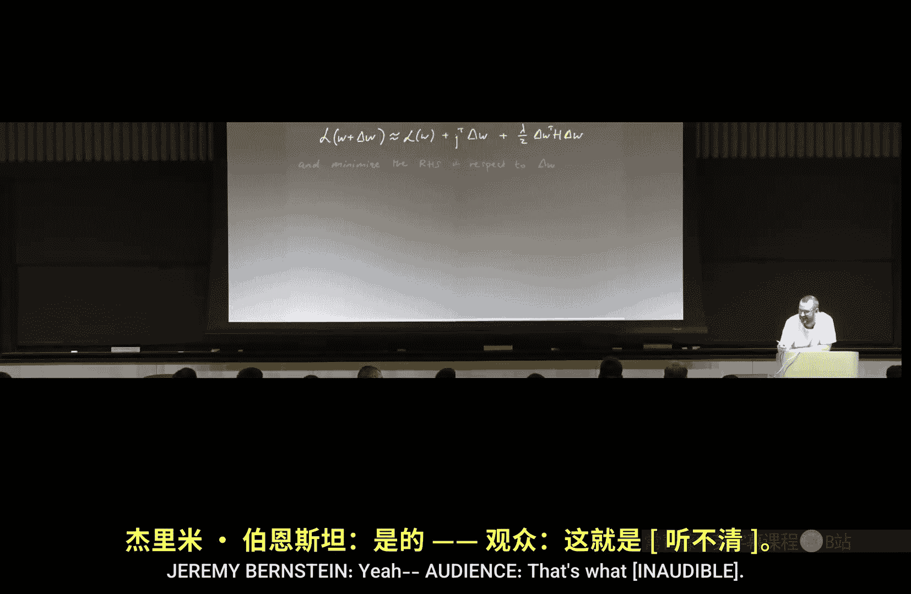

They lamb over two times 2。H Delta W。 And then we these cancel。 And then we set the derivatives to 0。

 That that， that thing that we all did once month。 Yeah， we， okay。

 and then we just solve for Delta W by rearranging， and we get like。This thing。

 And we can just call this Newton's method。So， it's like。And people describe this as like。

 you get your gradient and then they talk about preconditioning it with like the inverse Hasian。

 but it basically means you take the Hasian， you invert it。

 and then you multiply it with the gradient。 and we call this Newton's method for and it's an optimization algorithm that uses first and second order information。

So I just rewrote that here。So what are the problems。Like。

 why don't we actually use Newton's methods to train neural networks。what the。Yeah。

 so what problem one is that like the Hassian is D by D matrix。And， you know， D may be billions in。

 in， you know， a large neural network。 So you can't even store such a large matrix。 And if you could。

 you can invert it。 And you just basically， it's just too big。嗯。

What's another problem with Newton's method is if you think about how we derived it。Is this， is this。

 Are we sure that this procedure is giving us a minimum of the quadratic form。

Do we know all we did is。This one of。It's just the first， Yeah， So what do you mean。

 Could it be a minimum or could it be something else， It could be a maximum right。

 It's just finding a critical point of the quadratic form。So it could， you know。

 if it's close to a max。It could find a maximum。 So it's not even the， you know。

 necessarily doing gradient des set。 It could be doing gradient asset。And there are。

 there are ways to fix this， these type of things。 Like there's something called cubic regularization。

 which adds a cubic penalty to the quadratic form and。嗯。But people don't use that。

 And any time we present a method， there's always like attempts to make it practical。 And like。

 there's a literature on that method。 But then in practice， we just use Adam to train own that work。

嗯。Okay。So then that was， that's Newton method。 Now。

 we're going to look at something called Gaus Newton method， which is a little bit different。

And it starts with something called the Gas Newton decomposition。So here。

We suppose that we have a composite objective function， like it's the composition of two functions。

 which is remember， we actually have that in machine learning because we have an error and we have a neural net。

 So we're actually in this situation。嗯。That's what this is saying。

 So let's derive the Gaston Newton decomposition。 So we start with the gradient。

 which is D L of A D W。 because we have a composite。 We can do the chain rule。So we got DL by D。

Dear F by D W。So that's just chain ro。And now let's say what you wan to know about the Hass。

 This is the second derivative of the loss with respect to the weights。Well。

 now we just need to differentiate the gradient again。

But we recognize now that we have a product so we can do like the product rule。嗯。Okay。

And let me just remember how they do the product roll。See this。

 this is like the derivative of this with respect to W and then one application of the chain rule。

And then there's this term， which is just like this term。 And I haven't differentiated it。

And then the， and then we have to do the second thing， which is。Like， I don't differentiate this one。

 and I do differentiate this one。 So I get D L by D F。D squared F by D W square。Okay。

 and so what I hope to have shown you is that if you just have a composition of two things。

 you can derive a formula for the second derivative and it splits up into two pieces because of the product rule。

 we just call that the Gaus's Newton decomposition。It diverted out。诶。

So what this is saying is that the full Hasion of a composite。Decomposes into these two pieces。

And we think of， if we think of this as being the curvature。

 It's like the second order information about the， the whole objective function。

You can break it up into the second order information about the error with respect to the model and the second order information about the model with respect to the weights。

 So it's like。Decomposing curvature into one piece from the error and one piece from the model。

 That's called Gausian need and decomposition。So then what do， what do people do is they say。

 let's pretend that our error measure is the squared error。And we know that for the squared error。

 the second derivative with respect to the model is just basically one or some， yeah， okay。

So then basically， we can drop this term。We just say that。 that's why。And then they say。

 let's just ignore the curvature of our model。And let's just ignore this term。And that's like。

 it's just an assumption that people make。 They， they say， hey， this。

 I don't really know how to deal with this term。 So let's just ignore it。嗯。And okay。

 if so under those， under those like steps， H， which is D squared L by D W squared， is just equal to。

Somehow， the product of the F by D W and the F by D W。So then if I want to do a Newton method。

 but using this form of the Hassio。What does Newton's method look like。

 Its Dlta W is minus H inverse G， which is now。Minus D， F by D， W， D， F by D， W。Inverseji。俾。

If you go through this， you you'll realize that all of these things are tenses and you need to be careful about other indexing。

 but。

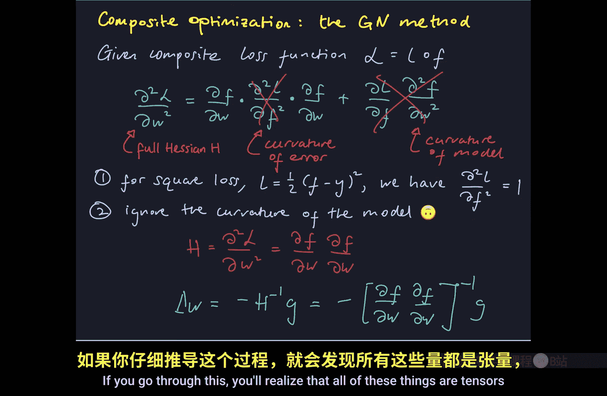

But that's something to just check。 But essentially。

 it' and we call this thing the Gauss Newton method because it uses it started with the Gaus Newton's decomposition。

嗯。And it's just another way of deriving an algorithm which looks like some kind of iterative weight update。

But what I， and I've just rewritten it here。

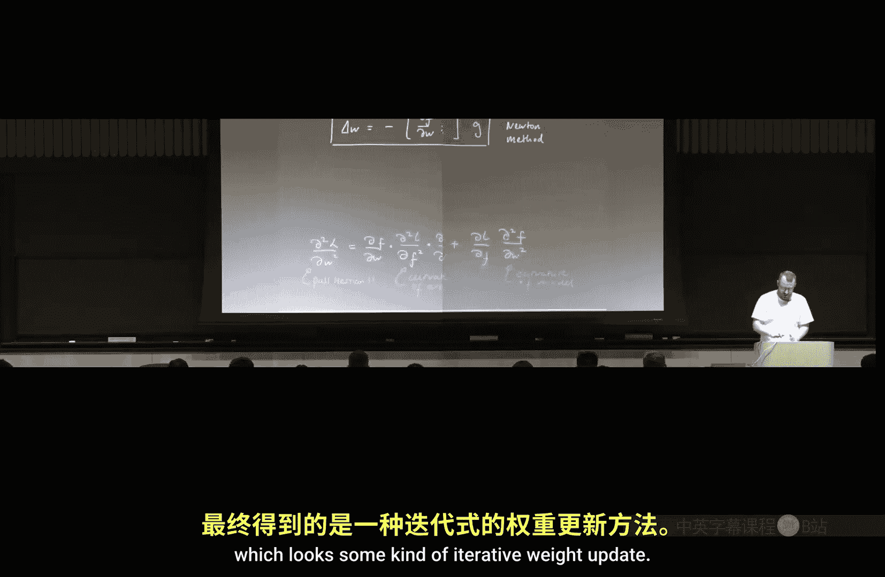

So this is this thing that we're calling the Gaus's need method。 And remember。

 these are the derivatives of the model with respect to the weight。

 So it's not the same thing as the regular gradient。

That you usually think about is a different gradient。呃。Okay。

 and this is just to remind you about the， the kind of assumptions that the method made。

 Like one is just drop this term。 and the other one is like， set this one to one。

So what do people think of the problem， Like what's the problem， Like， why don't I actually do this。

嗯。If deep learning， you may have hollow rain。Yeah。Oh that could be a reason why I would want to do it。

 Is that what you're saying， no。Or because you'll say you get it low rag， can't invert it。Yeah。

 that could。 Yeah， I need to think more about that， but you might be right。Yeah， oftentimes。

 people will always just， if they want to invert something。

 they'll add a little bit of identity matrix to it and then to kind of give it better conditioning。

 and then they'll just invert that， but。嗯。I think yeah， that's a great point。

 basically what I wanted to say is it involves inverting a matrix。

 like it involves forming an extra matrix and then inverting it。And not only that。

 it it also involves like computing these extra derivatives。

 Like not only do you have to compute the regular gradient， which is this one。

 you have to compute these extra derivatives。嗯。And people are not going to want to do that in practice unless they're really convinced that there's a really like big improvement to using this method。

 And basically， no one's convinced。 nobody's convinced them of that。 So they just don't use it。

 That's like the， the kind of practical reason why people would not use this。

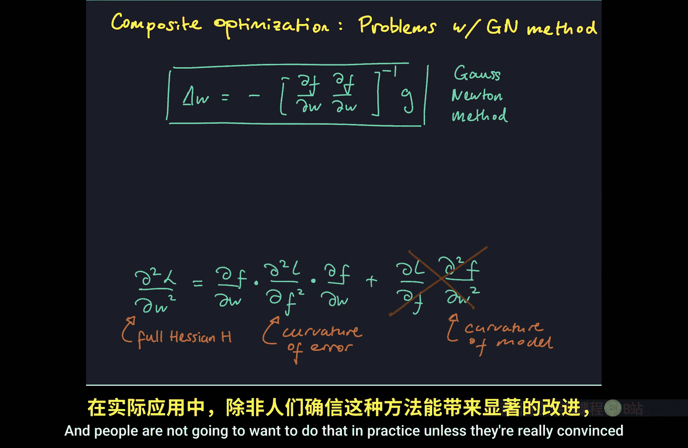

But there's a lot of research trying to make this type of thing practical。嗯。Okay。

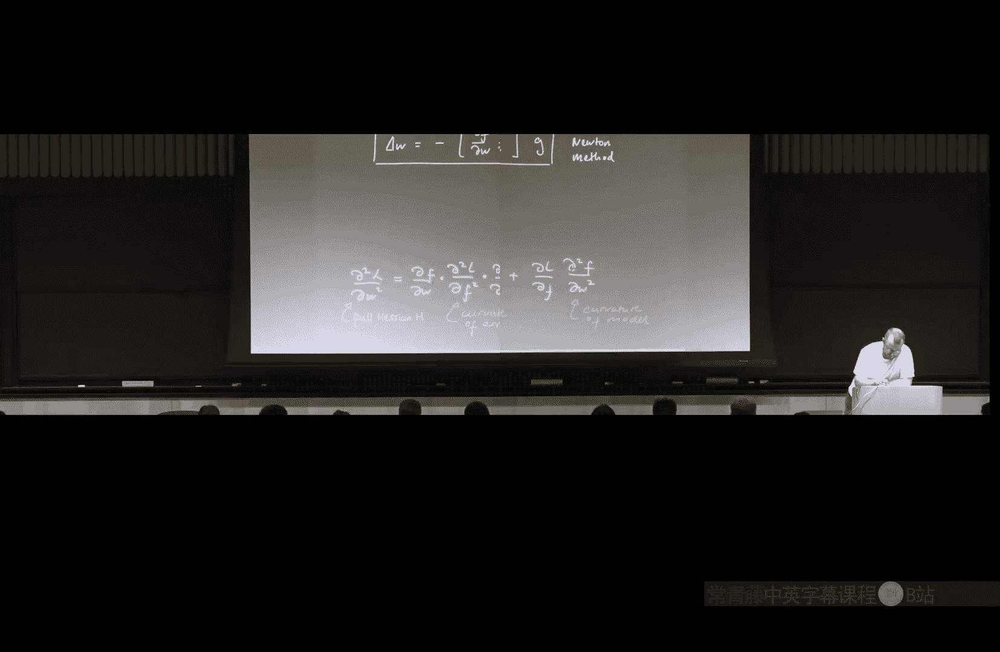

So I， I'll just write like extra extra gradients that you've got a compute。And then， like。

 inverting matrices。

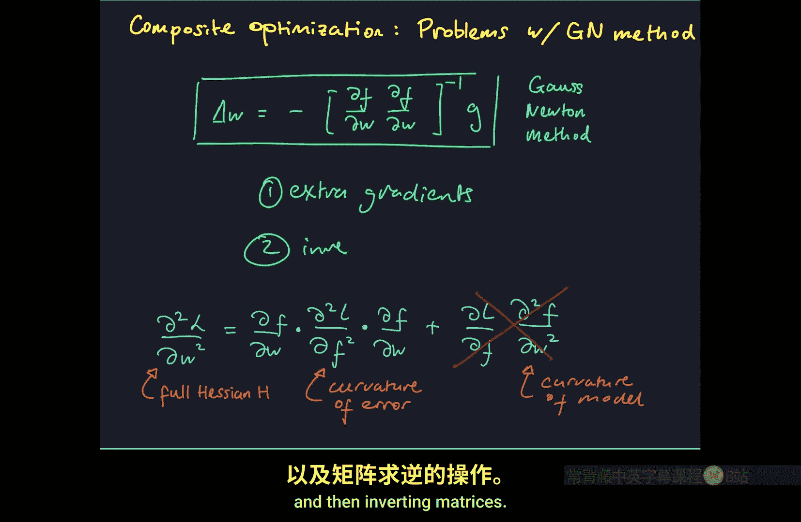

These are kind of things which count against it a little bit。That degree great。呃，或这个。W。It is。

 but because you compute do the gradient by back propagation， you never explicitly form D F by D W。

 Like， think about how you actually calculate G， you'll realize like。

 because you start from the the end of the network and work backwards。 You never compute D F by D W。

 but it is implicitly there， but you're not computing it。

But if you did forward mode automatic differentiation， then I think you would get both of them。 But。

 but it's， it's much more expensive to do forward mode automatic differentiation。

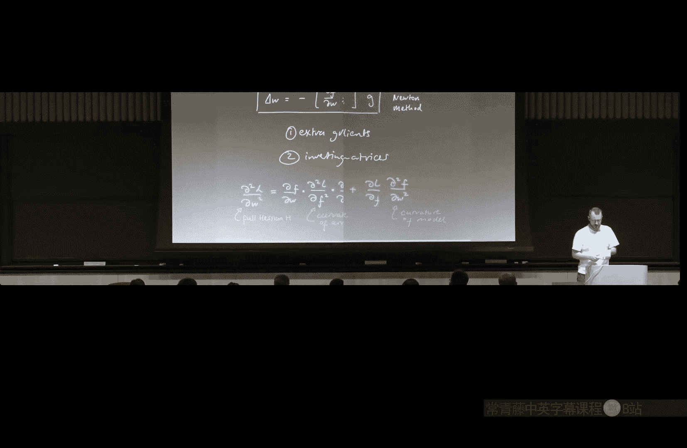

Yeah， okay。So that was Gaton New math。This one is called steepest。 So now we're in like square。

 I'm not sure whether you should think of Gauston New then as being first order or second order。

 because oh yeah， yeah。

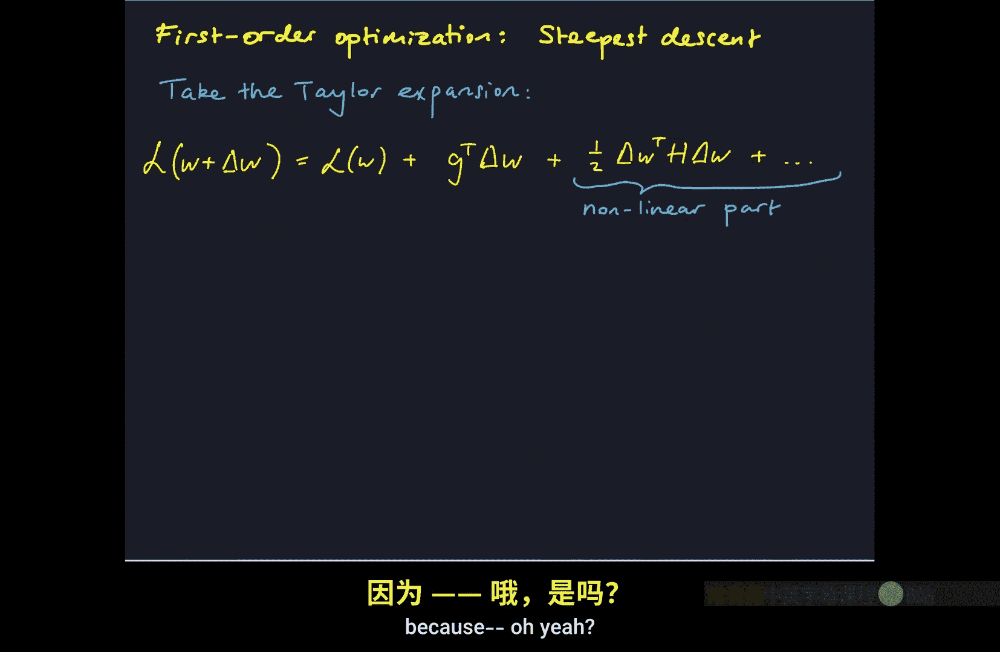

Use an intuition for how much more expensive。可以。I hear like。It takes some label right。All。Yes。

 Im for Gauston Newton， I'm not let's just talk about Newton。 So let's pretend it's the full Hessian。

嗯。I'm not an expert on all these。 I think it isn't it cubic。

 The cost of inverting a matrix is basically equivalent to computing a singular value decomposition and。

I just have an intuitive sense that you never wan to do those。

 They're much more expensive than computing like a forward pass or a backward pass。 That's。

classessses like。到。

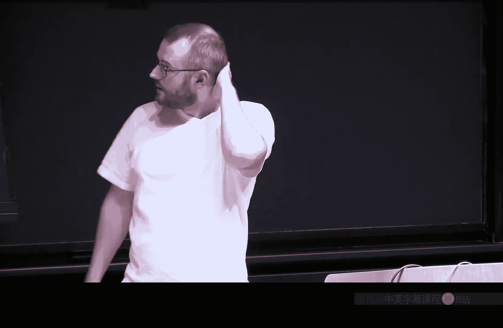

In the Well， how， So how do they scale with the dimension， That's， that's the question。 Well。

 they're somehow linear in the number of layers。 And then you need to ask， what is the cost of of。

Doing a forward on an individual layer。And like。And then you also have factors。 Like。

 this is a good thing to think about。 I'm not gonna give you the answer because I don't have it。

 but the other factors that are involved are like GPs are like great at doing matrix multiplication。

 They're basically designed to do forwards on layers and to do backwards on layers。

 but they're not designed to invert matrices or。Or do singular value decompositions。 So its。

 these are things that if you just get a coab notebook and start playing around， like very quickly。

 you can get a sense of how these different algorithms compare against each other in terms of complexity。

But these are the right， Yeah， are the right questions to ask or the right things to think about。

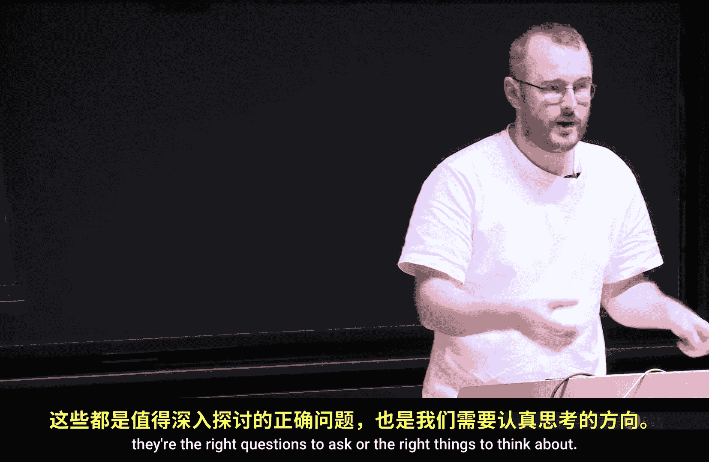

嗯。

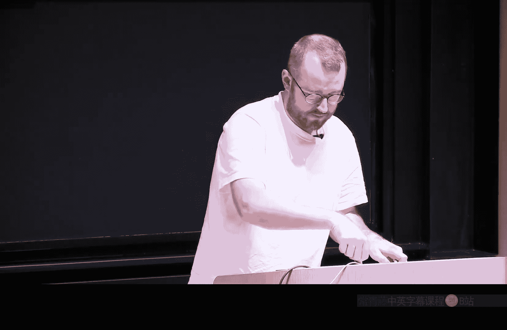

Ae。I think。Sorry。延生的。他说啊他是对。其这不。For backward password。Creian for each。Like a sub part of the all。

But here。A big make。嗯こい。Re to all the factors in one。Yeah。

 let me just give you an intuitive sense of like why we're definitely not computing those derivatives。

 doing a regular backward pass with that。 Maybe that would answer the question。

 But think like G is the derivative of the lost， which is a single number with respect to all of the weights whereas the the output of the network。

 It could be outputpidding or tensor and D F by D W is。For every component of that tensor。

 it's one derivative。 It's like D D sorry， It's the derivative of the first component of that tensor with respect to all the weights。

 It's the derivative of the second component of that tensor with all the weights with respect to all the weights。

 So it's like it's just a bigger tensor than the gradient。

 And and you really want to avoid explicitly forming that。

 And back propagation allows you to do that because you only have track derivatives with respect to the loss。

 which is a single number。

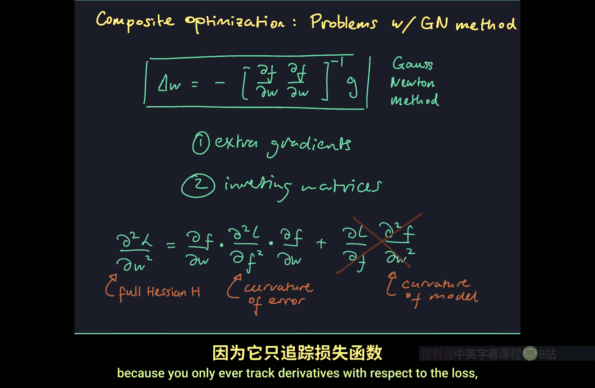

四月。Yeah， but thinking， yeah， thinking through like it just implementing actually implement back for yourself is like a really good exercise that forces you to it forces you to think about these things。

 And because pietorch and because the packages we have are so automated。

 you can actually like have a whole career without ever implementing back or thinking about what gradients look like。

 but it's a really good exercise to do that I would just say。😊，Okay。I think I'm doing okay on time。

 so like yeah don't be afraid that you do have questions。嗯。系。

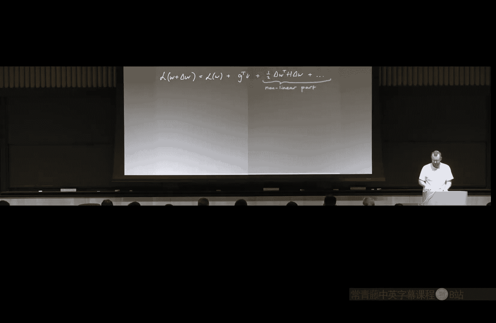

Okay， so the next one is called steepest design。Ands。Again， we get this Taylor expansion。

 So it's always， always get this Tayloror expansion。 And this time， we're gonna， again。

 we're just going throw away the non the new part。And we're just going to replace it with lambda over 2。

 So Lambda is a number。 It could be 5。And then we， we choose our favorite norm。

And we measure the norm of Dlta W， and we square it。So steepest just what I'm saying。

Is a technique where you just， you say the nonlinear part。

 I don't even know what that non nonlinear part is。 Let me just replace it with something which I。

 which I know very well。And actually， a lot of a lot of optimization methods actually have that flavor of just like take the thing that I I don't even know how to deal with it and just replace it with something that I。

 you know， I like， yeah。😊，But what's the rationale behind this report？When you choose。

That's a great question。And。Lets we will try， I'll try to answer it。

 but let me just first show you what the implications are of different choices。

 And then we can try to think about how we would actually make this choice。嗯。Yeah。Okay。So。

 the point is。What what are some of people's favorite norms。I'm going start。Likeゆくりの。Okay。

 like someone else。Forbeius。 So like that's if we have a matrix， if we have a weight matrix。

 forbe is not。What's another one。Max， so infinity No。I， is's that w you be yeah。喂，也可以 one more。H。

What is it。The al P norm。Yeah， which like p equals2 is Euclideus。Wait， okay， one。

 though some of the yeah。Divergence kind of。Yeah， it's actually not a norm。

 but it' let's just add it。呃。It doesn't satisfy all the properties。 It's not symmetric， or it。

 it's not some， it's not something。So it' it's actually not a norm。

 but it's that's a measure of distance， but it's technically not a norm。嗯。Okay。

 so the point to illustrate is like， there's a lot of norms。

 And so there's a lot of sleep as descent methods because there's a lot of norms。

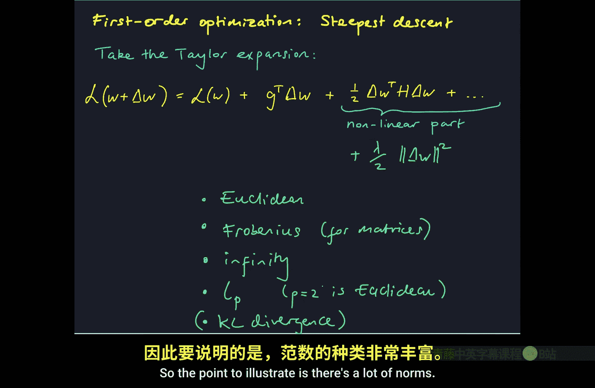

And this is， theres many more neurons than what we talked about。

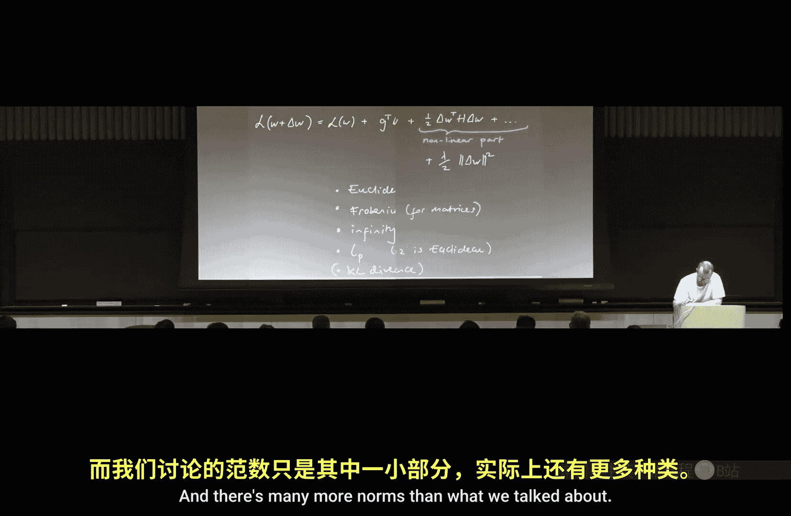

So let's just start with L2 normal， Euclidean normal。

So I put now I and we we're considering this a model because we threw away what our loss function actually is。

 And we're just modeling the， the nonlinear part。And just to remember， just to remind you that。

The a ball of fixed Euclidean norm is like a circle or a sphere。 Like。

 these are two balls of fixed Euclidean norm。An。And we're going to do our favorite。

 our favorite thing of minimizing the。Right hand side。 How， How do we。HowHow do we minimize it。Well。

呃。How someone someone told me， how do I minimize it。Yeah， yeah。Okay。

 so that's the take derivative set it to 0。And it's G plus， okay， you need to like。

 work out how to take a derivative of a square Euclidean norm， but it's just。Lambza do to W。

Is equal to 0， and I rearrange it， and I get Delta W is minus1 over lambda times the gradient。

And so then I， I recognize this。 I say， hey， this is。

 this is just like the most vanilla form of gradient descent。With it， with the。

With a particular step size like a step size of one over lambmbda。 So I make lambda。

 I make the penalty larger by increasing lambmbda， and my step size get smaller。 So it's like。

It's kind of interesting that there's some， some connection between like regular old gradient descent and like L2 geometry on your。

 on your oxization space。So， let's do another example。So this time， we put the infinity norm。And the。

 remember that， the unit ball in the infinity norm is like， not a really。Looking like a bowl anymore。

 It's more of。The kind of square。So infinity norm is just measuring the maximum size of a vector across the coordinates。

I can just write that。嗯。And the absolute value。诶 okay。So has anyone done the homework already。

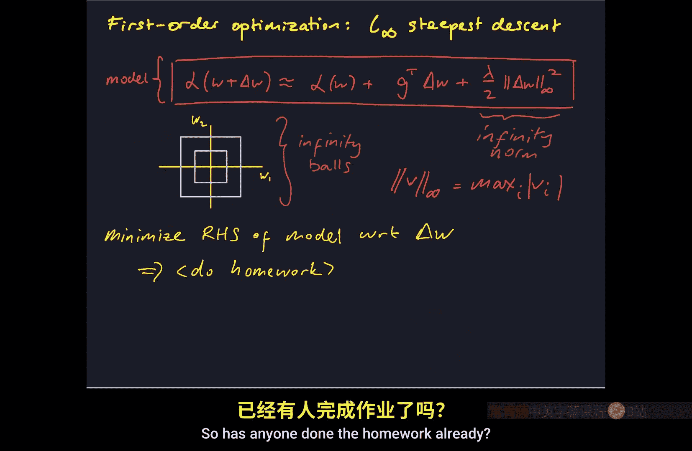

Noally okay。 Does anyone know the answer， if I minimize the right hand side， what is it。

Does anyone know。

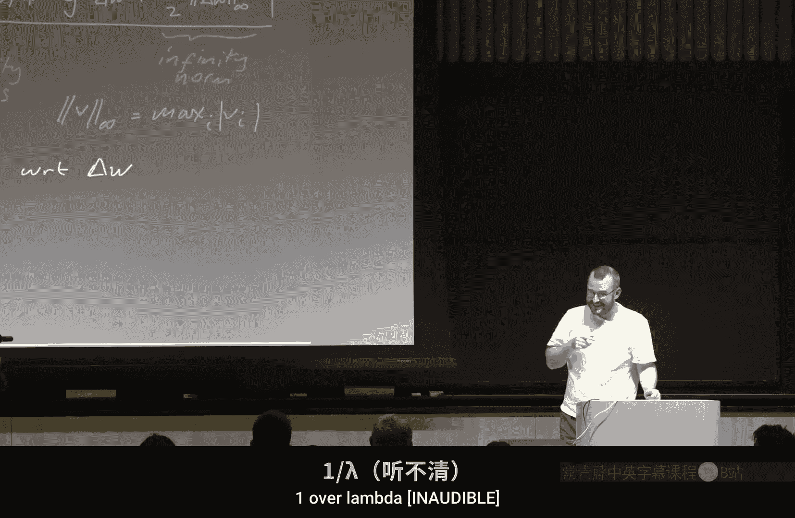

Yeah， so this is all， this is on the homework。 So if you just solve this。

 it's not quite as simple as just differentiating because of the。嗯。

Because a max is not really continuous， in some sense。But the。

 the solution is like the L1 norm of the gradient divided by lambda times the sine of the gradient。

Whether the sign is like plus or -1， it's plus1。 if the thing is positive and -1。

 if the thing is negative and you apply that across the coordinates of the vector。 So it's like， oh。

 I SAT my。My norms are infinity norm。And like now I get like this like sine gradient descent algorithm。

 Oh like interesting。And there's a reading。That that we posted。 And it。

 that's like a blog post that talks a little bit about this。 If you want。

 and it has some interactive visualizations。 So if you， if you wan to visualize some of these things。

嗯。Okay， and I I still want to get that that question of like， how would。

 how should you choose a norm in practice， is the right question to ask， but we。

 we still haven't answered that question。 I'm just showing showing you if you pick this norm。

 you get this algorithm。 If you pick this norm， you get this other algorithm。

 The the question we should ask is， how do we pick such a norm。嗯。Okay， but before that。And I guess。

 yeah。Let's just look at how this， how this looks for a general norm。And we like。

 even though it's a general norm， we can still actually say something about it and what you can show。

 And I think this is also on the homework。Is to show that it decomp the solution to this thing can be sort of transformed into this other thing。

And we can think of this as like， we think of this as being the step size。Or the learning rate。嗯。

And we think of this as being。The direction， the step direction。

And we can sort of separate the solution of the steepest descent problem into two pieces。

 One is computing the step size， and the other is computing the direction。And like this。

 this funny thing is called a dual norm。 It's like every norm has a duel， which we call it dual norm。

Then it appears as in this。 Anyway， this is on the homework。Ands。This is something that you can show。

 So there's like a general formulation if the solutions are the property。 go ahead。

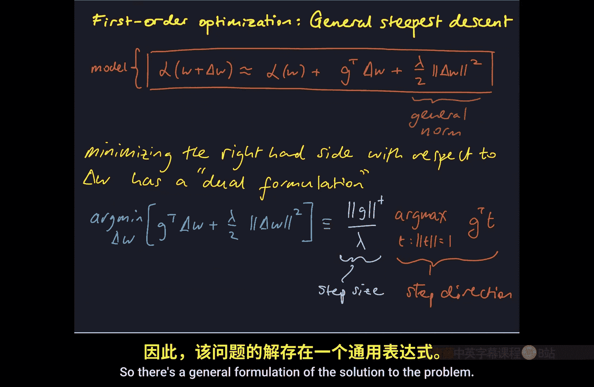

第二方。あいことは進て。方面第一个。い一嗰冇。わげ。There's no guarantee that what。Yes。There is no guarantee。 Yeah。

 there's no guarantee about this at all because I said， take your loss function。

 throw away the nonlinear part and just replace it with your favorite norm。

 So that doesn't sound like the kind of thing that' is gonna to give you a guarantee。

 It sounds like kind of random or but it's it's a framework for thinking about deriving different optimization algorithms for the framework to actually apply。

What you would wanna do。Is you would want to。 Yeah。

 let's just talk about this because of the fact that we can。包过区域。We of the short。Yes， yes。

 the larger and larger lamb there is somehow the better the model should be， in a sense。

Is that what you're saying。Because， yeah， you don't。 you never move too far。

 If you make lambda infinite， you never move anywhere。

 So you're always within the linear region and then the model holes。 But it's like。

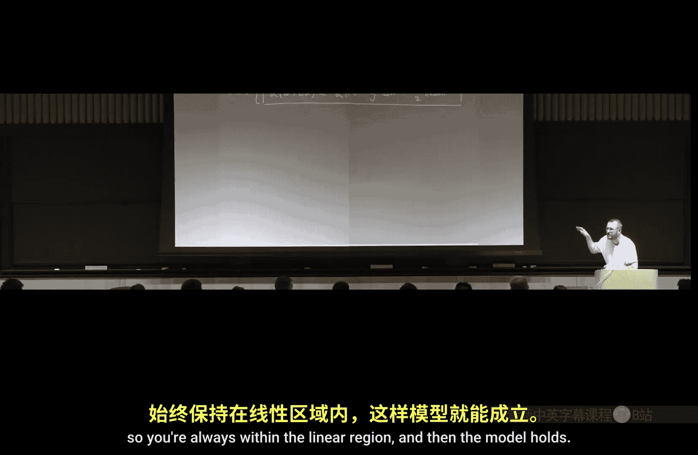

You wouldn't know how big you need to make lambda to be for that to work。That's the problem， exactly。

So let me just， let's just think a little bit about how how we could really pick such a norm。

So remember that， let's just go back to get the tail expansion。嗯。So this is。

 this is the Taylor expansion， assuming that the loss function is analytic， which it's not always。

 But let's assume it is that this Taylor expansion really holds。But what if。

 what if we could do the following thing， What if we could up band the Taylor expansion。

With the linear piece。And then we could produce a lambda。And we could produce a norm。

Such that this was really an upper button。嗯。If we could produce such a land in。

 Then we could get the kind of guarantees that you were talking about。And actually， on the homework。

 you're gonna do this。Although it's a bonusless question， maybe you're not gonna do it。 But if。

 if you want to， you can do it for， for the case of a linear model。

 a linear predictor in the square loss。And then the hope of putting that on the homework is you with them think。

 what if I don't have a new predictor， What if I have like a two layer neuro on that。

 How would I do it then， What if I had like a five layer on that， How would I do it then。

 And that's essentially what I I'm trying to do in my like research at the moment is like。

 try to answer that question。

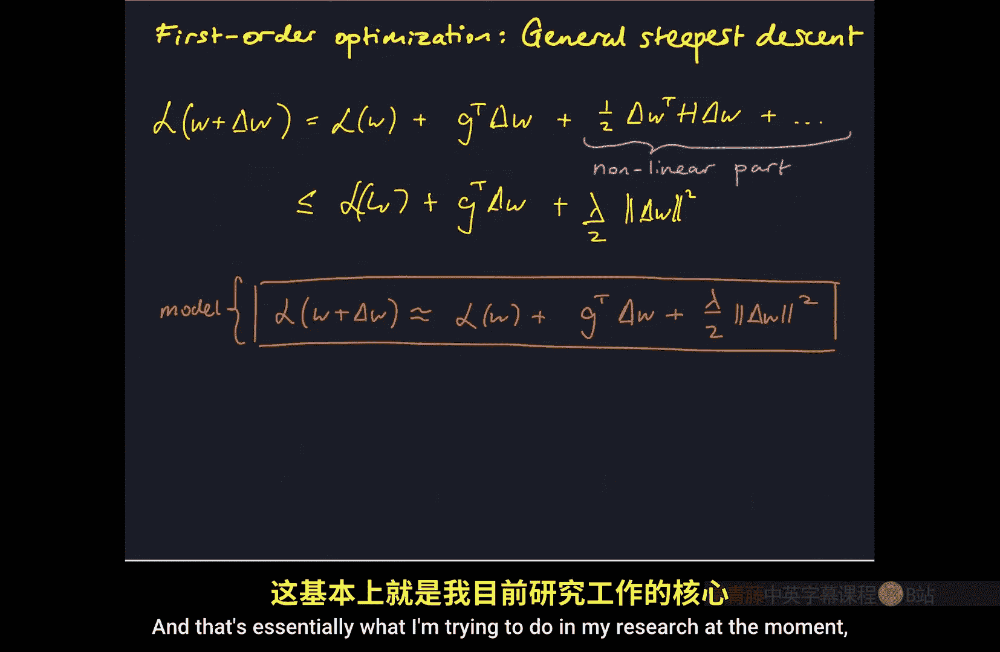

But yeah， anyway。 So that was， that's the end of classical methods。Optimization。嗯。

And now I want to think about on a purelyuchuristic and purely intuitive level。

 how to make the training really scalable。

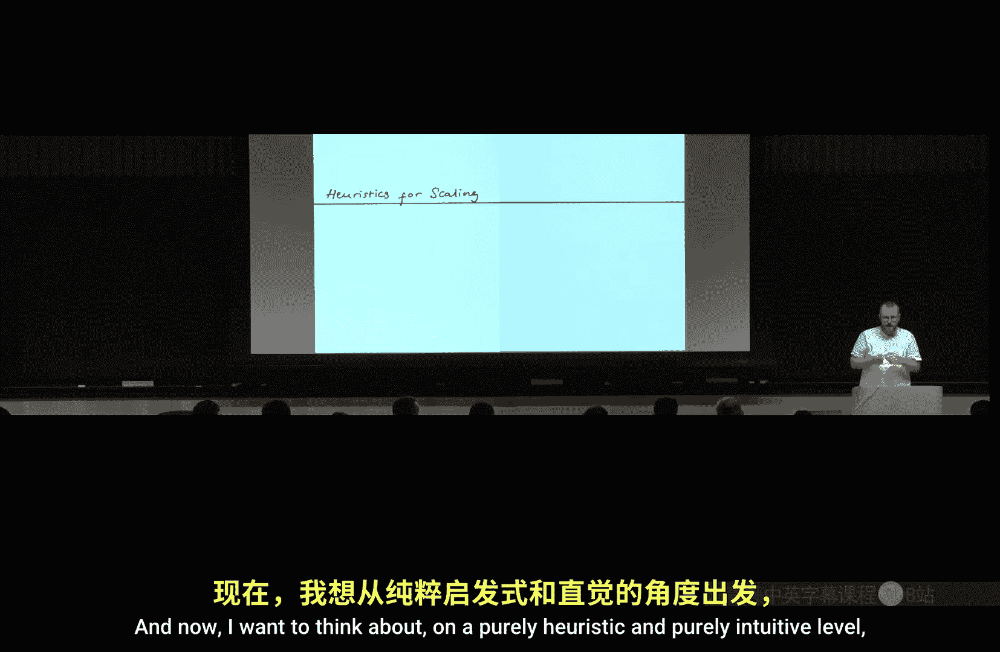

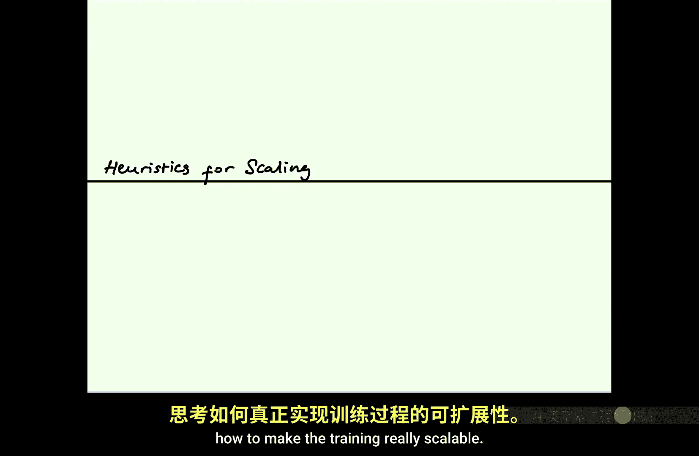

And then if there's time at the end。Which seems like there might be。

You can start trying to think about how to build a more formal theory around this type of thing。嗯。

Okay， does anybody have more questions？more to do we update all the。Components of W and。Yeah。

 this is the same then。你跳嘅。Exactly， that's why the sine function appears because the sine of a vector is maps a vector to another vector where all the components have the same magnitude。

😊，Just repeat the questions for that Oh sorry to repeat the question。

It was a question about does the solution to steepest descent have the same magnitude update across all the different coordinates。

 and the answer is yes。Can like pull the general stick this end because I used。

the composite step size and step direction。 Yeah， and for the step direction to look at。你就我知道他的这。

Dction， we're going to maximize。可的做一点。I just don't know what the information we have my。

Like imping the law， like imping a constraint on the norm of your direction。

 going that help So if if if the constraint is thes， Okay， sorry the question， the question was。

Under a Euclidean norm penalty， the solution is to always point this that direction in the same direction as the gradient。

 And that's kind of an intuitive thing。 But what seems less intuitive is if I put a different norm penalty。

 the optimal direction may change， and it may point in a different direction from the gradient。

 And the question is like， why， why would that ever be a good thing to do。like this， however。

 I want to impose a warm culture on my step like step side。That's exactly the question。

That's the right question。 Why would I want to do that。

 Why would I want to oppose a different norm other than the Euclidean norm。

So I'm trying to say that implicitly by by， I'm trying to put it upon you that implicitly when you say the best direction is the gradient direction I'm trying to say that you're thinking Euclar。

 So the question would， why， why would another norm be better which would tell you to go in a different direction。

 Well， the rough intuition is like， what if all the axes in my space are not equal with each other like。

Like， imagine you get a map of the US and then you take the map and you squeeze it。

 So like you get like， you know， you get like the corner and Photoshop and you like squeeze the corners together So it becomes right。

 And then you see like taking a step of1 centime to eastwet would correspond to moving like 10000 miles 2000 miles。

 whereas taking1 centimem the step north south might correspond to going 10 miles just because you like stretch this map in a weird way。

And when you say that it's like it's natural that going in the same direction as the gradient is the right thing to do。

 You're assuming that you have a very isotropic map of the United States where like taking steps of equal。

 And what I'm trying to the idea is that。You might not be so lucky that the last function。

 because of the in deep learning， because of the architecture of the network and so on。

 it may not have that property that different directions in the weight space are equal to each other。

 may very non isotropic space。A。So like doing different ones， somehow equivalent。

 I'm scaling each coordinated。 I'm basically using a preconditional version to scale each coordinate at a different rate。

That's one example。 Yes， so like that you could， you could take a norm。

 I can say that I'm going to build this new norm。

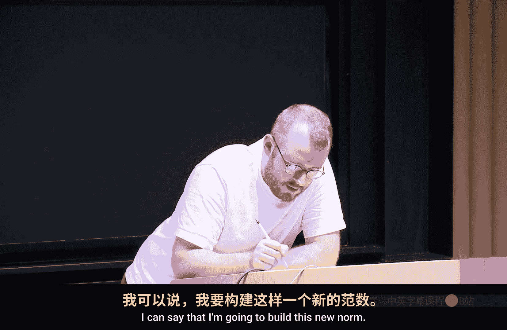

So like， remember the Euclidean norm is like some over I。W I squared。 And I could say， well。

 I want to build a new norm where I take positive constants AI。

 and I just like scale the different coordinates differently。I could do that。

 and I could derive his steepest ascent algorithm into this new norm。

 and it would correspond to like some reshaping of the gradient。But that's just one example。

 And another example is the infinity norm or the Frrebeous norm or the， And there are all ways of。

 measure of saying that different coordinate directions or different directions more generally have different weightings。

嗯。A。And maybe one more thing to say about that is like。

 Why should different winnings have different What's， Another intuition is like。

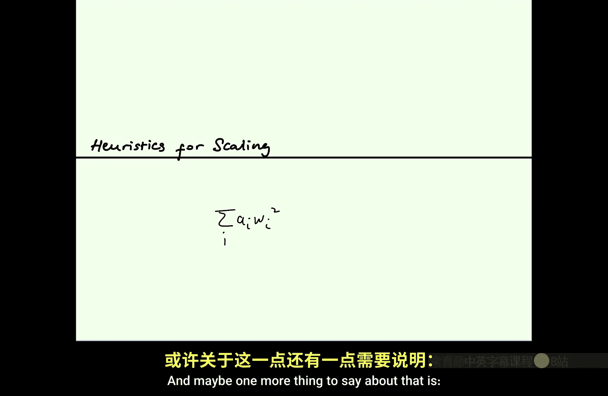

If I'd used the linear piece， like the first on a term。

I need to know for how how far that linear piece is valid。 Maybe if I move too far in that direction。

 the linear piece broke down， and it may break down at a different rate。

In different act going in different directions。 So we。

 the idea of building are enormous to capture like， at what rate does the linear piece break down。

 If I like move in this direction。 this is this direction， It may not be the same。嗯。Okay。

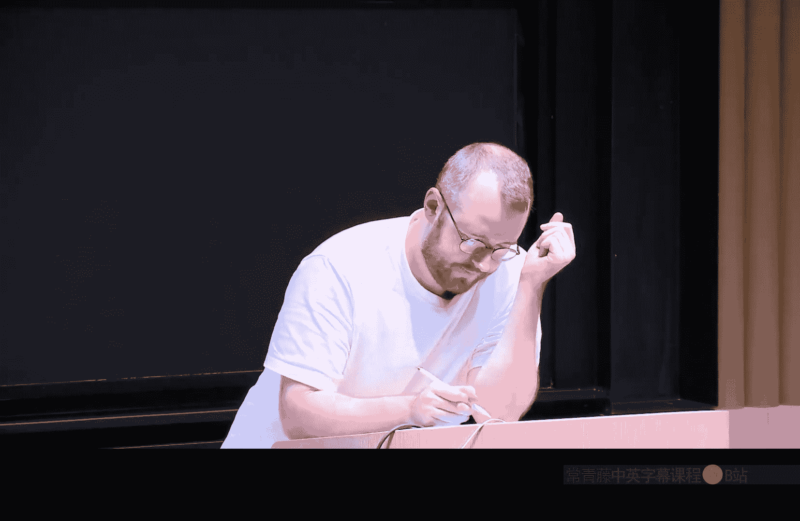

So now we're going forget that for a little bit and just thinking about scalingal。So the question。

 the intuitive question that I want to ask is how large should the weight updates be when I do gradient8 at the。

 And I want to think about this kind of Goldilock step size， because if it's too big， intuitively。

 you' gonna kind break you on your own network。 And if it's too small。

 you're not gonna like be training very efficiently because your steps are too small。

 So you kind of want to find that nice middle。And someone already kind of had this observation。

 But the observation is that a neural network is built out of matrices。 Like it's。

 it's not one big vector。 The weight vector is like matrix 1， matrix 2， matrix 3。

So can we think about that matrix structure？And this is where I wanted to say。

 Perhaps we could try a matrix and。And the one example was the Frbeius norm。嗯。So the idea is， oh。

 yeah。I， I forgot to say but when we， when any， whenever anyone talks about too big or too small。

You should always ask in which norm。It's like analogous to， like。um。If。

 if just someone just says something's really big， you have no idea what they're talking about because you always need some kind of reference like a scale。

 You know， if you look at a map， there's the scale at the bottom。

 which says like 5 cm corresponds to like。1 mi or something。 So。

 if anyone ever says that something is。Big or small。 You should always ask like。

 what's the scale that you're measuring it on。 And for tensess， the the。

 the notion of scale is what's the norm。So that's good thing you think about。So when we in。

 in particular， when we say that we want the update to not be too big or too small。

 we want to choose a norm and say it should not be too big or too small in that norm。

 And then we're gonna say。A neural net network is built out of weight matrices。

Maybe we can try and matrix the one。 Does anyone know any other matrix norm。要会可以看后期的larest新购物。

Exactly， there， call it the spectral in the one where it has also some other names。

Does anyone else know any otherwise？这 wait。Okay， Van I didn't know。

 I think I pretty much knew just the Frbeius norm until like maybe three years ago。

So your spectral norm is like the， the larger singular value。 There's a bunch of other ones。

 One is called the nuclear norm。There's， there's a general class of norms called the shotin P norms。

And just wanting to point out there's actually a lot of ways to measure how big a matrix is。

 which kind of makes sense because it's like a mo。 You know。

 it' it's got a lot of different coordinates。 So there's presumably a lot of different ways to measure measure size of a matrix。

嗯。This is where I want to introduce。 So just to summarize， we want to ask， like。

 how big should our weight update be。 And we've said， well。

 we kind of need to pick a norm in order for that question to be a meaningful question。嗯。

And now I want to introduce you to this third this new perspective in thinking about on your own network。

Remember that like， you， maybe when you first think about a neural network。

 you think about kind of neurons and there's like nodes and they're connected by edges。

 And then you like， go a bit further and you learn a bit more。 And then you're like， oh。

 I recognize this is a weight matrix。And， you know， if I have a layer with a single output。

 then its weights are just a vector。 And， you know， and now I'd start to describe my。

Newural network is like。Matrix multiplications。 And and I think of this as like the tensor perspective。

And then what I want to say is like you go even further and you realize that there's this kind of spectral perspective on。

 on neural networks where。Every weight matrix has has something called a singular value decomposition or an SVD。

Which is like a generalized eigenvalue decomposition。 Like not every matrix has。

Eigenvalue decomposition， but every matrix has a singular value decomposition。嗯。

And we can think about like taking my， my neural network and and decomposing each matrix into its SD。

I'm not saying like we should actually go ahead and do that to like train it in its spectral representation or something like that。

 I'm just saying that like mentally， you can always do that。 It always， It always exists。

 that decomposition。嗯。And another I just wanted to introduce like a way that I think about stable training is I kind of imagine my spectral decomposition of all my weight matrices。

 And like one thing I think is that。😊。

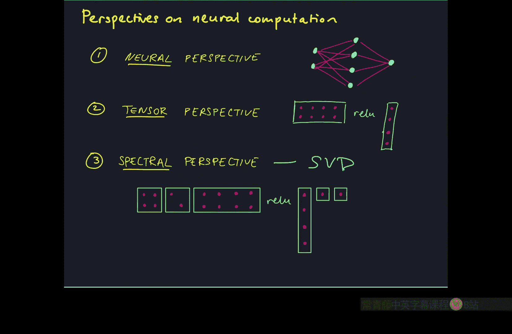

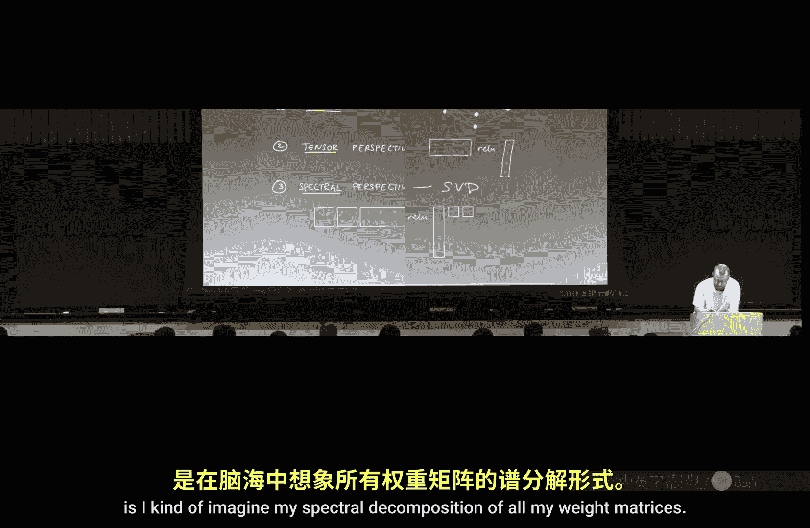

Probably like the singular values should not change too drastically from step to step。

 that would be bad。 But if they change too little from step to step。

 that would be also bad because I would be turning too slow。

 And like what this stable It's like another way to think about what stable training means is like。

 maybe you don't want your spectral decomposition to like be going haywire when you're training and maybe you don't want it to just change a teeny。

 tiny bit like something in the middle seems good。嗯。That's the thought。And then。As。

 as somebody mentioned， that's the spectral norm。 So if I want to compute， like。

 let's say the spectral norm of this weight matrix， I compute its singular value decomposition。

 And then I just take the largest singular value。 And that's like a way of computing the spectral norm。

 And it's a way。 So that's another way of measuring the size of a matrix。

Which you'll also come across in the homework。嗯。Okay。

 so I wanted to talk a little bit about the spectrum on the one。 Like， what， what。

 how did we think about those。And I drew this picture。

 And the idea is like the spectral norm sort of tells you if I feed a vector into a matrix。

 then I get something that comes out。It tells me right。How big the thing that comes out can be。

 given that they knew how big the thing that went in was。So we can write that and can write in it。

So I'll use this notation， the spectral norm of a matrix at n。Is the max。

Over input vectors with unit。How去 know。Of like the L2 norm of M V。So does this make sense。

 It says I feed in a unit vector to the matrix， and I get out a vector。

 How large can that vector possibly be， That's the spectral norm。And I wanted to。

 I think that that's a nice idea because like when you train a neural network。

 you're putting vectors into matrices and matrices are coming out the other end。

 So that seems like actually something about this norm is like descriptive of what's actually happening during training。

 So maybe that's a good， potentially that could be a good norm for us to think about when we measure the size of the matrices。

 That's the idea。😊。

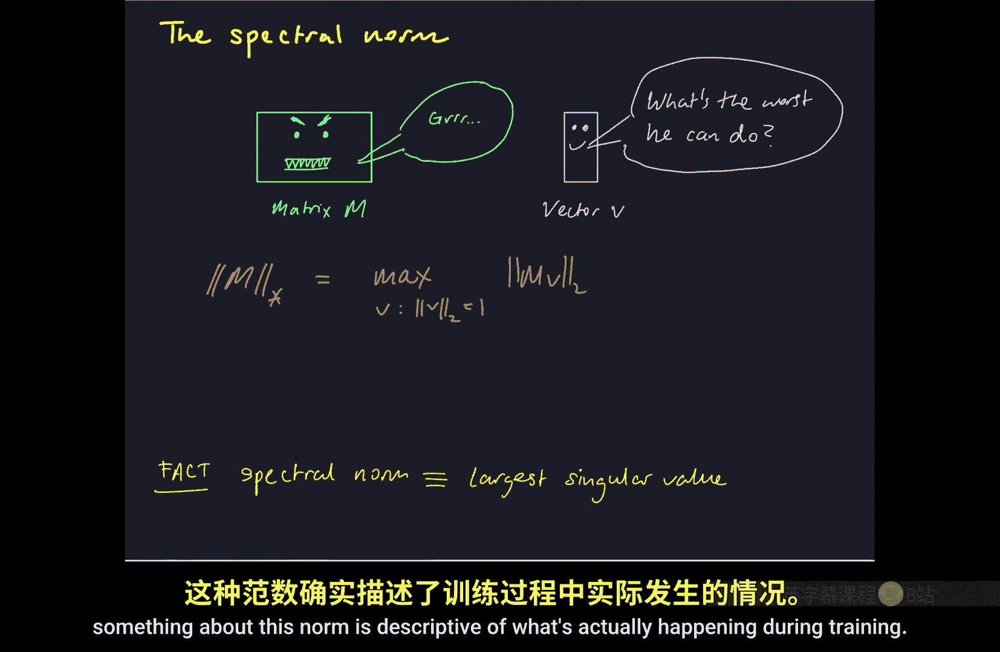

嗯。

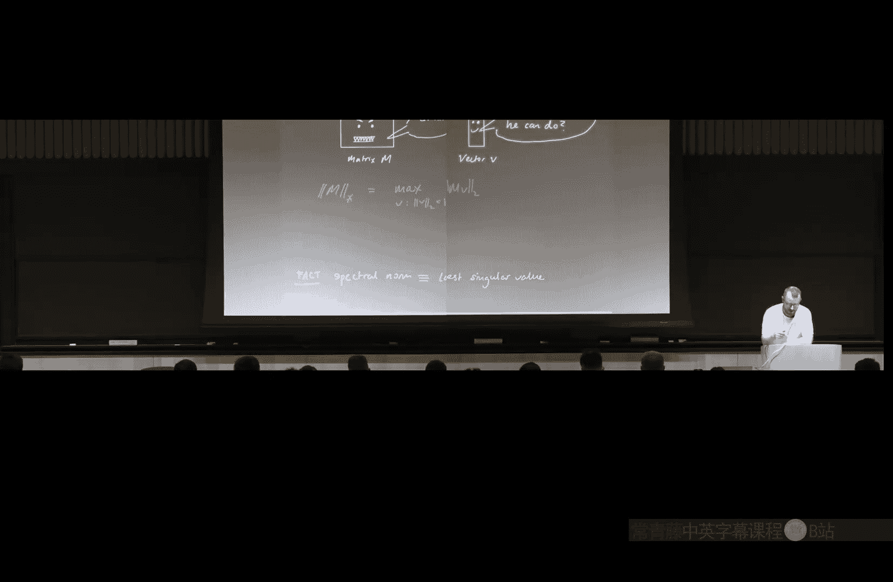

And so there's a fact which I have not proved。 but the spectral norm is equivalent to the largest singular value of the weight metri。

o。And okay， but there's something arbitrary here。 And what I hope to point out is arbitraryaries。

 like， why would we care about the。L2 norm of the inputs。 That was an arbitrary decision。

 And why would we care about the L2 norm of the outputs。 that also seems arbitrary。

 And if we put like we can actually change this to be like an arbitrary。

 let's say LP norm here and L Q norm there。 and you can change this definition involve any norm on the input space and any norm and the output space。

 And then we would refer to the you know， the thing that we get is like the， let's say the Q to P。

Norm on the matrix。 And this is it's called inducing。 We call this inducing a norm on a matrix。

 given a norm on the input space and a norm on the output space。

So we call this like an induced operator norm。嗯。And this seems kind of helpful because， you know。

 in my neural that， maybe I don't care about the L2 norm of my activations。

 or maybe I don't care about the L2 norm of the outputs of a layer。

 Maybe I care about some other norm。And that's where we come to the。

 this thing that we're gonna call the R M S to R M S operator norm。

 And I'm not sure if anyone remembers。About the R M S Nor。Do you。

 does anyone remember what R M S norm is。From my other lecture。No。It's related to the T， the L T9。

Do you， does anyone remember it was unlike one of the。scaled by the number of four units， exactly。

Yeah， so we define this R M S norm。Of a vector V。To be the one over a square root D。

 if D is the dimension times the two norm of the vectors。 So it's just every rescale Euclidean norm。

But does anyone know about like？If you know much about transformers or neural architectures that people use。

 we often make a big effort to normalize all of the activations of a layer in the RMS S norm。

 And this is referred to either as RMS normalization or layer normalization or layer norm。

 It's like a standard thing that if you actually implement a transformer。 like。

 I think at some point you'll do this。 You'll probably use layer norm。 So it's like。

 I want to make the argument that。

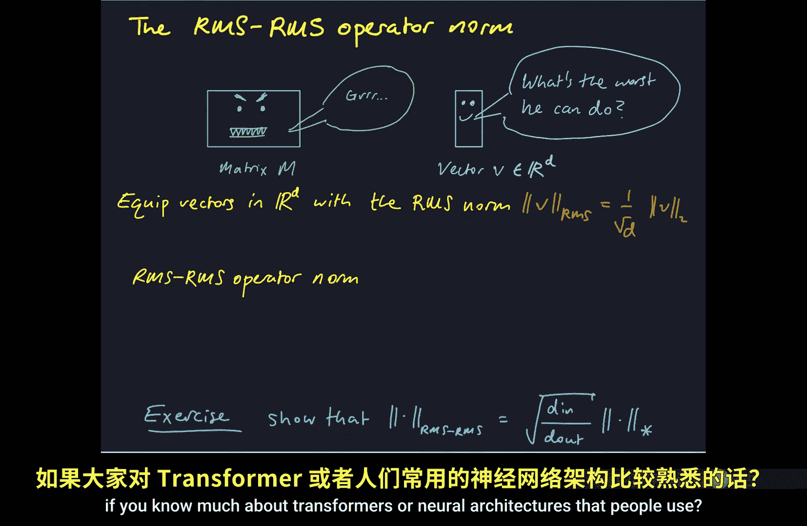

For。A layer in the neural network， a really natural norm to equip it with for an activation vector is the RMS norm。

😊，Not the Euclidean norm。 And another way to put this is， you know。

 what does it mean if the R M S norm of a vector is one。

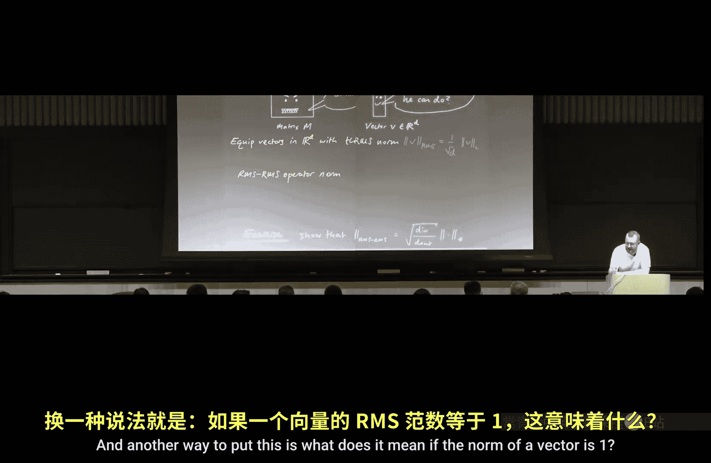

Like if V RMS S is one。It sort of implies that like each V I is around one。 So if。

 if you normalize a vector to have unit R S norm， you're sort of normalizing all the coordinates to be around one。

 which is kind of nice for neural networks。 It sort of means that the。

 the feature vectors of activation vectors are all well behaved。😊。

So we go ahead and then we just induce the operator norm。Kind of like we described to。

On the matrix N， we define the R M S to R M S operator norm。

To be the max over vectors inputs such that the R M S norm of the input is one。

 So the average input size across the coordinates of the input is one。嗯。

And then we measure the RM S norm of the output。And we say this is inducing using a vector space with the RMS S norm。

 And then there's a matrix。 And then there's another vector space with the R M S norm。

 We induce the operator norm on the matrix。😊，And that's what we call the。

RMS S to R M S induced offer than OEM。And as an exercise， like what you can show。

 you can prove that this is equivalent to the spectral norm， but with a dimensional factor。嗯。

But it's just， it'， it's just a rescaled spectral norm with a particular dimension of pref。

And this is also like on the second question of the homework。 not， not like。

 you just need to use this。 Like， you don't need to even understand necessarily。

 You just need to be able to normalize something in that normal。嗯。So why， like， what is the payoff。

 Like Why did we spend so long talking about different norms and how to define them？ Well。

 what I claim is that defining that particular norm is the thing that like solves the width scaling problem。

 So once I， once I know about that norm and I use it to normalize my training。

 I can fix this problem。嗯。So what what， what's the claim。

The claim is to remove drift in the optimal learning rate as I vary the width of my neural network。嗯。

I actually do two things。I should initialize my weight matrix at La L， such that。

It's RMS S to RMS S operator norm。Is around one。And then， I should update。By a Delta W L， layer L。

Such that。The R M S to RMS S operating along the one。Of my update。Is also around Wa。Intuitively。

 that means。It sort of control the fact that I normalize the input the initial matrix。 sorry。

 because I normalize my initial matrix in this norm。

 If I pass in features that coordinate at Y 1 or on average 1。

 I can only get out features that are at most coordinate Y1。

 So that's why it's a good initialization。 It like controls RMS norms as you move through the network。

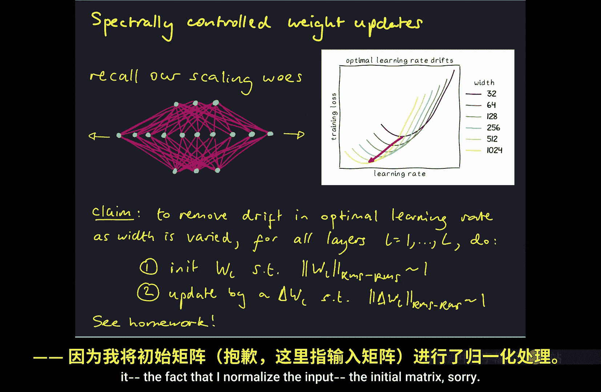

And then why is it good to normalize my updates like this。

 whichs because it ensures that the amount that the feature change by from one step to the next。

 the amount we call it feature learning or the amount that the activation vectors can change from step to step is controlled in precisely the same way。

A。Does anyone have questions about that， I feel like I'm just。Yes， sorry。

The idea of the effort to like be expressive。Controlling exactly what that is to。

So how do you do this but not lose like de approximation capacity？That's a great question。

 So to repeat the question， like it seems like constraining these properties would somehow damage the expressivity of the network and how do we stop that。

Well， we're only con in what I was presented。 We're only controlling the property initialization。

 And then between consecutive steps。 But over many steps， things can change much more。

 So I think that that's probably why it doesn't harm the expressivity。Sorry， any more questions？

女性にする方のしてご承も。So in some sense it's an empirical observation and like actually the second homework problem on the homework is like playing with it empirically。

😊，But in another sense， there's a lot of theoretical things to support it。

 The simplest of which is kind of actually just like the definition of this operator norm。

 Like if you just think really hard about this operator norm， it tells you that things。

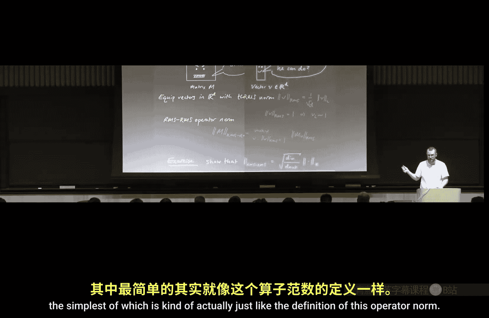

They kind of have to behave in a good way in a certain sense， but only in terms of an upper bound。

Like it says that the features at a particular layer cannot change more than by this amount。

 And it's nice to know that。 but it doesn't tell you the features definitely will change by this amount。

 Like this is precisely how the internals of the behavior。

 And there is also a theory to talk a little bit about that。

 but it usually makes infinite width limits。So I have some references on the final slide。

 And like there is， it's like an active topic at the moment。 And there's a lot of experiments。

 and there are a lot of theory。 But， you know， it's still a not fully resolved kind of question。

 But what I was hoping for the purposes of the lecture is to get across it。

 there' quite an intuitive idea of， of just how big should things be。

 And in what norm should I measure that。 And I'm trying to like。

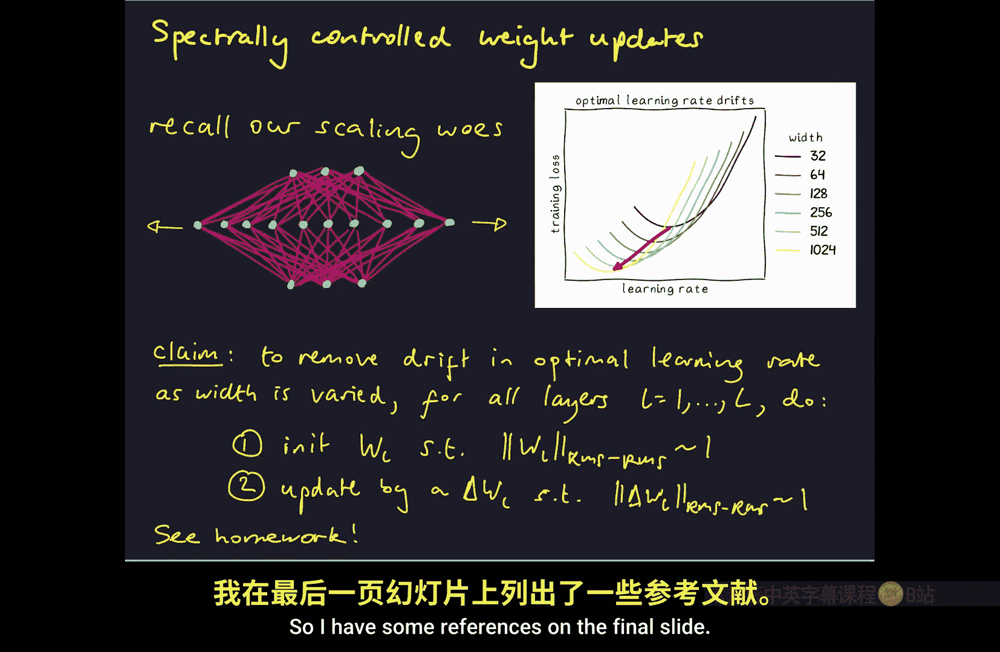

Make this like this claim， which is sort of vague claim at the moment。

 but if you're really careful about that， then you can make the training much more stable。

We should provide wide thisclaim。How are。With。Why not change。啊所以我。

One way to put it is that as I change the dimension of my layer。

Which is what we're scaling when we're scaling with。

 either the input dimension and the output dimension or both。

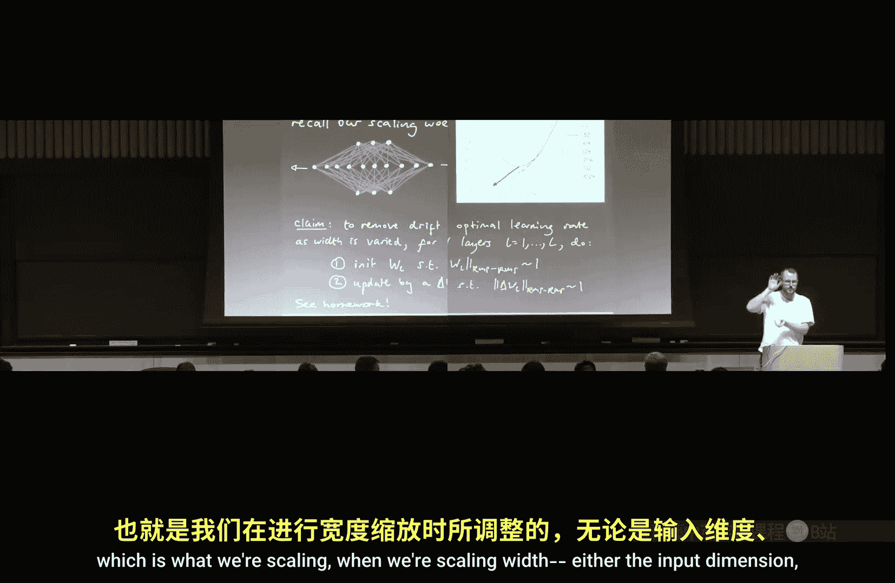

This norm， the RMS norm is a dimension。 is's sort of in some sense， it's a nondimensional norm。

 Like my system is behaving well when the norm is one。

 that would mean that all my activations are around one。 What's the alternative。

 It's like the alternative is either I scale the dimension and the size of each activation either grows with dimension or shrinks with dimension。

 that would be bad scaling。 And like if you if you ensured that Euclidean norms were control。

 And then you trace back what that means for individual coordinates。

 you would see that either like not sure which way around that either the individual coordinates are growing or are shrinking。

 the nice thing about this norm is it keeps the the size of the individual coordinates actually invariants of the width or the amount that the coordinates are changing is actually also invariance of the width。

 So that's like the。That's the consideration。I'm the first conclusion， but for the second one。

 why are we training the updates given that we kind multipied them by learning rating？

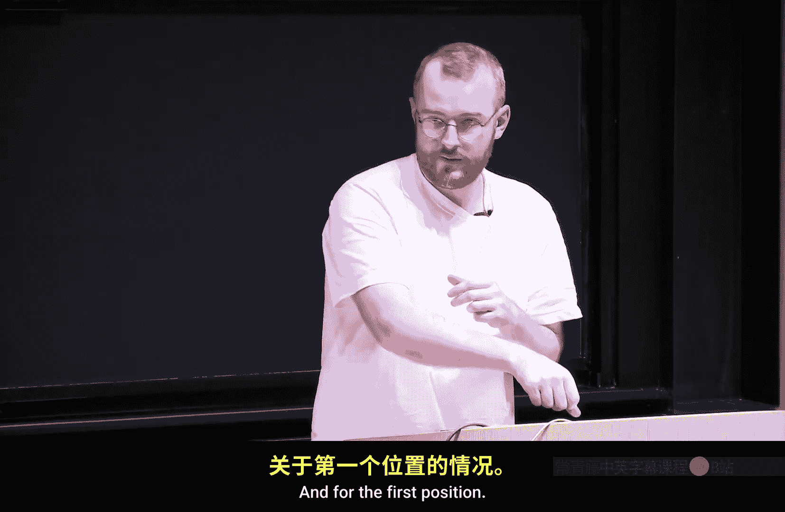

Yeah， so the the goal is that the learning rate should be independent of width。

 The optimal learning rate should be independent of width。

 So we're trying to package all the dimension dependence in the right way into the norm so that then the learning rate。

 after I normalize the updates in that norm， the learning rate。

 I don't need to change it with width anymore。So if if you don't normalize the updates on a particular norm。

 then the learning rate itself needs to account for the dimension dependence。

It may be clearer because the second homeworkick problem you implement like a normalized version of gradient thescent。

And you compare， like。2 for like one without an explicit normalization。

 one with an explicit normalization。 and then you。 So it's something。 maybe， okay。

 let's finish the lecture。 and we can talk about this more。Okay， the last yeah。

 the last one is depth scaling。嗯。And I kind of whimpped out a little bit。 And also。

 it's kind of like an open research topic。 So it， it' it's okay。But remember， the problem was。

That if I scale the depth， the performance can get worse unless I'm kind of careful about things。

And what I wanted to do is to think about。This， this expression。

 maybe I should have that and asked you。 But does， does anyone know what this。What， oh wait。

 you can't see what I'm point at。 Sorry， what this evaluates to。Doest even market nice lot。Yeah。

 it's E the X。ops。And so。What I want to make is an analogy。Where this is like a compound system。

 It's a big product of many， many， many things。 But I scale the internals of that thing in a nice way such that even when I take the number of terms in the product to infinity。

 the thing doesn't blow up。 and it doesn't go to 0。

 So that's I call that kind of well scale depth limit。

 But it's just like that's something that many of us know from just。N， I guess。系。Okay。

 and the crucial thing is that we take apps。 We think of this as the input。And we divide it by L。

 which is the number of terms。And then we're gonna take a product of L things。

 And it's really nice that because I divide X by L， it it。😊，You know。

 this thing converges to each of the x。 But you know， if I， if I put a different factor here。

 if I put L square， I take the limit， I would get 0。And if I put like square root of L。

I take the limit， it would blow up。And so it's like really thinking about what factor you should put there so that if take if I take the depth。

 by the number of terms to infinity， it will remain stable。

 Like that's the same sort of consideration you need to have if you want to train a residual network and you don't want the dynamics that either blow up or go to zero as you take the depth to infinity。

So just to write like a little suggestion about that。So you think of a residual network as being a。

 think of a single block in a residual network as being a function which takes X。

And give us back X plus。Like the block。Of X。 And the block could be like a little MP。

 or it could be an attention layer。 could be some other like neural layer。

What do I want to put in front of the blocks， such that if I take。

 if I have an infinite number of these blocks， it's like its still a nice function。

 Probably I want to put like the divide by the number of blocks， which I'll call L。So。So intuitively。

 like you should think， you can think of a residual network a bit like this is one block。

 And then I can think about raising it to the power L。

 But that really means composing it with itself L times。 And you really want to be very careful。

About like the block multiplier。嗯。I'm happy to talk There is a little more to the story。

 so I'm happy to talk more about it if anyone wants to talk about it。

And then I put this caveat here becauseuse it's like still， it's not completely。

 there's different papers saying different things。 It's not completely the end of the story。

As your depth increases， your complexity increases。G a certain wh。Yeah， essentially it definitely。

So the question was， does this have something to do with how the capacity or the complexity increases as depth increases。

 Yeah， you learn as you increase your debt。Your train loss。小查。Yeah。

 so what I'm saying is if what I'm trying trying to convey is like。

 if you set up your residual block and you're not really careful about it。

 you can see performance gets worse as you make the depth larger。 But I'm trying to say， like。

 here's a way to be more careful about it to try to stop that problem。 And if you look at。

If you look at like a transformer code base， which I think later in the class， we actually do。

You'll see that a standard transformer block actually doesn't put a one over L multiplier。

 The standard thing is actually to put one over square root L。And the。

 the argument is that the blocks are somehow incoherent and random with respect to each other at initialization。

 And if I add up lots of incoherent random things， it's a bit like doing a random walk and a random walk moves a distance like square root number number of time steps in the walk。

 So I should divide by square root， that number of things。So that's the， the rationale。

 And there's a kind of like， it's unclear whether that's the right thing to do or whether just the divide by L is the right thing to do。

 But it's it's like really a thing which is part of a transform a code base is like。

 what block multiplier does your residual block have。

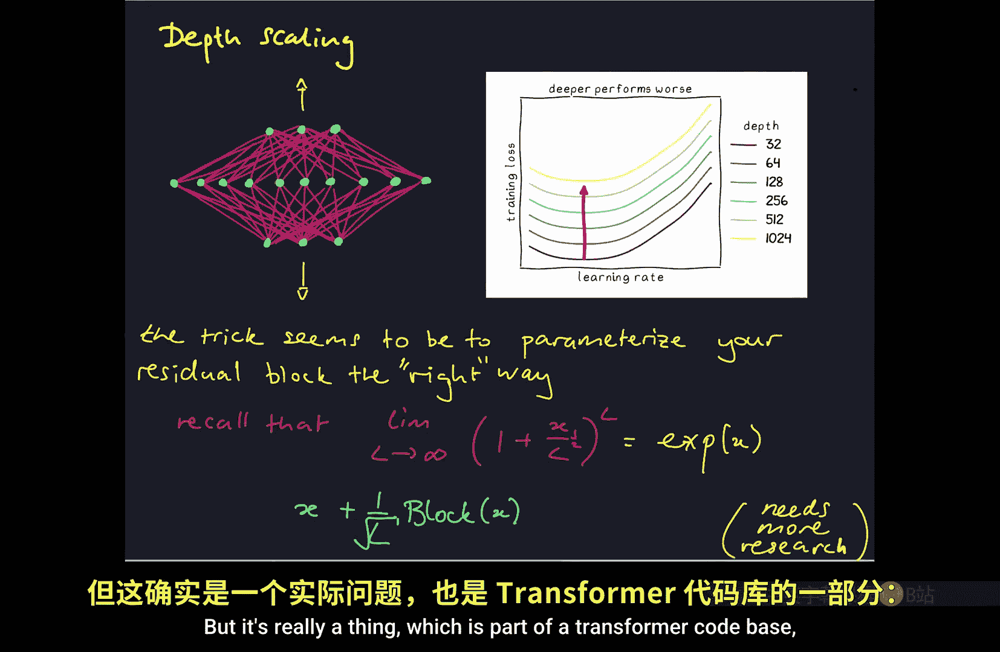

嗯。I just， lets if people have more questions， I'm happy to stay at the end and talk about them。

 But I think I should just get to the end of the lecture。😊。

So the last thing I wanted to talk about is like something that I'm kind of its like I'm working on at the moment。

So again， you can be very skeptical and like， feel free to not believe me。

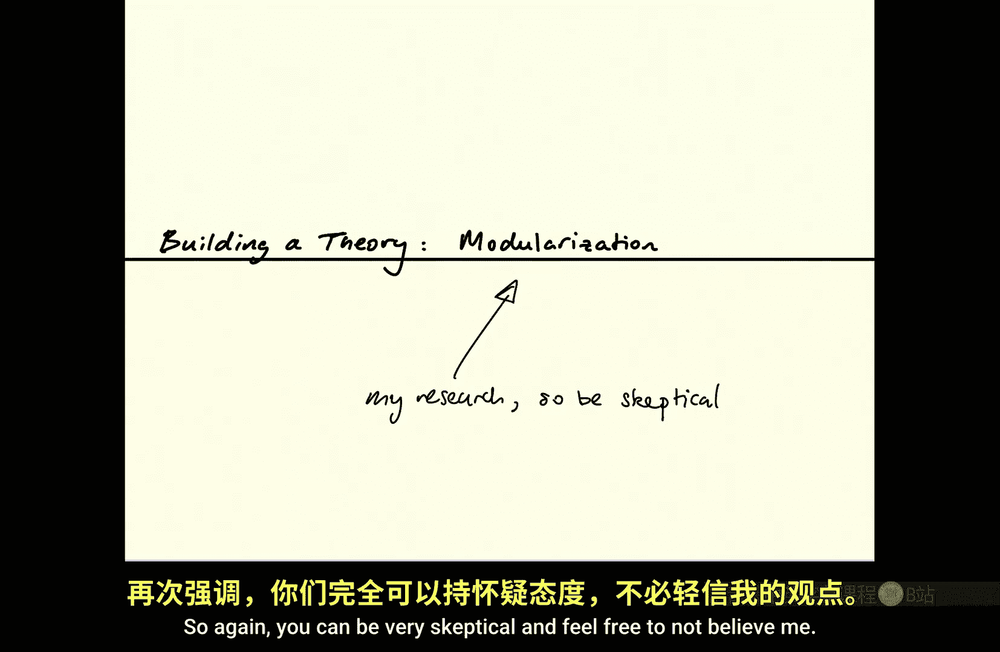

嗯。But the way that we're thinking about scaling and more generally optimization for neural networks is the idea of wanting to build a very modular theory。

So I w to like， tell， what does that even mean。And。

It's sort of like the problem with deep learning is that there's such a zoo of architectures that people want to consider that how can you build an optimization theory that covers all of them because someone can always produce a new architecture。

 And you're like， I have no idea how to deal with that。

 But what if we could bake the construction of the optimization theory into the process of building the architecture。

 So that whenever you build the architecture， you also get an optimization theory。

 like that would be kind of cool。😊，So the idea is to like kind of build the theory within neural own network。

嗯。And we， we have this to， to actually formalize that and think about that。

 We have this idea of a module。 And like Pytoch already has modules。 So you know a lot about Pyto。

 you can think about a Pytoch module。But a module just means something with weights。

And a weight space inputs in an input space。And outputs in an output space。

And notice that that's an abstraction which can handle an individual layer in a neural network or a full neural network。

 They're all members of this class of things。So even even the realulu。

 you can think of it as having an empty weight space。 So it's also a module。

 but also a full transformer is also a module。And the idea is that we're going to write a library。

 Think about this as like writing your own deep learning packages。And it's gonna have a module class。

 And then we're gonna write a library of， of what we call atomic modules。 And these are things like。

Really。Ver。嗯。Con， like convolution。Ebedding。These are like the basic。

 the basic layer types that are part of the library。 and kind of。

 as you may have seen on the homework， potentially。

 either you better write the forward and backward functions for these things。

You better write those by hand for like the basic things。 Youve just got to do that。

 So the forward is like。The function the thing expresses and the backward is like its derivatives。

 basically。But what we say is we're also gonna equip our module with something else， which is a norm。

Which is gonna be a function from its weight space to the real numbers。

And we're going to say that actually， we kind of know how to do that for the basic layers。嗯。You know。

 as we said for a linear layer， like the good norm is this R M S to R M S operating norm。

Really actually doesn't have weight。 So it doesn't need a norm。

 And you could imagine that maybe we could come up with a good way to equip the other layer types。

 the basic layer types with norms。 And we do that like with pen and paper and by hand。And then。

 then then we're gonna write these combination rules。

So we're going to think about if we've got two modules from our library， we。

 we're gonna have a way of composing them to give us a new module。嗯。

And so you may have thought about， you know， forward function。

 It's sort of obvious how to compose them。 It just means like， compose the forward functions。

 do function composition。嗯。The back we， we're just gonna do the chain rule。

 Like if we compose functions， we know how to compute the derivative。 It's like the chain rule。

And then like， the question is， how should we combine the norms。

And I'm just gonna leave this as a question， but it's like something we've been thinking about。

 So it remember that module 1 has its own norm。And module 2， has its own norm。

And then we need to find a way of combining them。To give us a norm on the composite or the compose module。

 And it comes back to that question of how do we pick our norm。

 Do you remember we were talking about steepest descent And the big question is like。

 how do you pick a norm that's a good match for your loss function。

 And it seems horrendous for deep learning because you can have any architecture that someone can come to you with and how are you supposed to give them a norm so that they can do steepest descent？

 But what if there was an automatic way。 You know， what if there was a way to assign norms the to the basic things in the library。

 And then when people compose them， it automatically gives them a norm on the compose thing。

 I it would kind of solve the problem in a way， So that's what we're trying to do。

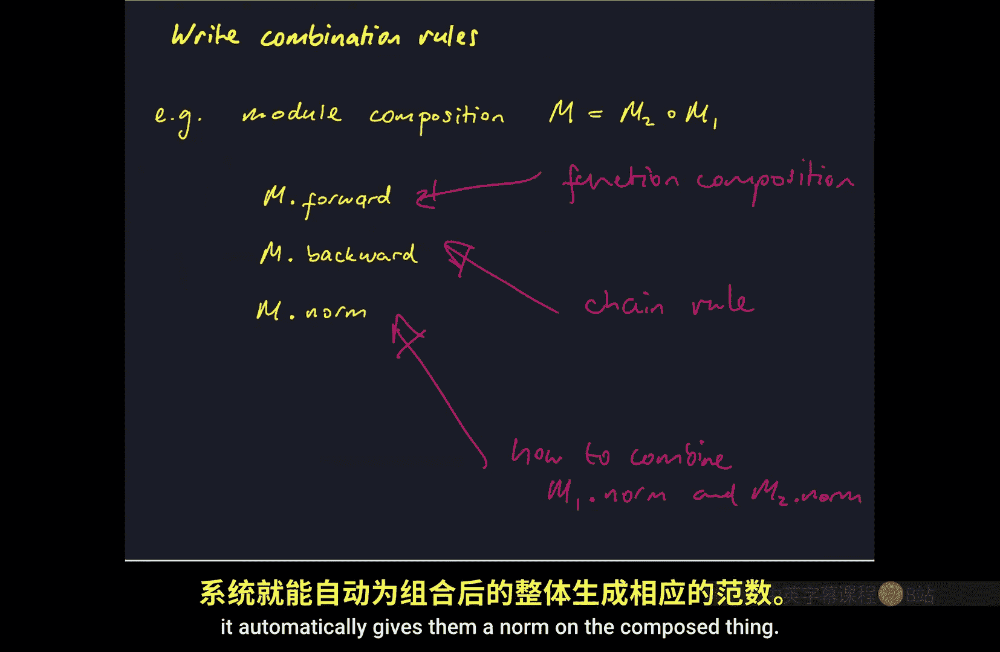

嗯。And I'll just quickly tell you， because someone asked， is you asked。

 is that theory for or is it all just kind of heuristics， And that is。 And like。

 it's a range of things。 Like， you know this that the first two references。

About infinite width limit。 So people love to like study how things behave as the network becomes infinitely big and to try to keep it stable in that。

 in that limit。The third paper is like the paper that from my collabor is also with Phil。

 where we're not trying to do those limits。And then the fourth one is， I think。

 a really interesting paper as well。

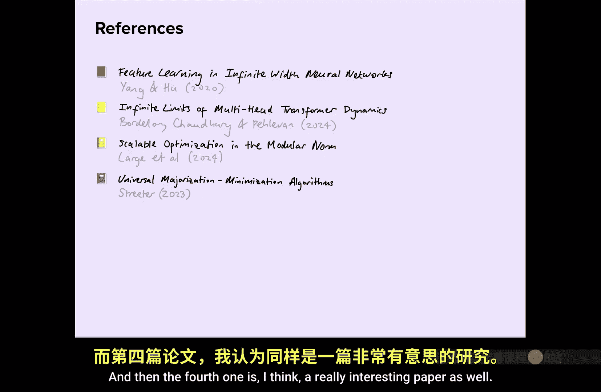

嗯。Okay， that's the end of the lecture。 But I， I can stick around if anyone has questions。 Thank you。

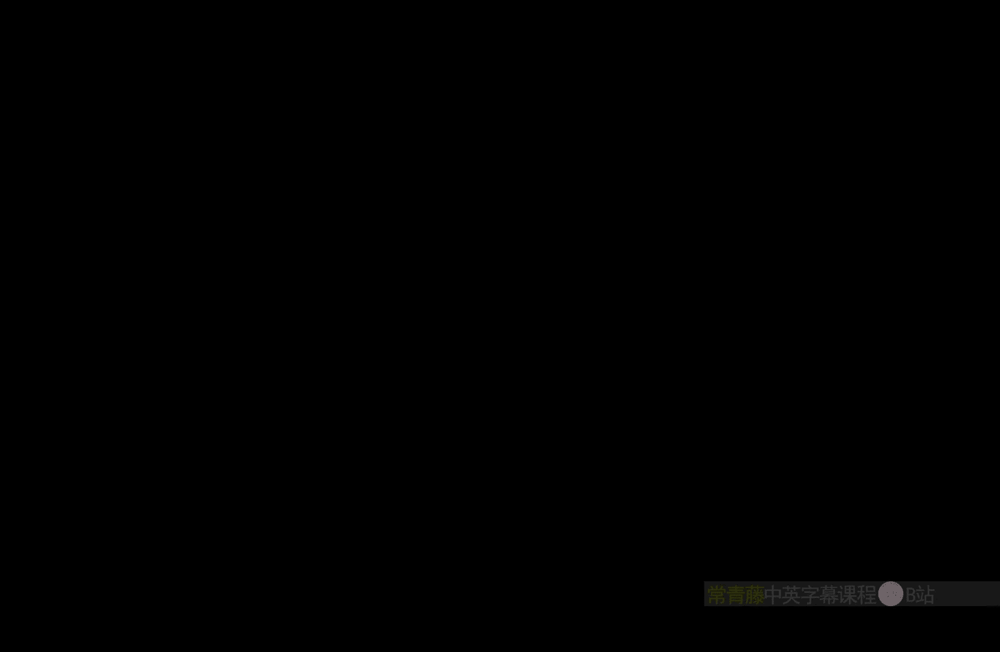