# 麻省理工学院【中英⚡深度学习｜6.7960-Fall-2024,-Deep-Learning】-p08-P8-架构：Transformer--BV15QZ4B1E6v_p8-

Okay， welcome again everyone。 Sorry for the delay。 So， yeah， we'll get started。

 Today is going to be about transformers。So hopefully you're all excited because this is the architecture that you should use today。

This will change， you know， next year， there'll be a new architecture。

 Don't worry things will change。 But this is the one that will get you the jobs today。 Okay。

 this is going to be a little bit more of a practical lecture， you know。With graphranets。

 we talked about the general like class of all the functions that could represent and so forth。

 and there's so many different possible ways of parameterizing graph nets。

 but with transformers we're just going to say there's one concrete instantiation that works。

 and that's what we'll learn about today。Okay， so we'll talk about。

Kind of three key ideas behind transformers。 One is this idea of operating over tokens。 The next。

 this is going to be the only thing that's actually new。 It's going to be called attention。

 Everything else will actually be just new names for old ideas。

And the last one will' be talking more about positional encoding， which we've seen a few times now。

And then I'll show a few different architectures and some ways of using these things。Okay。

 and so as I said， like there's so many architectures。 But right now， there's just one， you know。

 to rule them all theres。 This is the one ring architecture。 Don't worry it'll change。

 This isn't gonna be the final architecture。 but this， this is the one right now。Okay。So。

There's this interesting book called Don Quixote， written by Pierre Minard。And okay。

 you probably are thinking I'm saying something wrong， right， it's written by Cervantes。

 but there's a short story that another guy Boorrggeis wrote about this guy， Pierre Minard。

 that rewrote the Don Quixote word for word， exactly the same words， but with entirely new meaning。

And in the short story is the， the meaning is new because the context is different。

 It's a different historical era。 and the life of Pierre is different than the life of Cvantes。

 And you're gonna hear the same exact story。And if you read this。

 you would read the same exact story， but it have entirely new meaning because the context is different。

 And I think that's。Go to be a theme of the lecture today and also the theme of this whole class。

 We'll keep on telling you the same things。 maybe word for word the same things。

 But because you have new knowledge and new connections you can make， it'll have new meaning。 Okay。

 so this is like you know， a few pages， short story。 If you want to read it。 It' kind of fun。

 It's called Pierre Minard， author of the Kyoote。😊，O。So everything new is， you know。

 everything old is new again。We're going to be riffing on the same themes。

 So let's go back to convolutional architectures。 and we're going to see a limitation of them。

So let's say that I want to ask how many birds are in this image， right。

 We saw that you can do that with the CNN。 You chop it up into pieces。 you process with filters。

 you aggregate the results。 You count the birds。But what if I want to say is the top right bird the same species as the bottom left bird？

So could a CNN do this。 Well， you know， sure if it's deep enough if the receptive filters are big enough。

 it can do it， but it might not be the best way of doing that because remember。

 the CNN filters are all local。And local filters are not going to be the most effective at making assessments about relationships that are more global in nature or distant。

So CNN ends are all， you know， they're built around this idea of locality。

 they factorize the signal processing problem into little local pieces that get put together step by step。

So they have the strong locality bias， and that can be a good thing。

 That's good for a lot of problems。 You know， if I want to understand something about the population in this room。

 I don't need to go and like look at Mars。 I can just locally look at what's going on in this room。

 like most signals have the things that are matter to assessing them are all kind of local。

 There's a smoothness to the world。 Okay， but that's not always a good idea。

 And so transformers try to get around that。😊，Okay。

 here's just a diagram looking at the receptive fields essentially of a simple CNNN。

 so this is a two layer convolutional network， it's convolutional because every output neuron in this layer is going to be taking input from just a local patch of the first layer。

 so it's like a length three filter over the input and if there's convolutional be the weights would be shared among all these filters。

But notice what happens if I want to make some assessment about the relationship between the first input variable X1 and the seventh dimension of input X 7。

Okay， so on the second layer of the network， let's say this is the input。

 This is the first hidden layer， and this is the output。On this layer。The only these hashed nodes。

 these hash neurons。Have some dependency on x7。 And for x1， these two over here。

And on the next layer， the receptive field kind of expands out by one because the filter is a length 3 filter。

 And so you get a receptive field that expands out by one。 You can just trace the arrows back。

 See what。Which neurons？Kind of get some imagine some dye is dropped onto that neuron。

 and the dyeble out over the edges of this graph。 Which ones is it going to hit。

 which are in the support of this neuron here。Okay， so it's just。X1 is in the support of this neuron。

 this neuron and that neuron。 and X 7 is in the support of the three neurons in the right。

 But if that's my output layer。 and I only have this， depth to convol network。

 then no neuron in the output has gotten and die from both X 1 and X 7。

 So it's impossible for this architecture to have made a decision that depends on the joint configuration of X 1 and X 7。

Okay。So I can always make a deeper CNN， but this dye just bleeds out slowly in convolal networks。

Okay。The idea of attention is to say， well， let's。Have an operation that allows us to look more globally。

But the problem， there's another way of doing this， right。

 What is another way that we saw that you can have neural networks that kind of process data globally。

WhatWhat what is one of the architectures we saw that processes that doesn't have this locality bias of CNNNs。

 you want to show。fullyly connected network and just a vanilla MLP and a vanilla MLP with fully connected layers。

 every single output neuron is connected to every input neuron。

 so information is aggregated immediately globally。O， but see you then said， no， no。

 we want to chop it up and， factorize the problem。 And then attention says， okay， no。

 we want to look globally， but we don't want to have。Every neuron connected to every neuron。

 because that would just be too much processing。 That would mean that for this， you know。

 mapping from R N to R N， we'd have n squared edges and n squared parameters。

 And it would just be too compute heavy， too many parameters， too much to learn。Okay。

 attention says we'll look globally， but we'll look sparsely globally。

 So when you get a new question， you'll just attend to the parts of the input signal that matter。

 So if I want to count how many birds I'll attend to these locations。 know。

 it's exactly coming from the idea of attention in the human brain or in your own life experience。

 you can attend to the things that are relevant to your problem。 If your problem changes。

 you'll attend to different things， right， So you'll attend to these two birds， if the question is。

 is the top right bird the same as the bottom left bird。 And if the question is。

 what is the color of the sky， you'll just attend to know the sky region of the image。Okay。

 so that's the intuitive idea of attention。 iss meant to kind of model， you know。

 what humans might be doing when they process images or other types of signals。

And we're going to talk about mathematically， how that can be done。

I'm going go through these three kind of architectural pieces of transformers。

 Attention will be the second one。 That's really the new one in transformers。

 And then tokens and positional encode codes will be just the same as you've seen before。Okay。

So new idea， not really new， but sort of new idea。 number one is tokens。

 So it's a new name for what we actually saw in the GNN lecture。So a token is a vector of neurons。

 This is how I'll define it for the purpose of our course。So in the GNN lecture。

 we talked about node attribute vectors or node feature vectors， right。

 So every node has a vector associated with it。 And we're going give that just a new name。

 which is a token。 So a token is a vector of neurons。

And the way to think of it is that it's kind of like a little encapsulated factor in my computational graph iss going to be a little packet of information that will be。

A little bundle of information that will kind of all be processed in a modular fashion。 Okay。

 so we'll have a set of tokens。 And these are the units that we're operating over for transformers。

Okay， so in graph nets， the tokens were the nodes of the graph or the feature vectors associated with the nodes。

Okay， so we can have an array of neurons and that's what we operate over in MLPs and kind of vanilla neural networks。

But in transformers， we should kind of always be thinking about the basic data structure as an array of tokens as opposed to an array of neurons。

 So it's like an array of vectors or array of little encapsulated bits of information。

You could also generalize the notion of token to be not a vector。

 but it's some array of like structured information in transformers the structured information is just a vector。

 but there might be generalizations for this that come about later in 2025 for the next year。

So I do want to note that I'm using the word token in a way that is not completely standard。

 I'm using it in a way that shows up in various computer vision literature。

 but is a little bit less common than natural language processing so in natural language processing people mostly talk about tokens as being the discrete units of the vocabulary that we're modeling So it's like a token is the letter ABC。

 there's 26 tokens for the English alphabet or a token could be we could tokenize with a different kind of vocabulary it could be every English word is a separate token so there's discrete units of the vocabulary that I'm operating over。

Is what natural language people usually mean by the tokens。 But iss a kind of weird definition。

 I think I I prefer to think of the tokens as the kind of chunks of information that you are fact raising your problem into。

 It's a more general definition。 And that's the one we're gonna go with in this lecture。 Okay。

 so token is a vector of neurons。And a set of tokens is how I will represent some data。Okay。

So just like I could have cofnets that operated over an array of neurons。

 I could have convolution over tokens that operates over an array of tokens that would just be like multichannel convolution so I can have different data structures built on top of tokens。

 where now tokens are the new units， the new encapsulated units of atomic information in a neural net we have scalar valued neurons in a token neural net。

 we have vector valued units。Okay， and we could have a set。That's unstructured unor。

 And we can also have a set of tokens and and transformer land。 Well。

 the main thing we operate over is actually set as opposed to a arrays。 But there's always， know。

 variations on this theme that you can make up。Okay， so let's use a image processing example。

 but I I want to just。Make sure we keep in mind that transformers like the maybe why they're so popular is because they're very agnostic。

 the domain。 the recipe is once you turn your data into a set of tokens。

 then you just use a transformer and this is one of the reasons they just dominate across so many different domains。

 and basically all domains where deep learning is applied that I know of。

 I think transformers are currently the most popular kind of way of doing it。

Or at least the most performant way of doing it。Okay。

 so that's one of the powers is they're very agnostic to the input signal。

Their previous methods like CNNs were much more tied to the locality properties of the signal。Okay。

 so how do you turn data， your data into tokens， And then we'll just process tokens。

 That's the general idea of transformers。 First， the domain expert turns data into tokens and then transform generic transformer processes tokens。

Okay， so for images， this is the standard way of doing it。

 But you could imagine a lot of other ways that that one could do it。

 But you just break up the image into patches。 just like a con。 You chop it up into patches。

 and then you turn each patch into a token by just projecting it into a flat vector。

And you could use some matrix that you multiply the pixel values by W tokenize to get a D dimensional vector。

 And that could be a learned matrix， or it could be somehow hard coded。

So its just a linear operation。嗯。And。I've basically already said this。

 but when operating over pixels， we're operating over like scalar valued measurements。

 What's the red color at that pixel When operating over tokens。

 we're representing the input as an array of vector valued measurements。

 and the vectors are just the kind of projection of a set of RGB measurements and a patch onto a fixed dimensional vector in R D。

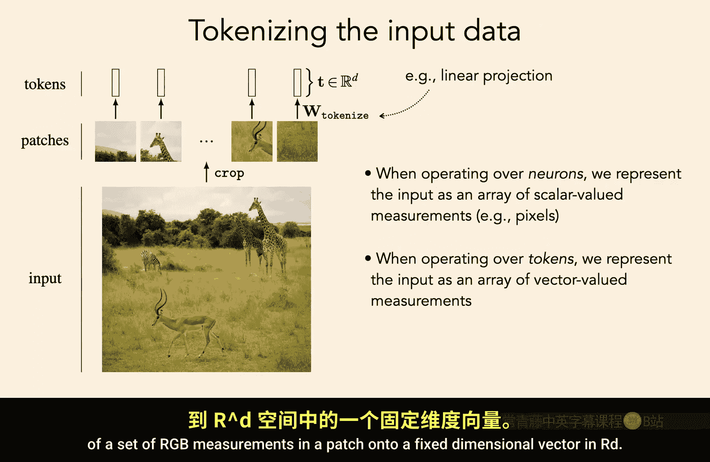

Okay。Question， all the tukens is generally the same size。That's yeah， they do。

 So do all the tokens generally have the same size。 Yeah， usually they do。

 They're generically like a set of vectors in RD。And that is an interesting thing to， you know。

 maybe do for a final project or a research project。 I think， you know。

 variable sized tokens could be really interesting。 It's not a standard way of doing it。😊。

Probably there's some challenges with hardware。 like you want to another idea of transformers is that they just match really。

 really well to the GPU hardware and the software we that we use。

 And if you have variable sized tokens， now there's something you have to keep track of and how do you you know。

How do you map that onto your hardware。 It might be nontri question in the very back。Yeah， question。

 if you're tokenizing an image， do you want your patches to overlap。

 And the answer is in standard architectures， I think no， you generally don't overlap。

 but that might be a good idea。 just like in convolutional networks， you can set this right。

 that's a parameter。 And you can have that same parameter here。

 But the current standard way of doing it is no overlap。 As far as I know， that might change。

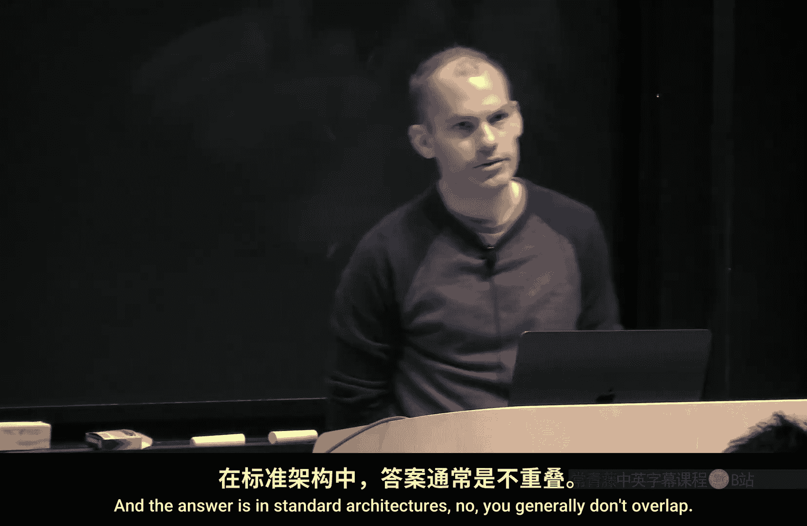

We give one more that on the phone cap So are thekens just like take the patches。

 the patches are also just pixels， and it would beken the pixels。Yeah。

 so the patches are the question is are the patches just pixels， Yes。

 so you you flatten the patch into just a list of numbers。

 It's a long vector that is size dependent on the size of the patch。

 and then you project that into whatever dimensionality you want to process D dimensions。Okay。

So yeah， you can tokenize anything。 And again， this is the power。

 The general strategy is you take your signal， your data your processing。

 you chop it up into little chunks where the chunks make sense as the kind of units of your domain。

 So usually that means local chunks because locality is a very good inductive bias。 So in images。

 the standard thing is chop up into nonoverping patches in language。

 the standard thing is to chop up into little snippets of words， which are called by pairs。

 So I won't go into the details。 but basically the kind of phonemes or know the units of the language you are operating it over。

 they could be you could operate over。Single characters or three characters or entire words。

 But the one that people like is just called a byte pair it like 2，2，2 byte representations of the。

 of the language。 So you you can learn this for English。

 and there might be a bitete pair that represents T， H。

 and there might be a by bite pair that represents I N G。Okay， so that's how you carve up English。

And other natural language and how you carve up sounds will often just be chop into chunks like YouTube do for an image。

Okay。So once you have done that， then everything else is domain agnostic。

 So this is the only like part where you have to actually consider your input domain。 Not， I mean。

 yes， when you think about the loss function and other formulations， Yes。

 do you think about your input domain， But this is the main part。Okay。

So here's a notation that we're going to use。 So we're going think of the tokens as just vectors。

 And I'm often going to describe an array of tokens or a set of tokens because it will turn out that actually the ordering is going not matter。

 We'll have architectures or permutation invariant over the ordering of the rows of that matrix as this matrix T。

 So I'm going just transpose my token vectors。 now they're gonna to be row vectors。

 I'm going stack them up and that will be this matrix T that will simplify a lot of the math。 Okay。

 so when we're operating over tokens， is the notation will use。

 we have n tokens in the rows and D channels。 So we're gonna use the same dimensionality for all tokens to answer that question But and if you try to use different dimensionality。

 the notation will become more complex than the math would be。😊。

 you'd have to do some more bookkeeping。 And yeah， it it would be harder。Okay。So。

Just like with regular old MLPs in networks built out of tokens， we have two basic operations。

 One is a linear combination operation， and the other is a unit y is non nonlinearity。

 So what is a linear combination operation。 It's just a generalization of the linear combination over neurons。

 So here's a linear combination over neurons。 This is a linear layer I have X in is the set of scalrs x1。

 x2 x3 and x out is just another scalar， And I have a weighted combination in W1 times x1 and so forth。

 right This is the regular old linear layer going from R3 to R1。Okay。

 so what does a linear combination of tokens look like， Oh， and right。

 we just can write that in matrix form as W times X。

 You've done that a lot on the PAT and in other places。

A linear combination of tokens is just going to be a weighted combination of vectors。

 So I'll have vectors with D dimensions。 But Ill， if I only have three tokens，3 three such vectors。

 I'll have three weights that I can learn or decide to set the values of to create a linear combination。

 So it's gonna be， you know， a weight times the first。😊。

Vector plus the weight times the second vector plus the weight times the third vector。Okay。

 so you can represent that。Again， a matrix notation。 if we're using our our T， where T is。

D N rows by D columns or D is the dimensionality of each token vector。

 Then W times that matrix T is just like taking a linear combination of the rows。Okay。

 so you can already see here that the token linear combination is less expressive than if I did the same thing over all the individual neurons that make up those tokens。

 Okay， it's kind of like a low rank transformation over the neurons， because I only have3。

3 weights that determine that combination， but I actually have 12 neurons that make up all of those tokens。

 And so you normally would have 12 weights if it were just a linear combination of neurons。😊，O。

 so this is， this is a less expressive family of， of layers。 In fact， it' a low rank operation。Okay。

But we're thinking of the token have these like bundles， these encapsulated units of operations。

 We've just now defined how to take linear combinations of those， those encapsulated units。Okay。

 so the next thing we need is the equivalent of a reello， right， the point was non nonlinearity。

 And with tokens， we can have a token wise No nonlinearity。

 Instead of being a neuronwise No nonlinearity， will be a non nonlinearity that operates on each token independently and identically。

Okay， so here's my point wise No nonlinearity from MLPs。

 We have x out is equal to for each dimension of x And we just take a redluu of that dimension。Right。

And a token was nonlinearity is just going to be for each token in my array of tokens。

 I will pass it through nonlinear function F， and it will be the same nonlinear function applied to every single token。

Okay。So typically， in transformers， F is going to be itself in MLLP。

 So transformers are kind of like a meta architecture。

 Like the unit of the architecture are other neural networks。

And you can also think of this operation as equivalent to a convolutional filter that is run across the sequence of tokens。

 Okay， it has， it's a one by one convolutional filter。 So what does that look like。

 It looks like this。 I have a sequence of tokens。 Now， think of this as like。😊。

A spatial sequence or temporal sequence。 And the channels are in this token dimension。

The vector dimensions of the token。And the convolution filter will just be something that operates on each token independently and identically。

 So this is what the tokenwise nonlinearity looks like。

 And you can also now map that in your brain onto a pointwise No nonlineararity and an MLP。

 that would just be like I have vectors of length1。

 And my operation I'm sliding across that sequence is a relu or a tan H or a sigmoid some pointwise No nonlinearity。

😊，Okay。Okay， so now we've basically built what all call token nets。 You know。

 then their name for this would be graph nets。 But I'm going call it token nets for now。

 which is almost identical looking to a MP。 So MP is linear combination of scalar valued neurons。

 pointwise linearity and so on。 And token net is linear combination of tokens。 Okay。

 take a weighted sum of these three items。Followed by token wise mal nonlineararity。

 So each arrow on the second row is。It's self parameterized by an MLP。 It's， you know。

 a complicated and nonlinear function。 And then repeat that process。Okay， so the motif is the same。

 It's just over these more complicated units， as opposed to being scalar value units。

 which are called neurons。 It vector value units， which I'm calling tokens。Okay。

So I already mentioned， but this is also equivalent to that unrolled GNN that I talked about a few lectures ago。

 So in the unrolled GNN， we。Have this aggregate function。

 which is doing some kind of weighted combination。 And then we have a combined function。

 which now you can understand to be a。Unit wise is a node wise No nonlinearity。

 And then we repeat that process。 And Gens also often have the property that you share weights across depth。

 You don't have to， but you can， whereas transformers typically have the property that you don't share weights across depth。

 but you can。 So this is a choice。 but the standard transformer。

 you have separate set of weights here。 And on the next layer。

 And I'll tell you how those those weights actually get specified。In a minute。 Okay。

 and just to remind you， here was that picture of the unrolled G N N。 So in the unrolled G N N。

 we have our graph。And we take these navi calling them tokens。

 they used to be called the node vectors。And we aggregate。

 But this is this is going to be a critical difference in the G and N。

 how we aggregate is determined by the graph connectivity。

 It's the adjacency matrix of the graph that tells us how we do this aggregate。

 where the arrows are in that linear combination。 And additionally。

 in the graph that aggregate might be non nonlinear R。

 it doesn't have to just be a linear combination。Okay。

And then we also have a particular way of combining that to an update step。

 but it looks very much like a transformer that I'm showing you now。

 the token that version of the transformer， except that these arrows are not fully connected。

 They are determined by the graph structure。So， a。Transformer is going to be like a graphnet。

 but it's a fully connected graphnet。 So we have all the arrows at every single aggregation layer。

And I'll tell you how thosearrow's values get determined， which is going to be called attention。

 But you can can think of it as a graphnet over a fully connected graph。

 typically without weight sharing in depth。Okay， any questions about the relationship between。

These different neural networks， ML LPs， CNNNs， Gphnets。 And now this token net I'm describing。有张我报度。

So the token West Mountain linearity will be typically an M LP。

 and the parameters will be learned with propagation。

 So the are free parameters that are learned via optimization。And within there in that MLP。

 there's like point wise non nonlinear areasities in that as well。Yes， yeah。

 So it's like this network of sub networkss。 And in the MLP， there are also pointwise maleities。Okay。

 and one more。Yeah， so it's this， the question is in GN N's， the aggregate function is learned。

 or parameterized， and it can be learned。 And in transformers。

 I didn't tell you how we're going to learn these weights。In transformers。

 that will be done via this thing called attention， which we'll get to you in a minute。

And the token wise No nonlinearity in an MP is not is not learned。

 The pointwise No nonlinearity is not learned typically， but in a transformer。

 it typically is learned。 It's a parameterized MLP。 And in a graphnet。

 I think it would also be learned。 It's this update function。

 which typically has learnable parameters。

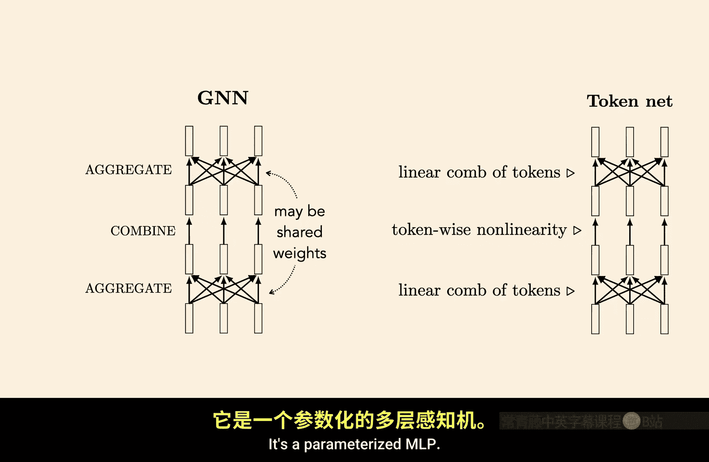

Okay， and don't worry too much about the se mantics here。 Like。

 it doesn't matter if you call something a graphnet or transformer。

 you should understand the concepts and how there's these particular building blocks that can be combined in different ways that achieve different effects。

 and there's trade offs。 And if you understand that。Deeply， then。

 the names are just something that is secondary to that。Okay。

 so that that was the first new idea was we're gonna operate over tokens。

 which are vector valued units instead of neurons， which are scalar valued units。

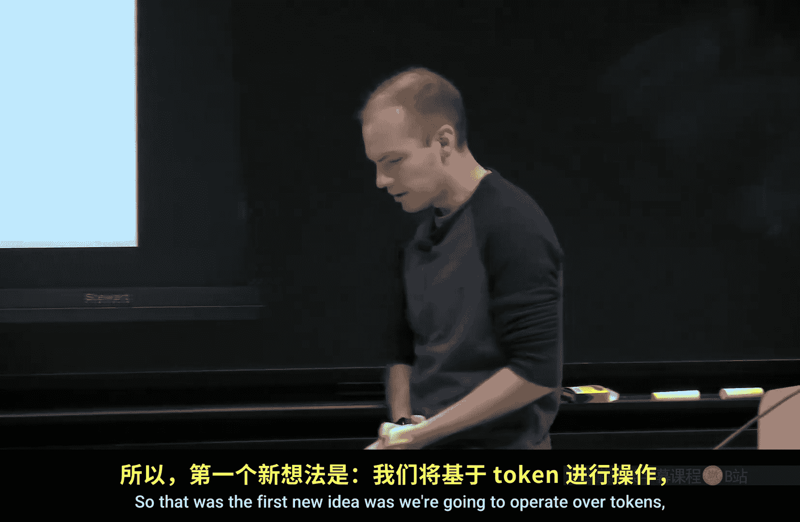

Okay， the next idea， which is going to actually be technically new， is going to be attention。

 which is how do we take the linear combination exactly。Between tokens。Okay， so here is a。

 let's say I have a like a token net。 What I could do is I could just learn the weights of the linear combination。

 just like in an NLP， I learn the weights of the linear combination。😊。

So three parameters all draw in blue。 and this could just be a weight matrix。

 which is going to be three numbers in this case， because I have three tokens。

 it would be a three by one weight matrix and one output， right。Three inputs， one output。

And W will be three parameters that are learnable via back prop。 That's one option。 You can do this。

 that will work。Okay。But transformers actually are coupled with this other idea called attention in attention。

 the weights that you use to do this linear combination。 Now they're not free parameters。

 I'm not going to color them in blue and color them in red。

 And if you remember in some of the readings， red was our color for activations。

 It turns out the weights I used to combine the tokens with the linear combination are going to be coming from activations elsewhere in the network。

😊，So。A is going to not be free parameters。 It's going to be a function of your data that you're processing。

So there's a few different ways you can do that。 We'll go into the full details。

 but just think that there's going to be some function F that takes in your input， data。

 your processing and determines this。Lineinar combination， matrix A。Okay。

 so a is going to be set by some function， which I'll describe of the data。

 it's not going to be three parameters， and T out will be just a linear combination of T in。

 according to A。Okay， so let's get some intuition for。What this attention matrix might be doing。

 this attention matrix A。Okay， so here's an image。 and let's say I want to process the query how many animals are in this photo。

 So I told you the intuition is I should look at the three animals and then count them up。

And that's exactly what what we'll do。 So I will attend to remember tokens are representing patches of the image。

 at least on the first layer of processing thatre representing patches。

 So what are the patches I will attend to in this image to answer this question should be the any patch that has an animal。

 And it's little hard to see， But there's a giraffe head in this in this one here。 So this is zebra。

 you know， impala and two giraffes。Now， every token is a vector of numbers that are descriptive of what is going on。

 And you know， there's some representation of， of that part of the world。 So at the first layer。

 willll just be the concatenation or the flattened list of all the RGB values。 But later on。

 it could be more abstract。And here， I'm just indicating that there might be one element of the vector。

 which is an indicator function。 Does this patch contain。An animal or not， right。

 or maybe at the head of an animal or not， because each animal has a one head。

And then what I can do is my attention can be allocating one unit of attention to each of these tokens and zero units to any other token。

 and then if I take a linear combination with weights of one for each of those tokens and zero for all the other tokens。

 that will achieve the correct answer of outputting a new token vector whose value is four in the dimension that counts animals So I've just kind of hand constructed here。

 a transformer one layer transformer that counts the numbers number of animals in the image by simply attending to animal heads and then taking a sum over all the things I attended to where the attribute vector of each thing I'm attending to the token vector is just a one if there's an animal head or a zero otherwise。

Or， in fact， in this case， it could be a one， no matter what's in in the photo。

 because the attention already only selected to look at the animal heads。Okay。

 here's another example， what is the color of the impalla， so what should I attend to here， right？

I should attend to these tokens。These patches。 And now I have another dimension of my token vector。

 which maybe represents the average color within that patch。 And if I take the average over those。

 you know， I take a weighted sum over the things I'm attending to。

 I will output the average color of the imppaa。 And that will be maybe a good ensemble response about。

The answer to this question， what color is the Ala。 Okay， this is just the intuition。

 but kind of hand constructing how these operations could actually ask answer queries of interest。

Question。T out here is meant to be， oh， yeah， I suppose that maybe I should use a capital letter。

 but just one token output。 it's like I'm just outputting one single token to answer my question in this。

 in this example。Okay， so yeah， the more general form is we'll have an array of tokens represented by the matrix T where the tokens are in the rows of that array。

Okay， so here is going to be the mathematical formulation of the most common kind of attention。

 It's called query key value attention。And remember。

 the transformers mapping from a set of tokens to a set of tokens。 So T N to T out。

And this will be one layer of the transformer， one attention layer， so one linear combination。

 so how is it going to work？So I will have a question。

 and then I'm going use the question to determine the attention。

 So the question the way I determine the attention is like that function F that produces a。Okay。

 so here's what it looks like。My input signal is a set of tokens。 Okay。

 so it's actually just going to be thought of as an unored set。

 just here is a bunch of different patches in the image。

And every token has this vector associated with it。And。

The question will also be represented as a token， which has a vector associated with it。

And I'll have a special operation called queryry， which will be to。

Emit some vector based on the contents of my questions embedding vector。 Okay， so the question。

 the question is a token， which is a vector。 and then I can transform that to emit some kind of query。

 So that will just be a linear transformation of that input vector。

And each token in my signal that I' processing will have a function called key。

 which emits something that the query is meant to kind of try to match against to see if the query matches the question the query matches the key。

Okay， so tokens represented by a vector and they can emit either queries in order to say what should I attend to or keys to say what is my content that my query should match to？

And we will check whether a query matches a key via a dot product between the key vector and the attention and the query vector。

Okay， so this， that kind of horizontal line is the key vector。

 and that vertical yellow line is the query vector。 And this is just meant to be the dot product。

 like the matrix product of the one by D vector times the D by one vector。Okay。

 so what will happen here will my query。Is relevant to animal heads。

 What is the color of the Apaa's head。 So my key will will match that query if I'm looking at an animal head。

 So the draft will be 0。2， but it'll match even better if I'm looking at the Apaa head because I'm specifying the Apaa。

 So that would be if I you train this thing to be a reasonable system。

 Then this would be a reasonable set of queries and keys and the similarity between the query and key is what I will attend to。

 So I'll get this kind of score vector S over here on the left。

 And this will just be the dot product between the questions query vector and each token in the signal and processings key vector。

Okay， then I will also have one more operation called value。

 which will be another transformation of my token vector into what I'm going to kind of report to the next layer of my。

 of my network。 This is kind of an analogy from databases where I can ask a question。 each， you know。

 bin in my big database can have a， it can know what it contains。 that can say Here's the the key。

 here's the relevant information I contain。 And then when the query matches the key， you open that。😊。

That part of the database that you know， that been in the filing cabinet and you pull out the values and get some information back。

Okay， so now the operation will be， I take the similarity vector S and I take a linear that's going to be the weights of my linear combination。

 but the linear combination will be applied over the value of vectors reach each token。Okay。

 so T out will be a weighted combination of the value vectors of each token。So those weights。

 alpha or A1 through AN。Over here will be determined by the by the score and will be determined by the the similarity vector by taking a softm。

 just normalizing that vector it so sums to one。Okay， so I'm gonna then get finally my A's。

 which are the elements of my。Attention matrix， which tells me how did， you know。

 how much attention to apply to each of the tokens values。 And I'll just take the weighted sum。

 the linear combination。Yeah， a bunch of questions。 So let me， let me quickly finish this slide。

 and then we'll go over it。It takes a while。 You have to， this is just the mechanism。

 And this is the concrete mechanism that ends up working really well。

 So it takes a while to kind of get comfortable with it。

 But I just want to point out that the key query and value vectors are just linear projections of the token vector。

 So we have one matrix that's learnable that transforms the token vector into a query。

 another learnable matrix that transforms it into a key and another one that transforms it into a value。

 So these are the learnable parameters。 These。😊，Projections are the learnable parameters of an attention layer。

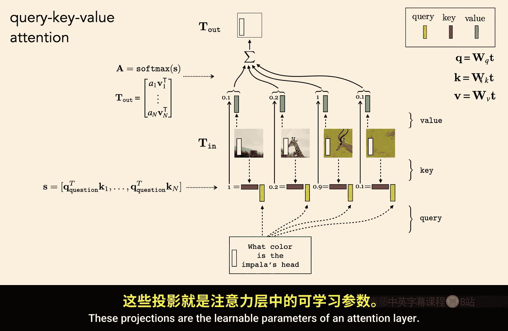

Okay， yeah a few questions look go here so there's the tokenizer the same for so a multial multimodal function in that both text and image can be tokenized the same way yeah so can text and images be tokenized the same way so no you'd have a tokenizer for text and a tokenizer for images and this is after you've done that now I'm just kind of abstractly saying there is a token that represents that question and a token that represents each patch and here's how you will use that question to allocate attention to those patches and then process the image？

Okay， question over here。I was wondering， so the query image is， for example， taken in the day。

 but the key images are taking at night at what point during the layers do we modify that so we're pair a image take in the morning。

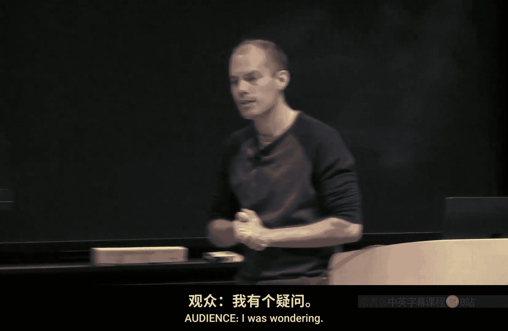

I say object。How do we change that with respect？So， so yeah， the question is， like， yeah。

 let's say the queries are coming from image taken during the day and the key processing and image taken at night。

 So the keys are taken。From an image taken at night。

 how do I bridge that gap so this will be learning will have to solve that for you。

 so you'll train on being able to you know query from daytime to ask questions about nighttime and the parameters will have to adjust in order to be invariant maybe to the time of day or appropriately answer that question。

So all the learnable parameters of a transformer can contribute to this in the attention layer。

 there's only three matrices that are learnable， which are the projection from the token vector to the query vector。

 the projection from the token vector， the key and the value。A questionest in the back。

Over here again。Yeah， so for something like a segmentation more。Were the query basically。ち。

How was it pretty。Yeah， great。 So for what if the question doesn't change。

 I'm just trying to solve one task， I'm gonna talk about self attention next。

 which will address that， that setting。Let's do one more over here。What meaning of the。

Thought product between the key bacteria about。Retrition， if they have any significance。Yeah。

 the dot product between the key vector and the query vector is meant to say how relevant is this key to this query？

And so dot product is like measuring the similarity between those two vectors in some way。

And an appropriate learning system would arrive at。Projections， W， K， V， N， Q， that make it so that。

When you ask when the text is about an imppaa's head。

 then the query vector will have values that are similar to the key vector values for images of Aala heads particularly interesting first。

About one。Does that indicate？Oh。That looks like a typo。 Sorry， Yeah， So it's point1 up here。

 And I think I forgot to make it point1 down there。 So that's just a typo。 Yeah， good question。Okay。

 let's do just one more。There seem to be a vi from the cultural what color is。开。A we。うんと思って。做个对待。

How we家 them。Yeah， that mapping， this query function that maps from the question vector to so the token vector that represents the question is given by this equation up here。

 which is just a linear projection of the token vector。 So it's just a learnable matrix WQ。

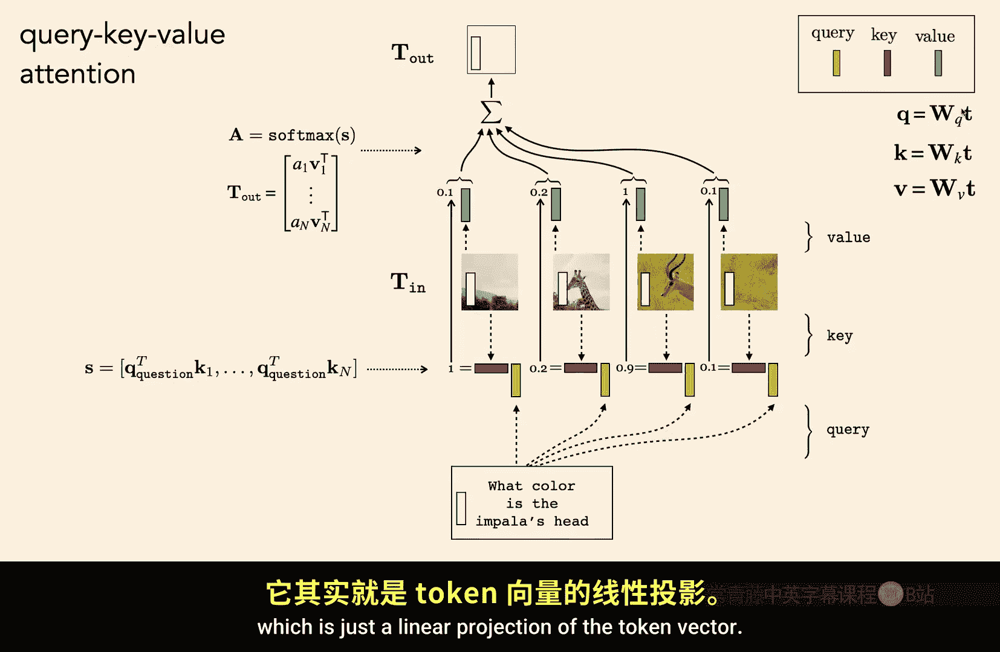

But it could be other functions。 I'm just telling you that that's the standard one in transformers。

 But you know， you can always change that。 It could be an MLP。Okay， so let's move on。Now。

 I I'll also tell you that the problem set coming out next week you're gonna implement a bunch of transformers and all the variations to implement GT。

 Like， you'll intimately know how transformers work。

 It's a little bit more of a practical problem set。

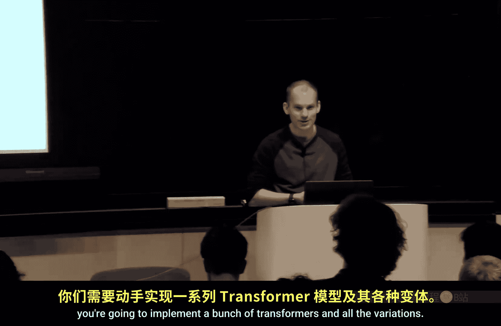

But I want to now talk about the next idea， which is self attention。

So self attention is saying rather than having my queries come from some like external question。

 like some text， my queries could come from the signal itself。

 So I could have it that every single token。In the set of tokens I'm processing can emit queries to the other tokens。

 Okay， and that's called selfatten。 So that's like， here's just an intuitive example。

 If this patch wants to get a better like estimate of what it is。

 maybe it should attend to other things that are similar。

 and then kind of ensemble or average the results to now say。

 I'm not sure if I'm an imppaa or I'm a gazelle or what I am。

 So I will kind of attend to other things that look like me in the image。

 and then I will update my own representation， by aggregateggregating information from the other things that are similar。

 That's kind of an intuition for one way that this could you， solve problems of interest。

But in general， it might be learning very complicated ways of processing information in the signal。

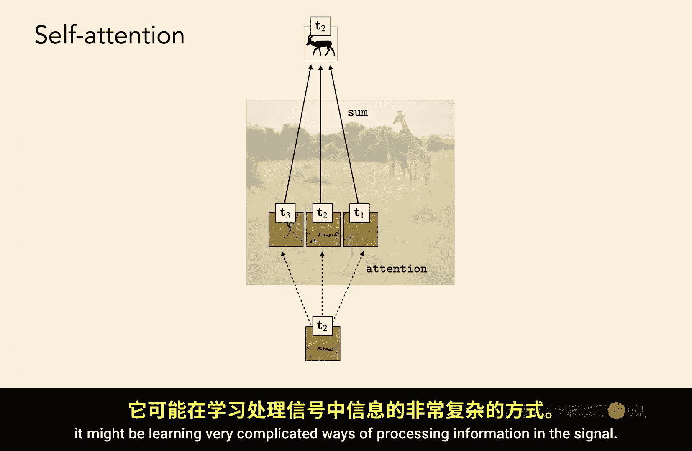

Okay， let me show you this video of the self attention。Applied to patches in these。

Videos when you are looking at the self attention of a。

Token that corresponds to a place on this horse to every other token in the image。 And for the dog。

 it will be a token on the dog and how much its to every。

 how much self attention it applies to every other token in the image。Or in the video。

What you'll notice is that the horse token attends to the horse patches。

 So it's kind of solving the segmentation problem。 It's like。

 if I want to understand something about。This part of the image。

 I should attend to other things that are related to it。 And I shouldn't cross object boundaries。

 This is kind of the natural segmentation of that scene。

 And that's what the attention function learns for this transformer。

 which is doing visual recognition。 Yeah， question。

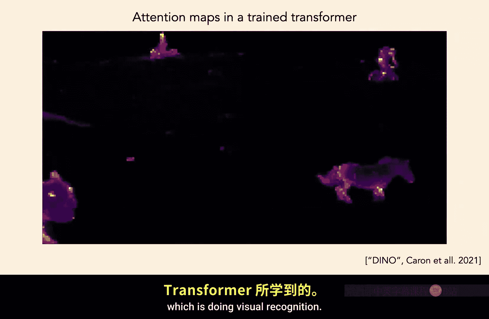

や本政。Is able to intelligent。Which parts of it？Yeah， given some like。Tk。

 how does it choose of Lake Paul？

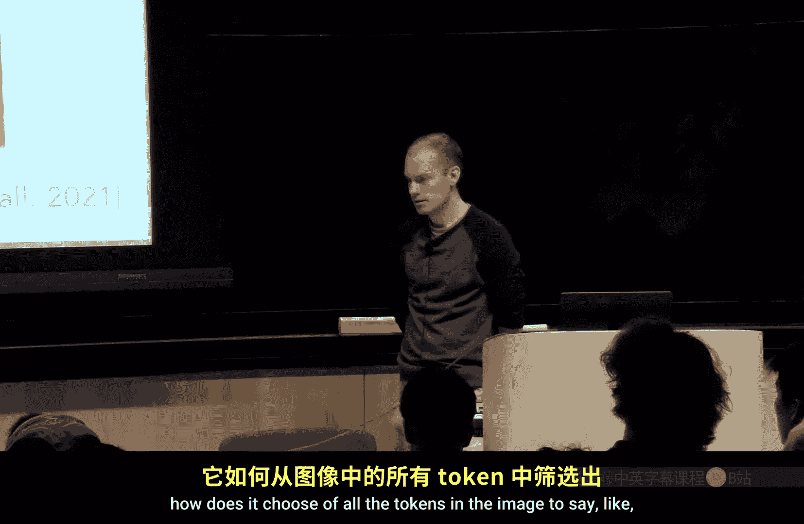

To say like these are the ones I hear。Yeah， so how， how does。

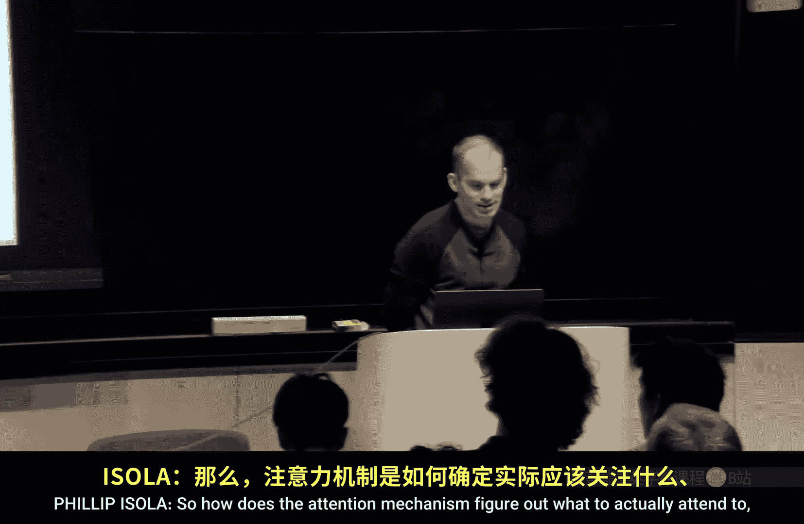

The attention mechanism figure out what to actually attend to， what its query vectors should be。

 what its value vector should be。That's just machine learning。

 That's just back propagation to minimize your objective is going to find the setting of all the weights。

 The mechanism that will achieve good behavior。 And it turns out the mechanism that achieves good behavior often has an intuitive interpretation like I'm giving you。

 but it doesn't have to。To solve recognition， maybe I don't have to have the patches on the horse attend to other patches on the horse。

 Maybe I could have attended to the background and been some inference about the context if it's on a field。

 And so therefore， it might be a horse。 But it turns out that it comes up with the more intuitive strategy。

 which is the horse attends to other horse parts and then decides what it is， yeah。呃一sま。

This seems like an observation， but actually it actually。Have分。Is everything perfect。Yeah。Yeah。

 great question。 This seems like an observation。 Does it really happen。

 Can you enforce this behavior。 This is more empirical science。

 This is saying we have an architecture， and we're investigating what it discovered and then I'm trying to provide intuitions for why it would work that way。

 why it discovered that solution， but it's not provable。

 it's a property of the data and the statistics of the world in combination with the optimization and the transformer architecture that ended up here。

 And there's a lot of interesting in empirical science on what do transformers learn。

 what internal representations do they have。😊。

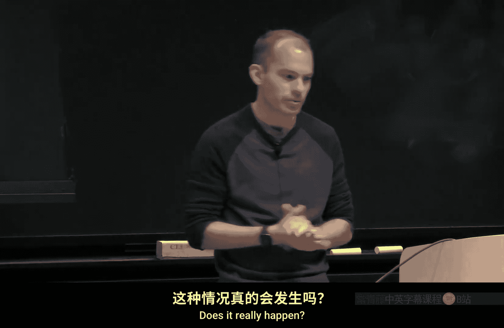

What are the circuits like there's this idea of interpretability research trying to understand what these things learn？

But there's another lens， which is just who cares what they learn。

 Let's understand ML theory and how gradient descent on objective functions with high capacity networks will converge on good solutions。

 but not care about the internal structure。 so you can look at it from either lens。

I think I need to move on， but we'll come back and have more time for questions soon。Okay。

So here is a fully connected layer with learnable parameters for how to take a weighted combination of the input token sequence to the output token sequence。

And here is the idea of self- attention， which is that the weights of that linearar combination are a function of the input sequence。

 so the F that is going to determine our queries and keys。

 or in particular our queries is going to be coming from the input。Token sequence TN。Okay。

 so how is it going to come from them's going to be。诶。

Exactly the same type of math that I showed you a few slides back。

 But here's how it looks for self attention。 Okay， so I have my T N。

 and every single token in my input sequence is going to emit a key， a value and a query vector。Okay。

 it's going to emit those via。W Q， which is a projection from its token vector into a query vector。

 W K， which is a projection from its token vectors to its key vector and the same for the value vector。

Okay， so now I will get。A set of queries， a set of keys， and a set of values。

 I can stack them up into the query matrix， which is for every row in that matrix。

 it will be the query for one of my input tokens。For every the key matrix and the value matrix。

 And this is just saying that I can represent the query matrix as just the matrix product of it's just a map mall。

 It's just a matrix multiply of the token。啊。Matrix times the learnable projection to queries。Okay。

 so this is another nice thing about the design of transformers is everything just becomes these matrix multiplies in a very simple。

 like notational form。 So this is my queries。 And they're just T N times W Q。😊，Okay， so。

Now I take all of these matrices and in order to get the weight in the linear combination for this unit of T out from this unit of TN。

 So remember the linear combination is over the values， the values are in this teal color。

 so I'm going to take a linear combination over the values。

And the weight that I'll assign to that linear combination is going to be the inner product。

 the dot product between the key and the query for for this， this token。 Okay。

 so the amount of self attention that I apply to myself is going to be given by this gray box。

 which is just this dot product。 And if you kind of work out the linear algebra。

 you can realize that this will just be the like matrix multiply of the query times the the key matrix。

 and then that will just be every query vector gets multiplied by every value vector， sorry。

 every key vector。 and that results in the value。 And。

The values will then be kind of stacked up into an n by N matrix。

 if have n input tokens to n output tokens as an n by N set of weights that determine that linear combination。

Okay， so mathematically， we can condense all of this into the simple equation。

 This is the famous attention equation， which is going to be the query matrix times the key matrix transpose。

 Okay， so if I transpose， I'm gonna be taking like the dot product between all the pairs of queries and keys。

😊，And then I'll divide by the dimensionality of the square root of the dimensionality。Of。The。

 the vectors of of the So the the keys queries and values are M dimensional vectors。

 They don't have to be the same。 They don't have to be D dimensional。 Remember。

 the tokens were d dimensional， but in general， the queries keys and values could be some other dimensionality。

divideivide by that dimensionality。 And then I'll take a soft max to ensure that I'm taking like everything sums to one。

 So that has some nice normalization and numerical advantages。 And then finally。

 the output will just be the attention matrix times the input value times the value matrix of the input。

Se of tokens。Okay。So it's a lot of little nitty， grty linear algebra to work out。

 but it comes to a very simple equation in the end。

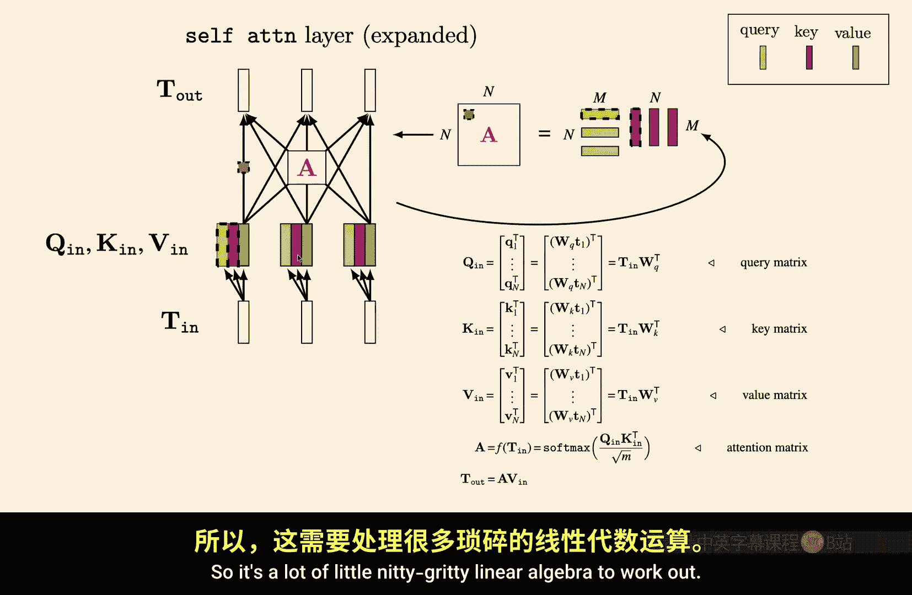

Yeah。Like， is there？2。W。Like at the end of the day， T is going to be。Like a major。

Which is a function of to learn。Yeah， do product with another one。

So is there something about decomposing A into D？m not Yeah， no， no， it it's， it's a good question。

 Like， why not learn a directly， I think empirically that recipe。

 Well the the basic statement is empirically the transformer recipe。 I'll， I'll specify。

 it just seems to work the best at so many different things。

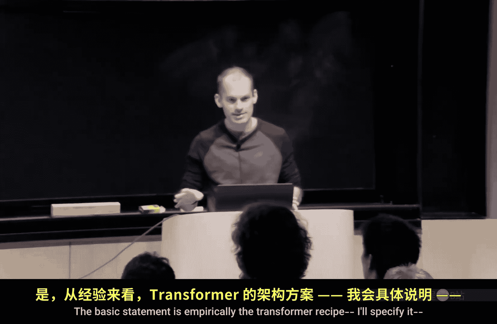

嗯。I don't know about like direct comparisons between learning A versus U。

This like outer product of the queries and the keys that are also learnable projections。

 but you can you can kind of start to count how many learnable parameters there are and like what is So at the end of the day。

We have some parameters mapping from T N to T out。 And you can kind of think。

 if I learned A directly， I would have to learn n squared parameters。Where N is。

 the number of tokens in my sequence。If I。Learn W， Q， W K and W V。

 I'm also learning a lot of parameters， but it's not dependent on the sequence length。 Now。

 it's dependent on the dimensionality of my token vectors。 So it's dependent on D， as opposed to N。

 Now， transformformers are typically applied in modern AI to extremely long sequences of tokens。

 maybe like millions， length million sequences of tokens， even like， you know， modern LMs。

 you can have。

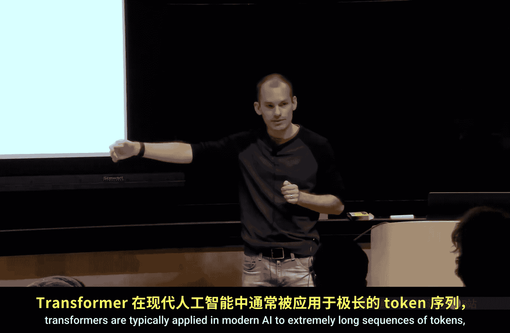

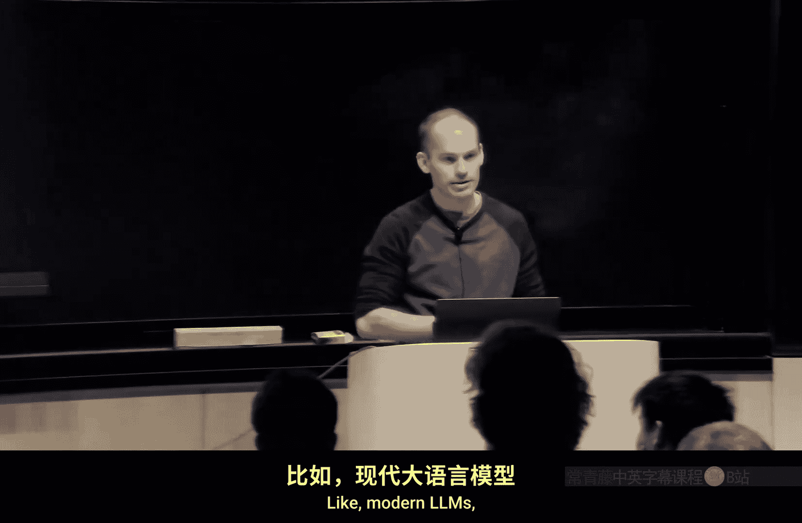

Paragraphs and paragraphs and whole books you're processing。 So N is usually very large。

 And D is much smaller。 So there's actually fewer learnable parameters。 That's just one perspective。

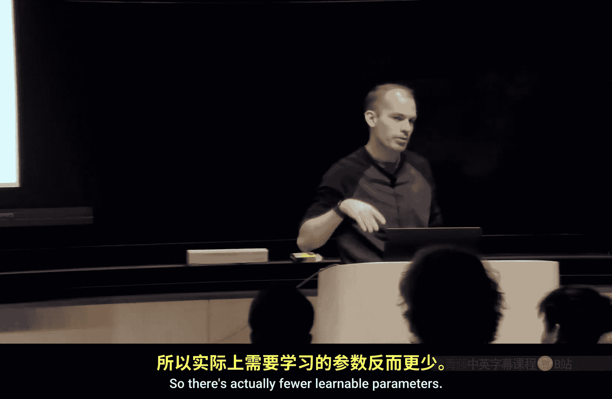

Okay， one more yeah。Yeah， so， okay， I'm not sure I've got the first part of the question quite。

 but I think you're asking。Shouldn't we have like a different way of processing language and vision。

 Can you， can you adapt your architecture to that？ And the answer is， yeah， that is of interest。

 But again， the kind of the power of the transformer and the transformer paradigm is。

Kind of only put in domain knowledge into the the first step。 plus a few other places。

 like in positional encoding， which we'll get to you。

 you can put into domain knowledge and otherwise use a very generic computational framework。

 which has the advantage of。Just if you， if you homogenize。

 then you can get advantages of everything runs on the same commodity hardware。

 The code bases are all the same。 The lessons are transferable between different modalities。

So there's a lot of advantages to that， but specialization。To modality is if it well。

 It's just kind of a trade off back and forth。 how much do you specialize versus how much do you make kind of homogeneous approaches。

I'm not sure I quite answer the full question， but I think I need to move on to get through everything。

We can talk after。Okay， so yeah， as I said， the attention layer is at the end of the day。

 just a linear combination。 So we can now think of like a family of different linear combinations of neurons that we've seen。

 So the first one was in the MLLP， the fully connected layer。

 where every single edge in the mapping from input vector out， but vector is a learnable parameter。

 So we have n squared learnable parameters。 If the input is in R and N， and the output is in R N。

 And we also have some biased terms that we can add n bias terms。😊，In convolution。

 we have a much lower rank matrix， but remember we said that the convolution can be represented as a matrix for a fixed dimensional input。

 we can represent the convolution as a fixed dimensional matrix。

But the interesting thing is it has this like toplit structure where the the diagonals all share the same value。

 So the colors indicate the unique values in this matrix。 So there's far fewer learnable parameters。

 There's only four learnable parameters。 If we include the bias as opposed to n squared learnable parameters for this toy problem where the convolutional kernel size is 3。

 So you know， every three inputs in every three neurons in the input mapped to one neuron in the output。

 Okay， and convolution has this nice property of translation equal variances。

 con of trans X is trans of con X。😊，Okay。And that comes because of this weight sharing。

 you can see it。 Like if I translate the input， I'm just。

The same value is at a different location in that matrix。

So what does the transformer attention matrix look like with this notation， So so what do you think。

 can anybody， this is probably pretty tricky to work out just in your head。

 But what do you think it's going to look like if I'm going to draw it on the next animation。

 So anyone want to guess like， what is the transformerss。

Matrix of unique value is going to look like。 Okay， yeah， let's go here。

 So it's not going to necessarily look sparse， but it is low。 It should be lower。

So it will be low rank。 Its， you said it's not gonna looks sparse。 I think it does looks sparse。

 but we'll see。 We'll see。 Yeah， okay， any others。It's going to be some low rank sparse matrix。

's a little hard to work it out。 But so I also have to tell you how I'm how I'm notating things。

 I mean， it's not like you had you were wrong。 So I'm gonna notate things where I'm gonna take the first three neurons and call that one token and the next three neurons and another token。

 So I'm factorizing the input signal into these two tokens now。 And then those。

 those two tokens get to attend and interact with each other。

 But that just corresponds to using the same set of weights for each element of the token vector because a linear combination of you know。

 rows of a matrix is like using the same weights for element of the row when I'm taking that combination。

 So you can kind of work it out think for yourself。 But this is what it looks like， so。😊。

Transformers have these layers that are linear layers。 Of course。

 the weights are coming from queries and values。 So there's another mechanism on the side。

 But at the end of the day， it's just like this low rank sparse transformation。

 It has fewer linear learnable parameters， which is advantageous in some ways。

And then the other interesting property， which I'll describe in a minute。

 is that transformers are invariant covariant with permutations of the input。

 But we'll come back to that， just like rapnets。Okay， so here's the MLP。

 Here's like the vanilla transformer with self attention。

 And this is roughly the standard architecture we use in computer vision。

 The architecture we use in language processing has one small difference。

 which I'll come to you in a minute。A few little details to add on top of this。

 I think I won't talk about multiheaded self-atten。 It's in the reading。 There's a section on it。

 but the idea is that whether rather than just having one attention layer。

 I can have k attention layers in parallel。 and then I can aggregate them in each attention layer can be attending two different things。

 one can learn to attend to shapes and one can learn to attend to textures， for example。Okay。

 so here is the complete vision transformer architecture。

 This is the standard way of processing kind of spatial signals。 So images in particular。

 but also audio and other things can be used with the same architecture。

And there's only a few things that you haven't seen。 So it's going to be。A set of tokens。

 multi headeded self attention， which is MA。 So that's just multiple runs of attention。

 then combining them all together。And then pointwise No nonlineararity， which is going to mean MLP。

 the blue are the learnable parameters。 Everything else is not learnable， So the。

 the queries and the keys and the values which are indicated by kind of this F。

 well that's really the queries， but there's also keys and values。

 that's learnable and the parameters of the tokenwise MLP are learnable。 Everything else is not。

 These pluses here are residual connections。 So I think in the CNNN lecture we talked about renets。

 So we'll just take an identity path around all this processing and that has some advantages。

And then there's one other little layer called， which I mean lately in token norm。

 It's often more commonly called in the literature layer norm。

 but there's not really an obvious kind of。Layer structure here， really this。

 this operation is just taking the vector and normalizing it to have zero mean and unit variance。

 So I'm taking the elements of this vector， and I'm just dividing by the variance and subtracting out the mean。

Okay。So that connects a little bit to what Jeremy was talking about and what you've done on your problem sets or what you're working on your problem sets。

 where it's good to normalize activations and weight updates in your network For a lot of reasons。

 One reason that Jeremy alluded to is。For stability of optimization and taking the steepest descent direction。

 you need to think about the norms and you might want to normalize your weight updates in a particular norm and your problem that goes into that here。

 we're not normalizing the weight updates for normalizing the activations。

 but you can understand that normalizing activations。

 will have a consequence on changing the size of the weight updates because if I backpro through normalizing the activations。

 you can see that the weight update will be a function of the scale of the activations。Okay。

 so there's layer norm has desirable optimization properties。

 Ex what those are is basically open science。And it's not quite clear why Laonoroma is right thing to do。

 but it's what people do。Okay， so you'll implement transformers on your problems， But I。

 I wantna kind of quickly walk through a kind of pseudocode of it just to show you how simple these things are。

 They're so easy to implement。 That's one of the reasons why people like them。

So here is a transformer in the vision transformer style that is taking。Processing a set of tokens T。

 So we first tokenize the input。 that might be domain specific knowledge。

 like break up your dimension to patches。And then for each layer， we're just going to run the same。

Operation， we might have different weights per layer， but otherwise， the same operation。

 We will take the matrix multiply of the layer norm of the tokens。呃。Times like that this， you know。

 outer product of the key query value matrices with the token matrix。 And we're layer norming it。

 Then we get key query value value matrices。 And then we'll just take the matrix multiply of。

Q times K transpose divided by the dimensionality， which here I'm noting as D。

The dimensionality of the keyquaium value vectors， and then I'll add residual connections and take the linear combination of mapm so everything is just map Mos and a few other simple operators。

 and this maps wonderfully onto modern compute that loves matrix multiplies。Okay， so really simple。

 and that should work。Okay， so there's one more new idea I have to get to before。

The end of the lecture。 Well， there's a few more things to get to， But one more big new idea。

 which is positional encodings。 Okay， it's not a new idea。 Again。

 It's been seen in a lot of older architectures， but it was one of the like the key things that kind of made transformers stand out。

So。嗯。The first thing to know is that transformers are permutation invariant or sorry。

 permutation equal variant， just like graphnets。 Okay， so if I permute the input sequence of tokens。

 then you can kind of work out for yourself that if I permute it like taking T 2 into the place of T1。

 then the output will also。Change the order。 So the output representation of T 2 will now be in this vector。

 as opposed to in the second vector。 So permuting the input permutees the output。O。

 so transformers are essentially a set to set mapping， an unordered set maps to an unordered set。

 The ordering of the tokens doesn't matter。Okay， so you can see this because pointwise tokenwise No nonlinearity F。

 it just applies to every token independently and identically。 So， of course。

 if I change order to the tokens， it doesn't change anything。

 I'm just treating them all independently。 And you can work out for yourself that attention is permutation invariant。

Okay， cause again， attention is like every pair of tokens。

 how much they tend to each other will just be determined based on the values in the token vectors。

 not the order。Okay， so because transformers are just pointway。

Token wise is non linearity and attention。 The whole thing is perm equivari。

So transformer permute the input is equal to permute the transformer of the input。Okay。

 so now positional codes。 Well， remember， if we want convolutional networks to not be translation equal variant。

 we add。The we told the filter where I am in the image。

 and then it can make a different decision based on where I am。

 It's no longer translation equivariant。 We saw that a few times。

 So now you can do exactly the same thing with transformers。

 If I don't want it to be permutation equivari， which oftentimes you actually don't。

 oftentimes the order matters。 You know， if I'm processing a sentence。

 earlier sentences have like causal impact。 The earlier words in the sentence are you know。

 causally determining the next words， but there's not quite the anticousal direction。

 the statistics are different It's not like a reversible sequence or permutation andvari statistical process。

 So anyway， I can。Concatenate each token with a value that tells me where it came from in the input signal。

 What position was it in the input sentence， What what location was it in the input image。Okay。

 and here's how you do that typically， not， not typically。

 but this is like the vanilla way of doing that。 There's a lot of more advanced ways of doing that。

 But if I want to tell this patch here on the draft's head， what position its at。I will。

 I could encode the X， Y location and Cartesian coordinates of that， of that patch。

 but I'll typically represent this on a 48 basis， where I will。

Say what is the value of a sine function at that location。

 and I'll do that for different signss and cosines or in the vertical in the horizontal direction。

And this is just like a encoding of the position。 But in a， in terms of。

A different basis as opposed to being just like the Cartesian grid。Okay。

So these values tell me where I am in the image。The book chapter goes into some kind of intuition about why  Fourier positional encoding is advantageous over other types。

 but this is also an open science question。 this one works pretty well。Okay， and。You can。

 for whatever signal you have， like， there's a lot of domain expertise that can come into this part of the problem。

 How you define the visual encodings， because that's the part where you kind of。

Tell the system what what it means to be local for your domain。

 you give the inductive bias of what locality actually represents。

 So from processing data on a globe， I can do physical encoding that's like latitude and longitude。

 but maybe on some kind of Fourier basis over like spherical harmonics over like sineusoids on the sphere。

For graphs， one of the typical position encodings is the onto the kind of eigen basis of of the graph lapplaceian so。

We mentioned this a little bit in the GNN lecture， but basically， I can take a graph。

 and I can compute something called the graph Laplaceian。

 And I can look at the the eigenvectors of that。 It's this like thing that tells me kind of location in the graph。

 like kind kind of canonical location in the graph。😊，And these， the coordinates。

 the eigenvectors for some of these the eigenvectors of this graphflplian are described by these colors on the nodes so。

The like first eigenvector is this one。 It's really smooth。 It's like what， you know。

 where am I globally And then other eigenvectors are like high frequency。

 like almost like a 4ier basis。 So I don't。 this is all domain knowledge。

 It's not stuff that you need to know intimately unless you're working on， on that domain。

 But this is just to say you can introduce a lot of domain knowledge into positional encodings。😊。

Okay。So those are the three pieces for the transformer。 But there's one last thing。

 which is a lot of you will have seen large language models and already heard about transformers in the context of language modeling。

 So I want to tell you how transformers map onto language models because there's kind of one extra piece that is important。

And it's called causal attention。Okay， so first， I have to get。

 we're gonna come back to autoregressive models and generative models of language and other signals a little later。

 And one of the kinds will be an autoregressive model。 But I'll tell you briefly what it is now。

 because it's extremely simple。 And a lot of you already know this， because all over the media。

 This is how， you know， chat GPT works and so forth。😊。

You take a sequence of words and you simply try to predict what is the next word in that sequence。

Okay， so once upon a time， and then you do the same thing autoregressively。

 which means you just take your prediction and concate concatenate it or postpen the input sequence with your prediction and then keep going。

 Now， predict the next word and the next word。Okay。

 and you can train such model because you will train the predictions to match the data set of actual text that you observe from the training set。

Okay， so we'll say once upon a time。 and you can watch， you know。

 Claude orllama or whatever your favorite L L M。 You can watch it right out things as doing exactly this。

We'll talk more about those later， and you don't have to do auto regression in times。Arrow order。

 You can do it in any order you want。 but that's just a detail。 Okay， so as I said。

 you have a training set， which is sequences and completions for the sequence。

 This is just text online for language models。And you are then going to use supervised learning to try to like classify what is the next word and a vocabulary of possible words。

 And then at test time， when you're gonna to sample new sentences， you'll just say。

 you know color to the green idea sleep， it will predict what based on my training data。

 what might have come next and maybe furiously came next。Okay， it's a quote from Noam Chomsky， so。

Okay。So that's how G works。 GT is generative pretrain transformer。So。It's a transformer。 Okay。

 and it's an auto regressive transformer。 So here's my normal transformer， that I'm drawing。

Where self attention。 So the input sequence of tokens that represent the words or maybe set parts to the words get to choose what to。

 which of them to attend to update their representations。 finally， at the very end。

 come up with a prediction for the next item in the sequence。And every time I run this。

I will get a prediction of the next item in the sequence。

 and I'll shift the input over by one and repeat the process。Okay， so。There's a little issue here。

Which is that。If I want to train such a system， I want it to be the case that my prediction for the word furiously only depends on the previous items in the sequence。

 Now， with this architecture I'm showing here， the input has the word furiously。

 and it could just learn like an identity connection to say， oh， I'm predicting furiously。

 And my input already told me what the answer was， that'd be wrong。 If I'm predicting the word ideas。

 I need to only be able to look at the previous items in the sequence。

 I can't look into the future if I want to be able to write a sentence in timess order。

So what we do is we do what's called。Masking， causal masking of our attention matrix。

 And that just means that every output。Token can only attend to earlier tokens in the sequence。

 So the order does matter。 This is no longer permutation equivari。 Now。

 the order actually is matterine via the masking operation。 Okay， and so now the attention matrix。

Looks like a masked matrix。 And that just means some of the arrows are not allowed。

 They're just set to 0。So the arrows at the top here exactly match the masking at the bottom here。

 and I only allowed to learn， or I'm only allowed to use these values。

 meaning I'm only allowed to attend to things previous in the sequence。

And this allows me to make predictions are causal that only depend on information previous in the sequence。

Okay， so。This is what a multi layered transformer looks like with causal masking on the first layer。

 I'm trying to predict the fourth item in the sequence given the previous three I。

Will not observe the fourth item because otherwise I would be cheating。 and I would be too easy。

 But then after the first layer， then I can just use a mask that looks like this。

 Every token attends to itself in all the previous tokens。

And this will achieve that the receptive field of this output token that will predict the next word can only see every previous word and the receptive field where this output token that I could use to predict the second to last word will only see everything previous to itself。

 And therefore， I can just supervise this thing to kind of output a sequence of words and every word in that output sequence will only depend on the previous words。

 And this is an efficient way of training such a system。Okay。

 I'm going a little quickly for the sake of time。 but there's more details on this in the book chapter。

 This lecture follows the chapter almost exactly because finally。

 I had all the material ready for this this year。Okay， so here's。

I'm sorry to say this is just probably the worst diagram in like all of science。

 But it's also the best paper in all of science。 So it's like that， you know。

 they balance each other out。 Attention is all you need。

 It's a super important paper because it's the one that define the transformer architecture。 Again。

 It's not new ideas。 Its just a particular recipe that is novel in its details。

 but works incredibly well。And a few new ideas here and there。

And so this paper is just super important。 At attentiontention is all you need。

 And a lot of you will come across or will have seen this diagram。

 This is their diagram for what a transformer is。Super confusing to me。

 I don't know why they call this like a feed forward layer。 But what， what is it。 So this is a。

 this is the token wise non nonlineararity that that box in blue， they called feed forward。

 So it's like applyinging independently and identically。An MLP to every single token vector。

What is this thing here， This is that auto aggressivegressive part that I was describing。

 So that has nothing to do with really transformers。 That's more about auto aggressive modeling。

 So you can kind of， really， they sort of factor those two ideas separately。

 But they put them together in the first paper。 Okay， so that's just saying。Right， what is。

Shifted right。 O， shifted right is， is this thing where I just shifted the input sequence to the left。

 I guess， in my diagram。And I don't know， position encoding。

 that't meant be like a assign sign used wide position encoding。Then all of these things add a norm。

 That's just a original connection， so。Just think of it like this。 And I think it'll be simpler。

And I definitely prefer。This diagram instead。 But for language。

 I would just shift the input to the left and do causal attention。Okay， last slide is going to be。

Just showing now how I could put together some language modeling and image modeling to do more complicated things。

Okay， so here is a case where I will take my input， which is an image。

 I'll tokenize it by mapping each of these patches into token vectors。

 I'll do self attention and some computer vision stuff here。

 But it's all generic processing of tokens now。😊，And then I'll do this thing called crossats。

 And I'm going to try to be describing this image and text。

 The task is to take an image and turn it into text， write a caption for the image。

 So I'll take this as input。 and then I will autoaggressively start writing a sentence where every next step in my prediction problem will be capable of attending to the previous words in my sentence and additionally all of the representations of the image tokens and cross attention is just referring to when you are having these tokens attend to these tokens。

 which are not themselves。 They are like a different set of tokens。

 Okay so you can have all different types of attention masking strategies and this one is popular for image to text captioning will come back to generative models and autoaggressive models a little bit later and I'll end there for today。

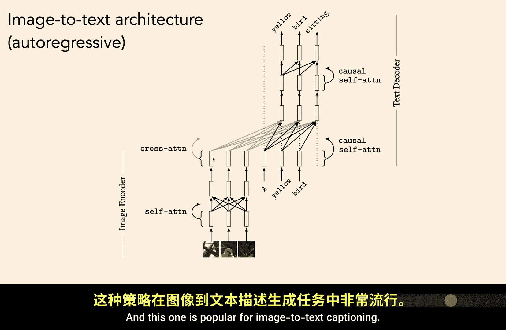

