# 麻省理工学院【中英⚡深度学习｜6.7960-Fall-2024,-Deep-Learning】-p09-P9-深度学习黑客指南--BV15QZ4B1E6v_p9-

Today we're going to have a lecture which is a little bit different than some of the other ones because it's a bit more on just like practical advice and heuristics and hacks。

 a little less on formal knowledge and theory。

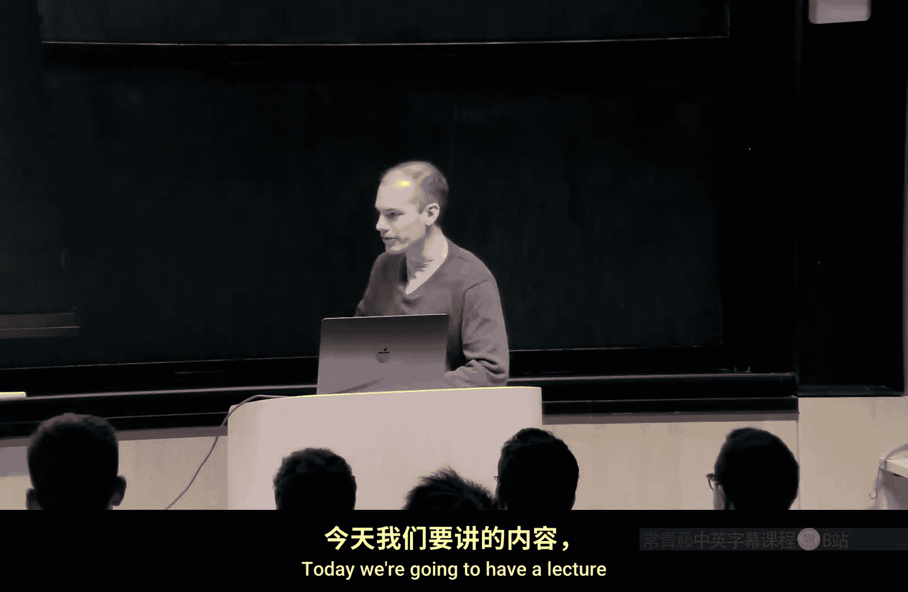

So the big disclaimer is that this is going to be a somewhat opinionated lecture。

 I'll share things that I think are good ideas， but they're not when everybody would agree on it's just anecdotes from my own experience。

And we'll talk about a bunch of different aspects of the deep learning pipeline。

And how to actually like make working systems with data and models and good optimizers and also then some comments on。

The other parts of the problem， like how do you create a good evaluation framework and how do you use compute effectively and so forth？

And。These slides are put together from a lot of sources。

 so in particular Evan Schelhamer had a talk which like formed the skeleton of this talk that he was giving for some years。

 Evan was the developer of Cafe， which was the most popular deep learning framework five or 10 years ago。

And then I got a lot of tips from Andre Kpathy's blog posts on this topic and from my lab members and other folks。

Okay。So。The starting point of this lecture is that。

TheA big part of the story of deep learning is not just the theory or the algorithms is actually the the hacks。

 the practical tips。 It's a little bit of a triumph of the practitioners over the academics and the theorist。

It doesn't mean that we won't eventually have a very clean mathematical theory of deep learning， but。

Historically， a lot of the people that have really made progress here have just done these things。

 which we might call like hacking and it's worth valuing that and understanding that。

And in the generalization lecture， I talked about this paper briefly， which is。

That you can overfit to a set of random labels with a deep net。

 and this means that the general generalization bounds you get from some classical theories like the VC dimension are e vacuous。

 They don't really tell you anything about how well that system will generalize and yet deep nets generalize so clearly the classical theory doesn't quite work。

And a lot of the places you've may have been introduced to deep learning。

 if you've studied it in the past or you've programmed the neural nets in the past would be courses that are very practical in nature。

 like FAa AI， which are really focused on like， let's just code these systems and make them run。

 and maybe the math in the theory of secondary。ok。So this practical stuff is a big part of the story。

 and it's worth understanding。So I'm Im going to start with one story， which comes from my。

Post Tech advisor Alyosha Fros here on the right。Back when I was at Berkeley and his advisor。

 Tider Malick on the left。Was mentoring Alyosha when Alyosha was a grad student。

 so this has been passed down to me through multiple generations。And。Essentially。

 Alyosha was training models back in those those days， you know，1020 years ago。

And would come to Jeendra， his advise and say， okay， here is my result， right？

 And it wasn't a deep net。 It was something else， but this is just meant to convey the idea that he would show the results of some numbers。

 some plot。 Like， I got 30% accuracy or maybe here's my loss or my optimization graph。

 And Just in say， okay， what's going on here。 Why are there these spikes。 And Alyossha would say。

 well， I don't know。 And so Jetenra said， okay， this， this is not enough， right。

 This doesn't tell you that much about what's going on。 You really have to look at the data。

 You have to look at the results you're getting。 This was a computer vision lab。

 And so the data was images。 Look at the images。 Look at what images here you're analyzing what labels you're predicting。

 Look at the data。 Don't just give me some summary statistic。And he put it this way， he said。

 becomecome friends with every pixel。So I think that's just a lovely phrase and whatever domain you're in。

 try to become friends with the data points in that domain。If you're studying music。

 become friends with every note。 if you're studying chemistry， become friends with every molecule。

 right， become friends with every pixel。 Look at the data。Okay， so then。

Alyosha is well known in computer vision now has being a very intuitive and insightful person in terms of the actually kind of like。

The holistic nature of computer vision。He went to France and took photos and understood the beauty of that data。

点睇。Okay， so look at the data。And you can think about this also for your final projects。

 don't just show us like a plot， like show us the data。

 something a little bit more high dimensional than just a single plot。Here's an example from。

A system that tried to。Diagnose whether or not a scan of a patient's chest was had this patient has breast cancer or not。

 And so you're trying to classify a bigign or malignment for the possibility of their being a tumor。

And。This paper is actually an analysis and critique of prior works。 So it's not their fault。

 These authors are the ones that pointed out this issue。

 But what happened is a deep net was used in prior work to try to identify， you know。

 if is this cancer or not， And it got like really high accuracy。 I don't know，99% accuracy， so。

What do you think it was doing， anyone maybe have seen cases like this？

Was this deep net accurately classifying the the scan。 I'll actually， I'll tell you。

 I'll tell you it wasn't。 So they， they then tested this system and it failed。 Okay。

 so why did it fail， What was it doing that made it fail。 I saw an answer back here。

Yeah， so one answer， it just said nothing is cancerous。 and maybe in the data set is imbalance。

 and 99% of the cases were not cancerous。 that could have been it。 That's not the case in this one。

 but that is a common failure。 Let's go back here。So outside of the lung。

All in the top right corner is more。That that was the point they were trying to make。

 So in this case， as you said， the deep net was not looking at the tissue。

 It was looking at the R in the corner。 So there was this kind of spur correlation。 this shortcut。

 And it turned out that that R was some indicator about like what hospital this came from or I don't remember entirely。

 but let's just imagine that it was R if it came from like Roosevelt Hospital or something like that。

 And at Roosevelt Hospital， all the patients that were put into the system had malignant tumors because it was like hospital you go to for that situation。

 So there was a bias in the data and。

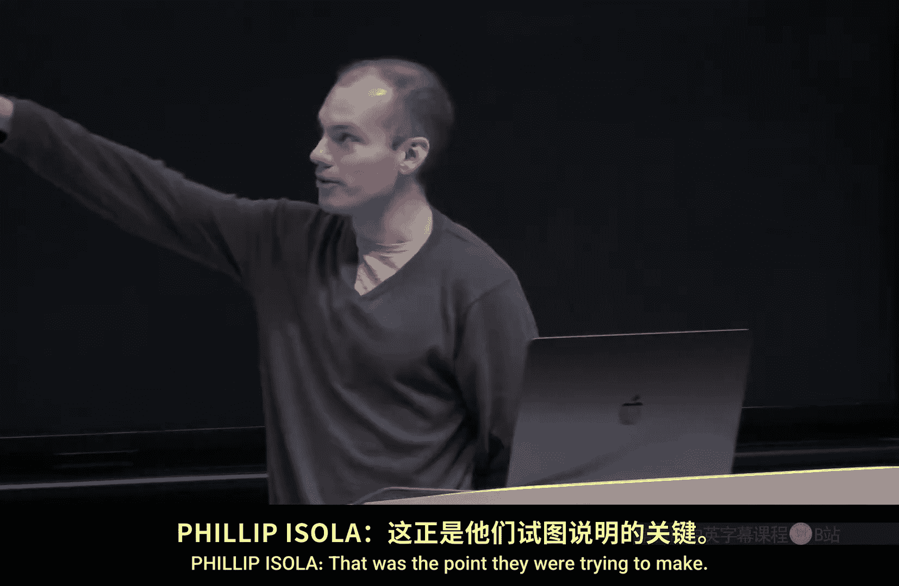

The data gave away the answer。 And so you know， you really need to look at these things to identify。

 is your model working for the right reason or the wrong reason。

 This is the wrong reason because it won't generalize to other hospitals。O。So。

 or you can imagine a worst case where R just meant like malignant。

 and it would have a difference in both if it weren't right。

 It would just completely give away the answer， and it wouldn't generalize to a system that doesn't give you the answer。

 And that's what you really care about。Okay。Look at the output， too。 Okay。

 so don't just look at your loss curve。 That's the most superficial thing。 You should， Yeah。

 definitely do that， but don't only do that。Okay， so。

Here is something that would be better to look at if you're in the business of training generative models of cats Okay。

 we'll talk about generative models later， but these are models that make photos of， you know。

 you've all seen this Dolly and midjoney and these types of things。

So this is learning to make photos of cats。 And if I were to only look at my loss。

 like what does my objective function say about the quality of these images。

 it might be spiky and crazy。 I don't know what's going on， but if I look at samples from the model。

 actually， these are outputs from the model as it's being trained。You get a lot more information。

 You can kind of see something which is like， it seems to oscillate。 It's like periodic。

 So now this happens to be what's called a generated adversarial network。

 We'll talk a little bit about these later， but they do have this oscillulatoratory behavior。

 And it it's something that's very obvious in this output。

 It would also maybe be obvious in certain loss curves。

 But you get much higher dimensional highput understanding of what's going on when you actually look at the data like this。

Okay， oh here's another example。 is these are some little ants I that I trained years ago to try to play some predator pre game。

And what was happening is。They would like， I looked at the reward function。

 This is like a reinforcement learning and trying to， like， chase each other。 I think that the。

Blue ones are trying to run away from the red ones， which are the predators。And at first。

 the reward of the predators would go up a little bit， but then it would like just plateau。

 and I didn't know what was going on。And why was it plateauing because they were falling over and then making no more progress？

So if I only looked at the loss， it was like， oh， it just plateaued， like learnings hard。 It was。

 you know， I don't know。 SGD was failing。 No， it was failing for a very particular reason。

 which is the ants fell over。 and I had to fix that。Okay。So look at your outputs。

 look at your inputs， visualize what you're doing。Okay， so just to summarize some of those points。

 look at the data。Inspect the distribution of inputs in your training set。

 In the distribution of outputs in your training set， as the student said over here。

 you could have an imbalanced set of target outputs in your training data and that would be another common failure if your data is 99% benign tumors and 1% malignant then chance。

Where the system is completely doing， you know naive guessing based on those prior priors。

 not looking at the data， not looking at the input at all， would be 99%。You could just say， well。

 I know I'll be 990% right if I always say benign。Then you have to calibrate with respect to that。

 You have to realize that 99% is trivial。 And therefore。

 you're looking for a higher number than this。 Or maybe you want to measure something else like the。

The conditional probability of being correct， given that is malignant。Okay。

So you can select random mini batches。 You can visualize them。Ploot histograms。

 plot marginal statistics。 What is the variability of the units of measure in your data。

 Are your numbers in the range 0 to 1 or in in the range 0 to 56 or in some other range。

 Can negative numbers be in your data or is there only positive numbers。

 These are the types of things you want to know。Okay。So。One of the most common bugs。

That I come across， especially in like final projects， is that the data is。

Not being pre processsed and loaded into the format that you think it is。So。For example。

 let's say you're working with images。And you have assumed that your data lies in the range。0 to one。

But actually， when you loaded it， it is loaded as unsigned integer8 UN8s in the range of the0255。

 which is a common format for imagery。

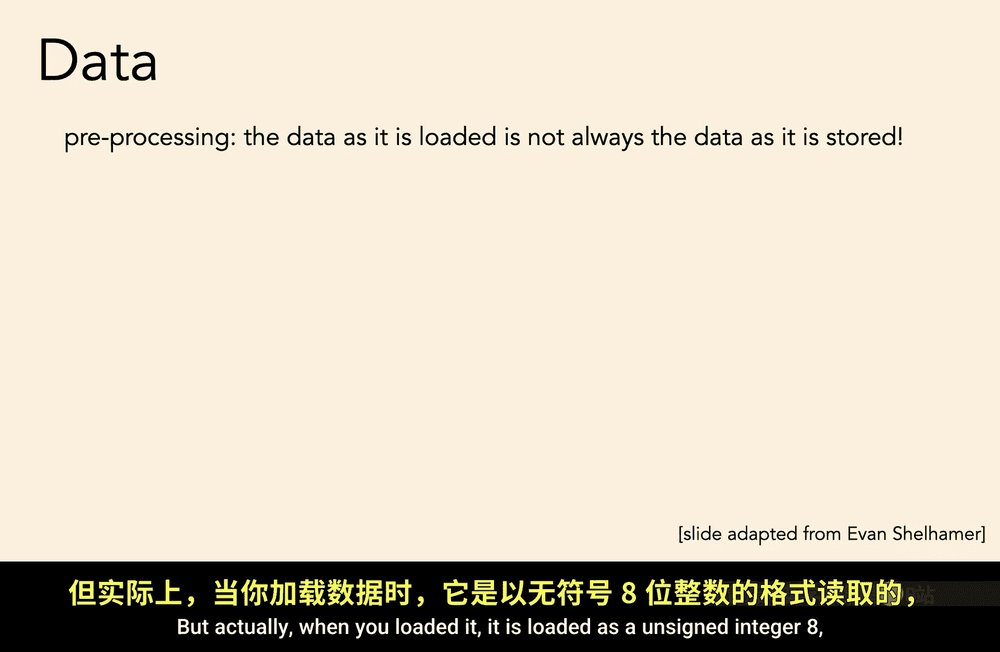

So you， you might have a bug because you， you have code that actually like clamps。

 Let's say you actually like。Camp your inputs to be between0 and1。

 but the data you're loading is between 0 and255。 So now you're losing all of the information because you're making all your data points equal to either  zero or1。

So you have to be very careful about this。

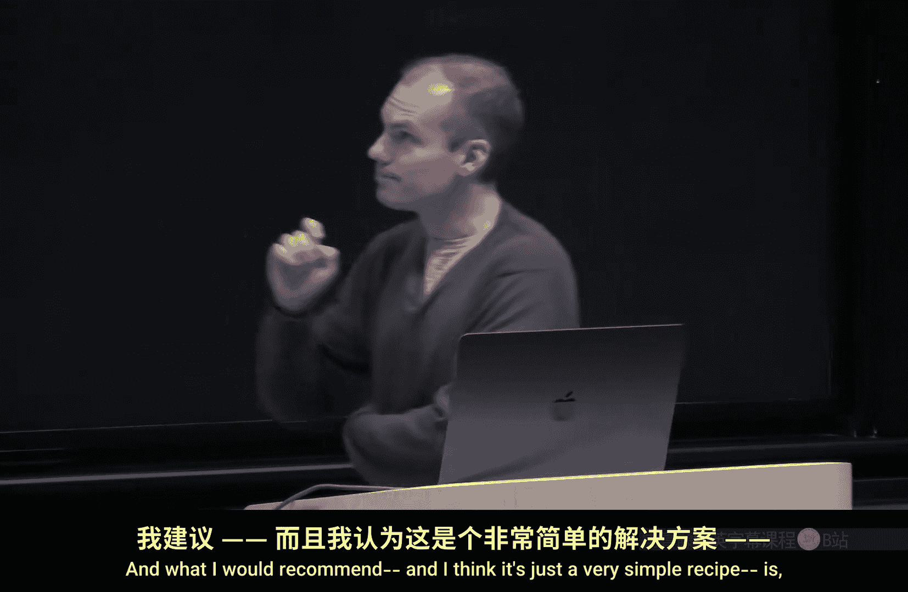

What I would recommend and I think。It's just a very simple recipe。 is somewhere in your code。

 you're going to have。Model dot forward right， you're going to run your neural net in a forward pass on your data point。

Right before that line is where you should inspect the data。

 So you don't want to inspect the data like as it's sorting your hard drive。

 you don't want to inspect the data as it's initially loaded by your data loader。 You can do that。

 too。 But a place where you really need to understand what the format of the data is and what the distribution of the data is is right before you run your model on it and make sure that。

What format you think it is， what shape you think it has。

 what dimensionality you think it has exactly matches。What it actually is in practice。Okay。

 so here's just another example of where this can go wrong。So。It turns out that in。Some of these old。

Normal libraries， one is called decaf， another is called cafes。

 So these are like the precursors of pieytorrch and Tensorflow and other models like that。

 other systems like that。If you load an image。Off of your disk in decaf。

 it will be represented upside down。 It' will be flipped。And in cafe， the channels will be permuted。

So the standard color space for a cafe is BGR instead of RGB。 The color channels are permuted。

And so if I have an image on disk and it's an RGB order and then I load it into cafe。

 the order of the channels will be the blue channel is in the first channel dimension。

 the first index。Okay， so that was because of some old convention in a library called Open C。

 It doesn't really matter， but it used to be BGR with the convention。

 And now we use RGB as the convention。 But let's say that I'm training my cafe model on images。And。嗯。

Maybe it says， oh this is a blueberry， right？Well。That could be because it's actually。

Seen an object per， you know， a strong red channel。

But it's interpreting that red channel as the color blue because maybe the system was。

 was pretrained on data in the format at RGB。 But now you load it into cafe。

 and it's in the framework BGR。 So anyway， you can get errors like this。

So you really need to have a match between what your model is expecting and what you're giving up。

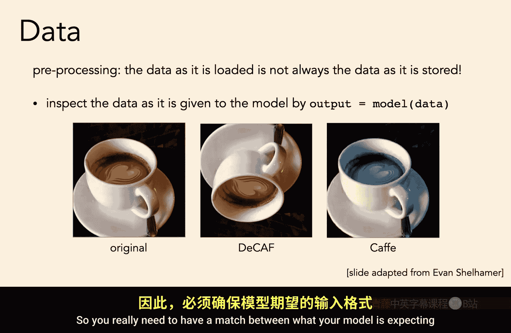

And if there's any mismatch between training and inference or between the model architecture and the numerical transformations you apply and the data format。

 then this will cause problems。Okay， so here's。

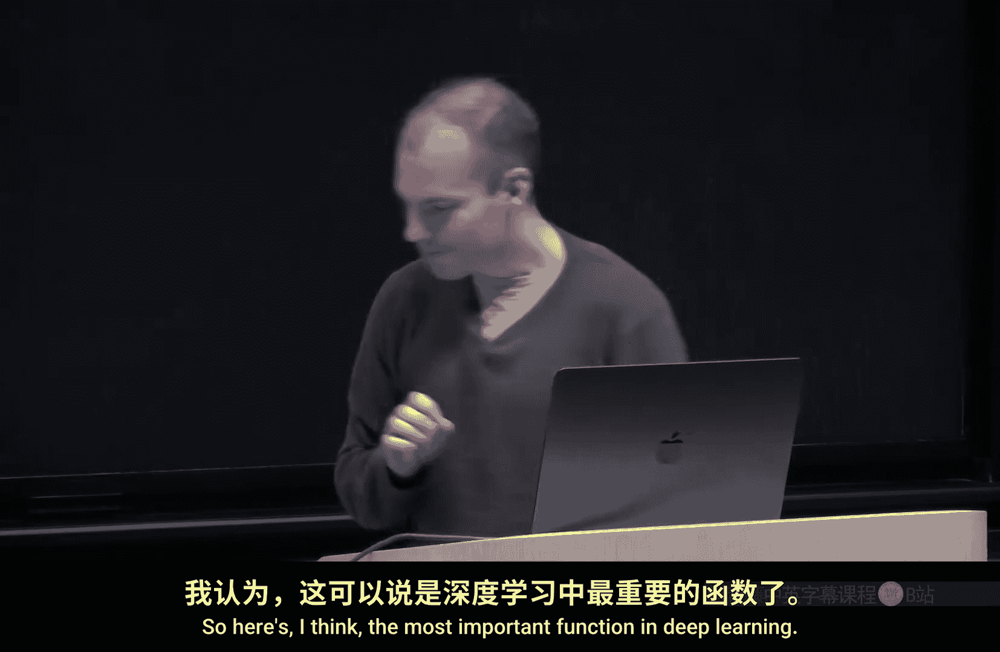

I think the most important function in deep learning。 This is one that I wrote。 So it's very。

 its a very clever advanced。Contribution， okay， so here it is。Insspeced data。Okay。

 so I just put this all over encode code that I write right before you called model that forward。

 that's the the most important place to put this。 But you can just sprinkle it all throughout your code。

Okay， it's going to just tell you a few things。 And to me。

 these are the most important things to know about your data。

 but there's a lot more you could think of as well。 again。

 you could try to visualize it somehow or plot two dimensional distributions over the different axes。

 but okay， what's the data type， Is it a tensor， is it 32 bit tensor， is it a UNA， is it what is it。

 What's the shape， The shape of the tensorors in deep learning are super critical。

Does it require gradients， okay， so in your problem sets you're constantly training these networks and any parameter that you want to train needs to have required gradient equals true so that you're actually getting gradients for that parameter。

What is the min， What is the max， What does the mean， What is the variance。

 You could go on from here。 But these are the ones I like。

 There are some librariesties that just kind of give you this by default。 But I find those， you know。

 those sometimes change and。Have to require and install。 or it's just a little bit。

 I just like thisniet of code that that inputmet of code will kind of work， I think。

 for at least a few years， okay。So really simple， but I actually think this kind of stuff is important。

Okay， so data。Another thing is， again， the numerical range matters a lot。 so one of the standard and。

Most useful ways of。Re'ming dependence on exactly the units in which you're measuring your inputs and your data in general is to normalize it somehow。

 This is like the standardization transformation where I take my my data and I subtract the mean and divide by the variance or by the square root of the variance。

This is a really common first step to any kind of data loading you're going to do。

 you load your data。 You subtract the mean divide by the variances。Okay。

 and the point that this achieves is it， it makes it so that you're kind of invariant to。

Exactly the unit of measure that you。InIn which the data is stored。

 So if I'm modeling some geospatial information， it doesn't matter if I've measured my data in with the。

 you。The meters or centimeters or inches or feet。 if you've standardized， then it will。

Remove the dependence on the scale of those measurements some to some degree。

 at least it removes it makes it unit variance and zero mean。Okay。

 you could also squash and squish in other ways。To massage your data into a more canonical distribution。

 Yeah， question。

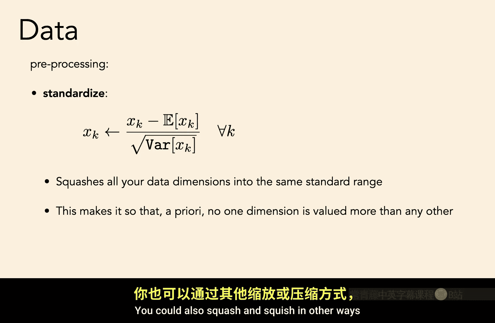

，I this necessarily better than this？I mean， mean as。Yeah， exactly。

 So is this better than like just divide by the difference between the min and the max or subtract the min divided by the difference between the min and max not not necessarily。

 like basically， you want to remove。Information about maybe the unit of measure。

 like the scale of it or the mean of it or possibly other statistics of it。

 And there's a lot of ways of doing that and。Yeah， one of the。

 so I'd say this is one of the most common is just standardization。

 and the other most common is probably。

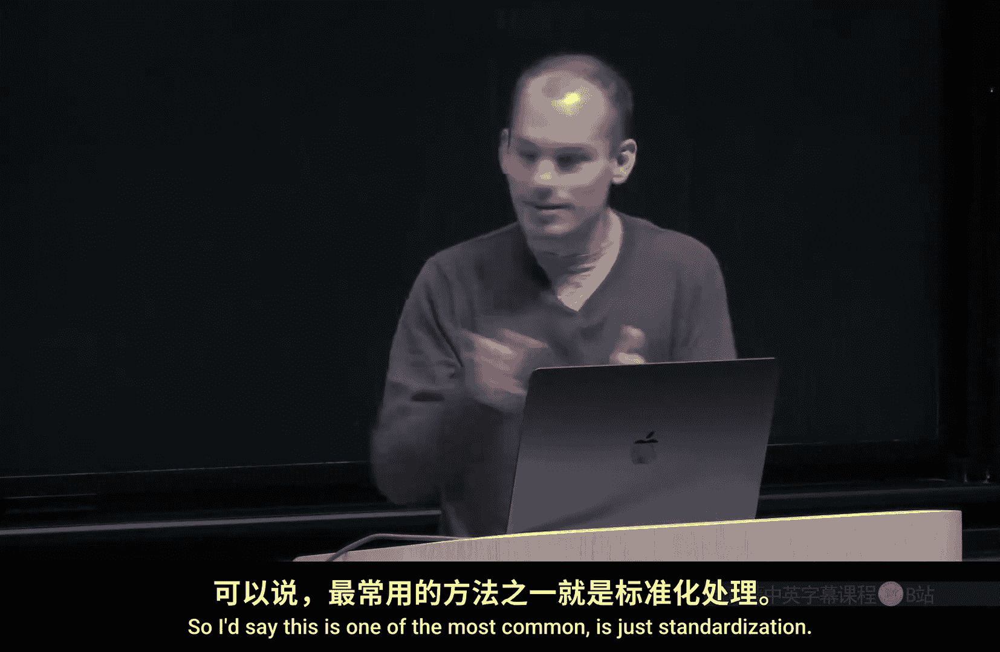

Subtract the men so that the numbers are all。Positive now。

 and then divide by the max after subjecting the in。 So now the number。

 the the highest value is one and the lowest value is 0。 That's another very nice trick。 Now。

 your data lies in the range 0 to 1。😊。

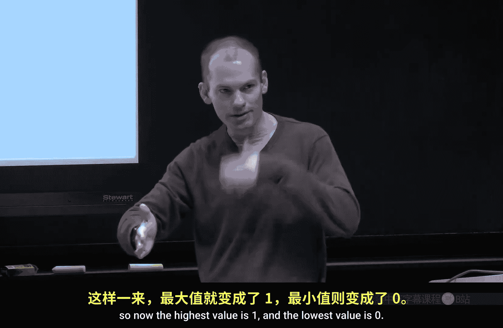

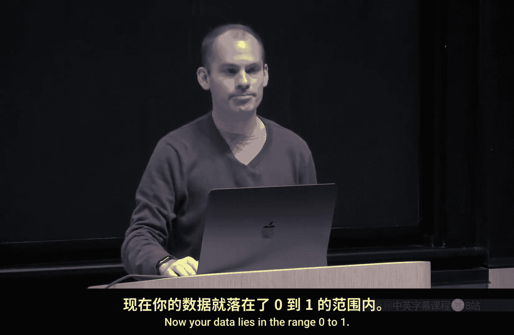

Okay。And this kind of removes inductive bias about the unit of measurement。

 which might be good or might be bad。So it says that no one dimension is treated as like more important。

 a priorityi than another dimension。 They're all in the same， on the same scale。

 They all range from 0 to1。 Can anybody think of a case where this would be bad or actually would want to use that information about the scale。

 Okay， yeah。

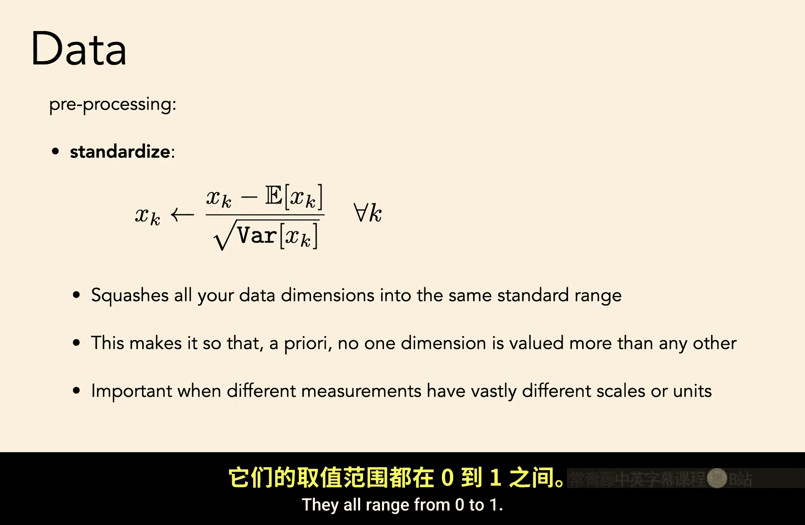

So if you have sail。Horizon and vertical distance they are actually a two dimensional phenomenon。

 so you wouldn't want to scale them differently。Yeah， if you have horizontal and vertical distance。

You might not want to scale these differently because maybe distance in the vertical dimension is like physically different in meaning than distance in the horizontal dimension。

 Is that what you're getting at， They're physically the same。

 You want to scale them together as opposed to。Oh， if they're physically this， yeah。

 so if they're physically the same， then it could be that the horizontal data。

 it has like a very narrow distribution， but you wouldn't want to therefore scale it up because now it's like you're measuring space and the horizontal axis differently than the vertical axis。

 Yeah， so there's a lot of interesting considerations that can come up where this go wrong。

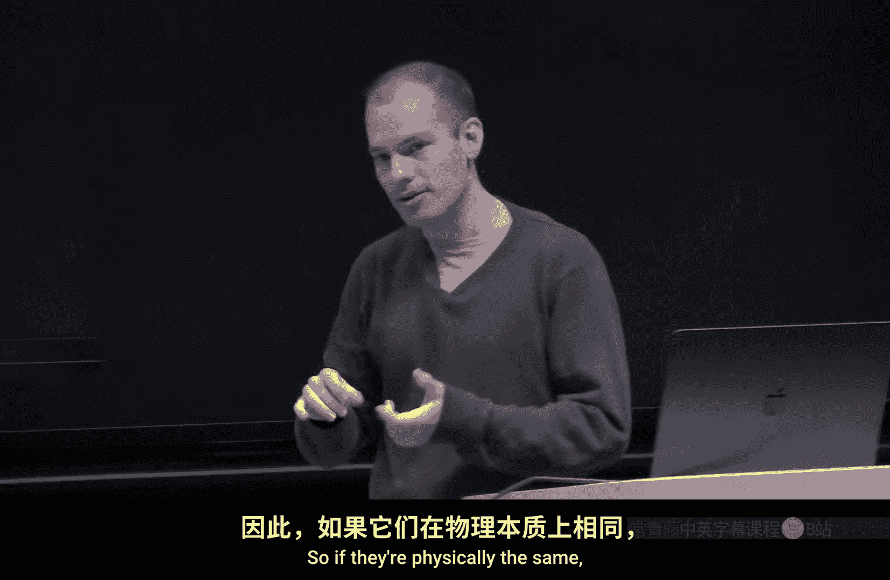

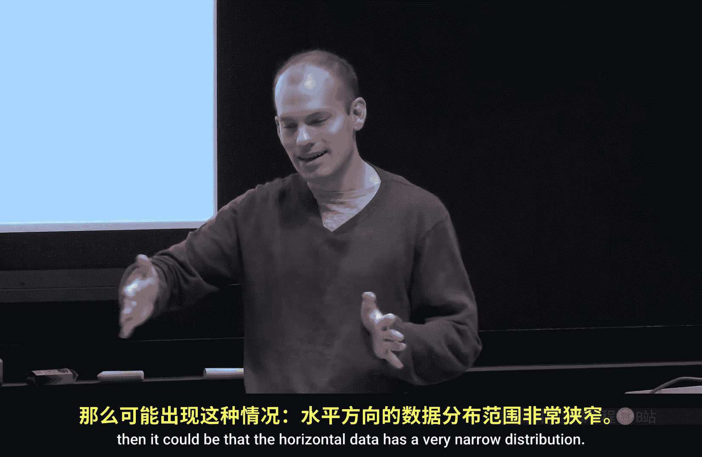

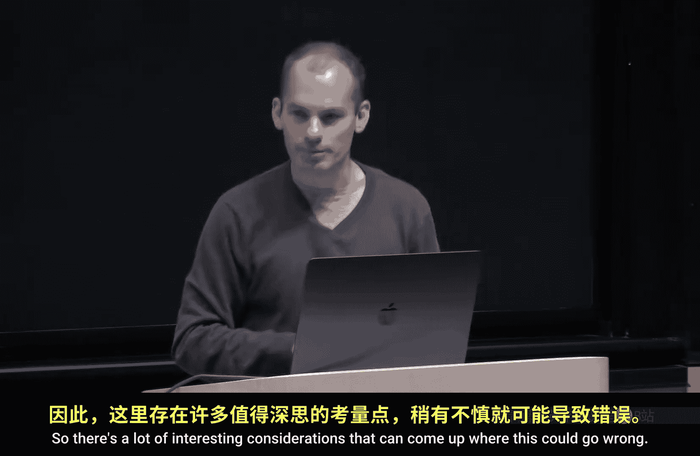

But I would say， in general， it's like good heuristic。

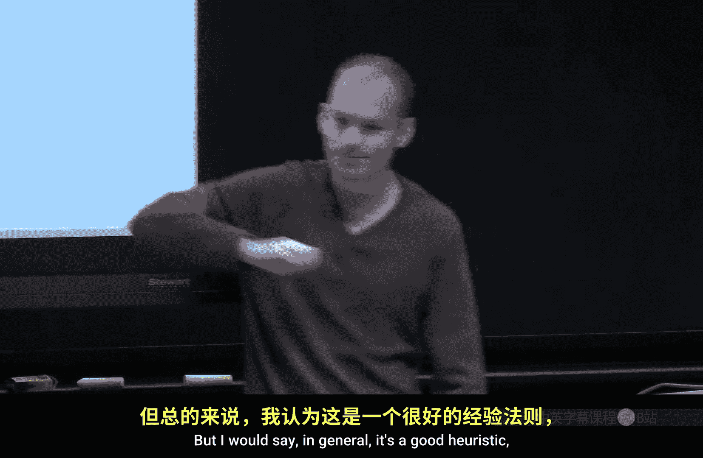

Okay。没。Especially when you have measurements on vastly different scale。

 like you have some measurements you know， that are 10 million times bigger than other measurements。

 It'll be very hard for your network to learn to pay attention to the tiny measurements if there's another measurement that's 10 million times bigger because the gradients will。

Just be much， much smaller for the data on a smaller scale。Okay。

So。Okay， this slide is gonna be a little more subtle。So beware of low dimensions。

This is a slightly different thing than maybe what you've heard before。

 Maybe you've taken some statistics class or even high dimensional statistics。 and people said， oh。

 high dimensions are weird。 beware of high dimensions。

 like things are different than your intuitions and high dimensions。Okay， that's true。

So the human intuitions we have are mostly for like low dimensional three dimensional spaces。

 you know the world is like three spatial coordinates time is another dimension。

 We're used to thinking of low dimensional spaces。 We think of objects like a sphere and a low dimensional space。

 we know what that looks like， but you may know from other classes that a sphere in high dimensional space has slightly different properties like。

And so a Gaussian distribution in high dimensional space is like a soap bubble where almost all of the probability is in a tiny little band around the surface of the VR。

Okay， so things are a little bit different in high dimensional space than we're used to。

 But what I want to point out is that。If we weren't human and we're just like some。

Ideal you creatures of math。 Then high dimensions is a simple one。

 Things are simple in high dimensions， and they're weird and low dimensions。

 And deep learning is all about getting used to thinking in high dimensions。

 and everything gets simple in high dimensions。 So that's what's really nice about it。

 So here's an example of that。😊，So we talked about RMS normm。

 remember Jeremy introduced that in one of his lectures。

 and we sometimes want to take the RMS norm of the activations to achieve good effects on learning dynamics。

And we also talked about layer norm， which is the standard layer in transformers。

 which is almost the same。 And in high dimensions， these things behave almost identically。Okay。

 so the only difference is layer norm。 you subtract the mean over your vector。

 and then you take the R S norm of that vector。 An R S norm。

 you don't subtract the mean of the vector。Okay， so。

RMS norm will tend to map data points onto the unit hypersphere。

That's the effect of that operation so here's the visualization of the inputs it's like a cloud of data points and then the outputs after an RMS norm layer are going to map everything to this unit sphereR okay so that is this normalization you get everything onto the unit。

😊，Well， layer norm， you might think， okay yes， basically the same operation。

 And it is in high dimensions， but in low dimensions， it has this effect。 So for 2D inputs。

 this is layer norm applied to 2D input， the data points or the red points。

 What layeror is doing is by subtracting the mean like the vector X is two dimensional for a 2D space。

 And we're subtracting the mean of two dimensional vector I'm losing one degree of freedom。

 And now that kind of degenerates into all of my outputs have to be on I lost one degree of freedom。

 essentially， And then the Rs norm kind of loses another degree of freedom。

 So now the outputs have zero degrees of freedom。 And being on these just like two points as opposed to being on a one dimensional manifold the circle for R S norm。

😊，Okay。So the point is just be careful in low dimensions。

Try to work in high dimensions as much as possible where things are nice and simple and get an intuition for high dimensions。

 and especially normalization layers like batch norm won't work well if your batch size is small。

 La norm won't work well if your layer dimensionality is small。

Or it will have weird effects like this。 So you have to be really careful。 I remember I had a bug。

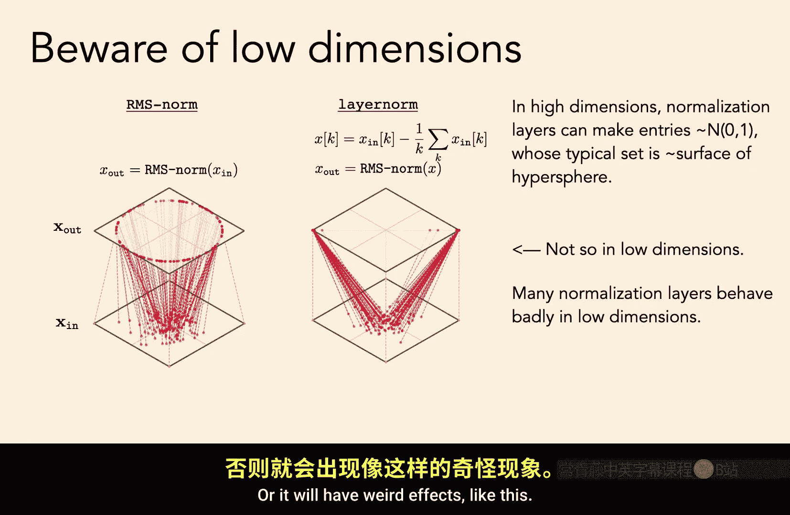

So the work that was the most popular that I've ever been involved in was this project called Ps to Ps。

In the initial code release of that project， I had batch norm over a batch size of one and for one of the baselines and batch norm over a batch size of one means take a data point and subtract the mean over a batch of one。

 It's just take the data subtract it is0。 So that baseline was trivially beaten。 And I corrected it。

 We still beat the baseline in the end。 but that was out there for a while and that was just that was just a bug。

 So you can't take batch norm over batch size one。 You can't do layer norm over layer size 1。

 if the dimension of the layer is one。

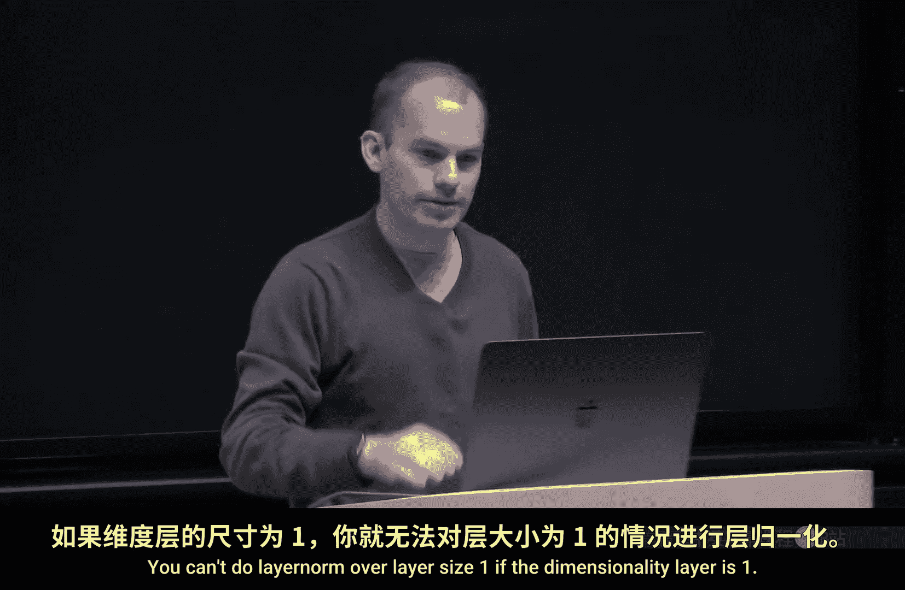

Okay， so the general trick is just， you're gonna be working with data tensors of size， you know。

 batch size by N by M by C， maybe some other dimensions as well。 these tensors， right。

 The weights are gonna be matrices N by M。 Just make sure all of your。

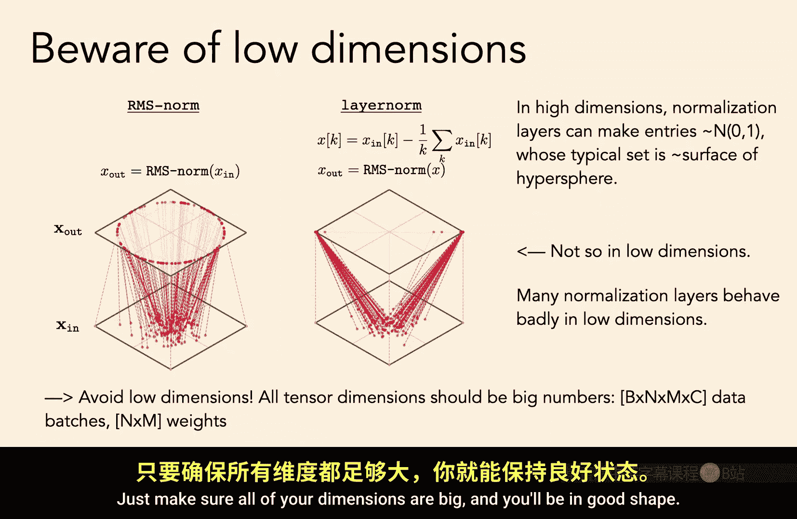

Dimenssions are big and you'll be in good shape。When you say big， what sort of scale do you？Oh yeah。

 when I say a big， what kind of scale do I mean。Yeah， these are just heuristic。 so I don't know。

 like let's say。You know。At least 1010 and above。 And， you know， ideally probably is because。

 the bigger， the better in general， I would say like asymptically。

 everything becomes nice and simple。 Like deep learning is kind of like thermodynamics。

 It's really hard to say anything about a set of three or four molecules。 You know。

 the three body problem in physics is really hard to solve。

 But it's very easy to say what the temperature is of a billion。Atoms， because I just， you know。

 asymptically things become very， very simple。 We leverage a law of large numbers。

 since it's the same thing。 like you always want to be toward the asymptootic limit。Okay。

 what is the cost， Well， money， time， energy。 So there is， there is a trade off。 I'm not。

 there's not zero cost to increasing the skill of these things。

 but for kind of statistics and inference and prediction。Bigger is better。O。

So。Yeah， these are basically things that I've already said。

 but you wanna know the range of your data。 You w tona know the shape of your data。

 And one little trick this was coming from Evan is that if you want to kind of sanity check your。

Neural net architecture。Don't test it on tensors， in which。

Different dimensions of the tensor all are the same number。Because。

It makes it much harder to catch errors with reshaping。

Because it could be that like you do some reap operations and you still get a tensor of dimension 64 in the like the second。

Dementia， that tensor。But the first dimension also should be 64 and you actually have pered the tensor in the wrong way。

 but you can't tell， so you get kind of a better type checking to make sure the numbers all work if you use a unique set of numbers。

 a unique dimensionality for each dimension of the tensor。Okay， so it's a good like way of just like。

Getting syntax errors in your code and they they'll they'll throw a shaped mismatch error when you've used unique numbers if you're getting them in the wrong order。

 but they won't if you have the same dimensionality。Okay。And yeah。

 be very careful with changing the types of your。Tensors。

 if you cast a tensor as a UN 8 because you think allll save memory， Well。

 UN 8s can't represent negative numbers。 So now all your negative data。

 if you have negative data will go away。So that's the point here， know。

 what is negative one for a a byte is like a UN8？And what if I've taken my input date， I'm like， oh。

 I know my input data is positive， but now I standardized it to make it lie between。

Be unit variance and centered on zero。 So that means it can have negative values。 And。

 but I still the intuition while I'm working with only positive data， But I've standardized it。 Well。

 now it becomes， It has negative values， but it's U and As。 And it can't have negative values。 Okay。

 there's going to be a bug。Okay。So。You've probably gotten in the feeling for this in the piece that's already。

 but a lot of your code is just going to be reshape operations。

 and this becomes a bookkeeping nightmare。 you're going to have a lot of bugs that come up just because you didn't reshape things in the right way。

You're constantly transposing， permuting， reshaping， flattening， unflattening， unsqueezing。

 squeezing， right This is like。Half the code and pytorrch。And。I personally can never remember this。

Conventions for these things。 So if I do reshape。A tensor， let's say it's a two dimensional tensor。

 And I reshape it into a flattened array。 So just a vector of the product of the two dimensions。

Is this going to stack the rows into a sequence or stack the columns into a sequence。

 I don't even remember。 I don't know what this does。 Does who knows， actually。

Is it going to be like row major order or call major order？If I have a matrix。

 it's I going to read off the row and then the next row and put it after the first row。

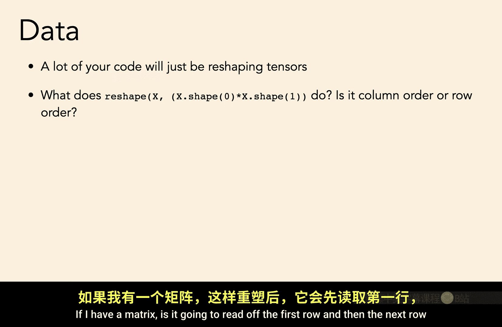

Does anyone know？For rea and Pyttorch，All right。Ro。Okay， it's row continues。

 So it does the first row。 And then it takes the next one and puts it after it， Right。

 But it's hard to remember these things。 And you really don't want to have to remember all that stuff。

 So this is a library that I think makes some of that a lot easier， makes keeping track of the。😊。

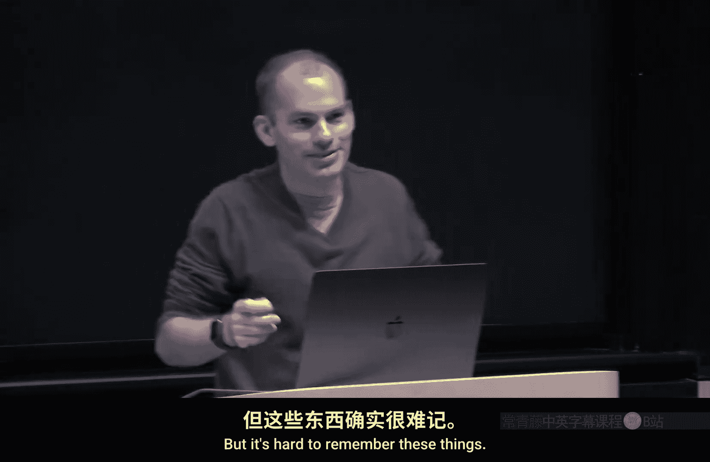

The re typepe operations a little bit easier is Iops。It doesn't mean you don't have to think at all。

 and you can still have bugs with IOs。But I， I， I found it to be very helpful。

 So all of the kind of reshaped， flattened， unsqueezed operations now have a common notation。

 They're just rearrange。 and you give a string， which is going to say。😊。

Kind of it's kind of like a shorthand。For。Telling the system what is the set of reshapes that will map from one space to another space。

 So here we have BHWC， that means at first I have a four dimensionaltensor。

And I'm going to map that to H BWC， BW parentheses。 that means I'll flatten。

Those two into a single dimension。 So it will be an H by B times W。By C tensor。

 it'll be tensor with three dimensions。And yeah， you still have to worry a little bit is it you know。

 the real major order or call a major order， but it makes it makes a lot of this easier to think about。

 and it tends to have the property that or maybe it always has the property that if I do the inverse operation。

 it will be an identity。 So if I do reshape B HWC to H BWC and then I do the inverse where I do H parentheses BwC。

 and then to be HWC， So I do the opposite direction。 if I do those one after the other。

 I'll get back where I started there inverses of each other。 So that's a nice property。

Reach shapepe might have that property too， but this makes it very easy。So try inops。Okay。

 as you can see， this lecture is just going to be like throwing a whole lot of little tips and tricks to you and I'm hoping that some of them will stick and you can kind of go and pull on these later。

😊，Okay， so data augmentation。You did some data augmentation in PSet1。

 so you know what data augmentation is， just a quick recap。

If I want to take small data and I want to make it bigger， there's simple tricks which you can do。

 which are apply transformations to your data， which should not fundamentally change it。 So you can。

 you want to be able to apply you know， transformations to， in this case。

 images that do not change the target class。 So this creates bigger data from smaller data。And。

I think a lot of people have this impression that data augmentation is a little bit ugly。

 a little hacky， but and there's a whole community of people who say， oh。

 you should really replace data augmentation with with。What we might call geometric deep learning。

 where data augmentation is forcing invariance to this set of transformations。

 forcing invariance to mirror flips and crops and changing the lightingning conditions very slightly。

 like just changing the intensity Okay， so data augmentation says all of those changes should have no effect on the label。

But geometric deep learning approach is say no， I should design an invariant neural network architecture。

 I should have a， you know， I should use a covenet to achieve translation and equal variance and then poorly into tube translation invariance。

 And therefore， why why do I need this croping。 And there's all these arguments。

That I can actually use an architecture to enforce the invaris and equalvaris and cemetries that I care about as opposed to data augmentation。

But I think that that's mostly not the right advice for like a good hacker and machine learning。

 I think the right advice is data augmentation is really easy， really intuitive。

 And it's architecture agnostic。 That's the power of it。 It's all on the data side。

 So you don't have to design some fancy know， symmetrytry preserving architecture。

 graphnet that knows how you know， molecule chirality should be properly propagated。

 You don't have to do any of that。 You just say， okay。

 here's the set of things I think are fine to do to my data。😊，And。I'll feed that in the architecture。

 I can send this to M LP， and it will be invariant to these operations， too。 So data augmentation。

I think is the way to go for most of the types of invaris you actually want。

 it's just simpler and software engineering wise it decouples these properties from the architecture design。

Okay， that might change。 Maybe in a few years， we'll have like a very clean framework for geometric deep learning。

 And， and then we'll go go to that。Okay， but I love data augmentation。

 I think it's one of the most important tools。And。There's another kind of data augmentation。

 which is really cool， which is sometimes called domain randomization。And。Oh， oh。Okay， yeah。

 I'm just showing that here's， here's like a visualization of what data augmentation is doing。

 But I think that you probably have kind of thought about this before。 But we have our training data。

 I just make more data from little data by adding these。

 these other points by perturbbuting my input training data。

 And that just makes it so that my test data looks like it's。In distribution。

 my test data just looks like more more training data。Okay。So。A little quiz now。

So which of these three loss curves would you be happy with？ Let's say you're running an experiment。

 You're trying your model。 Which one are you gonna be happiest with。😊。

So who who raise your hand if you think the leftmost image is the one that you're most happy with。

Okay， we get like a third。 Okay， the middle one are you happy with。No one thinks the right one。

You know， we get two third。 Okay， so you're all actually very clever。 I think， you know。

 the first guess， and I guess would be the left one。 And that that is the right answer in some sense。

 but it's not what the answer I is looking for。So what is wrong with the left curve？Okay。

 so it's too easy。If you're seeing a loss curve that just goes down really fast and then it's just flat。

 Well， you've wasted time optimizing in the flat region。 I mean， maybe not。

 maybe it's decreasinging a little， but if it's truly flat。

 You're just wasting flops by doing more training in that region。And。In general。

 you don't want to make your problem so easy that training on it converges really， really quickly。

 You want to make your problem hard enough that you're actually going get a lot of。

That you're actually going learn a lot。 So， okay， obviously。

 the middle plot is bad because your loss is going up as you train it。

But the kind of plot you want to see is that， yes， your loss is going down is very graceful and smooth。

But you're making continual progress。 And there's kind of a long way to go。

 And you've made the problem hard enough that there's something interesting to learn， so。

Here's the rough recipe。 I' have in mind， so you definitely want to minimize your loss with respect to your parameters。

 right， That's back propagation。 That's basically the main optimization thing we do in deep learning。

 But there's another thing that we don't usually optimize。

 But if you're going to actually work on a large scale project most of your time will be on on this part iss changing your data to make it harder。

Make your data hard enough that there's a lot of information you can get out of it。

 so so you don't necessarily want to max over data。

 but you want to kind of like increase the difficulty of your data until there's something interesting to learn from it。

So， and that's what domain randomization。 That's what data augmentation do。

 They add more data so the learning problem becomes harder。 They're a little bit like。

Going from the really bad， easy。嗯。Loss function on the left。

 loss curve on the left to this one over here。 why。

 Because you're adding more data points that the model has to learn about。

 and why is that a good thing， because it will generalize better， right。So fitting this distribution。

 understanding that is。Easier than this is easier than this。 But the last one。

 which is the hardest to train on， is going to generalize the best。Okay。

 so another version of that idea goes under the name， domain randomization。

 So this is a popular term in robotics， where we want to train a robot to be able to pick up blocks on a table。

 and I could train it with just one lighting condition with this is training and simulation and testing in reality。

 I could train it with just like one particular setting of colors of the blocks。

 But then it will only know how to pick up blocks of that color。

 I could train it with one lighting condition， but then it will only work when I'm in that lighting condition。

 So I make my problem harder by adding all this random variation。

 and it will take a lot longer to train， but it will generalize better to any new test environment with different color blocks than it saw at training time。

 yeah。😊，Re even to lighten。Is it Well， it generalize to light changes that never happened。

 So the idea is that you want to make it so that you've covered all possible lightings in your training data so that the test data just looks like another random lighting condition that exists in the training data。

 So the short answer is， no， it won't generalize to。A lighting configuration that's not seen。

In this randomized training data， but the longer answer is。You potentially could get。

The property that if you。Train on a broad enough distribution。

 Maybe you start to get this kind of like emerge generalization。 I think I'll set that aside。

 but I'll say the， the short answer is no， but maybe there are cases where you would actually generally even better out of distribution。

With respect to this randomized training distribution。

 but it's a little more subtle and I'm not sure that we have there's a clear answer for that。Okay。

So what is this doing， We're just minimizing the gap between the source domain。

 which is simulation and the target domain， which is reality by randomizing the source domain。

 This is what Open AI used for their robot hand some years ago。And。

I'll just show you the what their data augmentation looks like。

 So they just had a simulated environment。 They rendered that hand with a lot of random conditions。

 They also randomized the physics parameters。 They randomize gravity。 So。

 why would they randomize gravity， We know what， We know gravity is negative 9。8 m per second。

 whatever it is。Right。And why would they randomize gravity， What do you think。Let's go here。Space。

Oh right， okay。So the answer， you go to space， change the altitude。

 maybe you're on a different planet。 that's one good answer。

 So it will generally like if they went their a robot to work on Mars， this will work better。

 that's not quite， I think what they had in mind， they weren't quite imagining going to Mars yet。

 but okay。

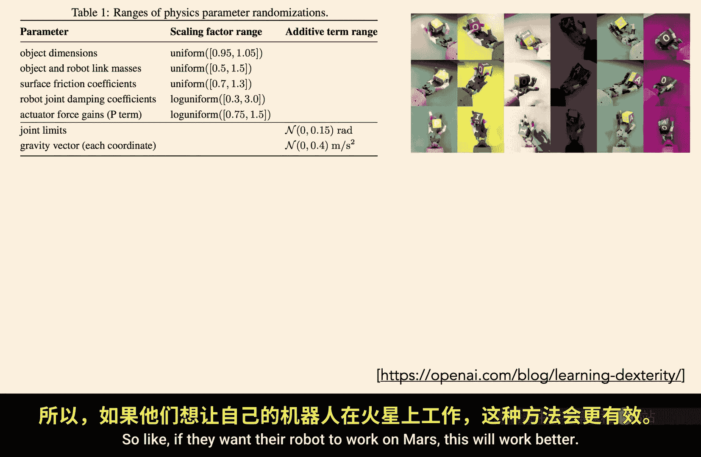

When the machine is movingThat's a really good point， so when the machine is moving。

 then your measurement of gravity is affected by that because of some general relativity type。

You know， reference frame， you can't tell the difference between acceleration and gravity。

 according to physics， right so。That that's another possibility。 I think that's part of it。

 But what I think was the real reason is there， there。Gravity， like accelero。

 they have these accelerometers that measure things like how the robot's moving and what the gravity direction is。

 what， what's down， what's up。 And it was just a little bit noisy。

 So they're just modeling that noise。 essentiallyly， they're saying， well， actually， our our。

 our physical measurement of gravity will might be like。😊。

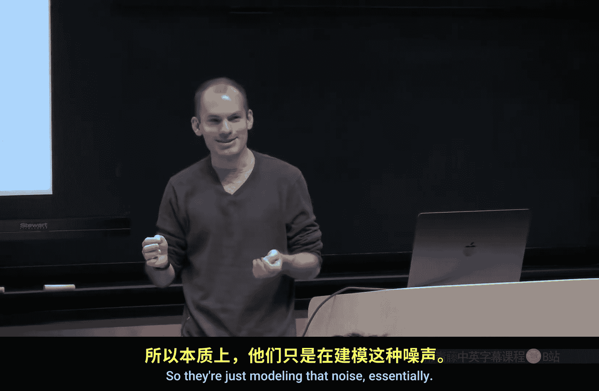

Pointing in the wrong direction， maybe 9。8 is always correct。

 But let's say it's like slightly miscalibrated， so slightly in the wrong direction。

 Well I trained so that it's always slightly randomized。 It doesn't matter if I'm miscalibrated。

 It will still be within distribution。 It'll still be robust to that variation。Okay。

 a lot of good answers there。 But here's the， the one that I thought was like the most important kind of surprise is that。

Or the most important lesson is that this is on the X axis， the years of training， simulated years。

 So it trains in a few weeks， but it was simulated years of experience。

And on the Y axis is the performance， so higher is better。And with no randomization。

 it learns really， really quickly。 So this is like that loss curve that goes down really。

 really quickly。And， you know， they some engineer of this project might have seen that curve and been like。

 okay， we're done。 We solved it， but they were smarter than that。 And they said， no， no。

 let's add a lot of randomization and make it robust to all the different errors and gravity that we might be measuring。

It made it robust to all the lighting conditions。 And then it took， look at this。

 It took like 10 times longer to get to the same level。 Like this was one year of experience。

To get to there， let's say， And then 10 years， this is a logarithmic skill。

 So they're having to train this thing for so much longer to make it solve a much harder problem。

 which is to solve robotic cube manipulation under a lot of different conditions。

 as opposed to just one condition。And if you reported that to your manager， you're like， oh， I got。

 you know， lower accuracy。 Well， a bad manager would say， oh， you know， get rid of that， make it。

 Learn quickly。 But that's wrong because you want to make the problem hard enough that it will actually generalize to the the real cases you care about。

 which are the test cases， not the training cases。 This is performance on the training data。Okay。

 so high training and accuracy means the problem is too easy。

 So make your problem hard enough that it will generalize better。Okay。

So let's see continuing on with this theme， so in academia， in universities， in research labs。

Most of the time in machine learning and deep learning， we do the following。

 wed say we have fixed data。 you're given data， and you have to have model it， right。

 And you design neural net architectures and learning problems and objective functions and optimizers to learn a function that models that data。

But this is actually not the way it works in most。Real world scenarios in industry and practical scenarios。

It's usually the other way around。 you just download the latest greatest model and you don't change it too much。

 But what you do change is the data。That's what companies can do。 That's what governments can do。

 We can change the data。And that's where most of the leverage， in my opinion， is。

So you can collect more data， you can collect better data。 You can label your data in new ways。

 You can change the data。 and this is an even more powerful set of tools than changing the learning algorithm。

 So most of this class and most classes you would'll take at MIT are about the algorithms and not the data。

 but there's I think， more leverage to be had on the data side in practice。Okay。

 so it's probably a problem in our curriculum and we should have more data science or like data like data centered classes and we have some we'll talk a lot about data properties and things like this too in this class。

Okay， so here's another little quiz。 So here is a language model that's trying to predict the next word in these sentences。

 And these are famous sentences from these are first， the first line of famous novels。So。

What do you think is the second word after it。 Let's say I'm going try to predict next word。

 given previous word。 What do you think it's going be， This is a famous opening to a book。

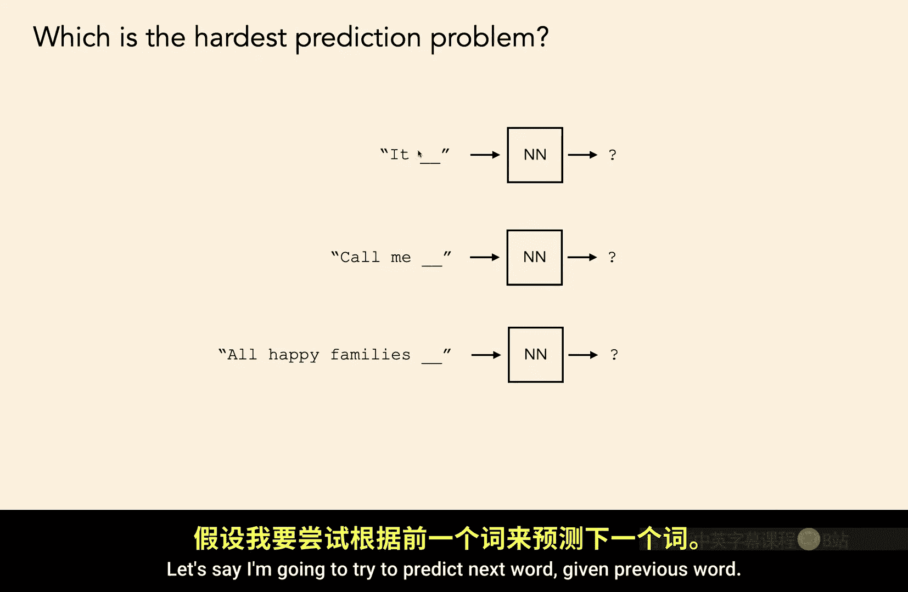

It was。Who knows what the book is？Tell she， wow， okay。Yes， that's right。 You're right。

 But there's actually a lot of other ones。Yeah， you know， there's a lot of time。

 there's a lot of first lines。 So anyway， yeah， it was the best of times It was the worst of time。

 That's actually what I had in mind。 But obviously， that's not the only answer。

 What about the next one。 Call me like Ihmel。 Okay， that's Moby Dick。 all happy families。😊。

Okay， and hopefully you can kind of hear from the volume that a lot of people know the last one。

 not as many the first one。 What's the point。

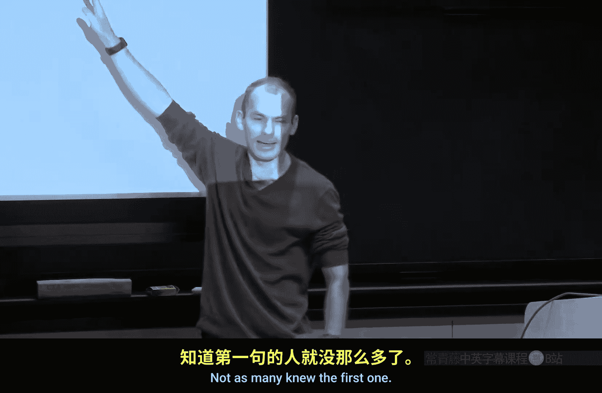

The point is that prediction is easier， the longer the input。 because the longer the input。

 the more information you have with which make that prediction。

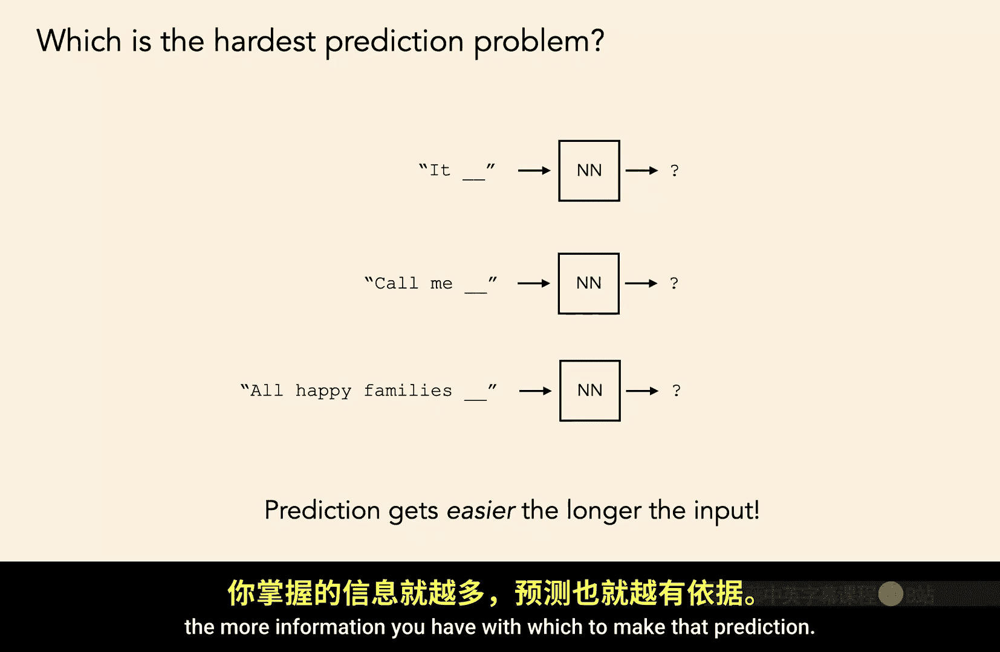

And this is also something that people got， I think， a little bit wrong historically。

It was kind of thought that， well， it'll be harder to model strings of length。

And then strings of length and less than N， right？ So back in the early days of NLP。

 people would have these N gra models。 And it was like a model of， you know。

 how how words co-oc with each other。 And you'd have bigrams。

 How often does this word cooc with that word and tri gras and N gras。

And you didn't want to make N too large。 But this was a little bit misguided， I think， really。

You can make your prediction problem much easier by making N really， really， really big。

There is a little technical distinction， which is you in the Ngram era you are modeling the joint distribution of everything。

 Here， you're modeling just the conditional distribution on the last word， given the previous words。

 But I think it threw off our intuitions a bit， that like the more data you put on the input。

 the easier the prediction problem becomes。 So you should add a lot of data on your inputs。

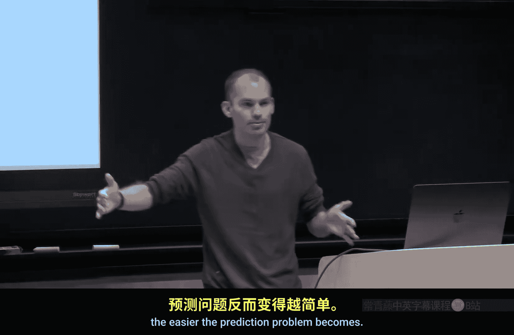

And you can do this。In research， maybe you just have a fixed standardized data set。 But in life。

 you don't， you can change your data。 And that's that's the main thing that' is going to give you performance。

 Okay， so we have X， and we have Y。 We're predicting y from X。

 So supposed youre designing a pharmaceutical drug。

 And Y is going to be the effectiveness of the drug。Okay， you generally can't change why too much。

 like maybe your boss just assigned you that job。You don't get to have too much control over what is the goal that's useful to society。

 Okay， but you can change X a lot。 So what would you put in X。

 Let's say I want to predict the effectiveness of a pharmaceutical。

 So maybe I'll put the chemical formula。 What else might you put in to make it an。Like。

 if I only do that， Okay， I can kind of predict the effectiveness。

 What else might you put into X to improve your predictive performance。

So somebody shout up some ideas。Patient data， yes， patient age， patient， you can take a biopsy。

 personalized medicine， right， you're gonna get better predictions with more information。 Okay。

 what what else the folding structure of the protein， So not just the chemical structure。

 but the geometry。 What else might you put in。Their medicine network。

Other medicines that works nearest neighbors similar medicines。 Yeah， okay， everything， the universe。

 you should put the universe in， okay。So。The point is the more information you condition on。

 the easier the prediction problem becomes。

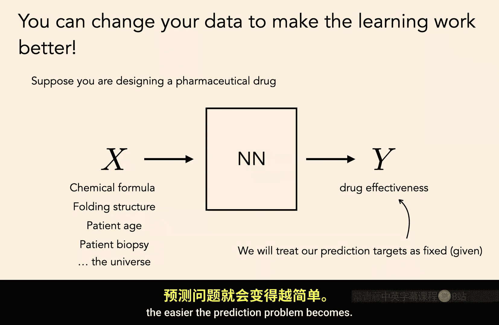

Now， this contradicts my previous advice that you don't want to make your prediction problem too easy because you might kind of overfit to shortcuts like you might be putting in the R label at the top of the cancer scan。

 but I think roughly this is even better advice that you should put a lot of information into the inputs to your modeling problem and control overfitting in other ways。

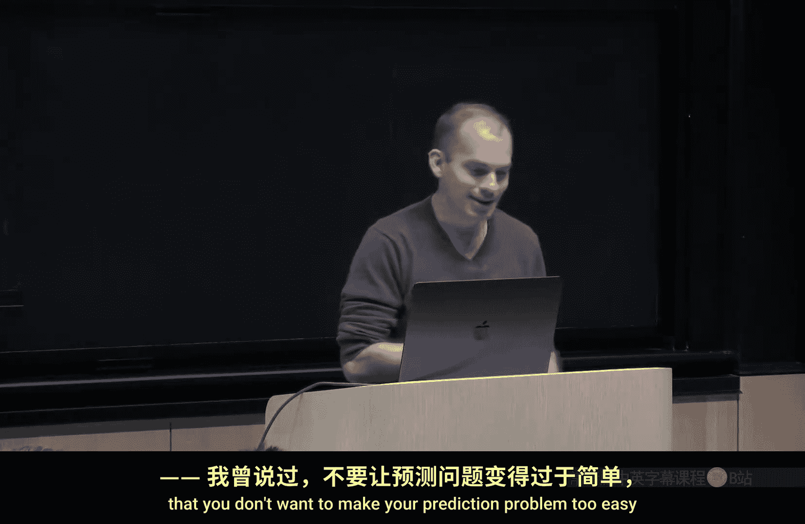

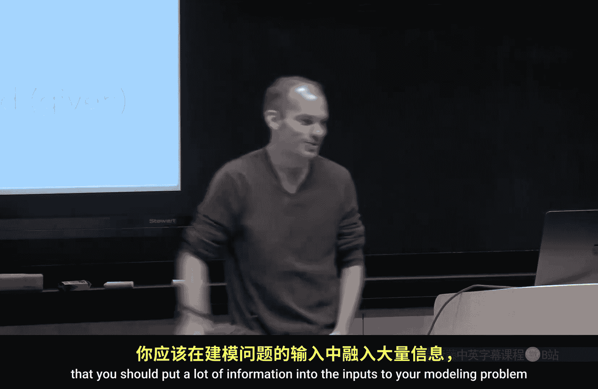

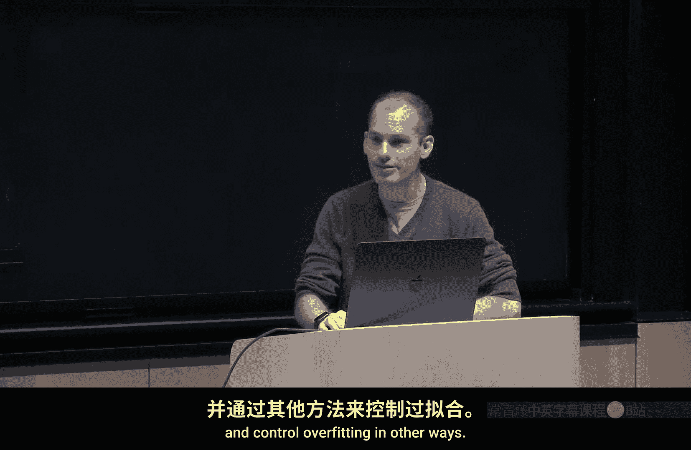

Okay， so why is this a good recipe？So if I'm going to map from x to y。

And I don't have a lot of information about X。 That means that there could be a lot of possible predictions that are all equally valid。

Okay， so if I just know the chemical formula and I'm trying to predict if it's beneficial chemical and I don't know anything about the patient。

 then I have to say， well with 10% probability it will help with 90%。

 it won't help and when it doesn't help， it might not help in these different ways。

 there's a complicated amount of uncertainty in the output space。And with neural nets。

 you can always think of it， or you can often think of it as modeling a probability of Y given X。

 we'll talk more about this in the generative modeling lectures。But if my probability。

 my uncertainty that I'm just trying to model is。Complicated distribution。

Then it's just very hard to solve this problem。But there's a hack， which is that。Okay。

 standard neural net training that we've learned about so far will use things like an L2 loss function to do progression。

 right， take some inputs and make a point prediction of the output value。

 So it doesn't handle modeling a whole distribution of part possibilities。

 The standard tools we have so far only do this。 We' learn about genderative models that handle uncertainty later。

 but that will be more complicated。The simple models do this。

 But you can solve this problem with the simple models。

 And the way you do it is you just put enough information in in X。

 that probability of y given x becomes deterministic。 It becomes a delta function。

 It looks like a single point。Okay， and this hack works really well。

 This is the hack that led to text image models working so well。 Okay。

 so here's the history of text image generation。😊，Or image generation， let's just say。 So in 2019。

 the best image generation。It looked pretty cool at the time。 But it's in retrospect， its。

 it's just not much。 all it could do is make photos of faces， front facing photos of faces。

 good lighting。 It could just make this one really narrow kind of thing in the world， right。

 Imagine all the things you might want to visualize。 It can only make faces and。😊。

What they were doing at that time was there were training models that don't map X to Y that just model Y。

 just model the output。 So the faces are the output。 Okay， so we had no information about X。

 and we just have to model the entire possible space of all faces。

 And so you can't do that for all images in the universe。

 You can only do that for really narrow categories like all faces with current technology。

But now we do have models that can make all kind of crazy images。 Any image you can imagine， right。

 Dolly stable diffusion and midjoney。 So what happened。

 what allowed that to happen is because we switched to giving a lot of information into the input to make it so that the problem。

😊，Of modeling data is almost deterministic。 It's， it's。

 there's very little uncertainty about not very little。 There's still some。

 but there's not as much uncertainty about how something should look。

 If you have a sentence describing how it should look。

 that that makes it so that standard neural net methods actually work。Okay。

 so I don't think we've made that much progress in general of modeling。

 on modeling complicated distributions。 We've actually just。

Switch to modeling simple Gaussian distributions， conditioned on a lot of information。Okay。

 but we'll talk more about this when we get to generative modeling。

The point is that you can change your data to make things work better。

 And the big change that I'm recommending is make it big。 Okay， big means train on a lot of data。

 that's the most obvious sense of big， but it also means that your inputs can be a big object。

 A high dimensional vector。 Remember high dimensions makes things easier。

 A lot of information from the input to pin down the output。

 So there's not uncertainty in that mapping。And then this one's a little bit more subtle。

 but I also would recommend make make why a big object。

 But we'll get to that and we'll get to generative modeling and foundation models and things like this。

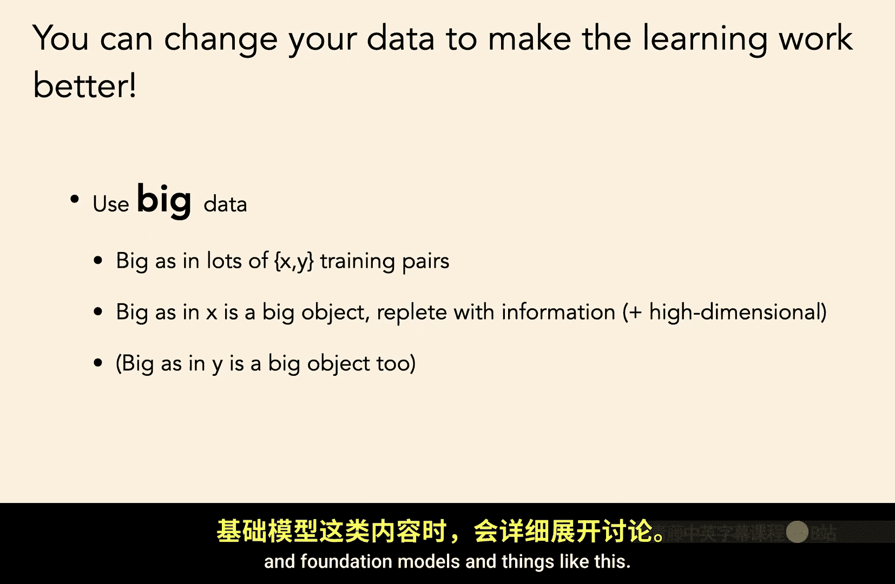

Yeah， question。いし。So like I think this is advice for。把修。But wait。2 years。好。How yourself。

And like Apple。They came out with fair。Years ago， and we kind of laughed。They ran through problem。特つ。

こ多。It's our。Yeah one of the key problems in this domain。You're going to get five car crashes from。

So if you want to scale your data output。With respect to the distribution shift like between less than fraction of a percent of actual data。

Positive light。We的。that。Yeah。あ。So yeah， great， great comment that if the stuff you care about in your data is extremely rare。

 then just scaling your data might not be the most efficient way of capturing those rare classes because you'll be wasting most of your scale on the common case。

 which is already well understood。And I'll mention this a little later。

 but data diversity and coverage over the classes of interest is probably that's the key thing that matters。

 So scale is kind of a proxy for actually coverage over all the different things that matter and yeah diversity as the other keyboard there。

 But here I'm not just saying big data as a lot of data points。

 but also so if you have this roller coaster issue how would you solve that， well。

 you would add more information context into the inputs to say that if I know I'm at an amusement part because that's in my context then you shouldn't you shouldn have lower probability of say to crash And what do language models do now。

 they're all trying to make the longest possible context you hear about like a million length。

Context in terms of the tokens and language models。 This is。

 this is basically trying to achieve the same thing。 If you have enough context。

 then a lot of things become easier and more performant。O。Okay。

 so that was all about data and that was already， you know more than half the lecture。

 So data is the most important thing in machine learning。 So it's it's good to focus mostly on that。

 but models and other things are also important。 So let's talk a bit about that。

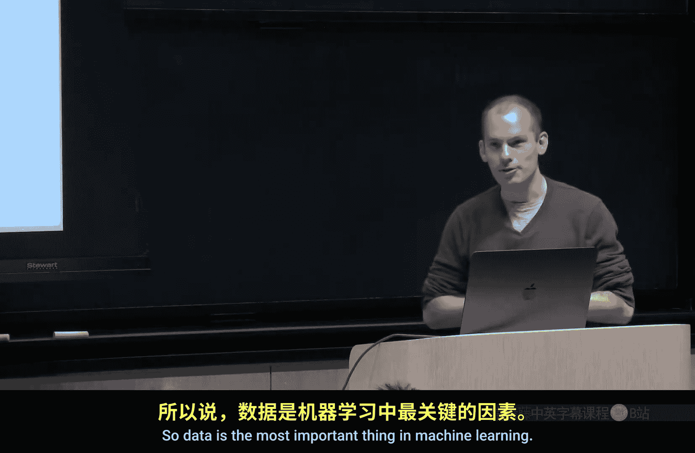

Okay， so。I think the first principle of modeling is keep it simple。

Why keep it simple is it just pays off multiple times。Simple models are easier to build to debug。

To share。诶。It's tractable to understand。 So we can't do any of this。

Theory and like really understanding how these things work and giving guarantees about them。

 unless we keep things really simple and it may a little frustrating to be like， oh。

 why are we proving， you know， properties of M LPs， Like， I going to do a more complicated model。

 but。It's because it's easier on the simpler models and so we should take that as a constraint on what we can actually make progress on。

It's easier to build theories run simple models。But this is the other one。 you might think， oh。

 but that's a trade off。 Like， I want a really powerful model。 No， simple models are also power。

 the most powerful models， right， Well， the simplest model that fits the data that that is， you know。

 by some arguments， Then we talked a little bit about going to be the best model。 And， you know。

 there's the intuitive argument of outcomesham's raor。

 and then there's a lot of formalizations of that with generalization bounds and ideas of optimal inference。

😊，Okay， so I would just say I've been saying this for， years in lectures like this。

But I still think it's true。If you focus on simplicity and overweight that relative to what the average person does and are willing to sacrifice some accuracy。

 are willing to sacrifice some other things， you'll have an unfair advantage。

 and your contributions will really stand the test of time。 So like what I tell my students is。😊。

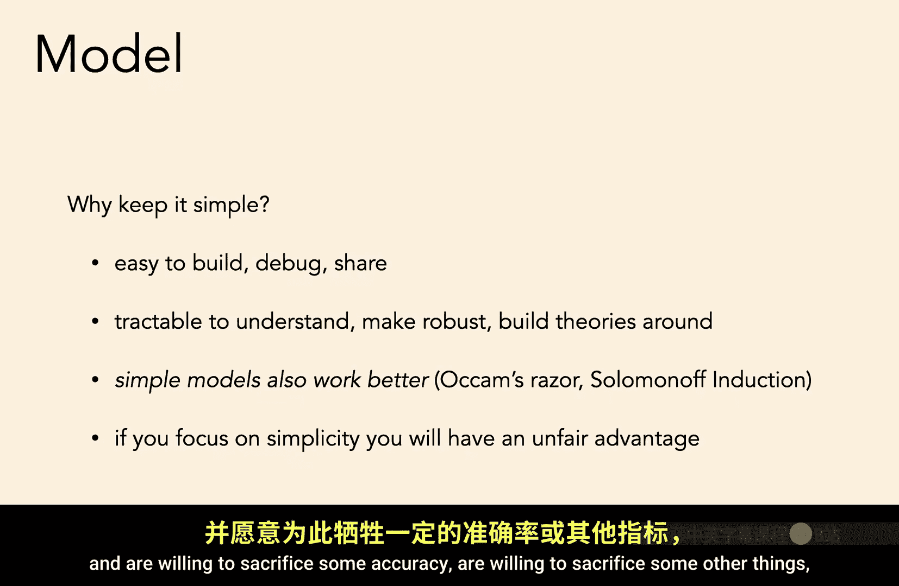

If method A gets 1% better on benchmarks than method B。

 but method A is more complicated than method B by like some factor。

Go with the simpler publish with simpler method。 like there's so much competition in research to have these like bold numbers。

 the leaderboard of the benchmark。 And if you just。

Remove all the bells and whistles that got you to that bold number。 that being the leader。

 you'll probably have a method which will stand the test of time and be higher impact long term。

 so don't fight for that last 1% by adding complexity。 Every bit of complexity you add has a cost。

 and it's usually not worth a little tiny change in accuracy on your problem。Okay。

 unless you're like saving lives at a hospital okay， so anyway。

There are some cases where it might be， but keep it as simple as possible。有诶我得低抽住抽住。Yeah。

 how do you know that you're sacrifice， like what is this trade off ratio between complexity of the method and accuracy on some benchmark？

嗯。I don't know how to measure that。 I just think most people are calibrated too much toward accuracy or performance on on the benchmark。

 And we it'd be lovely to have a way of measuring simplicity。 But again， we don't really have that。

 So it's more just an intuition。😊，一。They' good to use auto of domain data for the training sets so they will have。

Is it good to use out of domain data in the training site。 Yes。

 so I'll so roughly again this principle that train on as much as possible and put as much information into access possible is。

 I think， a good principle and。I'll talk about the idea of pretraining in just a second。

 and we'll see lectures on that a little bit later。 But the general trend is if you have data X。

 Y and Z， and your problem is about data Z， you should train it on X， Y and Z。 Don't only train on Z。

 X and Y are strictly beneficial towards Z if you're doing things right。

 right Like there's some kind of。Data processing inequality type argument。

 like you could always just ignore X and Y if you would had the optimal algorithm。

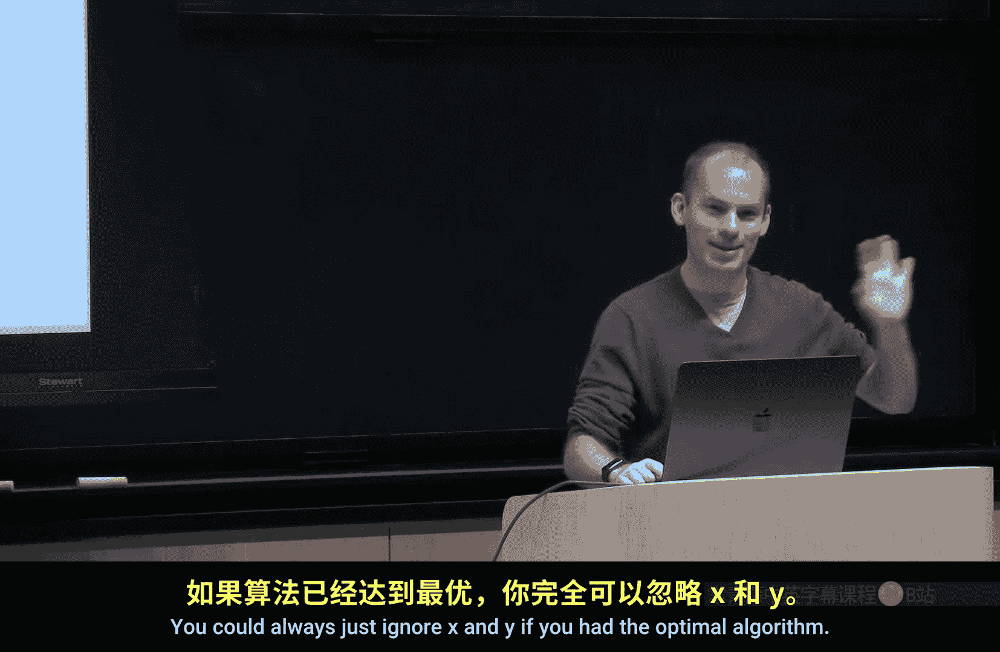

Okay， so， yeah， popularity matters more than performance and simplicity matters more than， you know。

 anything。So you want to work with， you know， systems that are。Widely used。

 that usually means they have to be simple。 and it also means that they will interface well with the community and that you won't just be building some。

You know， amazing palace that nobody ever visits。Okay。So。

A lot of folks are always going to be looking for like。

 but where do I even find the good models to start with， where do I find the popular standard model。

 So GitHub。The number of stars or forks on Github is a good proxy for quality。

 So this is like a a little bit of a。Sad story， but popularity matters like don't look at the leaderboard。

 look at the number of stars。 The stars is more predictive that it' going to be useful than the like accuracy。

 Of course， this will mean that you're only going be doing things that are popular。

 So if you want to do cutting edge research where you're really changing you're innovating beyond the state of the art。

 this advice does not apply。 But if you're just trying to solve a problem at a company。

 popularity matters more。Okay嗯。So Huging face is a great resource for wonderful popular models。

 GiHub Pytororch has a lot of repositories and papers with code is a place to go for the leaderboards of like the latest greatest data the art model。

 but you probably don't want to do that you want to look at the latest greatest one。

 look at how many GiHub stars that has go down the list until you find one that has 10。

000 GiHub stars and do that one。Okay， so the highest performance model that has 10。

00 GiHub stars is like that's the rule of thumb。Okay， but you。

 you definitely want to start with a pretrained model。For practical purposes。 Okay， again。

 this might differ if youre in theory or you're writing the latest research paper。

 But if you just want assist to work， this is the advice。 So standard on the shoulders of giants。

Use pretrain models， we'll talk about pre traininging and transfer learning a little bit later。

 but you generally don't want to be training your systems from scratchch。

Okay and be aware of the flaws and the copyright issues and the biases and all the other problems with pre models out there。

 but there are some like Al fold and Alfil2， which are probably pretty safe to use like there might not be too many like negative social biases or ethical issues there。

Okay。Okay， so here's another， another little trick that I like， which is。To transform your problem。

Into a solved problem。Again， it goes back to the simplicity and popularity are things that matter a lot。

So if there exists like a solution to your problem， just transform in into that solution， okay？

This a little like in CSs theory where we talk about like polynomial time Reducibility， like I can。

I can show that。 I can。Find a polynomial time method that will convert my problem into a known problem。

 And this gives me some way of understanding my problem。 Okay。

 so can I find a way of changing a new problem that。I don't know how to solve。 like in this example。

 I'll give image colorization to a known problem and I already know how to solve like image classification。

Okay， so this is a project that I was involved in， you know， almost 10 years ago。 now。

 you're gonna try to predict the black and， the color of the black and white image。

 like predict every pixel value。 So at first， you're thinking。

 this doesn't look very much like just a classification problem。

 I'm trying to do something like regret。 I'm trying to predict the color。

And I'm trying to predict the color of every pixel， not just one label。ok。Well。

 we set it up as empirical risk minimization。 So find the function F that makes the correct predictions on the training data and expectation。

You can predict the colors， and then you can concatenate them with the input image。

 So you don't have to predict the black and white。 It's already the input。 You get a colorized photo。

Okay， so how do we turn colorization into how do we reduce that into classification？So first。

 we say we could just predict the color of the image， right， Ylow， it's a class， right。

 So just have K different color classes。 That would be okay。 So how do I turn colors into classes。😊。

Well， I can just quantize my space so I can say I'll have one class is yellow。1 class is orange。

 One class is blue。 Each class I'll represent with one hot vector。

 just like we normally do for classification problems。😊，Okay， so now rather than cat dog elephant。

 it will be the blue class， the yellow class in each box here will be a different discrete class。

Okay， so now just like I could predict the label as rockfish， I can predict the label as color。

 It's the same math。Okay， but how do I do that for every pixel？Okay， what do you think。

 how am I going to change from doing a whole image classification to a per pixel classification？

We've already seen it。What architecture should I use， CNN Comvenet。 Yeah， okay。

 so Comvenet just says I will predict the label of the center pixel of the patch。

And if I slide that component across the whole image， I will be predicting the label。

 the color of every pixel in the image。So now I've converted。Classification into。

Per pixelel color class。Prediction。Over a sliding window operator。

And so that allows me to formulate my problem as classification， which is generally a good idea。

Or we would call it softm regression for the idea softm cross entropy loss。Okay， so。

Why is this generally a good idea？Well， we have a really good machinery for it， we know how it works。

But。There's another interesting property which， O， I'm not going to have time to go into all the details。

 but。The softm distribution， the categorical distribution that you predict。

Is fully expressive over this over all possible。So for very pixel， I'm gonna predict a， the color。

And I'm actually modeling a fully expressive distribution over this space。

Probability mass functions over the discrete vocabulary that I'm modeling。

So that means I I'm not this is like the most general way of quantifying uncertainty or modeling a distribution over a discrete variable。

And if I were doing like regression， at least where regression， that would not be the case。

 It's not it can only represent Gaussian distribution。 So this is。

This is why classification has this like nice property of being more expressive than regression for this type of problem。

And discreteet classes are also easy to label， easy to talk about easy for humans to understand。ok。

Another one is that under this representation， we remove the inductive bias about the how we have measured distance in the input space。

 because all one hot variables are equiist from each other。 So the distance is always one or 0。

 There is 0。 if it's。The same class and one if it's two different classes。

So this kind of removes inductive bias about how we represent target variables。Okay。

So here are some good， good default choices for this year for using， keep learning a new domain。

 So turn your data into one hot vectors。Transform your goal into cross entropy classification。

And use atom and transformer to solve it。So just a basic recipe， this will work pretty well。嗯。Okay。

 but there's a few things that you should be aware of not to use。 In my opinion， again。

 this's a bit subjective。 Don't use batch norm。 I think that lesson has kind of gotten out now。

 So I don't know if I still need to say this。But if you're using batch form， just get rid of it。

So batchche form introduces a strong dependency。Between。The batch size。

 which is one of the kind of cardinal hyperparameters that matters in deep learning。And。Li。

The learning。 So Bachelor is。Normalizing activations with respect to the statistics of a data batch。

Okay， so you're interested this。 it's even stronger dependency on batch size。

 So now your performance will change dramatically when you change batch size。 And this is。

 this means that if I change my batch size， I have to ret my whole model。

 mean I don't really want to do that。Bacheroom has different performance at train time and test time。

 which is undesirable。Because at train time， I will have a big batch。

 and I'll take the statistics from it at test time， I usually have just one data point in processing。

 and I have to。Do something else I can't normalize with respect to the batchge instead you use kind of learned statistics。

It makes distributed computing really hard because I can't just chart my batch onto a lot of nodes in my cluster。

I have to communicate information about the different elements of the batch across nodes。

 So you have this communication overhead。Okay， so just use layer normm。

 that's the standard one right now， maybe there'll be other standards in the future。

Some stuff you can read if you want on the the problems with batch Norm。

 And I already mentioned that in the P to fix project we。

Did Bchelor run batch sizeize one and had a bug。 So that was， that's one problem。Okay。

 but that's just for to read after。Okay， so the easiest way to get your model to perform better is actually not to do anything fancy。

 but just。Scale up your data。 alreadyread said that。 scale up your model， make the model bigger。

 wider。Deeper， more channels， more heads。And scale your computer， train it for longer。

 So just remember that this is， this is like。The simple recipe。

 this is kind of the scale is all you need recipe， and it's not necessarily the entire story。

 but it is part of the story。So here's a reminder for me to tell the story about when we were working on that cuization project that I mentioned on the previous slides。

嗯。

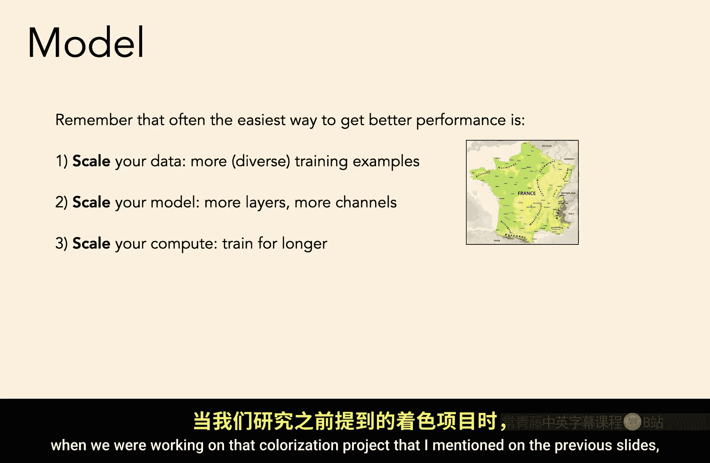

We were trying to come up with a new model。As opposed to just turning it into classification and running a standard convolutional network of the era。

And。So Richard and I who are working on this， we went and visited a lab in France for a month that summer。

And when we left， Richard just said， okay， well， we don't have our model ready yet， but I'll run。

 I'll let the baseline keep running while we're away。 And so we just turned the GP on。

 We started doing this regular thing。 And we had horrible results at the time。 And so we go。

 And then like two weeks later， we check on it。 And it's beautiful。

 And it's better than all the kind of crazy advanced architectures and variants that we tried。

 So just if you're ever not sure what to do。 just train for longer。😊。

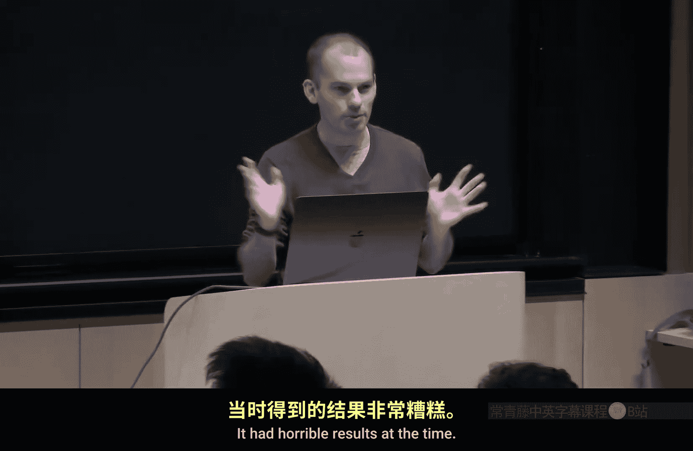

Go to France。 go to the beach， relax。Okay， and a lot of people call this like the bitter lesson or they they worry about this。

 and they think it's like diminishing to science and truth。

 But it's like truth might be simple and easy。 And if it is like all the better。 it's， it'。

 it's to me， very sweet。So I don't think that is all there is。

 but I do think that this is like a really， really big part of it。Okay， so。

There are reasons to work at small scale because it will allow you to iterate quickly。

 It will force you to be efficient and come up with clever algorithms that do scale better。

 but eventually。I would say scaling is necessary， but not sufficient。 So it's not that scaling。

 I don't really think there's going to be any way of making performance。You。

 human like intelligence without massive scale， that's just going to be a necessary condition。

 in my opinion。So there's not， in my opinion， there's not a hope to like solving it with small models and not much data and not much compute。

Okay， but we'll see， maybe if somebody will come up with that。嗯。Okay。

 so a lot of people make their whole system and then they get it to be really。

 really performant and they stop。 But you're only half done when you get there。

 when you get your system to work and be scaled up， You're only half done。

And this advice comes from the author of the Little Prince， which is shown here。

So once you get your system working， now you should go back and remove all the non-essential components because you probably added a lot of things that at the time were important。

 but once you scaled up and once you got other parts of the system to work were're no longer important so don't forget to go and remove all the stuff that's non essential。

Okay， so perfection。It's finally attained not when there is no longer anything to add。

 but when there's no longer anything to take away。So I think a project should always go add add add until it works。

 remove， remove， remove until it stops working and cut off there and then report it。Okay。

 I'm a little short on time。 So I will go quickly over a few slides or skip a few slides to get to some of the final points。

 Copis， coding assistant。You should be using these not on your Pets。 Okay， so we're gonna。

 we're gonna clarify on the next Pet a little more about how to turn off the coabs autocomplete。

 We weren't super clear in that。 But， but it is of course policy。 you shouldn't use AI assistance。

In a way you wouldn't use a friend。 you shouldn't have them just write all the code for you。

 You can ask conceptual questions and iterate and figureact that with them。

 But for your final projects and for life in general， you should absolutely use coding assistance。

 Like these are just gonna get better and better。 They have some mistakes right now。

 But this will be an essential tool in the software engineers toolkit。

 And you should be learning how to use them。 And this class is about AI。

 And so we're very happy for you to learn how to use these。😊。

But you know you should always don't replace thinking and like think first and then ask the LLM。

Don't trust the code without understanding what it's actually doing and verifying it and testing it。

 Okay， so there's good practice for using these。 You definitely don't want to just like use them blindly without actually having knowledge about how it works。

Okay， and general advice is write a very clear dock string。

 and then autocomplete with a copi will work pretty well。Okay， so， and you can prompt it， you know。

 by saying， you know， you're a really smart code or if you want。

 but I think some of those tricks will disappear because they're being like baked into the new systems。

ok。So first， when you're gonna optimize your models。

 start with one data point and overfit to that data point， then a few data points。

 and then finally start scaling up。 Okay， so scaling comes last。嗯。Okay， check your oh。

 actually this one's kind of fun。It's good to get used to log numbers because most of the time in deep learning we're talking about log probabilities are like the cross entropy loss is an average log probability。

Of the data under the model。 And so get used to log probability is like no is is a negative number。

 Okay， is smaller good or is bigger or good。 What if it comes at 0。 What does that mean。

 So here's a few log probability numbers just to memorize So what is negative 。69。

 If you get that number as your loss。 Is that good。 Is that bad。 That's just log of0。5。

 So if you have a binary classification problem。 You'll often see you get negative 0。69。 You're like。

 okay， it looks pretty good。 No， that's a chance。 that means you're outputting equal probability to both classes for a binary classification problem with equally weighted classes。

 Okay， what is log of 10%， like 10%， we often have 10 weight classification problems。

 as are like standard homeworks。 Okay， negative。😊，2。

3 means you're at chance You're outputt 10% probably over data points。ok。So with a regression loss。

 like a least squares loss， it better not be negative， right。

 because the minimizer of least squares is 0。 The minimizers of log likelihood is negative infinity。

 So it's good to get used to these and know when， when to look for bugs。

 If you see negative1000 on a regression loss， you know， that's a bug。😊，Okay。

Always tune your learning rate and offering your batch size。嗯。Okay， I I just wanna， let's see。 Oh。

 I have a have a lot。 Well， you're gonna have to read some of these slides after。 Yeah， sorry。

 we' got a little late start。Okay， another one that is kind of fun is。😊。

Use exponentially moving averages to smooth things out。

 So what is an EA and EM is exponentially moving average， It just says take whatever value you have。

 And over time， you will mix in the new value with the previous values multiplied by some decay factor。

So you're exponentially decaying the contribution of the previous values with the new values。

And people use this all the time to kind of trade off between。Averaging across space。

 So let's I have a batch of gradients。 and I'm going take an average over all my great like you know。

 the sum of my gradients is going to be my estimate of the total gradient。😊。

And you can kind of replace averaging across space across batch dimension with averaging across time。

 across iterates of your learning， using EMA。 So it's a attracted between kind of time and space and whatever quantity you have in deep learning。

 gradients， activations， data， weights， even target predictions。

You might want to try putting an EMA on that just like。

You can and Pytorch just have some wrapper that says this variable will not be its value。

 but be its value summed up over all the previous values。

 and then it becomes the kind of EMA version of that variable。Okay。So。Yes， I， I， I。

 I packed way too mention to this lecture。 Okay， this， this 1 I wanna point out too。 Okay。

 so there's all these pieces of advice and little tips。Here， but。

If you're going to make some nice dish for dinner tonight。呃。Do you think that it would， you know。

 which spice should you use， right？ So， you know， somebody might say coming from Google or someone might say like。

 oh， you know， Kayenne pepper is all you need。 It's just the best。 Just use that， right。Okay。

 is that right， I Kayen pepper all you need。No， it's not quite like that。 So， so attention。

 attentionten is not all you need。 Attion is one thing that works pretty well and has certain effects。

 Okay， Relos are nice， but it's really like cooking to me。

 It's very multimodal in the success landscape as a function of all these things。

 You want to find the right combination of spices that solves your problem。😊。

Every， you know， every regularizer you add is going to have a certain effect in thell overlaplooks。

 You have to have some regularization。 Do you need to have skip connections。 Well， yes。

 you do if you have a really deep architecture， but maybe you don't， if you have an optimizer。

 which somehow doesn't have vanish ingredients。 Okay so you have to get the right combination。

 And there's many combinations that are all equally valid。

 So you can have a nice spicy chicken dish with cayenne and peppers on it。

 or you could have like a nice sushi with miso and soy sauce and things like this。

 And they're both good。 And you just want to learn that which ingredient to use to have which effect。

 some ingredients regularize， some ingredients increase capacity。

 some ingredients make optimization faster。 So you just have to get the right combination。😊。

And don't overspaceice don't rely on one。Okay， so I think I'll end there。

 The rest of the slides have various tips that you can read on your own time。

 I hope that they're self explanatory and I will see you next week。

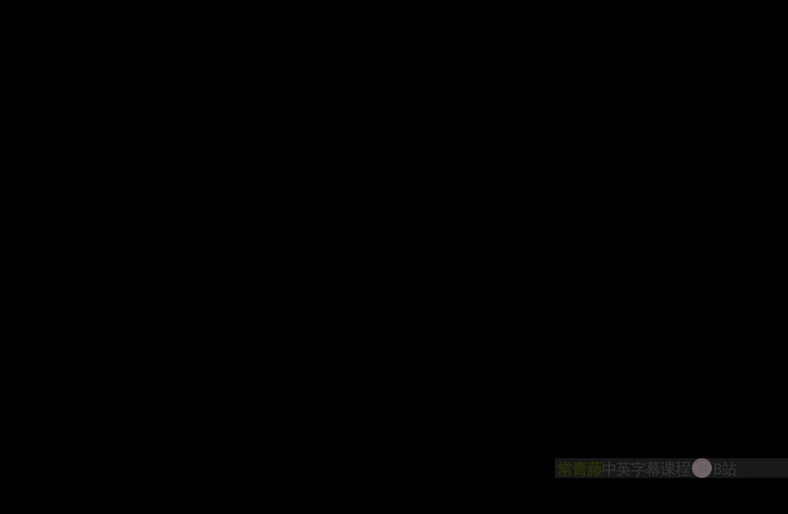