# 麻省理工学院【中英⚡深度学习｜6.7960-Fall-2024,-Deep-Learning】-p10-P10-架构：记忆--BV15QZ4B1E6v_p10-

So today we're going to be doing our last of this minise on machine learning architectures or deep learning architectures。

 so previously we talked about CNNs， CNNs， things like transformers and today we're going to be introducing the contexts of memory and sequence modeling and we have seen different types of ways to model sequences in the past we talked about like 3D CNNs that have time or transformers that have a sense of time but today we're going to be introducing a new class of types of models that handle memory and sequences in a different way。

 and this will be the first class of architectures that we talked about that's actually quote unquotetring complete。

 So this is actually the most general framework of the architectures that we're going to be introducing。

😊。

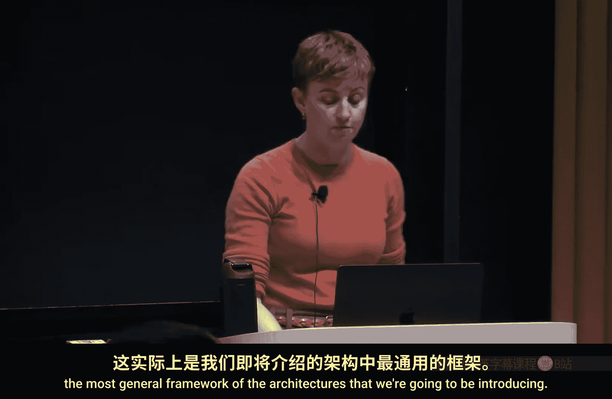

So we'll first motivate sort of again why we think we might want to model sequences。

 model something like time or order， and then we'll talk about how we might use CNNs for sequences。

 we'll introduce the concept of an RNN or recurrent neural network and then we'll go through an extension or a specific subset of RNNs called LSTMs that stands for long shortterm memory and these actually seek to specifically avoid one of the common issues with RNNs which is forgetting。

And then we'll introduce the idea of sequence modeling and long memory and start talking about some things like auto regressionion。

So。If I look at this， this is a single frame from a video。

There's a lot of things that computer vision can understand from this frame alone。So where。

 for example， and and our human brains kind of do the same thing， right。

 So if you look at just this frame， can anyone tell me what this is a picture of。Anything。

Kids playing， Yeah， right。 And maybe they're playing in a classroom。

 so you can understand something about the scene。 This looks like maybe a kindergarten classroom。

 We have computer vision models that can understand stuff like objects that are seen in that single frame。

 television person chair。😊，And we could start doing things like question answering。

 talking about specific attributes of those objects。 What color is the chair。 That chair is red。

 But so far， none of the things that we've talked about have have really explicitly tried to understand。

 for example， relationships between things and how we might predict into the future。 So for example。

 what will the girl do next。 That's something that from this given frame。 I don't know。 probably we。

 we have some ideas about different possibilities， but we might not even know。

 because we also rely on temporal signal， we rely on context and an information。

 But if we watch this video。And we kind of get to the point of that frame。

 We can sort of guess what's going to happen， right。嗯。

So I don't know if any of you have ever had this experience of a chair being pulled out from underneath you and it's incredibly disorienting when something is not how you expect。

 it might go， but watching this video there hits a point in the video where we're pretty sure that the kind of likely thing。

 which is that the girl sits in the chair is not going happen right because the guys move the chair。

 there's sort of these complex relationships between the actions and then you know things like predicting she's gonna fall。

 that she believes that the chair is there， why she believes that the chair is there。

 whether you guys are going to laugh at it。😊，And so all of this is really like very complex and nuanced understanding about the scenes。

 the objects and things like intent， which we could argue about whether these machine learning models that model sequences are really getting at understanding things like human intent。

 but they do start to try to get at this sense of what is going to happen next。So。

Sequences can be a lot of things。 We' talked previously。

 We introduced CNNs about the idea of adding a temporal dimension to things like images。

 Now you have like a video。 This might be pictures from an Italian city square over time。

 You can also think about sequences of language， an evening stroll through a city square is a sequence of words。

 or you could think about know， sequences of audio signal。

 me saying an evening scroll stroll through a city square is a sequence， right。😊。

And looking back again at the architecture that we've gotten very familiar with。

 convolutional neural networks， we can extend those into the spacetime dimension and make a cube like a spacetime cube。

 And again， here， we， we're showing this in three dimensions to be for simplicity。

 But actually it's really four dimensions， right， we're extending this fourth temporal dimension because we have multiple inputs of red。

 green and blue for each of those dimensions。😊，And then time just becomes another spatial dimension in that tensor。

 right， So I have a 4D tensor instead of a 2D tensor。

And so now when we're thinking about how we might actually try to represent time。

 there's different ways that we can think about capturing time within this cube。 And。

 and one interesting ways that you can kind of model temporal structure can be something like taking a slice through that spacetime cube。

 So this is what it looks like if you build sort of this new image that takes a single horizontal sort of pixel slice and then runs that through time。

 So what are we looking at here。 What are these sort of stripes likely to be。😊，Yeah， people walking。

 right， like and then walking at different angles to the camera sort of with different trajectories or different speeds。

But you could also think about taking sort of a vertical slice through time。 right。

 So now this is showing you know， for a given sort of position horizontally or vertically in the frame。

 like who is going through that position first。Interestingly， even from a very long time ago。

 they started modeling images like this for the Olympics。

 when they were trying to figure out who was the first person to go across the finish line。

 If you take the finish line。 And you make that as a single pixel element。

 you can see exactly what pixel cross this first。 And that represents the person who won the race。😊。

And so there's lots of different ways you can think about representing or modeling time。

 And then if you actually want to think about how you do convolutions in time。

 if we take sort of a very simple 1 d perspective of this。

 So now imagine we're just talking about the scalar perspective。

 then what you would do is you would similar to before。

 you would learn some weight matrix over some given fixed time window。 So in this case。

 three sort of elements in that sequence。 And then you can think of this as a sequence to sequence model。

😊，So instead of before we took an image or something。

 and we would run this across the image and these different patches。

 and then you were sort of constrained by the structure of the image here actually。

 now you can run this in time。 So now you're taking input from these sort of three different positions in the sequence and you're generating an output position。

 Now you could slide that。 and you could slide it arbitrarily long。

You can take any arbitrary length sequence and you can generate an arbitrary length sequence。

 So these convolutions in time are not they're not sort of constrained。 I mean。

 they're only constrained by sort of the length of your input sequence。

 And you can imagine that if you had something like a static camera that was taking video of this classroom continuously that you could sort of just keep running these convolutions in time。

 And there wouldn't necessarily be a point where you need to stop。

 like we're constrained by the architecture itself。Now。

 if you consider something like more dimensions， right， things like， you know。

 these RGB videos or add even additional dimensions in that RGB channel。

 something like MRI that captures 3D volumes over time or hyperspectral satellite images that can have something like。

 you know。384 different bands。 You can continue to think about these convolutions。

 But now where time is potentially this infinitely long dimension。And。If you're doing this。

Then what we discover， both empirically and also it kind of makes sense intuitively is that as that time sequence becomes arbitrarily long。

It's hard for our memories of what happened at the beginning of the sequence to persist。Right。

 and one of the reasons for this with a convolutional approach。Is， is the following so。Here。

Say we have our temporal convolution。And it's taking in some input。 You know， we're throwing this。

 showing the scalar vision。 But for the sake of。Intuition， this is a picture of my cat， Frank。

Who is the cutest cat in the world。And so say I'm walking around my house taking a video。

 and I start at this point in time。 and then I go forward。 And now in the future， I have again。

 remember because it's a convolution， that same weight matrix。

 And now I want to understand what's in here。😊，But the thing is， I don't get。

 I don't really have from this fixed time window any inputs coming from the beginning， right， Ive。

 I've only got the window that I can look at。 And so based on the information I have， well。

 maybe I look at this and。I predict tiger because it's orange and it's outside。 And， you know。

 cats are usually indoors。 So the idea of something like memory or trying to extend sort of what we forget。

 move beyond sort of these fixed time windows is to try to capture that， that context。

 be able to sort of remember what you saw in the past。 So here。

 then maybe you'd have some memory unit。 And that would actually give you some context。

 give you information， you know， since I'm walking around my house。

 It's unlikely I'm gonna see a tiger。 But I did see Frank before。 So it's maybe still fnk。

And so this type of， you know， identification with the context of what you've seen in the past from like。

 you know， the same， for example， sequence is really the intuition or sort of the motivation behind the development of what we call recurrent neural networks。

 So these R NNs。 so transformers， CNNNs， everything so far mostly had this sort of fixed window in time。

 right， There was you know， transformers these days。 you know。

 we can talk about that that context window getting very， very large。 but it's still fixed。

But a recurrent neural network makes that infinite， right？

 And the way that it does it is you introduce the idea of a hidden unit。 So now you have。

 for example， from this convolution。 send you， you run your model through the convolution。

 you get some value。 And then you learn a way to take that value。

 that hidden that hidden unit and predict the output。

But you also take that hidden unit and you send it forward in time to the next time step。 So here。

 now， as you're convolving through time， you're actually taking in both that new temporal input and your memory from the past。

嗯。And so here， if we want to look at this in a little bit more detail， again。

 just thinking of everything as scrs just because it'， it's really easy to visualize this way。

So a version of like a scalar temporal prediction problem might be something like predicting temperature in Boston tomorrow。

So here now what you're doing is you're representing time as some sort of discrete sequence。

 though you can apply these to continual sequences。And the next hidden state。 So now we have。

 you know， our inputs running through some model to get some hidden state。

 And then we send this output。 And we also send that hidden state one time step forward。

So here it's as you're kind of running this through。What we do。Is we say your next hiddenden state。

Is represented by some function F that will depend on the previous hidden state and the current input。

 And then that F， that function that's shared over time。 So we're not， you know。

 that that function is， is， again， it's fixed over time。

 The way that we push information forward is fixed over time。 and that's something that gets learned。

And it's independent of time what that function is。 And then similarly。

 we'll have learned some function G。That will map from our hidden state to our output prediction for any given time step。

And that's also going to be shared over time。And so， here。You'll note。

That this is the first time we're not seeing a dag， right， This is not a directed acyclic graph。

 We have a loop。 We have a cycle because you're going from that hidden state to the hidden state again。

And that's recurrent， right。And so you can kind of write this recurrent function for what your hidden state will be。

 That's some function of your previous hidden state and your current input beta。And then again。

 your output function is going to be G mapped from your hidden state。

I think it's a little easier to interpret when you think about the computation being unrolled， right。

 because then actually， for any given time point， it's still a directed graph。

 It's just that you have this recurrence loop。But so。Again。

 this is kind of like the simplest version of this。

 And now you assume all of those functions are linear layers。

 which we're very familiar with at this point。So now what you're learning is you're learning you。

 which is mapping your input to the hint。To sort of the next point。

 you're learning some V that's mapping your previous hidden state in as well。

 And you're gonna combine them。 And then you're learning V that maps your hidden state to the output。

And so now here you have some。Something like this， right。

 you'll have some nonlinearities in there in this sort of simplest form。

So your new hidden state is just non nonlinearity applied on top of W times the previous hidden state plus u times your input data at the current time point plus some bias term。

And then similarly， the output， again， is some other non nonlinearity。Plus。

 times V plus the current state plus a different bias term。So if I got rid of W here。

What would this be called。

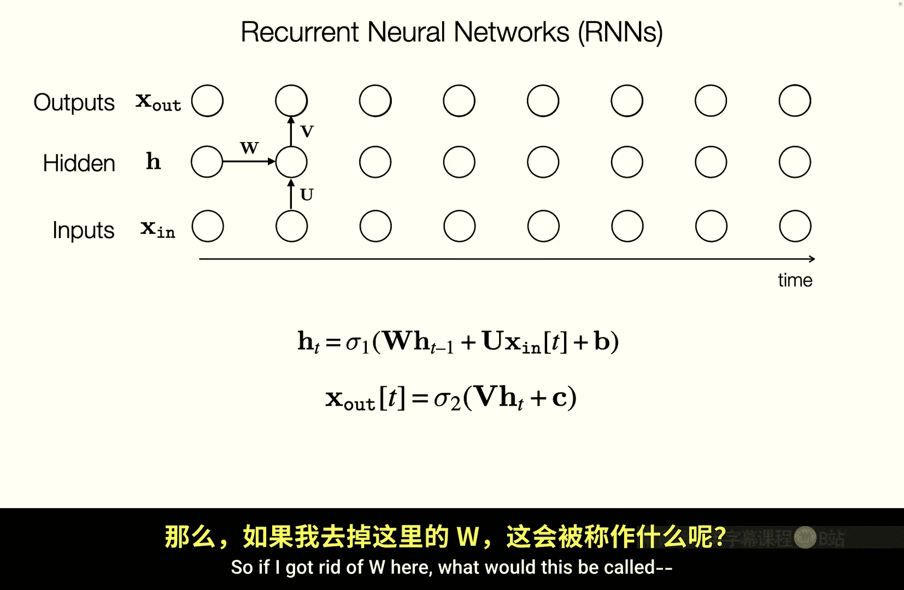

If I got rid of the kind of recurrence dimension， if we were just looking at that mapping between the input and the output。

I mean， since it's scalrs， it's a little silly。 I mean， it's like a one dimensional convolution。

 But imagine if you extend these beyond scals， it starts looking a little bit like that multi layerer perceptron that we're very familiar with。

 right， So the only difference here is that that recurrence that's actually sending this information forward over time。

And really， I think the point here is that the hidden state is intended to capture the most relevant historical information。

And。What we're learning in W is how do we actually understand what is relevant。

 Like what do we need to keep。And， of course， this can be extended to be deep， right。

 You don't need to only have a single hidden state。

 You can actually stack a bunch of these on top of each other。 have many。

 many sort of different hidden states， hidden layers。 And then now。

These could be any dimensional tensor。 And there are many， many。

 many works that have looked at different ways to structure these deepercurrent neural networks。

But how do we do back prop if we don't have a dag， right， Oh yeah。The recurrence。

How many times have you have feeling like on rolling it？How do you know thisTo infinity and beyond？

Is that a hybridprint？So the way this is structured it doesn't have a sense of stop I mean it'll just stop when you stop doing it right like when you stop putting in input data。

 I guess that's when it stops， but there isn't a sense in this model necessarily as it's structured that has' an end right because you have that weight that's passing the previous hidden light unit into the next one so if you don't give it a next step I guess that's the end。

 but it doesn't know what stopping is。are you。嗯。I mean， it depends on the problem， right。

If you're using these types of RNNs to do something like。

Model video or model audio clips like they probably have an end right。

 so you can just stop running them when you get to the end。

But you could also think of it in like a continual sort of way。

 like maybe you're continuing to get temperature data every day and every day you predict the next temperature and that's going to go until。

板。嗯。Does that make sense， Yeah， how does this architecture capture the infinite leg of the？认规定是。

Right， so the question was， how does this architecture capture memory throughout that very long infinite length because that hidden state only depends on the previous state？

 So it's recurrent。 So this state only depends on the previous state。

 But the previous state depended on the state before that。

 and the previous state depend on the state before that。

 So you are capturing in every single hidden unit as far back as you have。

 but we'll talk about how even though that's theoretically true that this construction actually makes it really difficult to learn things across like very。

 very long time horizons， mostly because you have some limited capacity there。

 And then we'll also talk about actually some of the mathematical limitations of this formulation。

 But yes， great question。Cool， so how do you do backpro if we have a， if we don't have a da， right。

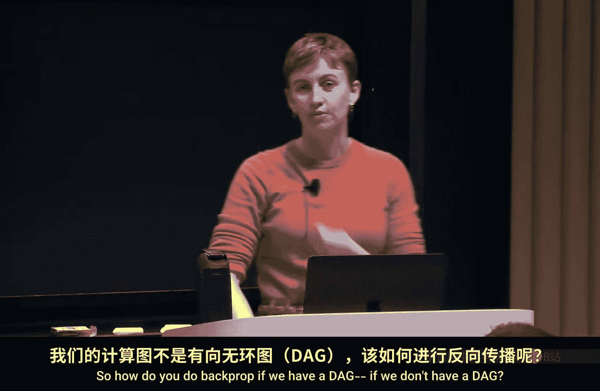

So the simple， practical thing， historically， this was something that really trip people up。

Back crop is intended for feed for networks， and now we have loops。But the hack is you just。

 you just decide when you're training what your sort of fixed time window that you're going to propagate back through is。

And then now you unroll it through that time window。So you'd say， okay， guess what。

 my time window is going to be this far right， I'm going to go from V back to X O and then now you've unrolled it and of course you have some shared parameters in that network。

 but it's actually now again a directed acyclic graph。

Because we're stopping the point where you're going to kind of keep going back forever。

And so here you can actually just， again， if you're going to try to calculate， you know。

 the influence on the output， you know， D of x out with respect to D of x in。Over， you know。

 from 0 to time T， you can do that by just。Sending now through this directly acyclic graph back to that that zeroth element just by unrolling as far as you want to unroll。

And that's a parameter that you would sort of select or tune， right。

 how far are you going to send your back propagation？

And then once you've kind of unrolled it and you've kind of decided on this fixed time window during training。

 then you can just use the same chain rule and you can calculate what that gradient is going to be。

And the interesting thing here is it does kind of limit maybe how well we might learn things further back in time。

Because， of course， like the information is still available， right， you're still， you know。

 at inference time， you're still going to have that previous information getting passed through or getting encoded。

 But if you only trained the model to send signal back to a given sort of fixed time window。

You could see how intuitively it might teach you to pay， you know。

 to kind of only capture some sort of limited temporal window of information。

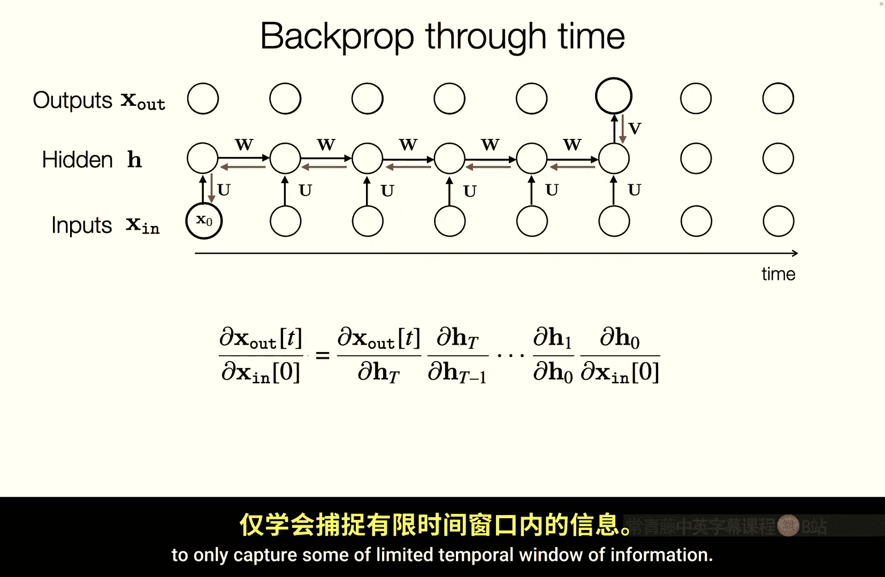

Now。In practice， there's also other complexities as we increase that time window in terms of what。

 what that means， yeah。Please the time window。 I it then harder to。

For gift if you only use a couple of inputs， I think。Oh， interesting。So the question。

 which I think is an interesting one， is if you've。

Traed this model using back prop over maybe a time window of like 20。 Now， if you only have。

 you know， a sequence of three inputs， I that actually limiting your ability to do it shorter。 Well。

 so potentially no， because this is just looking at one component of that。

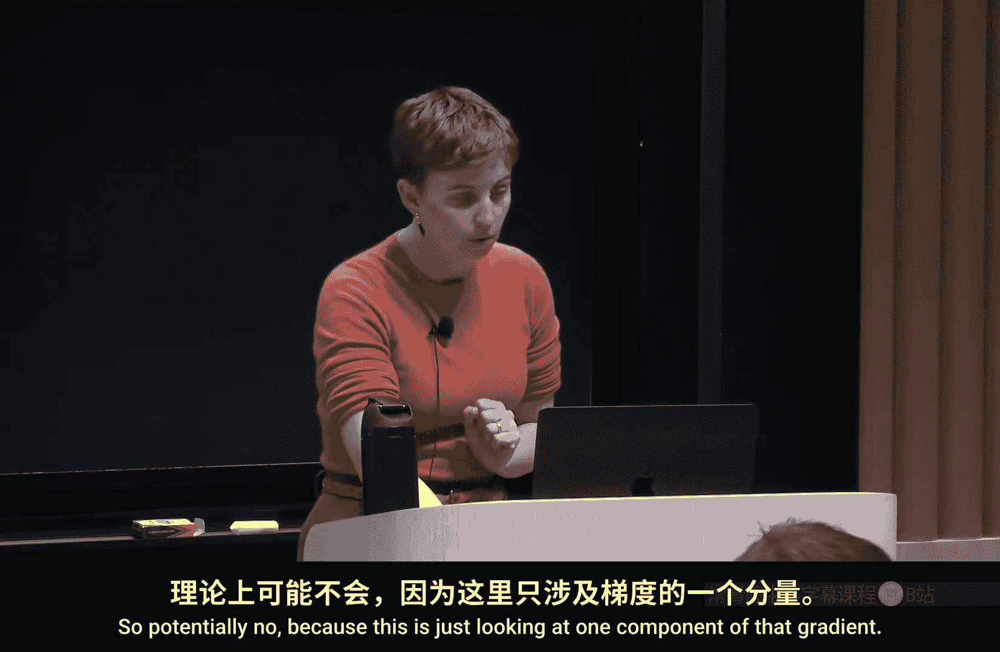

Of that gradient。 But actually。

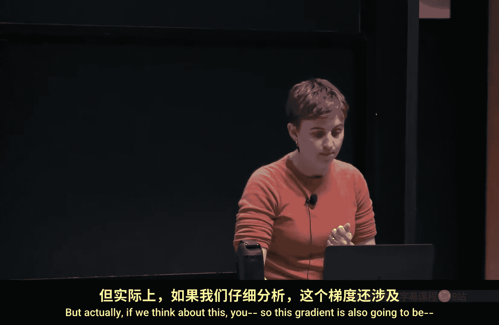

If we， if we think about this， you would， you So this gradient is also going to be like。

 this is just the input of that。

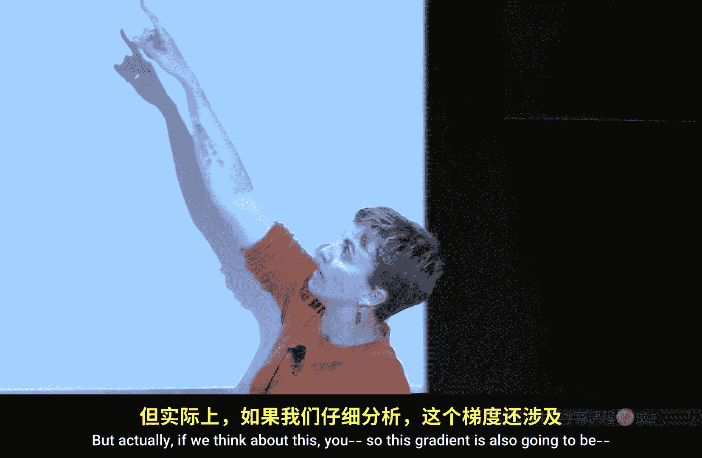

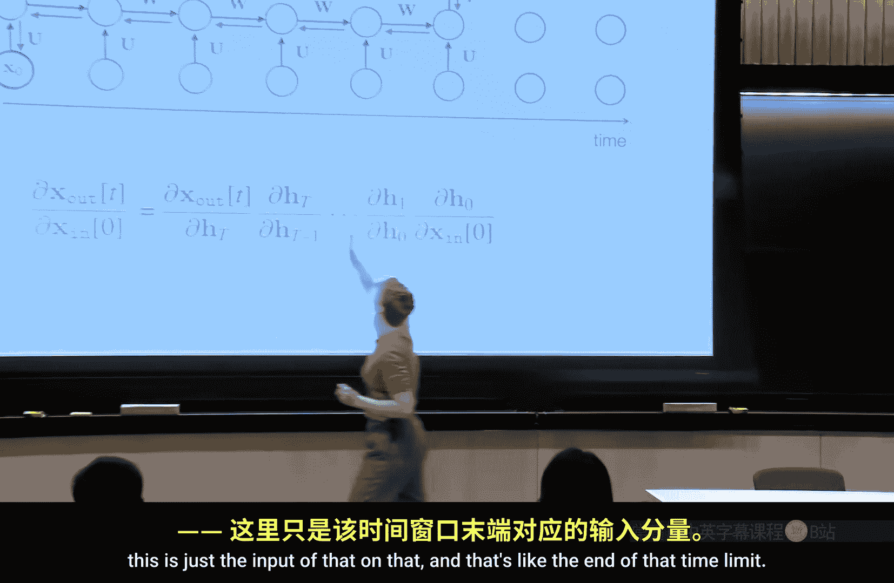

On that。 And that's like the end of that time limit。 But in practice。

 you would also do everything up to this time point。

 And we'll go through that in the next couple slides。

 So you would still be getting that signal from sort of everything within the time window that you're looking at。

 not just going back to the farthest point， which makes sense because。

It might be much more helpful to have some of those more frequent， more。

 more recent gradients than maybe the further ones， yeah。To go along that point for this example。

 would it be like if XN is today's temperature， X out is like six days in advanced temperature。

 but we are actually inherently predicting like one day， two day， three day，  four day5。

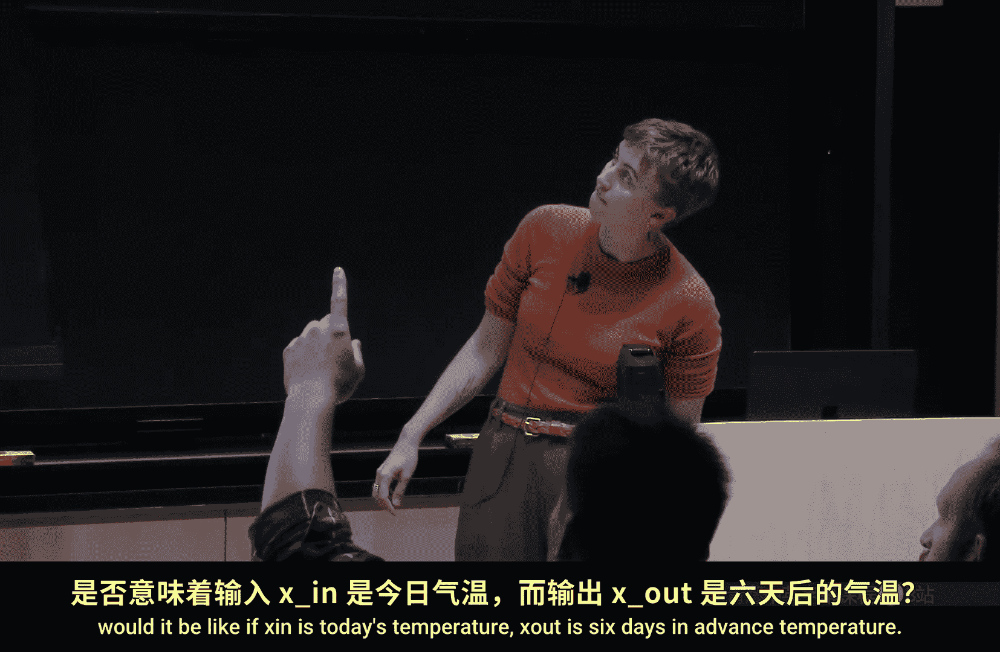

To get。Yeah， so what we're showing here is just the fact that if you do unroll this。

 that now you do have this directed graph again。 But then like in practice。

 essentially what you're saying is you would only take the gradients up to like t minus whatever x0 was。

 this is like 1，2，3，4，5，6。 So you'd only be taking those gradients over a sequence of 6。

 And then now for the next point， you'd shift right So now you'd only go to x1。

 And then for the next point， you'd only send gradients from x2。

 So you have some fixed time window that you're unrolling that you actually accept gradient。

 you calculate gradients over。

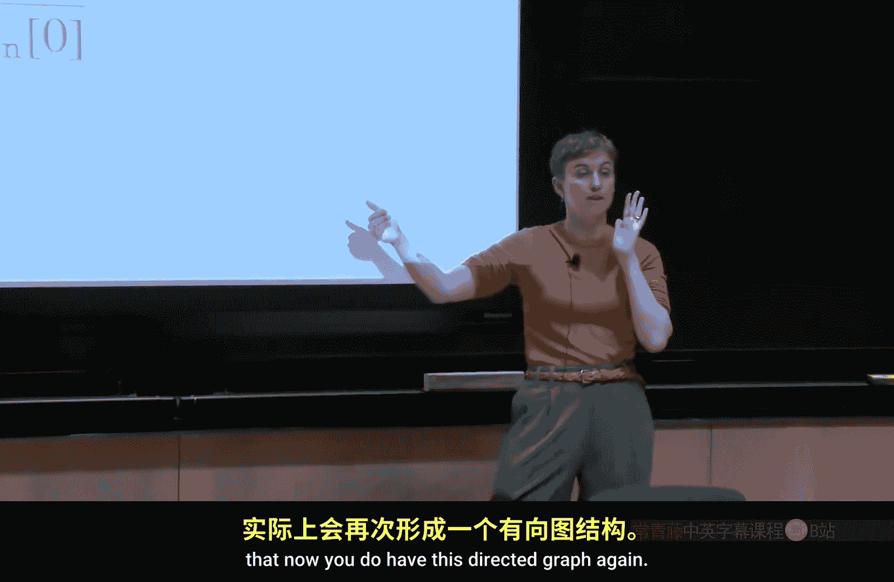

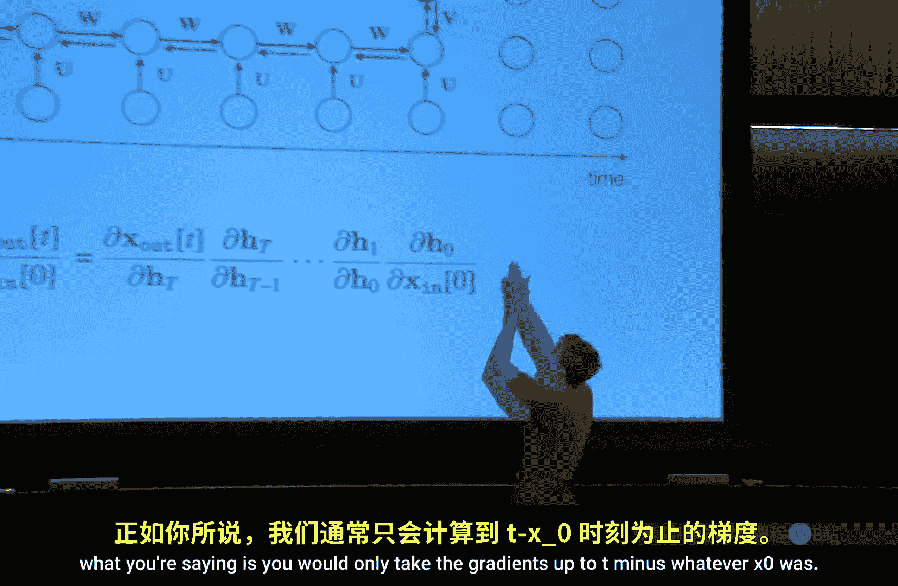

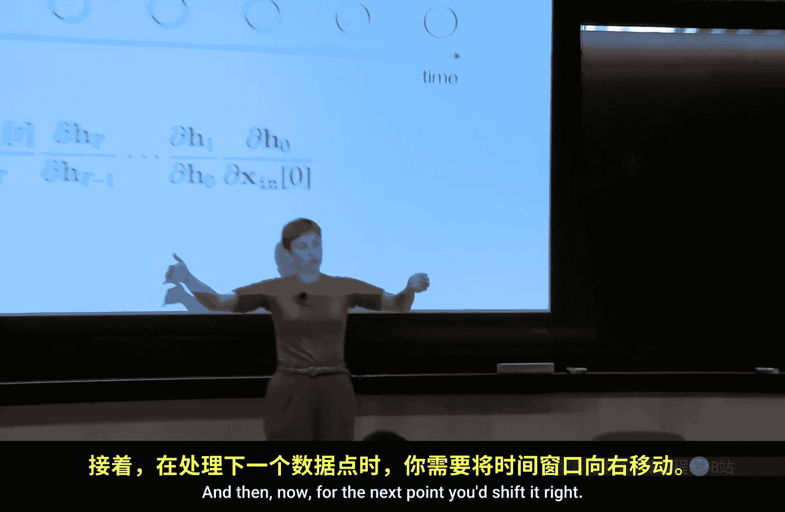

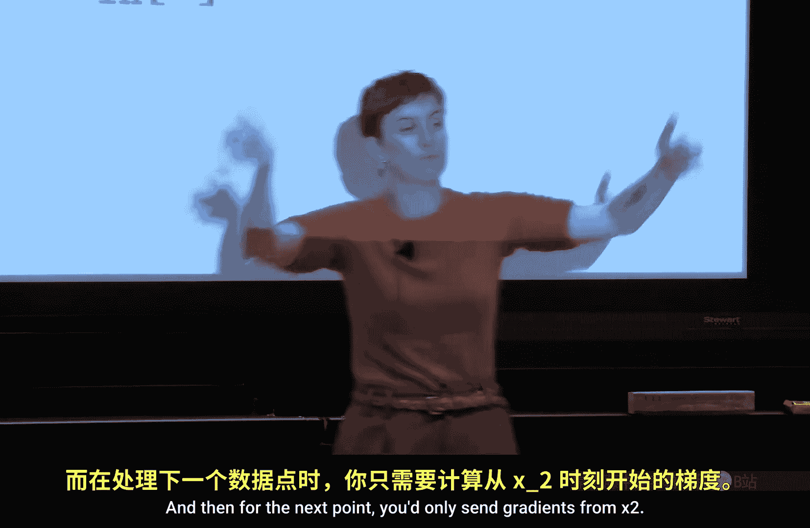

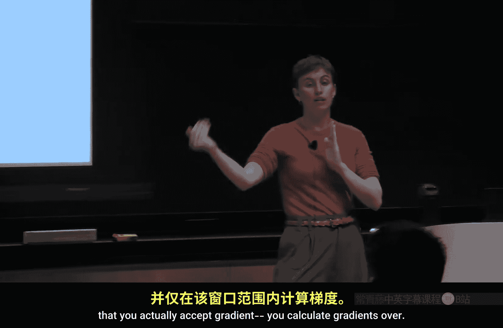

Yeah。The truncetated time windows。I think that's a reasonable assumption。

 The question was is that fixed time window， a reasonable approximation of an infinite time window。

 I would say it's maybe a bit of both。 So again， I'll walk through it in a sec。

 but basically with this formulation， the longer time window you have the harder it is for information to actually make it that far with these weights。

 So at some point， actually like extending the time window is probably by construction here。

 not super beneficial。 yeah。😊，Yes， I wonder is there ways to optimize。

 What's the time window we need for a specific task， or is it just like。Well， it's a hyperparameter。

 right， So， you know， when you would look at the literature for this， you know， people would。

 would abllate that hyperparameter， for example。And and I think sometimes it it might be something that you could actually bring some domain knowledge to decide。

 right， like what what actually makes sense。啊。

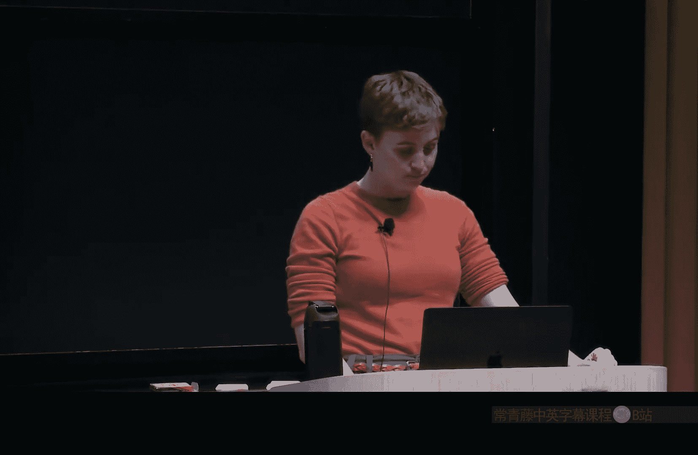

So a few conceptual things。 if you are going to unroll this。

 remember that that that function that maps the hidden states forward through time is fixed over time。

 So those ws are shared。 So now what does that mean for backpro。

 So we have this sequence of videos right？ now the loss is going to end up being。

The sum of the losses from each of those predicted frames over some sequence and to optimize。

 you want to learn how you would change W， U and V so that you know the sum of the kind of loss over that sequence is is minimized right。

 is how we do gradient descent， but you want it for the entire sequence sort of within， I guess。

 the time window that you're considering。So we want to figure out how we want to change all of these。

 But， of course， W is as， again， like shared over time。So we have to do back over shared parameters。

So we're gonna sum up all of these sort of individual losses。

 And now we're gonna be passing this gradient back。 And now。

Does anyone remember what it looks like when we have these back prop over shared parameters， right。

 Because here we have， you know， the loss is all getting summed up。 The gradients all coming down。

 And then there's this kind of waterfall backwards where those gradients are passing through all the Ws。

So does anyone remember what we do when we're taking gradients over shared parameters？

Its been a couple weeks。 Does this look familiar to anybody。Yeah， so here， you know。

 there's this idea that if you have kind of shared parameters and they're sort of being shared throughout a network。

 that it's actually the same as branching structure in a directed acyclic graph。

And so when you're doing a gradient， when you're taking the gradient over this branching structure。

 you're actually just summing the gradients for the parameter each time that parameter occurs。

 So for that W， we're going just be summing those gradients over every single element that we have that W in。

😊，Cool， so here。We have W in all these places。 and now we have kind of this branching structure。

 And then when we're calculating the change in that， that loss with respect to W。

 it's the sum over the change of the loss from the gradients from sort of each of those。Cool。

 and the nice thing is， if you're using something like Pytorch。

 This will happen automatically in autograd as long as you don't do deep copies， right。

 as long as you're sort of pointing to the actual， by reference that actual variable。

 then autograd handles this kind of。😊，Like summing over the gradients within the thing reasonably well。

 So make sure you're not doing deep copies and it all works out pretty nicely。

And then I think another point is。You're summing over the past inputs， right， So。

 so if you're calculating the loss with respect to this one， you're summing over all of those。

 If you're c with respect to this one， it's only over sort of the ones previous to it， eta， et cea。

 because that's only going in one direction。Any other questions about back propagation through an R N。

Cool， let's move on。So。Problem of long range dependencies， right， We talked about， well。

 as this time window starts to stretch towards infinity。

 it seems like it would be hard for this thing to remember。You know。

 why not set your time window to infinity， You know， why not remember everything。

 So it turns out first， memory size will grow with with that T， right。

 So if you need to use some sort of infinitely long sequence as an input。

 that means it takes up a lot more memory。And that time of memory is， is non parametric， right。

 There's not like a finite set of parameters we can use to model infinite time。

Aenans make like a Markov assumption， which is to say that the future hidden state。

Only depends on the immediate preceding hidden state， right， So， you know， we say， okay。

 it's recurrent， but we only depend on just the immediate hidden state before that。

And then by putting the right information into that hidden state。

 you can model dependencies that are arbitrarily far apart in theory， right。

 because the model learns with W how to keep the relevant information。 Or at least that's the hope。

So here。What you're saying is actually， in order to capture those long range dependencies。

 we have to propagate that information through a very long chain of dependencies。

And this ends up being a bit difficult。 So let's walk through this。It's very big chalk。

So for simplicity， just to walk through what the math looks like。

 we're gonna assume we don't have any nonlinearities。 And that all the bias termss are set to 0。

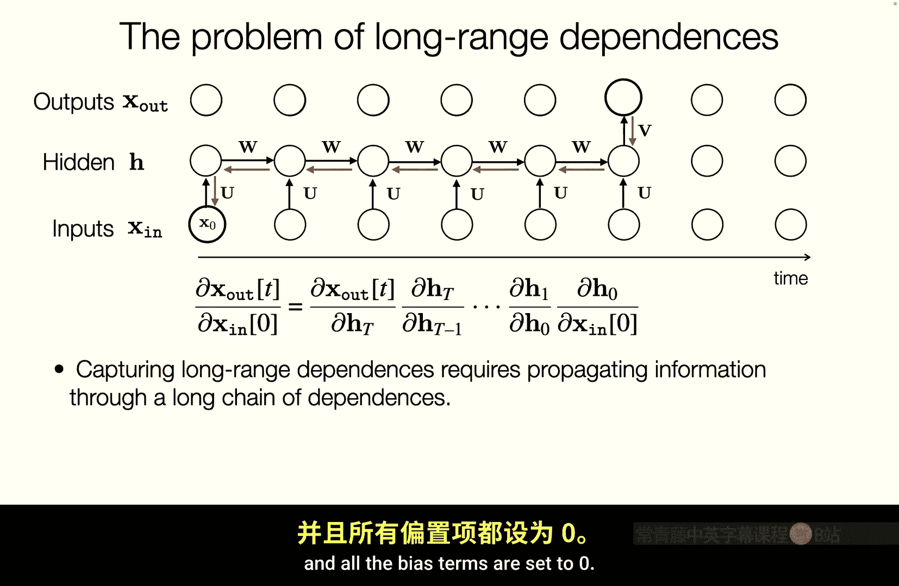

So say we have you know， H sub1。And that's going to be equal to， like we said before， w of h sub0。

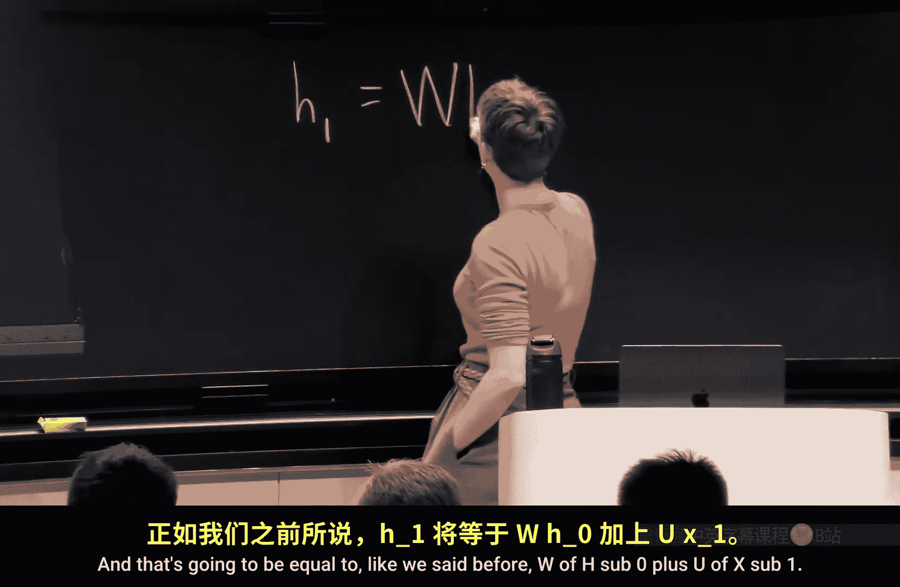

Plus， you。Of x sub 1。So H to one， the hidden state at that first step is going to be equal to the weights times the hidden state of the previous step times plus these weights times the new input。

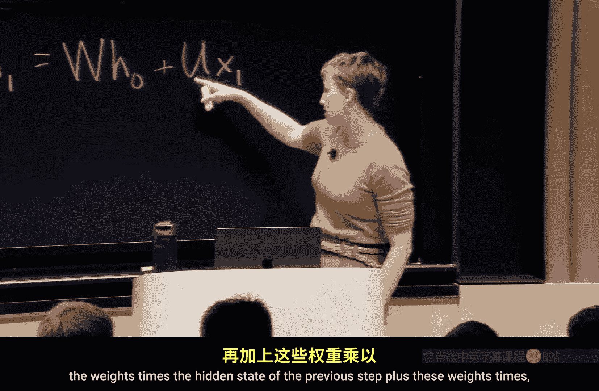

Now， if we write out what this recurrence looks like， now， if we say H sub 2。

 now that's going to be equal to。W of。W of H sub0 plus。U of x sub 1。Plus u of x sub2， right？

So what do you notice here。Now we have a W squared term， essentially。And so now。

 if you do it for another time step。You're gonna have W cubed， etc cetera。

 all the way up to W to the N， right。So。

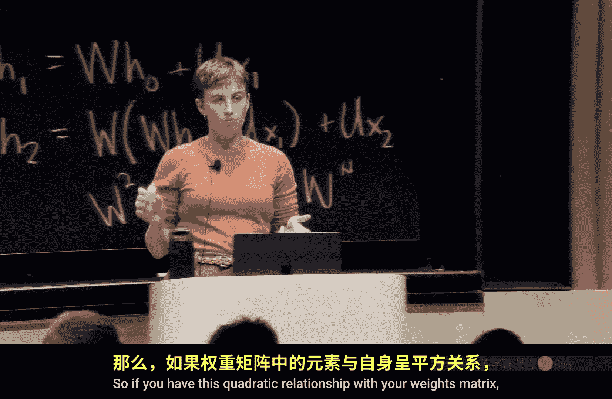

If you have this quadratic relationship with your weights matrix， what happens for。

Values in that weight matrix that are small。

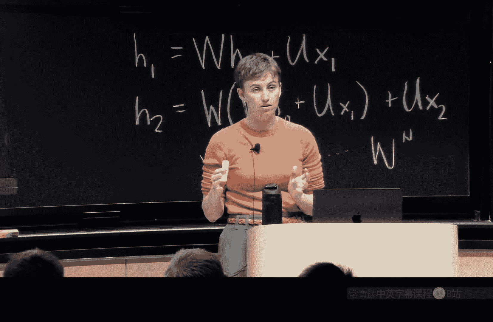

They'll go to 0， right， And anything in that weight matrix that's big。Will be infinite。

So what happens is in order for this to be stable at all during training。

All the values can need to be close to one。Which means it's kind of hard to capture really variable information in there。

 and then additionally， kind of no matter what， even if you're just a little bit below one。

 when you go to infinity， it will go to zero right because you have this sort of exponential relationship。

And so what this means is often that old observations in a recurrent neural network are forgotten。

 right。And that the stochastic gradients become really high variants。

 and you can either have these vanishing ingredientss or exploded ingredientss。😊。

And so this is why we sort of started to look towards LSTMs， yeah。

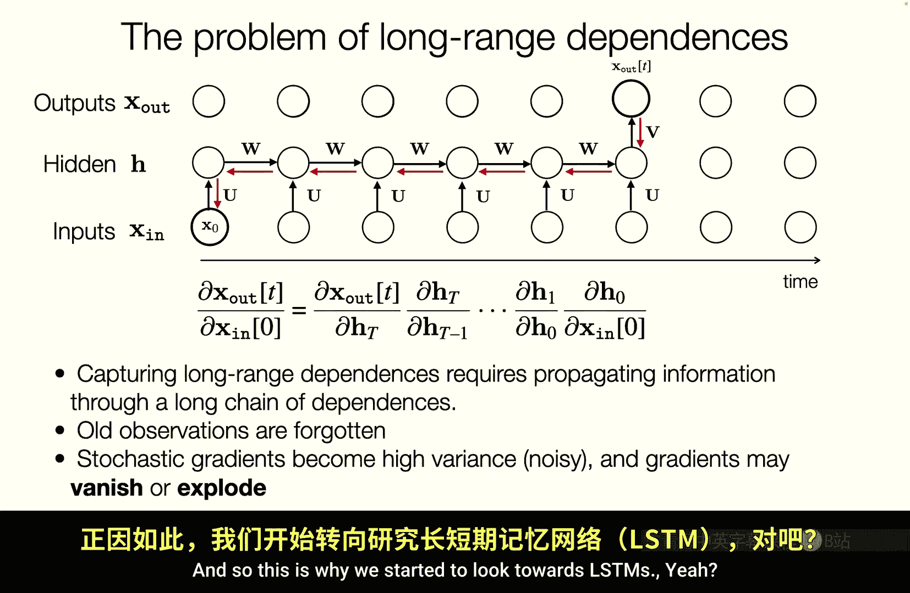

So the question was， we previously talked about the spectral norm and using that as a。

 as a way to try to mitigate things like these vanishing our explode ingredients。

 So you could try to build something in here that would try to。

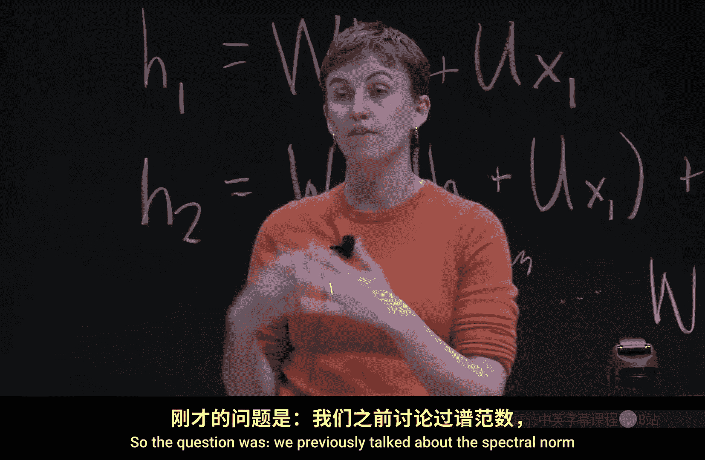

Normalize these weights so that they would be， again， like。You know。Close to one， essentially。

 I mean， or not not go to sort of infinity or not， but。This function is。

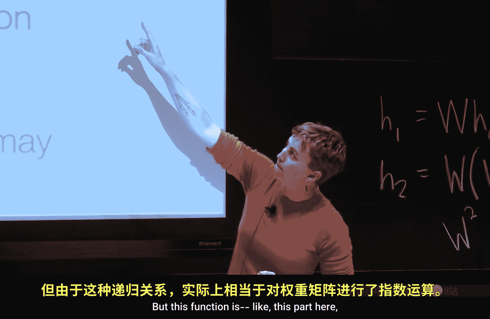

Like this part here， like the fact that because of the recurrence relationship。

 you're taking an exponential in the weights matrix。嗯。

You could take a spectral norm over that exponential。

 but you're still gonna to take the exponential first。

 So that might help you with the exploding gradients problem。

 But it's not going to change the fact that the small things are going go to 0。Does that make sense。

 Yeah， cool。嗯。And actually， if you， I， I thought this was kind of a fun blog post that specifically takes it's from a control theory professor。

 but they're looking at stability analysis in recursion。😊。

And so if anyone's interested in sort of the different ways that people think about what makes things stable or not stable in a system。

 if you have recursion， I thought this was kind of a nice， a nice blog post。Yes。

They saids can explode or vanish， do they both correspond to old memories being forgotten？

And also as a follow up， like， isn't it not a terrible thing that old memories are forgotten because that's？

Well， that's， so， so the question is， if you have exploding and vanishing。

 do they both correspond to memories being forgotten。 And no。

 the exploding ones correspond to unstable training， which we also don't really want。

 And the vanishing ones would be old memories being forgotten。

 And then do we actually want to remember things over longtime horizons。

 And that's kind of the universal question。 Like， do we need this。

And I would say that there are definitely。Cases where we don't。

And then there maybe are some cases where we where we do， right， So， so an example might be。嗯。

Think about temperature。So we have kind of these daily cycles of temperature。

 So we'd like to remember that the temperature got warmer in the middle of the day than at night yesterday。

 So if we're looking at predicting temperature on some sort of fine grain horizon。

 you'd want to be able to remember at least periodically a day back。

But then also you have these yearly cycles of temperature right where it's hotter in the summer and cooler in the winter。

 So maybe if you're trying to model temperature， you also want to have this yearly dependency。

 And then you have things like these weather cycles like El Nino that happen every seven years。

 And so depending on what you're trying to model， there may actually be a lot of value in the longer and longer term memory。

 if there's signal in more and more timescale。 Does that make sense。😊，Cool。

 so this is why we introduced LSTMs， which is to try to deal with forgetting。

 to try to deal with this vanishing gradient problem。

 And the reason the vanishing gradient problem is more of a problem than the unstable exploding gradients is exactly like what what this guy over here mentioned。

 there are things we can do to try to force， you know。

 to take normalization over the gradients to keep them from exploding different ways that we can kind of constrain it or regular it or clip it。

 But we can't， we can't do that when things go to 0。😊，So。LSTMs are， essentially。

Designed so that the default behavior is to not forget。And then you have to learn to forget。

And so the default is the identity。 You're biased to like， not forget anything。

 And then you learn what to forget， kind of like garbage collection。

 what to throw away so that you can add new stuff。And so if you look at this。

 So this is kind of like the standardcur recurrent neural network。 right， We have some nonlinearity。

 This is， this is kind of a simplified version where it looks like we're sending in the inputs。

 There's a function here that's mapping this in。 And then we're sending out some hidden state。

 But then therell be some function mapping that to the output。

 We're just only looking at kind of the hidden layer component of this model。😊。

And so what an LSTM does is it builds a little memory controller。

That decides what to save and what to delete。 And it turns out this is still tocomp。

 And it's actually very close to a Tring machine。 It's kind of like that idea of a hidden tape that you could read to or write from。

 And so now， every single one of these sort of functions that maps us from our inputs and then to what the sort of next hidden state should be has this little controller built in。

😊，And so let's go through the different sort of components of this thing。So first。

 we have this cell state C。 This is a new thing that we're introducing for an LTM。

 And this is kind of the tape in the Tring machine。

 And this cell state is what gets modulated by the part that decides what to forget and what to add。

😊，So then we'll have some function F of T。And this function。will， you'll operate over， you know。

 applying your sort of previous weights to the previous hidden state and your current state and then your biases。

And that that is going to be non linearized by something like a sigmoid。 So if it's large。

 it goes to one。And if it's small， it goes to 0。 And so now， if you're taking this thing。Now。

 if you multiply by 0。 So if， this value ends up being small。Coming out of the function。

 then it's telling you， forget this thing。And then。

So what you want to do is give high values to things you want to remember and low values to things you want to forget。

So that's like this what this component of the LSM is is in charge of deciding what to remember and what to forget。

And then。Each element of that cell state， essentially， because of the。

 the way that we're using a sigmoid and not something like a relo， which would be sort of unbounded。

 is it's essentially the identity function with some masking of what we want to forget。So， then。

There's this next component。 And this one is determining which indices we want to write to and what to write。

So now we have， essentially。This I that is used to determine basically which indices we're going write to。

 And then the C of T is going to be what how that information kind of gets added to the cell state。

Yeah。And then， finally。We need to do the actual forgetting。

And so this is where this kind of comes in what's quite different is for the first time now we have these multiplicative relationships。

 right。So you're multilying， you're taking the previous cell state and you're multiplying it by this f sub T。

 which is going to be kind of either ones or zeros or very close to。And then。

So now that's kind of updating the， the cell state in the first place。

 And then you're going to add this new information。

 So you now have this I sub T multiplied by this the， the new cell state C sub T。 So in this case。

 it's removing information and adding information。Okay。

 so now after you've actually updated that information in the cell state。

Now we're going to decide what gets output to the next hidden state。It's not mathematically similar。

 but we just learned about transformers， right， where we have sort of the keys keys。

 queries and values。 So in that， in that case， when we talk about this like sort of value projection。

 these value matrix。 that's kind of telling you how you should output that next state or how you should output sort of the sort of output of that thing and this feels to me like on vibes kind of like kind of like values right you've already decided what you've updated the cell state's information and now you want to say。

 okay， now what， how do we take that and update it to the next hidden state。And then note。

 So we had now。We have both these hidden states， which are getting passed through。

 but we also have that ticker tape， that cell state that's also getting passed through。

 So there's kind of two things going on。Cool。So really this important point。

 like the important thing that this has beyond that vanilla RN。

Is the fact that you have almost this gating functionality that's provided by multiplicative updates to the cell state。

 where now we explicitly learn what to remember and what to forget。And then you multiply by one。

 So you have this identity instead of multiplying by yourself。

 which removes the vanishing and exploded ingredients。 We no longer have that exponential。 Instead。

 you're only ever going to do something like the identity or remove it and add something new。

And it's sort of， you， because the default is the identity。

 It's kind of like a ski connection or a residual connection in a resident。

You have this component where you could just learn throughout this entire thing to only ever send the identity。

 like， okay， just send the same information forward all the time。Awesome。😊。

Any other questions about LSTMs。 know， this part's like a little fiddly。 So， you know。

 definitely feel free to go back through or visit this really nice blog post that we pulled some of these visualizations。

 from Clola。😊，Yeah。Element wise is competition for the hidden。

So the multiplication is basically like you're learning this gating function， F。

 it's like telling you what to forget。And then you're learning this I that's telling you like what new information to add back in。

 And so those two things are going to be multiplied in。

 and they're going to be multiplied in like element wise in your C。

 depending on what the sort of size of C is。Yeah。自分。好，直系。哦 sma嗯。The sigmas are sigmoid functions。

Literally。Literally， sigmoid functions。Yeah， and and the reason that people often to use。

 you could use another linearity。 But the reason you use a sigmoid function here is because it's bounded between 0 and 1。

 So you kind of want large values to map to 1 and small values to map to 0。Yes， yeah呀。

The question was if the weights are on the diagonal， and the answer is no。こ。O。

Let's talk about sequence models， so。So we just talked about a bunch of different ways that you can think about。

Trying to model sequences， but。呃。There's this sort of new kid in town of what we call an auto regressive model。

So previously， we said， okay， we're going to have some fixed time window。

 We're going to be sending this memory forward。 Things can be infinitely long。

 but the idea of an autoregressive model is， is quite simple。 And we've introduced them before。😊。

SoThe idea is you have some beginning of a sequence， and then you ask it to predict what comes next。

And then this is the auto aggressivegressive part。 You add that in。And now again。

 you ask to predicts what comes next， right？And this idea of sort of continually， you know。

 predicting what's next， predicting what's next。 This is how we think about doing， you know， Mo。

 generative AI。 A lot of these things like Cha T B T。

 these vision or these language models will explicitly be trained to be auto aggressive。

Though of course， there's no reason why you can't take the same framework and instead tell it to fill in the blanks or something。

So when you're actually training one of these auto aggressive models。

You might have a bunch of different examples of sentences， right， And then， you know。

 the beginnings of sentences and then the next word。

 And so then the learner has to learn from the beginning of a sentence， what is the next word。

And then when you're actually sampling， you would do something like send in some new beginning of a sentence and then use your predictor sort of until you want to stop or until the predictor decides to stop to predict the next thing。

 yeah。

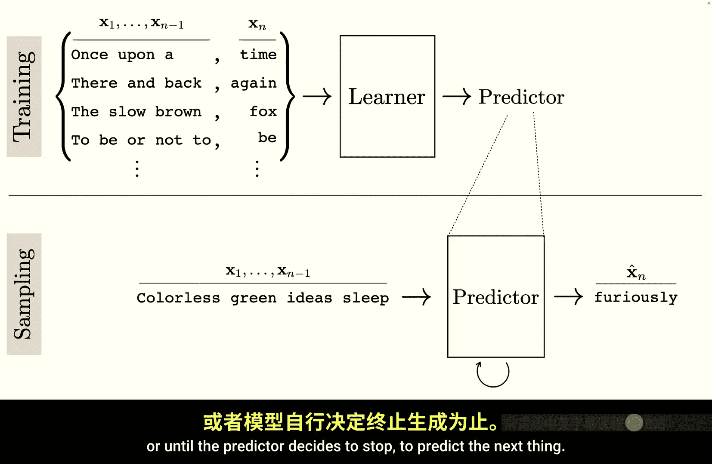

You mean you。If I predict something I time to eat， I take that prediction。So now。

So now you predict something at time T。And then you take that prediction and you add it to now what's your input。

 So now your input is everything up to t -1 and your prediction for T。

 And then you ask it to predict T plus1。 and then you add it in。great。売正に。Yeah， yeah， yeah。

 So then actually， the sampling part， like this is， that's exactly what would happen， right。

 you would send in as your input， Colless green ideas， sleep， ask your predictor what comes next。

 says furiously， And then you would take that furiously。 And you could add in。 And you could say。

 okay， well， what if I said colorless green ideas sleep furiously， then what comes next。 And then。

 you know， So is this idea of autoaggression that you're sort of using your predictions。

 adding them to the input and then predicting again and again and again。

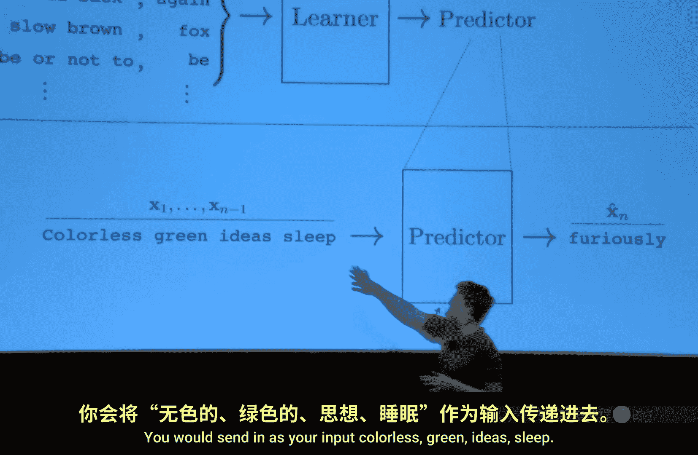

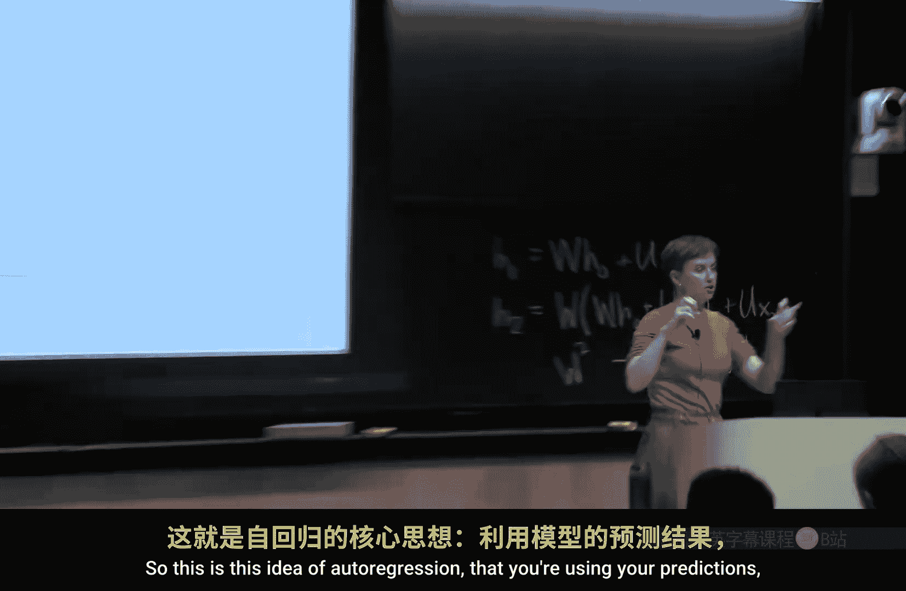

Is that one way you could evaluate？Just print out that。He's like sample。Would produce。Yeah。

 so I mean， you could think of using an RN N to kind of predict， predict the next word。

 So like your output would be what we think the next word might be。

 But what an RNN doesn't have is like this explicit like loop back where now that output from like up to T plus1 becomes the part of the input at the next time step。

Does that make sense， So It's not like innately something they would do in our R M。

 but you could totally like loop it around that way and and kind of construct it。

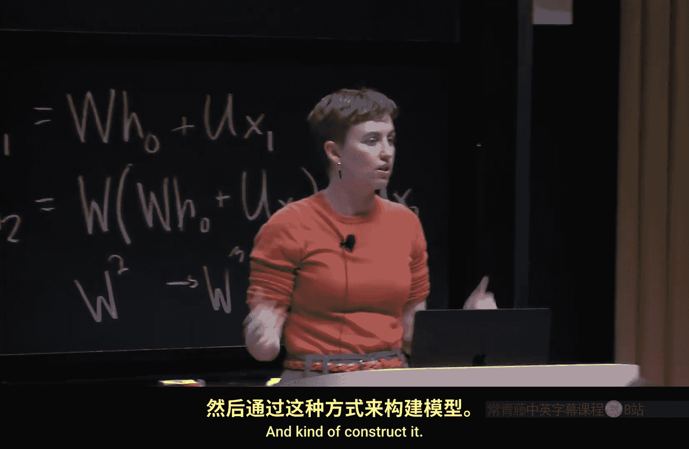

Yeah。This model the predict output。それ的。Distriion， and then you sample one element from this distribution。

But what is your？Anyway， continuing。What我 is you。Instead of sampling one and adding it to be input what you put。

Okay， yeah，'re， you're just being the question。 We're about to get into the， the probability models。

 But the question was basically like what we said， what I just said was you take， you know。

 the prediction。 and maybe that would be a distribution。 And you're picking the maximum。

 And then you put that maximum in。 Like， what if instead you put the distribution of possible next options in。

 And we'll talk about different ways that people think about doing that。嗯。So。Essentially。

 what we're talking about is or one way that you can think about doing this is trying to learn some probability of the next word right and can you can take that and factorize the probability of that joint distribution。

 Basically you're just reformulating the conditional distribution right the probability of the next word given everything we've seen before is true for any probability of distribution。

 you factorize them out and you get something that's multiplicative and and is somewhat you know still auto aggressivegressive right because you're taking the probability of every previous thing up until that point。

So。You can think of this， the sequence models in， in like transformers。

 when we talked about it in the transformer lecture last week as modeling， for example。

 the probability of a sentence。 And then that could be generative， right， so。Here。

 what this looks like in practice。 So say you're trying to look at the probability of once upon a time。

That's the same as the probability of once， the probability of starting with the letter the first word once times the probability of getting upon。

 given that your first word was once。Times the probability that you'd get A。

 given that you already had once upon， and then， you know， et cetera， et cetera。

 So this is kind of how you would model the probability of this sort of given sentence。

 the likelihood of a sentence， right。So。What's a function that we could use。

That would map the probability of the next word。Given the previous word。

Maybe some of the things that we've talked about in class。Specifically the probability。Yeah。

 go ahead。The're just regression there some deep thing。So we're just a。

So you said logistic regression。A softmax。 Oh， yeah， yeah。

 So softftmax takes an input and then gives us something that might not be a probability distribution。

 but at least sums to one， right？ So what is one of the ways we frequently use a softmax。

When we're doing。Classification， yes， exactly。 So we could just treat this as a next word classifier。

 right， And we， I think we talked in the hacker lecture about how。😊。

A reasonable starting point for a lot of things is just being like， all right， let's。

 let's see if we can formulate it as a multiclass classifier。 So here， then the input is once upon a。

 and then you learn a next word classifier that would probably by taking a softmax give us some distribution over the likelihood of the next words。

 right。😊，嗯。And so now here， a standard multiclass classifier will use some neural net。

 that softm will squish the outputs into a probability mass function， right。😊。

Non negative vector sums to one。And then you learn that by penalizing it via cross entropy。

So how would you map words to classes？ How many classes would there be。嗯。Lots， right？

So if you use words and use every possible word in the English language。

 which there are many more words in some other languages on earth。

 and you represent all those words as one hot vectors that says K。K would be about 100000。

 And we know that multiclass classification starts to be a lot less sort of easy to learn when the number of classes starts to scale quite large。

 though it is possible， for example， we run some hundred0000 way classifiers for species in inaturalist。

 right， There's about 450000 species currently an aaturalist。 We train classifiers for all of them。

 but。😊，you need a lot of data， and it can be quite unstable。So， instead。You know。

 another thing that you could do。Is you could。Represent every character as a class， right？

 So now in the English language， the alphabet is 26。 So now we only have k equals 26。

 And that's a really reasonable set of classes。 But the thing is now your classification is fewer away。

 But the sequence prediction is a lot harder， right， you have to take a lot more time steps。

 There's a lot more predictions that you have to take。

 And And it's pretty easy for these things to kind of devolve over time。 right。

 Like imagine you know， it， it starts spelling something weird。 And then like where you're gonna go。

 So ideally， you'd want something somewhat in between。

 And it turns out in practice that what's what's kind of a sweet spot is this idea of。😊，Bite pairs。

Which is two character pairs。 And so now you represent words。 Its about， you know， about 1000。

26 times 26， maybe plus a few more of these bite pairs。

 And that's actually the these tokens of kind of these two character pairs is， is quite frequent。

 even in sort of the larger scale language models we have。过。So。

Let's talk about then what this might look like。So you have this kind of。Probability。

 this classifier for the next step， basically。 And then you send your class your output prediction forward。

So， one example of this， this is an example that's taking in some caffeine molecule。

 And then you have a model that's trying to output a description of that molecule。

So maybe that would look something like this， a mild stimulant that enhances cognitive ability。

So you use this caffeine molecule。 You have some representation that you use to sort of start your。

 your word generator somewhere。 And then you would describe this。

 Maybe this we would call like a molecule to text。So one way you could do this， right。

 would be something like an LSTM。 So now you have you have your molecule。

 You run it through some GNN that gives you some representation of that molecule that you can do is to sort of condition on your starting point。

 Then once you have the starting point， the LSTM is just predicting that next word at any given point。

 right， And you're taking the sort of previous things into account。

So if you're actually looking to train this。Now。The training data is something like a mild stimulant that enhances cognitive ability and character。

 like stop predicting。 So now for the first time， we've introduced the idea of stopping。

When you're done。And then your outputs would maybe be some probability distribution or sort of likelihood over those next words。

 given the previous words。And then you could train it using something like a max likelihood objective where you want to maximize the probability the model assigns to each target word。

 right， You want it to sort of maximize the probability of the。

 the word that was actually in the sentence。嗯。And then。So now you have your targets。

 you one hot encode them， and then you can do something like maximizing cross entropy because now you have this multiclass classification。

 you can train it the same way we've trained things before。Now。

One thing you might actually want to do in training， you know， currently we're saying like， okay。

 you would take your prediction and then you would use that and send it forward to the next thing right。

 as the sort of previous word and you're learning from that， but actually in training。

 often we use something called teacher forcing， which is basically even if you predict the wrong thing in a given time step。

 you enforce the correct word goes in as the input so you know you actually send this in now and condition each next word prediction on the ground truth preceding words right instead of letting it sort of devolve and then penalizing it for every mistake it made after it made its first mistake。

And then at test time， what you would do。As now you， you， you have your starting point。

 and then you're seeing a sample from the predicted distribution of those words。So， you know。

 for example， now we do that auto aggressive thing where we send that in。

 and then we predict the next thing， a strong stimulant that enhances cognitive ability。But here。

 you'll note that after a， we weren't super sure what was likely next， right？

 And so the model predicted strong。 And it turns out that strong was。Exactly wrong， right。

We said mild originally。 and that actually is pretty different in terms of the meaning of that sentence。

 And so this is something where you have this autoaggressive modeling。 If you make one mistake。

 then often it can kind of take you down a path in almost this tree where you make a lot of mistakes。

 And so one way that people handle that is they do something called beam search where you essentially let the model choose top K like what it thinks of the K most likely things And then from each of those。

 you choose the cop K most likely things next， you fill out this entire tree。

 and then you calculate the probability。Of the entire path along the tree for each of them。

 And you pick the one that scores best overall。嗯。And so then the score is like sort of the model's confidence of the entire kind of sentence along that tree。

And there， what we might learn is that actually maybe you know。

 condition on the input that this sort of correct path on the tree might would score higher。嗯。

And this type of approach for language modeling， sort of lots of different deep things。

 plus LSTM flavored things put together to try to generate text or describe images or do V Q A。

 This was really popular for few years ago。 This was definitely kind of like the sort of approach that people took。

2015 ish timeframe。嗯。Of course， I think today， what we see is often people will use transformers instead。

And we can talk about。A bit about sort of what that means， yes。For example。

 should I do it in an auto aggressive way using the beam search and so on。

 or should I use the model demo。U course the third word。

 because it seems to me that there is some information in the。Previous words that helped you。I mean。

 I think that's probably a question that would depend， right， So the question was。

 what if I only care about predicting the the word3 ahead of where I am now。

 I don't care care about the things in between。 Should I still model all the things in between one step at a time。

 or should I try to learn a model that predicts three words in advance。

I think my intuition aligns with yours that like there's signal in those intermediate words that you would really want to propagate forward。

 And so probably I would not try to just guess from。

 like what's the word 3 in advance without some context of what the intermediate words were。

 So I'd probably do this maybe with the beam search type thing， right。Yeah， well， these days。

 a lot of temperature models are transformers with really large context windows。 right。

 So you're actually sharing information across all the temperatures sort of indeterminately。

 And what we'll talk in a second about kind of。😊，When you're talking with these long range dependencies。

 like what the trade offs are， when you're talking about using something like recursion or even recursion with these sort of memory controllers versus using something like attention that potentially has easier ways of sort of sharing information over longtime horizons in more flexible ways。

 I guess， is probably a better way to put it。Cool。So。We talked previously。About the fact that。

 you know。We want to recognize that this is Frank， even when he's outside。And just to be clear。

 he only gets supervised outside time because I'm a good naturalist。

 and I don't let my cat kill birds。But he gets supervised outside time on our balcony sometimes and he loves it。

 and I want to recognize him out there。So here。Say we sort of had this concept of like using a memory unit。

 right。So one thing you could do instead of sort of passing memory forward as you went through the sequences is you could just let every single time step get a memory unit。

 right， You could just keep memories from every single point in time。😊，And so then you would。

 instead of needing to kind of figure out how to send the information forward in time in sort of this constrained way。

 you could just directly link your old memories。And so there are methods that directly link old memories to future predictions。

 right。Things like temporal convolutions do this。Things like attention and transformers do this。

 And we talked a lot about those last lecture。And then there are also these memory networks that you guys could take a look at if you're interested that explicitly try to have sort of these like memory representations or units that you can access over time。

Maybe through like a separate bank of memories。So if we're actually trying to model arbitrarily long sequences。

 we've talked about a couple ways to do it， right。So we talk about recurrence where now you have these recurrent weights that are shared over time and you're sort of you have this cycle of where you're passing forward information over some time window and the way that you pass that information。

 you know could be just vanilla recursion， could be something like an LSTM。

 There's a lot more complicated ways to do it。We talked about convolution。

 You can model an arbitraryarily long sequence of convolution。

 but now you have this fixed set of convolution weights。 Those are shared over time。

 but you don't get to see anything outside of sort of the time window of that convolution。

And then the last thing we talk about is attention。

Where here weights are dynamically determined as a function of the data， right？

 So you have this convolutional kernel with attention weights。 So if you look at recurrence。

 that looks like this， right， You're passing that forward in time。 Convolution looks like this。

 So you're getting that time window， but you're not passing it forward in time。

 And then attention will look something like this。 where now。

The attention weights are a function of the data。 So the way that you keep the information is dependent on the inputs。

 which is quite flexible。And then， of course， in all of these cases。

 you can have some sense of at least the bottom two of what this sort of time window is。

 From the top one。 We do talk about a time window for back。So。This is interesting。But now。

 if you take these different approaches， if you use something like self attention or recurrence or convolution。

 they're going to be different sort of computational complexities。Based on the sequence length。

 So sort of how big your sequence is， the dimension of the representation。

And then like the kernel size of your convolution and the size of the neighborhood， I guess。

 if you're gonna to have some sort of restricted self attention。

 like you a window that's sliding instead of just self attention over the entire string。

And this is actually from that attention is all you need paper。

 And the name attention is all you need is actually really trying to say that we don't need memory。

 All we need is attention。And here you can see that， you know。

 when you talk about the number of operations， the maximal tax length， the complexity。

 there's a lot of trade offs here in terms of what's possible。But， of course。

 with something like self attention， you have this n squared right in terms of the length of the sequence。

 in terms of the complexity per layer， because you have to calculate the similarity of the entire sequence to itself。

 So if your sequence is length and you need to calculate this sort of n squared computations。

 And you can imagine that that can get really computationally exhaust。

 It takes a lot of memory to store something like that large。

So there's a bunch of methods that have been developed in recent years to try to figure out how to make even larger context window transformers given limited memory。

 And so these are things like efficiency from spaification So things like the reformer or performers or Lformers that are all different ways to try to decompose attention。

 do something like a low matrix approximation， a low rank matrix approximation to get that context window computation from big O of n squared to big O of n or things like the reformer uses this quadratic dot product attention that uses local hashing to get it to n log n。

 and this is definitely something that people are quite interested in。 but also frequently。

 this comes at the expense of a little bit of performance。

 And so if the tradeoff is performance versus computational efficiency。😊。

We just build GPUs with more memory。And then there's other ways that people try and look at even larger context transformers。

 So instead of yes。Letss performing。efficientfficient to just use the express angle that you games the training。

And gets a better。 So the question is， if it's less performant but more efficient。

 could you use the time on the GPU to train on more data？

 I don't think that's actually the choice that they're making。

 I think they're going to train on all the data they have。With the biggest thing they have。Com。Sorry。

 I guess。So another mechanism that people have used is to try to increase the context window of transformers。

Is this idea of kind of local and global attention。

So things like transformer Ael uses segment level recurrence。

 And then these very fancy positional encodings to increase the context window， longformers。

Scas was sequenced length by deconstructing local and global attention。🤧Sorry。

This this is from Longform， I believe this figure at the bottom。

 So what you can see is that they're basically sparsifying that n by N computation， right。

 So the previous one was sparsifying via decomposition。

 This one is sparsifying via some sort of masking， but essentially ways to try to figure out how you don't need to do n times n computations。

Okay。And then another thing that was introduced to try to increase the context of transformers without needing to sort of scale memory with with N squared。

 was this idea that maybe。Something like a large GT that will jointly model all the world's language and all the world's information could be broken down or broken down or decomposed into something that models just language that's much more lightweight with some sort of lookup table or memory bank that is able to let us do fact look up in a database。

 And the other benefit of something like this is there's ways to， again， ensure factual。嗯。

Like validity， right， because here we're predicting what's likely。

 and it's learned based on the world's information。

 But you can't guarantee that it actually matches the truth of the world's information。

 Whereas if you keep the knowledge base， this kind of look up of like facts separate。

 Then you can try to enforce that those facts are actually going to be true。

 that you won't have things like hallucinations。 Of course， there's still some complexity there。Am。

And so this is like retrieval enhanced transformers， essentially。

 So things like this paper called Re。 And this gives you this trillion token database that just gets stored in memory and gets accessed by your language model。

😊，Cool。So how far back can we go， though， Like， is this actually a limitation。

 Do we need to decrease our context window for something like attention， How much memory do we need？

 And it kind of gets to this question， like， do we really care。

About modeling things at the beginning of pride and prejudice By the time you get to the last chapter。

 right， like， do we care。And if you look at the attention window of some of these models。

 as they've kind of scaled。Bert。Had 512 token attention， or context window。 G 2 had 10，24。

 GG 3 was 2048。TP T 4 was， by default 8000， but they had a souped up version that could do 32000。

Anthropic has a model that has about 100 case。 So it's like 75000 words。

 That's like two or three books worth of context。 So if we can fit this in memory。

Do we need anything else？ Well， one way that we might is that how many people can afford。H 10s or。

 you know， whatever the the best and brightest version of a GPU is。 So from my perspective。

 I think figuring out when we actually need this much context and how we should use it and in what ways is valuable from the sense of efficiency。

 right and accessibility of these models。And。This takes a lot of power， and it takes a lot of energy。

 And it's really slow to train。 And so I think efficiency gains on in terms of how well we model time and how we think about what's needed to model in time。

 I think are really valuable。 And there's a nice paper maybe two years old now from Jatenendra Molis group that talks about when do we actually need long term context。

 And I do this within the the frame of reference of video action recognition， right。

 So if you have a video， how much temporal information do you actually need to recognize the action。

😊，And what they were pointing out。So they introduced this idea of a minimum certificate set。

 which is essentially the total amount of frames or like little clips of a video that you need in terms of time to recognize an action accurately。

And so here， if you have this entire video and you want to recognize sort of what's going on in the video。

 basically how many of those frames of the video are needed。And that's kind of the amount of。

 of context you really need。 And what they showed。Was that most of the video action recognition benchmarks we actually study。

Needed somewhere。Up to maybe like two seconds of context， right。

 We didn't need models that could handle three hour long movies because actually。

 the actions we cared about in our benchmarks。We're like two， three seconds。

And so their point was that what we need is we need to develop benchmarks for things that actually need longterm context in order to encourage the community to do work that shows benefit there because really hard for us to measure progress on something that we're just not measuring。

 And so they introduced some new ego schema benchmark that had certificate lengths of more like 100。

 But I think that this is an interesting point just from a meta perspective。

 it kind of tells us about how the benchmarks that we build the ways that we model value。

 we model improvement in the machine learning space， directly influence。

 what we make progress on right because we want to optimize these benchmarks。

 And so if theres something our benchmarks are missing， there are gaps。

 That means that we don't we don't know what we don't know And so we might say oh。

 we want to build these models that have really long context windows。

 But then they're just the more context windows we have or the more temporal context we have。

 it's not really improving performance。 maybe it's because the benchmark measuring performance on just doesn't。

Actually include anything that needs it。 So， yeah， And then finally。

 I want to talk a little bit about just this like different perspective on。Fast and slow memory。

Here's one interesting thing。 if you think about a neural network as something that's frozen。

And you send data into it。Then the activations that you get。Through that neural network。

 there's some statistic of that data point。 You could think of them as like fast memory， right？🤧Yeah。

So they're actually building you some representation that's very fast that's kind of capturing memories of how that data is running through the network。

 Similarly， if you're learning the parameters of a network via training from a large data set。

 you can think of the theta， the the actual parameter values in that network。

 as representing some statistics of that training data。 So in a way。

 those parameters in a deep net are slow memory of the training data。😊，And this is interesting。

 right， So， so we could think of， okay， parameters are maybe slow memory， right。

 You're sort of slowly building this memory of the entire training data set and activations are fast memory。

 It's it's some statistics or some memory of your， some existing data point。😊。

But do we ever think about。Fast memory weights of a model or slow memory activations of a model。

 And just as like something to kind of give you food for thought。😊。

There is this idea of hypernets that were that were released。

 which are nets that output weights of other nets。 They're used as sort of a version of neural architecture search。

 And so those weights are almost like a fast memory of the input data to that hypernet， right，re。

 you're getting as sort of the output of your network， another network that's a set of weights。

 or these ideas of codebooks。 These actually use tensors of activations that are learned。😊。

So you are doing back propp to the activations themselves。

 And you can argue that these activations are kind of slow memory。😊，Of the data that you're learning。

嗯。So I think there's ways to kind of flip the perspective a little bit and try to think about like how we have memory that's kind of stored in in the weights。

 in the activations， what are the ways that we're kind of representing what the data we're learning or the data we're actually using at any given point in time。

嗯。Cool。Any other questions？ Otherwise， I'll just leave you with。Another picture of Frank。

Who's the best cat ever？

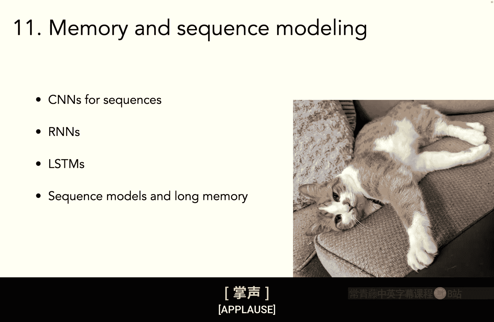

Awesome， I'm happy to take questions up here。 Otherwise， see you guys on Thursday。

