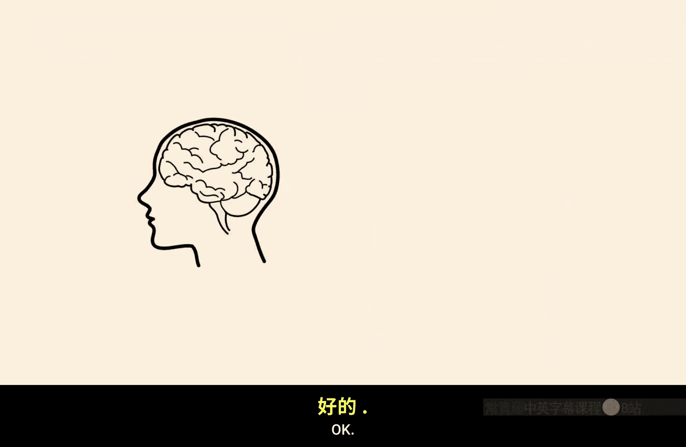
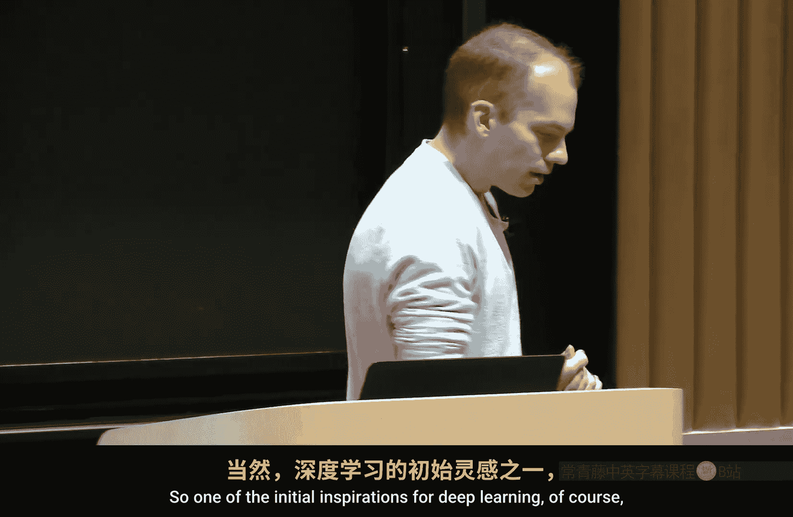
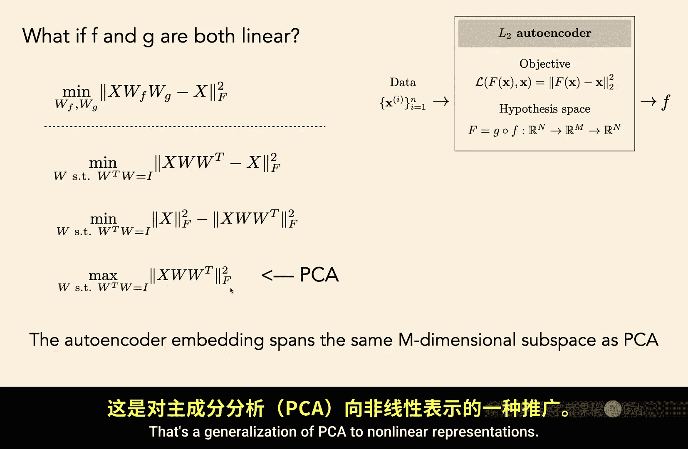
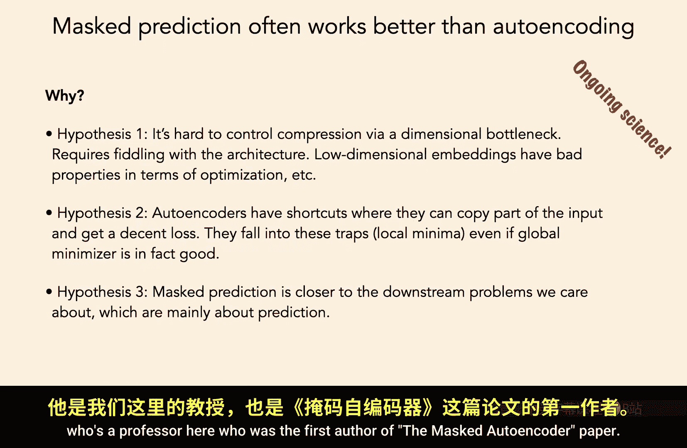
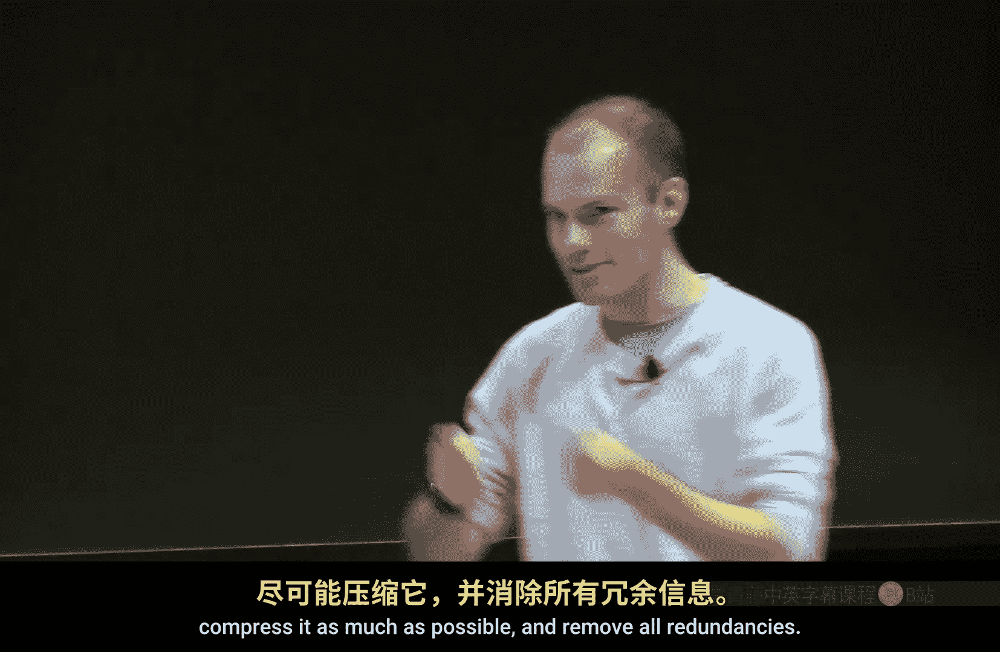
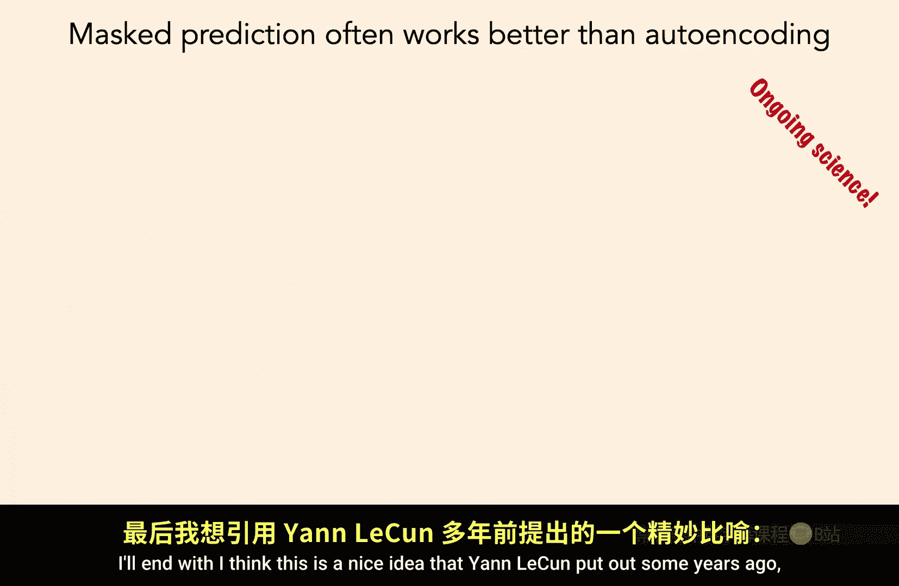

# 麻省理工学院【中英⚡深度学习｜6.7960-Fall-2024,-Deep-Learning】-p11-P11-表示学习：基于重建--BV15QZ4B1E6v_p11-

Good， so welcome to today's lecture。 And today， we're going to talk about representation learning。😊。

So we're moving into the next kind of third of the class。 So we covered you know。

 basic approximation and generalization properties of M LPs。 And then we talked about。

Different architectures， transformers and R Ns and so forth。

And now we're going to come to kind of a new perspective on deep learning。

 which is the idea of representation learning and generative modeling。

And this is a perspective which is kind of associated mostly with deep deep neural networks。

 but is actually could be connstrued to be broader than this。

 You could do representation learning and generative modeling with other architectures that are maybe not neural networks。

 But this but most of the techniques have been developed intimately in conjunction with neural networks。

 And this field of representation learning， it usually goes hand in hand with with deep learning。

Okay。So we'll talk about the idea that。Deep nets learn representations。 What does that even mean。

We'll ask， why should we learn representations。And then， we'll look at。

One kind of representation learner called the auto encoder。

We'll look at the relationship to clustering and what's called vector quantization。

And we'll look at the idea of learning representations via prediction and what's called self supervised learning。

And then in the next lecture， we'll talk about a different type of representation learning。

 which is called metric learning or Conive learning where you learn about similarities and distances。

Okay。So this is going to be the new picture for deep learning for the next few weeks。

We have data that comes into a system on the bottom。And then layer by layer。

 we change the representation of that data until we get to an output at the top and we'll call the output an embedding or a representation。

But actually， each layer it is a representation of the data。So layer by layer。

 the deep net takes your raw data X and turns it into F of x， and then F of F of x and so forth。

And each layer is a different representation， so the data will be differently distributed。

 It' will be transformed somehow。Okay， and the forward direction through a neural network will be called the encoding direction。

 so it's going from data to maybe simpler， better， more abstract representations。

And that's the direction in which presentation learning operates。

 it tries to find a good mapping from data to embeddings。

And the backwards direction is not going to be backpro。

 Now you're going to back prop tries to find the gradient。

 The backwards direction is more like the inverse of the forward direction in this context。

 and that's called generative modeling。 It's going from abstract representations and latent variables。

To data。 And we'll talk about generative modeling in a few weeks。Okay。

So these two things can roughly be thought of as inverses of each other。

 and we'll clarify that connection as we go。But today。

 we're just going to talk about the first direction going forward through a network and view that as learning representations。

And one way to like just one label for this idea is data to Vec， so X to V X is your data。

 and people have developed X to Vec for all different modalities。

 So the most famous early version of X to V was called word to V。

 you want to go from words in English or some other language to representations that are vectors。

But you can do this for images， you can do this for sounds， you can do this for molecules。

 whatever you want。And here's an example of an image， we take our data's input。

 and then now we're thinking layer by layer， we get a vector representation or maybe a tensor representation of the data。

 and let's investigate what that representation is。

 what each of these is indicating a neuron or mathematically just a scalar dimension of the vector。

And we can investigate what those actually represent。

 so we'll talk about the layer3 representation of this image is if I go through three layers of neural processing。

 three convolutional layers， for example， what is the tensor of activations I get out。

 That's the representation at layer 3。And then we can talk about other layers too。Okay。

 so the representations will be a vector tensor of neural activations， and in this example。

 they might be representing， you know that there's a car or there's a ground or so forth， a building。

 a road， So we're going to try to see how representations might map onto these。

Kind of semantic representations that we think about in our head。 Okay， question。

With this family of two factorss， are they future attraction？Yeah。

F extraction is is another name for the same thing。嗯。

X to V can also be called extracting features from input data X。

 and the features are in the form of vectors or tensors in this case。

One question was X to that traditionally only getting from bigger data sets to smaller representations。

Yeah， so the question is， is exsterduct always going to smaller representation。

 lower dimensional representations？ThatOne of the classic ways of doing it。 Often the representation。

 you want to be a smaller object， a lower dimensional vector than the input。

 but that's not the only way of doing it。 You don't have to do it that way。Okay。

 but that the the intuition here is， is I'll use these cartoons a few times over the next few weeks。

 or， we'll use them in a few lectures。 So the data will be this blue blob。

 It's some complicated object， high dimensional。You know， weird topology。 That's like the space of。

 you know， images。 This is weird manifold， right。And the representation will be this。

Orange or a reddish circle。 And it's a circle， because we're gonna make the point that the representation is oftentimes a simpler space。

 So the distribution of over embeddings is often going to be a very simple object。 In fact。

 it will typically be a Gaussian distributions。 So Gaussian is a circle in high dimensions。

 or a Gaussian high dimensions looks like a circle。Okay。So this is the。

 this is a picture where somehow learning embeddings are simpler。

 They have a simpler distribution than the data distribution。

 The input law is like the data distribution。Okay， and we call the mapping from data to representation and encoder。

Okay， so I'm gonna。Now show some visuals。 And I want to introduce a different way of thinking about functions than what you might have learned about in like grade school。

So， you know， when you first encountered functions。We learn this way of representing them。

 you have on the x axis， the input and on the y axis， the output here function。

But that's not really the only way that that's basically telling you what is the mapping from X in to X out or from X to Y traditionally。

 But in this class， we usually talk about X in to X out for some layer。

So this is just telling me that if I'm at some point on the X axis， where do I map to on the Y axis。

 right， It's telling me something about the mapping。

So we're just going to rotate the y axis to be at the top。

 And now we'll look at this mapping as mapping a set of points on the， you know。

 input dimension to that set of points on the output dimension。

 And the identity mapping now looks really simple。 right， It's just straight lines。 Nothing changed。

So I don't know why we decided to go with this way of representing functions as opposed to this way。

 But I think both of them have some interesting properties and advantages in terms of clarifying what's going on。

Okay。But the second way will help us to visualize some of the mappings in neural networks。Actually。

 in some of the earlier slides， we've already showed a few examples of this。So here。

 here are a few different neural layers for a scalar input to a scalar output。

 So this is like the width of the network is one in this case and。What does， you know。

 a linear layer do， A linear layer can， sorry， it can。 if the linear layer has weight， too。

 it will just expand， itll， it'll take your input data and itll make it， you know， scaled up。

 So it'll just like spread it out。What does a re do， Okay， Re is kind of interesting。

 A re takes all of your data in the negative half space and maps it to 0。

 So this re has this property that the density of， of data that will get mapped to 0。

 You usually have a spike of density at 0， which we'll see on， on the next slide。

And the sigmoid will map most of your inputs to either 0 or1， but in a kind of soft way。O。So。

 I like thinking about。Functions this way， because I think it helps to understand kind of representations and distributional transformations。

 So think of， think of your functions as taking a set， a distribution of input data points and and。

Doing these geometric transformations， squishing them， and skeing them and remapping them。Okay。

 and so here are some of the functions that we've seen， some of the the basic neural networks。

 layers that we've seen in this class。So we have the linear， the relu， the normalization layers。

 softmax layers。And。Activations are going to be colored in this red font。

 and parameters are colored in the blue font just to kind of clarify what is actually being learned。

 So the only learnable parameters of the weights and biases in in these layers。Okay。

 so here's the wiring diagrams。So let's look at the mapping diagrams for these layers just to get kind of a build of this intuition。

Okay， so we're always mapping from X to X out。 Now， one nice property of this other way of。

Plooting functions is I can， I don't have to only plot scalar to scalar functions。 I can。

 I can plot 2D to 2D functions。 Okay， I don't have to plot 3D to 3D。 That's where it breaks down。

 But at least I can go to 2D to 2D， which you can't do with traditional plotting。Okay。

 so here is the mapping。 I'm showing in two different ways。 On the left。

 I'm showing how each point on a grid of input values maps to the output。And on the right。

 I'm showing how each point in a Gaussian cloud over the input space maps to the output。Okay。

 so 2D data goes in。 And what its a linear layer to do is going to be an offine transformation。

 And geometrically， it will just look like rotating and squishing， scaling， anything like this。

 So it's like a geometric transformation of the input data。AndThat's all it's doing。Okay。

 what does the Re do。So a relu looks like this funny shape。

 So there's two important properties to notice。 So one is the relu maps all data to the positive orfront。

 In this case。 So in high dimensions， it's just going to be like a little。

 you know the subspace where all the dimensions are positive， right。

 because need this' negative gets mapped to 0。 And two is you can see how there's like。

Most of the points get map to these axes。 You get this。What's called a sparse representation。

 So Reou has this property of making things sparseer because most of the inputs or in each dimension。

 half of the values will tend to be negative and half will tend to be positive。

 and the negative values will get mapped to the。The axes here。各改。

And there'll be a lot of density right at the origin。

 because that will correspond to anything in this strictly negative orant。 And in high dimensions。

 I think this effect becomes even more more extreme。Okay， so what does L2 norm look like？

 And this is what I think I showed in in one of the last lectures。

 but I didn't really fully explain that。What L2 norm will look like and the same with RMS norm。

And same with layer norm， which is you know， variation on this。

Is it will take all of your data and it will map it to you know， unitary vectors。

 It will map it to vectors that have norm one。And so in this particular case。

 with the Euclidean norm， it will map it to points on on the circle。

 and high dimensions will map it to points on the hypersphere。Okay， so。

 so that's what these layers do。And。That's nice for various reasons。 But one of them is。

 is that we just， we know that the numerics are going to be。Bunded somehow。

The vectors will not go to infinity or not go to 0。 They'll all get you know， into a unitary range。

Okay。So what is， what is softmax， Can anybody now I'm gonna to ask you。

 can anybody explaining why does softmax look like that。

 What is that line that's showing up in the softmax graph。 So I have input data。

 two dimensional data， and I'm doing a softm of those two dimensions。 Let's let me see some deals。

 yeah。Yeah。Yes， exactly。 So the answer was that's the line that X X 1 plus。X 2 equals 1。呃。So。

 or you know， x plus y equals1。 If you think of one dimension as y and one dimension is x。

And that's the simplex。 That's the， is that the one dimensional simple， sort of the zero dimension。

 I think guess's the one dimensional simplex。 I can't remember how to define simplex。 But anyway。

 the simplex is the set of points in R D that where the dimension is sum to one。And。

The output of a softm is going to be a point in this complex。Okay， so that's。

 that's what that looks like。 This is basically going be like your probability。

Is high of one class if you're at that point and low for that class if you're at the other point。

Okay。So this is what neural networks are doing。 Those are our basic layers。

It's a little more complicated with attention and， you know， other kinds of layers。

 But these are the basic ones。 So let's now look at what an MLLP looks like。 plotted this way。

 So here's a。Let's see。 this are three layer M LP because there's three linear layers。

 So our convention is three layers。And the input data is going to be a cloud of points at the origin with label red and a circle of hemisphere of points around with label blue。

 Okay， so we're going to try to do a binary classification。

 So this will be training with cross entropy loss between softmax regression。

 and we're gonna look at what training actually looks like。

 So this is nonlinear classification problem because there's no linear hyperplane that separates the red cloud from the blue cloud。

 Okay， so layer by layer， the representation of the data。 The distribution data gets transformed。

 And what you're gonna to see happen is that the red points will move away from the blue points。

 And and this is what it looks like。 Okay， so after a few steps of gradient descent。😊。

They start to spread out like this。 And， you know， at this layer， we're kind of shifting things over。

 and then the red loose snaps it back onto the axes。 And then we ske things in a different direction。

 And eventually， we get things to kind of spread out on a line。

 And then the softm clamps that back down to， this simple。

 And so the red points are all heading toward the10。 And the blue points are all heading toward 0。01。

 And those are the one hot labels for your data。 So this optimization is actually working say we're getting the blue points to be classified as class 2。

 And the red points to be classified as class 1。😊，Okay， so let's， let's look at that animated。

 So this is what it looks like。 This is。Every single layer has width to。

 so we can plot everything here。 There's nothing hidden。

 And It's not like I'm doing dimensionality reduction or visualizing。 It's just the raw， you know。

 activation values at each of these layers。And。Each of the layers now can be understood as a different representation of the data distribution and a better and better representation。

For solving the class， of sake we're getting the red points from the blue points。

 which is the classification task。ok。Oh， yeah， so。Yeah， just for fun， I didn't really。

 really have a deep insight to take from this。 But just for fun。

 you could say you can compare the optimization using S GD。

Great descent to the optimization using the spectral descent method that you worked out in your problem set。

 too。So in the spectral descent method， you are normalizing the updates by their spectral norm。

 and you can see there's some interesting different dynamics。

 It's a little bit hard to read too much into this。 Well the spectral descent is descending faster。

 but that depends on the learning rate。 So there's some caveats， but it is getting to a lower loss。

 The loss is tiny little font is actually say we're getting the red and blue points better。

 So you can understand that different optimization schemes actually do perform differently and there was some reason for working out what you worked out in your problem set I think something that might be interesting here is it looks like this first linear layer is almost like a rotation。

 which is a orthogonal transformation。 And if your updates are kind of orthogonalized。

 then maybe that somehow relates to this first layer finding this orthogonal transformation it's just a rotation。

 but it's also scaling。 So yeah， I think it might be fun to see if you can get insights from this。

 but I didn't it's a little complicated。Okay。So we can also try visualizing more advanced nets in this way。

And this is where the power of the ideas of representation learning really come in。

 Like not when I'm just having an M LP over two dimensional embeddings。 But when I am having a very。

High dimensional feature space。So this is the clip neural network。

 It's a vision computer vision system that is quite good at extracting good features from images。

 And we'll talk about that a little bit later in the course and。Now。

 the embeddings are not too dimensional， but I'm doing I am doing a dimensionality reduction technique。

 PCA to show what they look like。So it's a bit of a cartoon rather than just showing you the real data。

 But the point is that layer by layer。 And these are vision transformer layers。

 or a block of 3D vision transformer blocks like we we。

 you know then transformer you have attention and then。

Layer norm and then softm and then this and that right。 So this is an entire block。

 a sequence of layers。But what happens is as you go deeper and deeper into the network。

You end up segregating these different colors and the colors are corresponding to the class of images in a computer vision data set。

 So is it a cat Is it a dog。 And you see that at the top of the network。

 they're all very separated from each other。 And that's because this network was trained for classification。

 So it's trained to。Find a way to disentangle all of these different classes and have the representation in some high dimensional space get all separated so that then at the very end。

 I can just take a soft max of that， and theyll be they'll be cleanly separated to the vertices of the simplex。

 which is the one hot labels for these classes。Okay。So it's a little bit hard to see because， again。

 it's doing PC A。 So it's not actually showing the simplex， but it's something kind of like that。

Okay。So the whole point is to kind of build up the intuition of how we go from entangled。

 complicated data at the input to a neural network to layer by layer gradually morphine disentanglely。

 these geometric transformations until you get clean kind of separation of your semantics of interest that can be read off into a prediction。

 for example， classification。 and the output space is a simpler object than the input space。

 that's the point I'm trying to make。ok。

Cool， so， any questions about the the the general idea of representation learning and what these neural networks are doing and what these visualizations represent。

Okay， coolol， so。One of the initial inspirations for deep learning， of course。

 was to understand the human brain。

And。In neuroscience， people have studied how representations are learned in the brain。

So I wanted to make this make this connection。So this is a map of the visual cortex， a cartoon of。

 the visual cortex of the human brain。And it goes through a sequence of layers。

 The layers are just like the layers in our neural networks， and they are kind of linear。

 followed by pointwise nonlinearar operations， plus some extra complexities that biologists debate over the whether or not these extra complexities are important or not。

 But for us， it's just linear re， linear re。And in visual cortex。

 there's about six of these layers or five or six of these layers。

 And then there's a final layer called I T， where that's kind of thought to be where the semantics are segregated。

 where object recognition has occurred。Okay， and so we have first layers extract。

 Do you kind of filtering to find edges and the next layers look for conjunctions of edges and disjunctions and all kinds of combinations until you get pattern recognizers。

 And if you look at the neurons and you poke into the brain and you measure what they're responsive to。

 you'll see that as you go deeper into the brain， they become responsive selectively for more and more complex patterns。

So let's see， do deep nutss， artificial deep nutss do the same thing。What do they learn internally。

 Okay， so let's say I train a deep net to do classification of images。 Now。

 I'm going to try to probe and interpret the representation that's learned in order to perform that。

 that that classification task。 And we'll do it just like the neuroscientists do。

So we will stick artificial probes into the neurons and measure their value as a function of the inputs and see what what inputs these neurons are responsive to。

Okay， so。In the brain， we would stick at an electrode in and see when the neuron fires。

 That's like when the relu is above 0， but it might not be exactly a re in the brain。

 It might be some other threshold function。And we're going to do the same thing。

So for which inputs does the neuron turn on and for which inputs does it turn off。Okay。

So people have been doing this for a while。 kind of one of the modern names for this type of work is like interpretability or mechanistic interpretability。

 sometimes So it's a really interesting area if you've come across those terms。

 but it's it's an old problem。 And I'll show you some results from thiszeer and Fergus 2014 paper on trying to interpret the units within a CNN。

😊，Okay。So。The first layer of in， in the CNN that they were working with。

 this was just a kind of vanilla convolutional network with， you know，5 or six layers。Well。

 the first layer has a set of filters。 And we can look at what。

 So the filters will all output a feature map， right。

 So each filter will output some spatially varying set of activations， and we can look at what。

Input patches。In the image， our most strongly activating。One of the filters to fire。

 So what is the filter looking for。Okay， so here are nine filters in this montage of nine sub subgrids。

And on each of these。Some areas， we have the top 9 input patches that most activated that particular filter。

 So this is like。Channel 1 filter。And what， what do you think it's doing？

 So what is this a filter for this， this top left one。Yeah， it's like an edge detector。

 It's looking for an oriented line， a bright， followed by a dark transition。 So right filter， what。

 what is the idea of a filter filter is trying to filter the day out something from the data。

 like find the thing it's looking for and throw away everything else。 That's kind of。

 that's what the word filter means， right， the English word filter。

 So that's what it's doing Its just it's responding to some things And not to other things。

 And what it responds to is， is edges。Okay， and then we have other， like。

 this is a different orientation of the edge。 And this is like a greenness detector。

 It fires selectively when it sees green。Okay， so it looks like at the first layer of processing in a deep neural net。

You get these kind of simple feature detectors。Okay， so the next layer， what is that gonna look like。

 So turns out not so different than what the neuroscientists came up with when they were studying animal brains。

 So the second layer looks like it's having neurons， filters。 that are selective not for edges。

 but for some kind of conjunction of edges as higher order patterns， so。

If I have two channels that detect two different orientations of edges。

 the next layer of my network could look for a conjunction of those two orientations like a cross。

And。That turns out to map to， you know， maybe even more complicated things like ras or circles and so forth。

Okay， so then as we go layer by layer， we're going get more and more complex pattern detectors。

 So here are the image patches that most strongly activate nine different filters on layer 3 of this network。

 And already you can start to see like just layer 3。 we get selectivity for faces， right。

 and it it's not because it's like really recognizing humans necessarily。

 but maybe it's because it's recognizing like little circle of darkness around a bright background with a like broader like torso thing underneath it。

 So its like blobbist detector， but it happens to be an okay template for a human。Okay。

 and then as we go deeper， we get much more selectivity。

 And eventually we start actually detecting selectively， you know。

 segregating dog faces from human faces。 for example， And again， this is 2014。

 This is the fifth layer of a convolutional network from that era。

If you run the same types of methods on modern networks， which are， dozens or hundreds of layers。

 you will get you know very precise detectors deep in the network that code for very specific things。

 And's that's this area of mechanistic interpretability where people are trying to understand。

 what are the emergent detectors in these systems。 You can do it for images or language models or other things as well。

 We can say， is there like a neuron within a language model that codes for the sentiment。

 it was a famous paper called the sentiment neuron that found a neuron that codes for sentiment。

 But now this is well known that this just occurs in all of our modern deep nets。Okay。

So the rough story is that， you know， deep nets and the neuroscience models of the brain are quite in alignment here。

The first layer of the human visual system or monkey visual system to be more precise will have these like edge detectors and the next layer will have。

 you know， shape and pattern detectors。 And then finally。

 at I T at the six layer or so well have like dog face recognition。One difference。

 So there are some differences between brains and machines。

 One interesting difference is that the brain seems to only have about， you know。

7 or I depends how you count， but maybe like 7 layers of convolutional filters。

 And our modern architectures have， you know， hundreds of layers of。Filters and other operations。

Okay， but the brain has recurrence。 So it uses those7 layers over and over again。Okay。Okay， so let's。

Now， get a little bit more formal and define what， what a representation is for the context of this class。

Okay， so we're going to basically restrict ourselves to representation as a vector embedding as a vector。

Or it could be a more general tensor object。 It could have multiple dimensions， but most canonically。

 it will be a vector。Okay， and there's two different ways we're gonna use the word representation。

So the first way is we'll say a representation of some data domain X or maybe a data distribution。

 P of X probability of X is a function that maps from data in that domain to embeddings in R D。

 vector embeddings。That function F is called the encoder。

And it will assign a feature vector to every element in the input domain。

 and will'll say that that function F， that's the representation of that data domain。Okay， so what。

 what is actually parameterizing that， It's the weights and biases。 So if I have a neural network。

 the representation by this definition is its weights and biases。

That's a learned representation of the data distribution。Okay。

 another use of the word representation will be the representation。

 not of the domain or the distribution， but of a single point。

 And that will just be a vector Z in R D and where Z is equal to the encoder applied to F。Okay。

 so people use both of these definitions of representation。 If you want to be clear。

 you can say the representation of a data point versus the representation of a data domain。

But I wanted to point out that distinction because we'll talk about， oh， the learned representation。

 And when we say the learned representation， we usually mean F。Okay。

 so that's the learned representation is the weights and biases of the data that fit the data。Okay。

Okay， so that's the formalism we'll work with for the next few lectures。 So why。

 why learn representations。So， there's。A lot of answers you could come up with。

But maybe the simplest。Is that to do more learning， right？ So we learn to learn， right。

 It's interesting。 It seems a little bit circular， but this is。😊。

This is usually the context in which we're going to use representations。

 We're going to use them to accelerate future learning。

We'll have a few lectures on transfer learning where we get into more details。

 but I have to introduce a little bit of this now， because the main use of trained representations is to accelerate future learning。

Okay， so quote from in Good fellow， generally speaking in a good or the deep learning book。

 a good representation is one that makes subsequent learning easier。And。

I think that this was kind of a。This was a strange misconception in the early days of deep learning。

 It was that。呃。We will make deep networks that act as blink slates。

 They come at new problems with no， no pre traineded prior information and。

People would complain about deep learning as being very data hungry。

 It would take massive data to apply a deep net to your problem。And， and they would say， well。

 humans are much more sample efficient。 We， we only take a little bit of data to solve a new problem。

But it was kind of， you know， it wasn't apples to apples。 So humans are born。

 and you in this class are coming to learn new information， not as a blank slate。

 You've gone through， billions of years of evolution。

 tens of billions of years of the physical evolution of the universe before that。

 right before even biological evolution。 And you're also having， you know。

 20 plus years of pretraining in your lifetime。 You've learned like very good internal skills and knowledge and representations。

 Okay， so you're not blank slates。 And deep nets also should generally not be used as blank slates。

 this is something that's changed over the last decade that used to be。

 we thought deep nets require a lot of data。Because we'll start from scratch。

 We'll initialize them randomly， and they'll be blank slates。 But these days。

 this is not really what we do。 We start with pre trained representations， okay。So let's。

 let's look at that idea。Okay， so very often， we will have。

 let's imagine that you're working for some music company at Spotify or something。

And you will train your neural network to classify the genre of the music。Okay。

 so you'll have two parts here for your network。 you'll have some encoder F。

 And then you might have some extra readout operation at the end to do your classification。Okay。

 we'll think of W as just being like a linear layer on top of a representation Z。

 But we can actually select any layer in the in the network to be called the representation。

 And any prior layers are the encoder and any subsequent layers are like the readout， okay。Okay。

 but often， what we're going to be tested on is not going to be the same as we' we're we've trained on。

 Maybe we invested。A billionillion dollars to train the Spotify。I sound recognition system。

 We don't want to train use a billion dollars to。Solve a new task， because maybe the next year。

 we realize， actually， we also need to predict if users like the music or don't like the music so we can give them recommendations。

So the trick is that we will just。Use our same encoder up to some layer in the network。

And we will only retrain the final kind of readout。 And that might， in this case。

 be a linear operation， which would be called a linear probe。Or it could be MLP or something else。

Okay。So。We're not going retrain from scratch。 We're going to initialize our network with the pretrain representation。

 And in this case， we might just freeze that pretrain representation。

 no longer updated and just learn like a linear mapping onto our new prediction problem。Okay。

 so these are the two kind of phases。 Now， they have。

 they have new names for these pretrain and post training。 But we used to call it like。

 there's a lot of different names for this。 But you pretrain， and then you post train。Okay。

 so another thing you can do is not just train this read off head。

You can actually update the parameters of your encoder as well。 but initialized from the the prior F。

 So you just。Continue to do back to update to find， you know。

 some fine tune perturbation of your parameters that will solve the new problem。 Okay。

 so this is called fineunning。 And I'll talk about that on the next slide as well。Okay。

 so we initialize F prime not with like random random weights。

 but we initialize it with the same weights as F。 And then we keep training。

 That's the whole idea of fine tuning。Okay， and here's the transfer learning paradigm。

 This is what is typically done for like real world problems。You know， for toy problems。

 you can train from scratch， but for real problems， you generally can't。Okay， so you have 3 phases。

 You have now not just train and test。 You have pretrain。

 which is can be thought of as learning and representation。 And you do that on a lot of data。

And typically， you can do that on a lot of data。 You can afford to do that on a lot of data because the pretrain phase。

 the representation learning phase doesn't require as much knowledge about what the final task is gonna be。

 We'll see that autoenrs and contrast of learning are these pretrain training methods that don't require knowing what the final task is gonna be。

But then you adapt to your actual task of interest。And。

You can do that on just a little data because you already have learned a good representation of the domain F。

Of the data domain X through this function F。F is the representation。Okay， and then you test， right。

 That's， that's just regularly。 You deploy your system out in the real world。Okay， so。

I think a lot of you have， you know， probably done this because this is just a practical thing。

 If you're， if you're ever gonna， you know， play with deep nets。

 you'll download a pretrain system and you'll fine tunena， right， So a lot of you。

 I'm sure I've done this。 But it's worth kind of understanding why and how it works。Okay。

 so fine tuning in an extremely simple recipe， pretrain a network on task A。

 resulting in parameters W and B， weights and biases。

 those weights and biases are your pretrained representation of the data domain。Okay。

 then you initialize the second network using some or all of the weights and biases。

 You could initialize some weights from scratch， some from your pretrained weights。 You could。

 you can do all kinds of interesting network surgery on that。

 And then you'll train the second network to result in parameters W prime in。Beta prime。

 And this is often called fine tuning because we assume the W prime is just like a minor modification of W because we only fine tune on a little bit of data。

Okay， so the kind of point here is。呃。The way I like to think of。

 like a lot of people think of deep learning as the thing you do when you have a ton of data。

But I think the real point of deep learning is it's the thing you do that enables learning from little data。

So deep net and deep learning to me is really all about how to learn from little data。

And the way you learn from little data is by pretraining on massive data。 So， yes。

 you have to pretrain on massive data。 But once you do， you get a very sample efficient method。

 which is just update the representation a little bit to solve the new task。

 And this is the kind of the best known way right now for a lot of problems to do learning from little data to do learning from little data。

 you have to pretrain on massive data。 That's the weird。

 That's a little trick that happened that people didn't quite expect。I think for a while。

 people thought there might be some algorithm that's just better at learning。

 You don't have to pre train that algorithm， but， but this works better。 Yeah， question in the back。

 talk about。まですね。Yeah， so what's the scale for massive and what's the scale for little。So。

 in practice。The kind of pair is is's always the the ratio is always becoming more extreme。

 I would say， but， you know。There's not gonna be a precise answer， but I would say in practice。

 each year， the pre trained representations get trained on more and more data。

 So that will be like a language model trained on 10 trillion word tokens or words on the Internet。

 right。And the fine tuning is typically something that you can do on coab yourself and， you know。

A few minutes or hours。Now。It depends what kind of fine tuning you're doing。

 So we'll talk about linear probes and low ring fine tuning methods。

 But that will come in the future lecture。But it would be like a trillion pre traininging tokens。

 and， you know。A million or less fine tuning token。 So the ratio is like many orders of magnitude。

There's a question in the way back。P。別にたしているね。存在？Yesや。Great。I是。いや。Yeah， very good question。

So if I can rerase the question。What if you're in a domain where you don't have a lot of pretraining data for that domain。

 What if you are in a scientific domain where it's like very specialized measurements。

Are you allowed to use a language model pre training that's trained on like Internet talking and text。

And the， the empirical answer is， yes， that often actually works decently well。

 So you don't have to pretrain on the same type of data or even the same data distribution as you're going to fine tune on。

There's often a lot of shared information between one data modality and one distribution and other ones that might look very disparate。

 but your mile， you know， your mileage may vary。 It's like if you have a really。

 really big gap between the type of data you pre trained on and the type you fine tune on。

 then it might not work as well。 But I would say in practice the surprise has been if you fine tune a language model trained on the Internet on almost anything。

 it will help。 that's kind of been the current。Finding it might not be the best way of doing things。

 but it will be better than initializing the network from scratch。Yeah question。 yeah。

 I want to ask what's the theory behind this fine tune framework you know like there is no guarantee for similarity between A or task B and。

 what's the guarantee for this kind of paradigm So the question I think is what is like the theoretical guarantees about fine tuning。

 So the big question in this area and transfer learning。 we'll have more on this later。

 But the big question is when and why does training on task A on data A help on task B and data B。

What is the property of A And B that has to be a like for this to actually work。 So empirically。

 it just generally works pretty well。 more than people maybe thought。 theoreticaloreically。

 I would say it's very much an open question。 Maybe I'll point you to Sanji Aora has some papers and some talks that phrase it the way I just gave it。

 Like， when does training on task A， help on task B。 And he tries to develop some。

 some theory out of this。 But I would say it's in his early days。Okay， let me move on。

 We'll come back to question more questions later。Okay， so。

That's really just all motivation setting up kind of the concept， why we actually care about this。

 But now let's get into a few algorithms and， and see how。

 how representation learning actually actually can work。Okay， so。Right， so， but just first， you know。

 what are properties of a good representation， The optional reading for today gives some ideas。

 So let me give 2 or 30。 And then I I'll ask you if you have any others。 So what。

 what are properties of good representation， What are we looking for。So I said that if I。

 I can pre train somehow， But what how should I pre train to get the best representation， right。

 What are the properties I'm looking for。Okay， so one property is that you often want your representation to be somehow small。

You want it to be something that is compact so that， you know， there' two。

 there's two reasons for this。 One is that this will just use less memory。 You can。

 you can store low dimensional compact features on your disk。

With less memory than the raw data itself， that's kind of the most obvious one。

 And The other one is kind of an Aham razor， like generalization theory。Ty of analysis。

 where you would say that the more compact representations will be somehow simpler and generalized better。

 learn more abstractions that generalize better。Okay， but you all。

 you don't just want your representation to be compact。 You also want it to be explanatory。

 And one of the technical terms for this is sufficient。

 You want minimal and sufficient representations。Minimal。

 they're very low dimensional or low information， but sufficient that they are sufficient statistics for solving your tasks。

 They actually are informative toward the tasks of interest that you care about。 Okay。

 so this cartoon on the right is meant to be like a minimal and sufficient representation for like semantic understanding of a scene。

 Just three things and where they are， but not like all the weird photometric details that might not actually matter for driving a car for the semantic problems of interest。

Okay。Another one might be that your representation has kind of disentangled the interesting factors of variation in your data into kind of independent dimensions。

 So axis aligned representation。We'll talk a little bit about that。I have two more。

 but I want to query the class now。 What， what are your ideas。

 What would you want in a good representation of data。What， what else is there， besides this。

 you know， minimal， compact， sufficient， disentangled。Yeah， let's go ahead。Somehow， human interpret。

Yes。Interprettable， you got exactly the 1 I was thinking of next。So you， yeah。

 there's other considerations。 We're gonna have to interface with these representations。 Okay。

 another one a similar dimensional size， dimension。yeah。

 you maybe want your vector embeddings to be like unit variants or some have some nice numerical properties。

 That's a good one。 I didn't think of that。Explanentatory integrated。sorry。

Explanatory and interpretable by explanatory， I meant that it is explanatory toward the automated tasks of interest。

 like the machine will be able to use that representation to solve problems and make accurate predictions by interpreter what meant a human can use that representation to solve problems and understand things。

 Theyre definitely related。 But that was the distinction I was trying to make back here。Contex aware。

Context to where， yeah， you want your representation to kind of know as much as possible about the universe when it's making a decision。

Another one。Some similar can say like resilient resilient， robust， yeah。

 so you want representations that are not going to be fragile and like vary a lot when the world。

 when the input data changes， you want the representation to maybe become be stable and you don't want it to be like you can just add a little noise to the data and suddenly the representation will go crazy。

Okay， and so those are all good。 I I just had this one final。 Like， yeah。

 it should a good representation fundamentally， It's just something that makes subsequent problems solving A DC。

Okay， think of like the 48 transform。 It's a representation of data that makes convolution really easy。

 It makes convolution just into a product。So that's like a classic representation。

 But all representations have this property or should have this property。Okay， you can think of more。

Okay， so， so how do we learn representations。So one way is you just train your neural network on whatever task you want。

 like music prediction。 And you hope that it learned a good representation。 And that that's okay。

 That works sometimes。That's just like supervised learning。 And it will find an F。

 And maybe that F is a good representation。But we're now we're going to talk about。

Methods that don't target like some supervised task。

 they just try to learn good representations generically。

And we sometimes call this unsupervised learning or selfsupvised learning， where we have input data。

 which is not X， Y pairs， but it's just X。 There's no target。

 but I want to still learn a good representation。Okay， and so what。

 what would a good representation be， So maybe it's some embedding vectors。

 I've said that's the main one we'll focus on。 But there's other things it could be too。

 It could be clusters。 It could be distance metric。

 You could learn a proper distance metric for your data and domain X。 Okay。

 a metric is a function of X 1 and X 2。 So it's a bivariate function as opposed to an embedding。

 which is the unvariate function， just as a function of X。Okay。

 we'll talk about metrics in the next lectures。Okay， so there's。

 so we're gonna talk about the vector embeddings。And there's kind of two， in my opinion。

 there's two general principles。For how to learn a good vector embedding without having an explicit supervised task。

Okay， so the one principle is compression。 Just compress find a way to find a good compression of your data。

 And the other principle is prediction。 be able to predict missing data when you hold that data out。

 We'll talk about both of these。And in the reading。

 there's kind of a catalog of some of the methods we'll see and how， at least in my view。

 they can all be understood as compression or prediction。And if you want to。

 you can actually even see the compression of prediction as fundamentally the same。 I'm not。

 I'm not sure if there's really a difference， but at least it's useful， you know。

 intuitively to think about compression versus prediction。 So let's see both of these。Okay。

 that's the question for you to think about。 Is there actually a connection between compression and prediction。

Okay， so learning via compression。We'll work as follows。 We'll take our data， and we'll try to。

You know， find that compact mentalal representation。

 But what is that gonna actually do mechanistically， So that we're gonna take our data。

 We're gonna find a vector em bedding。 And then we're going to find a lower dimensional vector embedding and a lower dimensional vector em bedding。

 And we'll just do that by constructing a neural network。

Where the width decreases as a function of depth， right， So each new layer will be a lower width。

Okay， so that， that is all fine。 I'll learn a low dimensional compressed representation。

 but I also need it to be sufficient and explanatory of the data。 right。

 I don't want to just map my input to 0， right， I want to map it to something that actually still can reconstruct the data。

Okay， so we call that that embedding vector canonically。 we'll call it Z。And。

We also want to be able to decode the image from the compressed representation。

 Or I'm using a lot of image examples just because I like images。 I I often work on images。But。

Think of image as just a placeholder for whatever data you want to put there。

 whatever domain you care about。Okay， so what is this thing called？ It's called an auto encoder。

And this is the like representation learning algorithm 1，0，1， just the most basic vanilla 1。

 And also my favorite and probably the best one。 And I think it'll just win out in the end。

 Like this is so many things of machine learning can be viewed as some kind of autoenr or some variation on an autoenr。

 So this is a very fundamental concept。 Just map the data to a simpler form such that you can。😊。

Decode the original data from that simpler form。 autoenrs is just such a beautiful idea。 right。

 You know， Hinton was one of the， this is not the original reference for autoencors， but Hinton。

 who just won the physics Nobel Prize， of course， was one of the people that you know。

 really helped develop autoenrs And in its early work。

 I'm not sure theres like a single inventor of autoenrs that would probably be。😊，Yeah， it's。

 it's an idea that's existed for， you know， centuries in some form or another。Okay， so that's。

 that's an autoenr。 So let's look at it mathematically。 So we have our input data distribution。

 which is all complicated。 We map it to a compressed lower dimensional representation。 So。

 so I'm trying it as a circle because it's a smaller object。 It's a lower dimensional thing。

 It might not actually be like a Gaussian object。 in order for it to actually be a Gaussian circle。

 We'll have to do something called variational autoenrs。 We'll come to that later。

 But just keep in mind that。😊，Autoencodederrs do have a way of actually mapping to the circle。

 but we'll talk about not just vanilla autoencodederrs for now， and then we'll train the decoder G。

 which will predict the data in such a way that we minimize the reconstruction error between the reconstructed。

 predicted data and the input data。Okay， so here's our objective function。

 We're just going to say that encode X into a lower dimensional format。

 Decode it back to the original dimensionality should be an identity。 G of F should be an identity。

 and that should just be reconstructing the raw data X in expectation over the the training set。Okay。

So that's an auto encoder。So here's like a kinda learning diagram of what the auto encoder。

Objective in hypothesis basiss。 So the thing to， the critical thing to note here is that the autoenr objective just says we're gonna define big F as being the composition of the decoder and the encodeder。

 So its' encode and then deco becomes this one big function F。

So the kind of funny thing about the auto encoder is that this big function F should ideally just be an identity。

 It should do nothing。 So the objective is kind of trivial。 The objective is like。

 you just don't do anything to your data。 Just learn identity， like。😊，Just。

Is if I had no constraints on the architecture on the hypothesis space。

 the autoenr would be a trivial thing to learn。 And it would have no utility。 It would just。

Spit out an exact copy of the data。Okay， but the， the key thing is auto encoder works because you put constraints over the architecture in our。

 in our formal language。 we'll call that the hypothesis space。

So the key thing is that we're mapping from a high dimensional。

Space to a lower dimensional embedding and back。 So typically， M should be less than N。 Now。

 there are variations on autoenrs where you don't need that。

 You can impose simplicity on the embeddings in other ways in dimensionality reduction。

 But for vanilla autoenrs， M is less than N。 And so for an image， you know， it looks like this。

 we have a low dimensional representation Z。Okay。So question， question for the audience。

 what if F and G are both linear。So I learn a linear transformation to a low dimensional space。

 And then I learn a linear transformation that tries to invert that。

What what do you think that is going to result in， Does anybody know it's a model they've encountered in previous machine learning or statistics yeah。

That will be another linear function。Yeah， that， that's right。 Okay， but yeah。

 so that's one good response。 Any others。Let's go over here。した。Like the equivalent PC but yeah。

 equivalent of PC， Okay， right， Okay， so you're， you're onto this。 Like if I w to， what is PC doing。

 PC is trying can be understood as trying to kind of maximize the variance I'm capturing in the signal via some。

 you know， transformation， linear orthogonal transformation of of the， of the vector。😊。

And if I'm maximizing the variance， I'm able to best reconstruct。

 And that actually is exactly equivalent to the L2 reconstruction objective。

 So PC can be understood as doing essentially the same thing。 So if they're both linear。

 we'll just replace it with the encoders and matrix W。

 the decoders the matrix W G and then encoders the matrix W F。 And we're trying to say。

 if I pass encode decode， I will obtain my original data matrix again。😊，Okay。

 that's the objective of an auto encoder written with linear F and G。Okay， and。

 and PC A is a variant of this where we we assume that the encoder and decoder are the same matrix W。

 and they have this， this property that it's an orthogonal matrix。 So that's the。

 that's the constraint。 It's slightly different setting， but it's almost the same。

And so this is the objective that PCA tries to minimize。Tryriess to find W， such that。You know。

 this transformation will result in decoding back to the original data。So you can。

 you can kind of work through the math。 if you're more familiar with PC I is maximize the variance in the projected space。

 then you can kind of work out that。This thing under this condition。

 iss equivalent to minimize the variance in x minus the variance in the transform version of x。

 And then since we're。We can instant maximize to change the sign to be plus instead of minus。

 And then we can remove this term because this term doesn't depend on W。 and we're maximizing over W。

 And then this is just max the variance captured in， in the reconstructions。

 And that might be more familiar。PA that you're used to。And。What can be proven is that。

The embeddings learned by a linear auto encoder span the same base of the embeddings learned by by PCA。

So this is kind of the rough， the rough argument there。Okay， so vanilla's most you know。

 intro statistical model that you can think of the most like standard one that's been around for hundreds of years。

 I， I believe are， you know， quite a long time。 PC A， Well， an autoenr。

 the very best representation learning method in the family of reconstruction based representation learning。

 iss just nonlinear PC A。 That's， that'ss like a generalization of PC A to nonlinear representations。

Okay。By the way， I was trying to to work out these equations。

 and I found that chat GT has gotten incredibly good at this。

 So if you're a little bit confused about I didn't put in like every single step here。

 but if you're a little confused， ask chat GT what's the connection between PC and linear autoenrs And it will just give this wonderful like derivation of everything。

 I think it's correct。 I did I did check， I thought about it。

 But my point is that these tools were getting a lot better。

 So if you're confused about a concept in this class， not a homework question， but a concept。

 just ask chat GT or clo or whatever language model you prefer。😊。

They're really good at explaining concepts anyway。You know， of course， they can be wrong。

 You have to be very aware of that。But I， I， I'm just finding that to be quite a nice resource for。

 for teaching。 And I'd recommend it for students， too。Okay。So let's do a little experiment。 Now。

 our encoder is actually learning good representations。 or， you know， it sounds nice。

 I learn a low dimensional compressed representation。

 But is there any point to doing this beside just compression and saving memory。 Like， okay。

 obviously， I saved memory by doing this。 I have a smaller object to put on my disc。

 But do I get any other advantage out， right， We said that we think we might get representation learning where we actually get a meaningful representation。

 So do we。😊，So here's an experiment。 You'll do some of these experiments on the same type of data on your PSet 3。

So it's a data set of colored shapes。 We have， you know， three different shapes， triangle。

 circle and square。 And we have you know，9 or so different colors。

And we're going to try to train an auto encoder on this data。Okay， so we'll encode some X。

 and then we will。Well visualize。To understand the representation。

 we're going to do this particular probe called like a nearest neighbor probe。

We're going look in the representation space。 So we're going to embed X into Z。

 And then we're going look at the nearest neighbors to Z。

We look at the images whose Z vectors are the nearest neighbors to our query image。Okay。

 so in the representation space， Z， the nearest neighbors to this triangle are going to be these other triangles that are roughly the same color。

And the nearest neighbor to this square will be， you know， blue squares。So what is this saying。

 This is saying that our representation space。Haず。Organize the data in a。

 in a way that seems kind of meaningful and seems to match human perception。

 So nearby embeddings and representation space actually are similar images。

 according to their color and their shape。So that looks like the auto encoder did learn a meaningful representation that encodes properties of both color and shape。

Okay， another thing that we can do is we can。Look at where that representation becomes effective。

 So we can now ask。Well， we'll measure the quality of the nearest neighbors by using them to do classification。

 So we'll do a K and N or actually one nearest neighbor classifier。

 So what is the one nearest neighbor classifier that just says。

 is my first nearest neighbor in in a data set， the same class as the query。

 So is it the same color class and is it the same shaped class。Okay。

 and I'm plotting accuracy of the one nearest name classifier for the shape class and the color class。

 And I'm plotting that at every layer of a encoder。This is a convolutional encoder。

 applied to this data。So what what's going on here， the accuracy at shape is getting better。

 which kind of makes sense。 Like I'm learning a better and better representation so that similar shapes are embedded near each other in representation space。

 Why is the accuracy at color getting worse。 Anyone have an idea， yeah。In a very quick way。

 it's perhaps learning the principal components of shape and separating it from。component Yeah， yeah。

 so it's， it's learning something like the principal one principal component dimension is shape and the other is maybe colored。

 That would be like， if I had the linear audio encoder， that might be exactly what it does。

 This one's linear， but it's gonna be something kind of like that。

 So anyone have an idea for why why color did not improve， as I go deeper into the network。 I mean。

 it didn't it got worse。 But let's just ask the question why didn't it get better。 Yeah。

You don't need that much stuff to decode color。 right， that's the answer。 Okay， right。

 So in pixel space， P space is a representation of the data。

 It's just the raw format that we take the data in。

And color is very superficial and explicit in pixel space。

 And the nearest neighbor image in pixel space to this query is going to have the same color。

 colors explicitly represented in that space。 Shape is not explicitly represented in pixel space。

 the if I do L 2 distance between two。😊，Images represented as pixels， just a vector of pixels。

It won't put similar shapes near each other， but it will put similar colors near each other。

You can think about why that is。 But this is the general kind of the general point is that every representation is good at some things and bad at other things。

 And there's trade offs。 So in this case， the pixels are very good representation of color。

 but a bad representation of shape。And the embeddings are a good representation of shape。

 but a worse representation of color， in fact， because the pixels were already kind of。

 I guess the best you could do in this case。So auto encoding doesn't strictly result in better representations。

 It results in different representations。 That's， that's a fundamental principle。

 All representation learning is making trade offs to reformat the data into a way that makes some tasks easier。

 shape classification and other task harder color classification in this example。Okay。So， okay。

 I said auto encoders are。The deep learning version of PCA。

And now I'm gonna say that another model is the deep learning version of K means。

 So PC and K means are the two most important like models。

 and everything else is just a generalization of them。 That's that you know。

That's just some opinionated statement。Okay， but that's one way of thinking about it。 So let's。

 let's look at clustering now。So clustering is the problem of taking data and outputting assigning each data point to a cluster so。

A representation learning lens on clustering is you're learning an encoder that doesn't output a vector。

 It outputs an integer。So for every data point， I output an integer， which is the cluster assignment。

 still is an encoder， still representation learning。Okay。So at inference time， you know。

 if I just apply my learned encoder that outputs integers to some data points， it will tell me。

 you know， this is the third class， and I'll color that red。 and that has identified clusters。Okay。

 so clustering is learning an encoder to integers。Okay， so why is clustering。A good representation。

 So from the， the representation learning angle， clustering is learning to function F that outputs an integer will represent the integers of one hot code。

In this example here So we can think of it as a vector embedding。

 but it's just a one hot vector embedding， right， That's isomorphic with the integers。Okay。

 for a finite set of integers。Okay， so。What's the best representation that。

 This is another subjective statement， What's the best representation that humans have come up with so far。

 What， what do you think， What's the best representation that the human brain has discovered。Words。

 okay， that， that was my answer。You you can disagree。 I don't know if this is true。

 I'm traditionally， I I I come from a computer vision background。 And so this is kind of。Blasphemy。

 I suppose。 But I think language is just the best representation of the world that humans have discovered。

 There's other representations that are good and have their trade offs。

 But language is like the pinnacle。Okay， and words are the atoms of language。 You know。

 there's grammar and there's structures between words。 But words are， you know。

 an important component of language。And clustering is the problem of making up new words for things。

 That's when we've understanding it。 right， A word is like a symbol that。At least you。

 there might be some linguists that would quibble about this。 But one， you know。

 rough definition of word is just like it is a symbol that denotes a set。

 And that's what clustering is doing。 Okay， so this is like saying， oh。

 I will map every image like this to this cluster。 and I I can just label it arbitrarily with a word。

Okay， language has more structure beyond the words， but this is。

 but words are an important part of it。 So clustering is the representation learning problem of finding new words for。

 for concepts。Okay， let's talk about K means。 So this should be review。 I hope you。

 I hope you've seen PC and K means before。 So if you haven't like go back and review those because。

 as I said， the deep learning is just generalizing those representational learning is generalizing these concepts。

 So what does K means do， K means finds you know， K different clusters in your data in each cluster is represented with what's called the mean。

Which is just going to be the average of all the data points in that cluster。

So it maps data points to integers， and it does that in such a way that each data point is as close as possible to the mean of the data points in the cluster it is assigned to。

Okay， so。Here's the representation learning view of K means。Again。

 train an encoder that will output one hot codes。 And then my decoder will just be like。

 think of it like a lookup table。 It takes in a one hot code and it outputs of a vector。

 and it's trying to output the vector that will reconstruct the input as as best as possible。

 So what is the， if I only can output a single vector。For every item in a cluster， right。

 the every item in the cluster goes to the same one hot code。

 So now I can decode that into just a single vector。 Like。

 think of G as a matrix W applied to a one hot code It selects a row of that matrix。😊。

What is going to be。The decoder that minimizes the Euclidean distance reconstruction error。

 the L2 reconstruction error。What is the， what is the name for the vector that minimizes the distance to all points in a in a set。

 in a set。The L2 distance。 Yeah， the mean。 Okay， I think a lot of you know that。

 maybe some of you don't。 But yes， the minimizer， the vector that minimizes the L2 distance to a set of other points is the mean of those other points。

 You can show that。Okay， so that means that K means is an L 2 auto encoder。

 The only difference from the other autor that I showed you is that the hypothesis space doesn't have a low dimensional bottleneck。

 It has an integer bottleneck。Okay。So that's just a mapping of k means onto auto encoders。

 They're the same model with the different hypothesis space。

K means this hypothesis space is not differentiable。

 It has some properties that are can be exploited。 some structure that can be exploited。 So we do。

 we optimize it with a different algorithm than S GD。 But。

 and that's where you might have encountered like the expectation maximization method for doing K means and。

 and so forth and。Yeah， that's， that's just because this problem has some special structure。Okay。

Okay， and then the deep learning version of Ka means is called a vector quantized autoenr。

So vector Planto's autoenr is exactly the same as K means。

 except that F is non nonlinear instead of linear。And there's a whole bunch of variations on VQ models。

 There's VQ G， VQ， V AE， etc cetera， et cetera。 These have bells and whistles。

 But this is the gist of it。 I'm trying to learn and encoding into a set of integers and a decoding that minimizes reconstruction error and F will be a deep network or F little F and in little G are both gonna be deep neural networks。

Okay， so you can read up on exactly how that method works， but it's kind of。

Just came means with deep nuts。Yeah， in this came's analogy， that the other。Find the best game。嗯。No。

 yeah。 So， so does the auto encoder learn to find the best case。 So K is the hyperparameter。

 and typically， the user has to define that。Now， yeah， you can。

 you can have methods to try to automatically determine K。

 but that's beyond the scope of these vanilla methods。Okay。Okay， so data compression。

 that was the first way of learning representations。And。It shows up in PCA and K meanss and VQ。

 V As and VQ Gs in autoenrs and so forth。There's another thing you can do。

 And that will be the prediction method。 Okay， so now。

 rather than learning representations by compressing data。

 we're going to try to learn representations by predicting held out data。

And this is actually the kind I I started this lecture with。

 I said that we could just pretrain a network on like music classification。

 That's a prediction problem。 And it induces an O representation for music classification。😊。

But we're instead going to do something else， which is we'll say we didn't want labels。

 We't want to be。 We don't want a representation that is tied to a specific task。

 So we don't want to have to have humans label some narrow task。

 We do something much more generic that doesn't require annotations or task specificity。

And one way to do that is we say we're not gonna to predict labels。

 We're gonna predict the raw data itself。And this is called self supervised learning。

 So it's called self supervised learning， because it's using the machinery of supervised learning。

 meaning predict y from X， except that we define y as being some part of the raw data。

 as opposed to some label。Okay， so this is like an auto encoder。

 except I'm predicting half of the data from the other half of the data。O。And interestingly， this。

 this works really well。 This tends to work a lot better than auto encoders。😊。

So here's an example of this setup。 This is the colorization problem I showed you before。

 Try to predict the colors from a black and white image。

And this is a self supervised method that tries to break part of the raw data。

 the color channels from another part of the raw data， the， the black and white channel。Okay。

 so we can now take that model that's just trained to， you know。

 do this self supervised prediction of the missing colors now it's。

It's kind of free labels because color images have the colors， you know， built in。

 I just took the color image。 I split it into the luminous channel and the color channels， right。

So it' it's cheap。 It's easy to run this on just raw unlabeled data。Now I can investigate。

 did this system actually learn a meaningful representation。

 So I'll do the deep net electrophysiology。 I'll poke my probe in there and ask。

 what are the neurons sensitive to。Okay。So here， I， I guess lots lotss the class。 What do you think。

 remember that。When I talked about the zeer andfergus model， I said that they were like， you know。

 face selective neurons and dog face selective neurons and other things。

 What do you think the neurons will be sensitive to for predicting colors？

 And let's look at layer 5 of a network。 So kind of deep inside the network。What do you all think？

Yeah， over here。Textures， O， good。 Yeah， texture seem to be。 color is kind of low level。

 It seems like it should be something that's a photometric property like texture， Any other ideas。

Yeah， in the back。Objects， okay， yeah。 So why， why objects。Different class objects。いやって。Yeah。

 different classes of objects have different colors。 The strawberry， if I。

 if I know something as a strawberry， I can say it's probably red。

 So knowing the object category tells me a lot about the color。Anything else。Okay。So， yes。

 it turns out objects is， is。Is one of the answers。 So here are three different neurons。

And this is looking at the， the feature maps。 And we're just shading。

 We're blacking out all the parts of the future maps for the activations are below a threshold。

 So this is like， where are the neurons firing at some convolutional layer， layer 5 of this network。

😊，And yeah， on lower layers， it is textures and other things like this。

 But the interesting thing is that it doesn't really matter how you train these networks。

 If you train them to predict classes， if you train them to predict colors。

 if you train them to in paint missing pixels， like just break the right half of the image from the left half。

😊，It。The units that kind of carve the world at its joints that are predictive of everything turn out to be objects and semantics。

 And the words that humans have。 So it's like word turn out arbitrary。

 We have the words we have because they're very predictive statistically of missing data。Okay。

 so this is like discovery of semantic words without any semantic labels。Okay。

 and this has been the big kind of finding over the last decade that LED to this kind of revolution in how we do deep learning。

 which was the move from supervised learning to self supervised learning。

So the self superse learning is you just。We used to try to do what was called unsupervised learning。

 which is just。Learn from raw unlabeled data。 But then we switch it into the mathematical machinery of supervised learning by just predicting some。

Fake labels， which are just raw data， which call pretext labels or pretext tasks from the the data itself。

Okay。And there's so many different ways of doing this learning by prediction。

 So you could just predict class labels。 that would be called supervised learning of representations。

 You could do predict the next frame of a video of the future。

 You could predict the next pixel in a sequence and the same things for any other data modality， too。

So the two on the right are self supervised because no human had to provide this label target。

 They just， it's the next frame in the video， the raw data。 It's the next pixel in the sequence。

And as you probably know， the way that language models work is。

They predict the next word in the sequence。 So they're mostly in the family of this type of learning。

 And we most people still call language models selfservised because we don't they're just predict the raw data。

 It happens that raw data is semantic in his words but it's it' still in that context。

 It's not like they're predicting the sentiment。 They're just predicting the next word。Okay so。

All of these selfsupvised tasks can kind of be understood as something we call imputation。

 which just means take your data。 It could be a matrix， a tensor some data object。

 A video would be like time by X by y。 A sentence would be like time by， you know。

 the the content at that time， the word at that time。And。Mask part of it。

And put that into an encoder， Decode it to predict the masked part of that input。

 So masked prediction or imputation is kind of the。

 the standard pretext tasks that people like to use these days to learn representations。Okay。

 so spatial imputation， just predict the， you know， next pixel from the previous pixel。

 temporalor imputation， predict the next frame from the previous frame channel imputation。

 predict the colors from the black and white。And again， on other modalities， you can do the same。

Okay。So。Yeah， you can do this in a way that frames it just like an auto encoder again。

 but it will be called no， a mask auto encoder。 So mask auto encoder is you， you take your data。

 you mask random chunk chunks of it and。The the little interesting trick is that in mass auto encoders applied to images。

 you're using a vision transformer and the vision transformer already tokenized the image into the first。

 remember it。 we talked about vision transformer。 We so that we are gonna create a set of tokens by chopping the image into patches and then。

😊，Mapping those patches to vector embeddings or tokens that then get processed。

 And so they just said， well， what if I just remove some of the tokens。

 And then I predict the missing tokens， right， Soing and the really interesting thing about the attention architecture is that。

😊，I can mask different ratios。 I can， I can only keep like four of these tokens。

 but then the attention mechanism will kind of scale in a way that is proportional to the number of tokens。

 like each token will attend to each other tokens。 So 5 have 4， itll be4 attending to 4。

 and it will output predictions for 4。 If  I8， it will be 8 attending to 8。

 So it has this nice kind of。Architectural invariance to the number of tokens you put in。

And then I decode， I try to， I just have some blank tokens I put into another transformer。

 And then I， you know， have trained it so those blank tokens get filled in with the， with the。

Prediction of the pixels in the missing tokens or the prediction of the data in the missing tokens。

Okay， and masked auto encoders are just a new name sort of for another model。

 which was very popular called Bert。 So there are differences in like engineering this to work on language versus vision is is know。

 a very important difference。 But conceptually， they're almost the same thing。

 So Bert was a language model that was very popular some years ago， it's got a bit out of fashion。

 But Bert is is roughly the same thing on on text。 So I just take my text。 I tokenized it。

 I masked some of the tokens。 I run it through a transformer。 and I predict all the tokens。

 So I'm now being masked prediction with language。😊，Okay， and。

The auto aggressivegressive models that try to predict the next word in the sentence are just the same。

 except they're only masking the final word as opposed to interlaving words。

 And that has some advantages in that I can kind of decode an auto in sequential order。

 as opposed to an like out of time order。Okay。So yeah， question， why is Bgging out profession？

Why is Burt getting out of fashion？ So I think it's because。

Masking the final token naturally can be used for generating sentences auto aggressivelyively。

 which we talked about before。 If I mask the interleaving。

 then it's like I'm generating words out of temporal order， so。If I'm talking with a human。

 like time is an axis that is you， important and not symmetric with other axes， like。

II have to answer the question after the question has been asked by the person I'm talking to。

And so having these causal attention mechanisms where the masking is in causal order。

 I'm only masking the future and condition in the past。

 It just fits into language models which operate in causal order。And once that became popular。

 the biggest models were all masking only the， you know。

 the the tokens in the future and given the tokens in the past and。

Because those are the biggest models they just work the best。

 But if I want to learn like a sentence embedding， I bet the Bt method is still gonna work better if skilledd the same amount。

Okay。Okay， so here's an interesting empirical finding。 This is going back to that colorization paper。

 but has been shown in a lot of work， which is that。

Msked prediction just tends to always work better than auto encoding。Okay， so if I。

 I'm gonna look at the accuracy， I'm gonna。Look at the representations at each layer of an autoenr versus a mask prediction network for colorization in this case。

 And I'm going to assess performance using a seen how well I can linearly class。

 given the representation of that layer imagenet categories in this case。 It's like a probe。

 just like we were doing with the shapes where we have the nearest neighbor probe。 Now。

 we have a linear classifier probe。Okay， so here's what happens。 As they go deeper in the network。

 You get the separation where auto encoding learns an O representation， but。

Maask prediction learns a better， A representation， which is more semantic。

 It's it linearly dedes imagenet categories better。And this is something that。

I thought I had a good explanation for。 And then I。Realized I don't。

 So I'm gonna call it ongoing science and leave it as， a puzzle for， for the class。

 And maybe this would be a good final project。 Why does mask prediction work better than auto encoding。

Okay， so here are three hypotheses to think about。 So one is that。Okay。

 auto encoding controls compression via a dimensional bottleneck。

Math prediction controls compression by the non overlap between the outputs you're predicting and the inputs you're conditioning on。

Okay， so the only thing that's useful for predicting the outputs is like the mutual information between the inputs and the outputs。

 And if these are separate， then I will just forget all this stuff that's specific to the。

 the inputs that's not relevant for the output。 So its kind of， that's how it does compression。Okay。

 so it could be that just controlling compression via dimensional bottlenecks is really hard to make work。

It's very finicky。 It requires the architecture that has constraints on the dimensionality of the embeddings。

 And we know that low dimensional。Things， anything with like low dimension and and deep learning just is hard。

 right， It interacts with optimization in weird ways and interacts with batch norm and layer norm in weird ways。

 So low dimensional embeddings have some bad properties。

 And maybe it's just really hard to use dimensionality of the embeddings as the way to learn a good representation。

Okay， hypothesisesis， too， is auto encoders。Are learning shortcuts。

So in order for me to reconstruct this signal， like， okay， imagine this。

 What if I had an auto encoder with skip connections with residual connections。

 Would that be a good idea。What would be wrong with that， Autoenr F G。

 but they just have some residual connections in between F and G。

Not forcing this slow dimensional representation。 Yeah， it just， it skips the bottleneck。

 So there's all these like little gotchaches like that。

 And it could be that autoenrs just have this tendency to kind of copy the like local information that they're processing and and。

 and that'll be a decent solution， even though it'd be better for them to capture global properties in order to reconstruct the entire signal。

And then maybe math prediction is closer to the prediction problems we actually care about。

 So somehow it's like closer to the actual use case。

 We're gonna try to predict the future from the past or something like this。So I don't know。

 I asked Kaing， who， who's a professor here， who was first author of the mass autoenr paper。

 And he said， well， you know， at the end of the day， it's just empiricism。

 So mass prediction works better than autoencoding。

 And I think it's a really interesting question theoretically why that should be the case。

I worth。You said that。The scope of my representation learning。The simplest and。

I maybe talk to this sort of why？Yeah， so ultimately， it。

 it just goes back to kind of some first principle argument that I can't really prove， but。

There are arguments along the lines of。You know， Al comes razor， right and like formalisms of that。

 that the most the compression is somehow equivalent to prediction and the most compressed representation will make the most accurate predictions about the future。

 And autoenrs are just like a simple embodiment of the idea of take your data come compress it as much as possible and。

Remove all redundancies。 And it just seems like， you know， they're must from first principles， like。

 if compression is all you need then autoenrs are all you need。

 But I think there's more to say that I don't have time right now。 So let me just， so yeah。

 still an open question。 I'll end with I think this is a nice idea that Y Lincoln put out some years ago。

 which is that intelligence is like this cake。 A lot of you may have seen this where the bulk of the cake is representation learning。

 You spend a lot of data and a lot of time coming up with like a really good representation of the world。

😊。

In a selfsupervised way or an unsupervised way， not tied to any specific task， Right。

 So self supervision is， it about not having labels。

 but it's also about not being narrow and tied to a task。

 It's just generally compress the universe into something that's predictive of the future and compact。

 And then the icing and the charity are all the rest of machine learning， supervised learning。

 adaptation， post training， reinforcement learning。

 So he's making the point that representation learning is like the bulk of intelligence。

 And I agree with that point。 So I will end there。Sumary you can read online。

