# 麻省理工学院【中英⚡深度学习｜6.7960-Fall-2024,-Deep-Learning】-p12-P12-表示学习：基于相似性--BV15QZ4B1E6v_p12-

I hope everyone is having a good fall。 I don't know if any of you else any of all of you noticed。

 but it started to be really cold today for the first time。 and I went outside and I was like。

 it begins。😊，So today we're going to be continuing our series digging into representation learning。

 And specifically， I'm going to be introducing the concept of similarity based representation learning。

😊，Start with kind of a high levell roadmap。 today， we're going to be talking about why we want to think about learning representations。

 why learning representations is a good thing。 try to get a sense of what makes a good representation。

 both sort of qualitatively， but also exploring some dimensions of quantitatively。

 what might make a good representation。 We'll introduce the concept of metric learning。

 And then we'll dig into contrastive representation learning。😊。

Which is essentially different creative ways to self-supvise the idea of building a metric space or or using sort of metric learning。

 And we'll talk about what contrastive learning does。

 and then some of the different potential models that are using contrastive learning。

 This is a pretty important point sort of throughout this entire course because it turns out that many of our modern architectures are built on top of some form or some component of contrastive learning and contrast sort of representations。

So。Why learn representations？What are， what are some reasons why we might want to learn a representation of data。

Yeah， over there。We can use it for many tasks， right。

 The idea that maybe some representation of data is broadly useful， Anything else。

It might be more compact， right， It might be more efficient to work with some representation of data rather than the original data itself。

Though， of course， that's a choice， right， You can actually build a representation that's larger than your data input。

Anyone else what， what else makes it Yeah， own the back。To improve generalization， right。

 we might want representations that actually sort of are。

 are capturing some semantic meaning or some important components of the things that we're trying to identify that will generalize well。

So。I mean， yes， to improve generalization。 I'm going trust you， they weren't just reading the slides。

 But you know what， Power to you， if you were， to do more learning， things like transfer learning。

 So often we talk about， know， this is that that first point about working for many different tasks。

 right， we build some representation that then is more easily fine tuned in a way that actually gives us something that's useful。

 Maybe requiring less training data in that fine tuning step。😊。

And then another version is actually maybe to exploit something like geometric similarity for new data or queries。

 So what does geometric similarity mean， one thing might be。

 have we seen the face of this person before， or is it new， right？

 There's actually something physical and structural about our face that should be similar regardless of maybe the lighting。

 the pose， the orientation， or another version of something like geometric similarity might be in retrieval。

 right， can you build representations that let you find items similar to a given query， right。

 So if I say， hey， here's， here's something I just found。

 have we ever seen something similar to this before。嗯。

Another example might be trying to do something like improve clustering。With side information。

 something about what makes pairs similar or dissimilar。

And then possibly we want to do dimensionality reduction。 Exly。 Can we actually make our。

 can we store this information in a much more compact way。

 And we can often do dimensionality reduction in ways that are fundamentally unsupervised。

So what are some of the things we might expect from such representations。

 What makes a representation good。

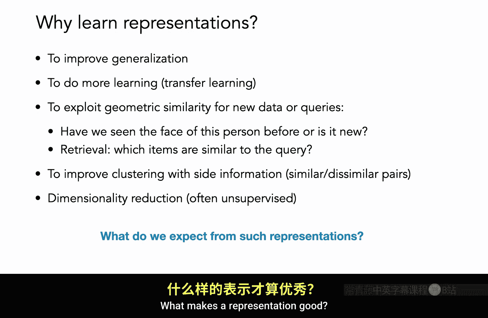

Yeah， it shouldn't have objects in lengthier higher emotional space， like that are similar in。

Representations。Very close point。Yeah， so the idea that objects that are semantically similar。

 We actually want them to be really close together in that representation space， right， We。

 we want them to be close together。 Why would we want them to be close together。 What。

 What does that do。Yeah。helps us。Treences。不上说。Yeah。

 it might help us be robust to things like disturbances and noise。 if。

 if you move a little bit in any direction， if you're not moving sort of far away from things that are that same semantic category。

 Why else might we want things that are similar to sort of be close together， Yeah， sure。

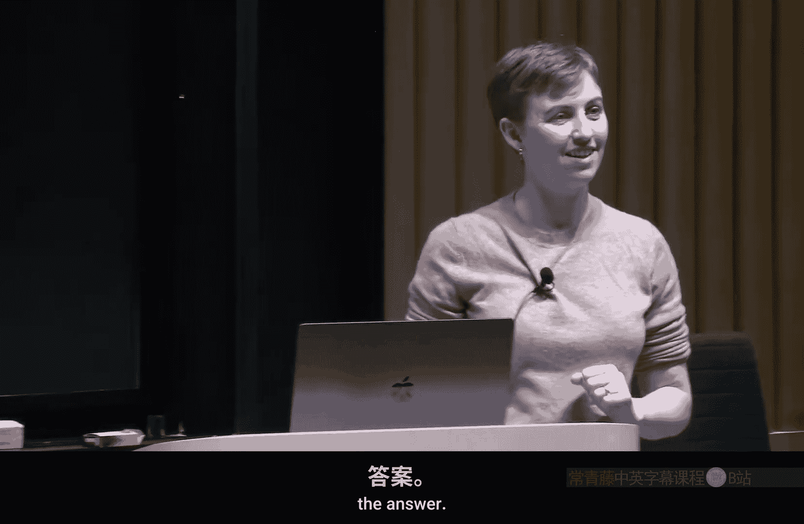

我还是可。は。あと学。Plus epsilon。Yeah， so， so what you said was basically like we might want the sort of downstream mapping of this embedding space to some maybe categorization to be kind of robust to change and to map things sort of easily from one face to another。

 actually， there's a different way to say that， which is basically， it's useful。

 if the space is linearly separable， right， It's a very easy function。

 If you want to learn categorization。 If different。

 if objects that are the same are close together and objects that are different are not close together。

 because then you just draw lines between things。 it's a very easy categorization problem。

 So a well separated space is also potentially quite useful。😊，So， so good fellow back in 2016。

 said that generally speaking， a good representation is one that makes a subsequent learning task easier。

 That's exactly what you were sort of trying to get at。 And so what could that mean。

 What is a good representation， So。😊，One framing of this is explicitly what we were just trying to capture。

 A good representation is both compact， which means it's sort of not。Too big。

 We don't want to have sort of more capacity than we actually need。

 This is getting at that efficiency angle。 You can take sort of an information theoretic perspective here and think about。

 you know， we want to kind of keep the minimal amount of information。

 but we also need it to be what we call explanatory。

 So that means that it's somehow sufficient to capture the dimensions that matter in our original data。

 And the really interesting part here is that， of course。

 this is going to be contextually related to the set of downstream tasks we might be interested in。

 because something that is sort of sufficient to be explanatory for one possible thing might be insufficient for another。

 And so a good representation ideally would be something that is kind of compact and explanatory in a way that makes it generalized to many possible downstream tasks。

😊，So。Back in 2020。There was this work that tried to pose specifically the question of not what makes a good categorizer。

 but actually， can we build complexity measures that accurately predict the generalization of models。

 Can you build a complexity measure over a representation that will predict how well that representation will generalize。

And it turned out that a couple of winning strategies for this specifically looked at both the geometry of the representation。

 so that consistency and separation， how sort of tight together。

 how close together were things that were the same， how far apart were things that were different。

But also， robustness to preturbations。 So if you move a little bit in any dimension or any direction。

 do you actually change something fundamental about the， the representation。And this。

 this really maps quite well， I think， to some of like our own intuition about what might make something easy to learn。

 And if you look at this specifically on something like C far， C far 10。

 which is a very sort of low dimensional image categorization problem where all of the images are。

 are very， very low resolution and small， and the categories are sort of simple。

 if you train a classifier on C far 10 with the correct labels。

And then you look at a TC visualization of the representations on the training data， Right。

 So this is the data that we've actually sort of already trained the models on。

 What you see is it learns to build a very。Like consistent and separable training space， right。

 Like the categories here are the same color。 And so you can see the things that are the same color are very close together。

 and they're very well separated from everything else。 And interestingly。

 they're somewhat uniformly distributed in the space。

 And we'll actually talk later in the lecture about kind of this other dimension of kind of distribution throughout the space。

😊，Now， if you take。The same model。 And you randomly generate the labels on that training data。

 And then you train a model to sort of recognize what are now basically random noise。

 You still will get clusters because the model can learn to memorize。

 But what you see is that those clusters are much less concise。 They're much less sort of compact。

 The， the colors that are sort of the same color are， are more spread out in this space。😊。

And they are much less separable。 So you could imagine that this would be much less robust to preturbation。

 right， Because if you sort of change in some direction， you're。

 you're pretty quickly moving into another color， let's say。So。

This is really capturing that something that generalizes versus something that can't generalize will have this concentration of this consistency data from the same classes close together and separation classes are well separated and robustness。

 right， If you move a little bit in any direction。 you're not sort of crossing what we might call a class boundary。

 If you train a downstream classifier on this， sorry。😊，So。What makes a good representation。

We want it to be compact。 We want it to be explanatory。We want to have concentration。

Data from the same classes close together。 We want to have separation。 Classes are well separated。

 and we want to have robustness to irrelevant preturbations。

 preturbations that we would not want to cross a class boundary。 So a nice example of this。

 and we'll get into this later。 But， you know， if you saw me from this angle。

 you'd want to be robust to me looking the other direction。 It's still Sarah， right。

 It's not somehow a completely different class。 So you might want to be sort of robust to a preturbation that's something like pose。

😊，So。How could we encourage a model during training to actually achieve this type of representation。

嗯。So one of the kind of。High level ideas。That really has had a lot of traction here is the idea of explicitly encouraging good representations via feedback in terms of the similarity of data。

 So you have pairs of either similar or dissimilar inputs。

 You're not just sort of looking at one example at a time。

 You're actually looking at two or maybe three examples and giving information to the model about what should be similar and what should be dissimilar。

 So why might this be different than just looking at one image at a time。

 So there's actually a really nice example， I think from psychology about the value of sort of this contextualization or this comparison。

😊。

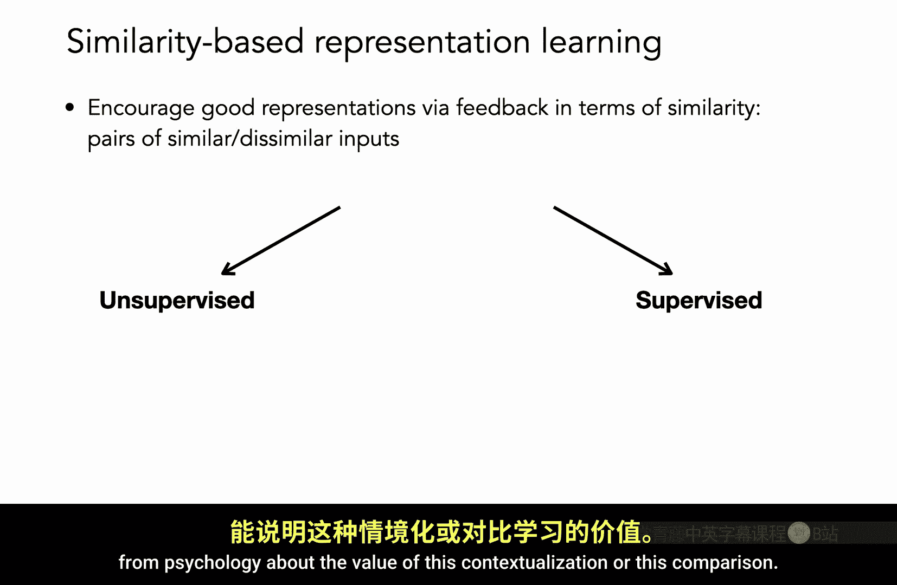

So。Tell me what an elephant looks like。Describe an elephant to me。Its very about him。Okay。

 very big and bulkan， huge sized。Large ears。Okay， anything else？研究たロ。Yeah。

 I think I'd also like something do the fall。Like some， some big nose trunk。 O， so。Now。

 if you do nothing about elephants。You could draw like almost an infinite set of things that might have those characteristics。

And probably none of them would look very close to an elephant。Okay， so now。

You in the front row or in the second row。 Yeah， you pretend I already know what a rhinoceros looks like。

Now， try to describe what an elephant looks like to me。You should up the trunket at the horn。Okay。

 so I know what a rhinoceros looks like。 So now you're saying， okay。

 instead of having a horn in the front， take a rhinoceros。

 but add a long trunk and then maybe add some big ears。

I'm actually probably much more likely to have an understanding of what that thing is。

 because I understand similarity and then like these small， contrastive differences。

 And I actually think this is like a really nice， intuitive example of。

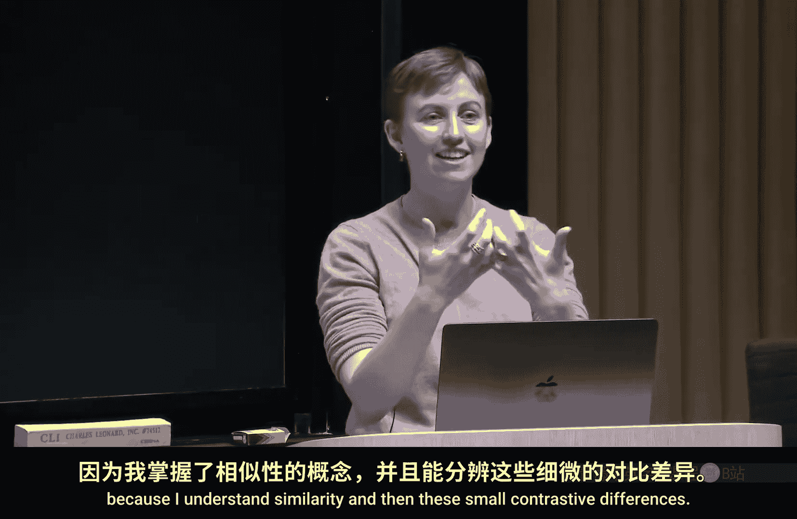

How we think about contrastive learning and why like this type of contrastive signal is so valuable。

 And I actually think interestingly enough， you know， I work a lot with species。

 One of the ways that we train people in identifying species is almost always contrastively。 right。

 If I'm teaching you how to identify two different types of birds， I'm not going to say。😊，Oh， like。

 I'm going describe this one from scratch with this massive exhaustive list of independent attributes。

 I'll say it looks a lot like this other bird。 But the important differences are like the spot near the eye and the color of the legs。

 right？ It's this this comparative difference。😊，So the way that we actually try to train things based on similarity and dissimilarity the original sort of proposed approach was this thing called metric learning。

 And essentially， this was based on the idea that measuring Euclidean distance in your input data space。

 So， for example， looking at the Euclidean distance between all the pixels in one image and another might not be ideal。

 right， instead， we might want to learn some metric。

 some representation that respects some desired properties。

 And so our goal is to learn a metric where data points that belong together are similar。

 close together。 and data points that are different are dissimilar far apart。

 And then the supervision becomes similarity information。 So， you know， for example。

Maybe you'd have three images of your instructors， and you would want to explicitly say that the two images of Phil should be closer together because they're both Phil and the image of me would be far apart because I'm not Phil。

And so actually， how do we do this， So the very， very simple version。

 which is just sort of in one dimensional space。 Let's assume， say you have some data points。

 X 1 through X N。 and you have some form of supervision。😊。

And this supervision is not exactly the distances between things or how similar or dissimilar there are。

 We just have supervision in terms of which pairs are in the same category and which pairs are in different categories right so we have some set of similar pairs and some set of dissimilar pairs and our goal is to learn a linear transformation Z equals W X。

 So essentially we're trying to learn this this matrix W that will respect this similarity。

And so the idea here is that we can use Euclidean distance in representation space。

 And so now if we kind of map out， okay， we want the sort of the distance between Z I and Z J to be equal to kind of factored out the difference in terms of X I and X J。

 transpose W， transpose W， the difference between X I and X J。

 We're sort of just taking that norm and factoring it out。

Then you can define basically this A norm on X， I and X J。 that will be W transpose W。

 which is a positive semi deffinite matrix。We like positive semi defite matrices because they're easy to work with mathematically。

😊，And so， this distance here。Actually is explicitly defined as the Mahallanos distance。

 And so the Mahallanos distance between two points is going to be defined by positive semidefinite matrix A。

 and it's defined explicitly as that right And so what you can show is that this。

 if we can learn some sort of optimal A， which essentially would be an optimal W for this z equals W X。

 then that will actually be this transformation that preserves similarity and difference maximally。😊。

So how could we actually phrase that as an optimization problem。How do we。

 how do we sort of learn the right W here。Any ideas。So。Essentially。

 the first proposed approach and one that was really introduced in in the。

 in the paper that defined the term metric learning。

 they call it distance metric learning was just specifically set this up as an optimization problem with a constraint。

Right， so here， what we can do is we can say， we want to find a。

We want to find positive semi definite a， such that the minimum distance of similar。

 We want to minimize the distance between similar points。

 So between those pairs that are known to be similar。Well。

 making sure that there is at least a distance of one or some， you know。

 epsilon between dissimilar points。 So you're essentially setting this up as an optimization problem where you're trying to bring the the things that are similar as close together as possible while enforcing that there is at least some margin around any point and any other point that is dissimilar to it。

 And you can actually flip this as well。 You can also think of it as keeping the distance between similar points within some constraint and maximizing the difference between dissimilar points。

And there's， you know， now sort of a lot of different variations of this that have been proposed since 2003。

 which is now over over 20 years ago。And it really is something that can be explicitly solvable。

 And you can again， swap the objective and constraint。

And there's actually been a lot of related ideas and follow ups to this things like， for example。

 information theore metric learning， which explicitlyposed preserving distribution information。

 So for example， relative entropy between Gaussians while trying to observe both upper and lower bounds as constraints。

 But a really simple example of kind of what this is like why you might want to learn some you know projection。

 some linear projection that preserve these similarities and dissimilarities is this one。

 I think this is incredibly intuitive。 So say your original data with sort of bimodal in some way。

 rights there's clearly sort of red and blue categories。

 And then there's sort of one mode where there's red and blue categories over here and one where they're over here。

 the very， very simple optimal projection here would be just removing the dimension here would be like along the y as。

 So now you're just projecting everything into the same plane。😊。

They're sort of very easily separable from， from that perspective。嗯。

There's a lot of improvements and developments on top of this that you can do， so。One thing is。

You can think about looking at nonlinear transformations。

 So instead of only learning a linear projection W。

 you can think about doing things like deep metric learning。

 where you're actually explicitly learning some sort of neural network that would map into a space that keeps things similar that we want similar and dissimilar that we want dissimilar。

We've introduced these concepts of different types of contrastive losses。

 We'll get into those a little bit more。 And then another improvement and something that actually is just track to be quite helpful is the idea of normalizing your representations。

 So instead of then taking Euclidean distance， if you normalize the representations to enforce that all of the distances have to live on the hypersphere。

 then distance would be essentially just equivalent to angle。

 And then you can look at inner products to measure similarity instead of leading to look at a Euclidean distance。

 And this is nice because you don't end up having things that get really blown up by scale。 right。

 you're removing sort of the scale complexity。Yeah。So。This deep metric learning idea is quite simple。

Linear metric learning is you're trying to learn some linear transformation。 Z equals W X。

 Deep metric learning is you're trying to learn a non nonlinear transformation。 Z equals F of X。

 where now F of x is a neural network。And now you're not optimizing over the set of positive semi deffinite matrices。

 You're optimizing over the weights of a neural network。 And， you know。

 there we can use things like stochastic gradient descent to do so。

So the intuition behind this introduction of contrastive losses is the following。So say。

 I show you this moth。What kind of mouthth is that？Anybody really into moths in this room？

I'm guessing， no。ELepioptera is the scientific term for the genus， anyway。So that's a moth。

 I actually also don't know what kind of moth that is。There's another moth。 Are these the same moth。

 Are they the same kind of moth。It's kind of hard to say， right。Well， O， what if。

 what if I showed you another moth， What if I showed you this moth。

If you had to guess and you had to say two of these were the same kind of moth。

 which two would you guess。Yeah， right right。 So it might be really hard to explicitly say whether something is the same or different。

 especially because when you get into things like this， actually。

 there's there's this dimension of what is a category that gets complicated。

 Like is the category all moths。 Well， then they're the same is the category white moths。

 there're still the same I the category white moths on green leaves still the same。

 is the category species of moth Like then maybe we don't know anymore， right。

 And so but it's actually very easy regardless of what you want your're sort of downstream task and sort of the dimension of granularity to be to say those two are definitely more similar than that one。

Right。So the way we translate this into machine learning is we try to build a loss that explicitly says that the distance between dissimilar pairs must be。

 must be much larger than the distance between similar pairs。

And the very sort of initial version that was introduced here is this idea of what's called triplet loss。

 which essentially demands that the distance between an anchor。

 So you have like one point that you say is your anchor point。

 and then you have two other data points that are sent in。

 and one of them is a positive example of the same as that anchor point。

 and the other one is a negative example that's different from that anchor point。 Now。

 you enforce that the distance between the anchor and the negative example has to be bigger than the distance between the anchor and the positive example plus sum margin。

 Again， this kind of enforced margin。And so what this actually looks like in practice is you're just sort of explicitly enforcing that you want to have some loss that penalizes you if that condition is not met。

And so then when you actually look at data examples here。 So maybe you。

 you take in your initial data and in that space， it turns out that sort of incorrectly。

 your model had put this first horse， the anchor horse X and this monkey closer together than the anchor horse and this other horse。

And now， after actually sort of updating your model， taking a gradient descent step。

 the loss and that gradient would tell you that you needed to push in that representation space。

 The horse and the monkey further apart and the horse and the other horse closer together。

And the way this actually is done is in sort of a triplet network。

 You would sort of have these shared weights。 So you have three images that go in。

 You run all three of them through the same convolutional neural network。

 You calculate embeddings for all three。 You take a triplet loss over those three different embeddings based on the anchor。

 the positive and the negative example， and then you back propagate through that branch。In the graph。

And so there are actually quite a few different improvements of this。

 One is actually pretty explicitly related to training efficiency。 and that's just that you can now。

 instead of sending in sort of all of these independent triplets。 you can load an entire batch。

 And now you'll have some positive examples and some negative examples in that batch。

 And then you can construct every possible triplet of positive and negatives and sort of calculate the loss over those。

 And so that way you're actually getting more training efficiency。

 you're making the best use of the batch you've already loaded in and also in this way。

 you're more likely to sample， for example， these hard negatives that give you a signal。😊，Because。

 for example， if you， if you send in an image。Or a set of three images。

 And your representation already captures well that these two are that the positive example is closer than the negative example with a margin。

Then you you don't get any signal， right， So the easy stuff doesn't actually help you train， right。

 because you don't have any sort of signal saying like， no， you got that wrong。

 You need to move them apart。 So you really need to see these hard examples where your model' is getting it wrong to be able to get signal and be able to actually get a gradient that trains your model to improve your representation。

So if you use this type of embedding， what you can see。Is you get clusters， right？

 you've done this in a way where now things that are similar tend to be clustered close together。

 In this case， this is a triplet loss network that was trained over the Caltech US USSD B dataset。

 And you can see that in this embedding space。 things that are close together are actually quite similar。

 Are there some other things that this this thing has learned beyond maybe similar species。So。

Environment environmentvironment， Yeah， yeah， yeah。 So if you look at， for example。

 that cluster over there。 it's， it's a cluster where， yes。

 all of the examples of those birds are turns， the ones that are flying against a blue sky。

 I could tell you their turns。 Maybe some of you guys know their turns。

 but they're also all pretty much birds that are flying and mostly birds that are flying against a blue sky。

 So you can imagine that you know， similarity here is maybe picked up on some more stuff than just maybe what we might be interested in in terms of similarity。

😊，And if you sort of query using this， right， you say， okay。

 find me nearest neighbors in this embedding space。

You also do start to learn sort of similarity semantically， right。

 You start to learn that things that look similar are similar and things that look different far。

 are far apart。And this kind of gets at this interesting question of like。

 what makes an image similar。Right， so here。These are are embedding spaces that are trained on sort of much larger data sets。

 and we have some reference image， and then we sort of have different different things that are kind of coming in that are potentially similar or dissimilar And this is a paper actually of fills where they explicitly asked humans what they thought was the most similar。

 trying to take this sense of how does a human brain think about similarity。

 And it turns out there's a lot of different ways that we think about similarity。

 we might think about similarity and pose， perspective， foreground color。

 foreground background orientation， the number of items， object shape。

 There's a lot of different ways that things can be similar and and what's the most useful way to have things be similar or different based on a representation space is probably going to be contextualized by some downstream task that we're interested in。

So how do we actually try to make sure。That we're showing these images that are hard to the models that we get training signal。

 So we need to find basically hard negatives。 And this type of like hard negative mining will often look for a misplaced negative。

 So we need to try to find things that have been put closer to the anchor than a positive example。

And being able to do this hard negative mining helps us accelerate our learning。

 The more we can sort of find the hard things， The more we train quickly。

 And one nice example of that is this。 right， So here's our moths。 again。

 you can imagine that if you saw those first two images。😊，Based on a lot of dimensions of similarity。

 like the pose， the background color， the orientation。

 these are actually more similar than this one on the bottom。

 But in some sort of semantic categorization， this， we want to know sort of the type of moth。

 These one should actually be more similar。 And that one should be further away。

 And those things like pose and background color are actually confounding dimensions， right， there。

 there are ways that we want our model to be invariant。

And so finding examples like this would be explicitly ways to sort of train your model faster to recognize what you want to be similar。

So。This assumes， though， right， that we already know the right answer。

It assumes that we know that these two moss at the bottom are the same。

 And then that one at the top is different。But actually。

 the idea of contrastive representation learning and specifically selfsvised contrastive representation learning thinks about how we might take these ideas from metric learning and also self- superervision to build representation spaces that are not explicitly supervised。

 right， How do we get a good starting point or good representation。

 if we don't necessarily have labels。😊，And sort of。

 why might that in some ways be better than actually training something with explicit labels。

So a common setup。For this type of self supervised representation learning。

Would be that we're gonna have some encoder， right， some。

 some feature some function that will map our data onto a hypersphere。 So again。

 we're normalizing to enforce everything to be on the hypersphere。

And we'll define some cross entropy for a softmax classifier that will discriminate classes based on similarity。

So if we know that these two images at the bottom are the same class and this one is different。

 then we're going to try to explicitly pull positive pairs together and push negative pairs apart。

So essentially， this is something like a cross entropy cross entropy loss。 right。

 We have a activationiv of a law activation of a logarithm of something and。😊，The one。

 like this kind of looks to us like us， maybe close to a softm， something close to a softm。

So we can use inner products。To actually do this comparison because we've constrained with the hyperspher。

 So we can look at like the angle instead of the distance。

So now we're sort of maximizing the inner product， which is sort of explicitly trying。 sorry。

I say no， no， no。 So we wantna， we want， we want to make sure that the inner product is as close as possible to one。

 right， because that would mean that they were as close as possible on this sphere。And so。We now。

 instead of minimizing distance， we can maximize that inner product。

That minimizes the angle between the two of them。And then。Essentially。

 what we want to do is we want to make this green part as big as possible， right。

 So that's maximizing the inner product between those two things。 And we want to make the。

 the red part as small as possible， which is going to give us the largest possible overall thing。Now。

We assume。For example， that we have a couple dimensions of symmetry， right。

 you can say that we want to have symmetry where we would have essentially if the first one is your anchor and the positive example is the second one。

 we want the distance between those to be the same as if you've flipped the two right So it's enforcing some symmetry between them。

 the distance should basically be the same no matter whether your first one is the anchor。

 the second one is the anchor and we also want to match the marginal and kind of what we mean here is for the distribution over all those positive pairs。

 we assume if we marginalized over one of those partners， we would end up with the data distribution。

 So it's sort of starting point distribution over the data。And so， now。嗯。A really common。 So yeah。

 this was in this sort of noise contrastive estimation， invoen Z E loss。

 There's a lot of sort of similar losses in metric learning that introduce these types of ideas。

And essentially， if we want to try to do this specifically self superupvised。

 So we don't necessarily know already that these two things are the same category。 And instead。

 we're going to do some fancy stuff to try to force our model to learn that an input data point is the same as itself。

After running it through a bunch of different augmentation。

 So perturbing it in a bunch of different ways。This actually can outperform some supervised pre training。

 which is interesting， right， so。😊，Intuitively， for me， it's like， why would we want。

To not have supervision。Well， one thing is， if our supervision is not well aligned with the actual task that we want to use the the representation for。

 we might learn dimensions of invariance or dimensions ofvariances that are explicitly unhelpful。

But if we just do self supervision。 So we're just trying to sort of learn something without any explicit definition of。

 of what is similar or dissimilar based on category。

 that might actually be better for a bunch of different possible downstream tasks。

 but not necessarily better for everything。 It's a little bit nuanced。And again。

 just talking about why we might map to a hypersphere。 So here。

 one thing is more stable during training。 Like why do we not want to have scale be a dimension of variance？

 It's kind of like logistic regression， it helps you regularize。

 And also we get this really nice behavior。 So if you enforce that everything is on a hypersphere。

RightAnd you enforce that similar things that are close to together on a hypersphere and different things are very far apart on a hypersphere。

 then you can always build a linear classifier， just a slice through that hypersphere that will actually be linearly separable。

So there's this nice kind of thing where， you know， no matter what we can always enforce。

 that we can build a linear classifier on top of that hyperpher representation。

How do we actually make it self supervised， Like， how do you get this sort of signal if you don't actually have labels about what's similar and different。

 so。Basically， what people do。Is they take all the random stuff。

 randomly uniform Du run from the data of as negative examples。And as positive examples。

 you take your image and you do a bunch of weird stuff to it。So here we have this original image dog。

 and we can do。Crop and resize， crop resize and flip。 You can distort the color。

 You can sort of drop or jitter the color。 You can rotate it。 You can cut chunks out of it。

 You can add Gaussian noise。 You can add Gausian blur。 You can do things like so will filter。

 and get you kind of this like rough edge kind of representation。嗯。And so then something like S CLR。

 which is one of the original methods that explicitly tried to teach this type of self supervised。

 Conive learning here for every data point in the batch。

 you would generate two different random augmentations of that data point。

 and those two random augmentations are the positives。 And essentially。

 the intuition here is you want the exact same thing under some reasonable preturbations to be mapped very close together。

😊，And then， some random。Set of all of the other things in the batch are used as negatives for that pair。

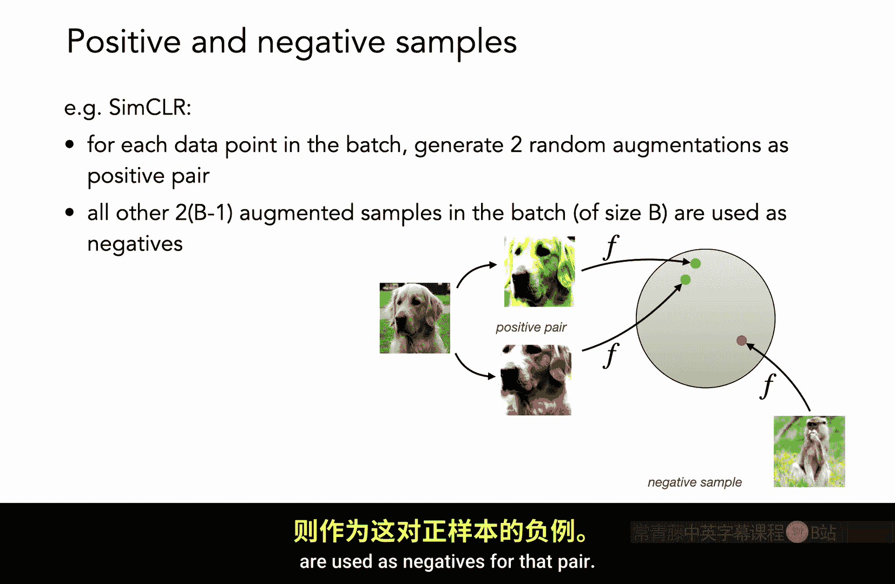

So can anyone think of any limitations of this。Yeah。

Have multiple pictures of the same thing in the data。 Yeah。

 so what if you have multiple pictures of the same thing in the data， So it turns out。

 and we'll get into this that that actually is a challenge。 And the assumption is that， well。

 maybe there's something in terms of similarity that we would still possibly want to capture。

 if you have sort of two dogs that are exactly the same under preturbation versus another dog。

 for example， or another lab or even another picture of that exact same dog。 But definitely。

 these types of，Like。Positive negatives almost in a way， are confusing。

 And when you're actually learning these representations。

 and there's explicitly work that shows that if you can remove those。

 even by using something like explicit supervision， it can actually really improve a representation。

😊，Yeah， is。Patients for。打里面。T。Yeah， so， so for example， here， we're talking about S CR。

 which is explicitly like an image focused， contrastive thing。 So those。

 those preturbations are going to be data specific， right？ So， for example， like。

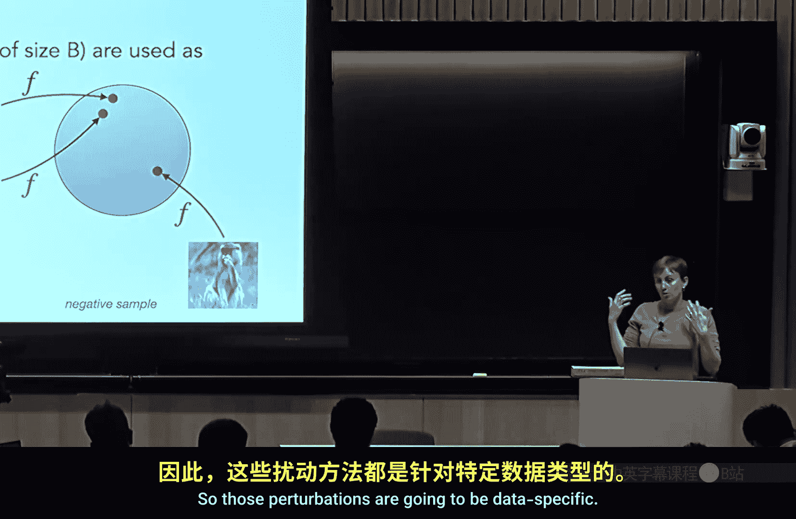

Reasonable preturbations on images are things that we actually have some is intuition that we want to be invariant to。

 We want to recognize the object is the same and it is invariant under flips。 For example， this is。

 this is a strong assumption that we're building in。

And there are actually some cases where we explicitly don't want to build in those assumptions。

 If you， if your downstream representation needs to be able to detect the difference between right and left shoes。

 if you use random flipping as an augmentation， it makes that almost impossible， right。

 because if you say this is a right shoe。 and this is a right shoe。

 and this is a left shoe and this is a left shoe。 Your model is incredibly confused。

 So the same would sort of be possible for any other type of data。 like， say you had， for example。

Data of specific molecules。 you then would have to inject some domain knowledge in terms of what types of augmentations of those molecules are reasonable。

 where we would kind of want to maintain similarity and what types of augmentations are actually potentially unreasonable。

Same for text， same for video。So the choice of augmentations actually does become quite important。

You think of a lot of different variations of this type of contrastive learning that use self supervision。

 yeah。Why doesn't the model？Stupid like what about this setup？Like two golden retrievers。

Like say say you get a different image country。And you make two augmentations of it。

Pick a negative sample that's now like a horse。There's nothing about this。

 I think that says that those two bone j。Close to this。Retriver in your representation statement。So。

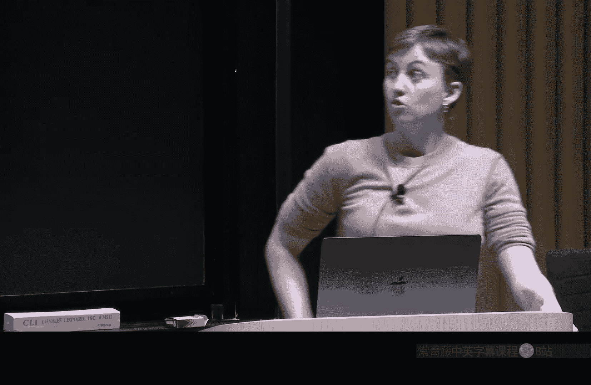

Right， so， so if you augment this one， you augment that that one and you force it close together。

 there's nothing from this particular training step that would say that either of them should be closer to the original image。

But now you're gonna sample these over and over during training in many different combinations and with many different randomizations。

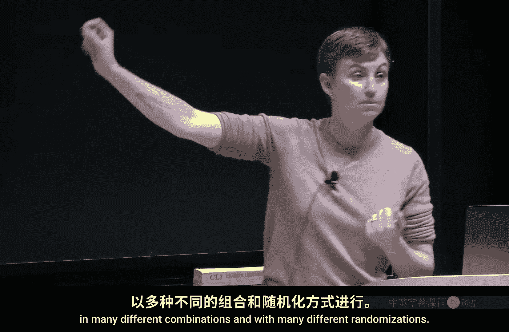

And so the assumption is essentially， though there might be some things in there that are like more or less confusing that generally over time。

 you're gonna to learn that golden retriever like things should all be somewhat close together because more often than not。

 you're gonna to get you know， two augmentations of a golden retriever and a boat。

 not two augmentations of a golden retriever and another golden retriever。

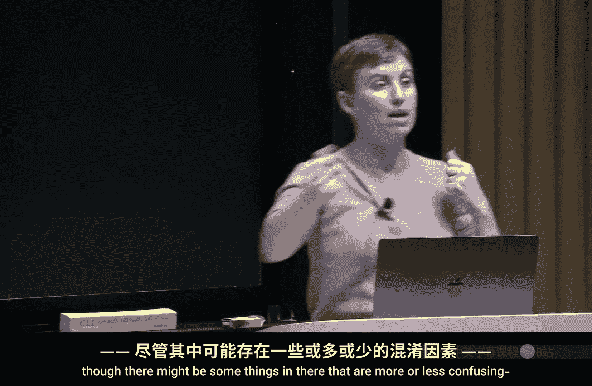

Does that make sense。So I think it kind of comes out in like。

 like like the noise kind of over time and over many。

 many different types of categories does kind of equalize or get to something that has learned the signal you want to learn。

So there's different a lot of different clever ways to think about how to get that similarity signal that isn't necessarily。

 you know， just massively augmenting， so one example is if you actually have data for you know of something like a scene and the depth image for that scene。

 then you can， for example， try to learn representations that put things close together if it's actually like the scene。

 the image of the scene closely matches the depth of the scene。

 so you can learn you know representations that capture something about scene structure by explicitly leveraging RGBD during training。

Or you could think about learning representation learning over video where you take frames randomly sampled from the same video as positives and a frame from another video as negatives。

 Right now， your model needs to learn something about possibly potential similarity over time。😊。

And you know， there's lots of different works that do this sort of thing。

 You can think about using vision language as views in some way of the same scene， right。

 you have the text description of an image and the image itself。

 You try to push those together and you try to push them far away from an image that doesn't match that text description。

 So there's a lot of ways of trying to think about how you can get this self-supervised signal and a lot of modern work actually really is just people coming up with creative ways to supervise models without requiring labels because labels are handcrafted human generated labels are very expensive。

So。Essentially， what is this method doing， right。There's kind of two ingredients here。

To making this work。1 is the contrastive loss。 So which sort of specific form of contrastive loss you use。

 And the other one is the data。 And by the data， I don't just mean like sort of the underlying data set。

 I also mean specifically which types of positive and negative pairs we surface to the model over time。

So if we dig into the contrastive loss。 and we think of this again as something like a cross entropy loss that tries to distinguish between data points。

 right。Another way that you can motivate this loss mathematically。Is you can try to frame it as max。

 as maximizing the mutual information between positive examples in the pairs。嗯。And so essentially。

 if you think of it that way。You're， you're really just trying to maximize a lower bound on mutual information between views of the same thing。

And there's been some interesting work， specifically this work that showed that actually。

 if instead of using the sort of standard contrastive losses。

 you just explicitly maximize mutual information alone， it actually worsened downstream performance。

And sort of looser bounds with simpler critics LED to better representation。 So essentially。

 the contrastive loss has to be doing something else。

 It's not just maximizing the mutual information between things that are similar。

So what else is it doing。So we'd said that we had a couple properties that we liked that made representations good。

 We had concentration， slash alignment。 So data from the same class is close。😊，We had separation。

 which means data from different classes are far apart。 We don't lose information。

 And then we had robustness to irrelevant preturbations， right。

 We don't want to change something in some way that we think is irrelevant and have it change and move really far in our space。

So。You can see how explicitly the alignment is really built into that loss from the beginning。 right。

 We're saying we want to pull similar samples together。 So that's enforcing alignment。

Similar samples should have similar features。😊，And then。You can talk about this sort of uniformity。

 which is essentially saying we want to push dissimilar samples apart。

 And if we're pushing all the dissimilar samples apart kind of equally。

 You can imagine that the optimal way to do that would be to cover the entire hypersphere， right。

 Because if we don't use part of the hypersphere， Then there's actually a way we could have pushed even further apart things that are different。

So here， this actually pushes apart all of the classes。 where here every class is again。

 like one point， right， because we've sort of said that the only information we have is that this image is the same as itself under preturbations。

So we're really pushing apart all the data points on， on that hyperphere。

 which is kind of pushing for that uniformity in our feature space。

 And that could be as sort of seen as a way to enforce separation。So。You can actually see this。

 which is really interesting。 So if you take C far 10 and you build these encoders。😊。

That encode them into this sort of S1 feature space with like the hyperphere on one dimension or or two dimensions。

 It's just a circle。 And you visualize feature distributions on the validation set。

You can see that if you use unsupervised contrastive learning。

 you get this distribution that is properly uniform around that circle in that embedding space。

Whereas if you actually use supervised predictive learning。

 you get a feature distribution that's not uniform。And if you just randomly initialize the network。

 it's， it's far from uniform， right， we really don't get anything close to this uniformity。

 So you can see that almost it's actually happening， right。

 something in the way that we're doing these unsupervised contrastive learning is really pushing and and enforcing uniformity across the data points。

So how can we quantify this。So the idea is that you might want to explicitly be able to study alignment and uniformity。

 So things being close together and things being spread apart。Using metrics。

 we want to actually way to quantify how， how aligned or how uniform a representation is。So。

For uniform， for alignment， we just do something like looking at the expectation over the distance between features for positive pairs。

This is pretty intuitive。 You're just saying， like， you know， my alignment metric is。

 how far apart do I think any two positive examples are going to be in expectation。

And then for uniformity， instead of trying to explicitly say the expected difference between negative pairs。

 you can do a transformation of this using the Gaussian potential。

And then you can look at using the logarithm of the expected pair wise Gaussian potential。

Which is essentially E to the minus squared distance。

And this puts more focus on the smallest distances， right。On this objective。

 this sort of goal has a lot of connections throughout math。

 And it turns out the solution that optimizes this is the one that maximally spreads out the points on the hypersphere。

 So the uniform distribution on the hypersphere is explicitly the solution to this。And so， now。

The uniform distribution on the hypersphere becomes the unique measure that minimizes expected pair wise potential between negative pairs。

So now if we want to dig into our explicit contrastive loss， One way to do that is we。

 we take asymptotics， right， we assume， okay， what happens。

 what happens as you take things to infinity。 That's a good way to sort of understand behavior generally。

 when you're looking at mathematical properties。So here。Without getting too formal。

We want to make connections between alignment and uniformity， and our contrastive loss。

So since our definitions are expectations， we'll look at the asymptotic behavior。

 specifically taking the limit as the number of negative samples goes to infinity。

 So say we have infinite negative examples for any given positive。

Then you can reformulate this to getting basically the combination of two different terms that are expectations。

And we're putting them here in green and in red， because basically。

 the first component of this gets minimized if every single point of the same category has the exact same embedding。

Right， so essentially， if the distance between positive pairs is just 0。

And the second term gets minimized if those collapsed points are at all the points are spread out as far as possible。

 which is that uniform distribution。So。First term gets minimized if and only if F is perfectly aligned。

 All the things that are same are exactly the same embedding。

And then the second one is is minimize that we get perfect uniformity。

 which is explicitly the uniform feature distribution， pushing everything as far apart as possible。

And now these are actually measurable quantities， right。

So now you can actually look at representation quality， as defined by alignment versus uniformity。

And look at how sort of accurate， for example， prediction is on a validation set。

And what you can see is you take a bunch of different models。

 So every single one of these points would be a different representation space or different thing that's been learned。

 And you can plot them in terms of their alignment versus their uniformity。

 as measured by these quantities。 and you can show that the things that have the highest validation accuracy are sort of the best possible minimizers of both alignment and uniformity。

 So this kind of red that goes into blue that goes back into red kind of explicitly tells us in some nice measurable way that alignment and uniformity are in fact。

 good qualities for representation space， and they map towards good accuracy on downstream tasks。

And you can show this over several different different data sets， though。

 you will see that sort of simpler data sets show this better than more complicated ones。

So what's the conive loss doing， Alright， So the loss function itself。

 we've just shown explicitly encourages alignment and uniformity or sort of concentration and separation。

 So then what is the selection of positive and negative pairs encouraging， right。😊，We talked about。

 know， sort of how we generate those positive negative pairs is through maybe all these different augmentations。

So what are we teaching a model。They our choice of pairs。

So augmentations of the same data point should be close， right。嗯。

And then we want or learned representation that's invariant to preturbations induced by dead augmentations。

 right， So we're trying to learn imvariance to the set of augmentations we explicitly put in。

And it turns out that finding the right invaris can be really hard， right。

 We talked about the molecule thing we talked about in the right the right and left shoe thing。

And so， you know， there might actually be some explicit imvariances， like， for example。

 the ones we talked in the talked about in the geometric deep learning lecture that you could actually explicitly hard code。

 right， if you want to be symmetrically invariant， you could build symmetry directly into your into your representation。

😊。

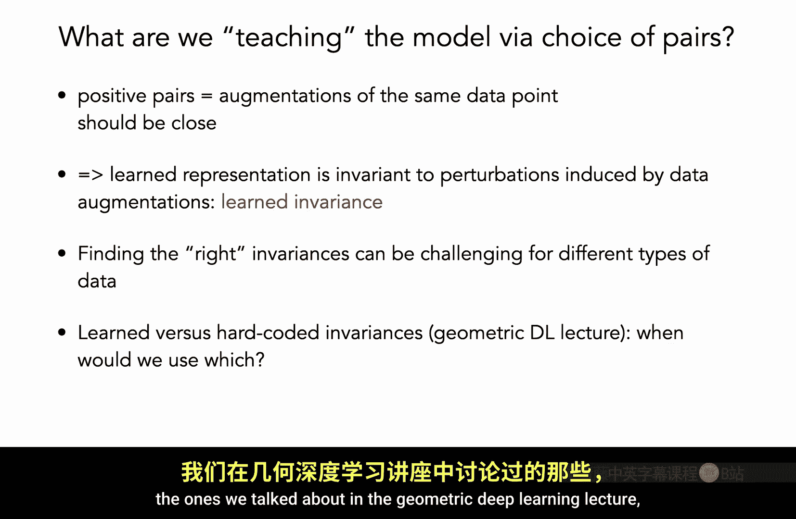

And， you know， maybe there are some cases where we'd want to use one or the other。

And it turns out that there are a lot of types of invariances that we might want to have that can be really difficult to define mathematically。

 And so this kind of experimental or maybe slightly more brute force approach。

 of just explicitly saying， hey， if I do this to this thing。

 I want it to be the same you can build those invariances in without actually being able to mathematically define explicitly what it means to be。

 for example， invariant to pose within a scene or sort of distance in these sort of complex geometric spaces。

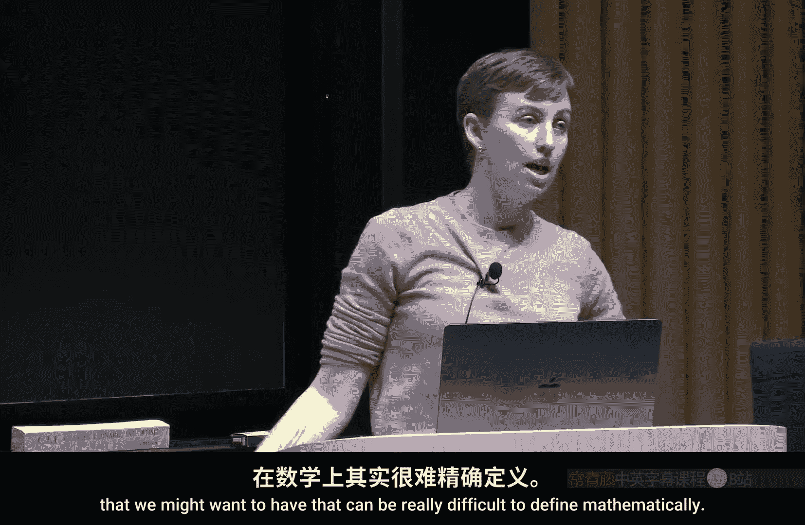

Particularly for non rigid objects。So。What we're saying here is essentially that the data is explicitly the dimension that encourages the robustness。

That third category that we really wanted in our representation。

That robust aerial preturbations is coming just from our data。

So this means that to make all of this work， you specifically want to have sort of this set of things to kind of help us get those losses to converge and sort of encourage the right types of robustness。

 And it turns out， for example， that these sort of four things， really heavy data augmentation。

 right， like not just simple stuff， doing really， really， really weird things to your inputs。

Within reason， having these projection heads， we'll talk about this in a second。

Having very large batch sizes and selecting the correct data pairs and hard negative examples。

 These are really the ingredients that make this self supervised contrast of learning work much better。

So， and you can actually see this in the literature。

So here they're explicitly ablating in the MCCLR paper。

 how these different transformations affect the performance。

 And it turns out that the performance of your your sort of downstream classifier。

 if you do this self-supervised representation learning， using only crops， for example。

 is significantly lower， like 15% almost lower， than if you use sort of all of the entire set of augmentation shown here on the left。

😊，So the data augmentation definitely plays a huge role here。

Another thing that actually plays a huge role is this idea of a projection head。So here。

 what people found experimentally is that if you， instead of applying your contrastive loss directly to the feature representation you're trying to learn。

You， you enable some learned projection G。That's quite simple from H。

 which is the representation space you're planning to use。 And， you know， some Z。

 where you're actually going to maximize kind of the agreement between similar pairs。

 you're actually applying that contrastive loss， that this ends up also really helping performance downstream。

And G will be something quite simple， right， a linear projection or like a very small multilay perceptron。

And then so you don't actually use Z， which is like this projected space where you're calculating your loss as your representation and you。

 you use H。And this projection had improves important performance。

 And I think one of the ways that people have intuitively tried to explain it is that instead of I。

 lets the model learn a representation that keeps a little bit more variance。So， for example。

 if you're trying to explicitly enforce this contrastive loss。

 you're sort of really trying to push things completely together that are that are sort of augmentations of the same object。

 But actually maintaining some dimensions of variance to some of those differences。

 It seems may be a helpful thing。 You know， this isn't something that's been super formalized。

 but it's some high levelvel intuition for like why we might want to use this representation as opposed to the thing we're actually calculating loss over。

 And actually， I see some synonyms to this in transformers。

 because you can when you think about a transformer， right。

 there's there's one set of projections where you're calculating similarity between things。

 And then there's kind of this other set of projections that you use to actually pass information。

Right，And so it kind of， again， seems to suggest that it might be valuable to have differences between the representations we actually use to keep information and the representations we use to calculate similarity or difference。

So。If you actually look at this， you can see you have sort of these gains between you know， no。

 no projection at all versus， you know， different dimensions。

 dimensionalities of those projections and sort of linear versus nonlinear projections。And again。

 H maybe gets to keep some invariance to dimensions of augmentation。

Batch size has also been shown to be really important。

So SCLR uses all the points in a back as batches negative examples。

 and it turns out that the number of negative examples you have at every given point really significantly improves performance。

 and particularly when you have like early on in training。

 you can see that the difference is close to 10% between。

 you know having a batch size of 256 versus a batch size of 8192。

 there's another reason why all of us are building GPUs。 I say all of us。

Invidia is building GPUs that have bigger and bigger and bigger memory， right。

 because we need to be able to capture batch sizes that are really big to be able to maximize performance。

😊，And it turns out this is very expensive， right， You know， needing to have huge batch sizes is。

 is costly from a computational perspective。 And there's a lot of effort to try to make that more efficient。

 So moco， for example， you can， you can go read。 It was an improvement upon S CLR that explicitly tried to make that the batch size dimension a little bit more efficient。

And then finally， we talked about the sort of selection of negative examples。

 How it's really important to。Try to make sure that negative pairs are informative， right。

 We want to find the hard cases we're actually getting signal from our loss。

And it turns out that if you actually have labels。And so here， labels would be maybe categories。

From your sort of set of classes that you're interested in using your downstream representation to categorize。

That if you can explicitly remove those， quote unquote， false negative samples。

 which is basically like you have golden retrieveeverrs and you want to not tell your model that another golden retriever should be really far apart。

And particularly like right， we want that far apart with a margin， Right。

 So it's not just saying it should be a little further apart。

 It's like really trying to push it outside of a margin far away from these points。

 which is something we don't necessarily want。If you remove all of those and you use only the true negatives。

 you actually end up getting much higher top one accuracy downstream。But again， like。

 this assumes that you have access to labeled data。

For all of your data points and that the label data probably needs to align with the downstream task you're interested in。

And so then there's a lot of people who've looked at how we can leverage some supervision。

 maybe not requiring all the label， the points to be labeled。

 but maybe if you have labels for some of them， how we can kind of look at supervised or even semi supervised contrastive learning。

And so here the idea is that having the contrastive learning signal， that tripleS signal。

 you get some sort of more geometric and robust feedback than if you just do cross entropy loss。

So then if you have images from the same class， you can use those as positive pairs。

 Or if you don't actually have。If you don't actually have labels for everything。

 but you do have labels for some things， you can use those positive examples as anchors and then kind of enforce sort of dimensions across。

 like whether you do or don't have supervisory signal that tries to get a little bit more structure and handle negatives and positives reasonably。

And there's a lot of work along these lines。

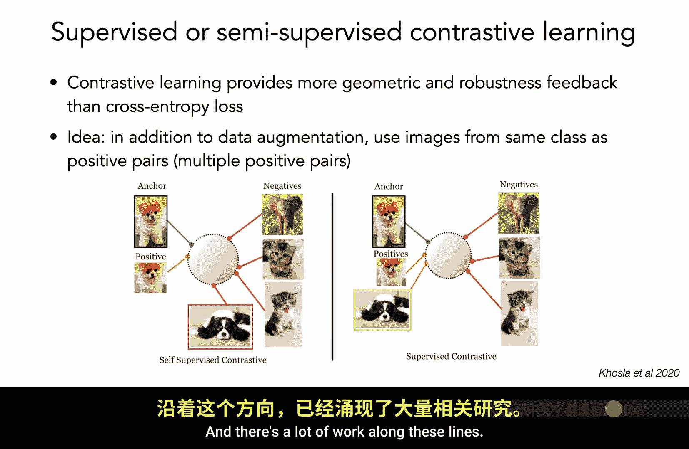

Cool， so。Representation learning， using similarity seems to be really powerful。

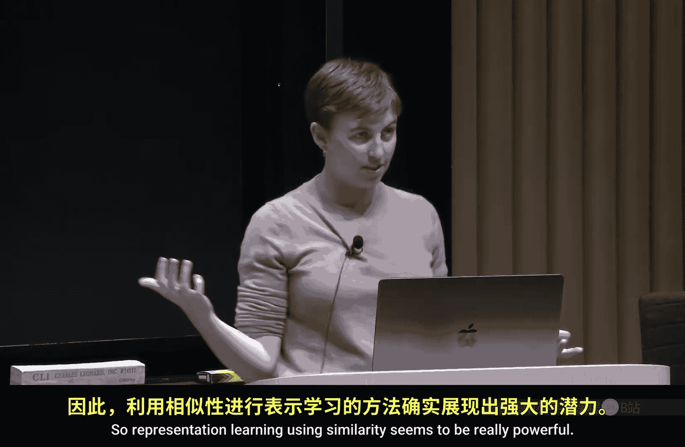

So just to finish up the class， I want to do a bit of a case study with one particular data。

 this is the inaturalist 2021 data set。 it has images of species， so 10。

000 different species of plants， animals and wildlife， insects。About 2。7 million training images。

 So it's not on the order of billions， but it's pretty big。

 About 50000 validation images and 500000 test images。

And the interesting thing about this data set is it has pretty explicit structure， right。

 It's species。 So you can look at the taxonomic tree over the set of categories。😊，And here。

 if you sort of start at the middle。This is high order branching in terms of the taxonomic tree。

So it's very coargraed。 This would be something like the difference between animalomaia and planti。

 right， These are animals versus plants。 They're very， very different。

 And this difference is very coargraed。AndThen as you move closer to the edge。

 you would get things that are increasingly more and more similar， right。

 So different gene different species within the same genera are going to probably be quite visually similar。

 though， of course， there are some exceptions from things like mimicry。So， you know。

 at the very fine edge， that's where you get things like the two mosths I keep showing。

These are different species， but from the same genus。

And so you can kind of unroll this level of granularity that's kind of we've got this proxy for the level of visual granularity in the classes coming from the taxonomic tree。

 So you can kind of roll this out on a graph and say， okay， kingdom is very coarsegrained。

 going down to species is very fine grained。😊，So one of the things that's quite interesting。

Is if we look at a supervised model versus SCLR or moco。

 these sort of two different approaches for for self-supervised contrastive learning。

 and we look at accuracy now using a linear probe So that means basically taking a representation space and then just learning a linear projection。

 that's going to actually be our categorizer， and we'll actually learn that linear projection with supervision。

Then we can look at the accuracy across these different granularities。And so this black line up top。

 thats supervised training from scratch。 We're not like starting with Inet or anything。

 It's just all of this is only trained on this data。And then at the bottom。

 we see what we get from self supervised learning again with that linear probe on the entire data set。

 So on the whole training data set with the linear probe。

And what we do is we train both the supervised and the self-supervised， you know。

 then the linear probe for the self-supervised representation on the finest level。

 So on the species level。 And then instead of sort of explicitly training them for these higher order levels。

 we just roll them up。 So you would say， okay， we're gonna predict the species level。

 Now you just aggregate all of your category predictions up a level based on that graph on that sort of taxonomic tree。

 you use that as your prediction for the next level and kind of etc。😊。

So we're basically training on the finest level， But then we're evaluating our ability to categorize at coursesar and coair levels。

And it turns out that if you look at this type of data。

 you can really see that there's at those fine grained levels， there's really not a small difference。

 right， There's about a 30% gap between supervised and self-upvised training on aaturalist。

 And if you do this same experiment on Inet。The gap is much， much smaller。 It's more like 7%， right。

 And so one reason for that is this， right， Iagenet is a very coarsegrained data set。

 The categories are not very similar to each other。 And you see the same performance。

 So the same sort of trend here， right， The gap is very small when you look at these very coarse groupings。

 class phome or kingdom。 But then the gap actually grows as the evaluation is made more fine grained。

😊，And so， this。Kind of interestingly， interestingly captures some of those dimensions that we were talking about in terms of the ways that we have chosen our data augmentations。

 the sort of pairs that we give the model or don't give the model and the effect that might have， so。

First， if we look at this and we actually try to probe these representations that are learned using this this kind of query approach or this retrieval approach。

 and we say， okay， we're going to start with this image。Now， if we take our supervised model。

And we find the nearest neighbors in sort of the entire data set。It turns out this is。

 this is a hard problem， right。And so there are a few examples outlined in blue。

 where we do actually get nearest neighbors that are the same species。

But then we also get a lot of nearest neighbors that are different species， right。

 So even with supervision， this， this problem can be quite difficult。

 And it turns out that as you aggregate up the category set。No， these are not all the same species。

 but they are in the same sort of genus or family。But now。

 if you take the same sort of Sim CL R representation and you do this the same thing。

 you use the same image and you query into the representation space。You can see。

That none of them are the same species。What is the model learned， yeah。

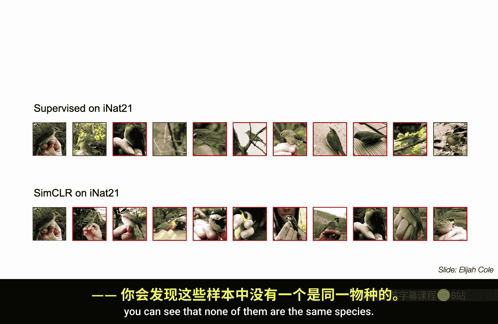

Yeah， yeah。Doctors。My are earlier the lecture。嗯哼。😊，Like supervisorvised。Other so。た。

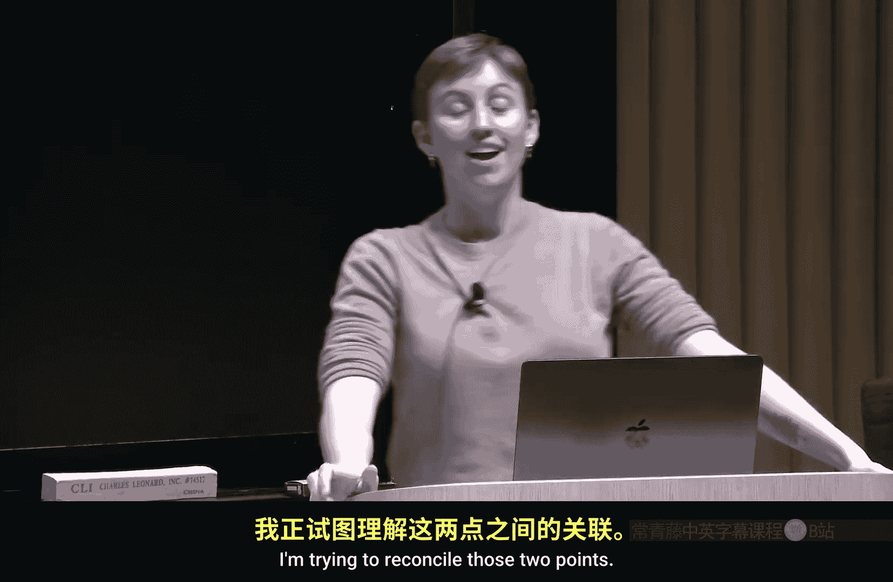

Yeah， yeah。 And actually， I think， I think this is this will actually help。 So it。

 it depends a little bit on， on the signal。 So basically， yeah， it's， it's。

 it's usually good to have this separability， but you need to have for contrastive learning to work well。

 You need to have a good similarity measure for your problem of interest。And so here。

 what I'm trying to show， actually， is that what we've learned is we've taken an image and we've augmented it in some way。

 And then we've forced those things to be close together。

 And it looks like that the types of augmentations we're doing is giving us more information about contextual similarity。

 So in this case， birds being held in human hands。 Then it is giving us information about species similarity。

 which is what we're hoping this model will be good at and what we're evaluating it on。😊。

So if you don't have a similarity measure where you're sort of choosing those positive pairs and saying these are similar and this is different。

 That's well aligned with your downstream goal， which in this case is identifying species。

 then these contrastive objectives， They're giving you uniformity。

 but they're maybe not giving you the uniformity that you want。

 or they're not giving you the sort of the similarity that you want。 Does that make sense。Yeah。

 so I think， I think the point here that I'm trying to make is that if you don't have sort of a selfsupervised signal that is capturing the thing that the task that you actually have in mind。

 then it's possible that the sort of contrastive objective really will not build a representation that is good in the context of your downstream task。

 right， Yeah， yeah， So if you did。 Yeah， if you， if we had， for example。

 if we had a supervised objective here， then you would expect it to be much closer to a supervised learning object。

And I actually think one of the things that I didn't do or， you know， this is。

 this is the work that was LED by Elijah Cole。 It would be interesting to look at taking a contrastive objective where now we're using supervised contrastive learning and see how that actually affects performance。

 though I actually wouldn't anticipate it would be so different from cross entropy loss in this case。

So I think this is interesting because it kind of points out how the benchmarks that we use really influence our idea of kind of what's good enough。

 right， because it turns out that with Inet， we're saying like wow， without any labels at all。

 we're still building representations that are very。

 very close to as good as supervised representations， But it turns out that that's again。

 contextualized on the task of interest， right If Inet our task is coursegrained and it turns out the augmentations we're building in。

They're capturing things that make it easy to separate coarse grained sort of visual characteristics。

 Maybe they're relying on the fact that at a coarsegrained level。

 like all those birds on hands would be put together。 That's fine because we just care about bird。

 We don't care about bird categories。 But as soon as you have some of these categorizations that need to be much more subtle。

 then the the augmentations would somehow need to capture that well， right。

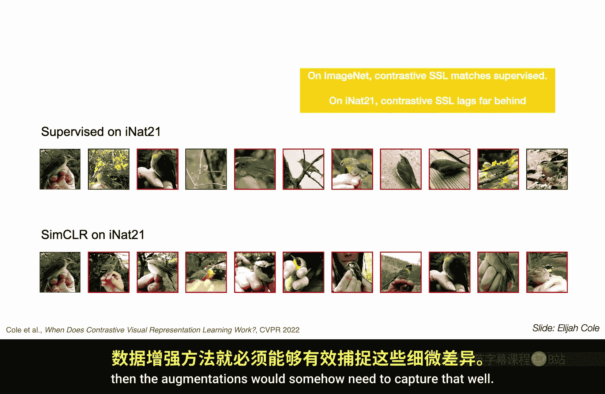

Yeah， any other questions about this。Yeah。

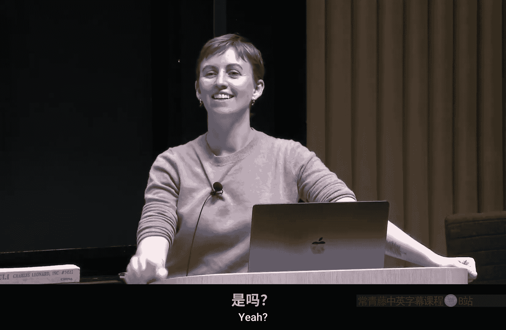

So the question was， does S CLR or does just， I mean。

 I think S CLR is just like one example of sort of a self supervised contrastive objective。

 Does that usually do bad on unseen data。So， sorry， can you try to repeat that one more time。是。

You not doing。Patients。So I'm just trying to understand。でさ。How is it that。Right， so， I mean。

 in all of these in a lot of these cases， what we're actually showing results on is test data。

 which is unseen during training。 So what we are actually showing that these things do for some things like image in particular。

 do generalize well to unseen data。 But the point you brought up about augmentations on the negative examples and it is an interesting one。

 And I think actually one of the things that is kind of funny is like if if you sort of only did augmentations on the positive samples you' ever do any augmentations on the negative samples。

 which in practice is not necessarily what people are doing。

 you can imagine that the model might learn something about staistic weirdness in terms of the input space versus not like sort of more natural statistics and start picking up on that signal。

 So that is an interesting bit of intuition you brought up。 But no， generally， I think， actually。

Because we're showing this on unseen test data， I think there is something reasonable about that。

 And we've actually found that。嗯。These types of contrastive objectives or the sort of triplet loss objectives often will generalize better。

 So the example I'm specifically going to bring up is this idea of individual reident。And almost all。

 for example， like sleb A， this you know， recognizing celebrities again。

 almost all the best methods on this type of individual identification。

 where you explicitly want to be able to say， even if it's not a category you've seen before。 So。

 for example， a human that hasn't been seen by the model。

 you want a picture of that human and another picture of that new human to be close together。

 And it turns out that these metric spaces， particularly learned through contrastive objectives。

 things like triplet loss， and then， you know， building up to more and more complex。

 contrastive objectives， those explicitly are better at that open set clustering problem in a way that actually a sort of standard。

Crossenttropy loss based on a fixed number of categories。

 there's almost nothing you can reasonably say about what will happen when you look at new categories and in practice。

 actually similarly to this， what we find is that if you use classification losses versus contrastive losses。

 the contrastive losses significantly benefit for that open set。

In terms of like making things similar， close together。嗯mh哼m。😊，I probably even not。I mean， not every。

 not everything does。 But， yes， there are， there are cases where people do augmentation planning of examples。

 Yeah， but I I think that is interesting。Any other questions。过。So， yeah， to summarize again。

We tried to capture some dimensions of what makes a representation good。 you know。

 and specifically that good representations might actually be really based on similarity and dissimilarity。

We said that we want to make sure that representations are well clustered。

 that they're compact and that they're separated。 So the classes are spread out。

We want to preserve relevant information， and we want to teach relevant invaris， right。

 We want the model to almost forget the irrelevant information where here we're explicitly defining what's irrelevant based on。

 for example， in those self-supervised objectives showing different augmentations that we want the model to be invariant to and in the supervised case。

 what we're saying is， okay， we want the model to be invariant to the things that are different about these two images of the same category。

 right， So that might， for example， be the context， the fact that the bird is being held in the hand。

 And then we can do this in a supervised or a self-supervised way。

 right we can and it all comes down to the difference between supervised and self-supervised the way that we decide what's a similar pair。

 And so we can actually build a lot of knowledge into the systems around what should be similar and what should be different based on our downstream goals。

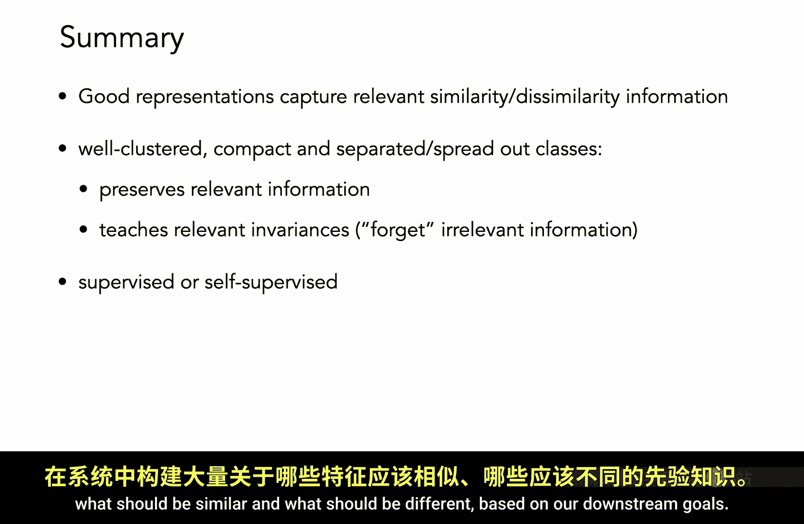

Cool， alright。 Any other questions。 If so， you can come up。 and otherwise。

 we'll see you guys next on Thursday。😊。

