# 麻省理工学院【中英⚡深度学习｜6.7960-Fall-2024,-Deep-Learning】-p13-P13-表示学习：理论--BV15QZ4B1E6v_p13-

Okay， thank you， everyone， for coming to the lecture。所。This was the example。

On do people remember this from。From the homework。You remember， that's good。Okay。

It's like a tricky one。Just wait， okay， if I， So if I just tell you the。If I write， oops。

If I say that the gradient， this is the gradient matrix。And it has。What we call the reduced S VD。

Do you remember what the， Do you remember what the answer was。呃薪水。It's easy transpose。嗯。

It something like that， but。Okay， I'll just write it or one version of the answer。This is the one。

 There's other ways to write the answer， but this is。This is like a simple way to write that， answer。

So， it's like。You can think of this conceptually as。Let's see。Taking the SVD of the gradient。

 And you can think about this as setting all the singular values to one。

And it's we call this a semi orthogonal matrix。 it's kind of。Because it's rectangular。

 It's not quite an orthogonal matrix choice。嗯。But I wanted to show you that。

 said there's someone on Twitter。Called Keller Jordan，0。Who calls himself as a speed runner。

 So it's like he wants to train the。Neural network as fast as you possibly can。

And he took like a variant of this method。嗯。And then add some tricks to it， like momentum。嗯。

 it's like makes it low precision。And then， in order to compute。It's like。

 it's not really obvious how to compute this thing without doing an S VD。

 And you don't really want to do an SD when you're training on neural own network because it's kind of slow。

嗯。So he uses this iteration。So it's a way to compute。This， this term。Without actually doing a speed。

 it's just kind of an iterative method to compute that thing。And it's， it's， it's not it。

 it throws away this learning rope。 Basically， it's a slight variant。But it， but it， this is the。

 basically， this is the result he's got。See this blue curve is like， is something called L M dot C。

 which is like。There's like Andre Kopathy has like a very fasty implementation of training transformer。

嗯。Which is supposed to be like the fastest way to train a transform。

 But this guy talent can train it in like a fraction of the time。

Using this like special spectral gradient descent method。

 So the full disclosure is like kind of collaborating with ca。

 So you take take everything with a grain of salt。 But it it's like seems to be actually much faster to use this method。

 And this all happened in the last like couple of weeks。 So actually after we wrote the homework。

 So just to say， like， we're trying to teach you some things that。😊，Well。

 potentially like matter in practice。Which is kind of。 But it basically， anyway。

 the thing that we wanted to say is if anyone wants to like， look at this for。Final project。

 Its kind of like a interesting problem of using thinking about the math of optimization to actually make the optimization too faster。

嗯。Anyway， that was just to tell you about that。 That's not the main point of this lecture。

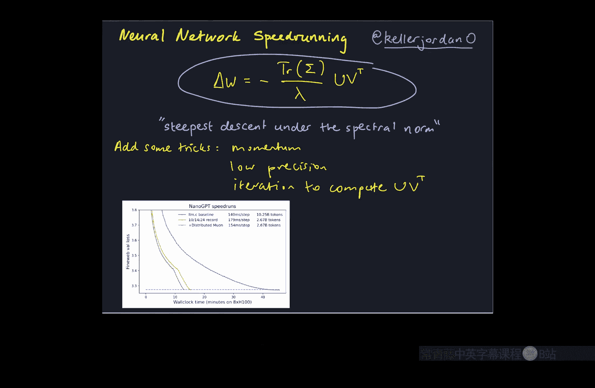

嗯。岁。

Last time。I think that you were learning about。Some aspects of representation learning。

And that was this idea of。Developing techniques， contrastive learning techniques that。

Where you try to learn embeddings of your data， and you specifically want to like， take。Basically。

 similar。Similar data points。And map them to like， nearby embeddings。

And then you want to take a data point from like a very different class and。

Map it to an embedding that's far away。And we call these contrastive learning algorithms。

And they are good ways to learn representations， oftentimes。Well。嗯。It's a good。

 It's a good sometimes you think of them as somehow unsupervised way to learn representations。

 But that anyway， that was last lecture。嗯。And then I also wanted to remind you。

That in like one of the even earlier lectures， we were thinking about kind of different perspectives on thinking about what's happening inside an neural network。

And there was the idea of kind of neural perspective thinking about tenses and then thinking about spectral properties of。

Of tenss。So this is just recapping some different things。But in this lecture。嗯。

Not really using that and using just thinking more abstractly as a neural network as being a map between。

From you know， a sequence of vector spaces。 So every layer of the neural network is。

 you can think of it as a vector space。嗯。And， you know， like，1。

1 possible goal of doing deep learning is to learn like a really good representation of your。

Data points。 And I'm just visualizing that here。嗯。As the idea of， you know， first of all。

 the input space， maybe all the different data points of unrelated things are kind of all。

Mixed up together and not really separated or disentangle。

 And then when we do deeper anyway we're kind of hoping that as we as we move through the network。

 we kind of get to the， the representation at the end。

 where like the data points from different class or like semantically different data points are kind of separated from each other。

 And like that's that's， you know， then we did a good job。嗯。So that's what this is saying。

 that we want a， a representation of our data， which is perhaps linearly separable at the end of the network。

 That would be nice。嗯。So what I want to talk about in this lecture is the idea that。You。

 when you pick what your neural network architecture is， it sort of already has an opinion about。

Which data points are similar to each other and which ones are dissimilar。

 even without doing contrast learning。So I want to just introduce some tools for thinking about this。

嗯。And that's， that's all this is saying， is that。The neural architecture kind of already expresses some kind of opinion about how similar two data points are。

 even before you train it。And think about some tools to capture that idea。Okay， by the way， asva。

 please just interrupt me if you have questions。啊。Okay。Si。This the idea here is like。

 I just give you some。で一次。And like， I just want you to think about， like， just from first principles。

 ignoring everything you've ever in machine learning about how。

How you would actually fit it if you wanted to fit a model to this data。Does anyone have ideas。

We did like a lion and then the lion coachch down。So I could， I could somehow just interpolate。

 maybe。我。That what kind of do you are。Yeah， that's one idea is just。Linear interpolation。嗯。And。

That's， yeah。That's yeah， I， I feel like， yeah， go ahead。Polynomial intopoli。

 which is like maybe harder to draw， but maybe I could fit some kind of like quadratic to this。

Potentially。嗯。It's fun just like， you can just， if you just think about this。

 you can invent a lot of different like function classes and just think about what it would mean to do。

Machine learning with different function classes。 And it's like。

It's kind of like a big jump to get to doing your own networks。

 If you just think about things from scratch， but that's kind of。Where we are。嗯。But a lot of。

 so basically， there are a lot of classic approaches to。Doing machine learning。

 what people did just invent their favorite function class and say， hey。

 we're just gonna do machine learning with this function class。So， a really classic example。

It's called kernel methods。 And it actually， it's quite related to what we talked about in the approximation theory lecture。

 which was maybe lecture 2。But kernel method says we're gonna take a a kernel， which is basically。

 you could also think of it as a bump function。And it's， you know。

 it could just look like a little Gaussian or like a little couldvy。And。I'm gonna to place。

1 kernel on the， on the location of each。Input， if this makes sense。So if I've got four inputs。

 I'll put 4。Little bump functions。 And intuitively， like。

 if I've got four data points and I have four bump functions。

 then have enough degrees of freedom to fit the data。 So that seems to make sense。 And then。

And then I'm just gonna re rescale them with scalar， with scalar coefficients just so that they。An。

Just so that they interpote the data。 So it's like fourb functions，4 scalar coefficients。

4 data points， everything checks out。嗯。And I， I， I wrote that down。H。So I， I construct my function。

 F of x。By summing over， if I've got N data points， I need to sum over N bump functions。

And I denote each。Bunk function using this， this notation K。So the way that understand it， okay。

 and then there's also a scalar alpha， which allows me to reweight the heights of the different bumps。

 And then， you know， if， if I have n bumps and end data points， I can definitely fit my data。

 So it's kind of a natural way to just to explain a little bit about。What K of X and X I means。

Roughly。If。Looking at this。This would be， like， K of。X comma 0。

And then you should think about this X I as like allowing me to translate this bump along the X axises to like。

Be centered on that I data point。Okay， and that's just。That's just what this bit says。

 And then I can define a function space。 Let's call it big F to be the set of functions， F。

That can sort of be decomposed in that form。嗯。And， and if I that。

If I let the number of bump functions actually go to infinity， So I consider like。

Or not all possible locations of where I put the bumps。

 And then I actually allow myself to have infinite bumps。Then this is， this is what is known as。

They call this function space a reproducing kernel Hilbert space。嗯。And this was like all the rage。

 like before deep learning or like before the recent or like， let's say the last。13 years of。

 of deep learning。 It was like before that， everyone was doing kernel methods。

 and they were like considering spaces of functions like this。

 And instead of choosing your neural architecture， the whole thing was like， you pick。

 pick a good kernel function。 You choose a good kernel or a good bump function that somehow captures the structure and your data。

 and like all the machine learning， sorry， slight exaggeration。

 But it was like kind of like it was the there were a lot of machine learning papers focused on kernel methods。

😊。

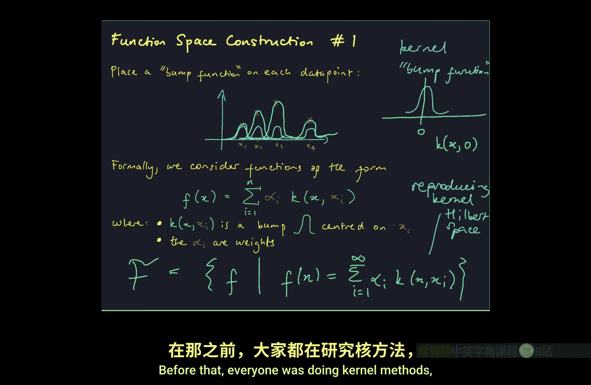

H。So， that's just the little。Introuctions to kernel on methods。And if you just think about it。

 it's like not so obvious why we don't still use like， why do we use neural networks， Why don't we。

 you know， why don't we。Go back to kernel methods。 It's like you kind of need to think about it。

 which it may not be obvious。嗯。

There's a second way， like second kind of classic way of， of constructing。

F spaces or doing machine learning。嗯。Where you actually， this time， you think about。Sort of sampling。

Sampling random functions。 So you come up with a。You come up with some way of just sampling random functions。

 We would call this like some kind of stochastic process。 And you just imagine。

 imagine just you just keep sampling， sampling random functions from your。

 from your stochastic process and you sort of throw away。 if it doesn't fit the data。

 you just throw it away。 But if it fit the data， you actually keep it。 And you sort。

 you're gonna somehow end up with this。Distribution of functions that actually goes through your。嗯。

Goes through your training data。 So you， that's not actually。 if you actually use this method。

 you wouldn't actually do that procedure of sampling lots of functions。

 You would actually do do something called conditioning the distribution of functions on the training data and getting the。

What we would call the posterior distribution of functions。嗯。But intuitively。

 this is what's going on with this technique。嗯。And there's a special way to make this computationally tractable。

 And it basically amounts to making the way that you generate the functions kind of like a Gaussian thing。

 And then this thing will become all the computations that you need to do to do this procedure become。

Straightfor。嗯。Yeah， I remember correctly， I think the optimal thing is roughly like a kernel method itself。

How similar are they。Yeah， that's a really good question。I have a slide。 Sa， let me。But so， yeah。

 there's a big， there's actually， it turns out， as it happens that there's a like a close connection between this procedure and the thing on the previous slide with all the bump functions。

 And like， that's kind of interesting。😊，嗯。Yes。And the， yeah， roughly， it's like if， if you do。

 if you take， if we， we've not discussed yet， how to sample these random functions。

 But we're gonna discuss it， but。Let's just say that we've discussed it already。

 And the point is that if you， if you sample all of these random functions that are consistent with the data and then compute the mean of that distribution。

 you get a single kind of quite smooth function， which is the mean of that distribution over a consistent functions。

 And that's， that turns out to be equivalent to。An。

Colonnal interpolaver of minimum kernel norm in some， for some definition of the R KH S normm。

So there is a， yeah， there's a really close connection。 But like， I， that should not make sense to。

 to everyone because。Haven't defined any of those things。嗯。Okay。But this is just， oh， oh yeah。 Okay。

 here was the slide。所。The kind of， there's， there's three ways now that we're gonna think about。嗯。

Function spaces。 So， first of all， this one is the one we just talked about where you sort of think about。

 you sample lots of random functions， and then you throw away all the ones that don't fit the data and you just keep the ones that fit the data。

 And， and this will be something called the Gaussian process。

Clonnal methods are the ones with the bump functions where we like pick our favorite little bump and kind of arrange them to fit the data。

And then neural networks say what， the， what the class is mainly about。And there's the cool thing。

 the， the really interesting thing is that there's all these correspondences like there's。

 there's sort of a way to get a kernel method from a Gaussian process。 There's kind of a way to get。

😊，Gausian process that that both that related to each other。 And the relation somehow goes both ways。

 That's what I want to say。But interestingly， there's a way to get a Gaussian process from。

And neuraln that work。And it it holds， well。There's， there's actually maybe a couple ways to do it。

 But the one that we're gonna think about。Is as a correspondence。

Where a neural network in a particular limit is equivalent to Gaussian process。

 And it's basically when the network is infinitely wide。

So you take the width of all the hidden layers and you make them infinitely wire。

 And then you sample， you randomly sample the weights。So you， you could think about that as like。

 you repeatedly， you just keep reinitializing your network and it keeps giving you random functions。

 If the network is infinitely wide， it turns out that this distribution is equivalent to something called a Gaussian process。

嗯。So like these connections， if you wantan to like understand more theoretically about deep learning。

 it's like interesting to explore these connections because you can sort of relate neural networks to these classical machine learning methods that people really cared a lot about。

😊，嗯。Then you can ask things like how useful these correspondences of do the correspondences actually amount to things which happen in practice。

 And that's something else you've got to think about。

 But I'm just gonna tell you a little bit about one of the correspondences。

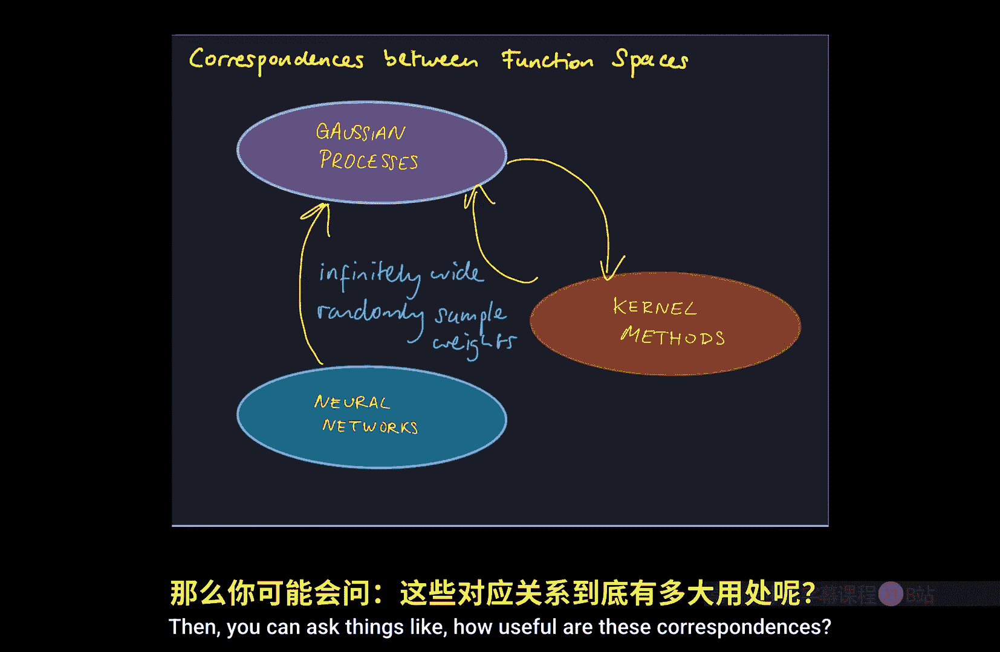

These are all like equally expressive， right， or is there some sense in which one is more expressive？

It's a good question。 So， oh， the question was， is there a sense in which one is more expressive than the other or all the different function spaces equally expressive。

 I think they may just be different in some sense。 Like there are。

 you can look up and you'll find some literature that discusses this。 And it's things like。

The smoothness properties of the functions in the different function spaces may just be different。

 Like the kernel thing， because it's built out of the functions。

 even though there's an infinite number of them， they may still be kind of reasonably smooth functions。

 But I think for a Gaussian process， depending on the clearvari structure。

 you can have really like horrendous functions。 But interestingly， with that said。

 like if you take the mean of the posterior of the Gaussian process。

 it's actually a nice smooth function。 So it's like kind of just different。

 I don't know which one is more expressive。 it's an interesting thing to think about。😊，Okay。

Let's see what Okay， so now I'm gonna introduce slightly more formally what a Gaussian process actually is。

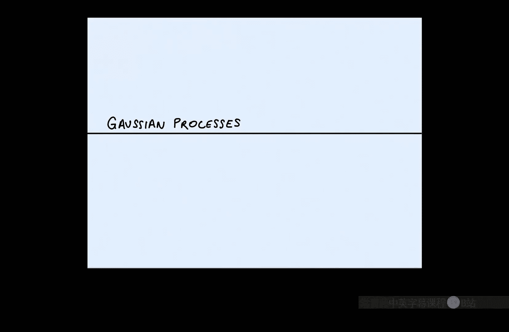

嗯。So this is just a recap of what we just talked about， but basically。If we have some data。

We can think about， you know， sampling lots of lots of random functions that are the ones that are kind of consistent with the data。

 and we can get this， this distribution。 And just notice that all the functions are going through the。

 through the data， but theyre， they're kind of random away from the data。嗯。And then， you know。

 given that random function， you can ask， you know， a couple of questions。 like one is。

 what does the mean look like， And it's sort of reasonable that the mean might be a lot smoother than。

Then all the random squiggly functions。And then you could ask。

 what is the standard deviation around the mean。And it's sort of reasonable that it should kind of grow。

As you， as you， as you move away from the data and then shrink to 0。On the data。 So that。

 that's one way it could look。嗯。So the point of a Gaussian process is it gives you a formula。

 like just like a simple thing that you can easily code up。

 It just involves some matrices and something you algebra， but it gives you。A formula。

 both for the mean function。And the standard deviation。 in other words， given， given a out of data。

 like you've got these， these like inputs。You can pick a new point on the X axis。 You say， like。

 I really care about this point on the X axis。 There's a formula that tells you the value of the mean and。

 and like what the。What the standard deviation is at that point。

 And then you can kind of sweep that point along the X axis。 and you can。

 you can get this mean and you can get this standard deviation so you can be。

 it basically gives you a formula for drawing this picture。

 That's kind of one way to think simply about what a Gasian process is。And and basically。

 the shape of the。The shape of these standard deviations and。

 and like quite what the what this picture looks like depends upon something that we call the covariate structure of the Gaussian process。

 And that's， that's what we get to pick as like。Machine learning people using Gaussian processes as we get to pick the covariate structure。

So， that's the picture。In， informally， I think this is probably the most useful， like。

If you just want a quick takeaway， you don't want to go into all the math。 This is like。

Quite a useful understanding of what a Gaussian process is。 is just pretend that it's not a。

 You don't know what a stochastic process is。 Like most people honestly don't。

 but you do know what a random vector is。 So let's just think about random vectors。

So this is supposed to represent a vector， which I just。Turned horizontally。

 So it would fit on the page。 And imagine that I have a multivariate， normal random vector。

With some covariance matrix and some mean， which is actually 0。

Then I could plot like each coordinate of this random。 You know。

 I get one sample of this random vector， and I just plot it on an axis。 So I just plot each。嗯。

Each entry， say like this one corresponds to this one。 This one corresponds to this。 Okay。

 and I could do that。 And then I could just kind of connect the dots。And I could call this。

Somehow it somehow building a function from a random vector just by kind of that's wrong。

 just by connecting the dots。 So I could do that if I wanted to。 then I could say that's kind of。

 in this picture， it's not that great because neighbouring you know。

 neighbouring points on the X axis。 or like。Not correlated with each other。 And usually。

 if I have like a nice function， I want nearby points to be like similar to each other。

 So then you say， okay， hey， I'm just gonna choose a covariance matrix with a special structure。

So that the covariance of nearby， like neighboring entries in the vector is very。

The the that very correlated with each other。 So I just picked the covariance such that neighboring entries in my vector were very correlated。

 Obviously， if I permuted all the entries in the vector， it would break that。

 but I'm not gonna do that。 So I'm basically gonna pick a covariant structure。

 such that neighboring entries are related。 And then I would get a picture more like this where。嗯。

When I connect the dots， the function。嗯。You know， it looks like more like a kind of nice function that I like。

And then basically， a Gaussian process is exactly this construction。 But then you lap the number of。

Kin of grid cells in your vector。 You let the dimension of your vector go to infinity。

 and you basically pack。You pack these。These sample points more and more closely together。

 if that makes sense。 And， and then it's like more。

Does it kind does the construction kind of make sense。Just saying， like， if you have a random vector。

 you can plot， you can plot its coordinates and then。

You can let the number of coordinates go to infinity， and it will just。Kind of limit to a。A smooth。

 like a something that's more like a continuous function or than。Does that。

 does it make sense what I'm， I've not really like proved anything here。

 I've just like given you an intuitive description。嗯。Okay， so that's， I think that like。

 if you forget everything else from the lecture， that's basically sort of what a Gaussian process is。

So now I wantan to give you the formal definition。So now we say that we have some input space X。

 which was like our， that was like our X axis and the。In， in the previous。slide。And then for every。

 for every point。In this input space。So kind of fit infinitely many points。

We let F of x be a random variable。嗯。So you kind of think about， you。

 you think about the function as indexed by its argument X as being like the continuous generalization of a。

Of a， a random vector， where。X is the kind of index about which coordinate you are on on the vector。

 but。That's just an informal thought。嗯。And then what we say is that。

Because it's difficult to think about infinite dimensional objects。 We say that if。

 if we choose a finite number of input points。And inspect what the random object F looks like on any。

 on any finite set of inputs。 So on any， on any collection of inputs， X1 to X N， where N is finite。

We can， we can consider that to be a random vector。 like legitimately。

 it is a random vector because were， we're inspecting the function on a finite set of inputs。And if。

 if this random vector is Gaussian。For any finite collection of inputs。

 then we would say that F is a Gaussian process。 So this is like the formal definition of the。

The Gaussian process。 is's kind of like an infinite dimensional object。 where if you like。

 take any finite inspection of that object， it's a Gaussian vector。

Which is somehow related to what we were talking about on the previous slide。

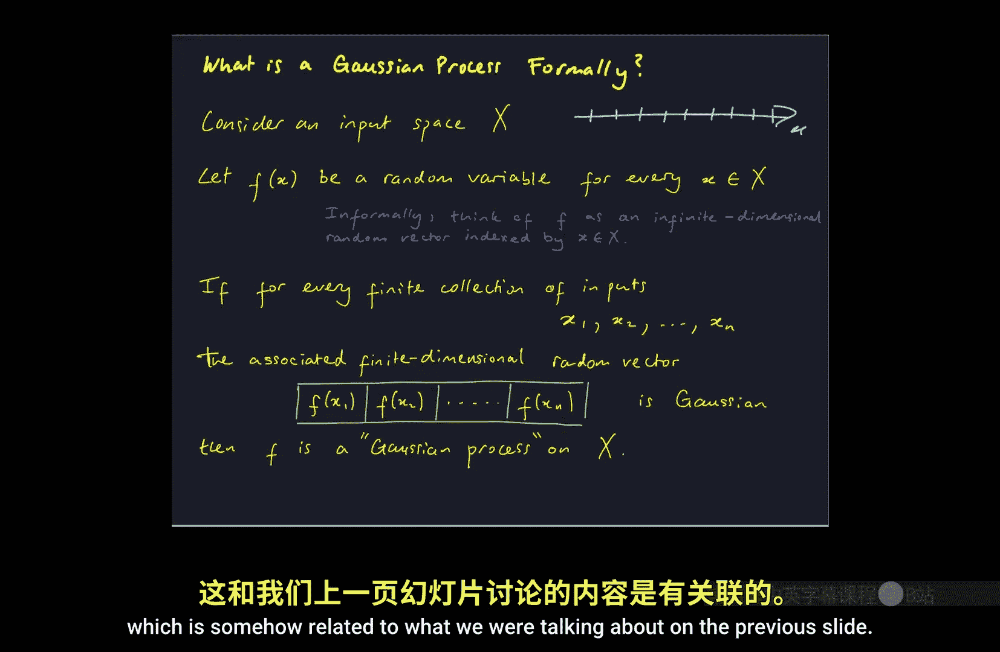

嗯。i。Yeah， okay yeah。 go ahead。It it's more like a analytical。 like when we use this tool。

 it's more like you produce something which analytically， like， you know。

 it satisfies this definition。 It's not。 you， you're very rarely in a situation where you would want to like。

Check test empirically。If， if it's Gaussian， so。That would， you would have to verify it。Analytically。

 most， most。Most cases， and I， I'm blanking on how exactly you would do that， but there are。

There are ways to do that。In find。Yes， so if you're going to use Gaussian processes。

 you will build something which satisfies this definition。And it's not。

 the thing is what's difficult about this definition is it's not obvious that anything should satisfy this definition。

 And like， there's a theorem that most people who use Gaussian processes don't， don't know the the。

 But I think there's some kind of it's called like commmoography of extension of theorem or something like this。

 And it's like there's a area of math， which is about like proving that these things exist。

But it turns out you actually don't need to know that area of math to actually use this stuff。さす。

galaxyus。I of see like。嗯。Sampling from a Gaussian。Yes。

like the simplest Gaussian vector is like a I I D， Gaussian vector where the con it's a I I D。

 And then just for each coordinate you sample a different Gaussian。

 And that they're not related to each other。 That's like a simple one。

 And then a general one is defined with respect to covariates matrix。😊，Ands。Yeah， I it's。

 I probably wouldn' gonna butcher any explanation I give now， but like， I， I would just， yeah。

 go in Wikipedia after the class。I can。It another way to think about a general multivari Gaussian is to like do the II D coordinates and then rotate the space。

 And like， it turns out that's equivalent I'm pretty sure that's basically equivalent multi to the general one with rescaling the coordinates as well。

Yeah。

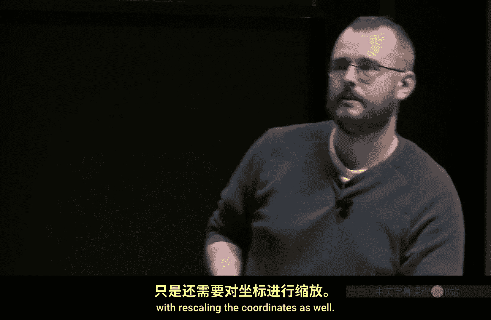

This is just a fall for this， but the dimensionality。

W that calciumussian lives would be the number of data。我。Yeah， but for this definition in。

 in this case。Yeah， that would be if I had a finite thing。 But this。

 this has this definition is for any collection of N， for any N。So it。

 it has to hold for all possible collections of inputs。 It's。

 it's just like quite a technical definition。嗯。Is it， sorry， is it， is it clear or。

Yeah， I guess I was just initially when I first saw thoughted I， I just imagine the。

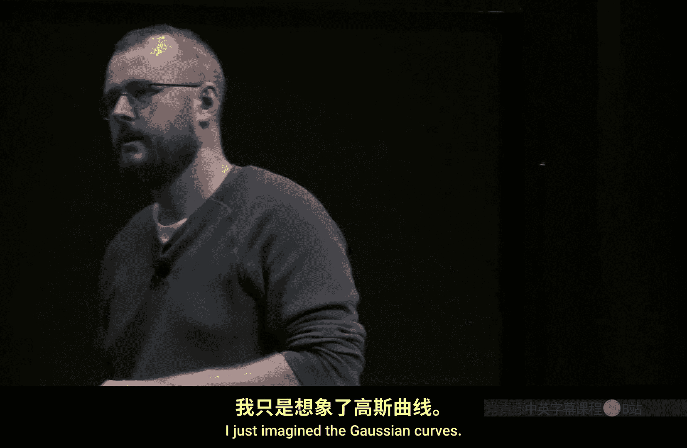

应该。现在还打你。だりま最。I understand that。Yeah， it's like conditions on having a set of inputs。

Yeah like a neural network。Some data。That's Gaussian in the Sun sky。Like the functions that is。

 I guess， applying on the be points in the dimension at like spaces。M。こ like。It's larger discount。

I guess I'm just trying to re thesism and let's been neural on that。Yeah。Okay。Thank you。I have a。

 I have a concrete example。 So I think I'm just not sure how。

 how much further into the lecture it is going be。

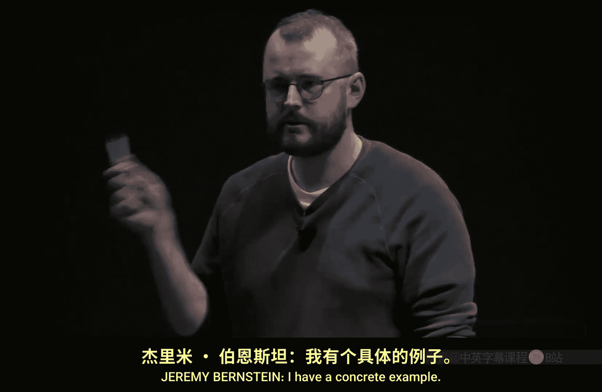

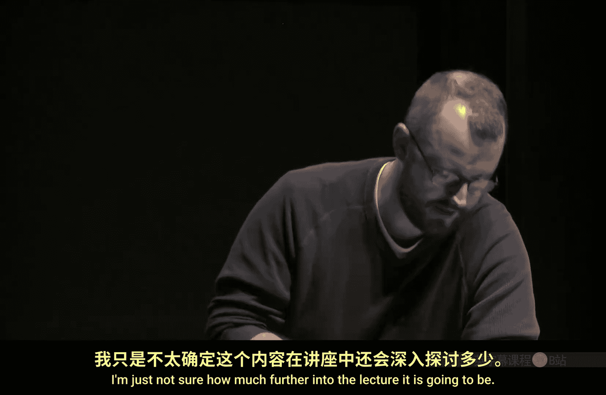

But I， I think it's gonna resolve this question。 So let me just like pllow on， but keep the question。

On。But there's， but I just have like a few more high level things to say。 And then I think， oh， yeah。

 I have a picture as well。 So okay， let， let me just go。 I think it's gonna。

 I think I'm gonna resolve your question。

嗯。So I should have defined what a standard multivariate Gaussier is。 And that's kind of， yeah。

 I'll add that for next time。But so a Gaussian process。

 this is just to say that a Gaussian process is the thing that generalizes a finite dimensional Gaussian vector to somehow an an infinite dimensional。

Random function。And if， if， if a Gaussian random vector is described by a covariates matrix。Well。

 actually， this thing that we call。The Gaussian process is going be described by something that we call the covariance function。

Which tells us。At at two different inputs。What is the covariance between the function of those inputs？

 So that's how the covariance matrix gets generalized。嗯。An， an example of a。You know， if in the F。

 if in the finite case。The covaris was， like。E to the I minus J squared。Then， then here the。

 in the continuous case， it would be something like E to the X。mininus x prime。Squared。

 so that's how that would kind of generalize。嗯。So， this is。This is， hopefully。

 this slide will help build some more intuition for what we're talking about。 Oh， yeah。

 go ahead verify dimension function just function accepts。

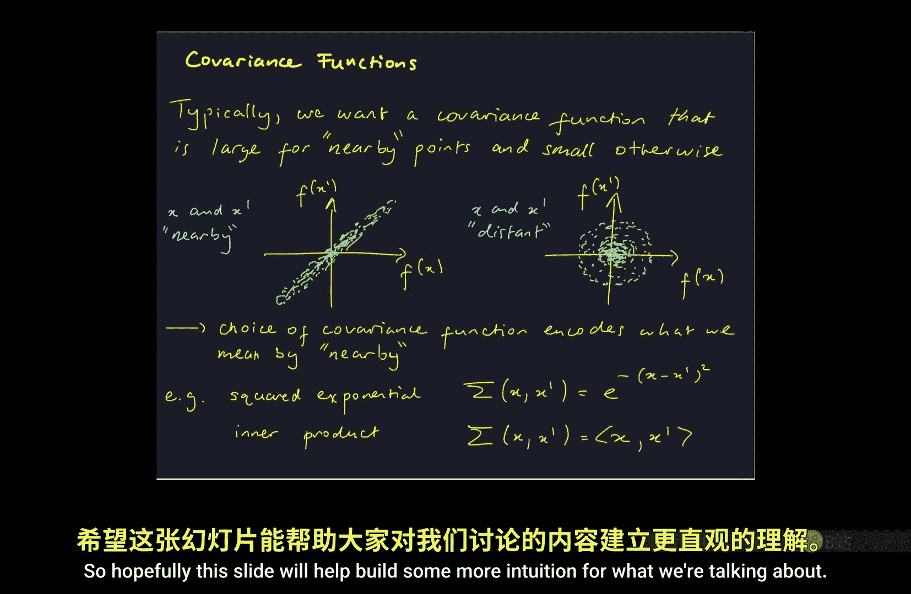

Exactly。Exactly。

嗯。So let me just say again that， yeah， exactly that we have a。Think about。

We've got the X axis or the real line is our input space。

 So there's an infinite number of things on it。 And here we're gonna consider two，2 examples。

 X very close to X prime。Which is this picture。And， basically。We're going to choose the。

Covariance function almost always in our Gaussian process， such that if I。

If I sample the random functions and I plot a scatter plot of。 So I， you know。

 I sample one random function， and I get this point the F of x and F of x prime。

 And then I sample a different random function。 and I get this point， and I sample a different one。😊。

But because， because we're imagining the X and X parameter close together。

The scatter plot that I get is highly correlated。And as X and X prime get closer and closer together。

 it， it should sort of concentrate on a very on， on the samples being the same。But then as I like。

 move the point X prime further away。 like now I move X prime over here。 So。

 so x and X prime are kind of far apart。The function values that I get from sampling the functions are now kind of uncorrelated with each other。

If it's a Gaussian process with a， with a covari with this kind of covariant structure。

 which is usually what you have。嗯。And basically， the。

 it's the choice of what we call the covariance function that actually encodes what we mean by。

 by nearby。And for different choices of covariance function， that could mean something else。

And just to give you some common examples of covariance functions， one would be to take。

E to the negative， the square distance between the in the two inputs。 if we have a multivariate case。

 it could be to take like some kind of dot product between the inputs。 Like it's basically the。

 the covariance structure is like some kind of measure of similarity between the inputs。

 And we sort of use that to induce like。What the， what the correlation structure looks like between different inputs。

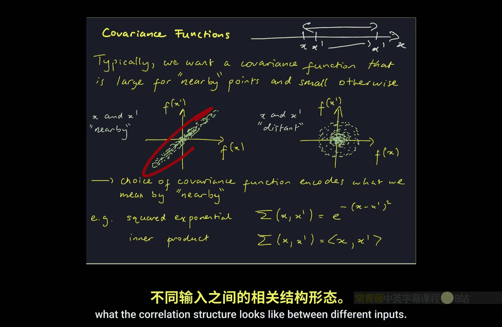

嗯。Yeah， to ahead work。I guess the words are not。経い。No， we have to。That's right。Yes， interestingly。

 that the covariance function。Yeah， yeah， if， if you have discrete inputs， look。Like。

There there are ways to define covariance functions， even on weird spaces。

 like the inputs don't have to be like the real line。

 Like the inputs to the covariates function can be。You know， any inputs that。So like。

 you can extend this construction to like kind of weird input spaces。

 That was one of the reasons people really like kernel methods as well， because they。

 they have that same property that， you know， like the in some sense， a downside of neural nets is。

Usually。You know it， it's not obvious how to apply it to language。 Let's say， Okay。

 we came up with a way to do it。 We just， you know。

 embed all the inputs and then learn the embeddings。 But like。

 it wasn't obvious that that was gonna work before people showed that it worked。

 So people came up with alternatives。 And like， this is compatible with。You know。

 different input spaces， basically。But I guess like if we were to say that， I don't know an LM。较笑。

It would mean that whatever the solutions it finds。Both the Gasian process。Some manys。

 and then it's also like。rightな。Find the solution。嗯， because。Yeah。

 so let me I kind of haven't got to what I precisely mean when I say that we can think of neural networks as galaxy processes。

 So I think let's wait to get there and then discuss this a bit more。

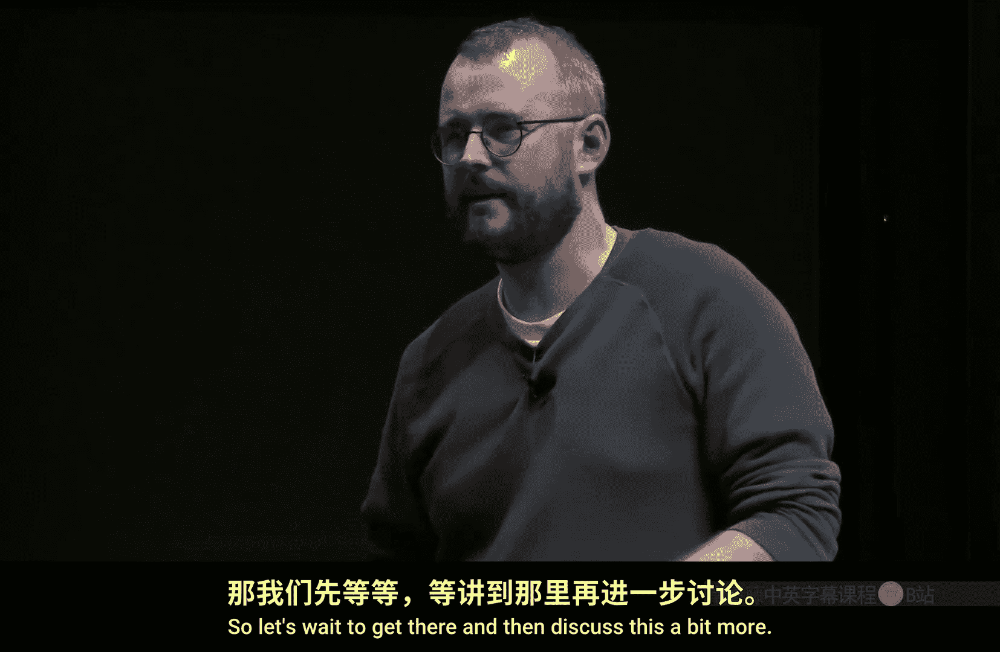

Okay。

所。I think， okay， maybe， yeah， things， this is the last kind of like abstract slide。

 And then I'm gonna start talking about a more concrete example for it in neural own network。

 So I hope that that will。Make things a little clearer。嗯。

But the last thing that they want to talk about is how。

If you're doing a machine learning with a Gaussian process。

 like how you actually make predictions or like， some people would say like how you do inference。

 like in， in kind of machine learning。Speak， but basically， how do you。

 how do you use if you've got day training data or you've got inputs and you want to make a prediction at the point that you haven't seen。

 How do you actually do that。嗯。And， and roughly， the idea is that if， if you're given。

Inputs x 1 to X N。 And you know， the function values F of X1 up to F of X N。 So that's like your。

 your input data is the inputs and the function values。We want to predict F of X star。

 where X star is like a new test point， a new test input。 That's what we want to predict。

You just think about stacking these。嗯。Stacking all of the things， like all of the things you know。

And the thing that you don't know。Into one big vector。Because it's a Gaussian process。

 we know that the joint distribution of this quantity。Is。

Gausian because that's like the definition of a Gaussian process for any collection of inputs。

 including like， you know， that includes the n inputs that I was given and the one I want to predict on。

 we know that the joint distribution of those things is is a multivariate Gaussian just by the definition of the Gaussian process。

 And then you can say that， hey， if I have a multivariate Gaussian vector。

 And I know it distribution。 one of the standard things that that tells you how to do is given the first n coordinates。

 what is the conditional distribution of the last coordinate。

 So that's like a standard manipulation that you can do with Gaussian vectors is just what is the conditional distribution of the last coordinate on。

 on all the previous ones。So there's just like a formula for that。 It's just called like。

Conditioning with Gaussian vectors or something like that。 And that， that is precisely the formula。

That gives you this kind of picture， because basically。

 you take this point X star and you sweep it along this X axis。And the formula tells you both， oops。

Both what the， what the， what the mean， the， the the mean of this coordinate is conditioned on these ones。

 And it also tells you what the standard deviation is。 And interestingly。

 like it's because Gaussians are so well behaved， the conditional distribution of the last coordinate conditioned on all the early ones is itself a Gaussian distribution。

 So like。Yeah， if you， if you take a Gaussian bacteria and you sort of。

Condition on the first N coordinate， the distribution of the latter one is Gaussian。嗯。

So in particular， there's just a formula for this mean and there's a formula for this standard deviation。

 And that is like a close form expression just involving like evaluating the covariance matrix。

 basically on， on the input pose。So I sort of realized I'm not really telling you explicitly what these formula are。

 but there are things that you can just look at。 And I honestly think like if you haven't seen this before。

 it's maybe easier just to have the intuitive explanation。 And you can just like。

 look look at what the formula are if you're interested。嗯。Si。

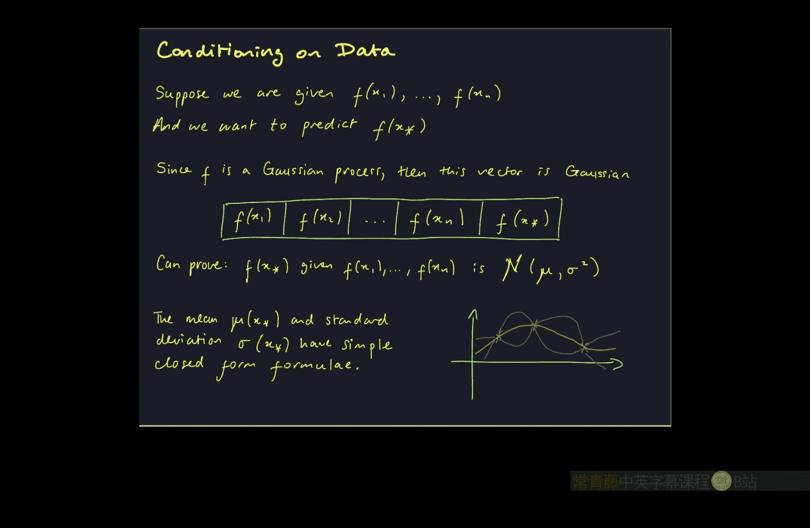

嗯。Now， I want to tell you what this has to do with neural networks。

Which was kind of the point of introducing this stuff。嗯。And。

 and there's a result called the neural network Gaussian process correspondence。

 which is like something that a lot of people have been really excited about over the years。😊。

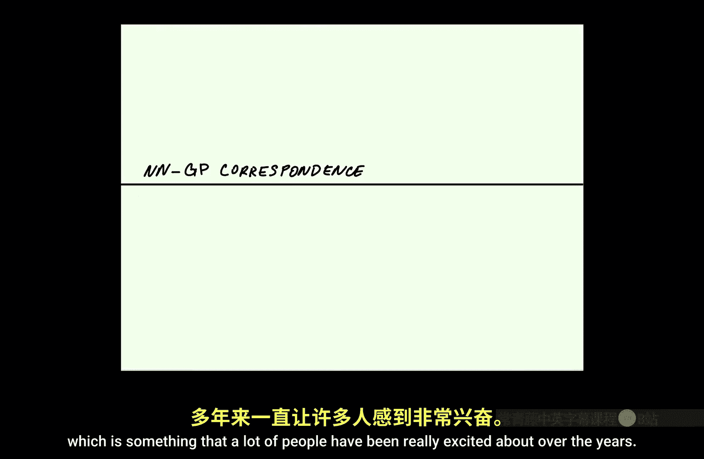

嗯。So now forget everything we just talked about and just think about a neural network。

 And we just think for， for the simpleimpst case is arguably like just multilay etc。

 So we've got weight matrices。W1， W2 W3 up to W L。And what we can do is we can just， you know。

Sample the weight matrices randomly。 and it gives me the function。

 Then neural network gives me a function。I write that function down。

 and then I resample the weight matrices， and I get a new random function。

 and I write that function down。 And I just keep sampling the weight matrices over and over again。

 And it's gonna give me a distribution over functions。 And I can ask， you know， what。

 what is that distribution， What properties does it have。嗯。Okay。So let's pretend that we did that。

And we generated like in this case，1000 random functions by sampling 1000。

Set of weights for my neuro that。So I reinitized my neural network a thousand times。

And I I wantan to inspect the functions。 So I the way I decide to do that is I'm gonna pick two inputs。

 X and x prime。And。You know， in general， it could be like X could be a picture of a cat。

 and X prime could be a picture of a dog， but it's just like 2，2 inputs。 And I fix them。And then。

 I get my。嗯。I get my thousand functions。F， F 1 up to F 1000。And for those two inputs， I just。嗯。

kind of stack the outputs of the network。 So let's just imagine that the output is one dimensional of a simplicity。

 And I just build a。A2 by 1000 matrix。嗯。Of all the outputs of my random networks。

And I'm just gonna plot them on the scatter plot and just see what it looks like。Okay。

 and I actually did this， but I did it like three years ago。But I did it on， this is a。

 this is a truck that's in the Car 10 da the set。And this was a three layer MP in the width of the network。

 the hidden， the width of the hidden layer was 1000。And I did it for2。Ps of inputs。

So input 1 and input 2。 So input， first of all， And then second， I did it for input 1 and input 3。嗯。

And the interesting thing。 Oh yeah。 So what input 2 is actually just input 1。 It's the same truck。

 But like with a little bit of jitter in the pixels。

 Like I just added a little bit of noise to the pixels。 And then input 3 is it's the same truck。

 But I just added a lot more noise to the pixels just to get。😊，Just， just to show the difference。

And then。For my000 random networks。This， this， this is what the network outputs look like。In the。

 for the first pair。 And then this is what they look like for the second pair。

 So that the interesting thing is it's kind of。嗯。It kind of looks like the thing that we were talking about。

 like the Gaussian process thing， where like the two inputs， which are kind of similar to each other。

 seem to have more correlated random outputs。Whereas the two inputs that are kind of a bit less similar to each other。

 the outputs are slightly less correlated。嗯。See， now。And then， you know， this is。

 this is displaying it for pairs of inputs。 But I could， instead of having two inputs， I could。

 you know， I could make this same table but I could put like  five inputs and then sample 1000 networks and then plot that  five dimensional scatter plot。

 And then I could ask， does that thing kind of look Gaussian。 And my claim is it will because of。

 because of this neural network Gaussian process corresponds like for sufficiently wide neural network。

 these scatter plots actually are Gaussian。 And actually to， to really it's。😊。

You we would actually have to do what Zach was saying like， how do we actually know these a Gaussian。

That's a good question。 I didn't know there's like tests for Gaussianianity that if you wanted to run on this scatter plot and you could do that test。

 But I， I didn't know how to do that。 But my claim is that really they are Gaussian。

 And it's because the neural network is， is a wide network。That it has to be this case。

 It has to be the case。嗯。So what is the formal claim of the。Of the correspondence。

It's something like this that if we take a neural network and we sample its weights。

 we randomly sample the weights。Then so long as the network had was very， very， very wide。If I。

 if I pick any finite collection of inputs。F basically， for any finite collection of inputs。

The distribution of outputs is actually a multivariate Gaussian。嗯。

Which is the definition of a Gaussian process。 That was the definition。 If， if you have。

 for any finite collection of inputs， the distribution of outputs is Gaussian。

 then then it's that's satisfying the definition of being a Gaussian process。

And it also would explain these pictures。嗯。And importantly， like。

 what the covariance function is depends on， on things like what the architecture of the network is and what the non linearity is。

So that's like a。It's like an interesting result， where like。

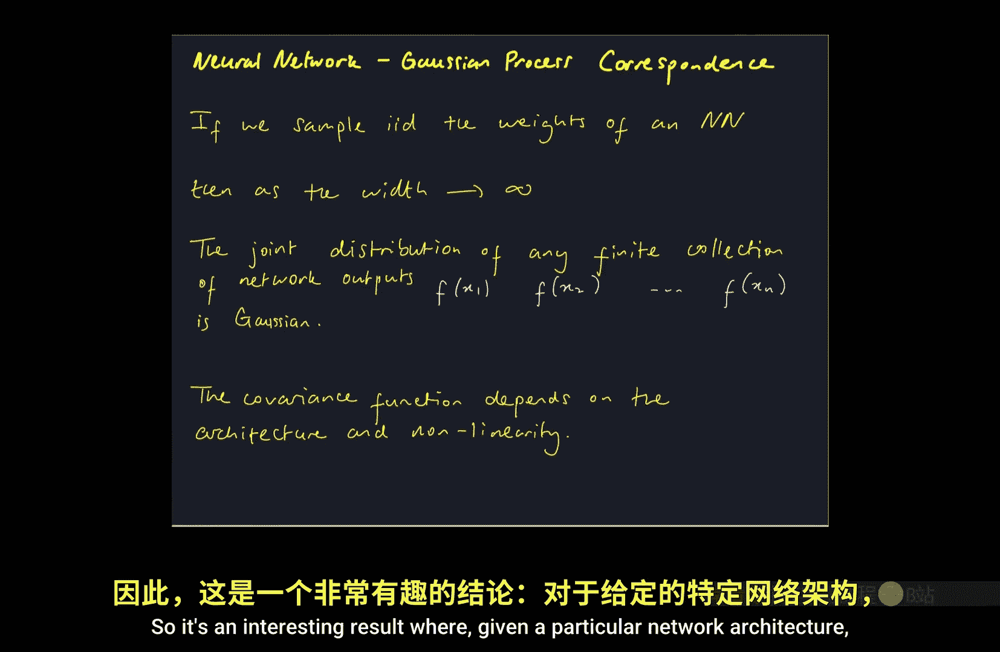

Given a particular network architecture， you can sort of expand it with。

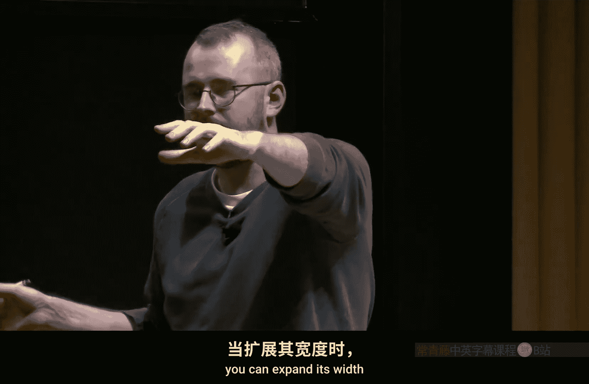

And there will be a corresponding covariance kernel or covariance function。嗯。That is。

 that is basically a a function of what the what the network architecture is。

嗯。And that's what they meant at the beginning when I said that like。

 there's actually the architecture somehow has an opinion built into the choice of architecture about what data points are similar to each other and which data points are dissimilar to each other。

 And one way to kind of extract that information is to take the architecture to be really。

 really wide。 And you kind of extract this kernel function or this covariance function。嗯。水语。ThisThis。

 this function of the form， like sigma X X prime。And maybe sigma depends on things like what the depth of the network is。

 what the nonlinearity is， and so on。I guess in terms of practicality。

 because they're making it really， really wide， we're really giving it a good opportunity to overfi。

But I guess the idea is because we're taking a random look at overfitting。That' sort of that's fine。

 okay。Yeah， that's a really interesting question。 Let me make some space。 And just also， like。

 I think this lecture is on the shorter side。 So the more interesting questions you ask them。

 than like the more learning。😊，Like can be or something， but。呃。Cause， okay， basically。

So the question is， if the neural network is really， really wide， then intuitively。

 I would think that it's gonna somehow overfit because it has like too much capacity for my。地嘴。嗯。

But the interesting thing about the， the Gaussian process picture is that。

Let's say that we have some data。And we get this distribution of functions with the the you know。

 one interesting function could be the the mean function。

 So remember that there's not only is that the mean， but these functions are sort of。

Going through the data。嗯。And because it's random and because it's scoutus， you can have really。

 there's some probability of getting like a really horrible function， really bizarre。

 like one function。Could actually do something like it goes through this data point。

 And then it goes all the way up here。 and then it comes all the way back down。

 And then it goes all the way back And there's some probability of getting that function。

 But interestingly， it's a very。It's very small， because， like。

Things can't deviate too much from the mean with like very significant probability， basically。 And。

 and even if they do deviate a lot from the mean， let's say the variance is really high。Oh， yeah。

 Well， I can always try to extract what the mean is， because I know that the mean is a nice。

 smooth function。 So in the context of this correspondence， it's an interesting question to ask。

 like， how can I get my。嗯。How can I get the distribution of functions to actually concentrate on the main。

 In other words， what do I need to do to the neural network to get the standard deviation to go to 0。

Relative to the mean， if that makes sense， is there something I can do。

 And I thought about that at one point。 And the， the argument is that， like if you make the。

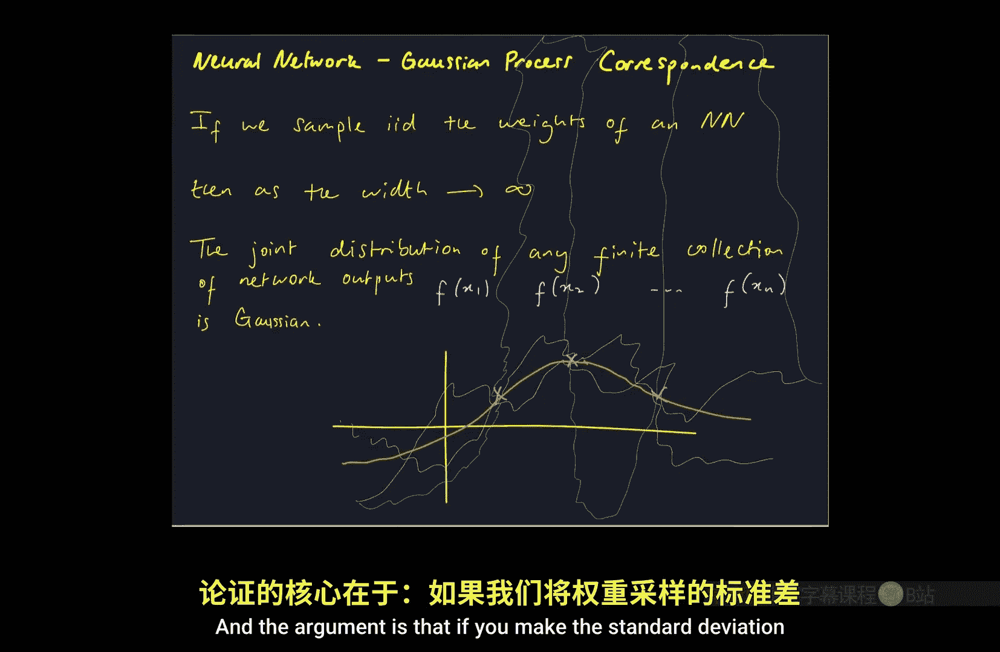

The， the standard deviation of that you sample the weights from very， very small。

 Then it actually causes the distribution to sort of collapse onto the main and then。

Then with very high probability， all the samples are very close to than me。But。I didn't w a2。 Yeah。

 it's， it's something to think about。嗯。

But it's， it's related to， Oh yeah， there's another answer to that question。

 which is it's basically like。I'm not sure if Philip talked about that in one of his lectures。

 but the idea of like neural networks being very， very over parameterized。

 but they can still like represent lots of nice， simple functions。

 So like the fact that the network is very， very wide does not imply that you're gonna overfit。

 It just implies that it's possible to overfit。系。Yeah go。B definitely it's like。緒。你是为个。Yeah work。

The day。You中。よし。It seems like you can do。先定緒に。And see。I， okay。

 so let me try to repeat what I think the questions were。

 So the first one was in this construction of this correspondence。

 why do the network need to be infinitely wide。And then I think the second question， is it like。

 if there is this correspondence， why do we actually do deep learning the way that we do it。

 Why didn't we just extract what the kernel is， and then just do Gaussian process regression。

Or do some kernel method。 Yeah， so they're both really good questions。 So on the first question。

 I'm gonna talk a little bit about that on the next couple of slides。 So it's。

 it's because the construction relies on a central limit the。Over the width of the network。

 That's the short answer。 So like for things to converge this Gaussian distribution。

 it's because of a central limit theorem。 And that requires something being large。

 And it turns out it's the width。Yeah， the second question。Yeah， that's a great question。

 because some people really thought that we should do kernel our methods， but it just seems to be。

Not the case from the way that we see things right now， is that。

It seems that even if you have an equivalent kernels， you youre on that。

Maybe for several different reasons， you would actually rather just train the you on that and just tune the hyper parameters。

 rather than。嗯。Rather than do the， the kernel method， or do the Gaussian process regression。

 I think there's probably a few different potential reasons why that's the case。One is。Well。

 first of all， the kernel method of the Gaussian process ends up having hyperpara as well。

 because somehow， like the architecture of the network is gonna affect what the kernel is。

 So that it's not like it's really a tuning free thing。嗯。

And then another thing is like the scale kernel methods scale are much worse with the size of your data set than your on net。

 Do you like， think it's like the cost of all the methods is like cubic and the size of the training set。

 whereas like。Somehow on neural own that's kind of scale linearly with the size of your training data。

m not sure if， I mean， if you train the LLM， you just train it once on the data and， you know。

 the computational cost is the cost of a forward pass and the backward pass multiplied by the size of your training set。

 So it's definitely not a cubic dependence on the number of training points， so。That's another thing。

 But I don't know。 It's a super interesting question why people use neural net rather than kernel methods。

 I think theres maybe not。It may may still be somewhat open， probably。Yes sorry。てバ？

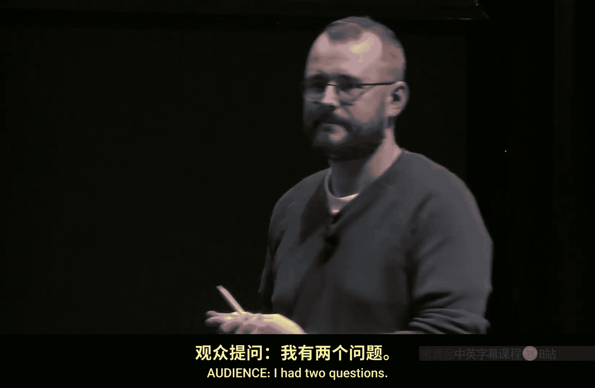

So first。Here we're saying。Yes。ga process。

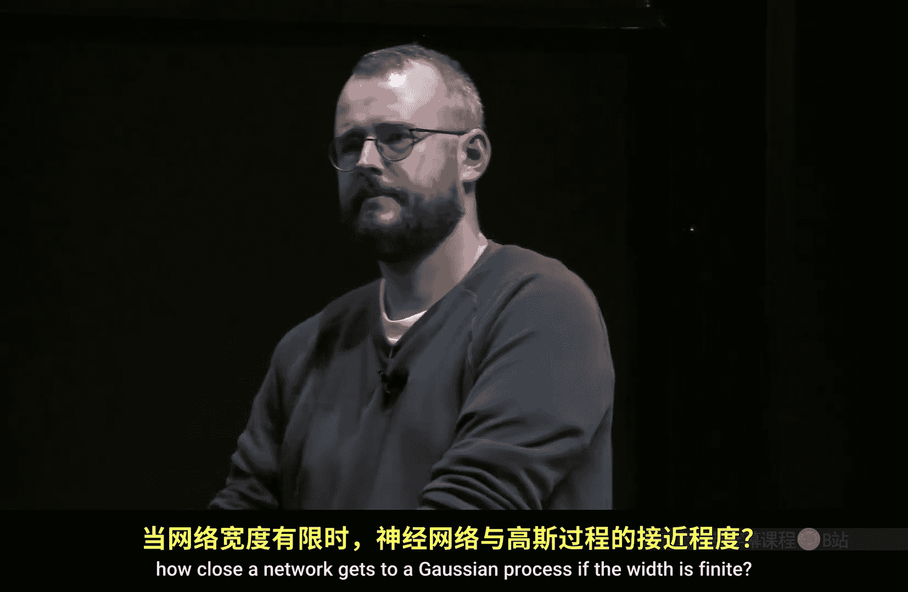

That's the great。 So the question was， have people。

 if this is a limiting result that only holds infinite width， like。

 if you have a finite width network， do we know what the deviations are from the limiting result。

I think there are papers。On this question。嗯。And okay，1， one answer is like。

 even in the classic central limit theorem， there's a result of like the Barry eyn theorem。

 which tells you about。The deviations from like normality of like a large sum of independent random variables。

 And so on what say， like， you can just like， you could just say youre gonna take the barriers in the theorem and like turn the handle and like。

F， figure it out。 I don't quite know if that actually works， but like。It's like Barry。

 I'm probably not getting the name quite right。 But Barry， and then I think it's like Eene。

I'm not sure how to pronounce them there。And was earlier the lecture， he said that people were。

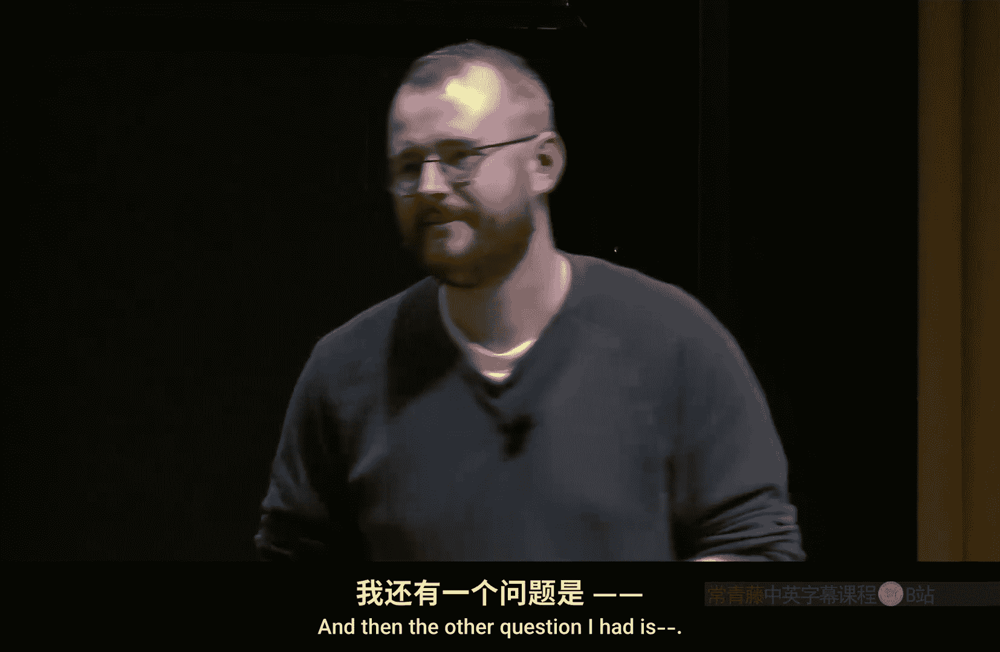

And I'm wondering what the larger backgroundbone the research community has been how that' it。ならいての。

Yes， that's a great question。 I think the short answer is probably it's had probably actually very little impact on what people actually do in deep。

Realistically， it may not be the case， but it kind of seems that way， maybe at the ends。

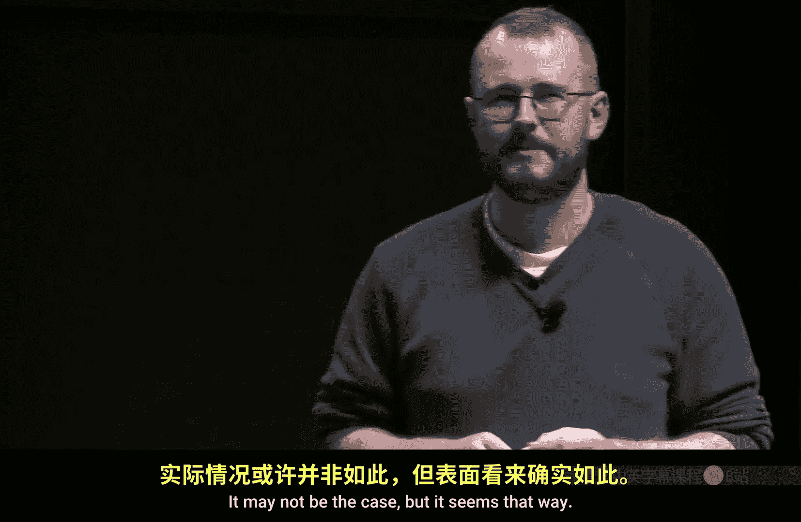

I can talk a bit about some of the potential limitations of the result， but it's like。

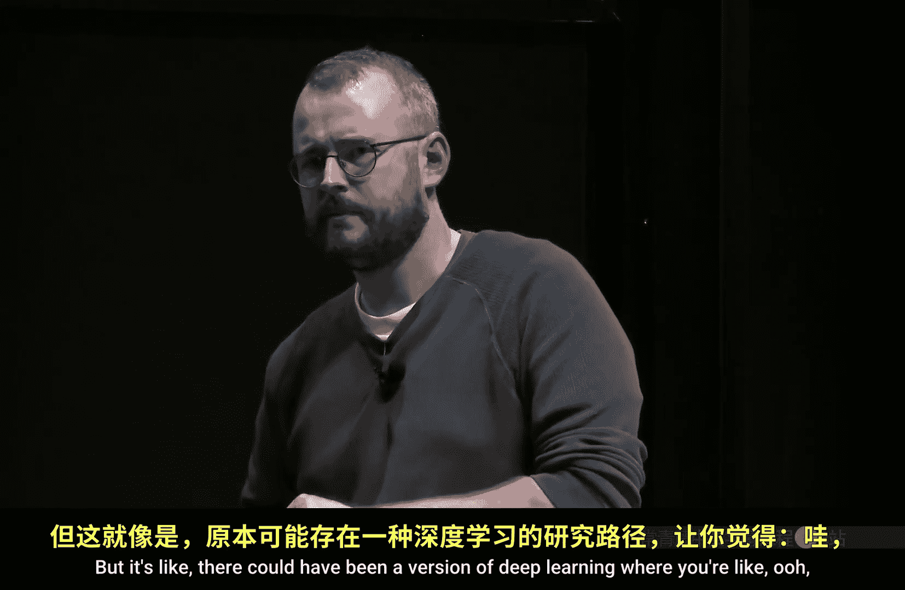

It's like there could have been a version of deep learning， where。You're like， oh， okay。

 I need to solve this deep learning problem。 Like， let me write down what my architecture is。

 take the limit， work out what the kernel is。 study the properties of this kernel。 And like， okay。

 now I'm ready to go。 like， but it's just， that's just not what is more like， okay。

 just get an architecture that seems reasonable and just， we'll just try it。

And it's， it's like anything it's， I think like there's a lesson。

 which is like anything that's too convoluted of a procedure is actually unlikely to be really capturing what's going on。

 And it just， you just don't need。 I mean， one thing is you just don't need to do that because you can just train then you're on that and you just see。

But， I think。There are also limitations of this result that mean it's possibly or。

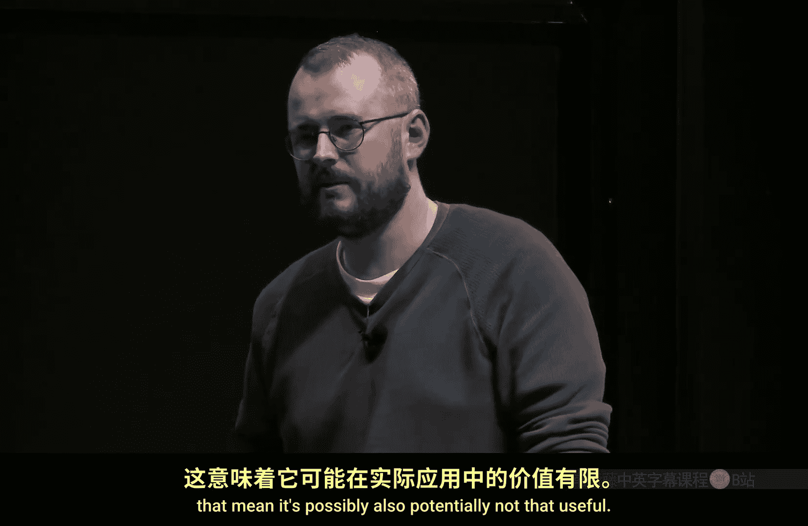

Potentially not that useful。嗯。

Yeah， so the point of this lecture is not to tell you， like。

 this is something for your practical toolkit for like going out into the wild。 It's more like。

 if you're interested to really get into the。Technical details of like deep learning theory。

 And you want to think about the different ways that people have come up with to think about neural networks。

 Like here'， here's one other。Okay。How many parameters do I need to optimizing that？Well。Generally。

 the， the kernel， the covariance function。Could have an arbitrary number of hyperparameter。

 So it's like if you're， if you're doing just straight up Gaussian process regression。

 you're gonna pick a kernel function， You get to design it and you get to choose how many hyperparameters it has。

What's the most difficult kernel function we choose and what is the correspondence to the neural network？

Or yeah， I have an example coming up for correspondence to the network architecture actually。

 I think like the really simple。 So the question was。

 is there an example of a straight typical kernel that people use in gasussian processes。

 like the the most。Like the， the first one that most people introduce is just the squared exponential kernel。

 which is like E to the negative。

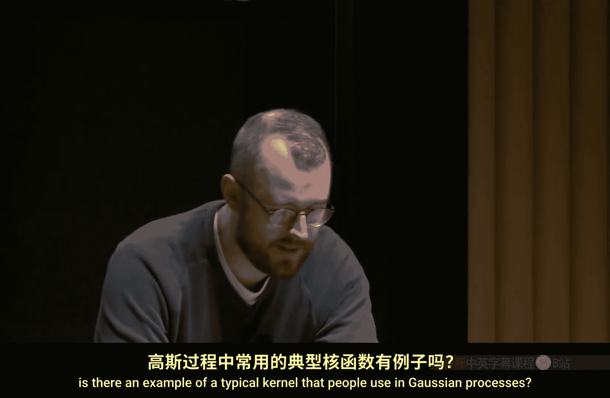

X minus x prime squared。 And then you might introduce a hyperparameter。

 like dividing by two sigma squared where sigma is a hyperparameter。

 and it controls the length scale of the correlations that the kernel and like that's this is a kernel with one hyper parameterameter。

 But then you could say， oh， what if x is multidimensional input。 Then I， you know。

 something you could say is like what if I have one sigma per input coordinate that would be a way to introduce a more hyperpara。

 or you could have a different functional form。 You could add something to this kernel。 you could。😊。

That's like the modeling， That's like the modeling decisions that people in kernel。

 And you can read up papers， and there'll be like a table of like 10 different kernels。

 And they'll say， like， if your problem has this structure， triconnal X。

 if it has this other structure， triconnal Y。 And it's like it's similar to like oh。

 like use a connet for images and use a transformer for this。 And it's like。

 it's just like modeling decisions。嗯。Okay， I'm gonna keep going because now I think we may run out time。

 I'm not sure。 So I didn't actually prove it。 I just wrote down a sketch。

 And I think I'm just gonna post a reading about how to actually prove this correspond is。

But I'm just gonna give you the high level。Something high level about how to prove。

 prove that this correspondence happens。 So remember。

 the correspondence is that an infinitely wide neural network with random weights induces the like Gaussian process distribute like the。

 the random functions you get are equivalent or Gaussian process。嗯。And the。

 the main tool is something called the multivariate central limit theorem。 Well， like mainly。

 you just hear about the central limit theorem for like。

A Gaussian random variable with one coordinate。 But it turns out there's a generalization of the central limit theorem to Gaussian vectors。

 And then the proving this result is just like applying that。

Theorem like a couple times and doing the right induction of the depth of the network。

And I think honestly， it's been a while since I thought about this。

 But I think that there's two steps。That's two main steps。 One is like。

 you pick a single input to the network。And you inspect the network at a particular layer。

And you show that the activations for that individual input。Or II D random variables。

 which is kind of intuitive that they should be。 if you're randomly initializing the network。

 the different。Activations of this the particular layer on the same input should somehow be IID random variables。

 but。You have to show that。 And then once you've shown that you then consider that a layer and you consider batching the activations over the multiple inputs。

 and you sort of think about each each activation coordinate。

 the batch of examples as being a random vector。 and then you like apply the multivari。

 Then you think about the next layer is summing over those random vectors somehow and you do this multivari central limit theorem。

 And anyway， I'm not really explaining it。 So the short answer is it's like there's a central limit theorem。

 and I'll post a reading if someone wants to go through the details。😊。

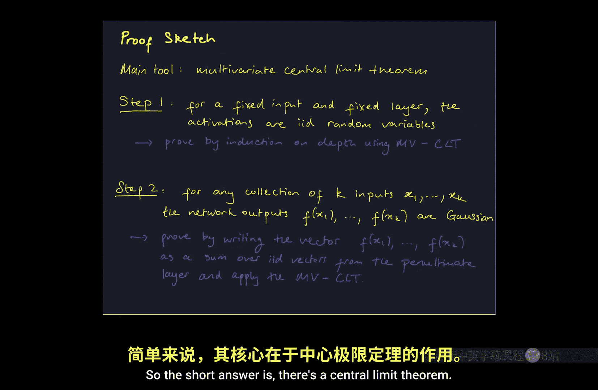

喂。

啊。The first question is。You as it weight goes started。You must agree scaling way。Yes， exactly。

I and the second question is like。き。冇啦 why。家可。when you have。P the tendency。Sve。That's okay。

 so maybe it's not obvious that they are independent。 And I think I maybe should not have said that。

 So I think that's something you've got to show。 And I'm not gonna go into it。

 But it's basically because of the network being so wide at every layer that you have like a central limit theory happening at each layer。

 And that's gonna cause the independence。 But I I'm not giving you a mechanism。

 I'm just like giving you a hand wy justification。 I'm gonna post the reading。

 But so the other question was。What precisely is the weight initialization and how does it scale with the width。

So I think I have a， I have a concrete example of this result in action。 So let's。

 let's just go through it briefly。So this is， I think this is the instantiation of the result for an MP。

With a really long linearity。U。And it turns out that all of the calculations。

 you can solve them exactly for this model。 And one of actually， one of the papers。

In the reading actually solves this kernel for this， for this architecture。

 But it's quite an old paper， and it may not be that easy to read。 So I wonder if I can like。

 post something better on Piazza， perhaps。But。Basically。

 we set the non nonlinearity to like square root two times really。And we sample the weights。With。

Various one over fan in。 So that's like。That's like。

What we would call somehow like the standard parameterization in Py towards。Is。

 is doing one over fanning。 It may actually not be the best way to。

 I actually think it's not the best way to initialize the weights in practice。 but it's for this。

 for this statement to hold， that's， that's the initialization you've got to use。

 So one over fan in variance。嗯。And， and then what you can prove is that the expectation of the network output is 0。

 This is a network with no non nonlinearity on the output。 So the。

 so it that makes sense that it's mean 0， because basically the， the last layer。Anyway。

 because the last layer is of the new layer， the the mean should be 0。

 And then the the covariant structure。So， the expectation of。F of x multiplied with F of x prime。

Takes this。 It's called something called the composition of a arc cosine kernel。So we。

 we take the dot product between the inputs， and then we iteratively apply this function H。

 which depends which okay。We apply H like L -1 times where L -1 is the death。

So it's called the compositional artrc cosine kernel。 It's just a particular mathematical function。

 which happens to correspond to this architecture。 Somebody proved that。

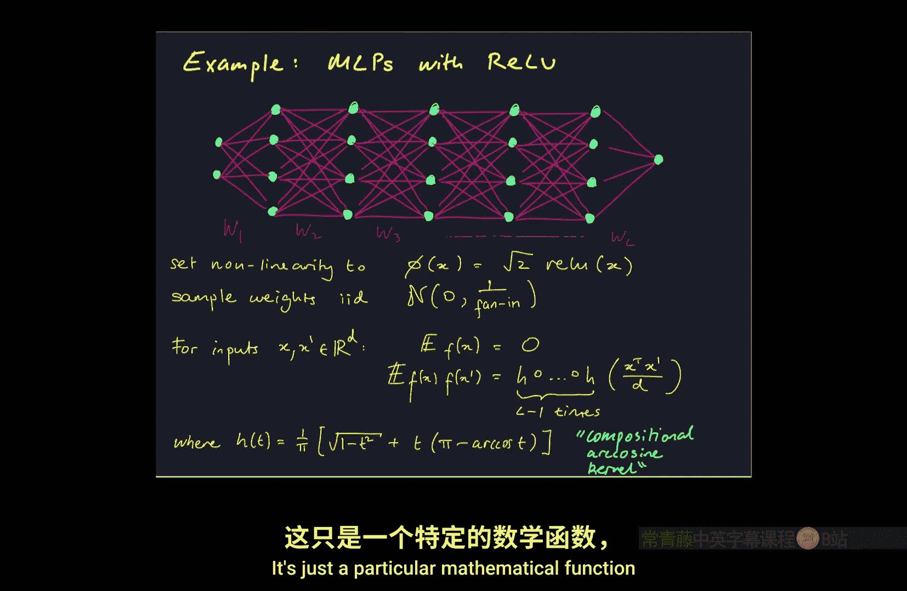

So this is an example of the result。Actually just a cl。The whole Ga process thing。

 this is for untrained。Yes， the， the thing that I told you about。 Yes。

 there is another thing that people with the the neural tangent kernel， which is supposed to be。

A Gaussian process characterization of train networks。 But it's like。

 it also holds under some assumptions。 And people have sort of kind of moved away from thinking too much about that at the moment。

But there is， yeah， there's， there's an analogous result。

 which is supposed to hold for train networks。 but I didn't talk about that。Okay。

Does anyone have。Okay， I think there's like one slide。

 And then I can I take some questions if anyone has more questions， but basically。If you like。

 really buy into this picture， you're like， yes， I believe in the。

 in the Gaussian process correspondence。 And I wanna like take this to the to w to see how far I can take this。

 You might have questions along the lines of。嗯。You know。

 how does the covariance kernel or the covariant structure depend upon my choice of network architecture。

 How does it depend on like the way I initialize the weights。And， and， you know。

 could you actually use these considerations to give you like a theoretical way to inform。

How we pick our architecture。嗯。And， you know， like how we regularize the weight during training or like can。

 can like this connection actually like inform the way that we did do deep learning。

 So that was like the hope for this type of result。 And it seems to have just like not really happen。

 Like instead， we just do transformer or like， you know， there's like a list of architectures。

 And you just， you just pick one from that list。 And we've got some。

 So it's just like it was a hope of having like a formal analytical way to do like design。

 like principle design and deep learning。 But just like。Doesn't doesn't seem that we actually use it。

嗯。So I had one thing。 I have a blank slide。 So there was one thing that I wanted to talk about at the end。

Which was。Basically， this question of how of， of the weight initialization that we talked about， so。

So the， the claim was， or that， that result held if we。You know。

 we have a layer with a certain fan in and a certain fan out。And we， and we use this。Initialization。

1 over fanning， which is actually like the Py standard。

It's like people call this like Xavier initialization。嗯。But。

It's not obviously actually the best thing to do， although it is the thing that's built into pieytorch。

An。And that's like， I'm just gonna give you one quick piece of intuition， which is basically like。

If I have。Okay， so wait， first of all， why do we， Why do people believe in this initialization。

 Why did people come up with it in the first place。

 And it's basically because it's the initialization that is good at at initialization。 And that's。

 that's the same reason that we use it in the。Neurural network Gaussian process correspondence。

 because the correspondence is about how networks behave at random initialization。 And basically。

 this is the way to initialize if you want to preserve activation magnitudes at initialization。

 you should initialize this way。Okay， but。But it it ignores like。

 a kind of fact of linear your algebra。 that if you have a matrix where the fan in。

Is much larger than the。嗯。The final out。See the， the input dimension。

 the fan in is much larger than the fan out。Then the special fact about this matrix is it has a huge null space。

 meaning that a lot of the inputs are going get map to 0。

And if you set up things such the initialization， the activation magnitudes。Get preserved。 Well。

 initialization， the vectors are hitting the null space。

 and you're kind of scaling up all the part of the vector， which is not hitting the null space。

But actually， like once you get further into training， actually。

 the inputs to the layer will kind of align with the non null space。

 And then this principle is kind of bad because then things are much too large。 Anyway。

 this is really there something that people call like maximal update parameterization on U P。

 which is like something that if you're like trying to train giant networks。

 people care about this a lot。 anyway， that's the end。 So if anyone has questions， I'll stick around。

 But thank you for listening。

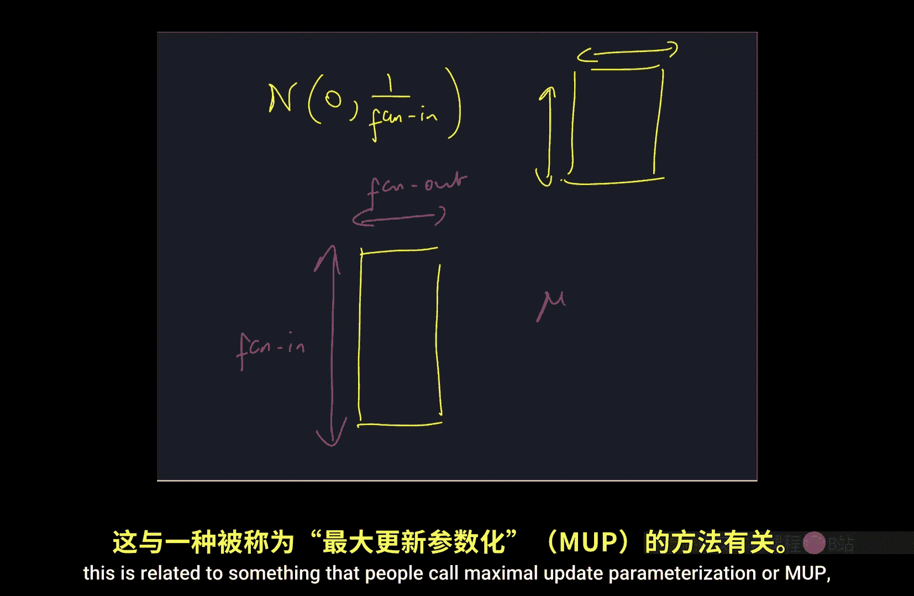

