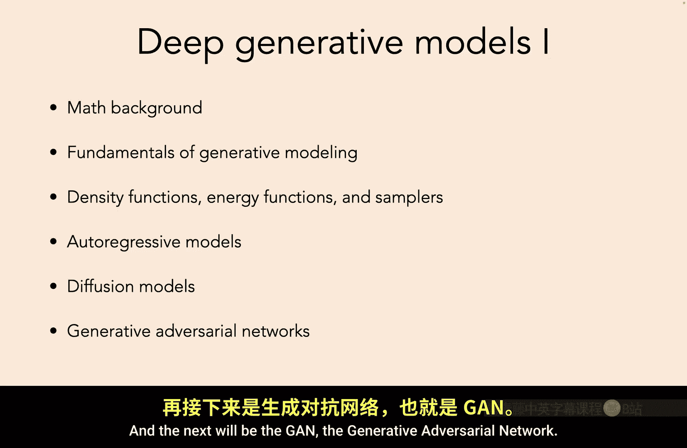
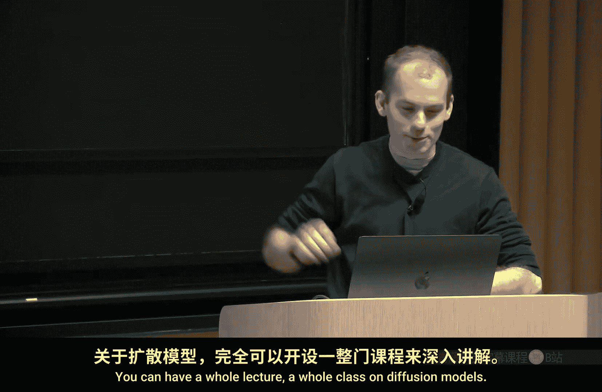
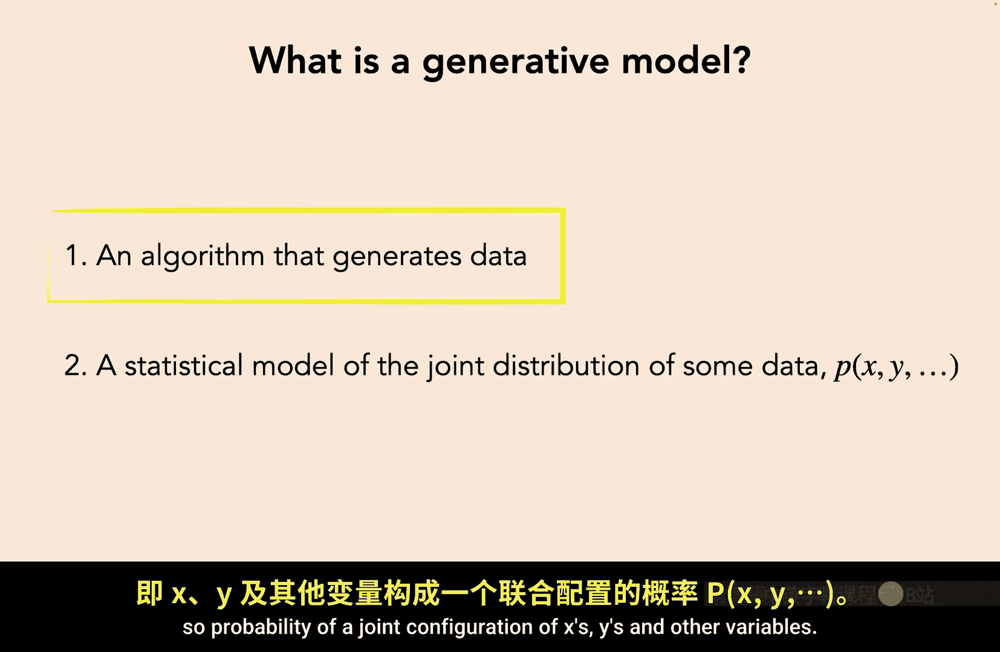
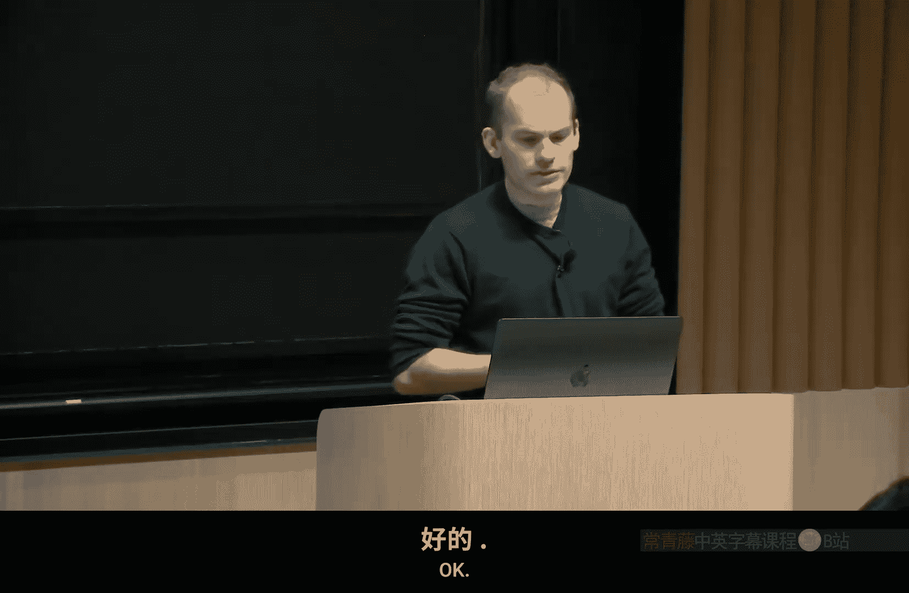
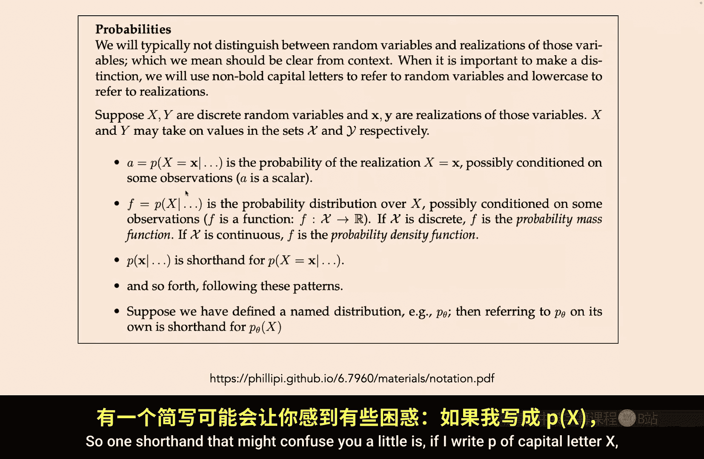
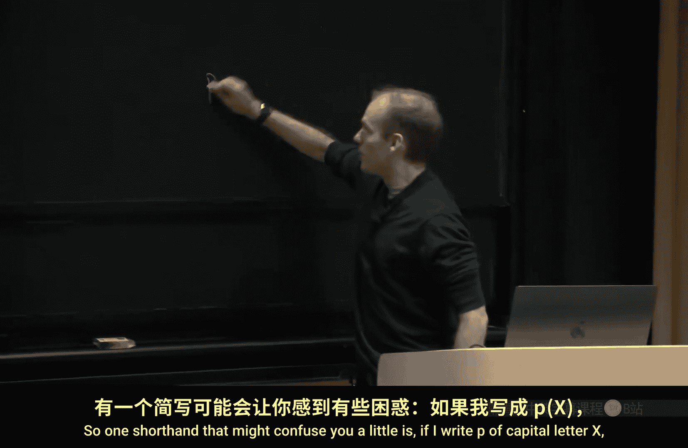
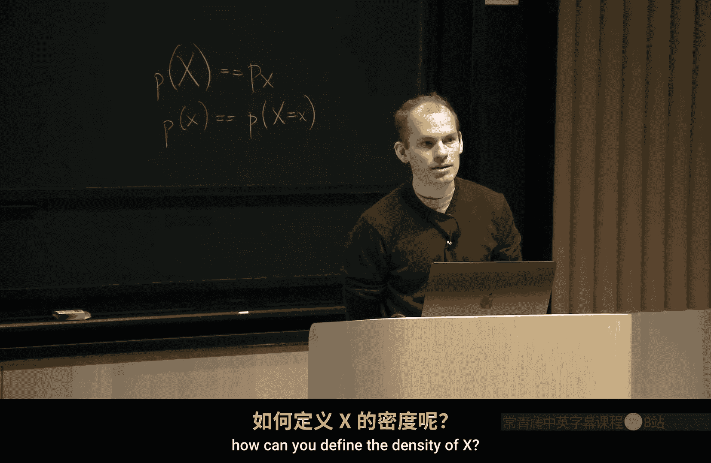
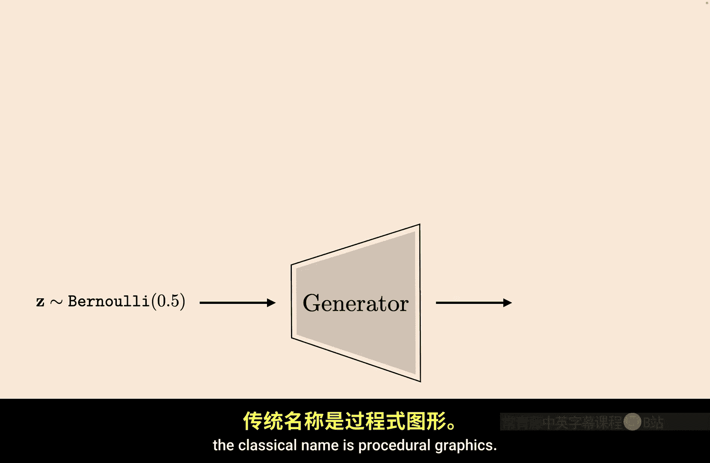
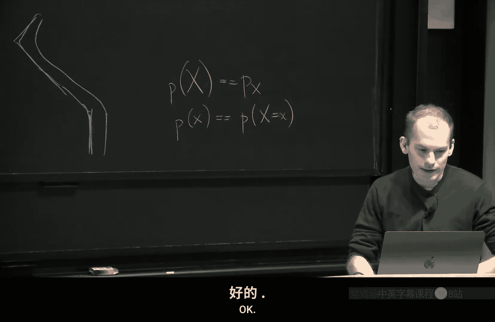
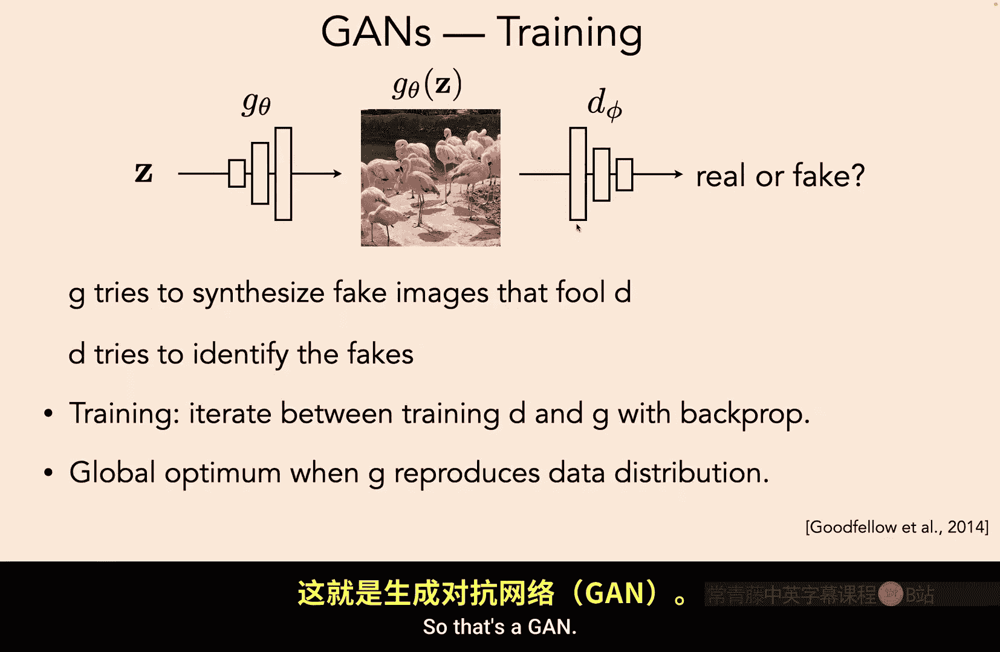

# 麻省理工学院【中英⚡深度学习｜6.7960-Fall-2024,-Deep-Learning】-p14-P14-生成模型：基础--BV15QZ4B1E6v_p14-

Okay， yeah， welcome， everyone。 So now we're coming to the another section of the course。

 which is generative models。 We'll have three lectures on generative models。😊。

And generative models are， the new name for them is generative AI。

 So this is the big thing of 2023 and continuing on to this year， 2024。Okay。

 so we're going to learn all about what generative models are。 Again。

 this is one of those topics which you could teach without mentioning deep learning at all。

 Of course， we'll talk about deep generative models， but。

The place where generative models are having innovation is mostly in deep learning。

s that they kind of go hand in。Okay。So I want to come back to this picture because we had three lectures now on representation learning。

And the way I like to think about generative modeling is it's just the inverse of representation learning。

 So these two things， representation learning and generative modeling are very tightly coupled。

 and we'll see actually in next lecture。Moels that do both representation learning and generative modeling at the same time。

But we're talking about this direction now。 So we've so far in the last few weeks。

 talked a lot about going from data to some kind of， you know， low dimensional embedding。

 and now we'll be going from simple low dimensional embeddings to data。Okay。

 so today will be just a tour of a bunch of the fundamentals of generative modeling and some of the popular models like diffusion models and GNs。

And then next week， we'll be looking at variation additionalal autoenrs。

 which are a model that does both directions jointly。And then we'll talk about conditional models。

 which is， how can I condition a generative model on some data to predict some other data。 And。

 in lecture 16， we'll really get out what are these things useful for。

 So it might be a little confusing when you first come across generative models to know， like。

 why do we care about these things。 There are things that make random images， random stories。

 Why would you care？ Well， we care because you know， chat GT is a generative model。

 And we know that that is something that's popular。

 But we'll talk more about the applications of generative models in lecture 16。Okay。And yeah。

 I love dinnerative models。 So I just think that， you know。

My favorite topic is representation learning， But my even more favorite topic is generative modeling。

 And I think they're really the same topic。 And this is just like the coolest thing in AI。 So to me。

😊，Generative models are kind of the core of intelligence。

 and that's kind of played out in the last few years with this generative AI revolution。

 but it's just super cool stuff。Okay。So I'm gonna start by giving a little math background because we're going to be using a different type of math than we've used previously in this class。

 which will be probability。 This will be things that you should have already seen。 if you haven't。

 You should touch up on this。O， then we'll talk about what's a generative model。

We'll talk about density functions， energy functions， and samplers。

And then we'll get into a survey of a few of the currently popular generative models。

 So one will be the other regressive model。 The next will be the diffusion model。

 and the next will be the again， the generative adversarial network。 So， you know， there's a lot。

 you can have a whole lecture， whole class on your diffusion models。 but。

 we're just gonna go through the basics of it。 And hopefully you'll have this toolkit that you can read up on in your own work。

Okay。And and the good news is all generative models use the same principles。

 So there's not there's know， very tight connections between all of them。

 You can often cast one model as another model with like some exchange of variables。

 A diffusion model is a type of variation autoencor。

 and an auto aggressivegressive model is a small variation on a diffusion model。

 They're all connected。😊，Okay。But you don't know what those terms mean presumably yet。

 So don't worry， we're gonna， we're gonna to see some connections。

So what I want to start with is yeah， what is the definition of generative model。

 And there's basically two definitions in the field。 There's the definition that I will focus on。

 which is an algorithm that generates data。And there's a definition that you may have come across in a statistics class or probability class。

 a slightly older definition， which is the joint distribution of some data。 So probability of。

 you know， a joint configuration of x's， Y's and other variables。

Okay， so these are actually highly related concepts。

 But I think it's simple like our real goal in generative modeling。

 especially in this era that we would call generative AI。

 is we want algorithms that make things that look like data。 So what's data could be images。

 We want algorithms that make images。 What's， what's data。 Pros are data。

 We want algorithms that make proteins， design proteins， right。😊。

Design drugs。 We want algorithms that write stories and chat with us。 This is generating text。

 That's data。 So this is in contrast to other forms of AI。

 which are more about analyzing or classifying or deciding like making decisions。

 taking data and saying this data is of type X。 or this data means I should turn left with my car。

 So going from data to decisions or abstract representations is what we've seen before。

 But now we're going from something to data。Okay， but most of the time。

 well we'll be generating data by either explicitly or implicitly modeling a distribution。And I。

 I think that this is all probably well known to you at this point in history。

 But these things are all over the world now。 generative models are what， you know。

 make it so that you can type in a sentence on your favorite text image model and say， you know。

 a a photo of a group of robots building a data center。

 and you get almost photo realisticistic pictures or you can make videos of this now。

 this thing is the stuff is advancing so quickly。😊。

But what you might not know as much or not see yet in the media as much is that generative models also can be used to generate scientific data data that is not just for entertainment。

 but might be for some kind of engineering application or logistics data of some form or in this case。

 this is a diffusion model， a type of generative model。

 which is generating some structures that describe the geometry of a protein。So we have this input。

 which is like， I want you to make me the。I want you to tell me what the binding sites are on a protein。

 and I'll use a diffusion model for that process。Here's another example。

 Here' is an image to image model。 So it's generating the output of this model is an image。

 but the output is a CT scan image。 And this is conditioned on an input， which is an MRI image。

 So it's taking saying what would it look like if the doctor hadn't scanned with an MRI machine but had scanned with a CT machine。

 So we'll talk about that setting as well。Okay， so generative models are not just for entertainment。

But where they became popular was yeah， writing funny stories and having chat bots and making funny images。

Okay。So let's go over a little bit of math background to get us all on the same page。

 And this is material that if you haven't seen it before， you should review。

 but you should have taken some kind of probability or class。 So I， we。

 we are going to be assuming that。Okay。But we're going to be changing the way we think about neural nets。

 So so far， we've mostly thought of neural nets as functions that map from some input data to some output data。

And in fact， we've thought of them as， you know， the classical definition of a function。

 which is for each unique element of the， for each element of the input space。

 there is a unique element of the output space。 So it's a mini to one mapping or maybe a one to one mapping。

 but it's not a one to mini mapping。Okay， so for every element of input， there's only one output。

Okay， and that's not gonna be sufficient for generative models because we want to make。

We want to make a whole distribution of things。 And so we're going to change our perspective a little bit。

Let me just give an example of the function perspective on neural nets for image classifier。

 The input might be a tensor in an N by M by C number of color channels， dimensional tensor。

 We're gonna learn a function F。 It will be a neural network。

 and it will our goal is to output a class prediction。

 So it will be an integer from one to D where D is a number of classes。Okay。So instead。

 we're going to now think of neural net as the models that we'll consider are going to be mappings from some input space X not to a object Y。

 but to a distribution over objects Y。 So we call that with this fancy script P。

 the the space of probability distributions over the space Y。And。That might seem a little bit weird。

 but it's like going from data to a distribution over possibilities。 It's not just one answer。

And we've seen that， in fact， already。 In fact， almost all the things that we've seen or you'll encounter machine learning can be recast from this perspective。

 So one example is classification。 We actually model it as softmax regression， right。

 This is the standard thing we've been doing in machine learning。 We learn a function from。

 in this case， let's say images to a distribution over the probability that that the image contains each of the D classes。

 So this little triangle is meant to indicate the simplex。

 which is this base of all categorical distributions over D categories。😊，And for D categories。

 it's the D minus1。Simpplex， so like， you know， if I have a binary classifier 0 or1， then I。

 my distribution will be， you know， how much probability do I place on class 1 and how much probability do I place on class 2。

 and that will be like a line。嗯。Okay。So。This is， this is the way we'll think of what we're actually modeling。

 We're modeling the probability of some output conditioned on that。 the input。

 which is thought of as a random variable， takes on some value X。And again。

 this is something that does characterize the classifiers we've seen in the past。

If we have a vanilla regression where we're doing regression with respect to a Euclidean like squared error loss。

 then you can recast that as outputting a Gaussian distribution over the possibilities。

 And the mean is your what you're regressing。Okay。So the main perspective here is that the outputs of neural nets are either implicit or explicitly going to be distributions of possibilities as opposed to just one like point prediction。

So this was in that hackers Guide lecture。 I talked about this idea that in a lot of deep learning。

 we're going to be predicting something from something。 And this little trick。

 this hack is that you make this in you're conditioning on。

 So you're gonna predict like the class of an image。

 but better than that would be to take your whole experience of the photographer's life before they took that photo if you condition on more information like a stack like a video。

 then you get less uncertainty over the output。 And the neural we had looked at before。

 we're making these point predictions， just saying for this input I'm gonna to predict what is the possible label Y or what is the possible outcome Y。

 But in reality， there's some set of possibilities， it's not alwayss only one answer。

 there could be this image could be a cat with probability of 50% and a dog with another probability and it becomes a complicated distribution to model。

 And I said just put more information into X to reduce that uncertainty。 But now I'm going tell you。

 if you don't have that luxury。 if you can't put more data into X。

How do you model a complicated output distribution that's not just a point？Okay。Okay。

 so that's what generative modeling tries to tries to deal with。 So a little bit more notation。

 So we'll talk about random variables。 They'll be characterized by a distribution。

 So random variable has a is， you know， a set of possible。Atoms。

 and there's a distribution over what values that random variable will take on。

 And that distribution is either a discrete or continuous。 If it's discrete。

 we call it a probability mass function。 And if it's continuous。

 we will call it a probability density function。嗯。And a realization of that random variable will be indicated with the low lowercase variable name。

 So a sample from the distribution of possible。Settings of that random variable will be a realization X。

 And we'll call that the probability of x。 And you can think of that as a mass in the discrete case or a probability density of x in the continuous case。

Okay， so uppercase letters in this course are random variables。

 they're characterized by distributions。 lowercase letters are realizations。

 they're characterized by scalarrs， just the probability of that realization。Okay， so just formally。

 a probability mass function is a map from data to scrs， and the scarrs are between 0 and 1。

 so the probability can be 0 up to 100%， up to 1。And the。

The sum of all the probabilities over all possibilities， sums to one。

 That's just a definition of probability。So if you ever have a vector that sums to one。

 let's say you do L1 normalization of a vector of activations in a neural network。And all of the。

 and also， you have like a sigmoid so that the numbers are all between 0 and1。 Well， that vector。

 you can call that a probability mass function。 That's just mathematically what a probability mass function is。

😊，ok。Probably， density is the same thing， except of continuous space。 and it integrates to one。

 And the densities don't have to be。 They can go to infinity。

 So it's just the densities are non negative。ok。So again。

 this should be stuff you know from probability in probability。

 but it's a little bit of a different way of thinking about things。

 And it's the fundamental language of generative modeling。So you should refresh yourself on that。

 And the notation that is linked in the schedule for the very first class and that you should be using all your problem sets and we we're using throughout the class has a section on probability。

 And we have some shorthand。 So one shorthand that might confuse you a little is。😊。

If I write P of capital letter X， I mean a distribution of this random variable。

 And if I write P of lowercase letter X， I mean the the scalar probability of random variable X taking on value X。

 So this is。

Shorthand for like the distribution over x。 And this is shorthand for the distribution。 sorry。

 the scalar probability of the realization random variable x takes on the value of little x。Okay。

 so this is on， on this slide as well as in the notation doc。ok。O， cool。

 Any questions about the math background。Before we now get into generative models。Yeah。我以前跟ちです。O。好。

provided the schedule is that it's always zero。Yeah， so。Great question。 So the question is。

 for probability density functions， like how do you define probability， the probability of， you know。

 infinitesimal thing shouldn't go to 0。 So the definition is you always only define the probability of a variable taking on some value over an interval。

 So the probability of x being between， you know。0 and 0。1。 So it's all defined with integrals。

 But usually we， we don't worry about that。 This is like when you kind of start thinking about measure theory and like the proper way to define things。

 But just think of it like probably the X takes on that value。 It's really defined as some integral。

Could you spend more time how we can think of my no？大ゼし。Yeah。

 how can we think of a neural network as implying and probability distribution？'ll show。

 I'll show a bunch of kind of examples of this。 But basically。

 let's say that I'm doing regression with an L2 loss。 I'm going predict some number。

I will interpret that， as I am predicting。A distribution over outcomes parameterized by the mean equals my output of my neural network。

 So that that is like a。And that interpretation is valid because the probability of the data under that Gaussian model is equal to the squared error loss function。

So this is some， something you can， you can look into the connection between like Gaussian max likelihood modeling and。

At least squares regression。So its know that the network is like a sa。We'll see both。

 So there's two possibilities。 One， the network is outputting samples from a distribution。

 and the other is the network is outputting parameters of a distribution。

 So I'm going to talk about both。Okay。So， okay， let's build up some intuition。 So。

 that was the math background。 We're gonna to get some intuition。

 And then we're going to get back to the math。So I like to start with generative models from this perspective that。

We already know about things like classifiers， take data and output a label。 And so again。

 I like thinking of generative models as the inverse of that， the opposite direction。

Take a label or some abstract description。 Like， I want you to make me a bird and output the thing that we would normally call data。

There's no definition to label versus data， but you kind of have an intuition of that what that means。

 So yeah， like precisely mathematically， there's really no， no distinction here， but。

Genrative models are when the outputs are something you would think of as data。Okay。So。What is。

 what is the problem， The problem is that in this direction。

 there's many possible outputs that match the input， right， So in this direction。

There's only one possible label that is the correct label for this bird。 but in this direction。

That robin is just one possibility out of mini。 Okay， so there's a distribution over correct answers。

Okay， so how do we model the distribution？ So we're going to see a few different ways。 But here's。

 here's one of the ways。We take a。Function generator called a generator。 That's a neural net。

It's a deterministic function， but we condition it on some random variable。 So we make。

Multiple outputs by taking the function and conditioning it on some random variable。

 And that will be these dice。 So we roll the dice。 We input that into our system。 We get one outcome。

 We roll the dice。 That's a different setting of numbers。 And that gives us another outcome。

 And this is the way that you can turn a normal neural network into a sample something that can sample from a distribution by conditioning it on random variables。

😊，Okay。So sometimes people will call these random variables， these dice in this diagram as noise。

I think that's a confusing term。 Their noise in the sense that they are randomized。

 the random variables。 They're randomized。But theyre not noise in the sense that they're meaningless or something that you want to get rid of or ignore。

 These dice rolls。 you should instead think of them as specifying。

Everything about the data that's not specified by your input command。 So if I say。

 I want to make a bird。 Well， everything else that's not specified by that。

 Like what color is the bird， What species is the bird has to be specified。

 made deterministic by determined by these random variables。 Okay， so there。They're specifying you。

 what's the color of the bird。 If I roll that， I'll change the color of the bird。

What's the angle of the， If I roll that， I'll change the angle of the bird。

What's the size of the bird， right？Okay， so that's kind of how a generative model will output randomized possible birds for the input command make me a photo of a bird。

Okay。So rather than thinking of them as dice rolls。

 another way you could think of them as these sort of like control。

 the underlying control variables that that control the output that you're going to you're gonna get。

And I can spin this knob randomly。 And then it's like noise a random variable that gives me a random bird。

 But I could also set that knob， that dice。 Now， I'm gonna think it' a knob to a value of the bird I want and。

And this is something that we'll see in a lot of the applications of generative models。

 gearing the models by controlling the latent variables that are input into the models， okay。Okay。

 so this is all kind of to build up this kind of intuition about what's going on。

Now let's I want to have you do make a generative model really quickly， so。

One of the places where generative modeling got started is statistics。

 But another place where it got started is computer graphics。 Actually。 So in computer graphics。

 the name for generative model is the classical name is a procural procedural graphics。

 It's a way of making random content for your video game or movie。

 I want to draw a random map for my video game。 So I will write down a procedure that creates a random map。

 That's a generative model。 So let's， let's make a generative model like that。😊。

So we're gonna take in a random variable。 It will be a coin flip。 So be newully random variable。

 And we're gonna try to make a generative model of rivers。 So here's how it's gonna be。

 Does anyone have a coin。Somebody has a coin。An object you can flip。

Google can do it for you if you want。 You can search。Coin flipper2， Okay， good。

 So why don't you do this。 So here's the start of the river。 So I flip the coin。

 and it will determine if the river goes left or right。Okay， yeah， heads is left。Okay， left again。

Okay， left again。I。So I don't know if you can still see it。

 but anyway's going that way one more time。Okay， cool。 So I think that's a pretty cool river。

 And then my computer rendering engine would probably like make it a little thicker。

 smooth out the borders。😊，Paint it blue。 And then there I， there I go。

 I have randomly generated a river from a distribution。Okay， you could do the same trick with trees。

 You could like flip two coins。 One coin is like how many branch， maybe rolllla dice。

 How many branches， And then the other coin is like， what's the angle of the branch。

 So you can write little scripts like this。 You probably have done it in some of your coding experience。

Okay， so I wrote a little program that does that。

It's just exactly what we did。So what is the program doing。

 It's Filipino coin n times and drawing the river by just changing the heading of the river by some 10 degree angle。

 depending on if I flip head or tails， it will choose left or right。Okay， so what is that。

 That's a mapping from random variables to generated imagery。

 And thats that's how generative models tend to work。Okay。So here's a more complicated mapping。

 But again， you can specify so many， you know， details of the world just via choosing a a random variable that determines each of the attributes of the image。

 So in this case， I have a Burulli variable， and of them for the river turns。

 I have a Gaussian variable for the color of the grass。 like brighter or darker。

 I have a uniform variable for the number of trees。 This is like top down。 Look at some you know。

 river。😊，And。You could say those random variables are noise， but。

What we'll think of them is as control knobs， that specify all the attributes of the data。

And a formal name for that is latent variables。 So latent variable is any。

Variable that determines how the data looks。 that is not directly observed。Okay， so。

these latent variables are the thing that underlie the causal like process of generating the data。

Okay， so yeah， just， that's one，1 concept to start with is that this kind of generative models that we'll see are going to be taking noise as input and turning it into data。

 And you should really think of the noise as the latent variables。Okay。

 so now let's talk about how to learn such models。 So you could handcraft this。

 write down like a Python script or play a game in a class。

 But how do you actually learn that program and represent it as an neural net。

And this gets to the question that was asked earlier。 There's going to be two different approaches。

One， I'll call the direct approach。 The direct approach is。

 I'm going to learn a function that directly samples random。Generated data points。Okay。

 it'll start from Z， which is going to be our name for the noise or the latent variables。

 So the dice rolls or the coin flips， and it will output data。 And the other approach will be。

 well call the indirect approach， which is rather than learning the function that goes from。

Random variables to data。 I'll learn a function that scores the probability of a data point。

So this is a function that should assign a high score。

 a high scalar to data that I like and a low number to data that I don't like。

 And there's a lot of different varieties of what that scoring function could be。

 The most basic one would be it's the likelihood of the data。 The probability of the data is。

 is a mapping from the data to a scalar。 If it's the density is a non negative scalar。😊，O。

 then if I have such a scoring function， I can generate data by searching for data points that score highly。

Or by sampling from the distribution given by that， that score。So it's like the， the。

 the direct approach directly， you know， give me data points， indirect approach。

 Give me a score that I can optimize to find good data points。

Or data points that are high probability。嗯。Notation wise。

 there is kind of a historical name for this top one， which is called an implicit generative model。

 I'm not sure that that name is still around or stick around， but you might come across it。

 And if you do， don't worry， that's implicit。 sounds like it's kind of indirect。

 But this is the direct approach。 Okay， so what it means is that the sampling procedure implies a probability distribution you're sampling from。

That's why it's called implicit。Okay， so this direct sampler implies a distribution that you could have drawn samples from。

 And this， this distribution， the scoring function。

 implies a sampler that can generate data directly。Okay。

 so we'll see both of these types of models in more detail。Okay。

 so let's start with the direct approach。 The direct approach is the one that is kind of the more popular characterization right now。

 Where the indirect approach is the more classical characterization of generative models。Okay。

 so the direct approach is I start with， I train the model by giving a lot of examples。

 It's just regular machine learning。 right， I give you examples， and I try to make more stuff。

 like the examples。And I'll take the data。 I'll output parameters of a parameterized function that can map from random noise or from latent variables that are randomized to that have simple distributions to data samples that look like the training data。

 So the objective is to make more data that looks like the training data， right。Okay。

 so this in our class will be a a neural network， but it doesn't have to be a neural network。

 But that's the thing that tends to work the best。And we call these two phases training。

 And now we use a different term rather than testing， we might call it sampling。

 but it's the same as the testing phase for any neural net that's fit to data。

 It's just when I run it， or you might call it inference or deployment。 But from a geneative model。

 we can also just call it sampling from the model。Okay。So， the indirect approach。Is。

I already described it， but let's look at it a little bit more detail here。 So it is， take some data。

 And this is what you would have seen in like your statistics classes or probability classes。

 You take some data。And you learn a scoring function that places high score where the data lives。

Okay， so the most standard one would it be a probability distribution that has high probability where the data lives。

So that the samples that you observe are。Samples from the distribution that you learn。Okay。

 but it could also be an what well call an energy function She'll show you or something more exotic。

 some other type of score function。And then sampling is no longer direct。 Now。

 sampling is I have my function that scores the probability of every possible value of x， right。

 So this is a one dimensional distribution。 The X axis is。

 What's the probability of coming up with this value of X。 Okay， it's high probability。

 And I can sample from that distribution using another algorithm。

 which will be called a sampling algorithm。 And we won't go into too much detail about these。

 but you probably you may have seen these before as like Markov Fa Mar Carlo is one type of sampling algorithm。

 Another type is called rejection sampling and just take a random sample and reject it in proportion to his probability under that scoring function。

 So there's a lot of sampling algorithms for how to go from this distribution to sample from that distribution。

Okay， so this is the indirect approach。ok。So what's the goal of generative modeling。The goal is。

To make synthetic data that looks like real data， make more stuff that looks like you're training data。

 okay。So the modeling questions to answer are， what does it mean to look like the training data。

 What does it mean for to be making more stuff that's like the training data。

 It doesn't have to be an image。 It could be looks like in an abstract sense。

And there's a lot of answers to this question。 They lead to different types of model。

 But we've kind of converged on one main one in machine learning， which is that。

You should make more data that has high probability under a density model， fit to your training data。

Okay， so this is called the max likelihood objective。

 We're gonna go through that in a little bit more detail now。Okay， so here's， again。

 the density model。 iss a mappingium from data to positive numbers or non negative numbers， in fact。

 and it's going to be parameterized by parameters theta。

 which are the weights and biases in a neural network。And。Think of that as being assigning， you know。

 a likelihood probability to every point along some data space X。

 So here data is just a one dimensional space。And here's my training data。

 My training data is examples of what， what the data looks like。 And I want to make more like it。

So in order to maximize the probability that my model P theta places on the training data。

 I will start with some model。 Maybe I have my， my neural network is going to output this shape。

 So it's going to output a structured object of this shape。 Okay， now how does it actually do that。

 It's gonna to output the parameters of a parameterized function like a Gaussian is a parameter function specified by the mean in the variance。

 So I could output the mean in the variance。 And and that's then my neural net is telling me that that's the distribution it think。

Explains the data。But it could be a mixture of Gaussianss。

 It could be any could output like the shape as some spline， right。

 So the network can output a set of numbers that parameters the distribution。Okay。

 so here's what I'll do with max likelihood modeling。 I'll simply。

So the definition of a probability distribution is constant mass， right。

 So this area under the curve has to be constant one。Okay， so I will push up the probability。

 I place where the data lives。 I'll increase the probability my model places on the data。😊。

And because it's constant mass， I'll have to take away mass from somewhere else where the data does not live。

Okay， so I'm outputting。A set of parameters that characterize a parametric family of distributions that integrate to one。

 So， So every possible sitting in the parameters specifies a curve。

Where the area under the curve is one。And if I increase the curve where the data lives。

 I necessarily decrease the the curve where the data does not live。Okay。And。

That's the idea of a density model。 So gradient an update that my density model will increase。

 you know， the probability I placed on the data and therefore decrease the probability I place elsewhere。

Okay， so the output of my neural network is a set of parameters that characterize this curve。Yeah。

 question。Yeah。那个人走。Youさ。就差不多。Yeah。差唔多。Yeah。So I think the question is。

If the probability density can go to infinity， how can I like。How does that make sense numerically。

 like， how can that still integrate to one。This is that kind of subtlety of continuous probabilities。

 We characterize the distribution with probability density function。

 which is not actually a probability。 The probability is an integral of the probability density over some interval。

 And that specifies it probably being in that interval。 And if the interval is infinitesimal。

 then the density can go to infinity over an infinitesimal interval。

 So it's like infinity divided by infinity roughly you get into， you know。

 the subtleties of continuous math。😊，Okay。Cool。What is our objective going to be to fit my。

Denssity to data。 I gave you the intuition， but formerly， we。

 we like to minimize the difference between。诶。The world's true data generating distribution。

 So these data points， these black data points came from some unknown process。

 We're going to call that unknown process P data。 We'll use that all over the place In the next few lectures。

 P data is just the probability。From which the distribution from which the training data was sampled。

 But we don't know that。 We don't have access to that。

And then we're gonna to fit our model to be close to that distribution。

 according to the K L divergence。 It's just a measure of the， you know。

 the difference between two distributions。And we want our model distribution to be the same as nature's distribution that generated the training data。

So we're gonna see that it will come out to just pushing up probability where the data points live。

 But mathematically， here's what it looks like。 So this is the definition of K divergence。

It'll be negative log of how much probability the model places on a data point divided by how much probability nature placed on the data point。

Okay， so we， we want these to be the same。 So we want these to go to one。So that log will。

 of you know，1 will be 0。 And then I will be minimizing this。 And I'll eventually get these to be。

 to be equal。Okay。So we， we can separate out the， the log of the ratio into how much log probability it place on the data。

 sorry， how much log probability the model places on the data minus how much log probability nature placed on the data and when that difference to be 0。

We can't actually measure how much probability nature placed on the data。

 We don't have access to that。 We only have access to samples from P data。

 We don't have access to the function P data。 That's just the universe。Okay。

So the nice trick is that in order to maximize。 So， okay， we， we're minimizing the difference。

 But now we got rid of the negative science。 We we're gonna maximize this， this。😊，This term。

 this equation。Well， in order to maximize this with respect to the parameters theta。

 the parameters theta don't appear in the second term。 So that's just a constant。

 So we don't actually have to consider that in the maximization。 So we drop that second term。

 And that's great because we didn't even have a way of evaluating that second term since we don't have access to P data directly。

 And instead， we are going maximize the probability the model places on the the samples from the distribution。

 And whenever we try to maximize an expectation in machine learning， we're gonna。😊。

Tend to always approximate that with a set of a finite set of samples。

 So this is the probability the model places on the population。

 And this is the probability that the model places on the set of samples from the population。

 which are our training data。 Okay， and this is called you know， max likelihood learning， right。

 maximizeize the likelihood。 the probability that the model places on your training data。

 which are samples from some， some unknown data generating process P data。😊，Okay。

 so you should recognize this as being the same form as we saw with soft max regression or it's kind of max likelihood is usually the thing that we're doing in data modeling and is often the thing we're doing。

ok。Yeah， question， if you don't have a regularization term。

 is this just going to lead to like direct deelta spikes on your data points， Yes okay。

 if you don't have a regularizer， will this just lead to drop deelta functioning your data points？

That's gonna be the next slide。 So wonderful。 So this is the question thats。😊。

ThatThat comes up all the time in generative modeling。 it's kind of confusing。

So here's a question for you。 I a filing cabinet。 Remember the filing cabinet from the lecture on generalization。

 iss a filing cabinet a good generative model。Okay， so what is the filing cabinet。

 I'm going to define it as follows。I will train the generative model by taking my data X。

 and I'll just put every data point into a。File。So I'll just add to the cabinet and then to sample from my learn generative model。

 this cabinet， I will simply take a random drawer or random file and pull it out。

So is this a good generative model， what do you think？Doesn it make new stuff。 it make new stuff。

 okay。But it it， it does make data， which is identical to the training data。

 So that that's like that kind of like what we want。 We want to make data。

 that's identical to training training data， right， That's what max。

 this does maximize the likelihood。 This is the max likelihood solution。

 or this is getting the highest likelihood you can possibly get。

Just memorize the data and output the same data。So， so， but you got you're right。

 but any other answers。I to elaborate on this。How， how could we avoid this solution。

 This is intuitively a bad solution。 I， I didn't do anything。Any thoughts。Okay， so here。

 here's how I like to think about it。It's exactly the same as overfitting in classical machine learning。

 So if you understand overfitting， then you can understand why the filing cabinet is a bad generative model。

So here's my training data。And。Exactly， as you said。

 the optimal generative model in the the the max likely a generative model。

 If I have like infinite capacity， I can fit any wgggly curve is to put a delta function all the data points on all the training points。

😊，Okay， but the true data generating process is something unknown， which here as a cartoon。

 it could look like that。 So these blue dots are just samples。

 my training data samples from some underlying process。 So what did it got， what went wrong here。

 If I take new samples from that same process， the lamb somewhere else。

 and I'll have place zero probability under this model on those samples。

So what matters in generative modeling is the probability you place on the test data。

 on new samples from the data generating process。We optimize the probability placed on the training data。

 But what matters is the probability you place on the test data， exactly the same as overfitting。

In machine learning， where you actually care about test performance， not training performance。

 But here， test performance is gonna be the density you have placed on new samples from the true generating process。

 And you have to control capacity or regularize in order。

 in order to avoid the memorization solution。Okay。So that's what overfitting looks like for a generative model。

 So the goal of the generative model is not to make exactly the training data or actually maximize likelihood on the training data。

 It's to make things that are new， but capture the important statistics and realistic properties of the data。

 but are infinitely new。We can quantify that as likelihood of the test data under a model。Now。

 if I don't have an explicit representation of the density， then it's not easy to quantify this。

 And that's why these methods that the direct methods just produce samples。

 but not densities are a little bit hard to calibrate。 right。

 It's a little bit hard to know what the test data likelihood is。But with density models。

 I can just cross validate by having a test set and measuring the likelihood I plates on the test set。

Okay。So here's the， the way that you can measure the quality of your generatorative's model。

 You can evaluate it。 You can't fit on this。 This is like the test score， the validation score。

 You sample new samples from the the world。 You make a split your test split or your validation split。

 you measure generalization error as the likelihood。 your model places on the test data。Okay。

 any questions about density models。And then we're going to do energy models。一。

How executives be Sophia bar like what is actually？Pace of data， hows it parameterized？

You can parameterize it in a lot of different ways。

 So one example would be the network outputs two numbers， two scalarrs， right。

 So it's a two dimensional vector。 that would be sufficient to parameterize a one dimensional Gaussian。

 The first number is the mean， the second numbers of the variance。

 Another option is like the network could output1000 numbers。

 And that would be sufficient to characterize or let's say 100 numbers or 100 plus 10 numbers。

 that would be sufficient to characterize a 10 dimensional Gaussian， where have a covariance matrix。

 which is 10 by 10。 So 100 numbers and a mean， which is 10 dimensions。

 So I have to output the number of。My the vector output by my network has to be all the parameters of the family of distributions that I am considering。

And if I want to do a mixture of Gaussians， and I have I want to put like two big Gaussians。

 I can do that with two times 0 plus 10 numbers。 And if I want to output other funny shaped curves。

 I can do that with other parametric families。 It doesn't have to be a Gaussian。

 But that's the general idea。So like assuming that you have a finite set of validation data like like I assume your procedure would be to train this until your validation date like loss starts to increase and then you like do early stopping to try and find a good point at which you've got a good generative model is there an analogy similar to what we learned before about。

Inductive bias in these models， like presumably if you're trying to generate images。

 you should somehow be able to add a form of bias or regularization that says like。

Images should not look like static like you should not be able to have just a zero value pixel next to something that's like a max value pixel like images of a sort of smooth quality So does that show up in how you regularize in the loss or is that like a。

So yeah， great question。 So can we add inductive biases to generative models to prevent them from finding bad solutions and kind of encourage them to find the good solution that actually generalizes to the test data and all the tricks that we have for other deep learning can can apply here。

 So you can use a， an architecture which has some kind of spatial smoothness。😊。

So like a convolutional architecture has like baked in spatial locality。

 You can use digital codes and transformers that have baked in kind of inductive bias towards spatial locality。

 You can use regularizers that you can do all the tricks。 Basically， Like there's a very。

 there's a lot to say， but you can do everything。😊，Okay， question in the back。 and then I'll move on。

Yeah， is there a connection between Max likelihood estimation and empirical risk miniization generally。

Yes， I， I guess I would say。Empirical max likelihood。

 which is like maximize likelihood you place on the data。

 That's what empirical means is on the training data。

That is a form of empirical risk miniization for the risk function。

 which is the likelihood of the data。 But you could have more general risk functions that might not have interpretations as likelihood。

But typically， the ones we use like squared error or L1 error。

 these all have interpretations as some type of likelihood function。Okay。

 so let's talk about energy based models。 So the energy based models are。

 I I said that the indirect approach is is another possible indirect approach。

 The indirect approach is you try to score your data and then sample from or optimize the score。

 find find data points that have high score。Energy based models say， well。

 what if the score is not a probability， but it' it's just an unormalized probability。Okay。

 so remember that the definition of a probability density is it integrates to one。

An energy function is just a probability that is unormalized。 So for any probability。I can。

I can represent or， yeah， for a， a broad family of functions， I can represent them like this。

 This is sometimes called the Bsman distribution。 So it's exponential of the negative energy divided by a normalization。

And any energy function， any function， E。That is not necessarily normalized。 will， through this math。

 imply a probability function P that is normalized because I just divide by the normalization constant。

 right。So whatever E is， if I divide by Z， which is this integral， P will be normalized。Yeah。

Energy function just a map from data to a scalar between negative infinity and infinity。

Just like the score。 So think of it as an unorized probability。 unnorized probability。

Id of thing that goes into softmax。 Yes， so the logics in a softm classifier can be。

St considered energy。 And then softm is just， you divide by the normalization。 You expentiate。

 you divide by the normalization。Okay。Okay， so why are energies good。

Because they're often sufficient。 So， okay， so first of all， why are probabilities bad。

 Because probabilities need to be normalized。 So my family of functions I search over is just normalized functions。

 And if I search over like arbitrary curves， like， let's say the neural network doesn't parameterize a Gaussian。

 which is normal， but it just just outputs like some like polynomial curve， right。😊。

Or maybe it just outputs a set of numbers or like the control points on a spline like。Whatever。

 or maybe it just outputs like a number per data point， right。

So I could have a network that takes in data and just outputs a number between negative infinity and infinity。

 Well， how would I normalize that， Id have to do this integral over all possible settings of the data。

 And that's intractable。 I don't want to do that。 So that's why probability densities are bad because I have to consider families that are normalized。

 and that's very restrictive。But energies are sufficient because energies。

 energy ratios are equal to probability ratios。Okay， so the probability that I place on。

 let's say I want to say which is more likely that is gonna snow tomorrow or there'll be a hurricane tomorrow。

 So that's some probability ratio。 And maybe that's the type of thing I need to decide for what to。

 how to prepare for some disaster。 Okay， it's oftentimes relative judgments for what matter。

 And so relative judgments。 the relative probability of X 1 divided by X 2 is equal to。

 Here's the definition of my energy function。And notice that the normalization functions cancel out。

Okay， so that means that exponential aided energies provide the same ratio as probabilities。

And I can evaluate， you know， whether hurricane is less likely or more likely than snow by just looking at the energy ratio as opposed to the probability ratio。

 which is intractable unless， unless I know the normalization。Yeah。Energy ratio， yeah。

So I guess energy actually includes expation， so it's one difference。Yeah， if you。

 you could do like some， sort the question is like I I I。

 I said energy ratio I meant expedent E to the negative energy divided by E to the negative other energy as equal to probability ratio。

 If you took a log of that， you could see， you know， it'll have another form。

 It'll be some difference。So， this is。Relative probabilities are often all you need for decision making。

 In particular， they are also all you need for a lot of samplers。

 So like Markov chain Monte Carlo only requires relative probabilities。

 So you don't need to have a normalized。Density or outputing。

 you can just output arbitrary unormalized numbers and still sample from that。

 The implied distribution。 Okay， so energy functions are often all you need。 Yeah。

 can you explain the negative。Yeah， so that's just the definition。 You could have。

 you don't need that。 It's just the definition because E is just a function that was negative or negative infinity to infinity。

 so。The definition is energies are related to negative probabilities。

 So low energy means high probability。Just a definition。Okay。

So why would you actually want a probability， Why wouldn't you always work with energies。

 Anyone have some thoughts on that。Why would I ever care about using normalized probabilities if if。

You know， if， if all what I'm saying is true。 any thoughts on that？ Yeah， just skill concept。

How would you skill them to different concepts， to different concepts。 Yeah， I。

 so how would you skill them to different concepts。

 I think that's getting what I think I I agree with that probabilities。

Put everything on the same kind of。Unit in on the same playing field， like。

 you're kind of scaling things to have the same unit。 So 90% probability。Can be， you know。

 in one domain， is's 90% probably another domain， but the energies could be arbitrarily scaled。

Or arbitrarily offset。So， I think。Probabilities are often more interpretable and more exchangeable between different problems。

 If you go to the hospital and they tell you your energy of having cancer is 10 million。

 What are you going do with that， right， But if they say your， your likelihood is 01%。

 you're gonna to be okay， that's fine。Okay。So human interpretability is the most obvious。

 But I think there's other reasons beyond that， too。So how do you optimize an energy based model。

 How do you fit an energy based model to data， So here's how you do it。

So we do the same thing we did before。 We find our data。

 and we decrease the energy where the data lives。Okay， remember。

 decrease energy means increased probability because energy is related to probability by negative。

 Each of the negative energy is probability。Okay， so。What's wrong with this？

 We're going to decrease our energy where the data lives。Okay， what's wrong with this。

It's wrongong with this。그。Sorry， yes， not constant mass。

 What's wrong with this is I could just decrease my energy to be negative infinity everywhere。

 If my only goal is decrease energy where the data lives， I can just say， well。

 also decrease energy everywhere else。 I'm not forcing it to be normalized。

 So there's no necessity to。To increase energy where the data does not live。

 So the simple solution is I will add a term to increase energy where the data doesn't live。Okay。

So the way you do this is you decrease energy where the data lives and you increase energy where the model places high energy。

 You actually sample from the model。 So I， I said you can sample from an energy。😊。

You can sample from the distribution implied by an energy without having the normalization constant。

 That's what things like Mar Markovfa and Monte Carlo do。Okay。

 so I can sample from my energy function， but I， I can't evaluate the probability。

 but I can take these。Points， and I'm sampling where there's low energy because that means high probability。

 And I'm gonna to increase energy there。 and I'll get this solution。If I repeat this process。

 I decrease energy where the data lives， and I increase energy where my current energy function implies high probability via sampling。

I， I go like that。 And eventually， I get this。 And here I decrease energy where the data lives。

 and I increase energy where the model has placed high probability。And they cancel out。

 So eventually， I get a delta function on the data points。 and that convergence to this algorithm。

 The positive term， which is decreasing energy， equals the negative term， which is increasing energy。

 because the model places energy exactly where the data lives。😊，Okay。

 so that should therefore kind of convince you graphically that this thing will converge to a solution that fits the data。

It will overfit in the same way that other generative models overfi， but。

We will list to early stopping and regularization of various forms。Okay。So at convergence。

 the green arrows and the red arrows cancel out。I get0 delta between them and the thing stops。

 So let's look at that mathematically。 This， This algorithm is called contrastive diveverginence。

 And variations on this come up a lot is even connected to， you know， contrastive learning。

 but you know， a little bit indirectly。Okay， it's another contrast。

 The contrast between where the data lives and where the model has placed high probability。

 want that to cancel out。So the model places high probability exactly where the data lives。Okay。

So mathematically， here's how you derive that。This is the kind of thing that you might want to work through yourself after the。

 after the lecture， but I'll go through the steps for you here。

So we're going to do max likelihood learning with energy based models。 So max likelihood learning。

Is I want to update the parameters， find the gradient of the parameters that will increase the probability I place on the。

 on the data。 And I'm writing it in terms of the expectation of， over samples。

 But you would really do this on empirical training set。Okay。

 so I can rewrite my probability distribution as an energy function divided by normalization。Okay。

And now I'm parameterizing the energy function。 So the neural net E is just a mapping from data to a number。

 And I'm gonna parameterize that by theta， which are the weights and biases。Okay。

 now I'm gonna take the log and split it into， into two terms。

 It'll be placed high energy where the data lives。And。

Then have this extra term related to the normalization integral Z。Okay， so that's the。

 that's called the positive term。 That's those green arrows。 And this is the negative term。

 That was the red arrows。 So how this one's easy， right， This one is just。

I have my samples from the data， and I just do back prop to increase the energy I place on those samples。

 or sorry， decrease the energy。 Remember， negative energy means high probability。

But how do you measure the normalization， How do you measure the gradient of this normalization function。

Okay， so here's the full derivation， which you might want to kind of walk through after the lecture。

 But here， here's what it is。 It turns out that this thing has a very simple form。So。

The gradient of this。normalormalization function， sometimes called the partition function。

Is so grad of log of F of x is equal to one over F of x。Grad of F of X。

 That's an identity from calculus。 It's a good thing to kind to remember。

So this is equal to one over z gra of z。Okay， now I can write the definition of Z。

 The definition of Z is the integral over x This is like in the softm。 This is exactly what we do。

 This is just the more general setting。This is the normal normalizing constant。

 So the integral over how much energy I place on all the data。Okay， sorry。

So then the next line is going to。B。Chain rule。 Okay。

 so this is just the gradient of E to the negative function of x is gradient of E to the x is E to the x times the gradient of whatever was in the exponent。

 That's just the chain rule。Okay。And then this line here is just rearrangement of terms。

 I'm taking this ratio。 this dividing my Z， pulling it into the integral。 So now I get this term。

 which simplifies to P again。 So it's just rearrangement of terms。

 That's the definition of P is equal to this term。 I found it again。

 But now I have an integral of P of this thing。And this is the whole。

 the whole point is to rearrange the terms until they get something that looks like an expectation。

 That's an expectation。 An expectation is integral of P of X F of x， right？

 That's expectation of F of x under the distribution P of X。 Okay， so I got an expectation。

 So this is all equal to expectation of samples from the model。😊，Of the gradient of the energy。Okay。

 so what is that， Why did I do that， Because if I get things into the form of an expectation。

 I know how to approximate expectations on finite data。

 I don't have to compute an integral over some analytical infinite， you know set。

 I approximate expectation with samples。 And we know how to do that。 That's just sample from P。

 evaluatevaluate this and back。 Okay， so here， so here we go。

 We converted this funny looking term into now just another expectation。

 Both of these expectation can be approximated with samples。 This is samples from my training set。

 And this is samples from my model。😊，And that's the gradient that will maximize the likelihood of the density implied by the energy for an energy based model。

Okay， it's called contrastive divergence。Any questions？Yeah， just one question on the derivation。

 You pulled that like a minus sign， but it wasn't。 if I understand correctly。

 it was not a subtraction。 It was like times negative1。 That I think， oh， yeah， sorry。

 that's a little。 This is a times negative 1。 Yeah， yeah， that's not subtraction。

 That's probably confusing， yeah。Okay。So that's the math。

 But you can also just kind of keep in mind the intuition。 P down energy， where the data lives。

 pushush up energy， where the model currently places high probability。Eventually， there's cancel out。

 and the model has fit the data。Okay， so we've seen a few different families of generative models now。

 We've seen that generative modeling takes data and you can learn a density function that assigns a normalized score to the data。

 You can， you can define an energy function that it define gives you。

A unnormalized score to the data。And you can also directly sample by learning to mapping them from random noise or latent variables to data。

Okay。So you can represent the data training process in any of these ways。

 either directly generate data from initial random variable or sample from a density or energy fit to the data。

Okay， and each of these things， then will have a family of generative models and deep generative models that have one of these forms。

 And a lot of deep generative models have multiple of these， these forms simultaneously。Okay。So。

Finally， we're gonna get to the， the you know， popular named deep generative models。

 All of that was really just background on generative modeling， and probability theory。Okay。

 so let's start。 We're gonna talk about three now。 We're gonna talk about autoregressive models。

 which we've actually seen before。 We're going talk about diffusion models。

 and we're gonna talk aboutganNs。Then tomorrow or not tomorrow。 But next week， we'll talk about V As。

 variational auto encoders。 Okay， so autoregressive models are kind of the simplest one to understand。

 So I'll start there。 So autoregressive models are these next word predictors。

Or next data point predictors。 So you know， I do once upon， I try to predict what's the next。

 you know word， right， a。And then I repeat the process。 So we've seen this a few times time。

So how is this a generative model， What， what probability distribution is it sampling from。Okay。

And I don't have to go in temporal order。 That's just a particular choice。Okay， so。Recap。

 I think I've shown this slide before。 We trained an autoregressive model with standard supervised learning。

 We have a data set of sentences。 We just。Chop the sentence into the prefix and the final word or the next word And at some point in the sentence。

 that's the supervised learning problem。 I can just try to like treat it as classification。

 predict the next word。Okay， so that's my learning algorithm and my sampling algorithm。

 I'm going to call it sampling， right， is I run， I predict the next word， but。

I'm not going to necessarily just predict one word。 I'll predict a distribution of our words， right。

 So it's like if it'， if each word is treated as a class， I can output a categorical distribution。

 They can do soft max regression and sample from that distribution。Okay。Okay。

 so why is this a valid probability model， Why does this actually do max likelihood。

 density modeling of distribution？ The reason is because of this equation， which is。

 I think something called the chain rule of probability。

 But it says that the probability of a set of words or a， you know， a vector X。

 So a set of data points， X。Is equal to the probability of。You know， x 2 given x1。

 So x 1 through X N are the elements of my vector X。

So I just do probably of X1 times probably of x2 times X1， right。

 So that becomes probably of x 1 and X 2。 And then I multiply that by probably of x 3 given X1 and X 2。

 Okay， so this is an identity， identity from probability。Okay。

 so I can just write that in the shorthand form， as this is product overall the conditionals of the next token。

 given the previous tokens or the next word， given the previous word， next data point。

 given previous data points。Okay， so here's what that looks like for the probability of once upon a time is equal to the probability of once times the probability of upon given once times the probability of right。

 Okay， so it's a product of all those conditional probabilities and autoaggressive modeling is simply modeling all of those conditional probabilities in a sequence。

😊，And trying to maximize the likelihood。 So how do I model probably a time given once upon a。That's。

 I just do next word classifier。 So I just output a categor distribution over。My vocabulary size。

 the number of categories is the number of words I could possibly to predict。 So once upon。

 I output a probability mass function， a categorical distribution over all the possible next words。

There's a few other ways you could do it in in natural language processing。 But this is kind of the。

 the basic idea。Okay， what about in image processing？

 Here's how you would do it in image processing for an autoregressive model。

I just I'm gonna start drawinging this bird。 And at any point in my drawing。

 I'm gonna predict the color of the next pixel， given all the previous pixels。Okay， so I can out。

 I can quantize my pixels， just like I showed in one of the colorization examples earlier。

 I can quantize my pixels into classes， red， green， blue， and so forth。

 And I'll put a categoracorical distribution over the classes。

 That's just soft max regression that we've seen before。😊。

And then I sample from it by just sampling from a categorical distribution， right， So if I have。

It's easy to from a categor distribution， right， I can just like take the unit。

 the unit intervals 0 to 1。 I can take a uniform sample from 0 to 1。

 and I can kind of walk through my probability vector until I get to。An。

Until I get to the segment that has been sampled from。So we can。

 we can easily example from a categor called distribution。And then we just repeat the process。

 So I go from nothing to next pixel， next pixel， next pixel。

 It's the same as predicting the next word in a sentence。Okay。And this is just， again。

 I think one of the early slides in this course was classifying images into categories。 And here。

 I'm classifying next pixel into categories。 And my loss function is the。

 the likelihood that my model， my model。Which is not really specified here。 But anyway。

 F F theta places on the ground truth class。 This is。

 the amount of probability my model places on the ground truth class。I want to maximize that。

Max likelihood modeling。Okay， so， yeah， just spelling it out for a different data type。

 So now my supervised data I learned from is examples of patches of pixels and the next。

 the next pixel in the sequence。😊，I do supervised softm regression。

 and I can predict the next pixel in the sequence， given the previous pixels。

 and I can actually sample to create a randomized variety of birds in this way。😊，Go question。So。

Did you characterize。じ all。Yes。Yeah， so what would I characterize this is density model。

 sampler energy model。 What do you all think。Who thinks density model， raiseise your hand。Okay。

 who thinks energy model。Who thinks sampler or the direct approach。

Yeah so I think density model was highest vote。 I think that these， these things are a little fuzzy。

 You can actually， I'm not sure there's a correct answer here。

 but I would characterize it as a density model because we're outputting the density。😊。

Over the next pixel， given the previous pixels。 And we're actually going to do that for every pixel and sequence or every word in sequence to get a probability that's explicitly represented。

 So this is actually， you can multiply all of those probabilities together。

 and you'll get the probably of the entire image。 So the the product of all the conditional probabilities。

 Its the probably of the entire image。 That's a density。 that's that integrates to one。😊。

So I would call it a density model。Okay。And people do this in a lot of sequential data modeling problems。

 Time series modeling is often autoregressive。 So here's another example where we're going to predict the next sound wave in。

 in a sound。 So this is like for music modeling or audio modeling。I simply predict the next。

 like you know。I have some representation of sound。

 and I predict what the sound will be on the next time step。 Okay。

 so it looks exactly like language modeling。 This is just auto regression modeling on another domain。

Okay。Right， so maybe it was a little。 Let me， sorry。Let me just go， go up here。So， just to clarify。

I'm trying to maximize the likelihood I place on my training data。

So the likelihood I place my training data is the product over the likelihood I place on each next。

Observation in this sequence。ok。And if I'm using log probabilities。

 it becomes the sum over the log probabilities。So the likelihood that the autoregressive model places on a training example。

Is the sum of the log probabilities that places on every next pixel in the sequence。

 And I just sum all those up and back prop。 And that's how you do optimization。 Okay， so that's。嗯。

That's kind of what this picture is showing is I will just make a prediction。

 I'll compare to the ground truth。 measure the probability under my categoral distribution。

 I have output of that ground truth point。 and I'll sum up all those probabilities and backpro through this graph。

 So that's how you actually train the thing。Okay。Okay。

 so same as what we saw in other sequence modeling in previous lectures like R N N。 we talked about。

 you know， you output predictions， you measure the error。

 But now I'm just giving it this probabilistic language。Okay， so next。

 next model that we're going to talk about is diffusion model。So， diffusion models are。

Really clever because they make the following observation。 They say that， you know。

 it's pretty hard to these are one of these more direct generative models。

 So they're directly mapping from a random dice roll to a sample as opposed to going through a dis through a density or an energy function。

Okay， so diffusion models make the very clever observation that it's very hard to convert。Noise。

 random variables into data， structured objects。But it's really easy to convert structured objects into noise into random variables。

 with simple distributions。So just imagine that these birds are like balloon animals filled with some kind of colored gas。

 right， And then you pop the balloon。 What happens， All the particles spread out randomly。

 and eventually， they become just uniformly distributed in a space。😊，Physically。

 that's called a diffusion process。 And diffusion models are exactly the same thing。

 except you're diffusing in some high dimensional data space， like whatever your data。

Is it might be like a tensor， and you're diffusing by just。

Randomly perturbing it until it becomes uniform， or it has a simple distribution。Typically， Gaussian。

Okay， so converting images to noise is really easy。 Here's how it looks like。 I just take an image。

 and I let the pixels diffuse outward。 So I simply take every pixel， and I add a little bit of noise。

 and I a little more noise。 I add a little more noise。 Eventually， I get to a state。

 which is like fully entroic， very simple distribution， Maybe it's uniform in the models we'll see。

 it's actually gonna be Gaussian。 If I just add a sequence of Gaussian random perturbations。

 I end up with a Gaussian。😊，At the very end of that sequence。Okay， so diffusion models。

Convert data to noise and then just learn to reverse the process。 So， so easy， right。

 So it's extremely hard to know how to do that， mapping from noise to data。

 But I supervise it by telling them the exact path to take。😊。

So every little step of denoising of going from noise to a little less noise is a very simple。

Just remove a little bit of noise。 right， It's a very easy thing to model。

 I can model it with supervised learning。 Okay， so I simply。

 I've created a lot of noisy sequences like this on my training data。😊，I turn them all around。

 and I then chop it up。 And for every noisy to less noisy pair， that's like a X， Y target。

 a noisy to a less noisy。 and will' index the noise level with T。 So higher noise means higher T。😊。

Just use supervised learning to， to reverse the process。 And this learns a mapping from。

Random noise to images。 And to sample an image， I simply can sample a random noise vector and put it through that mapping that I've learned that reverse diffusion process。

 as it's known。Okay， so here again is what it looks like。

 I created data set of noisy and less noisy images by having started with less noisy images and adding noise。

And I do supervised learning on that。 That could be as simple as just like mean squared regression。

 Try to predict， you know， according to L， which might be the squared loss。

 the less noisy image from the more noisy image。 And you do this with any data， not just images。

 just an example。ok。And this converts generative modeling into a bunch of supervised。

 tiny little prediction problems。Okay， I'll get to the question just a second。嗯。So。Yeah， okay。

 actually I'll do the question now。 Yeah， go ahead。😊，So is each step。

 the same model is F the same function for al T or is it different per T， Either option is fine。

 The most common option is you make F a function of X and you condition on T。

 So you just tell the network what time step you're on。But， but that's， you know。

 modeling choice is's not fundamental。Okay， so if I， I'll get to that equation in a minute。

 But anyway， if I want to sample a new image， well。

 I've converted all of my data at the end at T equals big T， meaning like as T goes to infinity。

 it turns if I'm adding Gaussian noise， it asthymppottically becomes a unit Gaussian。

If I do it with the right scaling。And that means that I can now。

 if I reverse the process chart with a unit Gaussian sample， roll the dice。

 which are unit Gaussian variables， and then I D noise with my learn function。

 And every unit Gaussian sample gives me a different noisy image。

 which are like the latent variables that specify all the properties of the data that you will generate in the end。

😊，Okay。So sampling is really easy。 It's just slow because you have to do this。

Run the dennoisian neural network over and over and over again。 like for T time steps。

 And when these first came out， T was large like 1000。 Now。

 people are showing how to do this with T being pretty small， like even going down to one。

 but you typically have to do a few time steps。Okay。

 so here's the Gaussian diffusion model mathematically。So。

We're going to define a data generating process that starts from a simple distribution unit Gaussian and maps to data。

And we're going to train it by training the Dnoiser that predicts the less noisy image from the more noisy image to invert the noiseer。

 which is a simple deterministic process that adds Gaussian noise to an image。Okay。

 we can condition the de noiseer on the time step。 So it knows like， what is the current noise level。

 And that helps it be a better predictor of of what the true like data point should have been。Okay。

So the forward process is simply。Add Gaussian noise。

 which is a unit Gaussian Epsilon tea and skill that noise， according to some。Scaled beta。

 which is can be time varying as well。 And there's some like engineering details about how do you select beta。

But in general， you can do this in such a way that at the end of the day。

 you will get unit Gaussian noise。Asymptotically， as T goes to infinity。Okay， the reverse process。

 in fact， with the reverse process， you're going to treat every little step as a small Gaussian max likelihood density modeling problem。

 Okay， so the reverse process， F is not going to just predict the noiseless image or not gonna just predict the less noisy image。

 It's going to predict the mean of a Gaussian distribution over the less noisy image。

This is just various reasons， but this gives kind of a nice mathematical probabilistic interpretation to what's going on。

Okay， so the next denois time step will be a sample from a Gaussian。

 whose mean is the output of my neural network， denoyer。Okay， so people like to use these。

 these terms P for one of the processes and Q for the verse process and it connects to kind of the standard notation and things like called variational inference。

 But you don't have to worry about it too much。 We'll just。We'll just say the forward process is Q。

 which X of T is a Gaussian centered on X of t -1。 And the reverse process I'm trying to learn is another Gaussian。

 but it's centered on a function of the noisy image。Okay， so the forward process is just add noise。

And the reverse process is predict the mean of， of a reverse Gaussian。

 So predict the mean and then sample from that Gaussian。Okay。There's a lot of variations。

 In other words， you could do this。 Its kind of vanilla， Gaussian diffusion model。And if you want， I。

 I wrote like a very vanilla version of this。 So you can play with the code lab， if you want。

But now I think there's probably better ones out there。

I want to make the connection between diffusion models and auto aggressive models。

So they're almost the same thing。 So both of them use a very simple trick。

You change generative modeling of a high dimensional structured object into a sequence of very。

 very simple modeling problems。In autoag。Modeling， you convert your data into a sequence of simple。

Categorical density modeling problems。 A K， A classification problems。嗯。Okay， again。

 you're free to choose other types of simple sequences， But that's just the most common choice。

 So think of it this way。 You start with a structured data object and you remove 1。

1 data point at a time until you get to nothing。 And then that supervises a reverse process。

Diffusion model， you start with a structured complicated object。 You add noise。

Kind of globally to every data point until you get to a very simple distribution you can sample from。

 And then you， you supervise it to reverse the process。

 This is your training data that is gonna supervise the reverse process。

 This is your training data that will supervise the reverse process。 This is easy to sample from。

 You're just sampling one pixel color。 Okay， like， let's say I have 256 possible colors。

 I just take a random。 I I， I have a categorical distribution over the 256 possible colors that occur in natural images。

 super easy。 Okay， and then I just。😊，Reverse the process by trying to classify the next。

 the next pixel， given the previous pixel。Okay， so the whole point is that a common strategy in generative modeling is turn a。

Complicated structure of distribution into a sequence of simple distributions and modeled a sequence of simple distributions。

Okay。Okay， so in the last like two minutes， I'll just do I'll do Gs。 They're very simple。

 Don't worry。 I know there's a lot in this lecture， but I'm， I'm。

 I'm hoping that I want to give you the intuitions and， then in the problem sets and。

 in the readings， you can dig a little more into the math and and work it out。 Okay。

 so Gs are a whole nother class of generative model。😊，Gans。Are a， okay， I'll tell you what they are。

 And then I'll ask you， Are they direct or indirect。 So they start with a latent variable。

 which is a vector of random numbers， and they map it through a generator network to an image。

 And then they play this game where they ask another neural network to decide if the image looks like。

A real data point or a synthetic data point sampled from the model。

 So is G a direct or indirect approach。 Who thinks direct。Okay， who thinks indirect。interestingter。

 maybe it's more subtle。 Okay， I， I would have called it direct because we're directly mapping from a random variable to a sample from a distribution。

 But with D， it becomes a little more confusing。 So， yeah。

 maybe either answer could have an interpretation， which is correct。Okay。

 so G tries to synthesize synthetic images that fool D and， and， and。That's the type O G。 Sorry。

 that should be D。嗯。D tries to identify the fake。Okay。So why should that work， That should work。

 Because if G is able to make output data points， which are indistinguishable from your training data points。

Then it must be that you're outputting things that。Are from the same distribution。

 And can prove that， in fact。Okay， so D plays this game。 D is a classifier for。

 is it a sample from G by synthetic data， or is it a sample from the real world。

 a real photo of flamingos。😊，Okay， this is just a binary softm classifier。

 I'm going to try to maximize the probability I place on real and minimize probably I place on fake。

 and that will be a。Classifier of real versus fake。

And G tries to fool D by trying to minimize the accuracy that。D will get on fake synthetic images。

 So G just minimizes the exact same objective。That D was maximizing。 Okay。

 so D is going to try to place。嗯。Basically， low probability on this being a real image。

 And G will simply try to place cause D to place high probability on this being a real image。

 So it'll try to update its parameters to make an image that causes D to get a low score on that。

 on that synthetic photo。Okay， so this is a Min Max game。 It's an adversarial game。

 But think of it more like a student and a teacher。😊，D is the teacher。 and G is the student。

 The teacher is saying， hey， you need to make a realistic painting and you didn't get it quite right。

 The shadows are wrong。 So G will update its parameters to make realistic shadows。

 And then D will say， oh， that looks indistinguishable from what I consider， you know， realistic art。

 So therefore， you've done well。Okay。So that， that's， again。

 I think this is just a summary figure of it。 I should stop there。

 and we'll continue with two more lectures and generative models next， next week。

