# 麻省理工学院【中英⚡深度学习｜6.7960-Fall-2024,-Deep-Learning】-p15-P15-生成模型：表示学习与生成建模的结合--BV15QZ4B1E6v_p15-

We're going to continue on today and this week with generative models。

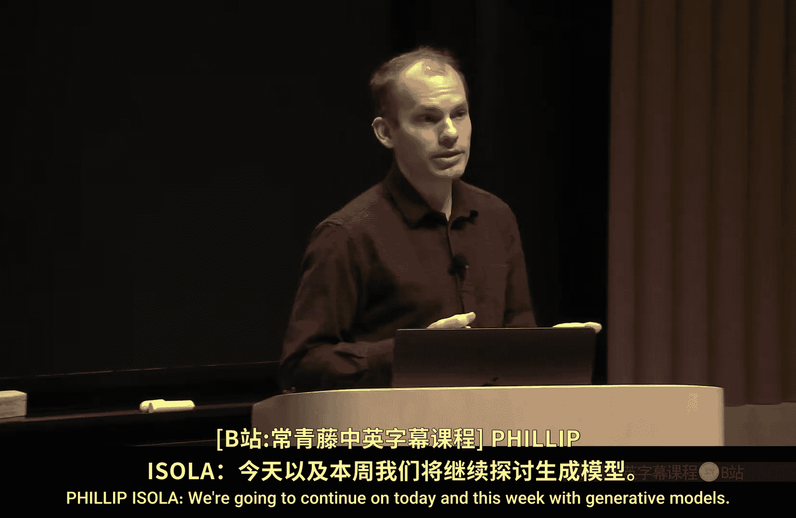

So， today， we'll be on。Dational。Autoenrs。And we're gonna to give a perspective that。

Generative modeling and representation learning are very tightly coupled。

 If you can solve the generative modeling problem， it should help you solve the representation learning problem and vice versa。

 And variation autoenrs are going to be one model that really puts the two ideas together and solves them both at the same time。

And this lecture is a little bit different than some of the last few。

 in that rather than covering a lot of different topics in some superficial level of detail。

 we're going to just go deep on VAEs on variational autoencors。😊。

And we'll also talk a little bit about the types of representations that are learned by generative models at the end and this idea of disentanglement。

Okay， so this is a picture I've shown a few different times throughout all of the representation。

 learning and generative modeling lectures in this class。

It's how I like to think about the two problems。Where representation learning is going from raw data to some nicer。

 structured， abstracted representation。And generative modeling is going from a nice， simple。

 abstracted representation to data。And I've said that these two things can be kind of thought of as inverses to some degree。

Not necessarily inverses in the sense of a mathematical function inverse because the direction from data to embeddings is mini to one。

 then the direction from embeddings to data might be one to many。 it might be a stochastic。

 So it's more like a stochastic inverse， but they kind of operate in opposite directions。

And in this lecture， we're going to see a model that explicitly models both directions simultaneously。

Okay。So representation， learning mapping data to abstract representations， geneative modeling。

 mapping abstract representations like a text instruction， for example， to data。

 So make an image from some text。Okay。So。The perspective that we're going to look at today is going to be generative models as。

Transforms from one probability distribution to another probability distribution。So， the。

Willll have a prior distribution， which will be the。Like the noise that we talked about last class。

 so the prior distribution is usually something that is very simple in structure。

 and we're going to map that prior distribution to a complicated data distribution。Okay。

 so we'll always have our latent variables or a noise base Z。

 which is often going to be Gaussian indicated by a cartoon here as a circle because it's something that is meant to be simple。

 if it's actually a normal distribution， then in high dimensions that will be roughly like a soap bubble。

 that's the way to think of it like most of the probability。

 density of a Gaussian and high dimensions is right near the surface of the hypersphere。

And the data distribution will be something more complicated。

 And so we're going to find a mapping from data that lives in this space。

 And according to this distribution， we're going geometrically push and pull it around。

 which is what the layers of neural net do until we get it into this shape。

 So remember those diagrams I showed before of the distribution of input data points going layer by layer and getting them remapped into a new distribution。

 This is like a cartoon version of that diagram。

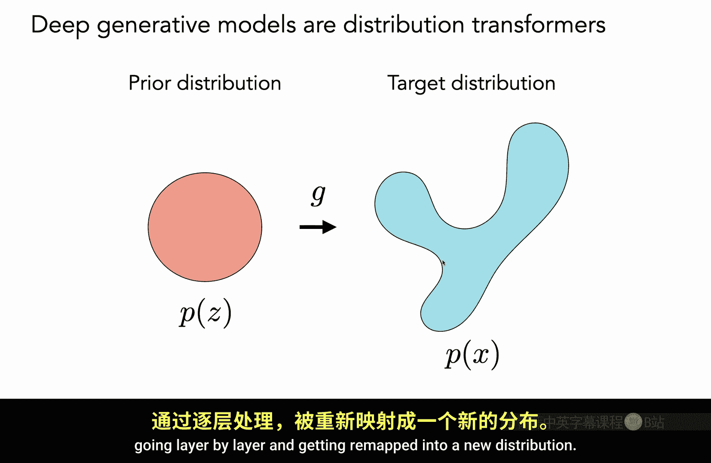

Okay， so data is x variables， Rz。And in the representation learning lectures。

 we looked at this direction， I think I used the same cartoons， so we had a mapping F。

 which we called the encoder from data to representations。

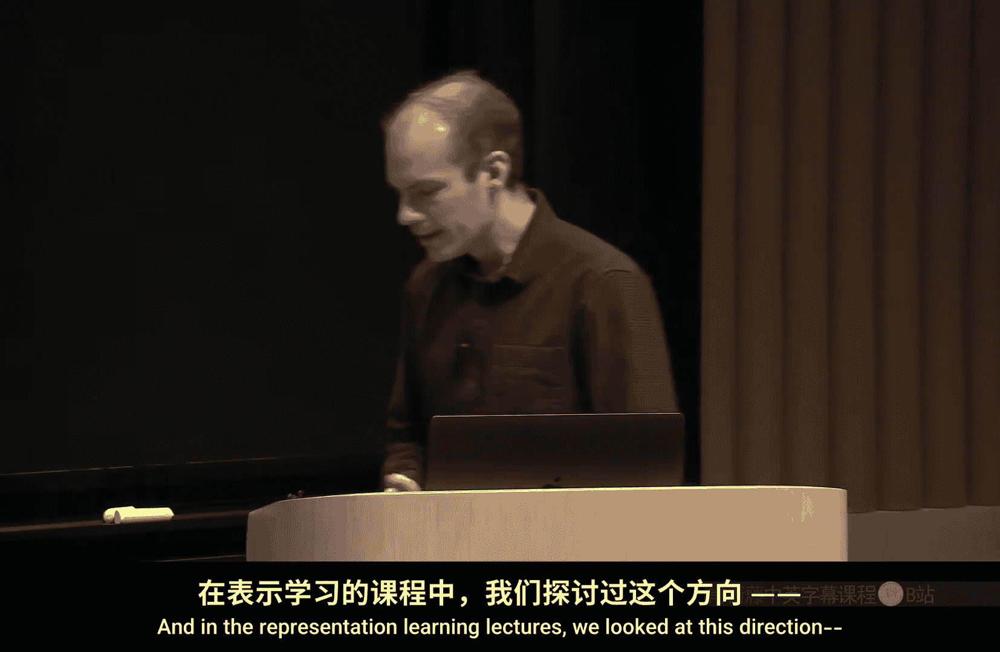

And in the generative modeling direction， it will be a mapping from representations to data。

And we'll call the function that generates the data， a generator G。So G is a mapping from Z to x。

And F is a mapping from X to Z。Okay， so these are sometimes called generators。

 Other times arere called decoder。 So we have an encoder。That maps data to representation。

 that decoder that maps representation to data。Okay。So we've seen that a few times。 Now。

 let's put these two things together。 It looks like they're basically solving， related problems。

And one model that puts these two things together is， of course， the autoenr。

 maybe you already had kind of noticed that。 So an autoenr maps from data to some vector space low dimensional representation Z。

And then it decocodedes that vector back into the data in such a way that you can reconstruct the data itself。

Okay， so the second half of the auto encodeder， the decoder。

It's doing functionally basically what we've described a generator， a generative model as doing。

Right， so the second half of the of the auto code， the decoder。

Is a mapping from some Z vector to data？And now the question is。

 can we use that decoder as a generative model， as a generator to sample new random photos？Okay。

 in order to do that， we need to be able to first sample a Z vector and then decode it into an image。

So the first question for you to think about。What is the issue with。This formulation， Okay。

 that's better。 I don't know why that happened。 Okay， so the。We have a mapping from Z to data X。

 and to sample a new random photo from the decoder。

 we would first have to sample a new random Z vector。 So what's the difficulty here。

How would I do that？ Anyone can think about what would be difficult about sampling from this some distribution number Z。

Yeah， let's go here。What distribution like I never told you what Z is。 Yeah， in the back。

 I think I saw have yeah。Right， how， how do you know what is the distribution over the encodings of an autoender。

 Okay， so， so that's the problem。 So typically， an autoender will learn a mapping into some distribution。

 some set of embeddings， right， But there's no guarantee that that set of embeddings is going to form a simpler shape or an easier to sample from distribution than the original data itself。

So the problem is I can decode Z vectors。That are corresponding to the data that I trained on。

 So if I have。F of x， where x is a real data point。 I can decode that by doing G of F of x。

 but I don't know how to sample new valid Fs of x， right， It might be。

Like some weird distribution full of holes。 And if I go to a point that has never been trained。

 this's never been observed via F of X， then I won't know how to decode that。

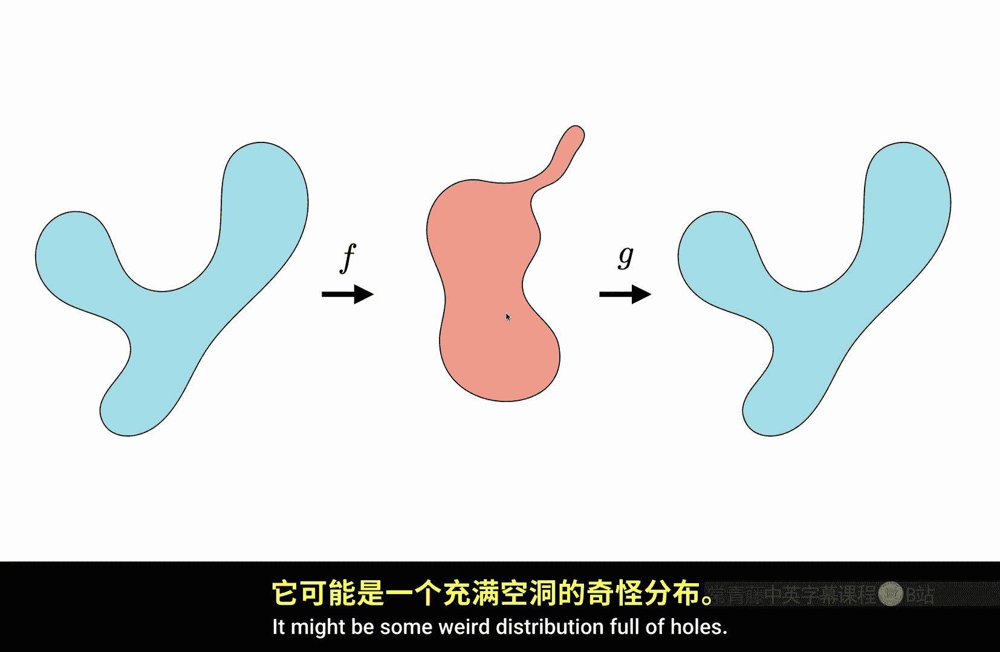

Okay， so the whole point of a variational auto encoder is to fix this problem。

 is to make it so that the latent space， the encodings of an autoender form a simple distribution that you can sample from。

 That's， that's all of the math and algorithms that will develop in this lecture are going to be simply to do that。

 simply to make it so that this。

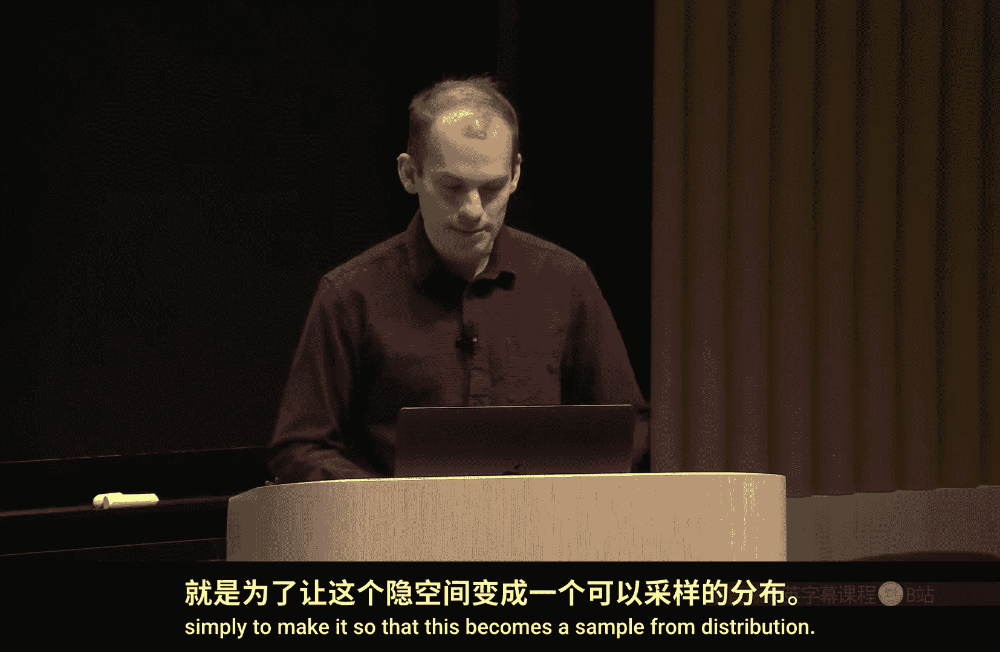

Becomes a simple sample from distribution。O。So we're gonna go through Vs from a few different perspectives。

 We're gonna kind of build up。诶。The kind of mechanistic intuition of what's going on。

 But we'll also look at the theoretical kind of probabilistic modeling way of motivating these things and try to understand at least some of the layers of analysis that I'm going provide。

 So it might be that you get lost in some of the math。

 But then always remember to kind of pop back out。 So the first perspective I want you to understand。

 is that a VE is an autoencor with one change， which is that rather than the encoder mapping to a complicated shape。

 it'll map to a simple shape。 It will map to a Gaussian。Okay。

 so A VE is just an autoenr that maps that where F maps to a Gaussian。

 And that means that I can sample new images by sampling from a Gaussian and running the Gaussian random vectors through a decoder。

 That's the first level of understanding of a VAE。

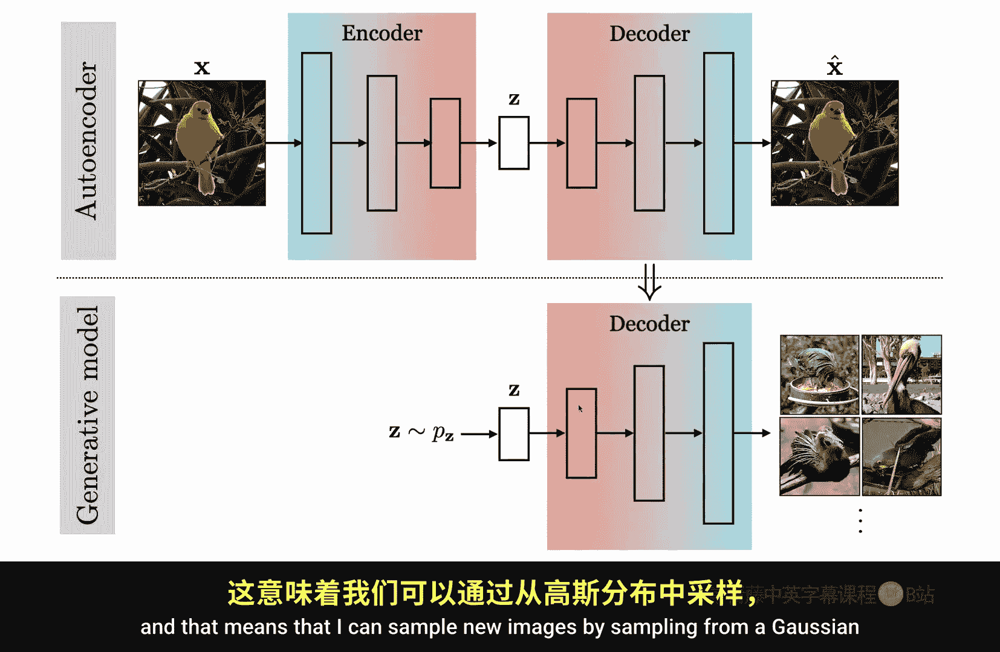

Okay。Question。The Gasian specifically because it makes it。It's unintrinsic。Yes。

 so why do we want the latent space to be a Gaussian。

 So the level of understanding that I want you to have right now is that if the latent space were a Gaussian。

 you could sample from it and then it becomes a generative model。

 sample a Gaussian from Z Decode becomes an image。

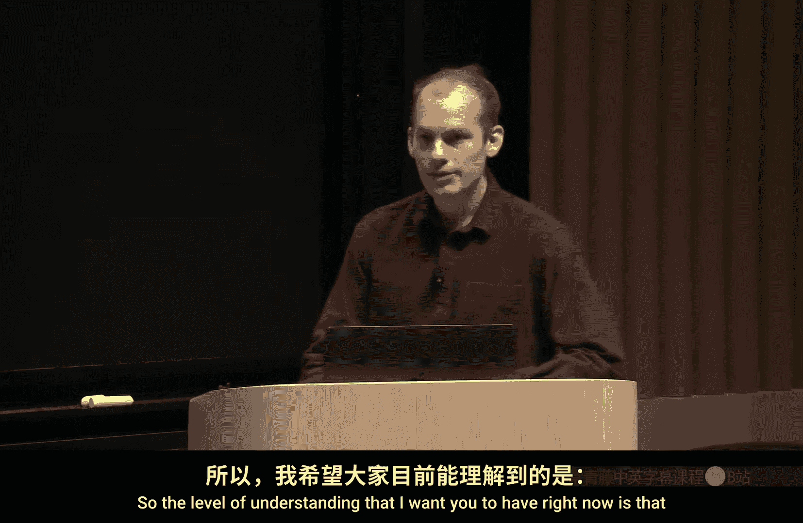

Now。You also asked， is it that a Gaussian is a better， you know。

 that leads to better representations， Like if I just want to think of this from a representation learning angle。

 I mapping to a Gaussian distribution a good idea。 And that's also true。

 But it's a little bit more subtle。 So we'll get to that toward the end。Okay。

 so VEes are great representation learners and great generative models。

 or they're good at both of those things。 That's why we're getting to them after we've already covered basic representation learning and basic generative modeling because the V puts both of them together。

 and it's kind of it encompasses all the models we've seen。

 and many of the models we've seen like diffusion models can be cast as a certain kind of VE。😊。

Or auto encoders are like a degenerate VE。 So Vs are kind of there to the pinnacle of generative modeling and representation learning。

Okay。But in practice， they're not as popular these days as diffusion models and other things。

 But mathematically， they're a framework that encompasses almost everything that we've seen。

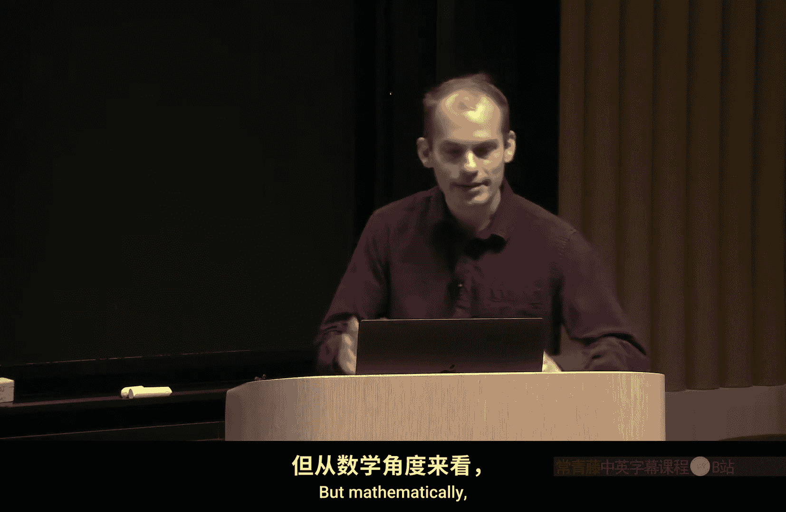

Okay， so what is the probability interpretation of a VAE？

So now we're going to take a step back and we're going to talk about mixtures of Gaussians。

 because it turns out variational autoenrs are fitting the mixture of Gaussians to a data distribution。

So mixture of Gaussians。 So what is the mixture of Gaussian。 Well， we talked about you know。

 we've seen Gaussians， right， So a Gaussian fit to data with a max likelihood objective is just going to be a density model where we try to increase the density that we applied to where the data lives。

 So they'll be like a gradient that pushes up the density here。

 And the parameters are just the mean and the variance。

 We'll shift around the mean and the variance of this Gaussian until we get maximum likelihood applied to the data points。

 And that's what we learned about last Thursday。😊，Okay， so that's one Gaussian。

 A mixture of Gaussians is just， well， in order to model a complicated distribution that does not have a Gaussian shape。

 I can use a bunch of Gaussian distributions and sum them up。Okay， so a Gaussian is like a little。

 give it like a little circle。 I mean， it could be an ellipse。

 but most of this lecture will just assume isotroppic Gaussians， which means that the covariance is。

Is one or is the identity， in fact？So we're going to assume that just for simplicity。

 that there's no ellipsoids or covariance structure。 It's just circles， it'll。You know。

 you can always turn these into ellipses。 But in the pictures， I'll just draw circles。

 So what does it look like to have a mixture of Gaussians that is fit to some distribution like this funny shape that was coloring in blue on the previous slides。

Just looks like this。 I'm going to say I can approximate that shape with a bunch of circles。 right。

 If the circles are small enough and I have enough of them， then I can approximate any shape。

So probably you could prove， I haven't thought through this， but probably a mixture of Gaussians can。

 you， to arbitrary precision， approximate any any density something like that。Okay。

 so here's what the mathematical model is。 is's just a mixture。 So a sum with weightings， W， these。

 you know， I think in traditional models， these would be positive。

 but you can imagine these be negative or positive more generally。

And every component is going to be a Gaussian， a little blip of gasian probability centered at amine。

 mu and covariance sigma。Okay， so the mean of the first mixture component is here。

 And the covariance is， in this case， it's just isotropic two dimensional Gaussian。

 So we're just going to have a covariance is equal to the variance。

 like it's just one number that characterizes that shape。 It's the radius of that circle。Okay。

So that's the mixture of Gaussians。And the parameters of the mixture of Gaussians are the mixing weights。

 W， the means and the variances the covariances of all of the Gaussians in the mixture。

And in general， in high dimensions， the covariance will be， you know。

 D by D dimensional matrix where D is a dimensionality。 And the mean will be a D dimensional vector。

ok。So V A Es are a mixture of Gaussians， but they're not just any mixture。

 They're actually an infinite mixture of Gaussians。 So mixture of Gaussians is a classical model。

 The kind of new thing with the V Ae is it's an infinite mixture of Gaussians。😊。

So how could I parameterize an infinite mixture of Gaussians。Okay， so mixture of Gaussians， I have。

waitai， so that's one parameter。 I have mean。 that's D parameters and covariance。

 that's d squared parameters。 And I have K of those。

 So I have like D squared times K plus d times K plus D parameters to specify K Gaussians。

So to specify infinite Gaussians， I need infinite。Prameterters， right？ So clearly， that。

 that's not going work。 That explicit parameterization of infinite mixture components。

So there's a really cool trick for parameterizing an infinite mixture with a finite number of parameters。

😊，And that is to parameterize that infinite mixture as a map beam from some underlying base。

 continuous distribution。Two mixture components via a function G that has a finite set of parameters。

And in this course， G will be a neural network， but in fact。

 a VE doesn't have to have anything to do with neural networks。 A G could be any type of mapping。

 but in this course， and in traditional literature， Vs are always using neural nets like you know。诶。

But yeah， really， you could apply this to other models， too。Okay， so here's how it works。

 We have P Z。 This is a unit Gaussian distribution。 We sample a random vector from that space。

 We pass it through our。Generator or decoder G。 And that outputs a number。

 which we will interpret as the mean of one of my infinite mixture components。

So I'll index the mean with this symbol mu and we'll have the neural network G or the function G actually also output the variance。

 So it'll output a set of numbers D， a D dimensional vector for the mean。

And a d squared dimensional vector for the covariance。Or in this example， you know。

 two numbers for the mean and maybe one number to characterize the covariance because it's an isotroppic Gaussian。

Okay。So if I sample different points in the Z space， I will end up。Pmmeizing different Gaussians。

 And because Z is continuous， I can sample any any point on a continuum， and I can there。

 thereby get an infinite number of possible or continuous possible set of Gaussian mixture components。

😊，Okay， and G just has weights and biases。 It's neural net。 Okay。

 so that's a finite number of parameters to model an infinite mixture。So this has parameters data。

 And now we have you know， fit some weird， complicated distribution with。

An infinite mixture parameterized by neural net with weights and biases theta。Okay。

 so what is the density implied by this mapping。So it's going to be not a sum because we have a continuous space。

 We have to switch to continuous math， and use integrals。Okay， so the probability of some。

Data point X， So the distribution over x implied by this model is going to be an integral over all of my mixture components。

 Each mixture component is just going to be a normal distribution in Gaussian， right with mean。

Givenn by the neural net and and variance given by the neural net。

 that'll place a little blip of density over， over X。 And I。

 my total probability will just be marginalizing over over Z。 So integrating over Z。 right。

 So here's the finite set of Gaussian。 it's the sum over my mixture components。

 But now I have an infinite set of mixture components。😊。

And I'm going to take the integral over all of those components and that integrals over Z space。Okay。

Okay， so this is the infinite mixture of Gaussian model。 These are the weights。

 P Z is my prior distribution。 It's usually just a unit Gaussian。

 And think of that like the weights of the mixture components。

 And then these are all the mixture components。 And it's an integral。Okay， any questions about that？

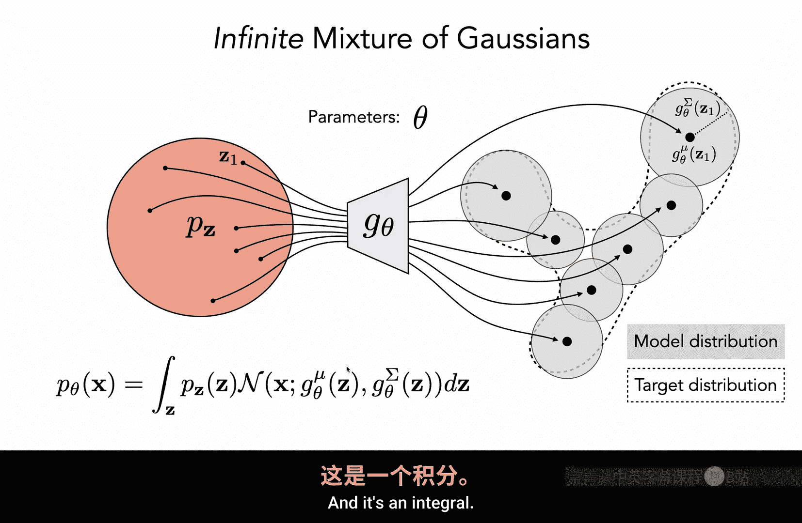

So this is the probability model that underlies V As for a Gaussian V Ae。

 You can actually have non Gaussian。 you could have other mixtures。

 It doesn't have to be a mixture of Gaussians。 It could be a mixture of Laplace distributions or poisson distribution。

 whatever you want， right， So it doesn't have to be Gaussians， but usually will work with Gaussians。

I the convolution or is that the wrong my。Is it convolation。

 I suppose it could be interpreted as convolation。Like you're， you're convolving over Z space with。

Ha嗯。I yeah， I'm not sure that's the most useful way of looking at it， but you。

 you could probably cast just convolution in some sense。

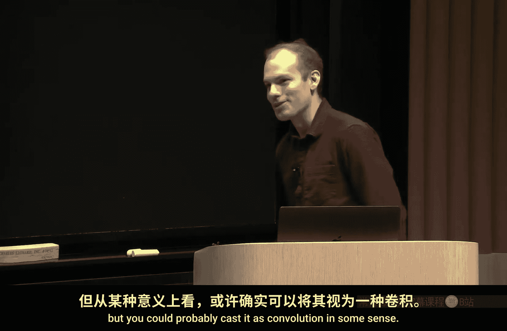

야。Okay， so I think it's easier to think of it as marginal likelihood marginalizing over some latent variables。

 So that's what we'll see on this， on this slide。So we're going to understand the Z variable。

 the Z space has being latent variables that describe all the attributes of the generated data。

 but in an abstract fashion and all those latent variables will hope that they have a simple distribution and they'll be U Gaussians in the VE。

 but in the example I gave last class， I said that I could write a Python program that will take noise from simple distributions and generate images。

 and these simple distributions are my distribution over the latent variables and they have interpretations。

So the graphical model， if you've， you know， if you've done probability with graphical models。

 it would look like this。 we sample a Z and then conditioned on the Z。 We sample an X。

 We only observe the X。 The latent variables are not observed。

 Our data modeling problem is to fit function fit a distribution over x。

That it is represented as a mapping from some underlying variables， Z。But we don't observe Z。

 We have to maybe infer Z from X。Okay， so the generator will be think of that as a conditional distribution。

 the probability over x， given some setting of the latent variables。And。If I want to。

If I want to model the likelihood of a data point X， I can integrate over my latent variables Z。

 So this is just marginalization from probability， right， P X given Z times P Z is P X and Z。

 then if I integrate over Z。Then by the rules of probability， I get P X。Okay。

 so this is called this is the likelihood。 The probability that the model P theta places on the data is called the likelihood。

 And I'm trying to do max likelihood learning。 So I want to find the probability model P theta that maximizes the likelihood of the data that assigns the most density to the data。

 And to compute the likelihood， I have to marginalize over my unobserved latent variables So sometimes we call this marginal likelihood So latent variable model。

 I'm gonna fit data by maximizing the marginal likelihood that it assign to data when I'm marginalize over all the latent variables。

Okay，Because for a given data point， there you know， to make it high probability。

 there might be a lot of different settings of the latent variable that can give it some plausible。

 like high probability。ok。Okay， so here is the entire like。

Objective function in hypothesis space of a variational autoender。Or in this case。

 just an infinite Gaussian mixture model and the variational autoencor can be is one one type of approach that that uses this model。

The objective function is going to be to do maximum likelihood。

 So I'm going to maximize the likelihood that my model places on the data。

And the hypothesis space is going to be an infinite mixture of Gaussians。

 so I'm going to try to find the means and the variances in the weights of Gaussians in an infinite mixture and to parameterize an infinite mixture。

 I'm going to parameterize a mapping from some underlying prior space Z to the data space X via the math that we just looked at on the last few slides。

Okay。So right， this is marginal likelihood。 I'm marginalizing over the latent variables Z and the likelihood term for P X given Z is going to be Gaussian。

 and the prior term for P Z is going to be unit Gaussian。

Mapping from unit Gaussian to complicated data distribution in that fashion。

And this model is going to give me two things。 It's going to give me both a density。 That's。

 that's the main thing， right， I'm trying to learn the parameters theta that will define this density function that maps from x to non- negative numbers。

And it will actually also give me a very easy way of sampling from that density。

 So it gives me those two things。 So in order to sample from this density。I can do the following。

 I first sample a random unit Gaussian。 So that's my sampling my Z vector， right。

 And then I decode it through G。Okay， so in order to create a sample X。

 I first sample a random unit Gaussian and Z。Or， in fact。

 this sampler is written here is just going to be the mapping P of x。Given Z。

 So it's going to say given some Z， what， how do I draw a sample over the possible x's that。

Followed the density Px spancy。So。I will。Give my， take my Z。And I will have my neural network。

Predicect what is the， the mean of the mixtureer component。 And then I will transform。

I will take a sample with some variance by multiplying my variance by a unit Gaussian。

 So this is just a way to sample from a Gaussian whose mean is G of mu and whose variance is G of sigma。

By transforming a sample from a unit Gaussian。Okay， so X will be distributed as normal distribution。

 whose mean is G of mu and whose variance is G of Sigma。ok。So， the difficulty here。Let's see。Sorry。

 the variance is G is sigma squared I suppose sigma is the standard deviation， not the variance。

 I always mix up those two。So， yeah， the variance。Did I get this right。

 variance is square of standard deviation。 Okay， yeah， so。😊，So the difficulty here is。

 is this term right here。 So if I want to maximize the likelihood that my model assigns to the data。

 well， the likelihood is written as an integral。 So if I were just try to solve this with back propagation or something like that。

 that means that every time I'm going to perturb my parameters to place more probability。

 and more likelihood on the data， I would have to compute this integral。

And this would be incredibly expensive。So。We don't even have a closed form for that integral。

 So we would compute that integral by。Approximating it with the set of samples by appximating the integral somehow to get a good approximation to an integral。

 I need to maybe take a lot of samples over the， over Z， right and。

This means that every time I'm going to run my model forward， see what density it places in my data。

 I actually have to run it forward a lot， a lot of times because look at the neural network G appears inside the integral。

 So to to get a good approximation to the likelihood my model places on the data。

 I have to run my my neural network forward。As many times as necessary to approximate this integral。

 which might be a lot of times。So one step of back is like running my neural network forward。

 you know， many， many， many times to get a good estimate of this this integral。

 And then I still to back that。Okay， so this integral is difficult to calculate。

 It's an intractable integral。 So what what am I gonna to do。Oh， and just notation wise。

 there's something that you'll might encounter in the V A literature。

 which is called the reparameterization trick， which just refers to this in order to take a sample from a from this distribution。

 P X given Z。Which is a normal distribution。 It suffices to take a sample from a unit Gaussian and transform it by offsetsing it by the mean and then multiplying it by the variances。

Okay。So。Then x is just a deterministic function of G with the only stochasticity coming in through this。

 this。Youit Gaussian noise is inserted in the side。 It's just a little trick。

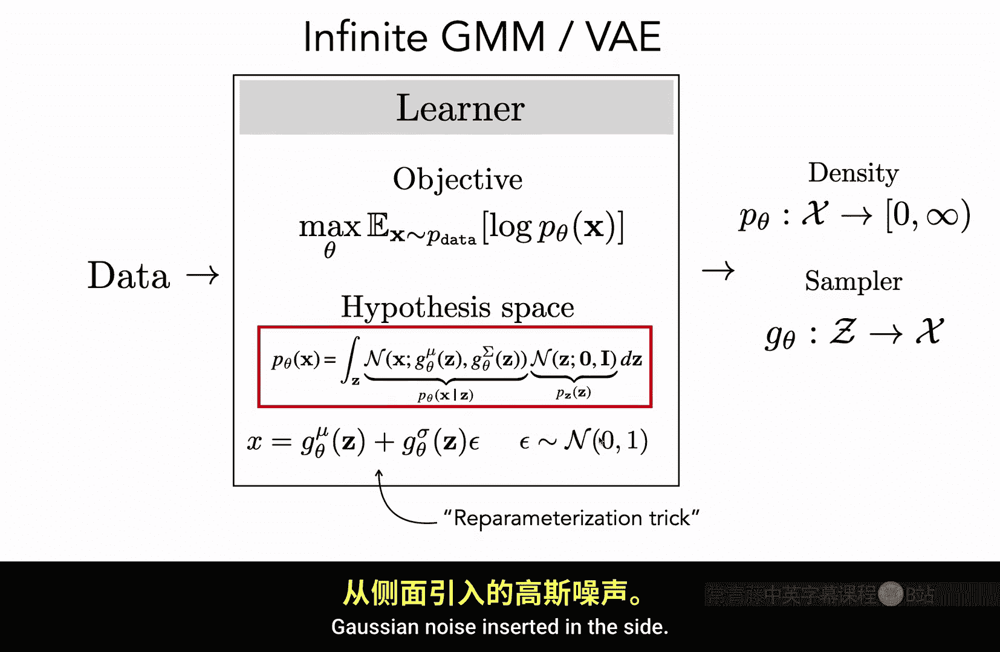

I just to clarify this， so you say it varianceance？Sma not sigma square is it standard to you。Yeah。

 sorry， I I got mixed up in the terminology。 So Sigma is the standard deviation。

 Sigma squared is the variance。 and yeah apologies for mixing up those terms。

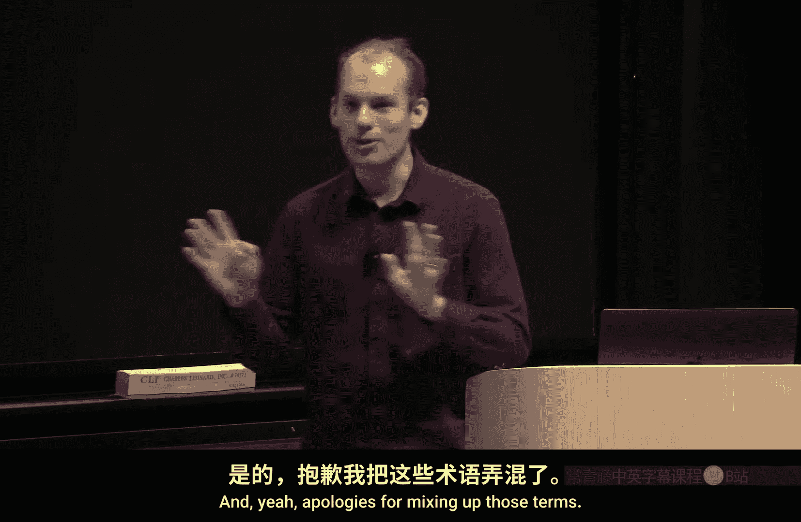

Should be saved。No， I believe that it should be multiplied by the standard deviation。 Yeah。

 I think this is not atypo It's just I misspoke。Okay。

 anybody can confirm that that that's the proper way to transform a a unit Gaussian into a Gaussian with some。

 some variance。 Okay， good。 So you multipied by the standard deviation。 square root of the variance。

 okay。

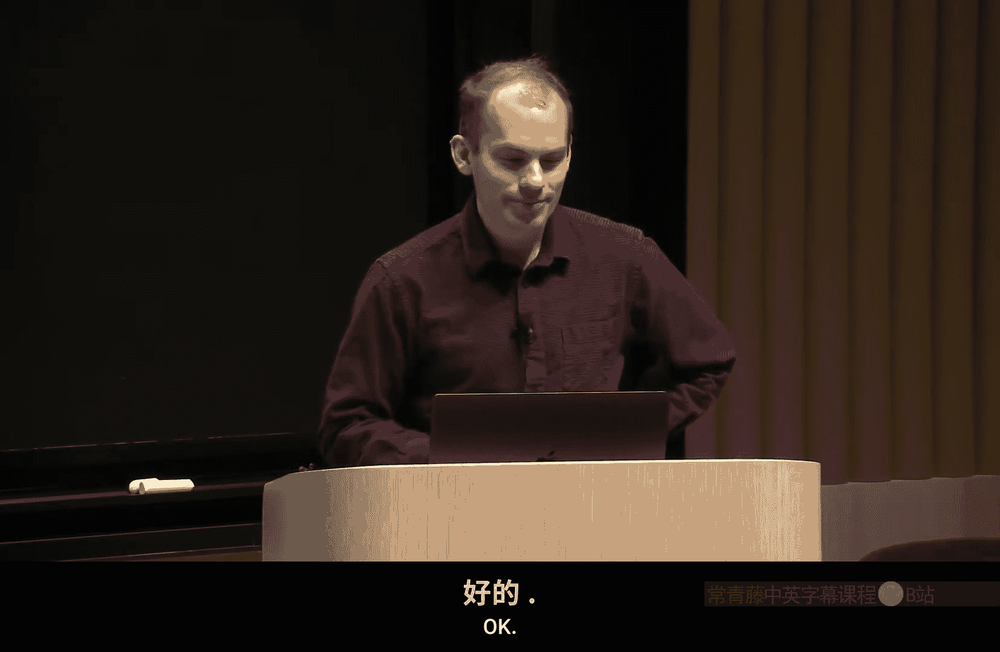

Okay， so that's the， that's the problem that we're trying to solve。 And the rest of the V AE。

Trickickery is going to be， how do you calculate this integral in an efficient manner？

So you could pause here and you could say you understand what V As are doing。 They're modeling the。

 they're maximizing the data likelihood by fitting an infinite mixture of Gaussians to the data and doing optimization to increase the probability we placed on X with respect to the parameters theta。

 which are the weights and biases of the neural network G。That's one layer of understanding。

 but then there's this integral。 So the rest of the lecture is actually。

 how do we approximate that integral。Okay。Okay， so I'm going to use the notation L to represent the。

Objective function， which is the data log likelihood。 So L is， is equal to this。

 this equation down here。 So that equation is the。Is the marginal likelihood。

 So it's going to be the probability of x given Z times Z integrated over Z is P X。

 Lo of P X is the log likelihood。 I'm trying to maximize the log likelihood。

 My model places on the data。And this outer sum over n data points is going to be， well。

 my training set， I'm going to be fitting my model to a training set of N observations。

So maybe I have N photographs， and I want to learn a generative model of them。 So I。

Since these are this is log likelihood， want to have multiple different。Data points。

 I maximize the joint probability by maximizing the sum over the log probabilities， right。Okay。

 so this is， this is the objective function for maximizing the likelihood using the mixture of Gaussians。

Okay。So I'm now going to introduce a series of tricks。

 I think around three tricks for approxiating this integral。

 So the first trick is going to be the most vanilla trick that we use all the time。

 which is to approximate an integral。 I can use some sample。 I can use sampling in some form。

 And the nice thing about this integral is it's actually in the form of an expectation。😊，Okay。

 so this marginal likelihood， marginalizing over the latent variables is equal to the expectation。

Of how much likelihood， probability at density I place on x for each Z in expectation over random samples from the prior P Z。

Okay， so right， that that's just， that's the definition of expectation。 It's an integral。With with。

If I sample from this distribution， it goes outside the expectation。 this is just a definition。Okay。

So。How do we approximate expectations， You can approximate expectations by simply taking a finite set of samples and averaging them。

That's the trick that comes up all the time in math， right， If I have an expectation。

 I approximate it with a Monte Carlo estimate， which is a set of samples。

 and then I take the average as opposed to having to compute the entire integral。Okay。

 as M goes to infinity， becomes this is an unbiased estimator of that integral。

 So as M goes to infinity， then I get a perfect estimate。Okay， so how do I do that。

 I sample from my prior， which is unit Gaussian。 that's easy。 We can sample unit Gaussian vectors。

 and then I sum up and take the average of the density that the model places over x for each Z。

 And remember that P X given Z is a very simple distribution。 That's just a Gaussian distribution。

 right。That was， that was here。 So P X given Z is just a Gaussian distribution parameterized by mineral neural net output。

 mean and variance。Okay。So this is trick number one。 And now that we have done that trick。

 we actually can train this。 I can actually write pytorch and do this because I got rid of the integral。

 I don't know how to write integrals in pytorch， right。

 But now I got it into a form where we can write it in pytorch。 everything is just countable。

 discrete math。 Okay， so。😊，I approximated integral with an average over average over M samples for my prior。

 and I looked at how much probability each of those samples places on my data。 I I added it all up。

And then I will it's a log probability so。Right， I'm trying to estimate log of P theta x。 Okay。

 so the， so log of this is P theta X。 This is my approximation to P theta X。And then I will。

my total probability over all my training data points is。A sum over the end end data points。

 and I'm going to try to find the parameters that maximize the probability I place over all of my data points。

Okay。Done。I see。 I think I know。 okay， this is fine， okay。Yeah， no。

 I think I think there's a typo here so。The that one of M should should be inside the log， I suppose。

 Yeah， that's， that's probably an important typo。 Okay， so log， one of Ram。

So there's a lot of equations in this lecture。 So be sure to try to like go through and think about them yourself。

 and might be there might be typos。Exercise for yourself solve。 Okay， so what does that look like。

 So here is actually a coab that's running this optimization to fit a mixture of Gaussians to this data distribution on the right。

 And rather than showing random samples。 So rather than randomly sampling from the prior PC。

 I'm sampling along a grid of points just for visualization， okay。😊，So we can say for this Z。

 that maps to a Gaussian at this location。 now add initialization。

 which is the frame that you're currently seeing。I've initialized the neural networks so the weights are near 0。

 And so the Gaussians all kind of all the mixture components are mapping to around 0。Okay。

 so here's what it looks like when you train this system。Okay， so。

The different points in Z space learn to map to different parts of the the data distribution So they cover the data distribution。

 They maximize its likelihood。

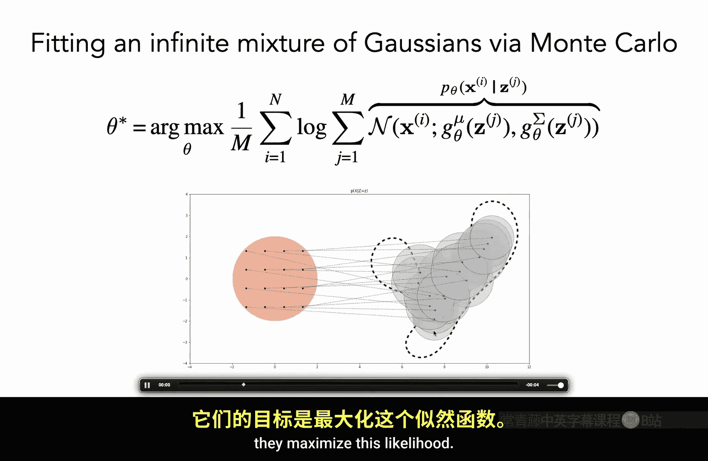

Okay， so that's what it looks like。 This is S GD on the， on the equation above。ok。Yeah， question。

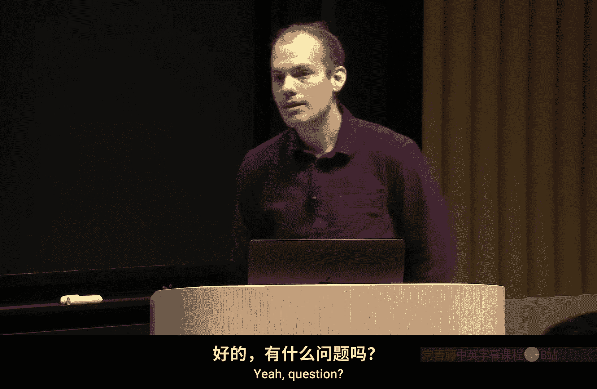

反呢个。Why don't we multiply by it。 Yeah， great question。

 So that's just because of how expectation works， so。Expectation is defined as this integral。

 and the probability Z comes in through the sampling procedure。 So higher probability samples。

 according to Z will be overrepresented in this sum。 So you don't need to double weight them。 Yeah。

 that's why。

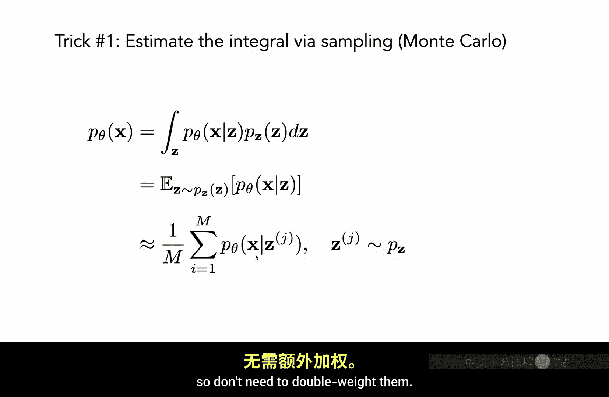

I was just a little confused on how are you computing P theta of Xig you said it was just I mean like on the previous slide right。

 it's like a normal distribution with。

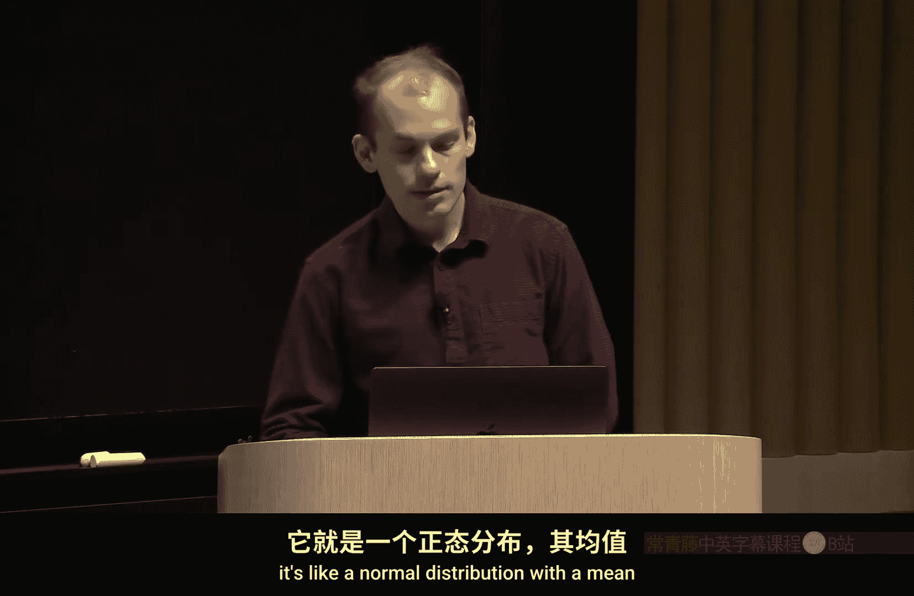

That doesn't mean and or standard deviation variance provided by the forward pass through your model。

 so then do you just draw a sample from the normal distribution defined by the parameters that you。

You don't。 So you don't have to draw a sample because this thing has a closed form， analytical form。

 right？ So what is， what is n of x。

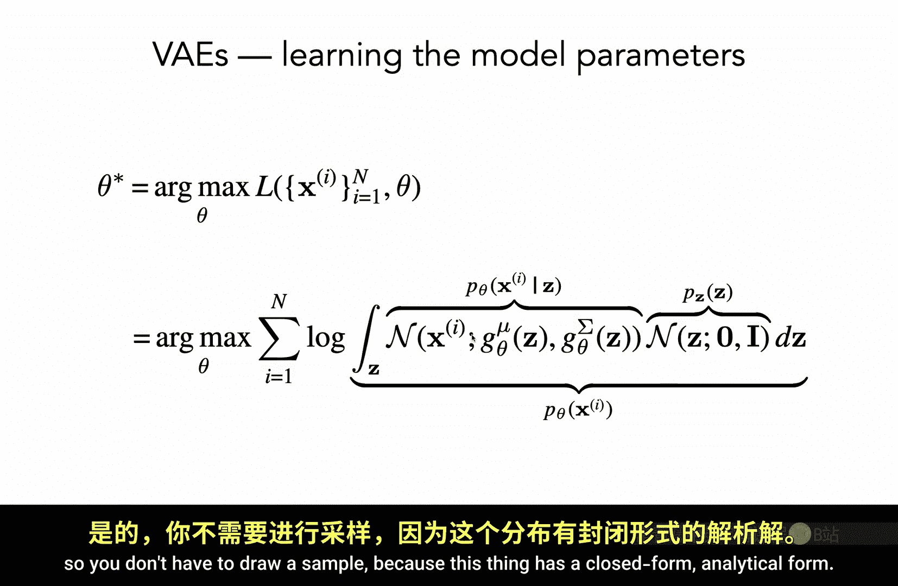

With mu and sigmas your or sigma squared， let's say as your mean in your variance。This is equal to。

Some normalization times E to the negative。Like x minus mu。Over2 sigma squared， right。

 That's just the analytical form of the density。

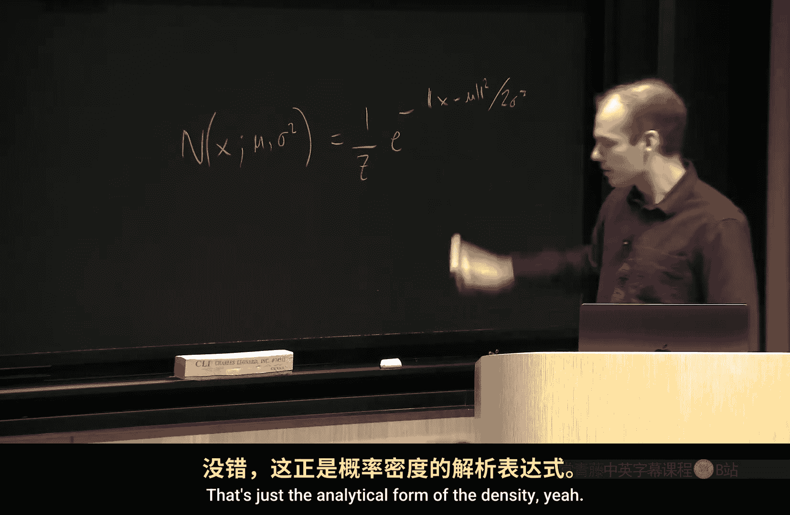

So。This thing here is just shorthand for some exponential of the difference from the mean divided by the variance。

With the approximation step， how does the error seal？

In the approximation of how does the error scale of M， I don't know。 That's a great question。So。

I think that it's going to depend on， yeah， the data and the parametric form of P and all these different things。

 But that I would just say that's like a good question to like， do some analysis on and。

I'm sure people have， like， in general， how do Monte Carlo estimators scale with respect to the。

Number of samples and。There's probably some classical results。 I， I don't remember， yeah。Okay。Yeah。

Okay， so。That's all， all well and good。 So actually。

 I'm gonna to ask a question kind of related to that。 Like。

 how many samples do you need to get a good approximation。嗯。

So I'll come to your question in a second。 So how many samples do you need to get a good approximation。

 So this worked。I， you know， do we need any more tricks Is this enough。 So here I have。

 I took you know， some number of samples。 Let's say M is like 100。 I don't remember the exact number。

Well， what is what's going to happen as I scale my latent dimensionality and I' gonna need a high dimensional latent space in order to be an effective model of a high dimensional data space。

 So for two dimensional distributions like shown here。

 It turns out that I can just sample like 100 of these samples M and get a good fit to my my data distribution。

 But for high dimensional data， I need a high dimensional latent space or a higher dimensional latent space。

 So let's say that my Z vectors are 100 dimensional。

 Do you think 100 samples M are going to be a good approximation to integral over this00 dimensional space。

 What do you think。

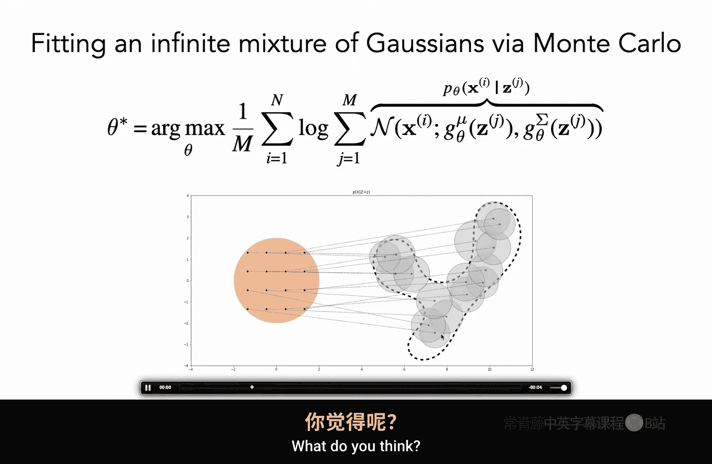

Thumbs up， if you think it will be okay， O， no， thumbs down。 if you it won't be okay， Yeah。

 thumbs down。 Okay， so why how many samples roughly would you say you need to have a good approximation to an integral over an d dimensional space。

This kind of gets to your question， I think。Yeah， in the back。'responing to。Question or question。

 Monte Carlo estator has variance。Go over now。So it goes down through one over screw。Excellent， okay。

 thank you。 Monte Carlo the estimator has variance1 over M nominally non dimensionional， but。😊。

Normallyally not dimensional。 So， so actually， there's no dependence on the dimension I D， I guess。

 that in practice， there is。 Okay， so I'll say that。

My my rep intuition would be that you need like exponential samples。

In order to cover a de dimensional space， you know， you know， in each dimension is going to be。

 you're gonna have to fill it up with another。Fix set of samples。

 So you should have something like exponentially more samples to cover a de dimensional space。

 But yeah， formerly， I'm not sure what。So actually， how does that work， I I'm interested。Yeah。

 central the myth theorem。TheClical result。Okay。

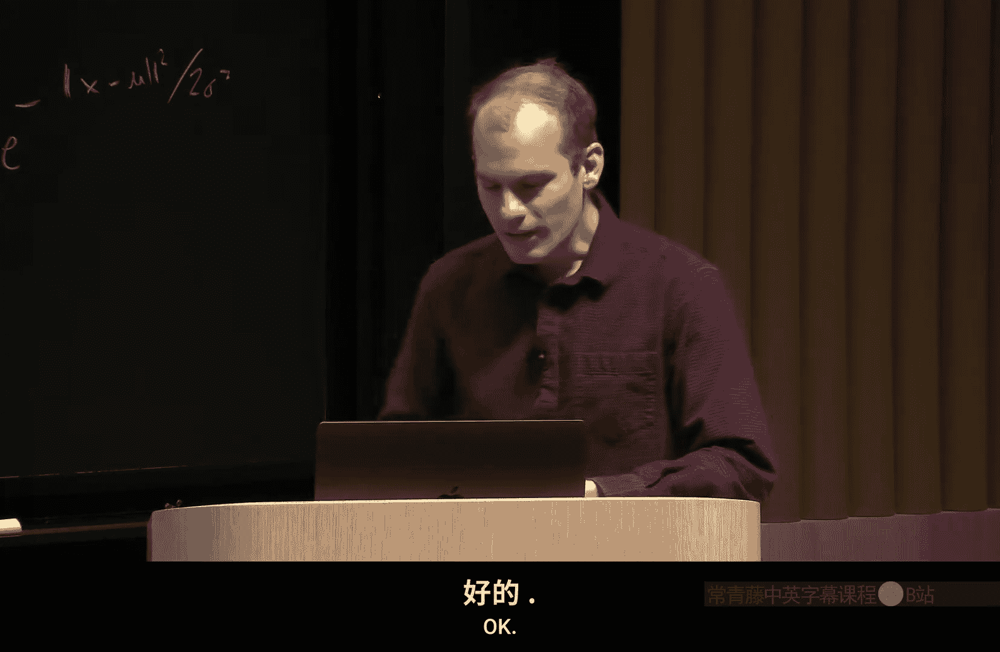

Okay， well。Well， also dimensions of problem。いやなぶれ。You wanted打。

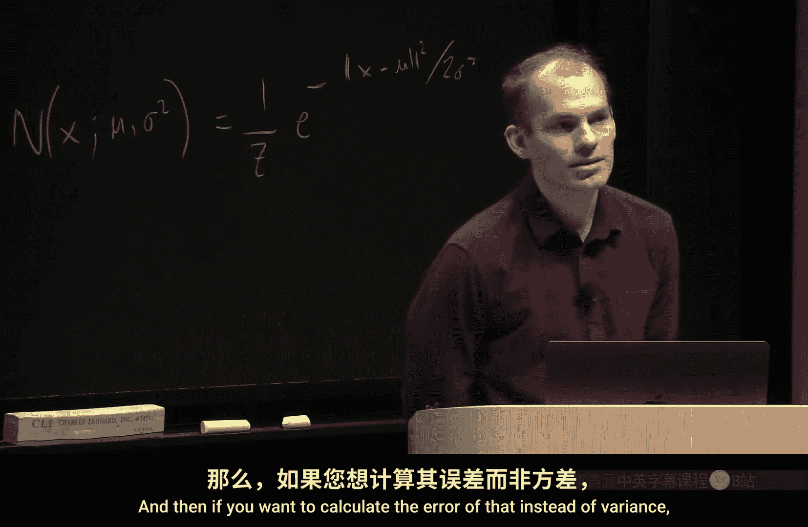

え。I think actually。電休。I think it's exponential in dimension。

 or So there should be some term in terms of the number of samples you need to get some quality of fit。

Should rely depend on the dimension。 I think it's exponential in dimension。

 but there's probably more to discuss。 Maybe we can take that offline。

But I'll just say that in practice， this doesn't work in high dimensions。

 And I think it's because you need exponentially more samples to get a good approximation to the integral high dimensions。

 But we， we should talk about that more offline to see if that's really true。Okay。

 so the next trick of the VE is we're not going to just sample randomly。

 We're gonna to sample intelligently。 We're not going to just do naive Monte Carlo approximation to integral。

 We're going to do a much more intelligent approximation to integral。

 And that one is going to be called important sampling。Okay。

 so what is the idea of important sampling。 And the idea is that。

 let's say that I want to estimate the likelihood that my model places on some data point X。

 that little X up there。Okay， what I'm going to do with important sampling this say。

I could say that that's the expectation of P X given Z with respect at taking expectation over Z。

And I could randomly sample disease， to calculate that expectation。

But what will happen if I randomly sample the Z， then almost every single P X given Z for most of the Z will place nearly zero probability on that data point X。

 right， Most of these mixture components don't lie near the data point X。Okay， just in practice。

 this is what might happen if I've spread out these mixture components to be a good fit to the data density。

Okay， so the observation is that with random sampling。

 maybe I have to take like around 7 samples to get one Gaussian component that's in your x。

 and almost all the other components are adding 0， roughly 0。

 So it's like this P of x is equal to the average of you know P X given one sample plus P X given the other next sample plus P X given the next sample。

 But most of these P X given a sample are 0。 So almost all the terms are nearly 0。

 except for the sample that except for the the that map to Gaussians are that place high density over this。

 this X。😊，So in this expectation， most of the terms are going to be 0 for any given point X。

So we can exploit that by just trying to say， let me only take the sample Z 2。

 and that will be a good approximation to this expectation。And this is called。

 this is the idea behind the importance of sampling。 So in order to approximate this expectation。

 which is that integral， I can simply multiply by Q by another density Q。

 and I can multiply by Q Z divided by  Q Z。 So Q Z divided by Q Z will be one。

 as long as Q Z is nonze everywhere， which is just a technical condition。

 we need to make sure it has like support everywhere。Okay， so then I can。That's valid， right。

 so I'm just multiplying by one。But the interesting thing here is now this appears as an expectation with respect to Z samples from Q Z。

 as opposed to Z sample from P Z。And if QZ is a distribution， which has placed。

High density only on the Z's that actually contribute to the sum that actually have high probability of the data under that Z。

 high P X given Z， Then this will be an expectation which requires fewer samples to get a a good estimate of the true integral world。

Okay， so， so this is called important sampling。 And I'm sampling from a distribution that kind of gives more importance to the the points that matter。

Okay， so I won't prove this， but I'll just assert that the， the optimal。

Distribution to sample from for performing this estimation in a certain sense。

 I think the distribution that like minimizes the the variance over my estimator of this expectation is to sample Zs from exactly the density P Z given X。

Okay。So what does that look like。if。If I knew Pz given x。It's like here， here's X。 So given X。

 These are the Z's。 Let's say that place high probability on X。 It's a distribution。

 It might be a complicated distribution， but most of the density。

 like this is the high density region of P Z given X is， is， is in a small region。

And if I could simply sample from those points， it would suffice to get a good estimate of what would happen if I had sampled from everywhere。

 because most other points will play  zero density， and they just won't contribute to that。

 that integral。ARough zero density。Okay。Okay， so important sampling is like。

 now I just sample once from this distribution。 and I get a as good an estimate as having sampled seven times with random sampling。

Okay， so here's the entire transformation。 I'm going to estimate the likelihood that my model places on the data via this expectation。

 but I'm going to switch it to this other expectation。😊，Where these， these two。

 these two expectations are exactly equal to each other， right， that's because。

These two integrals are exactly equal to each other if Q has nonze support everywhere。

But this one can be approximated with a Monte Carlo set of a Monte Carlo approximation to this expectation is going to be a better estimate。

 lower variance than this expectation。Okay。So。Here's important sampling， random sampling。

 I take random samples from from Z from P Z， and most of them don't contribute to the sum。

Important sampling， I only sample from the points that contribute to the sum。

 I only sample from the points that the model thinks will， you know， place high probability on， on X。

 So the probability of Z given x is the points that the model thinks are the Z's that will place high probability on x。

ok。Great， so if I knew P Z given X， then this would be what I wantan to do。

 I just sample from P Z given X， and I get a better approximation to that integral and。

This will then work in high dimensions， because sure high dimensions， the volume is exponential in D。

 but the area of Z space that actually maps to any given point X might be very small under a particular model P。

Okay， but the problem is， I don't know P Z given X。 That might be another complicated distribution。

 And I now have to come up with a way of modeling that distribution。So here's how you do it。

 The next step in the V， the trick， the third trick。

Is you're going to try to model or predict the optimal sampling distribution。

 The sampling distribution P Z given x， given given X。

 You're gonna train a model that will take X's input and output a density over Z。

 And that will be a model of P Z given X。Okay， so now we get to where it starts to look like an autoenr。

 It probably didn't look at all like an autoenr until now。But what does that look like。

 That's an encoder。 That's a mapping from X to a distribution over Z space。So， our model of。

Our model， which we'll call Q， which is trying to approximate。Peace。P theta Z given X。

 So we're gonna try to approximate that with another prediction called Q。

That density is going to be just for simplicity model also as a Gaussian。

 So we're going to take our X。 We're going to try to predict what part of Z space would P place high probability on X。

 So for what part of Z space is P P X given Z high probability。

 We're going to predict that by modeling a distribution over Z space。😊，Okay。

 we're gonna make that a Gaussian。 It will be， will take a neural network F。

 It will output a mean in a variance or maybe a covariance， if we wish。

 And that will be our model for P Z and X。 And that model is called Q。 And Q has parameterssi。

 which is the new set of weights and biases of this encoder function。😊，Okay。Okay， so。Now。

 we're going get to the full picture。 So we have， we have these two pieces。 We have the。

Decoder function， which is this probability model probability of x given z。

 And we have this encoder function， probability of z given x。We're going to put them together， now。

So。How am I going to actually write down the objective function for the encoder？ So the objective。

 we're going to say we want it， We want the encoder to model a distribution。PZ given x。And。

 but it's going model that distribution with another distribution parameterized by mean and variance that defines a Gaussian。

 And that's going to be Q Z given X。 And we're going to try to make those two distributions the same。

 So we're going to use the K divergence to try to minimize the difference between those two distributions。

 Just a particular divergence measure of how different are two distributions。

 We' going to make them the same。Okay， so this is our objective for the， the problem of the encoder。

 The problem of the encoder is to minimize JQ。 Actually， I think have a negative sign。

 it's gonna to be to maximize JQ。ok。So I'm just going to rewrite the kale divergence。

 There's a little bit of kind of algebra that you'll probably want to look at in more detail your on your own time。

 but this is one way of writing out the definition of kale divergence， okay。It's going to be。Yeah。

 this equation is going to be an in expectation sampling from the density that Qs Z given X。

 all of these terms。Okay。So。The learning problem for Q is to maximize。

To minimize the k divergence or maximize the negative kale divergence。 Okay。

 so this is the learning problem for Q。Is trying to predict the distribution over latent variables that will explain a given data point X。

 We call that inference sometimes and for the latent variables that explain the data X。Okay。

 I can take this equation， and I can notice that if I'm maximizing with respect to the parameters of Q。

 Well， the parameters of  Q don't appear in this term。 So I'm gonna just remove that term。

 they don't affect the， the maximization problem。 They don't affect the arg max over。

 over the parameters Psi or the parameters of the encoder。Okay， so now。

 and I'll we'll use this term a little bit later。 But this equation here will be J。

 We'll come back in a minute。Okay， so for our learning problem for Q。Is to optimize this。

 And this is an expectation。 So I could optimize that again by just taking a。

Monte Carlo estimate to the expectation by sampling a bunch of different Z's and taking the average over all of the values within the expectation。

Okay。So that's the learning problem for Q， for Q， which is parameterized by a neural network F。

Map from x to an inferred distribution of relatedant variables that can explain x。Okay。

 the learning problem for P。 This was our original learning problem。

 We wanted to learn a generative model G parameterized by neural net G， where G places。😊。

Gaausian probability over the data space X， and G defines an infinite mixture of Gaussians by mapping from by taking an integral over all possible points in Z space。

Okay， so for a learning problem for P， I'm going to call JP。It's to find the premiers theta。

That maximize the likelihood that my model places on the data。And that， and with important sampling。

 that means I'm gonna sample from my important sampling distribution Q， which we learned the optimal。

 important sampling distribution  Q up here。 We know that it should be P Z given X。

 but we're just going to try to learn P Z given X by fitting a distribution Q to P Z given X。

And this is then my important sampling for estimating the integral that defines the likelihood of the data under the parameters theta of my model neural net G。

Okay。So I know there's a lot of terms in math going on。

This might take you time to work through step by step。 All of， you know。

 this derivation is in the reading for today。 So these these slides follow that almost exactly。

 And additionally， the problems that you'll get to work through some of this yourself。 So you。

 hopefully you'll enjoy that。 But I know this is a little more mathematically notation heavy than some of the other lectures。

😊，Okay。So now putting everything together， there's one little final step。Which is。It turns out that。

If we approximate log of expectation by taking sample， like a Monte carlo estimate。

 by taking samples from。The thing that we're taking expectation over。

 if we do a Monte Carlo estimate of this。 and then we take log of that。

 It turns out that's a biased estimator of log of expectation。

 So Monte Carlo estimate of log of expectation is a biased estimator， that we don't really want that。

 We want it to be the case that as samples go to infinity， we get the true answer。

 and that won't be the case here。So we're gonna to do this little trick。

 which is that we're going to pull the log inside the expectation so that then we just have expectation of some function。

 And then a Monte Carlo estimate of that expectation is an unbiased estimator of that expectation。

Okay， so we're allowed to do that by Jensen's inequality。

 that says log of E of some function is equal， is greater than or equal to expectation of log of that function。

So this is just an identity again from a lot of you have seen Jensens in quality。

 it comes up a lot when you're working with probabilities。

And now what we have is that this is going to be a lower bound to our objective J。

 So this is a lower bound。 I can rewrite it。 So I take the log。 I， you know。

 move around the terms a little bit。 This is just rewriting some algebra。And this thing here。

It's called the evidence lower bound。 Okay， It's called the elbow。

 So you'll come across this term if you're working in V As or other types of what we call variational inferences。

And。It's a lower bound to the thing we actually care about。

 which is the likelihood of the data under the model。

And it's a lower bound due to Jenten's inequality on this line。

And this is something that is now we can approximate this expectation as an or this expectation as。

With samples， it willll be an unbiased estimator of that value。

 So we're going to have an unbiased estimator of the lower bound。

 We can maximize the lower bound on the likelihood the model applies to the data。

 and this will learn a model that places high likelihood on the data。

 Maximizing a lower bound will increase my objective J。Okay。So evidence。

 like this is the evidence that the。啊。The model provides for the data Anyway， Yeah。

 don't worry about the name too much， but it's called the evidence lower boundage terminology elbow。

So it comes in two terms that both have kind of an intuitive form。啊。

And I'll get to those on the next slide。 But the interesting thing is。

 once we have written things in this form， what you can notice if you go back a slide is that this objective is actually exactly equal to the objective that we had for a Q。

😊，Okay， so， so Q appears over here in this K L term。 So what is this saying， This is saying that。

In order to learn the parameters of the encoder， they give me the best important sampling distribution for estimating the likelihood the decoder places on the data。

It actually works out that I can just。Maximize。This evidence lower bound with respect to the encoder and decoder parameters jointly。

Okay。So， the V A E objective。Now can be written in this form as maximizing this lower bound to the thing we actually care about。

 And I can approximate that with sampling。 it will be an unbiased estimator of that of all of these expectations and integrals。

It has two terms。 It has the first term， which is how much probability does the model place on the data and another term。

 which is， well， I was estimating how much probability the model places on the data with respect to the wrong。

 not actually taking samples over all of Z space， but with taking samples with respect to this other distribution。

 So I have to somehow account for that。 So I'll penalize the difference between this other distribution and my prior to the unit Gaussian and PZ。

Okay。So this， this term is coming out because I had to multiply by this ratio。 How much， you know。

 how much different are my samples under P Z from my samples under Q Z。Okay。

 so that pops out into this， this term here。So now the encoder is trying to make these things as similar as possible。

 and the decoder is trying to just learn parameters theta that will maximize the probability。

Placed on the data。Okay。So here， here's the picture。 I'm gonna start with the data point X。

 I will encode it。 that will define a distribution over my latent space。

 I'll take a sample from that distribution。 That's one important sample for estimating the probability of my model places on the data。

 And then I'll decode that and see what probability the model did place on the data。

That's like one important sampling step of approximating the lower bound to the probability that my model places on the data。

Okay。So now we come back to autoenr a lot of math。 But at the end of the day。

 the V is a very simple model that looks just like an autoenr。

 So here's how it looks like an autoenr。 We start with data point X。 We encode it。

 We get mean musi and variance sigma squared Z。😊，We then take a sample from the distribution Q Z given x。

 So taking a sample that means we're just going to add noise。 Okay。

 so remember that mu z plus unit Gaussian epsilon times standard deviation for the encoded point X。

 So sigma Z is going to be the standard deviation of the encoded point x。

This is one sample from a normal distribution center at Muz with variance sigma Z squared。Okay。

 I think I'm getting the squared versus not squared term correct now。So that is one sample。

For important sampling for estimating the density that my model will place on the data。

 So then I will decode that to observe under a normal distribution。

 What is the probability that my model placed on that data for that mixture component。

 which is a good approximation to the entire integral。

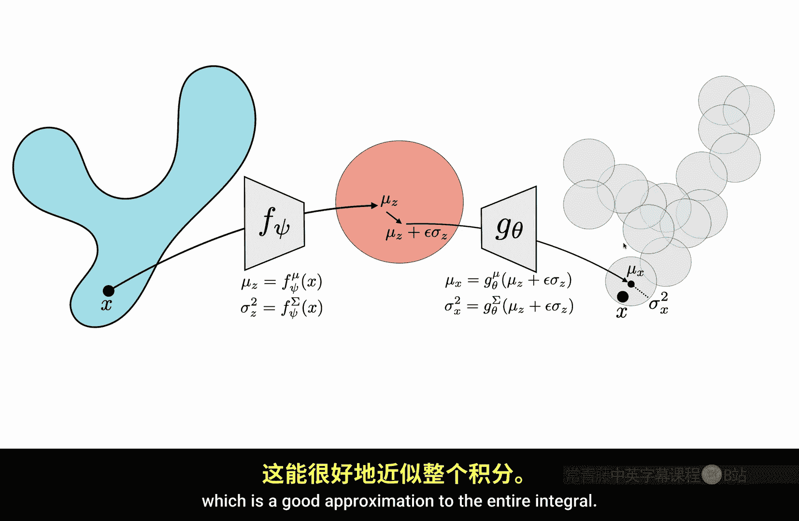

Okay， so remember， the normal distribution is just analytical forms that can calculate。

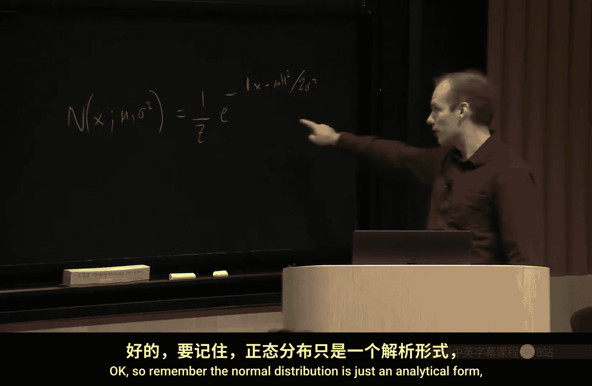

How much probability G placed on the data point X。Okay， so this looks just like an autoenr。

 except one step， which is this noise I added in the latent space。Right， otherwise。

 it's just encode code decode。 But I added a little bit a little bit of noise to the latent space because that's my sampling。

 That's， that's necessary because I'm I' I'm sampling to approximate this expectation。Okay。

 so here's the two terms of the elbow that I talked about before。The first term。

 it looks like a reconstruction error。Okay， why， because P theta X given Z is going to be。

A normal distribution。Over x。centered at。Aine， which is the decoded G theta of Z。Okay。

 so a normal distribution for x is just going to be a log normal distribution will be just d squared error。

 right， If I take log of E to the negative squared distance， it's just negative squared distance。

So how different is my decoded point from my。Input， observation X。That's this likelihood term。

And these other terms over here are just because the Gaussian distribution has to be normalized and the variance appears in the normalization and dividing by two sigma squared is just also part of the definition of the Gaussian probability。

Okay， so just for simplicity， imagine that we're going to model。

We're gonna use a V AE where we won't actually model the covariance or even the variance of the Gaussians。

 This is a valid modeling twist。 I could just fix。My circles to have radius 1， I can say。

 I'm gonna try to fit an infinite mixture of Gaussians where I don't get to change the variance of the circles。

 But I'm still gonna try to find the max likelihood fit。 That's a perfectly valid modeling choice。😊。

And if I did that， then sigma becomes one。 And this， these all， these terms all become constant。

 And then you can see that really， all I would be doing is trying to minimize the difference between my。

Data point X and encode decode of the data point X。 Okay。

 so then it would be exactly the autoenr objective of minimizing the mean squared error between my reconstructions and my input observation。

Okay， so Vs often will also model the variance of the Gaussian。

 but vanilla autoenrs don't really model the variance of the Gaussian。

 They just kind of implicitly set it to be constant。Okay。Okay， the other term， the K L is saying。

 well， I need my， my。Q Z of given X distribution。 I want it to be close to a unit Gaussian。 So we。

 we say that， you know， the， the the posterior of the。

 the inference direction should be near to the prior P Z。Okay， so what is this。

 This is from all a very simple interpretation。 So here's what it looks like。

 This is the K This is the K L divergence between two Gaussians。 So luckily。

 the K divergence between two Gaussians has a closed form and analytical form。And it。

 it looks like that。 So remember， the， this is the k divergence between the Gaussian defined by Q Z given X。

And the prior Gaussian， which is the unit Gaussian。

 So this is the kdirgence with respect to between a Gaussian that has mean mu and variance sigma squared and the unit Gaussian that has mean 0 and variance 1。

Okay， it has this form。In the readings we posted the original VAAE paper， and in the appendix。

 there's a nice derivation of that form。Okay， so what does this look like， Well。

 let's again imagine that we're not gonna model the the， the variance。

 We're just gonna set the variance to be one constant。 We're only going to get to。

Update our neural net to improve the density by changing the means that it it places over the data。

Okay， so these terms would then can be ignored。 They go away。 This is just a constant。

 So what is that that's going to be， I want to。嗯。Minimize。The means。 So basically。

 if all these termss are constant， you know， that one half is just a scaling in order to。

Increase the evidence lower bound in order to place higher probability on the data。

 increase the lower bound to the likelihood I place on the data。 I'm going to try to decrease。

The means。 So all of this term is saying is squash the means toward the origin。

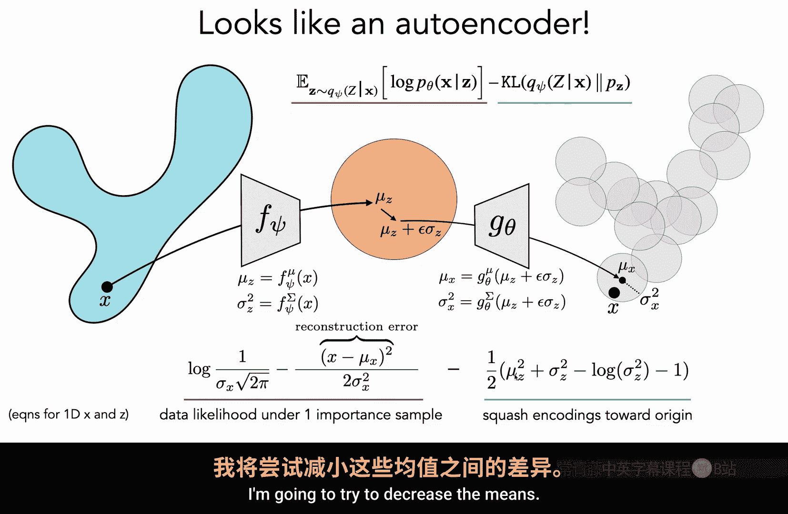

So I'm going to try to reconstruct my data。 That's the first term。

 That's the data reconstruction term。 That's an autoenr。 And I have one extra term。

 which is just do that in a way where all of the encodings are near the origin。

So what does that look like， That means that this funny shape that I could have gotten。

 this is an autoenr。 I just encode I decode， I minimize reconstruction。

 I might get an arbitrarily complicated latent space。 In fact， here。

 if my latent space is two dimensional on this cartoon， I could just have F be the identity。

 And then my latent space has exactly the same shape as my my input data space。

 if G and F are both the identity iss just like I encode to the same shape。

 I decode back to the same shape。😊。

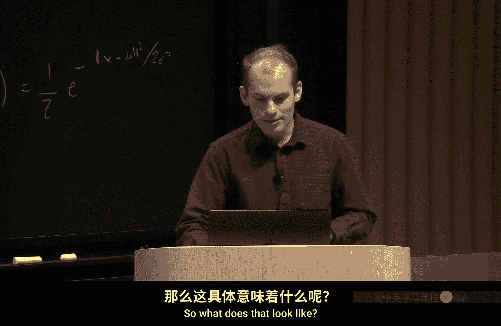

That would， you know， satisfy the reconstruction error， but it。

 but it wouldn't be a very good representation of the data。

 It would just be the raw data itself once again。So the variational autoender simply says， no。

 you've got to squish that latent space toward the origin。Okay。So。

This means that in a normal autoenr， I need to make sure that dimensionality of the latent space is low。

 So that I'm doing compression and forcing it to do something nontrial in a variational autoenr。

It helps have a low dimensional space， but it's less critical because there's this other term。

 this K L term， which is trying to compress the distribution toward。

0 to compress all the means towards 0。 And equivalently， we can understand that to be。

 I'm trying to make the distribution of encodings Z have the shape of unit Gaussian。

 But when I'm not modeling the variance， that just means squishing the means towards 0。Okay。

 so I just wish everything down。 Why does it not collapse to a single point。 So what do you think。

 what if， if this。

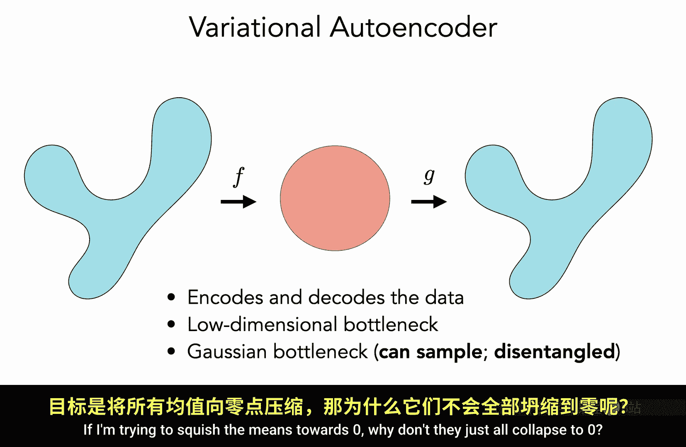

If I'm trying to squish the means towards 0， why don't they just all collapse to 0。

 What do you think。

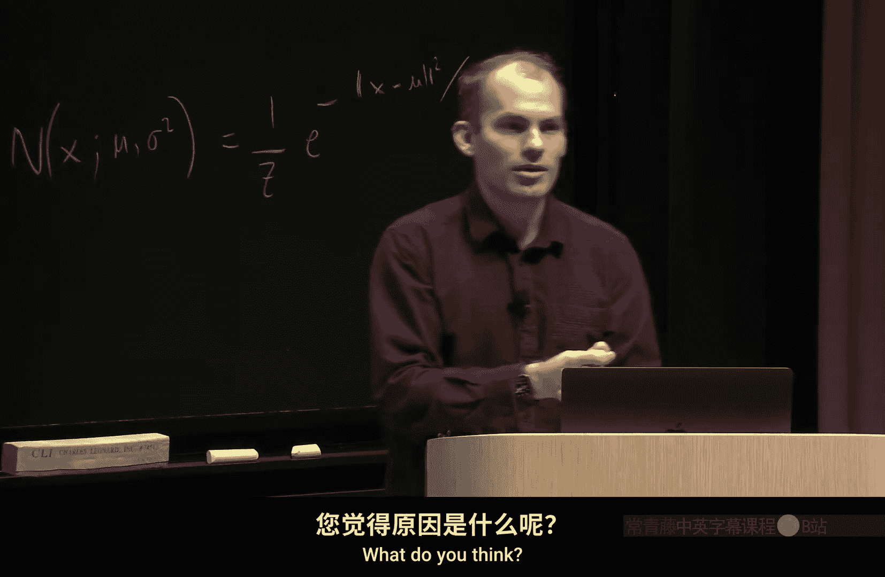

What prevents that？I think I heard an answer， no。If you push everything to 0。

 it's trivial it's trivial。 And what will happen to the the reconstruction， you cannot you cannot。

 Yeah， So that's the tension。 We're going to try to push everything to， to 0。 That's。

 that's this term。 If I'm not modeling the variance。 But I also need to satisfy this term。

 which says that you better be able to reconstruct your input point。

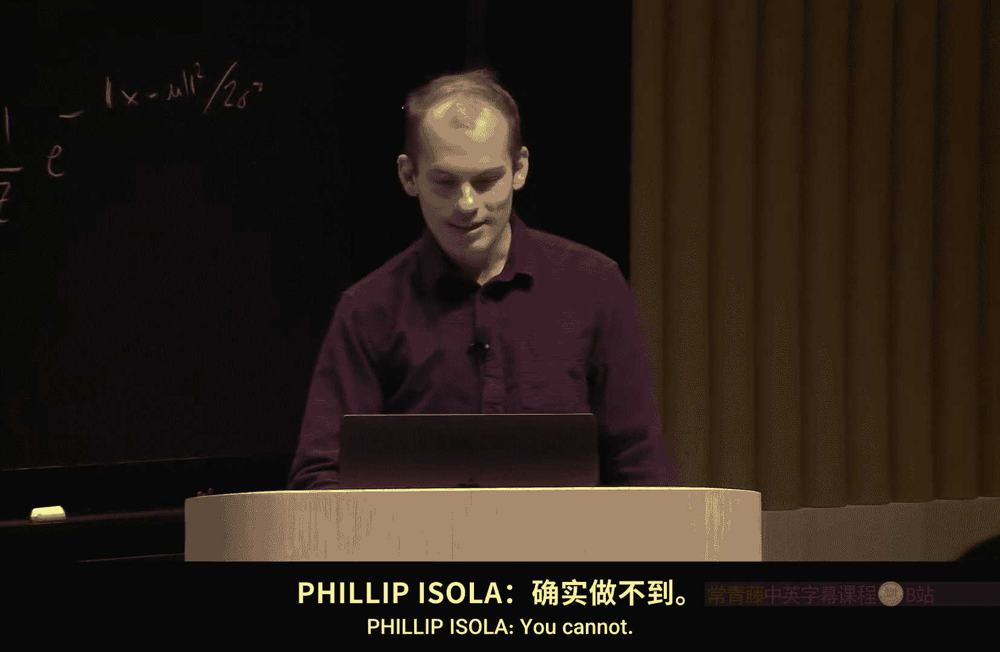

And if everything goes to 0， then there's ambiguity。 So in order to reconstruct the input， I。

 I need to preserve information。 I can't compress too much。 I can't squish everything down too much。

So you want to spread out in order to be able to reconstruct the data。

And that's the fundamental tension of the variation autoenr pushes everything toward the0 createates this compact shape。

 It's like I have some like Plato。 And I'm trying to squish it down。

 But there's also this physical force， which is preventing it from going to like a black hole。 right。

 It's like， it's like， no， no I don' wantan to do that because I need to。

 I need to still be able to know where I came from to British。 know， to reconstruct the data。

 It's it's like that I'm pressing it down。 But there's some tension eventually it gets to this unit shape。

And that's， that's what the math works out too。 So here's what that looks like。

 So now here I'm showing the encoder mapping added initialization that neural net is initialized with weights and biases that are near 0。

 So everything maps to to 0。 and then the decoder。 So initially。

 all of my mixtureer components are near 0。😊，Okay， and here's what it looks like to train。

 So what you'll notice is。II'm getting a good coverage over the data distribution。Okay。

 that's my infinite mixture of Gaussians， but I'm visualizing it with the finite s of samples along this grid。

And what is the encoder doing？It's like， I want to spread out these Gaussians so that if I go from X to Z。

And reconstruct。 I'll know where I came from。 I'll have an information。

 But I also want to be near the unit unit sphere unit Gaussian。

 So this tension will kind of make it pop out and then like kind of squish back together。

 And you can think of this almost like some sphere packing problem。

 There's probably some interesting connection to like a geometric way of understanding this that if you have a bunch of spheres And you want to fit them all into you want to make them not overlap。

 if they overlap。 what's the problem， that means there's ambiguity。

 If two different data points map to the same point or overlapping Gaussians， then there's ambiguity。

 You don't know which one it came from。 and you can't reconstruct。

 So it's like you don't want them to overlap too much。

 But you want them to squish down at the same time。 And there's this tension。

And then the solution is that they'll kind of spread out to evenly tile the unit Gaussian。Okay。Okay。

 so here's what the densities look like。 if I plot them as a heat map。

 So remember these are the Gasian components。 But actually， theyre continuous。

 there are little blips of， you know Gaussian probabilities。

 So here's what it looks like as a heat map。 It really did learn a good density model。😊。

And here's the density over the latent space， it becomes kind of a unit Gaussian in two dimensions that looks like just like a little blip of be shape probability。

Okay， so V AE is really just three tricks。 approximate an infinite mixture with samples。

 sample efficiently by not just sampling random， but with importance samples。

 So approximate with important samples。And predict the optimal， important samples to take。

 the optimal， important sampling in distribution with another neural network。

 and then jointly optimize the whole thing。 And it looks like an autoenr。O。

So in case some of that was a little bit too abstract， I just wanted to give you this step by step。

 Like， what would you write in Pytor to make this happen。 It's actually very simple。

So to optimize a VAA， I'll sample a data point X from my 2 set。Or maybe a batch of data points。

 I'll encode the data with a forward pass through my encoder。For each data point that's been encoded。

 I'll add some noise to my encoding。Okay， that's my important sample。

Then I'll decode the data by passing it through the decoder， and it'll compute the losses。

 which will just be the squared error and the KL term。And then。

That will give me a scalar loss value at the end of the day。

 and I'll just back prop through that computation graph。And typically， for the V E。

 even though I would really want to take a lot of important samples to get a better estimate。

 Usually people just take one。 They do forward， one sample， decode backward。

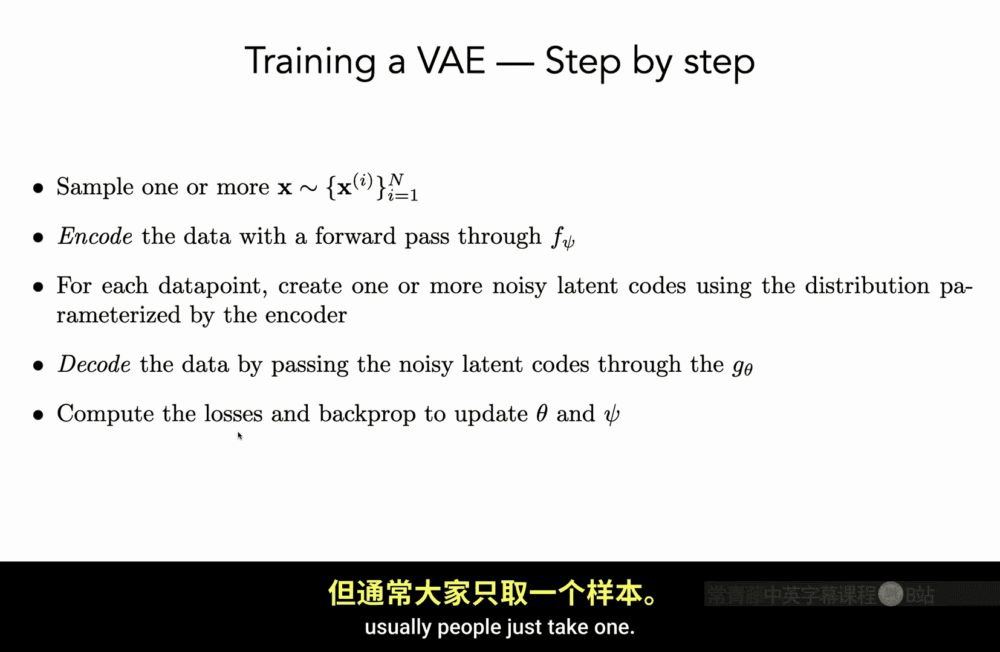

And that seems to be sufficient。How do you back through sampling？So that's why that repar。

 how do you back through sampling。 That's why that re parameterization trick was important。

 because the stochastic element comes in through the side of the graph。

 and you don't actually have to backrup through that sampling procedure。

You're just back propping through the mean and the variance of a distribution。

 and the actual noise is coming through the side and doesn't affect the optimization。

A question in the back。Pance inside the latent。正个。Probably。这是 also。多声。

Because it would be natural to think like， oh， you just do an auto coder and you just noise it。

Yeah will be smooth。But maybe it does matter。いや是。Great， yeah， good question。 The question is。

 for the encoder， iss it important that the， the noise you're adding actually is dependent on the。

 the variance predicted by the neural net。So could you're kind of asking for Q Z given X。

 which you're modeling， would it suffice to just model the mean and set the variance to be  one or some constant。

And。I think indeed， oftentimes you can get away with those types of things。

 like you can just take an autoencor， add a little noise to the latent space and do nothing else。

 And it might kind of be fine。 Or maybe you add this kale penalty to like， say。

 take an autoencor penalize the means for being far from origin and add a little noise。

 and it'll kind of give you a VE and it might be fine。 But you know， your mileage will vary。

 And you can always also not model these things with Gaussians， but more complicated distribution。

 So there's a lot of variations on on this。 But the simplest vanilla version。😊，Might be good enough。

And I think it captures the full idea。 Like the simplest vanilla version is just。

Smooth out the latent space and make it dense by penalizing。

The encodings from being far from the origin and smooth it out by adding some noise so that like。

It has finite information capacity， it can't kind of overfi or have too complicated a decoding mapping。

Okay， anyway， more to say about that。Yeah， question。 the data variable。よ。ありがとうございます。Yeah， so right。

 So why， why is pushing the latent variable distribution to 0 better？ So it comes out as。That is。

What K L divergence between a unit Gaussian and another Gaussian will do。嗯。

But I think more intuitively， it's just， it's this kind of severe packing idea that。

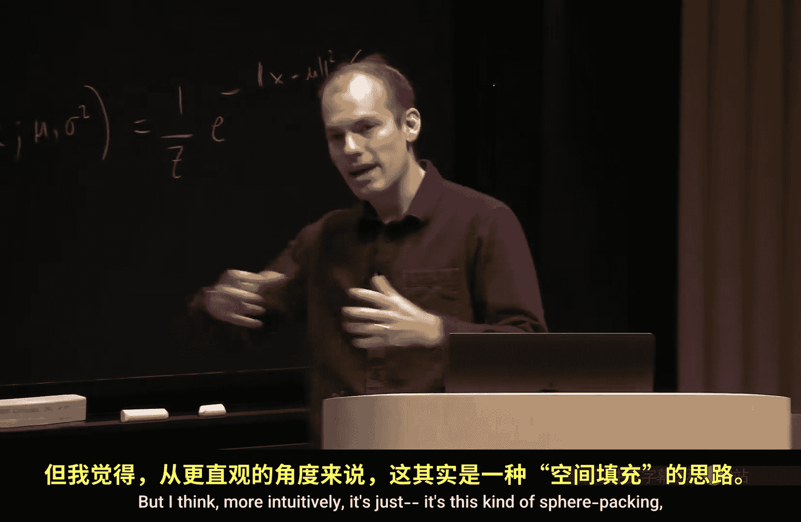

系。嗯。I want it to be the case。That every single point in Z space， if I sample from that point。

 it will lead to a valid image or a valid decoded data point X。And if I don't pack things in。

 if I don' squish， if I don't squish all the means towards 0。Then there might be gaps。Right， so。

Like here， there might be these gaps。At the end of optimization。

 there's a little gap here that might。 I mean， this is only a finite of samples。

 but maybe there's no。These data points here， like they can't be reconstructed at all。

Or equivalently on this direction， if there's gaps here， if like if these。

Means all went out to infinity。 So it's like， oh， I have high capacity。

 I can kind of memorize everything。 They're gonna go out to infinity。

 So they'll all be infinitely far apart and then I can you know。

 more easily decode where they came from。 There's no overlap at all。

 It's like perfectly information preservance inverible。 Well。

 that wouldn't be good because thered be all these gaps。 where if I now take a sample from a Z space。

 I might end up in a gap。 This never So the decoder has never seen that sample。

 and it will not know what data point to reconstruct。😊。

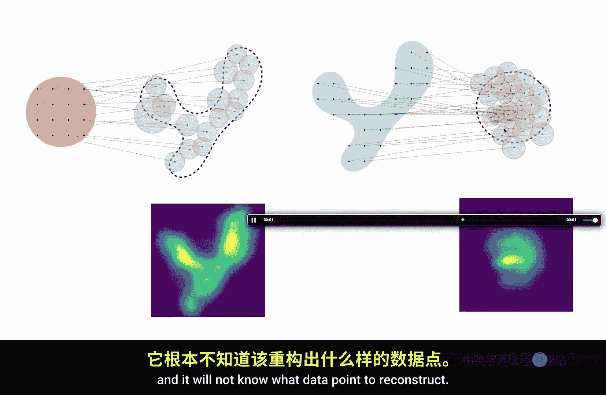

So you want there to be no gaps so that any point you sample in that Z space will map to a valid。

Data point X， according to your distribution of the training point x。Okay。

 that's the intuition I have。

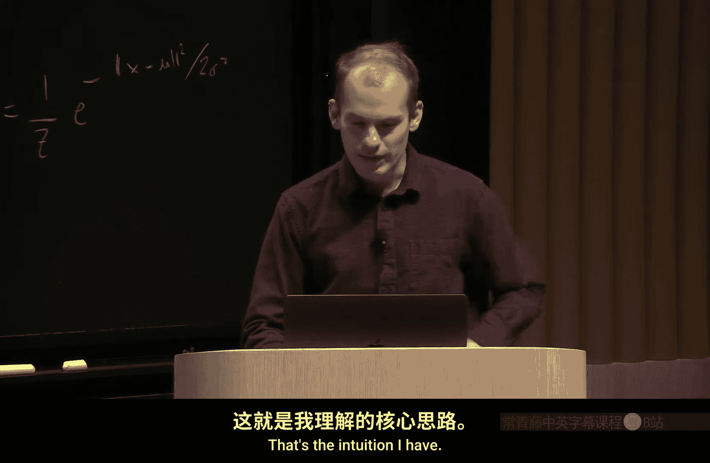

Okay， so in the last 5 or 10 minutes， I want to。Talk about what kinds of representations are learned by a VAE and other generative models。

And。嗯。So so we're going go back to this example here。 and we're going to ask。

 are the latent variables Z that the VAE learns actually related to what I gave as an intuition。

 I said I could write a Python program that takes a normal distribution maps it to grass color。

 a Bulli distribution， maps it to the turns of the river。😊，Well， is that what actually happens？

When I had train a model without kind of hand defining that。Okay， so I'll take my data。

 I'll learn my encoder and my decoder。My decoder can generate samples。

 and this is a good generative model of my data。 But now let's look at the encoder。

 Is the encoder separately useful。Is a VE a good representation learner？Okay， so。

 so we'll visualize it like this。 We're gonna take our， our latent space。

And we're going to move in access line directions in the latent space and see what images those map to。

Okay， so if I move along one axis of latent space。It ends up causing this kind of smooth variation in the output space with the curvature of the river changes。

If I move along another dimension of latent space。It ends up changing the color of the grass。 sorry。

Okay。So， indeed。My。Learned latent distribution。Ends up having different dimensions。In latent space。

 controlling different。Types of visual variation on this data。

And those types of visual variation actually do relate to the underlying。嗯。Prameterters。

Of that that define causally how the data was generated。 Like there is a causal process。

 a Python program I wrote that takes these。Attributes and turns them into rivers and grass and so forth。

And one of those attributes is the grass color is a normal distribution。

 So there's one dimension of the latent。Space。That generated the data that should control grass color。

 And the VE actually recovers that。 So it kind of identifies that true factor of that true causal factor in the data。

Okay， but this is not always going to be the case。The other factor variation that I'm showing you here。

 which is the curvature of the river。 actually does not correspond to any of the。

Underline variables in my Python code， because the Python code took a vector of Bnoulli coin flips to determine the shape of the river。

And there was no single variable， no like Gaussian variable that defined the kind of overall shape of the river。

 It was just a sequence of Bnoulli steps。 But some of the Vae learn this kind of abstracted。

 like intuitive physics of the world。 It didn't actually learn the physics of the world that I wrote in Python to generate this data。

 It came up with this abstracted abstraction， which is that there should be a factor of variation in this data that controls the curvature of the river。

 That's a good explanation。 So a VaE， like other representation learners can learn different independent factors of variation that affect the like primary independent you can learn different latent variables。

 different dimensions of latent space， that control different independent factors of variation。

 we call that disentanglement。 that if I vary the river or curvature dimension。

 it does not affect the color。 And if I vary the color。

 It does not affect the river curvature dimension。 This is a disentangled representation where there's independent independent between the effects of those two factors。

But those two factors don't necessarily map on to actually the causal mechanisms underline how this world was defined。

 They might be more abstracted for it。Okay， so VEs are not the only models that have this property of learning organized latent spaces that are good maps or good representations of the world。

 In fact， this is an example of aganN， and it does has just the same types of properties。

 So we covered GNs very briefly last lecture。 and it's not GNs didn't have any encoder that maps from data to to latent。

 So Vs do have an encoder they can go from data to the representation of the data in this disentangled space。

 The GN doesn't have that。 but nonetheless， the latent variables if you。

Sample random latent variables or sample along a grid of latent variables。

 They do show that they actually model structure in a similar way to the VAE。

And here it's just an example from a model called Biggan。

 where there's one direction in latent space that controls the orientation of the bird and one direction that controls the background color。

And you'll see this over and over again in all the types of generative models that we have talked about。

 there are。There are some kind of latent variables， usually like in diffusion models。

 maybe the noise。Or there are other intermediate variables like the activations of the network as it processes as。

 as the decoder processes the data， the activations on some layer。

 I can look at directions in that activation space。And these tend to learn， you know。

 structured representations to the data that that is the mechanism by which the model can fit to the world effectively。

 It has to learn some kind of you know factors that can parsimoniously explain the data。

 If it only has so much capacity， so many dimensions。

 This is kind of somehow pops out that this is a good representation of the world that allows you to generate photos that maximized likelihood。

Okay， so generative modeling。Forces you to explain the world。

 explainplaining the world is done well by actually capturing independent components and things that we have physical names for。

 like background color。 But sometimes things that are more abstracted， like。

Low frequency curvature of the river。嗯。Yeah， this one， maybe just a kind of。

Fund visualization to end on。This is， again， that same。Map， and here I'm coloring the input points。

 according to the coordinates within this space。 And here's what happens as I train it。

 So what you can kind of see is that。This thing gets the points in this space get remapped to the sphere。

But not like in a disorganized way。 It's all it's smooth。 It's a smooth map。 And that's。

 that's kind of why you know， it's， it's meant to give an intuition for how these。

Dimenssions of the latent space might map to smooth properties of the input space because on this simple example。

 all it's really doing squishing the thing down。 But there's also an important point。

 which is that it didn't quite fill this gap here。 know。

 if it really was' going to squish it into a sphere。 a Gaussian， then it should fill that。

 And you you'll see this when you're training generative models that in the latent space。

 things will be smooth and nice and there'll be a seam。

Because it's like you're mapping this complicated topology onto a sphere。

And you're gonna to have cuts and seams。 And you see it right here。

 So if you're navigating through a V A E latent space or diffusion model activation space on some layer of the network。

Youll you'll come across these weird jumps。 where it's smooth， smooth， nice variation。

 And then suddenly it switches to a different category。And that's what's going on here。Okay。

 also these tendrils。 like you， you can't。 This is all smooth transformations。 How do you cut。

 You can't really cut。 So you get this tendril of probability。Okay。

 so these are the models that we've seen in the last two lectures。 we covered a lot。

 So we talked about， you know， a bunch。I'd say think the most popular right now is diffusion models。

 the most like complete， like full picture that encompasses everything is VEs。

 The most cute and fun is GNs。 The ones that are popular in language modeling and is autoregressive。

 and they all have different trade offs。 Some of them have latent variables that are explicit。

 Some don't。 Some give you a density or energy function。 Some don't。

 and some give you a way of sampling in efficientlyffly and some don't。😊。

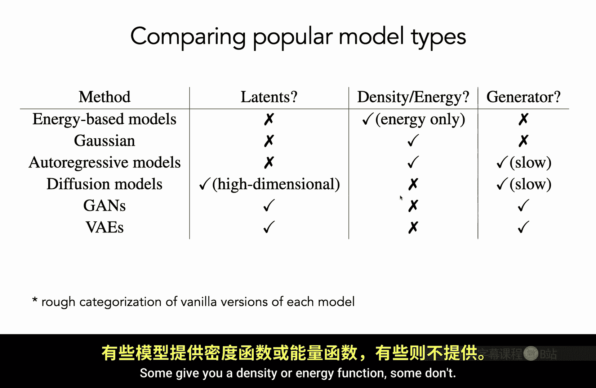

So that's for your own reference to review。

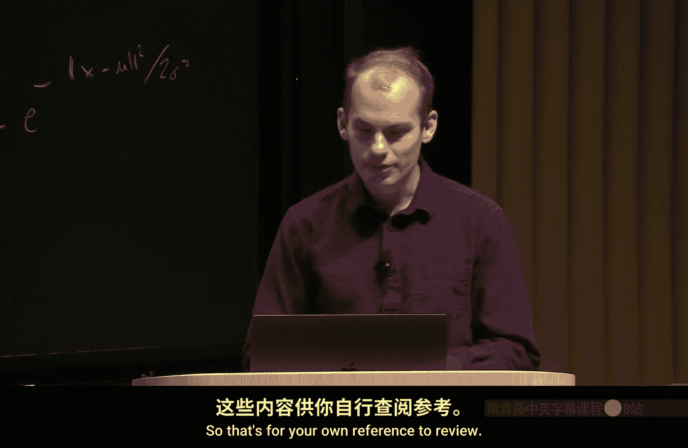

Thank you。

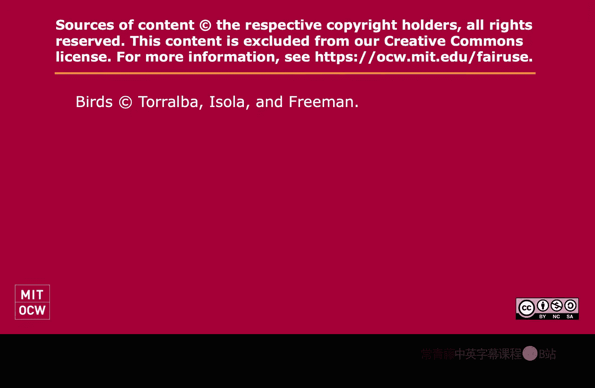