# 麻省理工学院【中英⚡深度学习｜6.7960-Fall-2024,-Deep-Learning】-p16-P16-生成模型：条件模型--BV15QZ4B1E6v_p16-

Okay， so welcome， Happy Halloween。😊，It's niceice to see a few little costumes。

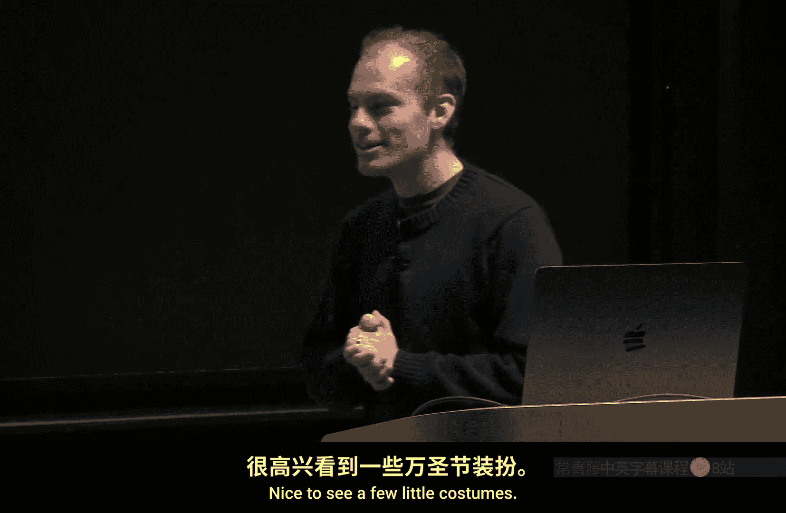

Okay， so today we're going to talk about generative models。 Again。

 this will be our third in the sequence of lectures on generative models。

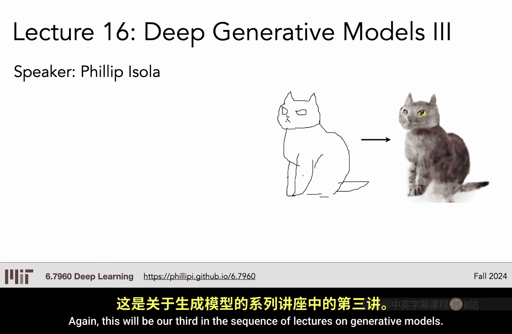

And。Last lecture was a little bit math heavy， a little bit notation heavy， a little bit of a slog。

 This 1， I hope will be a bit more fun and lightweight。 We're going to get to see some applications。

😊，Of that math。

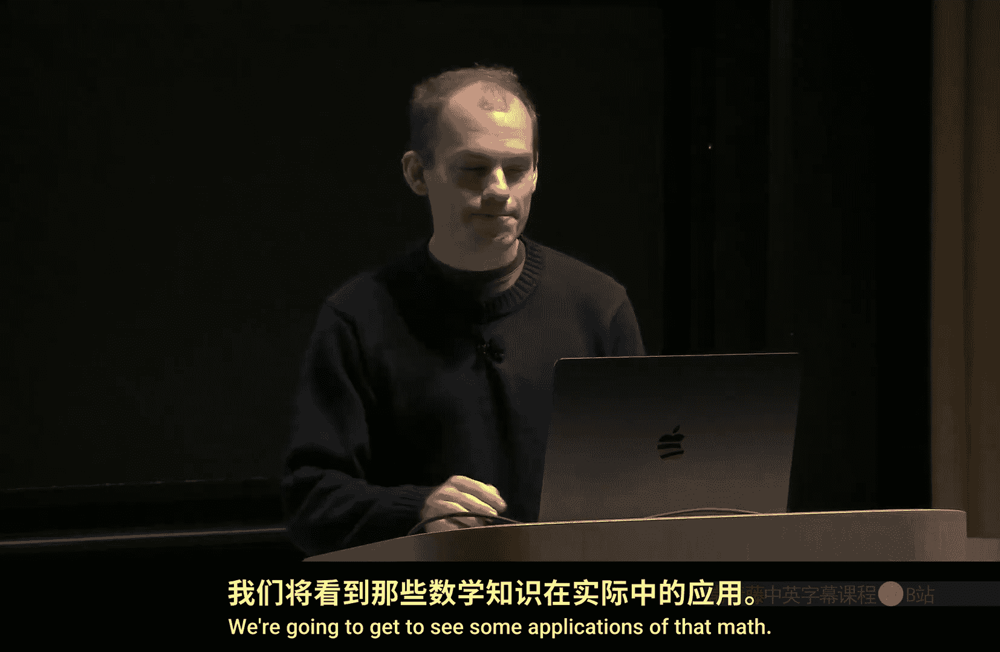

Okay。So here are the topics that we'll cover in this lecture we'll talk about。

The idea of structured prediction and I will go through a few different examples in different domains。

 all of the domains will be images in text because there the two domains where this kind of technology is best developed。

 but this technology will in the future and is currently starting to be used in other domains too。

But I'll talk about mapping images to images， text to text， image to text， text to image。

And then I'll end with a short section on can we do these mapping means without having paired data without having supervision of paired data in the form of paired data？

Okay。So。When I first encountered generative models。

 it took me a little while to understand why they are an important thing。

Especially if you come across them in this kind of generative AI era when it was like your first experience might have been you're making up beautiful images or writing funny stories。

And。And that feels like it might be they're useful for entertainment or there's some kind of frivolous art form but really I think they're just fundamental。

 They're core to almost everything。I think I've made that point in the previous lectures。

 but I think it will be most obvious in this lecture where I'll frame all problems that are predicting。

High dimensional structured data。Or information out of a network has been appropriate to be treated with gene modeling。

So we can call these data prediction problems in statistics and other areas。

 this is sometimes called structured prediction， so the problem of outputting something that's not just a single number or like a single decision。

 but is actually some high dimensional structured object。

This is the problem that generative models are well suited to， and this is the problem。

 which is basically ubiquitous。 It's hard to imagine almost any problem that you'll come across in your own work。

 which would not be structured prediction。 It's kind of a weird historical artifact that we had this term structured prediction。

 This is just everything。 So but I'll define it on the next slide。 But here's some examples。

 So image in and image out。 So this is like the problem of detecting objects。

 It's a high dimensional structured object， which you're trying to predict。

 which is an array of pixels that have a class assignment for every input pixel。

Audio and itss structured data and structured data out。 the output is a sentence。

 It's not just like a number or a single decision in the class。 it's a whole sentence。

This is speech recognition or automatic speech transcription。Okay。

 another one that's quite popular is describing an image in text or maybe a video in text and outputting the entire image or video。

 So text to photo， which you may have played with in things like staple diffusion or midjoney or Dolly。

😊，Another example is input sequence of some kind of protein sequence and output the 3D structure of that protein。

 So again， you're not just trying to like give one label to what know what is this protein you're trying to output a structured object。

 The entire geometry is a high dimensional object。 And it's an object that has structured it。

 And what do I mean by having structure。 This is going to be the definition of structured prediction。

It means that I'm modeling a high dimensional object X。

 So my output that I'm trying to predict is a high dimensional object X。

And it's an object which doesn't factorize into independent a product of these marginals。 Okay。

 so unstructured prediction was， if I want to model some， some high dimensional data。

 I will assume that all the dimensions are independent statistically。 Okay。

 so independent random variables means that the probabilities factorize as a product。

 So the joint distribution equals a product over each dimension。And if I don't have independence。

 like， don't have a product。 And then we call it structured prediction。 And of course， you， you know。

 it's hard to imagine in setting where you really have independence over your， you know。

 dimensions of your high dimensional structured of your high dimensional object。

 you're trying to predict like text or if it's a robot， the trajectory， it has to move its arm。

 And these are all high dimensional structured objects。Okay， from myself self driving car。

 how I navigate the city， right， It's like every decision is not independent of all the other decisions。

 There's joint dependencies between those decisions。 If I turned left， that effectss。

What my next decision should be， okay。Okay， so this is a setting that we're in。

But let's first go back and see how people approached these data prediction problems with unstructured models。

 because even though it seems like a kind of crazy idea now， it was simple and it's not terrible。

 like there's reasons why that can kind of work。Okay。So here's。

 here's the unstructured way of modeling the colorization problem。

 So I love this problem because it kind of captures all the key concepts in machine learning。

 In my opinion， I don't actually care that much about colorization as a graphics problem。

 but I've often used it as an example because it just has all the right properties。😊，Okay。

 so this is trying to predict the color of this shirt here， okay？So what color do you think it is。

Who who has the answer， right？ No one， right？ You don't know。 It could be red。 It could be orange。

 It's just， this is the grayscale version of the shirt。 So what color is it， Well。

 maybe I know that this shirt is manufactured by some company and。

 and this shirt comes in two different colors， right。So if I。

 I'm gonna imagine that the true probability of color of this grayscale shirt conditioned on the luminance value。

 the grayscale value。This is going to be the data distribution that is the the way the actual universe works。

 Okay， so this is the true distribution that describes this data I take。

Shirts that are teal and shirts that are pink with equal probability。

 I convert them to a gray scale image， and that's my observation。Okay。

So if I just try to predict the color using the kind of classical regression method。

 which is just out put a single number for like a single continuous number。

 What color do I think that shirt is， Let's imagine colors of one dimensional space。

 It goes from tea to pink。😊，Well， with this point prediction method。

 you can interpret that if you want to as a posterior distribution over all the possible colors that this shirt could take on。

 but you're kind of outputting a delta function and it doesn't express anything about your uncertainty over what the range of colors could be and it can't capture this kind of multimal distribution。

So in particular， if you are doing least squares regression to output a scalar value。

 which is going to be your prediction of color。Minimizer of the least squared objective over a data training distribution that looks like this is going to be the average of the two colors。

Okay， so the average is the minimizer of the sum of square deviations from a。

The average of a set of data points is a minimizer of the squared deviation from all the data points。

So that's， that's something to kind of lock， you， slot away in your brain。 It's。

 it's an important property that comes with a lot。 the mean。

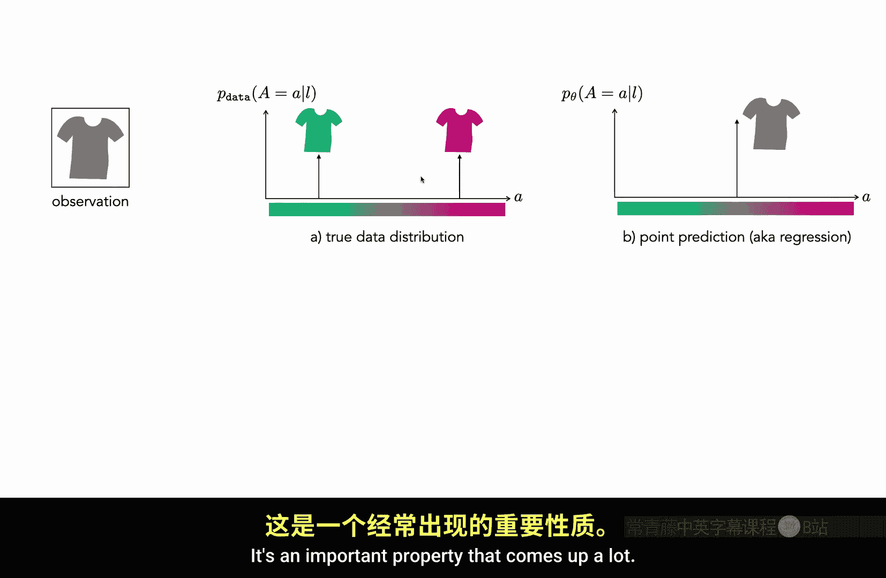

Or the expected value of the data distribution， the mean of that data distribution is going to be the minimizer of the least squares objective。

Regress problem。But notice the problem is that the mean has zero density under the true data distribution。

 So the mean is a terrible estimate of the color。 right， Yes， if you predict the color， then your。

 your error will， you know， that's a single prediction that minims the difference from the the truth。

 just say， well， if I'm here， I would sometimes get it wrong because I would have predict it would have been till。

 and I predicted pink。 So I'll get you know， half the time right， half the time wrong。

 But if I square the， the distance， then the wrong answers will， will dominate。

 So half in between is going to be the best answer for minimizing my error。

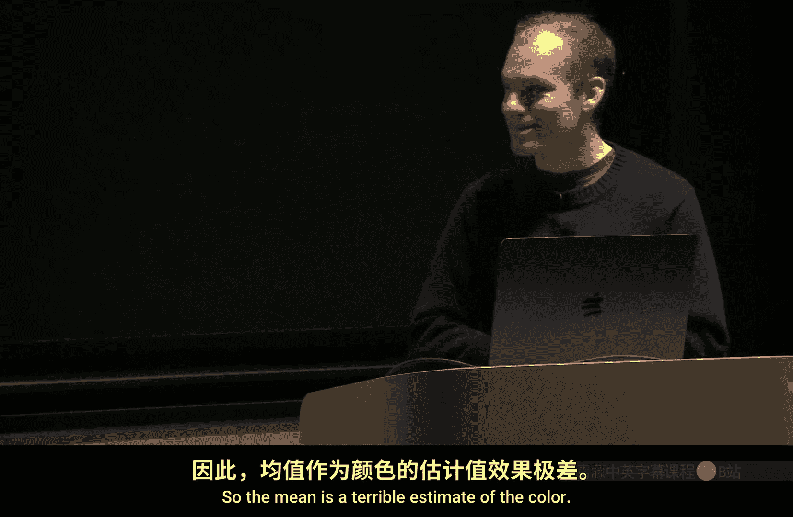

But it's a terrible answer because that has zero probability under the data distribution。Okay。

So we could do a little bit better by saying no， let me try to model some uncertainty。

 so I'm not going have a true probabilistic model。 I'll try to have a max likelihood density fit to my data distribution。

 my training data， and it'll be a Gaussian in shape。

 and that's great because now I am modeling the variance。

 the uncertainty over what the range of colors is but this is this Gaussian is insufficient because it's unimmodal distribution。

😊，And the true data distribution then'm front to model is bimodal。

 so you can't fit a bimodal distribution with the unimmodal distribution。Okay， so。

One very common trick is， is to simply switch to a categorical distribution。

 And so this is the the like hack that I mentioned in the hackers guide lecture that oftentimes。

 if you just quantize your data， chop it up into discrete classes and then model a categorical distribution over the probability of each class。

 It will work really well。 And here's one of the reasons why it works really well。😊。

Because the categorical distribution， which is just a set of numbers that sum to one。

Can express bimodal。Distributions， so the categor of distribution is like fully expressive over this quant space。

 You can represent any number of bumps。Okay， so the categorical distribution actually completely worked for solving this problem up to quantization error。

 So the only problem， the only issue is that I had to quantize my colors。

 So now I don't have like a continuous， exact precise color。 I'm outputting。 I'm outputting。

 that it's kind of the Tl class。 And there's some quantization error。Okay。

So the categorical distribution is pretty good。 and' that's one reason why we often use soft max regression because that models a categorical distribution over a set of classes。

So。That solved the problem of multimodality。 So one problem with prediction is that there could be a multimodal distribution over outcomes。

 meaning more than one bump。 And if that's the case， then regression。

 least where regression does not work。 Pointin prediction does not work， but actually。

 classification does work。 But there's another problem which classification suffers from。

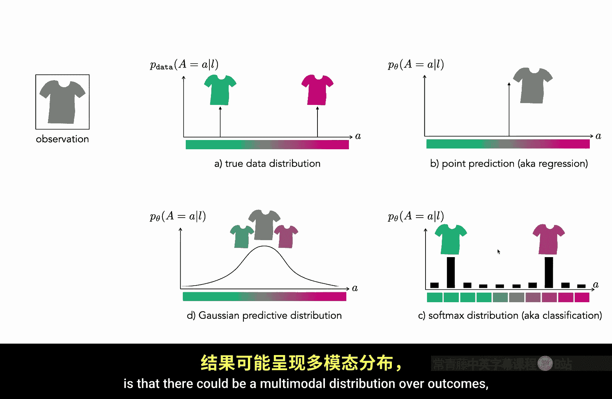

So this was only to predict one color。 And if I really want to colorize that whole shirt。

 I need to predict the color of every single pixel in that shirt。

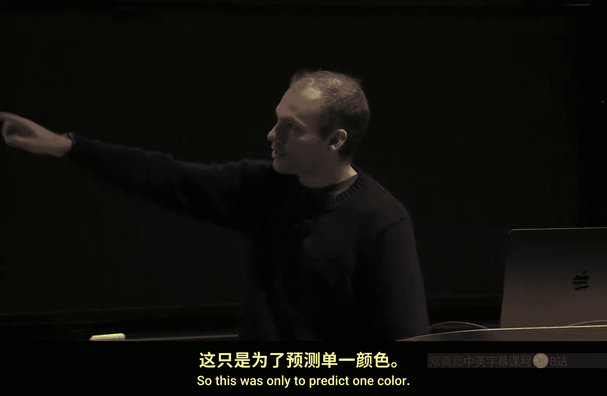

So my output is actually， you know， a high dimensional object。 right It's not just one one value。

In this colorization problem， it's going to be one value per pixel in the input image。

So here's where classification fails。So classification meaning the outputting， you know。

 that my softm distribution over the possible classes。Will give me， in this case。

 equal probability of teal and pink。And at this pixel， I'll say， okay。

 it's slightly more likely to be tilll。 Maybe this， this。

 the picture actually has a little bit shading。 And there's just like 51% probability being teal at this location for whatever reason。

 right， because there's a little shading right there that indicates a little darker in some sense。

Okay， over here， maybe it's a bit brighter illumination。 But I， I I now say， well。

 this50 is slightly more likely to be pink。 There's some kind of， you know。

 dependency between the brightness of the shirt and the color。

 And that means it could be other color， but it's slightly more likely to be pink。😊。

And this will just always happen。 You'll always have your。

Conditional distribution over your predictions being spatially varying to some degree。

 if I actually have underlined the truth is almost by it's almost equal probability。 Or in this case。

 I said the truth is exactly equal probability of teal and pink。 Okay。

 so my estimates of that probability will be a little bit noisy and they'll vary from pixel to pixel。

 And what will happen then is I won't have consistency between how I colorize the top of the shirt in the bottom of the shirt。

😊，Because the probabilities smoothly varied， but they crossed this threshold where the argm probability changed。

So this means that I'm basically failing to capture the joint dependency between this prediction and that prediction。

 The joint dependency says that they should be the same color。

 but if I were to classify each pixel independently， I would fail to capture that。Okay。

So generative models get around this。 the set of generative models we've talked about get around this because they have two important properties。

 One is。Well。This is almost like the definition。 when we talk about generative AI generative models。

 This is what we mean。 These are the two properties we mean。

 They can model a multimodal distribution。 So it's not just like。One Gaussian。

 but it can model a complicated posterior。And two is the model joint dependencies。

 There's a high dimensional multimodal distribution where the dimensions all have dependencies between them。

And if you have a model that can do this， then we usually will think of that as a generative model。

 and the VEs and GNs and diffusion models all can do this。😊。

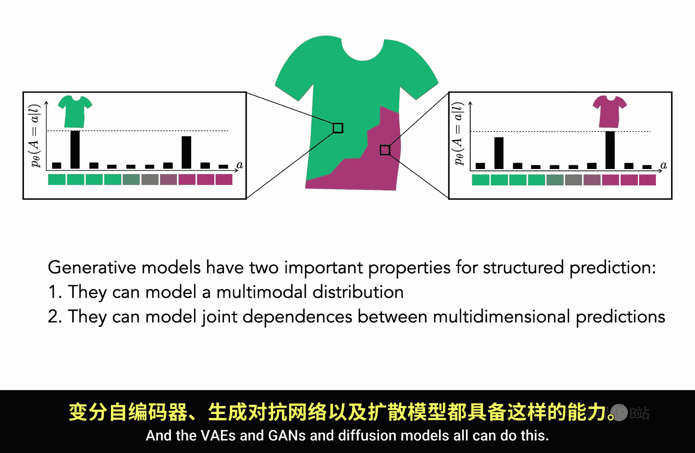

Okay。So that's kind of the motivation。 Any questions about that。Yeah。

 so to me it's just kind of strange。It was only in the last few years that people really had models that can do both of these things。

In practice， in theory， you know， we've thought about this for for decades。 but。

 this is just so important。 Every， every problem has this characteristics。 So。

 so these generative models are just the thing that you really want to use for。

I think almost everything。Okay。So now that you saw those。

 those two flaws with kind of unstructured prediction treating every pixel independently and outputting like a continuous real number for those。

 those pixels， let's look at some。Photos that might be a real photo。

 or it might be a colorized black and white photo that it was an AI system out of a color to。 And so。

 so I want you to guess。 so raise your hand if you think that this is a real photo with real colors。

😊。

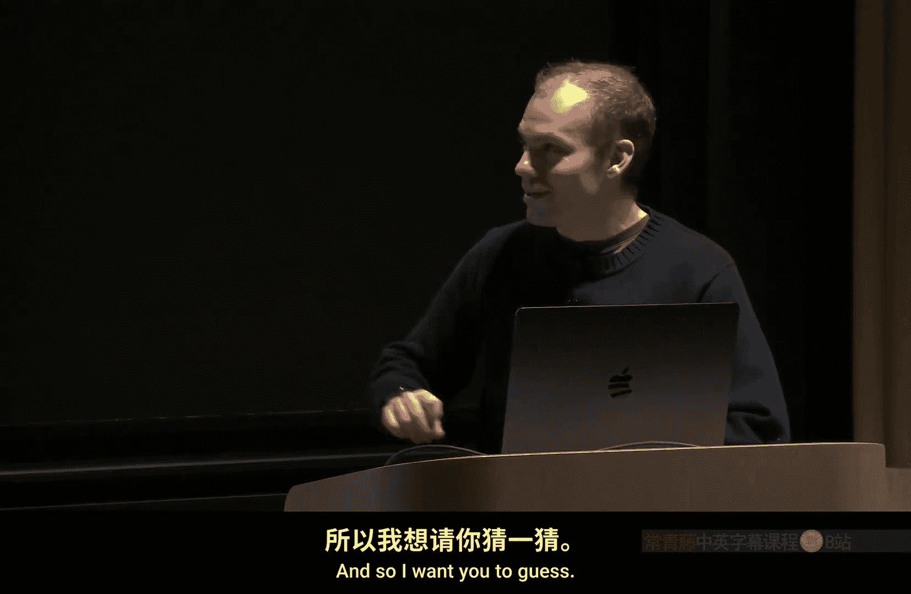

A few people raise your hand if you think it's a fake photo with AI generating colors。

 A lot of people。 So somebody who said fake， tell me what artifact， what。

 what failure mode do you see that's giving that away。Let's go here。好，给他。停。Down on the feet。No no。

So it doesn't know。 So so it's oscillating exactly。 there's pink down here。 and there's blue here。

 And that's exactly this effect。 This system is making independent predictions per pixel。

 and it kind of cross a threshold of probability。 and it switch to the other mode。

 It thinks this is maybe red paint or maybe blue paint。

 It's pretty sure it's the other of those things， but it doesn't know exactly which one。

 And then it just kind of chaotically oscillates when the probabil is very， very slightly。😊，Okay。

Anyone see any other issues that make they give it away。 let's go here。

it's kind of like a colored show。Yeah， so I think that's just like the resolution of the convolutional network that ran it just output a low low resolution prediction。

 So yeah， there's other artifacts like that， too。😊，Okay， how about this one。

 This is Margaret Hamilton， who was working at MIT doing programming in the 60s。

For the Apollo project。 So is this a real photo her or a colorized photo her， a real color photo or。

Synthetic， okay， so real， raise your hand。A few more people fake。Okay， actually。

 this is like split half and half good。 So who， So it's fake。 it turns out。

It was a black and white photo。 So who sees some issues that might give that away， Yeah over here。

There were， there were color pictures in the 60s Yeah。 So its only 1960s， Yeah， sorry yeah。

Way in the back over here。The bottom right thats。Yeah。Yeah。😊，Okay， that that I didn't know is good。

 So there's a watermark。 Any others。 Yeah， and the way back。Yeah。

So it's a little hard to see from on this projector。

 But the door and also the background here is kind of this modeled white to blue。 And this is， again。

 that that flipping around the probability thresholds。

 So it's not realizing that a white surface like the paint on the wall isn't is， you know。

 has a joint dependency if， if part of the paint is white。

 the rest of the paint should probably be white， too。

There's one other issue that So this is the issue of that， but there's one other issue。Which is。

This issue here。So that issue is also showing up in this problem。

So notice that all the colors look a little desaturated。 It's because we're basically。

Do some kind of averaging that is saying for all the possible colors。

 we'll kind of collapse the distribution toward the mean because we're not sure what， what doubt。

 But so you would only know that the system is doing that if you under if you know how that neural net is trained and what a subjective function is。

I happen to know that。 But yeah， this is just one of the things you'll see all all the time in AI generated work。

 at least from a few years ago， that things look a little bit blurty。

 a little bit desaturated And if you're in an audio domain。

 it might be everything looks the music that's been generated sounds a little bit kind of fuzzy。

 It's not crisp。 These are the effect of averaging。

 that you get when you're fitting a distribution that doesn't have。😊。

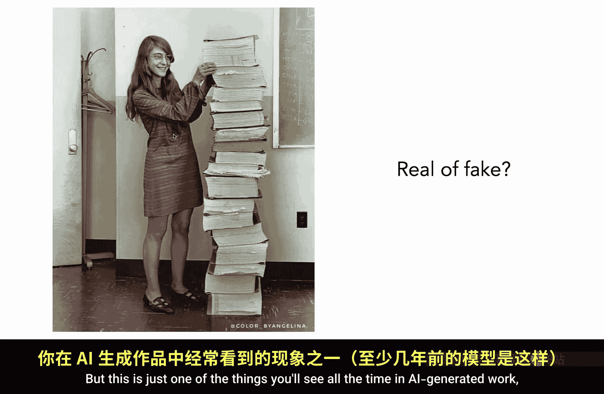

The capacity to approximate the the true distribution and averages between all of the different possibilities in the true distribution。

O。So。

Let's go back to 2012。 This is when deep learning really took off， became popular。And。

I think that the story in 2012 was very much about deep learning as a new hypothesis space with high capacity。

Okay， so remember that in machine learning， we always have my objective function。

 the hypothesis space I search over。 and how do I search over that hypothesis space。

 which is called optimization。😊。

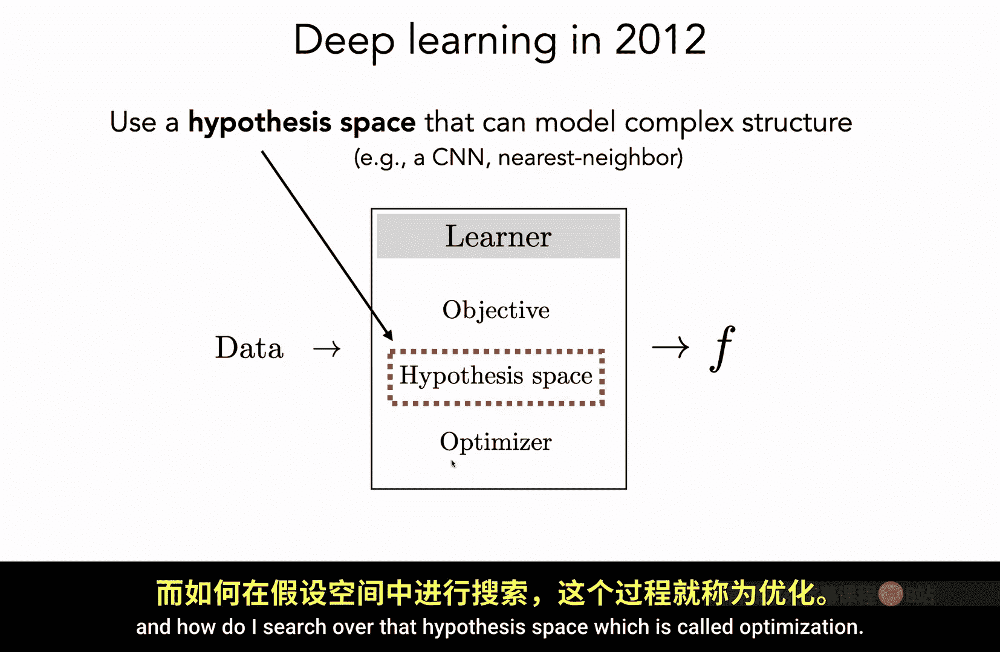

Okay， so you would have seen this slide， maybe some of you have seen it。

 I think it still shows up in various AI courses。This was a very popular slide in 2012 or a little bit after from Andrew Iing。

And he was pointing out that learning algorithms。Pret deep learning。 in those days。

 it might have been like a linear support vector machine。

 something that's linear is going to have less capacity。

 It's just a hypothesis space that can't fit non nonlinear data。

And that means that as I get more data， then I'll find the best linear fit。

 but then I won't ever be able to model the nonlinear parts of the data。

 And so deep learning will just keep scaling with more data， but other methods don't。

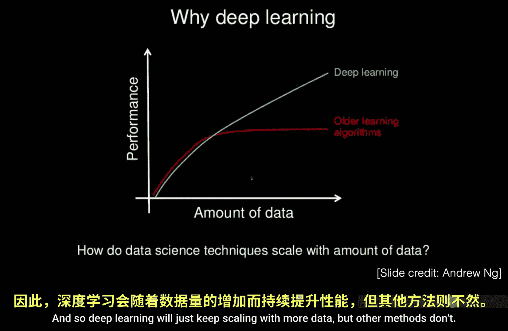

So this is an argument about the hypothesis space。But I wanna。

 I want to make an argument about the objective function。So let's go to this problem now。

 which is going to be assigned a class per pixel in an image so recognize， know。

 is it the sky is it a bird， what is going on in this image。And。

We're just going to do the per pixelixel classification。So。Let's see， yeah。Okay， so it kind of works。

 but actually let me go to this example， I think this is the better one。Okay。

 so let's suppose that I am trying to take a map of the world and predict what does the landscape look like at that location in the world。

 So this is a Google map。 And this is like satellite photo from Google Maps as well。 Okay。

 so I have paired data。 I can just predict the Ys from the Xs。

 But I'm I'm regressing or outputting an entire image。😊。

And now let's say that I use my unstructured prediction objective。

 which is to just minimize the squared error between my output。Like， I can just take my output image。

 flatten it into a big vector and just take the squared error between that vector and the ground truth vector。

Okay， so this is like least squares regression for outputting a high dimensional object。 And this。

 this is a implicitly。Treating all of the output dimensions as independent。

 That's basically what this sum is doing。 So squared error。 remember。

 it's like log probability under a Gaussian probability model。

 Some of logs is like the product of this probabilities。 So this is implicitly a unstructured。

Objective， where I've kind of assumed that the world factorizes independently over dimensions of the output space。

 independently over each pixel。Okay， so I could do that。

 and then I could run my greatest neural network of 2012。On this data。

I can make the biggest highest capacity convolutional network I want。 I can use， you know。

 SGD to optimize it。 So and here's the input。And here's the output。Okay。So。

 so it looks okay O like this is some buildings and they're getting colored like a nice bright paint like a city might have。

 And the roads are asphalt and they're gray， But it looks blurry， right？

 So why does it look blurry exactly the same reason again。😊，This park has trees in it。Now。

 I don't know if it's an oak tree or a pine tree。 I don't know where the trees are。

 If I average over all the different trees and all the different grass in all the different locations。

 I'm just gonna get kind of average green in the park。So。

By not modeling the joint dependencies between this region and this region， I have to kind of。

Or basically by not modeling the distribution of possibilities。

 I have to take the average for all possibilities。 and that's a blurry image。Okay。

So that was like deep learning 2012 to 2016。And then deep learning 2016 to 20。

24 has been about that to some degree， but more about modifying now the objective function。

 And that's where the generative AI comes in。Okay， so we need an objective function。

 some way of penalizing my predictions that can kind of represent a model and penalize errors in structure and high joint structure between pixels and deviations from model multimodal poster。

About those kinds of structure。Okay。So。Let's look at how to model that structure with again。

 and then we'll look at how to model that structure with a VAE。

And I'm going talk about image image problems in this in this section。 So input image， output。

 predicted image。Okay， so first we'll talk aboutganNs that are conditioned on an input image。Okay。

 so here is one way that you can do this。 I'm switching the problem now to be。

 let's say that I have like an architectural layout diagram。

 Each different color in the left image there is going to be indicating what is the architectural element。

 Is it a door， Is it a window and so forth。😊，And my output prediction is what that。

That building would look like。Okay， so I could be an architect trying to design new buildings and use this tool。

I'll use a neural net。 It could be a con that in this project， but it could be a。

 VIT and the modern era。And I will make my prediction。So。I told you about GNs。

 when I told you about GNs， I said that we're going to take a random latent variable that' Gaussian distributed。

 pass it through a generator， output an image such that a discriminator network can't tell whether that image is a real image or a synthetic image generated by the generator。

Okay， here， the noise is replaced with a conditioning variable。

 So there doesn't have to be noise in this example。

 There is just a mapping from an X to a Y as opposed to a Z to an X。Okay。

So it's the same exact math as the G。G tries to synthesize fake images at fool D。

 D tries to identify the fakes。 They play this adverarial game。 and at equilibrium。

 you're outputting images that are indistinguishable to the discriminator from real images。

So let's go through， let's go through the math。 I showed this very briefly in one of the previous lectures。

 but let's， let's go through it again in the conditional setting。

So here's the game from the perspective of the Discriminator network。

What it's going to try to do iss going to try to。Aign， it's a binary cross entropy objective。

So that means it's going to try to assign high log probability。2。

This is gonna to be like a fakeness classifier or it is a is a synthetic data classifier。

 Well try to classify fake data as synthetic。 So it'll try to assign high long probability to。Data。

 which is output by the generator。 That's the definition。

 syntheticyn data is data output by the generator。In order to try to assign low log probability 1 minus the probability to real data Y。

 So the training data Y is real。 The inputs are X。 The outputs are Y。

 That's the real data and print to distinguish between data that's created by G and data that's created by the true world Y。

Okay， so this should be assigned high probability。 It's just a binary classifier using cross entropy objective。

Okay。So。That's the job of D。 Just classify， synthetic or real。

The job of G is to try to make synthetic images that look real， according to D， the fooled D。So。

D is trying to maximize the log probability that it places on the true data under this cross entropy objective。

And G is trying to do exactly the opposite。 minimizeize the log probability that of a synthetic image being called synthetic。

 So it's basically trying to say， I want my synthetic data to cause D to be wrong。

 So minimizing as opposed to maximizing。Okay， so then we will， you know。

 back prop from D through the parameters of G update G to make a more realistic photo。 Now。

 it becomes， you know， a real looking photo。 It doesn't have as many artifacts。Okay。

So the the GAN objective is this mini Maxax game， this adversarial game where I'm trying to。

Find the parameters of the data generator that will create outputs that a discriminator cannot tell。

Whether they're real or fake， the discriminator will get a score of。You know，0。

But as low scores as it possibly can。Okay。And we don't want to fool just any old random discriminator。

 We want to fool the best possible discriminator so the discriminator is learning to get better and better at detecting the fakes and the generator is getting better and better at fillinging the discriminator。

 And at equilibrium， you can prove that this will converge to being samples from G are identically distributed samples from why the true data generating process。

So that's provable under the condition of the network has actually found the equilibrium。

 the natural equilibrium of this game and that there's sufficient capacity and so forth。

 but the national equilibrium has that characteristic。Okay。

So the perspective that I want to give in this lecture is that。From G's perspective。D is like。

 a loss function。It is some kind of penalty。 It's a critic or a discriminator It's a penalty that looks at the outputs that says。

 are they， you know how good are they or how bad are they And then you can back prop and cause G to update to make better outputs。

So it's like a loss function。 It's kind of like the squared error loss function。

 except it has a new property， which is that it's learned as opposed to being hand defined。

So it's a loss function that can look at structure in the output and not， not just say， you know。

 did I get every pixel independently correct， but also did I get the edges correct。

 And I get the higher order statistics of the output， correct， And this is what makes it powerful。

And it's very hard to hand define find such a loss function， but it can be learned via this game。

Okay。Okay， so you might have noticed that there's one little error with this formulation。

 So I gave you the G objective。 But for a conditional G， there's actually a problem。

 So if I output this photo。Should D in this setting call that a real photo or a fake synthetic or is it real。

 basically。Okay， so it is a real photo。 I'll just tell you that this is a real photo。 Okay。

 but it doesn't match the input。So the one little trick to make， again。

 conditional is you need to let the discriminator look at。Not only is the output real。

 but does the output match the input。 So it， is the pair X， Y。

 a real pair sample from the data generating process， P data X， Y。

So the D has to look at both the input and the output。

 Now it can penalize whether the output is blurry and unrealistic looking。

 but it can also penalize whether the output has the windows in the wrong place that don't match where the。

 the architect has drawn the windows here。Okay， so that's a very simple modification to the objective。

 D just has to be conditioned on It has to take as input。The data X。 And it's asking。

 did G of x create a realistic output that looks like y and also did G of x conform to the input so that the relationship between the input and the output matches the true data distribution。

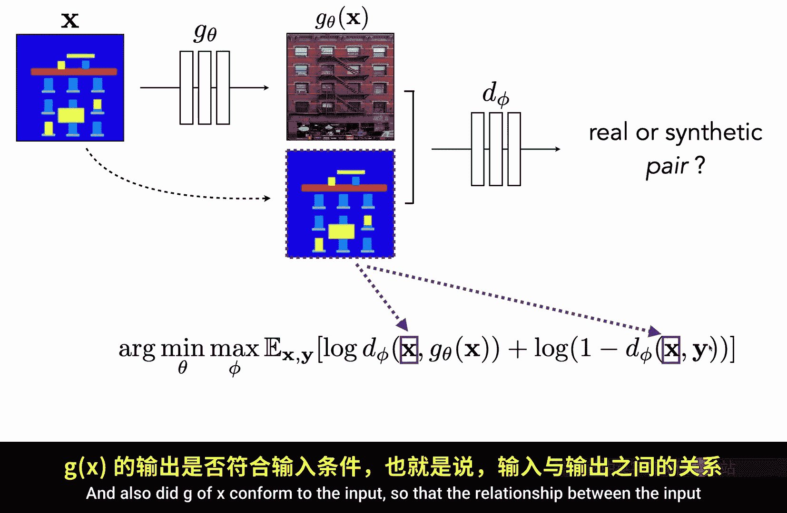

Question here。

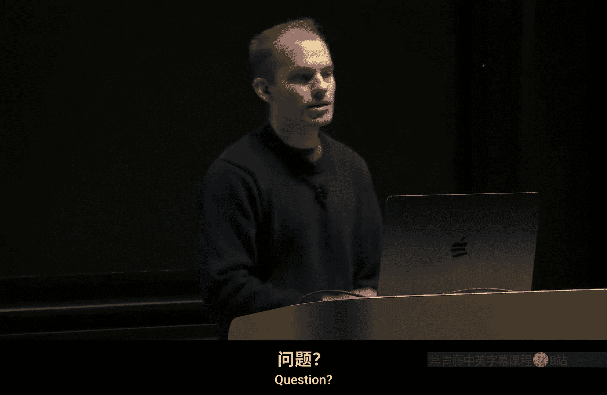

What is the definition of Spway？Yeahや。So， what is the definition of X X is given。 So these diagrams。

 you have a data set of diagrams with photos。 So you have paired data。 you have supervised data， X。

 Y pairs。

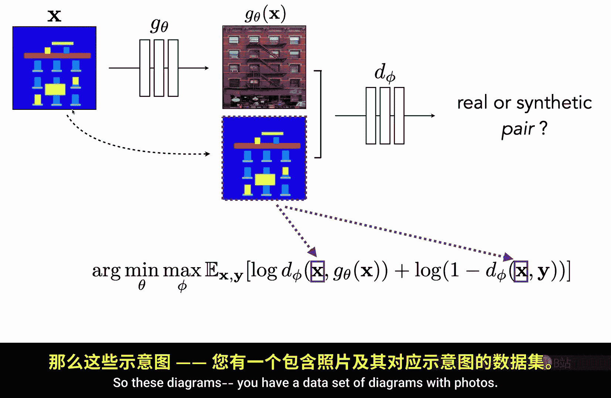

Yeah， question。Point are we doing the loss。not me。わかです。Yeah。

 so what pointes are we applying the loss function。

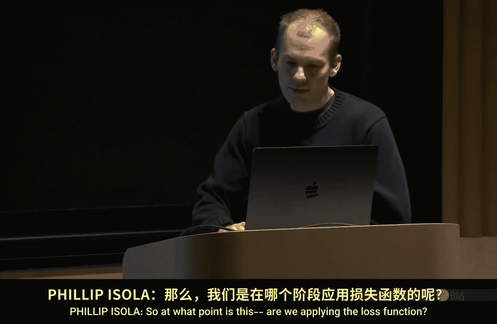

So the the key idea is I'm not trying to say real or fake photo。

 I'm trying to say real or fake pair of photos。So what you actually do when you run this is you take X。

 you run it through your neural network。 It outputs a prediction。

 and then you run that prediction through another neural network， the discriminator。

 and that scores your prediction。 And then you back prop through that entire computation graph。

 So the computation graph is。D of G of x。This slide is just saying that I can also add。

A regular older regression objective， which is just this is what like regular regression would do say is the output close to the ground truth label Y or the ground truth image Y in a squared error sense。

 And that will produce these blurry outputs because it it doesn't。

 it treats every pixel's independent conditioned on the input。

But it it can be added to this GN objective for a little bit better performance。 Okay。

 because the big issue with GNs， they're not as popular now。

 And the main reason was they weren't very stable。 They didn't converge very well。

 This avers game was very hard to optimize， but this regular regression loss can very much stabilize that process。

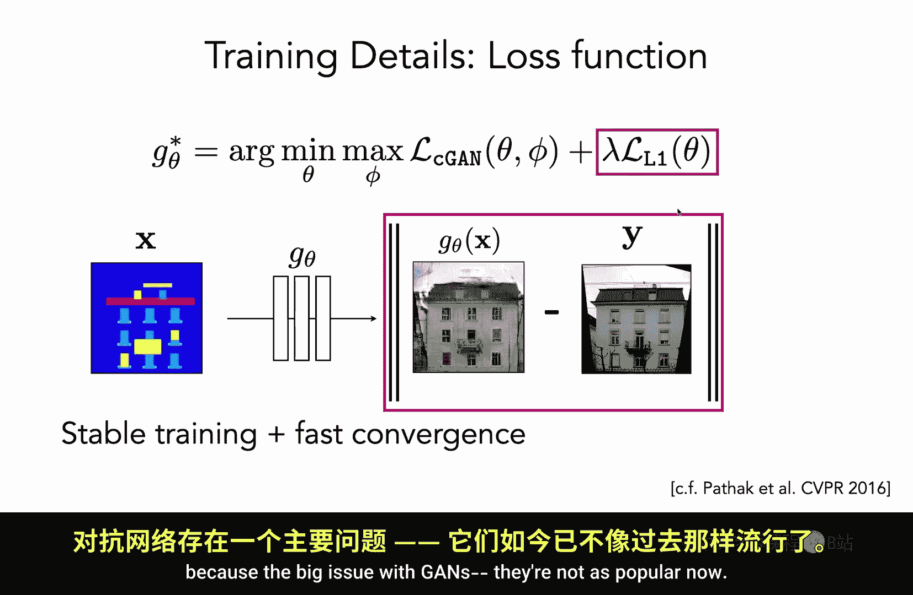

Okay。

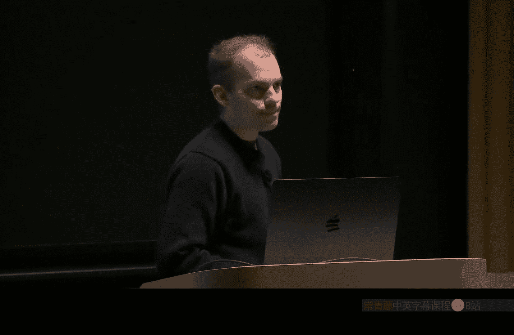

Okay， so that that works。 But， you know， this is not impressive by， by now。

 we've seen that you can generate all kinds of photos conditioned on all kinds of things。

 but you know， a few years ago， iss magic。 But anyway， this works， right。So I want to。

 I want to mention one of the interesting considerations in using discriminators to。

To penalize structure in your data， to penalize errors in the structure of your outputs。

 And that is that the architecture of the discriminator critically matters in what types of errors it is sensitive to and what types of errors it's not sensitive to。

Okay， so one of the things that worked really well in this project that made these。

 these images look good for that era。Was that we used this discriminator architecture called a patch discriminator。

What that means is that rather than just looking at having a neural net that looks at the entire photo at once and says。

 is it real or fake， we look at every patch of the photo and say whether that patch looks like a real patch or a fake。

 a fake patch。So this means that my discriminator is gonna like slide。 It's gonna be convolutional。

 So it'll just slide across the input image and for every patch， it will be making prediction。

 And this gives you。You can use a very small network to do that。 So that's one advantage。

 And additionally， you have more supervision because you have a。

 your discriminators being trained on a data set of patches。

 and there's much many more patches than there are images。 So if I have 10 images。

 I might have 10 million patches。 and that's just more data。Okay。So one question that you can ask。

 but this is that was just the architecture of that time。

One kind of fun note is I think that this architecture is still part of stable diffusion to this day。

 but maybe in the very latest stable diffusions， it disappeared， but it was for quite a few years。

So if you have ever played with sta diffusion， you have the patchuch scan just from in there， okay。

 but anyway。This architecture could change。 But the important point is that this architecture defines the properties of the loss and how it。

 how it looks at structure。 So what happens if I make the receptive field， the， the。

 the patch size that the discriminator is looking at really， really small。So if I make it really。

 really small， just one pixel by one pixel， I get back to almost the same thing as least squares regression that because I'm letting and my discriminator only look at one pixel at a time to decide whether it's real or fake。

 And then it looks at the next pixel in size of its real or fake。

 It just takes a sum over all the errors。And that is essentially factorizing my。

 my model into a a set of independent predictions that are are not jointly penalized。Okay。

 if I make the patch 16 by 16。 now， I can say， look。

 each of these predictions might have been pretty good， but it's blurry。

 Briiness cannot be seen in a single pixel。 You can only see blurriiness with two pixels。

 Two measurements。 you you say that it's not sharp enough。

 There's the difference between them is not big enough。 It's the second order statistic of the data。

Okay， and if I make it even bigger， I can model higher and higher order statistics。

 Staistics that depend on the joint configuration of many， many measurements，70 by 70 measurements。

And then in this era， if I， if we make the patch size too big， like the whole image size。

 it worked worse because essentially， for the reason that the model discriminator had too many parameters relative to the number of data points。

 But in the more modern era， this might not be such an issue because we just have infinite data。

 But back then we only had finite data。 This was trained on 400 images。

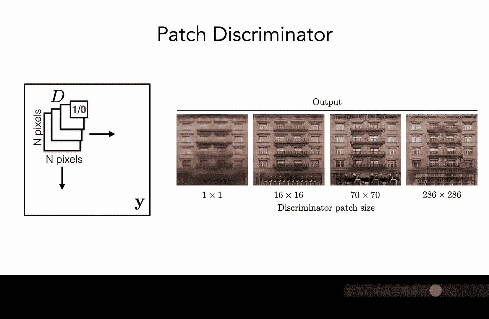

Okay， so the story in 2012 was that。Deep learning is a high capacity hypothesis space that can like many。

 many functions are in the hypothesis space， and older algorithms had low capacityities so they just could not find complicated nonlinear functions。

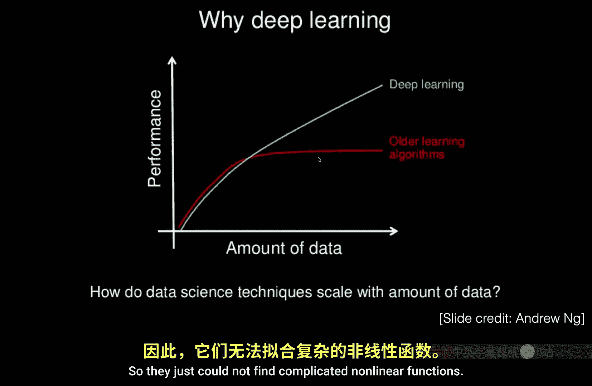

What I want to point out。With the last few slides， is that。

Deep learning with unstructured objectives actually does saturate。 So it could be that， yes。

 in the hypothesis space， there's the correct answer。 It's， you know， it's a universal approximator。

 I just make it big enough， wide enough， deep enough。

But if I'm only incentivizing with my objective function。

 that is good enough just to model the factorized distribution treating every different dimension of the output as independent。

 If that's considered good enough， there'll be no incentive to model the joint dependencies and you won't get a good result。

 okay。But with。Objective functions。 and all generative models have this kind of objective function that can model joint dependencies in the output。

 You， you know， you get better performance。This is a cartoon。

 but these little swaps of the ordering are meant to be indicative of the fact that with more capacity。

 you might require more data。 So less less capacity and a simpler set of modeling assumptions might mean that you can use less data to get a good result。

 but if you have more data， then you'll get better results。

 if you have more capacity and more flexible model class。

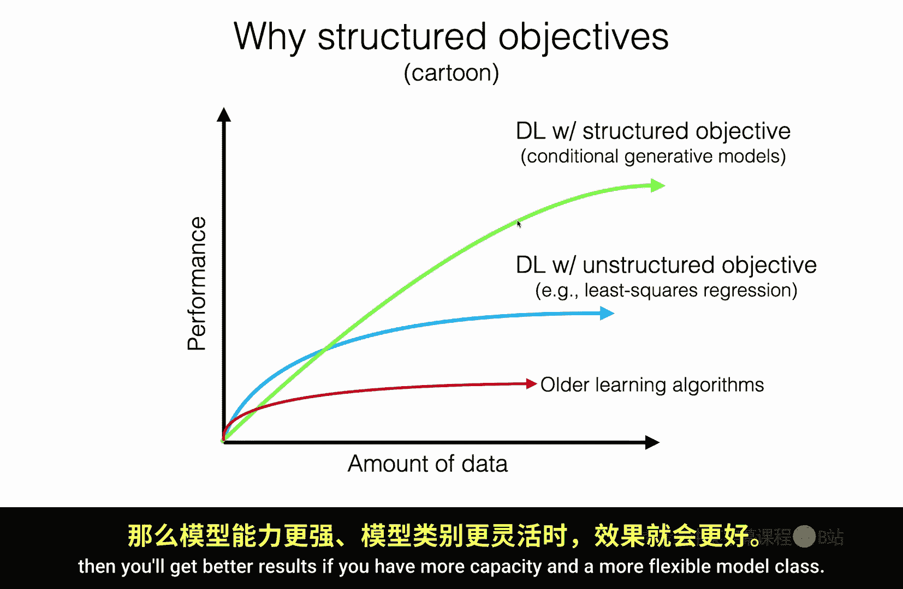

So here， here's where we were with just。Unstructured prediction， each pixel is independent。

 penalized with a least an L1 loss per pixel。And here's where we are with the patch G discriminator and the conditional G。

 where now it says， okay， it was blurry。 that looked unrealistic。 That's obviously fake。

 Id better add a bunch of trees。But we enter into the regime of hallucination。

 where these trees are just a guess， right， They're just a sample from the tree distribution over where the trees might be so。

It's not necessarily that trees are actually at that location。 It's just。

 this is one of the modes of the distribution that I'm modeling。Okay。Questions， yeah。I mean。

 I don't know if you know this。我会他。And L2 loss， it's like a Gaussian vd covariant。

Where you can force the structure。Covariance over the like full joint， just the， the full vector。

 yeah。Two weeks a their close theyre priced together。Yeah。

 like some kind of like Gaussian process over the entire set of measurements， something like that。

 or just one big Gaussian。 I think it will， it'll improve things over this result。

 but I would be pretty surprised if it makes a dramatic difference。

 I think that that still can only model Gaussian structure。

 and there might be other structures that you're missing。😊，So the L1。

It seems very faithfully everywhere。 looking carefully at the GN representation seems to have eliminated some of the details。

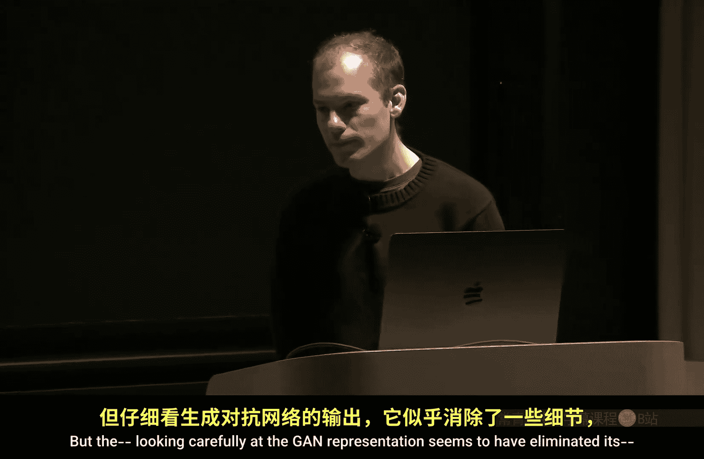

Yeah， so the question is， the L1 reconstruction is very faithful and the G actually some of the paths might not quite match like maybe this road disappeared here。

So this is， this is a common trade off that the L1 prediction is taking the average。

 It's very conservative。 It's very robust in that particular sense that like we can be pretty sure that there's going to be some some road here。

And all the， all the modes of the distribution。 we must share that so that the average will also share that road。

 whereas the game will select a mode and the mode should share it， but。Essentially， like maybe this。

 just， this mode is a little deviated from。 Yeah， I think it's， it's kind of like un ensemble。

 ensemble might be a more robust prediction of。Of the truth。

 then like one of the modes that might be a little low probability。

 And maybe this is like low probability in that region。 So the the rough idea is that。

The problem with generative AI stuff is that。You often will get these hallucinations or like samples from how something might be。

 but not all aspects of that sample might actually be high probability。

 And I think that's what you're seeing here， roughly。Okay。Okay， so let's go on conditional V AEs。

 So every generative model that we've talked about can be made conditional。 Oftentimes。

 it's quite easy to make it conditional。 So let's see how to make a V VE conditional for the same problem。

Okay， so one one of the issues with the G formulation is that this generator function tends to exhibit what's called mode collapse。

 which is that， yes， it will output one mode of the distribution that looks realistic， but it won't。

 it will maybe miss other modes of the distribution。

 It's not great at actually capturing the full posterior or just maybe one or a few modes of the posterior。

So conditional VAEs are a method that is a little better at maybe capturing all the modes of the posterior。

And here's how they work。Right， so what I meant to show here is that this schematic could match that building。

 but it also could match like a brick building。 Like I've， I have no idea what the material is。

 that's not told to me in this schematic， just where the windows and doors are。Okay。

 so what I'll do is I'll simply use this kind of V A E trick where I'm gonna have some latent variable Z that will get injected into the。

 into the network in order to model all of the uncertainty over the。

 the possible variations and the predictions。Okay， so let me go to this very simple example。

We have a pink square here， and it's moving up into the right over time。Okay。

 so you can see that as I go to the right， the square is actually getting a little bit closer to the corner。

And if I do， if I try to predict the future given the past， So I'm gonna take this frame of a video。

 of this is a moving object。 where will， will， where will it go next。

If I do that with a least squares objective。Then I am going to get averaging。

 So there's 8 possible directions This square could go in this little demo。

 So here are the eight possible directions that could go。

And my prediction will be an average of all eight possible directions， average of the eight modes。

Okay， so we want to somehow。Be able to model each of the modes and sample each of the modes and not just sample the average。

The average has zero probability under the data distribution。 So that's a very bad prediction。Okay。

 so we're going to build up something that looks like a VAE。So first。

 we have what looks like an auto encoder or the V As we saw last class。

 We just are going to take my target。 This is the prediction of the future。

 We're going to try to compress it into a bottleneck， a Gaussian variable Z， and then reconstruct。😊。

That prediction。Okay， so I'm trying to predict y given x。 this is x。

 and this is y here I'm just running a VE on y。Now， to make it a conditional VAAE。

 I'm going to simply let my reconstruction network， my decoder。Observe the data X。

 So it's going to what it's going to try to do is say， I want to predict。Y， the future from X。

 But I'm also going to tell you the answer。Okay， but I'm going to force the answer Y to go through an information bottleneck。

 Z。So what's gonna to happen is this arrow here is going to say。Well。

 I don't know what direction it will go。 That information has to come from Z。

So Z will learn to encode what direction this thing goes。But Z is is compressed。

 Z is trying to be a unit Gaussian。 it' trying to remove information and so。

Rather than encoding the color in Z， the color can be given by X。

 And there's a higher information capacity in this arrow。

 So what will happen is this is trying to learn as little as possible in order to make the correct prediction。

 So I don't need to encode the color since that's given in my observation。Okay。

 so Z ends up only encoding。The direction of motion， which is unobserved in the observation。Okay， so。

if the。Sees this target。 it will compress that into， oh the box should go down。So Z learns to encode。

Whatever information is missing from the observation in order to make a correct prediction。Okay。

 now at sampling time， I can sample from this model by replacing my encoding。My inference of Z。

 given a target image with Z is a unit Gaussian because I've trained it as a VAE。

 and I've imposed that it should be close to unit Gaussian。 So I can just sample from Z。

 And now I'll sample from Z。 Maybe I sample the down Z vector。That。

 thatll cause me to predict that the object goes down。

 So I'm sampling all the possible ways it can move by sampling from Z。 Now I sample up that goes up。

Right， it goes right。Okay， so you can train this for all kinds of data on this example。

 I'm introducing these latent variables that specify everything that's unspecified by the input X。😊。

So Z learns to model everything that's necessary in order to pin down what the output should look like。

That's not。Explicitly given an x， all the uncertainty。P of y given x is uncertain。

 So I'm going to add a la variable to Z， just like we did with V AEs， where we're trying to。

Learn all in unconditional Vs， Z has to encode everything about the data。 In conditional Vs。

 Z only encodes information that's not given in the conditioning variable X。Okay。So， one concept。

To give you here。Is now we really have two different ways of controlling the outputs of a generative model。

 In the previous lectures， we just had the latent variables Z。

 and they were like knobs that specify all the attributes of the data。

 And those knobs are here controlling you know， the lighting and the materials。

 But now we also have conditioning variables X。And。

And these also can control the way that the data looks。And for a lot of modern generative models。

 actually， the latent variables might play a very small role because you're just conditioning on more and more data。

 So in text to image models， if you tell it a whole string of text， now。

 you don't need a lot of latent variables because the string almost you know。

 very precisely could pin down what you， what you're gonna see。So let's look at text models next。

Okay。So first， we'll talk about text to text。 Luckily， text to text is basically nothing new because。

Text models， language models are typically auto aggressivegressive。

 Let's look at the autoaggressive class of language models。

Auto aggressivegressive models are already by construction。Conditional generative models。

 because an autoregressive model， if you recall， we model the data as a sequence of conditional predictions。

 So it's， it's， you know， the probability is a product over all of the conditionals， P of x2。

 given X 1， P of X 3， given x 1 and X 2 and so forth。

So autoregressive models are kind of natively conditional。

 and you don't have to modify them or do something new to turn them into conditional models。

So let's look at this with a conditional language prediction problem。

 So conditional prediction is take text as input， predict some other texture as output。Okay。

 so the way you train it is the way we've always described training these things。

 You just do next word prediction， color， Li green ideas， sleep。

 what's the next character or next word furiously。And now I can use this to solve conditional prediction problems by simply。

Giving the language model， whatever input I want。 And that's the conditioning variable X。

 the stochasticity， the latent variables of this model， there's not explicit latent variables。

 but it's stochastic because every next word I predict will be sampled from a like categorical distribution over the next word。

 If I'm doing a autoag model where every conditional density is a categorical distribution。 Okay。

 so it's still stochastic。 But these conditioning variables are now kind of made explicit in the training process。

😊，And you can do all kinds of things。 And this is often called prompting language models。

 which I'm sure most of you have played with。 This is what you do when you just talk with your favorite LLM Claude or Cha GT。

So let's say I want to turn my language model into a classifier of the sentiment of a review。

 I have a product review。 I want to now predict conditionally conditioned on the review。

 What you know， did the user like it or not。So here's how you do it with an autoaggressive language model。

 You simply take the review。 You concatenate。 you prefix that onto the input your， your question。

 So that's like conditioning on x， the review。 And then you add whatever question you want like this what's the sentiment in this review。

 the sentiment in this review is the next word prediction should be your predicted Y。

 says P of y given x where X is the review and y is the sentiment。ok。So really， really easy way to。

Do all kinds of conditional predictions with language models。This was， this became kind of evident。

 I would say， in the G3 era。 Now， this is people use language models this way all the time。

 But it was kind it took a while for folks to realize that language models are not just about writing paragraphs from scratch。

 like writing funny stories from scratch。 they're actually most powerful for conditional prediction。

 given an instruction or prompt or question。 they can answer that question for you。

 a conditional prediction problem。 And that's， that's where they really became powerful。 So here。

 you know， I gave chat， I gave G3， this review。 And， and then it says the next character。

 the next word should be negative。 And that's that's the prediction of the the sentiment in the review。

😊。

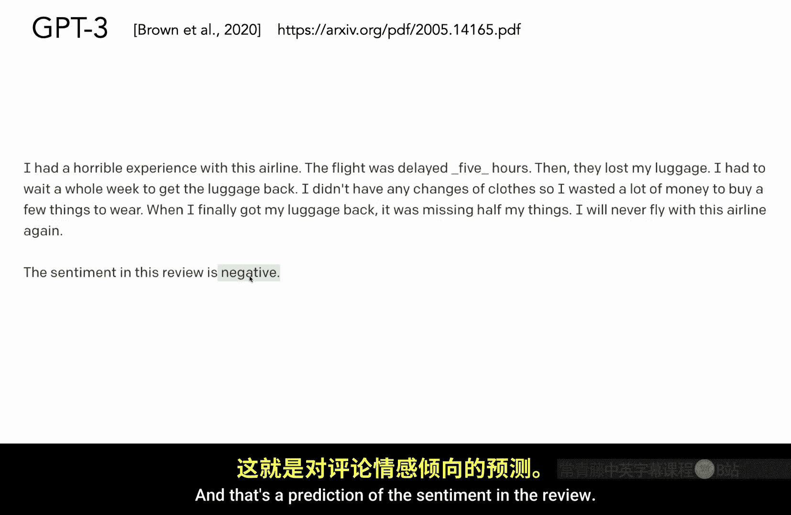

Okay。Question yeah。Is there a reason five house？呃。No， I think that you know。

 people put italics with 2 underscore0 scores。 I I just， it was how that review was written。

 I don't know。 I think I probably made this one up myself。 So it's just indicating italics， yeah。

It doesn't really matter。Is this like some letter？아。So retrieval augmented generation would。

Is related to this， but I would say for now， treat that as a separate concept。

There's no explicit retrieval in what I've shown so far。Yeah， in this case for training。

 we' just generate a bunch of instructions and try to make。The GT answer to these instructions。 Yeah。

 how do you train this thing， So there's two ways。 So one is that you just。

You're modeling all of the words that any human has ever spoken or all the words on the internet or like some huge corpus of sentences。

And。Probability of sentiment given review might be somewhere in that space of all possible things people have ever talked about。

 So that's， that's when I'm just training a language model。

 It will learn all these different conditional distributions。If they exist in the data。

 So this is one conditional that exists in the data。

 the conditional of predicting the next sentiment given the previous paragraph。But now if you're。

Conditional distribution you want to model is not just kind of implicit in the data。

 Then you can collect your own data set of reviews and sentiment labels。

 And then you could fine tune on that。Okay。Cool。We'll have another electron language models where we go a little bit more into all the different ways you can prompt and tune and adapt these things。

 But basically， autoregressive models are just conditional by default。

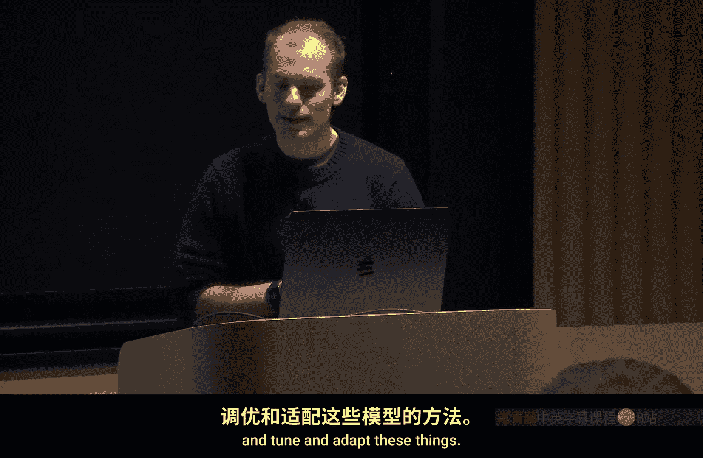

So now let's look at an autoregressive model for image to text。 So again， it should be pretty simple。

 but we need to make sure we can map between two different data types。 And。

 and the way we do that is we use transformers， which are kind of a way of putting all data types onto the same equal footing。

 Just turn everything into tokens and then just do token to token mappings。Okay so。

I'm showing images， I'm showing text， but whatever data format you want to work with， molecules。

 financial data spreadsheets， if you just can convert it to tokens。

 little bundles of information with embedding a token vector。

 then you'll be able to work you'll be able to run all the same technology that I'm showing you here。

So here's an architecture for how to map from an image to a sentence。

 Sometimes this problem is called image captioning。

 if I'm trying to take an image and like train the system to output the caption that somebody would have written underneath the image online on websites or maybe all text of the image。

So。Here's how to do that with a transformer。I have my branch down here， which is the image encoder。

 It will take。An image。 And we talked about this in the transformers lecture that typically we use these vision transformers。

 which chop up the image into a set of patches， embed each patch into a vector and then just run a transformer over those tokens now and get an output set of tokens。

 So now I've tokenized the input into these nice abstracted representations of the。

 of what's going on in that image。😊，Okay， so now this part here is just a GT regular， I mean。

 G is one name for it， but it's just an auto aggressiveive language model with a transformer。Okay。

 so what is that doing is taking in the prefix to a sentence and predicting the next word or predicting the next is with causal attention for every prefix。

 I have a causal dependency between that and the next， the next token in the sequence， right。

 So this， this word here， sitting only depends on all the previous stuff。

 B does not depend on sitting。 It only depends on the previous stuff。

 That's the causal attention trick。 And I just train this with this next token prediction objective with self-atten but causal ma。

Okay， now to stick them together， all I have to do isre they're all just in token space now。

 So all I have to do is prefix the set of language tokens with the set of image tokens。

 And now I will be basically reading off， you know， given this token， this token。

 this token of vision， what is going to be the next word after this word， this word， this word。😊。

And one of the very simple ways of stitching these networks together is what's called cross attention。

 which is just to say。Yeah， this， like GT language model is going to simply be prefixed with additional tokens that can submit keys and values that are queriied by these tokens。

 So the query is submitted from them。The word yellow， that will then match the key for the bird。

 because it's yellow。 potentially， that would be a good strategy。

 That will submit a value that gets integrated into the token representation at this layer of the network。

 which is now like a multimodal representation of both the words and the and the images。Okay。

 so cross attention is just attention， but。Going， you know。

 taking keys from and values from one set and queries from a different set。

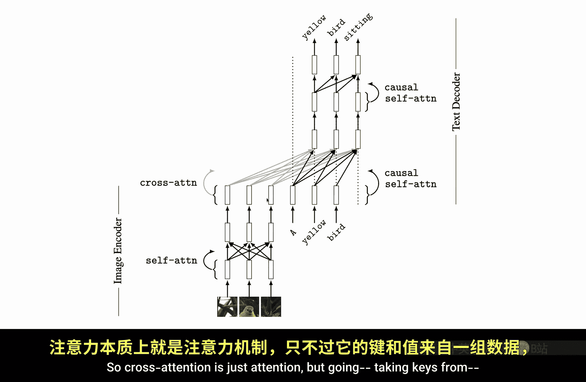

Okay， any questions about that mechanism。Really easy way to stitch things together。Yeah。

 question on the text yellow bird are they。At what point are it buy。

So this would be if I have training data of the form X， Y。 we're still in that setting。

 the X is the image and the y is the caption。 And I'm always going to be like extracting tokens from the image。

 And then I will be autoaggressively predicting the next word given the words I've so far predicted in the caption。

 Does that answer your question。 So at the very beginning。

 will Yeah this is like three steps of auto regression in yeah。😊，But you train it all。You know。

 some you you at inference time， you do it sequentially， but you in parallel at training time。

 This is like training time。 Yeah， question。え？水去。你。As it。公色有点。就会得明。Greater。

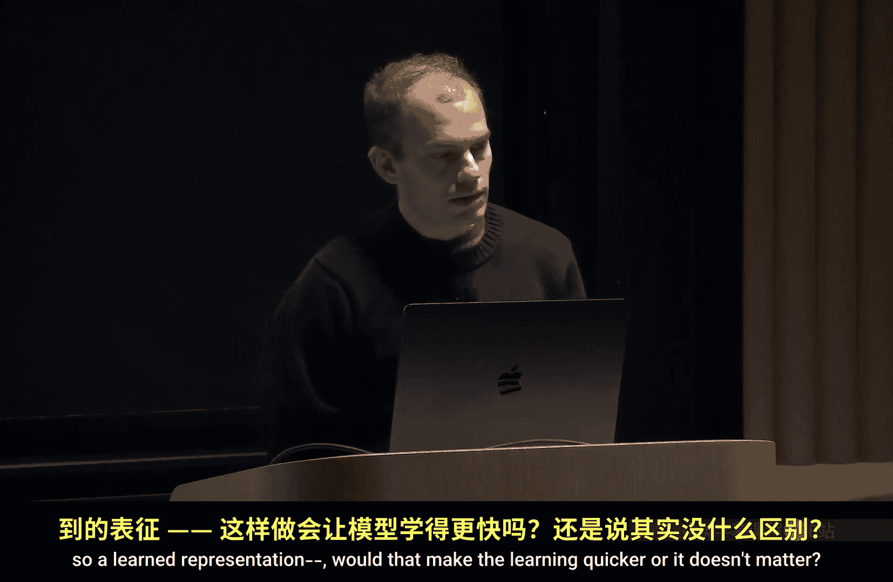

那件生。那です。And you。这。さです。来是。So， okay， I'm not sure I'm fully falling。

 Maybe we can talk about it offline， but like， yeah。

 there's a lot of different strategies for how to integrate this information。 Do I， do I learn the。

Typically， you have a query matrix， which applies to the text and another query matrix that applies to the。

The visual data and then you can submit keys， values and queries from both modalities。Okay。So。

One of the trending， you know， industrial things this year is multimodal chatbots， right。

 So now all of the language models actually are not just language models。 They take images as input。

 Some of them even take videos as input。This is chat GT。 And here's the slide。

 I just take a screenshot。 I think some of you pointed out to me that you can interpret our slides better by just doing this。

 And， in fact， it actually works decently well。 So go ahead and do it if you want。

 So what is this slide showing and how does it relate to how I work chat GT。

 And it's like pretty good， You know， image encoder across attention layer， But。😊。

It did get this wrong。 So how does it relate to how I work， It says， well， I'm not a language model。

 I， I'm only a language model。 I don't process visual data。

 And unless open your eyes doing some crazy hackery。

 it was looking at the the visual data like it had to be in order to make the correct assessment。

 So I think this is wrong。 It doesn't know how， how， how it works。

It doesn't know how its own brain or itself works。Okay。

So let's go in the other direction now and look at text to image。

And the interesting thing here is that text to image models of the current generation or maybe like one generation back actually are a combination of GNs。

 VEs and diffusion models。They're all three。 So it's kind of a nice。

 People call them diffusion models， but they have all three components in them。

 So I'll tell you about that。Okay， so。Here's kind of the the more general strategy for translating between two different modalities or two domains。

 This is just like a general conditional prediction of one type of data from another type of data。

So now we have our data distribution that goes from the encoder to this latent distribution。

 And then if its， if it's in the V AE auto encoder style， then I decode from that latent space now。

 not back to an auto encoding like back to X， but back to another domain Y。

 And I penalize the difference between my prediction in my， the ground truth Y。Okay。

 so this is just kind of a general way to think about it。

So here's what that looks like in text to image， which we talked about before。 So I go from。

Image space to latent space， to text space。And that would kind of map on。

Onto this image space to like latent space and then also text space。 know。

 where do you define the la is's not clear because auto aggressiveive here， it's not explicit latent。

But this would be more like the VAE way of doing that。Okay。

 but now let's look at the text to image problems。 So go from text to yellow bird sitting on a branch to the image。

Okay。And this one is going to follow this diagram a little bit more precisely。

So I already told you about how to train the conditional VAE。

 so how do you train a conditional VD when you're conditioning on text？

So rather than conditioning on the observation of that moving pink block。

 I'm gonna condition on a scarcarlet Macawaw sitting on a perch。Okay。

 so what's going to happen is the decoder is going to be informed by the observation。

 as well as my latent variable Z that explains everything that has to explain everything about the data to make this a deterministic process。

So the decoder is deterministic。 So this latent variable has to model all the random factors that could affect the output appearance。

Given the input。 So this input does not say that the Scarlet Macaw is facing to the left。

So therefore， the latent variable has to learn to encode that the Macca is facing to the left。

 The latent variable is trained by inferring the latent variable from。The target prediction。

 So this is like a VAE， right， And then conditioning， It's conditional VE。

 So same idea that I showed on the previous slides。And now。

 the only new thing is I need this to be a language model F that encodes text into to tokens。

 and need this to be a model that， you know， could be a V I T， you know。

 a transformer decoder takes a set of tokens。 And the latent variables might also be tokens。Okay。

And at inference time， I simply sample from the unit Gaussian because the VA is trying to make the latent distribution dense and compact。

 and therefore， samples from the Uni Gaussian are going to all map to valid predictions。

 Theyre all in distribution with respect to how the model is trained。

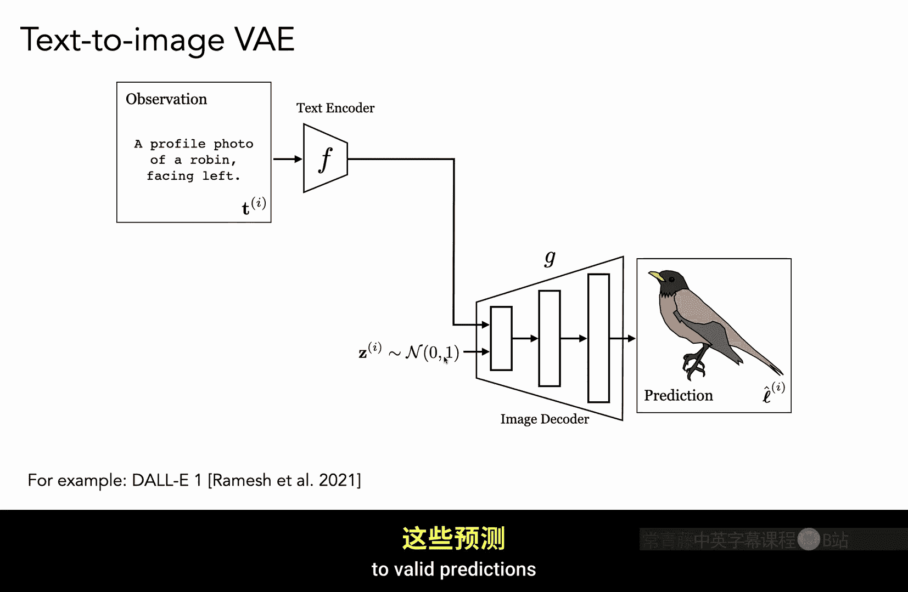

Yeah， question。If you go back to there。What's the optimal strategy to like incorporate？

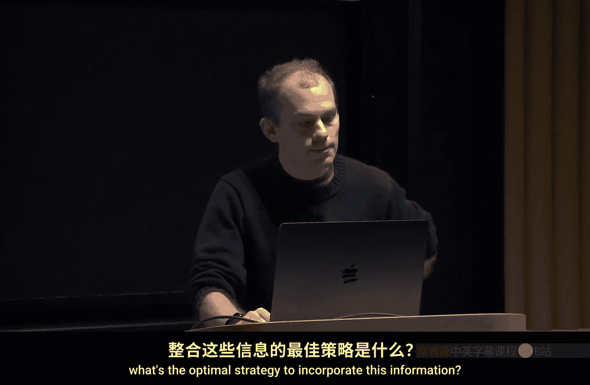

Information， is it just like， for example， to like sub to？Ebedding vectors or like， for example。

Proces through MLlP has something thinking low。Yeah， question is。

 what is the optimal strategy for how to combine this information with this information， I believe。

 And I would say kind of the， the vanilla most standard thing right now seems to be concatenation。

 like convert everything into a set of tokens or a set of embedding vectors and then just concatenate and do more cross attention between them and then repeat。

 So so what I showed on this slide is kind of the the current standard way of combining between different streams of data。

😊，Now， it's not the only way you could also sum them together， take an average， multiply。

 There's all kinds of other ways。 But I would say this is， this is the current one。

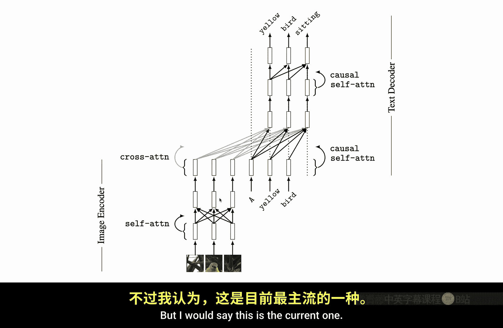

Okay， and how do you combine different streams in a transformer in a more intelligent way that is like an active area of research。

 maybe a good final project compared different ways of like combining these things。

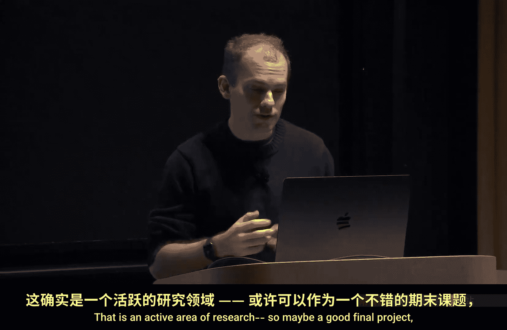

Okay。So that's how a conditional V AE can solve language to image。

 And this is roughly the way that the Dolly one model worked。 So Dolly one was probably the first。

 like。Text to image model that made a splash。Okay， but then stable diffusion。

 Dolly to mid journeyney， all these other things came out。

 and they switched to using a diffusion model。 So how do I make a diffusion model do text image generation。

Okay， so it turns out with diffusion models is's really， really simple。 So here's my diffusion model。

 I I start with random noise， the unit Gaussian noise。 I try to predict step by step。

 and I've supervised it with the opposite direction。 So I， my data point is here， I add noise。

 and that's my supervision for how to de noise。😊，I try to undo the noise I added。Okay。

 so each step is a supervised learning problem of here's the target。Less noisy。

 here's my generated noisy image。 I try to invert that by predicting what the less noisy image would look like。

 given the more noisy image。And to make it conditional in text。

 all I have to do is let my D Noiser observe the text。Why does that work。

 That works for the following reason， because the text。

Will be informative toward what the true image I started with is。Okay。

So if the text says a Robin on a yellow background， well， here's the noisy image。 I don't know。

 It looks like it might be a little bit of a yellow background or maybe it's a white background or a pink background。

 the text disambigus that。If the text is a。Is actually if there is a dependency in the training data between the text and the image。

 which there should be。So， so to the degree to which there is that dependency。

 the text will help you make a more correct prediction。 Therefore。

 F will learn to use the text and learn to de noise in the direction guided by the text。

If the text were roin on a pink background， that would be a hint as to what the correct answer is。

 And therefore Ad Dean Weiser would head more toward pink。

So the text will guide how the denoiser maps to different attributes of the data。

To the degree to which the text actually does describe the image content。Okay。Does that make sense。

 So it's really easy to make a diffusion model into conditional diffusion model。

Just let the denoiser。Take text as input。 It's really easy to make again into a conditional again。

 Just let the discriminator take the text as the input。

 It's really easy to make an auto regressive model into a conditional model。

 It already is a conditional model， right， The V A was the only one that was a little bit tricky。

Okay。Here's how stable diffusion from a few years ago worked。

 Sable diffusion has like five or six different versions。 So I don't know which version this is。

 But this was one of the versions。 So what it did is at every step of denoising。

 the denoising network was a neural network called a unit It's just like a connet with these skip connections。

😊，So it was a convolutional architecture。 Now people use what's called diffusion transformers where this is a VIT。

 This is a transformer model。 But back a few years ago， this was called the unit。

And that the text information comes into the network now， not by just concatenating tokens。

 because this was not like a token architecture。 This was architecture before transformers。

 And so you actually took the vectors coming out of the text encoder。

 And I think you like modulated the like the batch normalization or something。

 There's ways of integrating like scaling each of the activations by somehow the upcoming vectors here。

 So you could look at the details。 but I don't know if it matters that much。😊。

But there's a lot of interesting ways of integrating information from one data stream to another data stream。

Okay。So， and of course， once you have this ability to plug together different modalities and solve general conditional prediction problems。

 this this is a very general thing。 I think that's clear from chat GBT and language models where you can use them for so many purposes。

 But here's just an example for what's called the visual question answering problem where I have a text encoder that takes a question as input。

 turns it into a set of tokens。 I have an image encoder that turns into a set of tokens crossat and I have a decoder that tries to predict the answer to the question。

 And if this is trained on two poles of the form question image answer。

 then it will learn to you know maximize the conditional probability of the answer。

 given the question and the image， and that's general purpose image understanding。

 whatever question you want to ask be can be framed in this way。😊，Okay。

 so this is a very general purpose technology。And just to show you that I'm not like。

 I don't think I'm hiding too much under the hood here。 this is one of the current popular。Image to。

 to text。 or this is one of the current popular V Q A models。

 So image question answering or visual question answering is called lava。

 So here's my image encoder set of tokens。 Here's my question encoder， or they call it instruction。

 because it could be an instruction， not just a question。That's the set of tokens。

 They cross a tend and they through a transformer， A GT and they output a language response。

It's pretty simple。Okay。Yeah， and and I said that in the text to image direction and actually you're combining a lot of tricks。

 like all these models are， very related。 and often the tricks are actually being shuffled between them。

So this was one of the important texture to image models from a few years ago。

 This is still the kind of core of the stable diffusion line of work。

At least up until they might now be doing things with these flow based models， but just up to 2023。

 let's say。Okay， so you actually first trained what's called a VQ G。

 That's a V AE with a patchgan discriminator that tries to make the output look sharp。 So it's like。

 I take I N code I D code。 I put that through a discriminator。

 So it's like a combination of a V AE and a G。 And then。😊，In the latent space。

 I have either a diffusion model。 or here， it's actually an auto aggressive model over the latent variables。

 So you can just combine all of these things together。 and that sometimes gives you better results。😊。

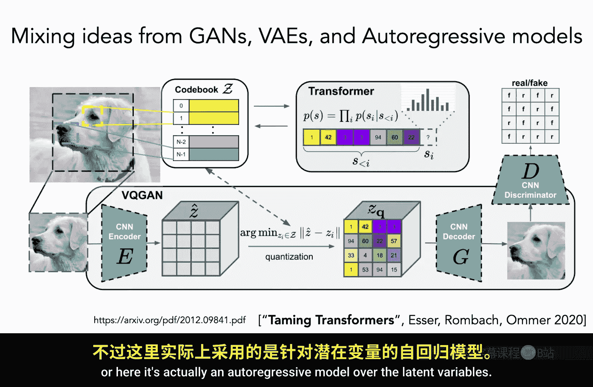

Okay， question。How was you break this。他这个。Maybe you finish separately all together。Yeah。

 great question。 How how do you train such a system。 It looks complicated would backpro work。

 So you can you can potentially backpro through the whole system。 That's， that's one approach。

 You can also pretrain some components separately if you have like data for if you have some data。

 which is like text paired with images and other data that's just unlabeled images。

 raw images of that text， you might pretrain the image only part of the system like you might pretrain this VQ G with just the images and then backpro through interface with a language model。

😊。

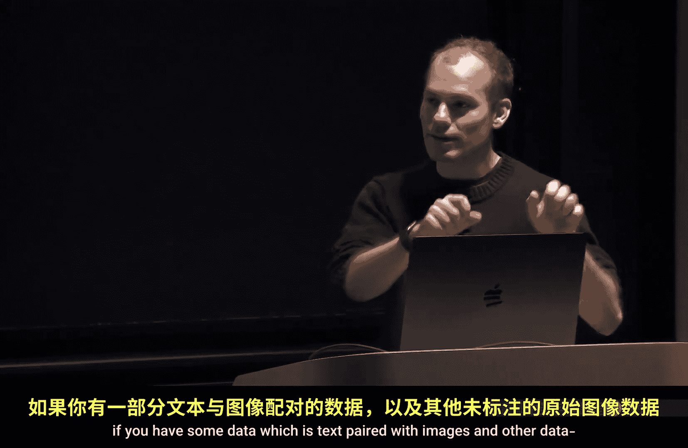

Only on the paired data。 So there's a lot of ways of doing this。 I。

 I'm not gonna go into this detail， but there is what's called vector quantization in the latent space in this particular model。

 which makes back prop hard。 And so you have to， you you have to deal with this vector quantization。

 But I， I think I won't go into that today。

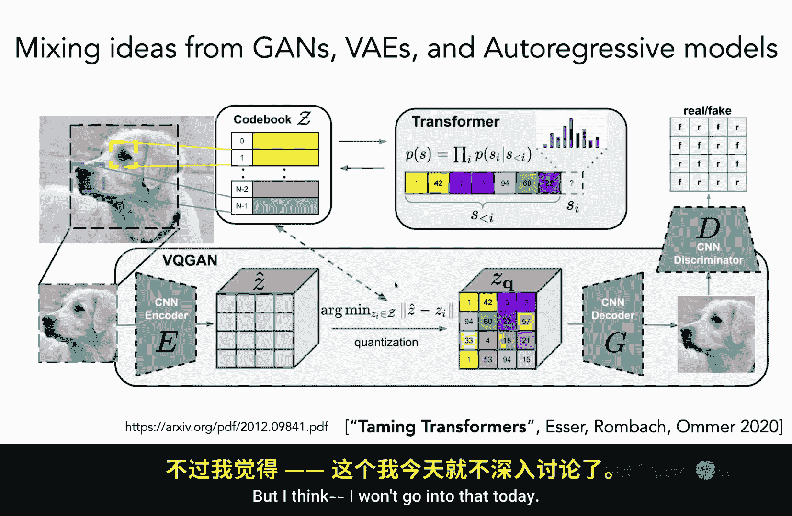

That question。We have seen example of generating an image or a text， but what if， first of all。

 tragedy we have this interaction？E text， vary， image and text。

They go through one model where actually it's engineering。Yeah。Good question。 So in。

 in modern chat bots， usually they take image and text as input and output image and text。

 And now some of them take audio as input too， and they'll output audio。 Eventually。

 they'll take all modalities as input and output all modalities。😊，That we can think of， right。

 I don't know how they work， because these are all now companies that don't tell us how they work。

 There's one Lama 3。2， I believe， which takes at least images in and and text and maybe audio as well。

 And that does have a paper that describes the details。 So I would look at that if you're interested。

So I don't remember how that one integrates information。Okay。

 so any more questions on conditional generative models for。Learning from paired data x comma Y。

as they increase the modalities， it seems that they're probably increase in their data。

As you increase the modalities， you would get increasingly data hungry。

That's a really interesting question。I think it can go in either direction。 in some sense。

 So as you get more modalities， maybe there's a more complicated， maybe they like the mapping from。

X to Y， if I'm trying to map from like input image to both sound and。And text， you know。

 maybe that's a function that just is more wiggily， is more complicated function to learn。

 So I need more data to learn it。 That's one possibility。But it's also possible that there are。

 there shared information between modalities。 So if I have more than one modality。

 then they can kind of。Like a pure language model that is just trained on language might be worse at language modeling than a language model thats trained on language and videos because there's shared information in the video about language information。

 So that's like a sense in which you get an advantage。

 statistical advantage by modeling more modalities。Okay。So in this last little section。

 I want to say， wait a second， so far。All of this lecture is about P Y given X for， you know。

 arbitrary high dimensional X and Y。And I've said that you can。

 But the thing that I haven't really explicitly said。

 but has been the underlying assumption is that you have。Data that comes paired。

 So my P data distribution。Is over， you know， X， Y pairs。And I can sample from that， get pairs。

 and then model the conditionals。Okay， so what happens if I actually just have data X。

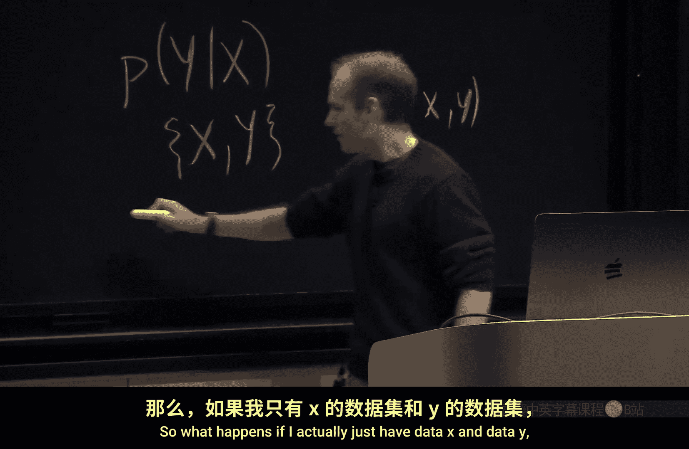

And data Y。 But I have no examples of x paired with Y。 Can I do anything。And it turns out you can。

And oftentimes， you can do conditional modeling with unpaired data。

 And this is sometimes called unpaired translation， so。

Could I translate this cartoon into this more nice Valentine？Okay， this is from。1968， this cartoon。

Okay， so here's the setting。 So paired data for colorization problem。

 I have black and white and color。 That's really easy to obtain。 I just take a color image。

 I remove the color channels。 I get black and white is paired data。😊。

I can model the conditional distribution of color given black and white。

 using the techniques that we saw。😊，Okay， but what if I want to。

Predict what would C Znne have painted if he had been standing at this river。

I can't ask Czanne to go and paint a million different rivers， right。

And I don't even know there's no photograph of this house that he was， he painted here。

So I don't have paired data。 And this is， this is a potentially more common situation than the situations in which we have paired data。

 Like having paired data is' a big constraint。 not only do I have to have both the X's and the Y's。

 I also have to have the mapping between them or the pairing between them， unpaired data。

It comes across all the time。 Here's a simple example。 I have a set of Cson photos。

 of set of Cson paintings， a set of photos。 And as a human。

 you can reason about the stylistic differences between those。

 And you can imagine what Cznne would have painted for each of these photos， right。😊。

How did you do that， despite never having seen a side by side photo of a place and what Cnne painted。

This is the problem of unpaired learning。And。There's a number of different methods。

 So I'm going talk about one in a little detail called doing this with GNs。Okay。

 so here here's a really cool thing about GNs and why they're still a neat model。

 even though they're less flashy these days。😊，So with again。

 the pairing between the input and the output is only coming through the discriminator。

 which looks at does the output go with the input， but it could drop that。Oh。Sorry。

 the animation is the left。 I could drop。I could。So， let's see。

So the problem with not having impaired data is I don't know what this Aison painting of this location would be。

But let me go back and just drop that dependency。The animations are a little off。

 but let me drop that dependency where the discriminator looks at， at the pair and say。

 what if the discriminator actually only looks at the output and asks。

 does this look like I say it's on painting or not。Now。

 this is the traditional unconditional G objective。

 I'm just trying to look at the outputs by synthetic image re generated from from Z or X。

 And I'm just trying to say， does it look like a real Cson painting or does it look like a synthetic seson painting made by the generator。

😊，And this is the cool property of the G loss。 is's actually just checking whether the output like belongs to the set of good answers。

 not checking whether the output matches the input。😊，Okay， so it's suitable for unpaired learning。

But how do I， how do I actually make the output， not just in random seson photo。

 but actually match the input。And。Sorry。So here is what looks like I say。

 on painting that matches the input。 But here is a。Well， the animations are off here。呃。

But here's also a perfectly valid Czason painting。And the discriminator will say that's real， too。

Okay。So the trick that works in this case is to use this idea of cycle consistency。

So I'm going to impose the constraint。That the mapping from X to Y is consistent with a backwards mapping from y to x。

So there's some kind of by activity between these two domains。 So I'm gonna， I'm gonna say。

 I'll train a network to map from photos to sson paintings。😊，According to a discriminator that says。

 does it look like I says on painting， Did I get to that domain output？

And then I'll train a discriminator in the opposite direction to go from Cson paintings back to photos。

 And that should fool a discriminator that will ask， does it look like a photo。

 So the discriminators will make sure I map to the domain of Cson paintings and the domain of photos。

😊，But I'll train these things to be what's called cycle consistent。

 which just means that if I go from domain X to domain Y and then I go back。

 I should arrive where I started。 and if I go from domain Y to domain X and I go back。

 I should arrive where I started。Okay， so this is kind of like in， in language， people use this， too。

 actually， there's an old Mark Twain story about trying to translate between a French speaker and an English speaker where。

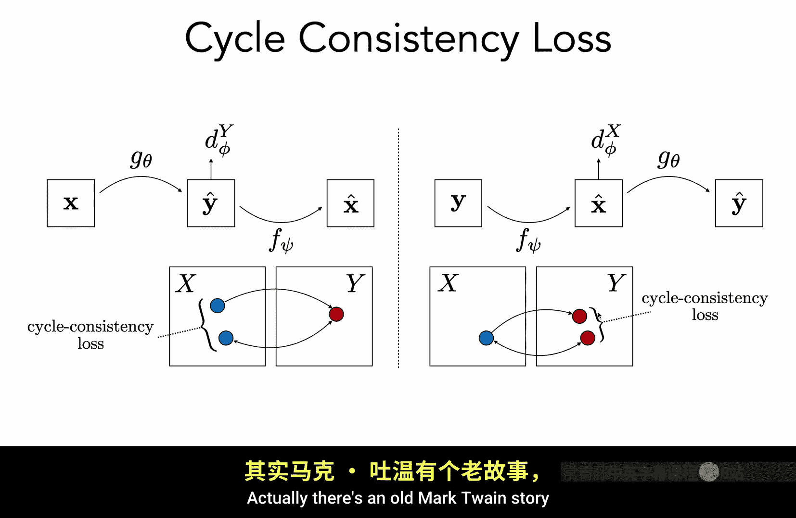

You know， you would， you would。Translate into French and then back translates into English and check that。

 And you know that the system is， you know， consistent with itself。 If you arrive where you started。

 If I say an English word， they say this is a French word。

 and then somebody that speaks French tries to translate that French word back into English。

 If I arrive back where I started， that's a。

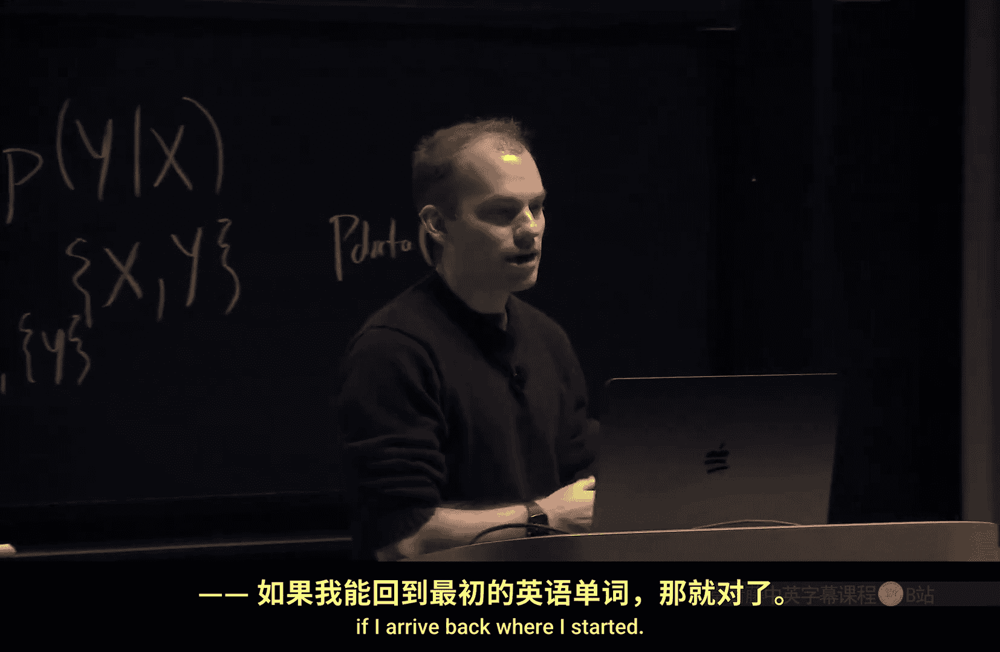

That's a property that should be satisfied by natural languages。

 because natural languages tend to have a bijection between the different， the different languages。

 Like every French word has a roughly direct translation to an English word。 You know， not perfectly。

 So sorry， French speakers， if maybe there's like concepts， you can only express in French。

 but roughly。Okay。So that actually works decently well， and that leads to the results set。

Look like this where I I've converted this photo into a synthetic Con painting。

Without having pair data。So one question you might have is。Wait a second。

There must be many cycle consistent mappings between any set of images X and any set of images Y。

And indeed， that's true。 But there is some theory around this that's been developed to say that。

 well。Under the constraints of a particular neural net architecture and in a particular optimizer。

Only some of the possible mappings from inputs to outputs are going to be found。So as long as I。

 I have some constraints that say that I need to find a simple mapping in a certain sense。

And neural networks do find simple mappings。 We've talked about that， right。

 So here's like a reello network with two dimensional hidden state。

Is trying to map this line segment A to this line segment B， and there's infinite possible mappings。

 But a re network trained with gradient descent with two hidden units can only find two mappings。

 In this case。 We'll converge on two mappings。 One is the identity mapping and the other is like the flipping of the lines。

 like negative identity。😊，Okay， so why is that there are also complicated wiggly mappings where every single point on A maps to a different random point on B。

 But it's very hard for those to be found by the architectures that we use and the optimizes that we use。

 So under the constraint of having a simple mapping， it'll tend to be the case that all map you know。

 the green stuff to green stuff。 that will be easier to learn mapping and that that that disambiguates that it should be like green to green instead of green to blue。

Okay。And these ideas show up also in unpaired language translation and potentially in other domains。

 you could apply them to。Where， you know， we try to impose what they call back translation or cycle consistency between the mapping from one language。

 to the other and back。And there's a number of other tricks that you can。

 you can apply as well in order to solve unpaired translation。

 So I'm not gonna have time to go into those other tricks。 But the， the general idea is。

 if I have a distribution of data in one modality indicated this is like the data distribution of the red modality。

 This is the data distribution of the blue modality。 Well， I can just align their shapes。

 it's like a rigid transformation problem。 So under this idea of distributional。

Like the two distributions。Should， should somehow。Be the same。

 And I can align those two distributions， or they should be the same up to like an isometric transformation。

 So if you're interested in other approaches to uned translation。

 look at this paper and look at distributional alignment ideas from natural language processing。Okay。

 so that， the point I'll end on is this concept that you don't always need paired data to solve。

Conditional prediction。 And one name for like pairing is grounding。

 grounding one modality in another。 And there's just really interesting implications。

 Like I could potentially identify the meaning of a word without ever having seen a paired example of what that word corresponds to in the physical world。

 And I'll have more to say on that in some future lectures。 Okay， thank you。😊。

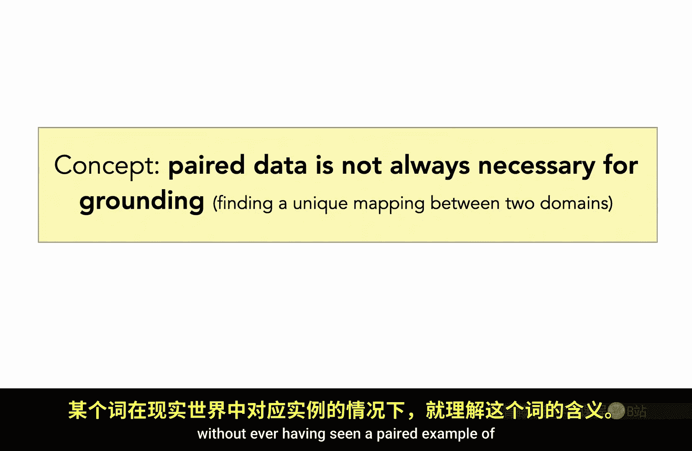

