# 麻省理工学院【中英⚡深度学习｜6.7960-Fall-2024,-Deep-Learning】-p17-P17-泛化：分布外（OOD）--BV15QZ4B1E6v_p17-

So today， we're sort of moving on from generative models。

 and we're going to start talking about out of distribution generalization。

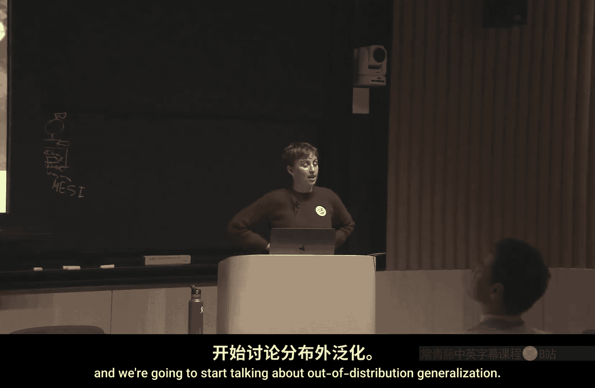

And this is， I think， one of the biggest open challenges for modern machine learning models。

 the ability to generalize to data that is not explicitly covered within the training distribution。

And so。Just a bit of motivation here。We've seen a lot of success in machine learning， right。

Incredible models for image classification。 This is kind of like a。Agregate of the Inet dataset。

 I would I would kind of argue that in many ways， things like simple categorization。

 the types of categorization we often try to do on datasets like Imnet is pretty much solved， right。

 They are， of course， like a few corner cases that are pretty difficult or sometimes even sort of erroneously labeled or ambiguous that are still kind of hard for modern models within Inet but mostly it's a solved problem。

 We've seen pretty great success on image generation。

 We've been talking about that the last couple days。 strategy games， things like machine translation。

 robotic manipulation。 We're starting to see success in all of these。😊，嗯。But then。

There are a lot of cases where。Machine learning still isn't very successful。

 And sometimes it can be surprising， right？ So， so I think one。Kind of interesting example here is。

 is in the space of sort of self driving cars， right？

 So we are starting to see self driving cars be deployed。 I think， you know， Waymo in particular。

 is starting to actually have fleets deployed in many different areas。And of course， there's。

Complicated dynamics around like， why we're not seeing self- driving cars at scale。

 A regulation plays a whole huge role in that。 But I think one of the main reasons is because we。

 we really don't have a good mechanism to guarantee the robustness of these models。

We can't guarantee that they are not going to make potentially harmful mistakes。

And this kind of really begs the question of， you know。

 are these machine learning systems really ready for the real world？

And kind of what dimensions of deployment in the real world are we still missing。

 like what do we need to be focusing on to be able to actually do this effectively？

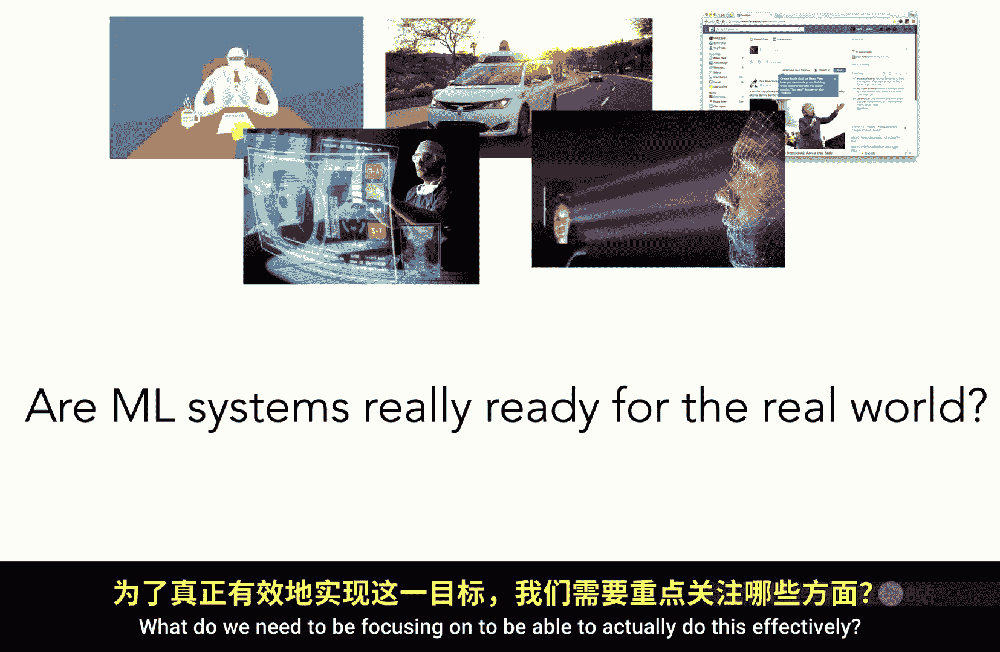

And I do think there's an interesting， sort of。Point here。嗯。

Which is you could argue that a lot of machine learning is actually actively being deployed in the real world。

 I think the GT models is a great example of that， right。People are using AI more and more。

 day to day。But if I'm trying to sort of characterize the types of AI that are ready for deployment versus the types of AI that even if we try to deploy them。

 we try， we invest， you billions of dollars into figuring out how to make them deployable。

 We're still not seeing that progress。 We're actually really seeing it happen。

 I think it kind of comes down to risk。And so a lot of the cases where we see AI models deployed are what I would kind of characterize as high precision human verification systems。

 right， So you need the model to be good enough to be useful。 so it should work most of the time。

But you also have a human verifier in the loop that is making corrections when something's not correct not right。

 right， So you have this kind of verification loop that's always happening with human intelligence。

 ChatT is a great example of this， right， you prompt it with something， you get a result。

 Maybe it's useful， you probably edit it， you probably like interact with it in some way。

 If it's just absolute trash。 maybe you giggle about it。 You share it with your friends。

 and then you prompt it with something completely different， right。

 So there's this human brain that's in the loop， kind of verifying that these things work well。

And things like hallucination aren't so much of an issue If a human is making the corrections themselves。

 It's when we start trusting these models without being human verified that we start running into issues。

 And I think another interesting example of that is things like a lot of the modern machine learning systems that are actively deployed in healthcare are what we call like decision support tools。

 right？ So theyre a tool that maybe a radiologist uses to try to highlight or potentially give some advice on what。

😊，What maybe a diagnosis could be， and then the human is actually liable to verify that and make a decision。

 And interestingly， there's been a bunch of fascinating work that's come out recently that really argues both sides of whether or not this is working。

 There's research that showed that these decision support tools are really great for trying to make sure that patient outcomes are beneficial that doctors aren't missing things。

 and then there's conflicting research that explicitly says that the deployment of these decision support tools is actively harming patient outcomes because doctors are becoming compliant。

 they're not paying attention and they're missing things in that long tail of the distribution that are actually quite important。

So kind of the jury is still out。 And fascinatingly， if you look at the regulation around what。

 what it actually takes to deploy a decision support tool in a hospital。The。

 the metrics are kind of shocking。s I'm not going to quote myself on the details， but essentially。

 it's like， you have to prove some percent accuracy on some small population of， of data。

But it's not nearly what you would expect。 I remember being quite surprised on the order of like 100 or 1000 patients。

To be able to deploy a decision support tool， and you don't have to go through anything like clinical trials because you're not actually making the decision。

 you're just trying to support the decision of an expert。So。Really， when we have this case。

 this is where we start to see things working well。

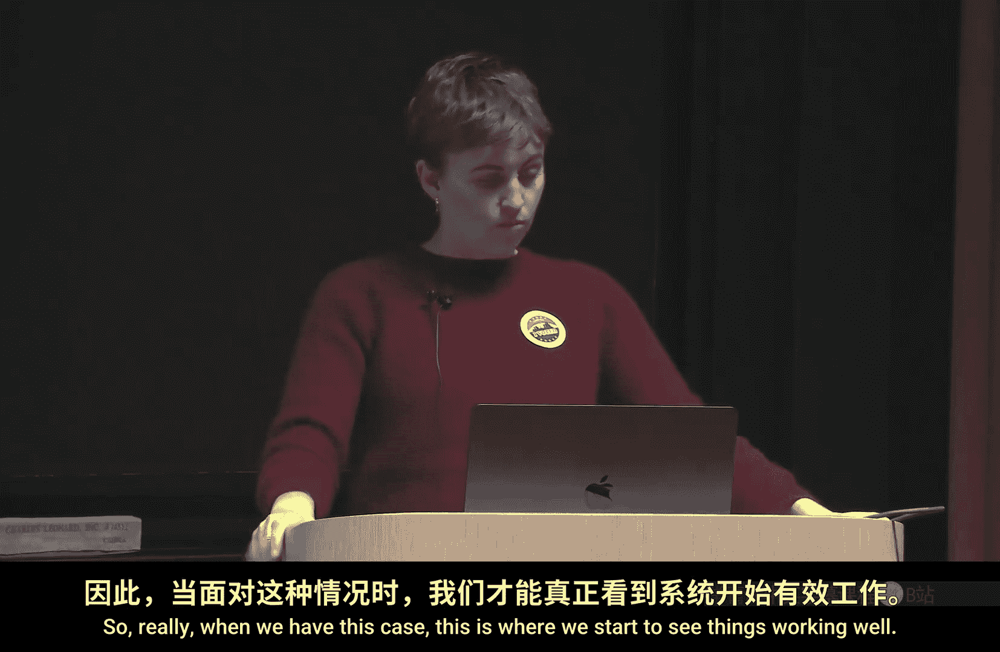

It's kind of the standard machine learning setting。

And it matches a lot of the underlying assumptions we make in machine learning。

 even theoretically that the data that we are training the model on is going to be IID independently and identically distributed distributed to the data we're going to use the model on right So you have some distribution over categories of interest。

 data， different sort of representative like visual characteristics within a category。

 And you're going to sample from that at random for training。

 And then you're going to do inference on the rest of the data。

 training distribution equals test distribution。This is never true in the real world。So basically。

 there has never been。Any such thing as a representative data set of all reality。

And one of the reasons that this is true， even with our best efforts， right。

 things like these are these huge data sets lie on， you know。

 billions of image data sets that try to just tackle this problem with pure scale， right。

 We're going to train on all the data we have and hope that that is close to being representative and IID to the data we want to use the models on。

It still doesn't work because the world is changing， right？ So if you capture all the data today。

It's not going to necessarily be representative of a month from now， a week from now， Things happen。

 Things change。 And so we often have something like this， right， Theres。

 there's some fundamental difference between the training and test distribution once we move to a deployment setting。

And so here， you know， maybe some version of that would be something like， all right。

 we've we've trained a model on Cambridge。 So this is like the data center。

 And now we're trying to use that model in a different season。

 now there's snow on the ground and the model starts to fail。

 And there's a lot of different ways that we can think about how those distributions can change So the data itself can become perturbed So that could be adversarly。

 We'll talk about that a bit in a bit。 but it also can be things simple things like the manufacturer of the cameras for Google Street view cars made an update to their system。

 And now there's some statistical difference in terms of the sensor itself。

You can get a different label distribution。 So， you know。

 maybe the set of sort of categories of interest has changed。

 You end up with something that used to be really rare。

 becoming much more common or something just disappears entirely。

And then there can be lots of other types of shifts。

 These can be sort of shifts in sort of the size of the sequences of the graphs you're modeling。

 whether。Gospatial shifts from like different countries or cities， source of measurement。

 That's like the sensor example I said。So what actually goes wrong when。

 when we have these sort of distribution differences。 So I thought this was kind of a cute example。

 It's a little hard to read， actually， Probably because I took a shitty screenshot。

But so this is a tweet by Hardma that was basically talking about。诶。Essentially。

 there was a failure mode in Roombas where they kept rolling over dog poop and then smearing poop all over people's houses。

 And so in order to try to avoid this happening， they went out and they collected a very large。

 diverse data set of dog poop。 So I'm sure that was someone's like research internship。

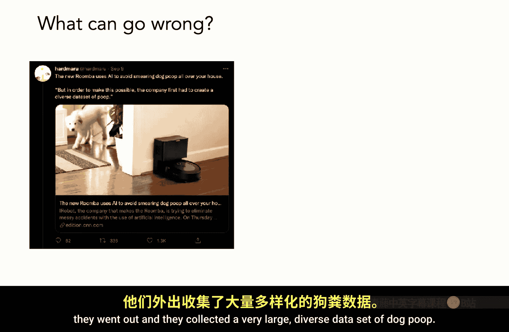

And then， so， you know， they're talking about， oh， okay， in order to do this， right。

 like the way that we're gonna generalize to this like sort of new out of distribution thing。

 which is like dog boom we didn't expect to be on the floor in someone's house。

 We're to collect this representative data set of dog boom。And then the response was from Dmitri。

 And he said， man， I wish they also created a diverse data set of rugs。

 So didn't confuse black stripes with cliffs。 And I could finally get my whole house cleaned。

 So this is kind of pointing out like you can， you can collect data for the distribution shift you do anticipate。

 But there's always going be things you don't anticipate， right？ And then you end up with Dimitri。

 who bought a roomba and basically gets like one tiny square of his rug cleaned a million times。😊。

Yeah， so it this is a silly， silly example。 But the point here is really that。

We cannot possibly characterize and anticipate every way that the world is going to change。

And so this idea that we can collect representative sufficient data to just ensure that where we're going to deploy the model is IID from what we train the data on is quite difficult。

This is reflected in quite concrete problems and when you're talking about AI safety。

 the safety of things that are deployed， particularly in high risk scenarios。

 things like medicine or self-driving cars， this was a paper that was explicitly characterizing what they thought were the largest problems in in AI safety and robustness to distributional change was one of them。

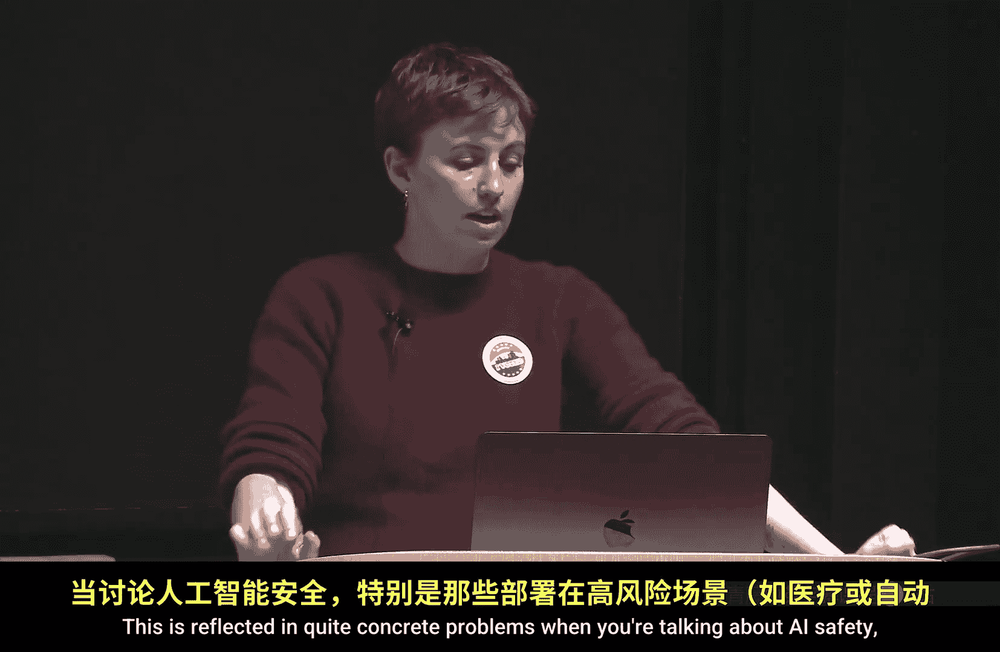

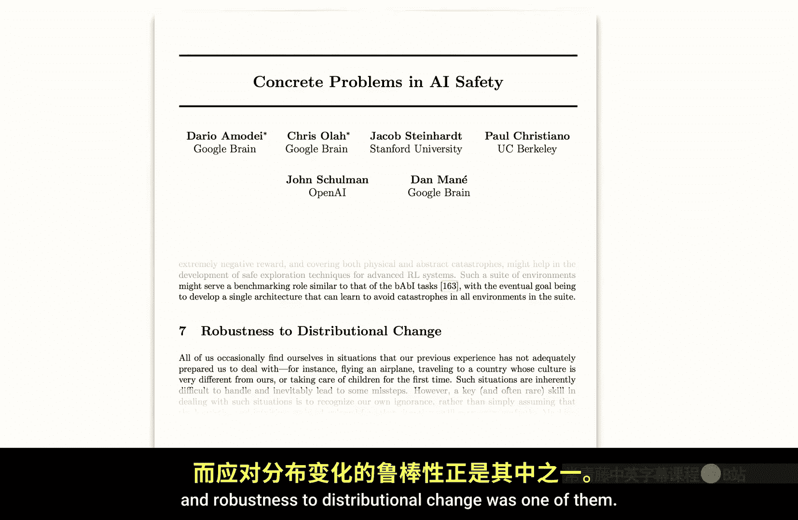

There was this really interesting workshop that happened back in 2022 at Princeton that they called the Reproducibility crisis in machine learning based science。

 they looked at about  a0 different papers across a huge diversity of scientific disciplines。

 and they essentially found that they diagnosed a bunch of different potential reasons why they weren't actually seeing reproducibility or sort of generalizability in the papers that they were analyzing。

And one of the biggest sort of failure modes here was data poisoning。

 So basically the way that they'd constructed the evaluation for these machine learning systems。

 was in some way， artificially IID that in a way that wasn't representative of reality And this is something that I actually run into a lot。

 I review a lot of papers for my sort of other half discipline。

 which is like ecology and environmental science。 and in those papers often what I see is a mismatch between the data that people are developing and training and evaluating machine learning methods on and the claims that they're making。

 So it's fine to sort of have a limited data， But then you have to understand what that means about what you can claim the effectiveness of the model is going to do right If you have built a system that identifies all of the individual macox in a national park。

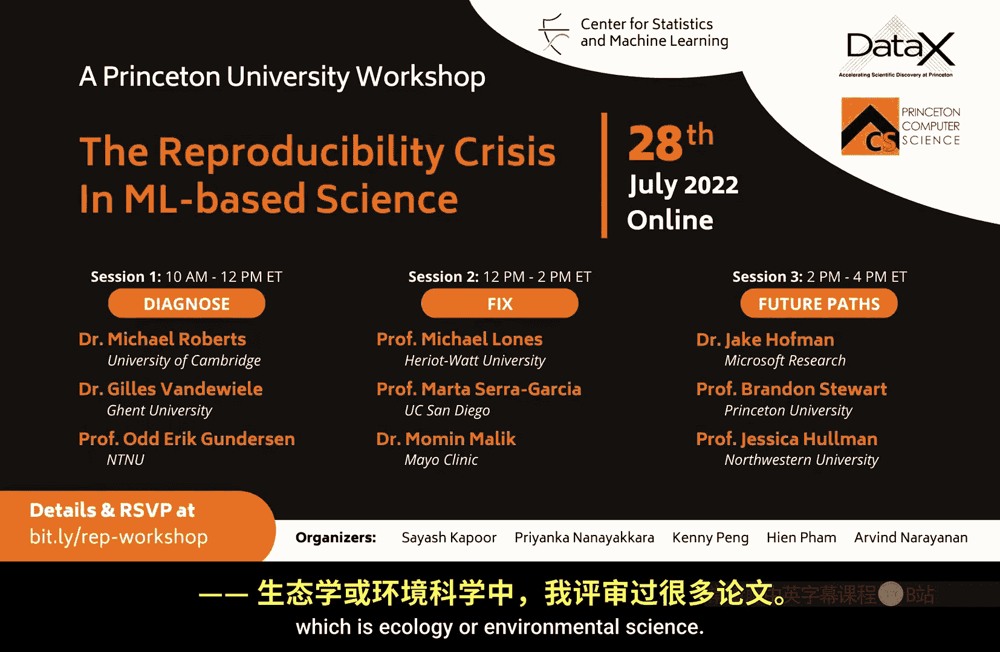

You can say something reasonable about your ability to monitor macox in that national park going forward as long as you've evaluated your ability to understand the changes in time for those individual macos right And so somehow the way you evaluate these models needs to be representative of the actual deployment use。

 And I think this takes a lot of really careful construction and thought， actually。

 the way we think about designing evaluation systems for machine learning models is really nontrivial。

If you use any sort of off the shelf。Tool things like Robboflow。

 It just automatically assumes that random splitting is fine。

 and you get often very sort of falsely high expectations in terms of the performance of your machine learning model because you've got data poisoning。

 essentially strong spatial and temporal or contextual correlations in your training and test data that make the model think it's doing well when it's actually not。

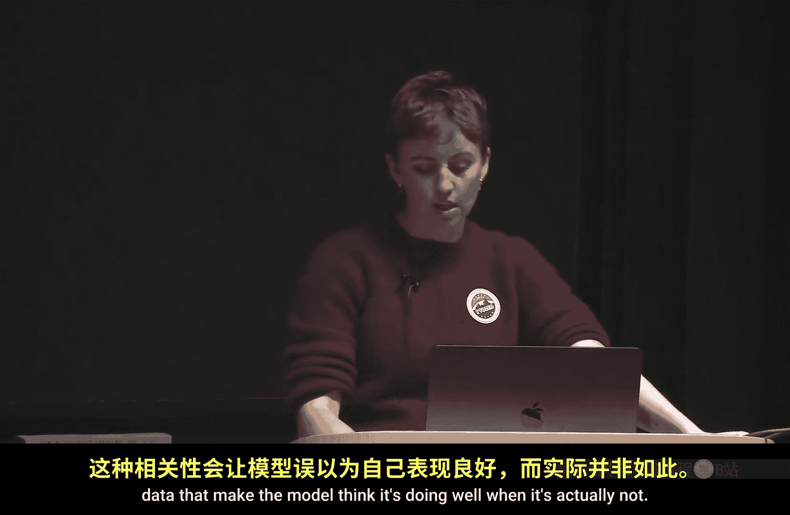

So， for today。We're going to be talking first about specifically adversarial examples and thinking about how you might train to address adversarial examples。

 So this is sort of small preturbations， ways that you think about robustness on the level of individual data points。

And then after that we're going to be talking about distribution shifts。

 so actually just these large scale strips from entire distributions of data and some simple mechanisms that people use to try to address them。

 though I do want to point out that both of these are pretty active open areas of research so I can talk about progress but we don't have solutions for these。

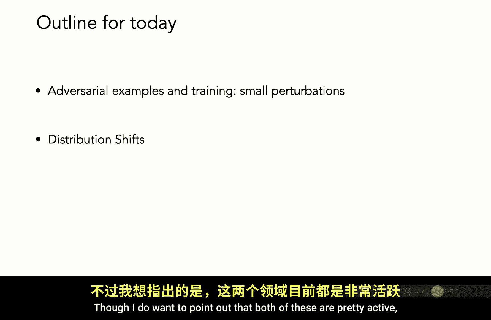

So first， if we're talking about adversarial examples。

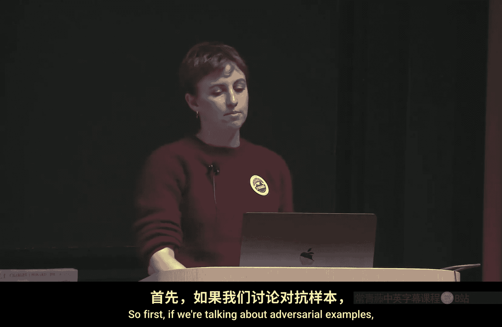

This is like assume assume we have a simple machine learning classifier， right。

We have this image of a pig。 The model says， yep， that's a pig，91% confidence。

What an adversarial example does is it adds some very small amount of random or not not random。

 but what looks like random noise。To this image。And you could see， like， it's 0。

005 times this sort of thing that looks random。嗯。And so when you're adding this noise。

 which is explicitly not random， it's actually optimized to be maximally adversarial。

You can actually change the prediction of model to be something completely different。

 maybe even with higher confidence than the initial initial prediction。嗯。Even though to me。

 this image looks identical， right， I can see no actual visible difference between the two images。

And so this kind of points to the brittleness within often machine learning models， right。

 they can be mostly accurate， but they can be really brittle to things that a human visual system is not brittle to at all。

And this is a big challenge， right， so。You can imagine that if you could do this sort of adversarial attack in something like self- driving cars。

 you could actually get models to explicitly change the decisions about street signs。嗯。And。

That would require that you're able to actually generate something that in physical reality is not just related to individual images。

 It's actually in physical reality， but that can also be done。 So let's see。 there's a。

I have a movie here， I wonder if it'll play。啊。Yeah， there we go。 So this is an example。

 So here's a classifier， right， It's classifying banana。 Do you put a toaster in there。

 It doesn't change the prediction。But if you put this very specially constructed adversarial sticker in there。

 it really convinces the model that it is， in fact， a toaster。 So if we watch that again。嗯。

So the interesting thing here is that I would argue from a classification standpoint。

 like this is really ambiguous。 You would expect a model would actually maybe even reasonably predict toaster。

 they're about the same size， whatever。 whereas here， this looks nothing really like a toaster to us。

 And so。😊，The interesting thing here。Is that this kind of demonstrates that it's not something about sort of high level image characteristics that you can actually really convince these models or trick these models。

 even in physical reality。 And there are fun examples of this， even in 3D。

 So this is an adversarial 3D printed example of a turtle。😊。

That most image classification models will categorize very confidently as a rifle。

And you can actually sort of show there's like a fun video。 if you go look this up。 Oh， here we go。

 perfect。😊，Yeah， so it stays。 the prediction stays rifle， even if you move it around， right， Like。

 it exists in 3D and you all you're doing is changing the texture。

And they basically showed that their 3D turtle was really consistently predicted as either rifle or sometimes as something else。

 but it was never actually categorized as a turtle。

And you do this type of adversarial attack for speech as well， right。

 you can add just a little bit of sort of very explicitly targeted noise in a way that perceptually if we listened to these or even visually within the waveform。

 looks like it's made very， very little difference。

 and it will actually the model will predict that the translation of that speech is completely different。

So what does this mean about our models， Are they useless， right？ Like what about them is so brittle。

 Why does this happen and can you prevent it， So a bit of a history of adversarial examples。

 So this has been something that people have been looking at for quite a long time。

 Some of the first works in the space where from back in 2004。

And there they were looking at adversarial examples for things like simple linear classifiers and one of the sort of original motivating examples was a spam filter。

 right So if you tried to build some classifier that tried to categorize whether an email was spam or not。

 could you basically from a red team blue team perspective。

 try to actually build emails that would explicitly get through your spam filter。😊，And。

This is sort of only gone on from there。 There's been a significant amount of work。

 this was reviewed back from even 2018， but now， particularly maybe in the context of today being voting day in the United States。

 there's a lot of work in this type of adversarial dimension， looking at misinformation filters now。

 So how do you sort of how do you try to detect and categorize active misinformation or deep fakes on the Internet on social media platforms and then this sort of active antagonism of trying to actually develop deep fakes that are undetectable by these algorithms。

So。It's important and it's difficult。So we'll talk about how do you actually do this in maybe the simplest sense。

 How do you create an adversarial example。So at first。

 we're going to assume at least for now that we have some fixed machine learning model， right？

And so now what we're doing is we're actually optimizing over data related to that model。

 So what we want to do is we want to find a small preturbation to a given image that doesn't change the meaning to a human。

 but does change the meaning to a machine learning model。And so the model is going to output some。

 you know， probability of given theta。 So like of some given machine learning model。

 weights and architecture。Some probability of y， the category given X， right。

 we might take some softms to get， to get that prediction。

So what an adversarial dimple does is instead， now you try to。Solve this optimization problem。

 that finds the maximum。Overall， possible small， like delta， so small changes to x。嗯。That you now。

 instead， predict a different different category。 So is a target category that is not the original category。

 And you could do this for any category， right， You could find the noise that would make this pig look most like an airlineliner。

 but you could also find the noise that made this pig look most like， I don't know， your friend， Bob。

And so you pick some wrong class， and then you have some given input image。

 and then you find a small preturbation that actually maximizeizes this。

And this will be within the constraints of some set of quote unquote， allowed preturbations。

 And so a really common thing here is actually that we look at this taking like an infinity norm over the。

 the preturbations。 So some intuition here is like instead of just looking at sort of the aggregate difference between。

The image and the the new one。 Instead， you're actually constraining it such that the largest change for any given pixel has to be less than a certain amount。

Right， so the infinity norm essentially is saying， like you're going to actually。

Just keep the maximum change for any pixel small。And that。

 that does tend to actually result in things that are unperceptible to humans。嗯。Cool。

So how do you actually do this？So how do you you know sort of given some machine learning model that you assume is not changing。

 how do you find that maximum preturbation， So instead of trying to sort of solve this as an optimization problem。

 you can actually also basically flip SGD on its head and you can do this thing that people call projected gradient ascent where we're updating that data preturbation over time。

And so first， you would take a step in the direction of the gradient， right？

And then you project the result back into your sort of feasible set。 So you're。

 you're constraining the amount that these images can change by design， right。

 you're making sure that it's obeying that that optimization constraint that Delta can't be too large。

 And then you just repeat this over and over again。

And this is quite simple and it actually works quite well。So how do you actually defend against this。

 is there any way to sort of defend against these sort of active avero examples？

So another way to think about this adversarial example instead of sort of trying to， yeah。

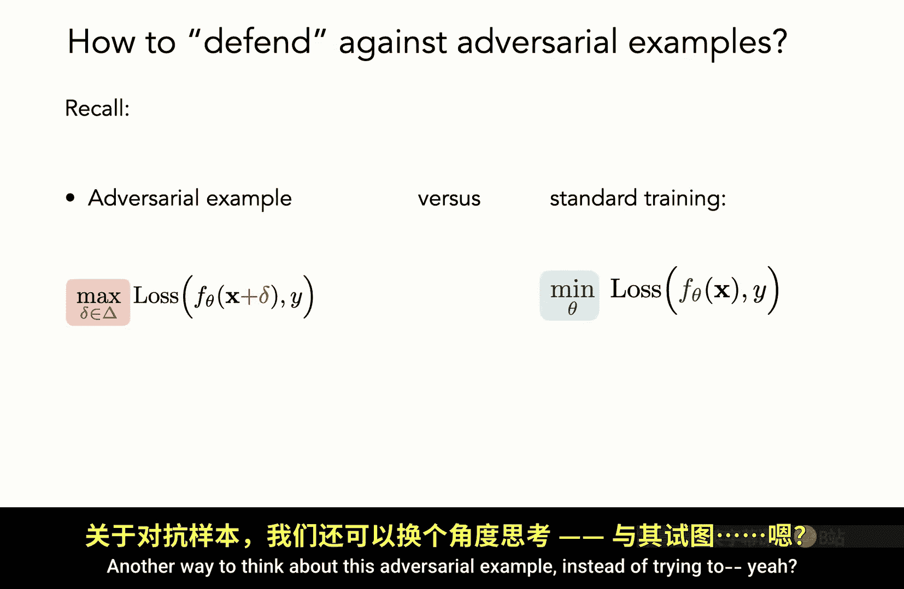

For the previous light。How do you actually。What's going。Like for example， prices。Yeah， yeah。

 So this projected gradient ascent assumes that you have the model weights and the architecture so you could actually calculate the gradients。

Is there a method that doesn indeed。So the question is if there's methods that don't need the actual gradients of the model。

 yeah， I mean you could do it in a brute force way too right you could just think about trying a bunch of things and just picking the one greedily that sort of the result was worse might be more expensive。

 so this is just maybe a more efficient way to find something。

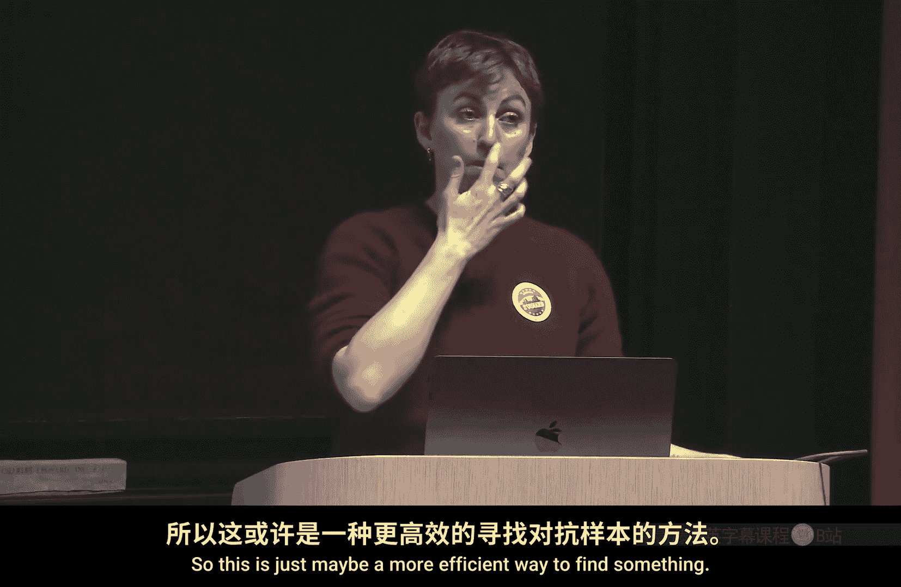

Yeah。And then there， there are like other methods that sort of try to do this maybe in different ways。

 right， So not necessarily assuming that the model can't change， but that's， of course。

 a bit more complicated。Okay， so a different way to think about finding an adversarial example is instead of sort of trying to explicitly maximize the probability that your image is predicted as a given label。

 you can also think about it as just maximizing the loss between your models sort of prediction of the image plus that adversarial amount and the correct label why so here you're not sort of saying I really want this to look I want the model to think it's this specific category。

 you're just saying， okay， what's the noise that will make this sort of most wrong。

 It'll make the loss highest for this example。Whereas in standard training。

 you're trying to minimize that loss sort of all over all the possible thetas in the model itself。

So then what you can think about doing is like if you have standard training where you're using SGD and you're trying to minimize the sort of loss over sort of all of the different data points in your model。

 you can think about training adversarly， right， like trying to actually get your model to be robust to the types of preturbations that were expecting this adversarial model might have this adversarial approach might have。

 right， So here now you have kind of this， this two or this sort of nested optimization。

 So now you're trying to find the model。Such that for every image in your data。The worst case。

 preturbation。Is still。Not too bad， essentially， like you're trying to during training。

 find the worst case preturbation and then find the sort of model that for all of the different data like。

All the different data points in your training data set is still sort of as good as possible。

 even in those worst cases。Does that make sense？So so theres thiss also can be called sort of adaptive data augmentation。

 And it's kind of like an interesting example of sort of finding these like hardest cases。

 So we learned a while ago about like hard example mining， right。

 Like it's sort of maybe most informative。 sometimes if you show models。

 explicit examples of things you know are going to be hard and you want to still do well。 Yeah。

 what happens if there are like two similarly hard examples， but like very different。😊。

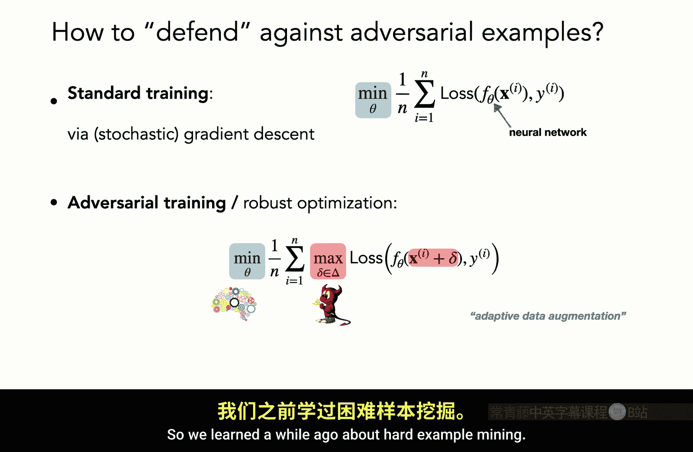

这。So the question is what happens if you have two hard examples that are different from each other。

In this case， like the maximally hard example。For the turtle was rightful， though。You know。

 besides rifle， there is like。Apple， that is like。On like a similar scale as being like。

The right example， but basically you've only trained for。对。

An adversial example where it would be like something。Related to a rifle。Right， okay。

 I think I think I get what you're asking。 No， no no。

 I actually think it's a pretty prescient question is just worded a little complicated。

 So so essentially the question is like， what if the data changes in a way you didn't anticipate。

 And so this is really explicitly constrained to be robust to the types of preturbations that you've defined as sort of within your reasonable set of preturbations right And so the cases we talked about were something that looked like very sort of small amounts of noise added to images。

 But we'll talk about in a bit， like most preturbations of data are not of that structure in the real world。

 right， like often if you have something that's。😊，Out of a distribution in some way。

 adversarial in some way， it's not， it's not sort of specifically the static noise。 And， for example。

 this type of approach would probably not work very well for those stickers because that's a different type of perturbation of an image。

 Did you have a question basically ask。Criticism is that like this won't help yourself better？

Deect pedestrian。Like that's not。Yeah， or I mean， pedestrian in a crosswalk。

Probably you could reasonably say you could， you could think about ways to augment your data to capture that in a bunch of different ways。

 But then what you end up with is like weird stuff。

 right like there's this classic example of like a bunch of stop signs being transported by a truck in the back of a truck。

 And there's a selfdriving car behind a truck full of stop signs。

 And it's just freaking out because like what is it supposed to do。 And so like yeah。

 like like this is kind of， again， like I said before。

 It's just really hard to anticipate every way the world is going to change。 So if you could do that。

 then you could reasonably try to be robust。 either just through sort of standard training or if you didn't have the right training data。

 you knew something about the way the world might change。 You could try to be a robust。

 explicitly to those types of things。 You could do things like empirical risk minimization。 but。

That is often not the case in reality。 And so a lot of the work in this sort of adversarial example。

 adversarial robustness， they have to make assumptions。 And usually。

 those assumptions are violated in real world。Unfortunately。Yes。😊。

Is there anything stopping this from being like age？Just like minimizemizing Boston。

Finding have to say down with that tax。我对。And lot like eventual be。Trains today。

So for a reasonable set of preturbations and assuming that， you know。

 like maybe you try a bunch of different hyperparameters。

 it is usually is often possible to get these to converge， but it can be difficult， right。

 because you basically have two different optimization objectives that are conflicting and so they can be pretty finicky to train。

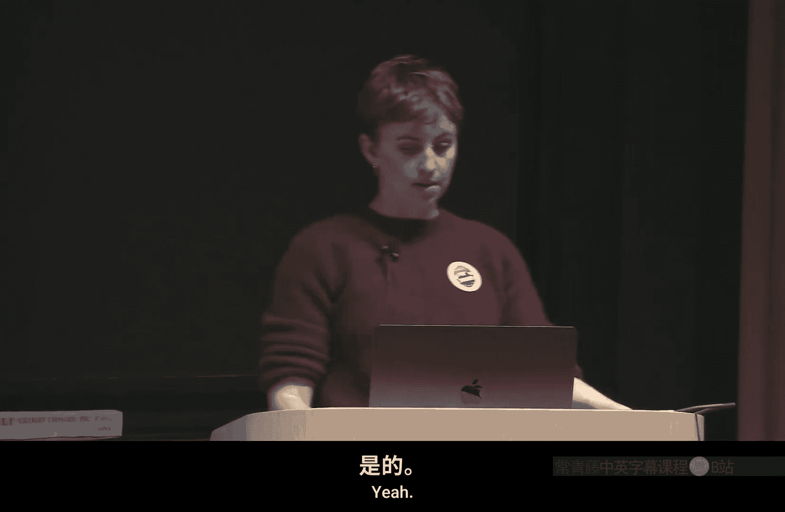

Cool， so now if you're actually doing that type of adversarial training。

 what you actually do sort of in the training loop is you would sample some data point X with the ground truth Y。

 you would compute now the approximate optimal adversarial preturbation and you could do that with that projected gradient accent And then you would compute the gradient。

 given that preturbation， and then you would update your loss given that gradient for the parameters right。

 So it's essentially like for every for every model， you're like for every data point。

 you're training another model。 and we'll talk a bit about it next lecture。

 but this also is sort of similar to things like metal learning right where potentially in your outer model training loop now for every data point。

 you actually have an inner training loop。 And then so it's also quite computational expensive to do this。

😊，Cool， so what do these examples tell us， What is the fact that these adversarial examples exist tell us about the models itself。

So arguably， I would say it tells us something about the input features， sort of the structure。

 the statistical characteristics of the data that we're training the model on that become critical for the model's decision。

So there's an interesting example here。 This is training data。

 trying to teach a model to categorize fours versus nines。And the interesting So it is like Mist。

 essentially。 But the interesting point here。Is that what they've done is they've added spurious correlations that are very small。

 So for every four。They've added a white pixel in the top left corner。 And then for every nine。

 they've added a white pixel just one next to that。

So now what ends up happening is if you do these adversarial preturbations that are very targeted。

 you basically just change the location of that pixel。 You get the exact opposite prediction。

And this really gets at this kind of question of like， what are these models learning。

And they're going to learn whatever signals are there。And ideally。

 whatever signals are easiest to pick up。So this becomes just like a binary classifier， right。

 if you consistently have these correlations， the model just ignores the rest of the image。

 It learns all it has to look at is just that top pixel。 And it's a perfect categorizer。😊。

And so what this can kind of tell us is that for any given model。

 the sort of features that are captured in that model。Some amount of them will be useless。

Some amount of them will be robust。 So these are features that are correlated with the label。

 even if they've been perturbed in some way。 So， you know， here。

 they're showing things that are quite semantic， right， things like specific attributes of like。

 you know， cat ear， a dog nose or like the sort of structural shape of an animal。

And then there's another set of features that you could argue are not robust， right。

 And these are going to be features that are correlated with the label in the training data。

 but can be flipped with preturbation， right， so perturbing these nonrot features can actually change your prediction。

And so many features can be correlated with the label in your training dataset set and thus be predictive。

 And they might also be correlated with the label in your test dataset set and be predictive。

 And so they can help with accuracy， right， Like like the accuracy is good。😊。

But there are features that are beyond what a human would use。

 or sometimes maybe in some subtle cases， things that we might use based on maybe like stereotypes。

 But if we think rationally about it， we might not want to use them。

 So there's a lot of examples of these types of stereotypes or biases and training data sets that are sort of against women or gender minorities。

 right， Like if you show early child GBT is very， very popular。 you know。

 if you if you asked it to generate not child GBT diffusion models。

 if you asked it to generate images of a doctor， gave you a bunch of white men。

 if you asked it to generate images of you know， a homemaker， it would give you a bunch of women。

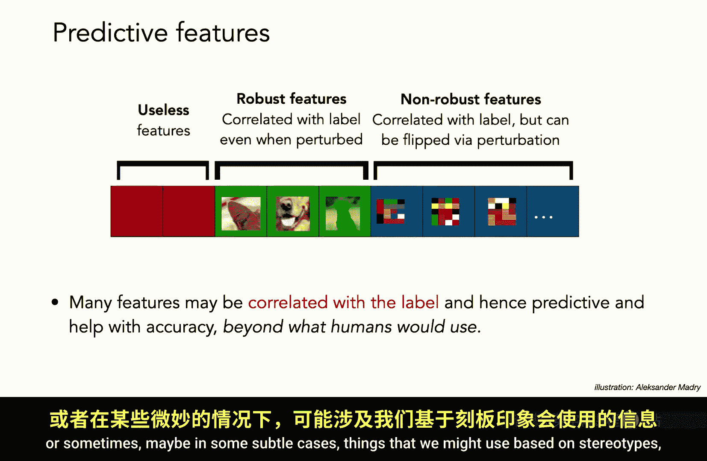

Just like biases that are built into the dataset sets that might be correlated with society。

 but unfortunately， are things that we， if we think about it from an ethical perspective。

 we don't want models to make decisions on right And this gets really complicated。

 So there's this entire sort of deep literature on fairness in machine learning models and how you think about equity when the data we're training models on。

 is just as bias as our modern society， like and these models tend to exacerbate societal biases so。

Crelative predictive features are not always something we want the model to use。

 both because it can make it non robust， but also because it can exacerbate bias。

And where do the correlations come from， They really come from the data， right。

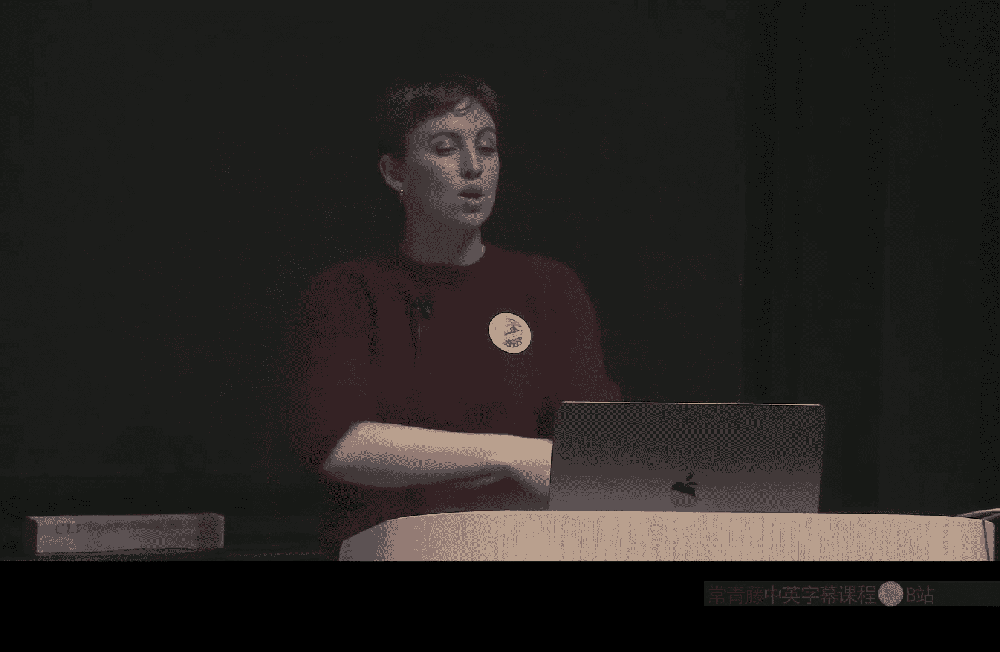

This is a fun example， dogs and cats。Turns out if you put a dog in a bow tie。

 the model predict it's a cat because there's this weird bias where people put bow ties on cats more than dogs。

 Or this is a really fun one。 If you， if you look at all the images of fish in the imagenet training gen set。

 you get like。😊，Grumpy dudes is sunglasses。Maybe very happy dudes and sunglasses。

 They're going fishing。 they love it。 But the model's not learned fish。

 It's learned like fish in the hands of a person。 And then， you know， like。😊，Basically。

 this really is just rooted in how we create data sets， right， So in an ideal world。

 we would have representative real world images that sort of captured the distribution of everything we would ever care about。

We would have expert annotators who were then able to build perfect annotations on top of that。

And then we could use that to carefully and meaningfully construct a benchmark where we could evaluate machine learning performance and。

 you know， happy sun and rainbows。 But in the real world。

 we often have images scraped from the Internet。😊，And then we have some form of automated or crowd collected labels。

And then that results in sort of these noisy， complicated biasanitations。

 And that might create an easy to optimize benchmark。

 but it's not necessarily something that is rooted in reality。

And one argument is that all these models are learning are shortcuts。

 It's all kind of different types of pattern matching。

 And so shortcuts here are features that are correlated to the label in the training data。

 but maybe not correlated with the label into realistic distribution shifts。

 And it turns out that these models will use them and will not generalize if then those features are no longer correlated。

 So。And， and interestingly， there's a dimension of imbalance here， so。

In some of the things that I try to do I， I'm doing species identification and static cameras。

 And what we get is。Day night bias for non diurnal species， so like raccoons show up a lot at night。

And so we still have some images of raccoons during the day during training。

 but the vast majority are at night。 And so the models learned that it's like， nighttime。

 kind of like fat cat blob thing， probably a raccoon。 And if you show it daytime raccoon images。

 even though it's seen them during training， the performance is just much worse。

 because this like correlative， predictive factor is not there。

And so the models will use these shortcuts when they're provided because we train them based on likelihood。

 right。

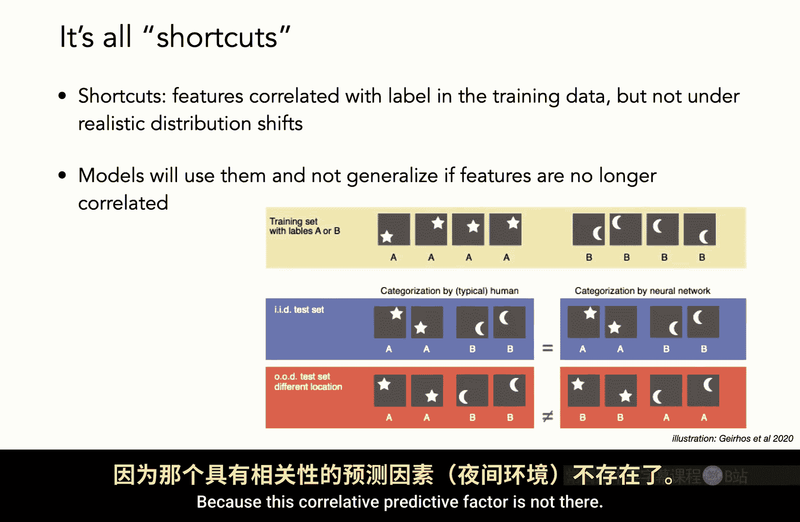

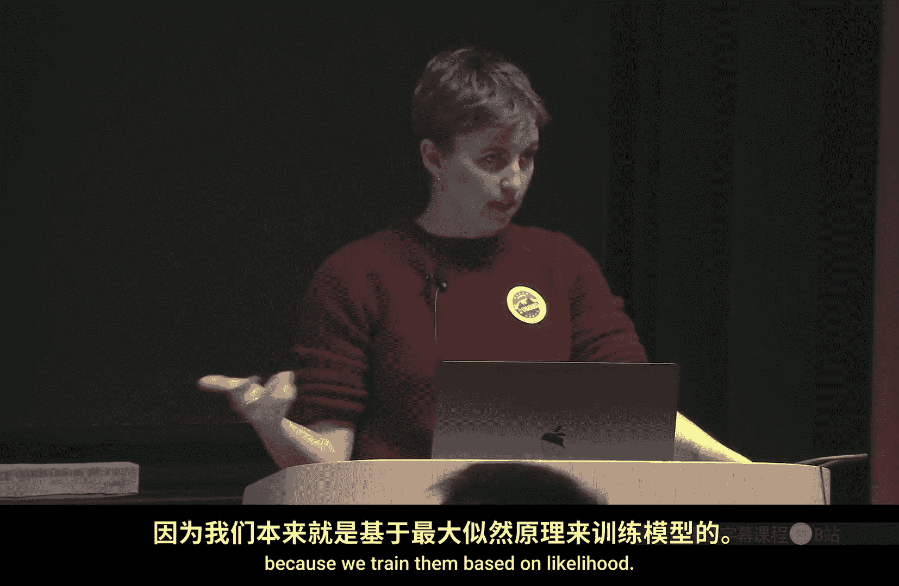

And this is almost this is often related to the data itself， right。And so interestingly。

 adversarial examples， those types of like preturbations we talked about。

Can transfer across models trained on the same data。

 So like the same types of shortcuts will often be learned。

 even if you use different architectures because it's trained on the same data。

And what can these shortcuts look like？Yeah， things like this is a picture of a green hillside。

 And this， this model is explicitly saying a herd of sheep grazing on a hillside。

 but there's no sheep。This one says a flock of birds flying in the air。

 These are instead these really nice tree based goats。 I don't know if you guys have seen these。

 They're amazing。 They goats that climb trees in the Mediterranean。😊，And then， you know。

 things like this。 it's people holding goats， But the model predicts their dogs， right。

 because it's seen less of these examples of people holding dogs。And these can be。

 these are all kind of silly， but they can be pretty problematic as well， right。

There were there was some early work that was showing that you could do a lot of like really nice predictive diagnostics on x-rays。

 and then there was this pushback work that showed that actually what the models we're learning was to detect where the X-ray was required acquired So which hospital and then calibrate the predictions according to the distribution of diseases at that hospital。

 which is again， probably the type of like useful but unwanted correlation。

 or similarly like it's learning that if an image has a ruler in it。

 an algorithm is more likely to call it tumor malignant And so you can imagine now that essentially what this is meaning is like you're much less likely to detect to the examples where a doctor hasn't already thought that it might be malignant and is like measuring it with a ruler。

So not all predictive patterns are desirable， and we talked about those fairness examples as well。

And there are tons of examples of this， right， And you can think about this in interesting ways。

 So here， this is like。You know， essentially， like going from IID to out of so independently identicalally distributed to out of distribution。

 you can see domain shift， adversarial examples， types of like distortions， pose warping。

 texture change， background shift， all of these will often result in a human looking at these images and saying it is the same category。

 but the model ends up not predicting the same category。

 So this is things that we want the model to generalize on， but it doesn't。

And then there's the opposite， too， which is things where the machine learning model is very convinced it's the same category。

 but a human would not be。And this happens for transformer models as well right。

 So this was a case where people had trained transformer models to look at like reasoning。

 but it turned out that they pretty explicitly couldn't generalize out of the distribution of the number of the sort of sequence lengths that they were trained on。

So adversarial training， when you're sort of training to be robust to these types of non-robut features。

 and now here you know we're assuming that we know the dimensions of robustness。

 which of course we don't often know。 they do tend to teach models that have outputs that are hopefully stable under these types of adversarial perturbations。

 So you get imvariance to these non-rot features。And， of course， like this type of just like。

Noise addition is not necessarily representative of every possible way that this data could be preserved perturbed。

 but there are some nice papers that show that if you train in this adversarial way， it。

 it can be much more expensive。But you can get features that tend to be more human intuitive。 Like。

 now I'm always a little bit iffy on the use of things like these activation heat maps as like concrete explainers of what a machine learning model is doing。

 But these do look interesting。 So here， if you look at like a primate。

 here's just some sort of if you trained with sort of an L infinity or an L2 norm。

 you can see that the features are like a little bit more semantically meaningful。

 Like they look a little bit more like the object of interest。 Andly similarly。

 if you're trying to build these sort of adversarial examples for robust models。

 So now if you've trained it to be adversarial adversarly robust。

 then the thing that your the data that your model actually generates to be。😊。

Adversarial has to look a little bit more like the semantic category。

 You're trying to make it adversarial to。 So here， if you start from these pigeons and you try to find the adversarial example that makes them look maximally like dogs。

 like this kind of looks like dogs。 It just really doesn't look like pigeons anymore at all。

 And so these are things that， you know， a human is sort of more okay with these types of mistakes。

And there are some papers that show that adversarial trend models maybe build representations that transfer better to other data sets。

 at least specifically with some of these like sort of the dataset sets shown here。Cool。

 so adversarial training， if you think of it as like another very targeted form of maybe regularization or。

 you know， a different type of domain adaptation， but one that's quite targeted to try to make the models robust to some explicitly constructed form of preturbation。

So now what if we're not talking about preturbation on individual data points。

 but we're Z talking about preturbations over entire distributions， right， So here。

 instead of having the sort of same distribution for training and inference。

 and now we have a pretty different distribution for training and inference。

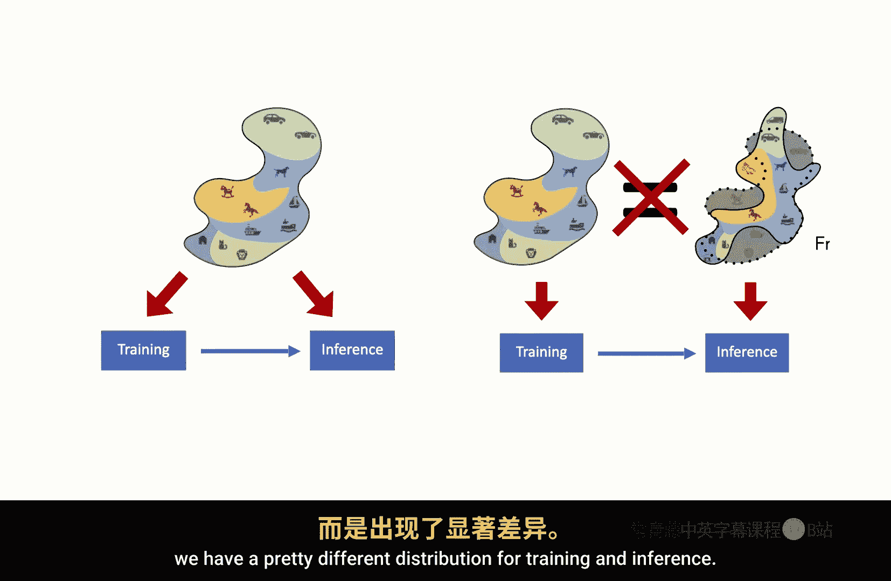

So。This is basically like the world I live in。 So here。This on the left。

 that's a map of an estimate of alpha diversity globally。

 which is an estimate of essentially the number of unique species that exist in any given place。

 And then on the right， this is a map， a heat map of the 3 billion existing species occurrence records in the global biodiversity Information facility。

😊，And you can see that they are clearly not super well aligned， right。

 They're almost anti correlated。 So you can imagine that if this is my training distribution。

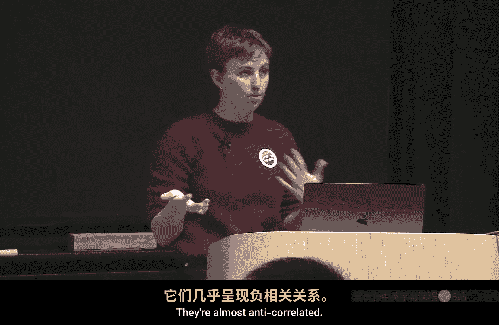

And somehow， that's like the distribution of the data maybe I want to use the model on。

 that that's a pretty significant distribution shift。

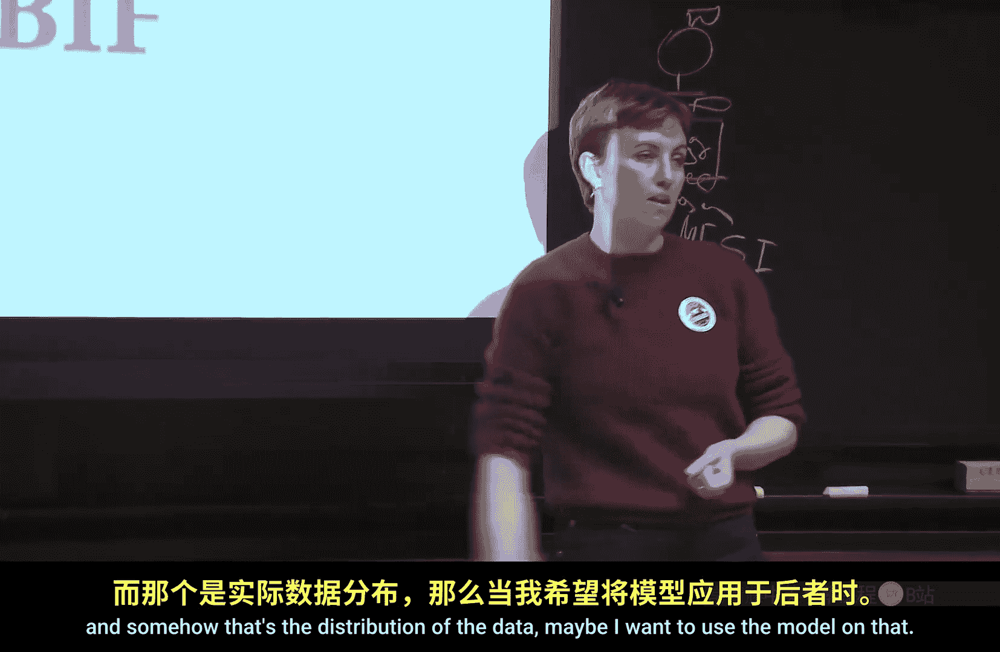

And then add on top of that， the fact that all of it's changing all the time and it gets pretty messy。

And this was the motivation actually behind the creation of this wild benchmark which I built with many other very talented people。

 specifically it was reflecting the fact that a lot of the literature around distribution shift and the machine learning community or sort of these types of not realistic distribution shifts like adding noise to things or taking Mniist and like rotating it by 45 degrees are like making it a different color。

 you know， like not necessarily super representative。

 even some of the examples that were designed on real data。

 like I don't know if you've ever heard of the waterbird data。

 It's basically a data set of waterbirs were like the training data has waterbir not in the water and the test data has them in the water you know。

 it's a background shift problem。 but it's pretty artificial right。

 you've constrained it so that the categories are balanced that you' only looking at one dimension of shift。

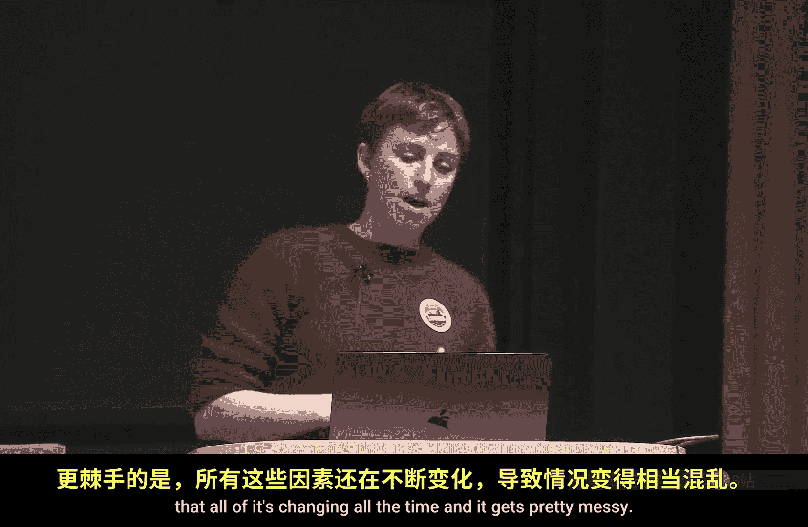

And the real world is quite messy。 So this is a benchmark that looks at distribution shifts over a pretty diverse set of real world domains。

 everything from。You know。Different sort of scans from hospitals to different locations of species categorization。

 generalizing like mapping of poverty across countries， looking at like comments across demographics。

And essentially， what this benchmark highlighted was that。

When you move out of distribution in these realistic ways。

 basically model performance degrades significantly。

And the way you actually kind of think about measuring this is you can try to explicitly construct benchmarks that look at performance over realistic distribution shifts。

 So here we looked at the gap between a control。 So in distribution test data。

 and note that this is not actually identical。 It's just randomly sampled from within the training data locations and then you have some new cameras that are sort of held out that are out of distribution。

 and you can see that macro of one performance degrades by like 16%， which is pretty significant。

And if you're thinking about sort of what are the factors that could lead to this。

 There a bunch of different things， right， It could explicitly be things like background It be things like pose of cameras。

 right， So the top and the bottom are sort of more horizontal。

 The one in the middle is posed a little higher。 So you're getting sort of different angles on species here。

 you know， you can see some of them have passive fored at night。 Some of them have color。

 So like the dimensions of shift in the real world can often be quite complex。😊。

But not just that visual shift。 We also have pretty explicit what can be termed subpopulation shift。

 So essentially for any given location or any given camera。

 it has its own unique distribution over the categories of interest。It makes sense， right。

 like that camera is placed in a micro habitatbitat。

 That micro habitatbitat has a local set of species that's interacting with them。

And it turns out that this is basically true for every ecological problem I've ever worked on。

 So different ecosystems will have both subpopulation and visual distribution shifts， no matter what。

 this is looking at detecting individual trees from aerial data across the National Ecological Observatory network。

 Trees both look different and are at different densities。

You can similarly try to think about categorizing detecting and counting fish in different rivers across the Pacific Northwest or things like categorizing urban trees across。

Different cities in North America。 And you can see that both visually and from the sense of subpopulations are here。

 the colors are kind of mapping the 20 most common genera of trees。

 And the differences in colors between cities kind of capture that subpopulation distribution。

And it turns out the performance often has a very strong correlation with subpopulation distribution similarity right So this is if you're looking at training on one city for urban forests and testing on another。

 you actually get these kind of blockwise structures where cities that have similar training distributions will like you'll generalize better within the set of cities that have similar training distributions。

 It's kind of intuitive these models， again， are trained on likelihood。

 So you're almost building a prior based on the subpopulation distribution within any given training set。

 And if you're matching that more closely， your model is more likely to kind of predict well。

And there's some nice examples of a sort of simple。

 simple approaches you can try to do to actually match the expected distribution of your test data。

 even without additional training。 So things like just if you can build or you can represent a prior。

 if you have some way to construct a prior over the set of categories you expect to see。

 Then you can just do a really simple sort of Bayesian remapping of the predicted probabilities to kind of take into account that prior。

 I'll talk about that a little。So what do you do about distribution shift？

So one thing that people have looked at is this that's quite similar to the adversarial example we talked about before is something called distributionally robust optimization。

So so far， we were sort of saying we were allowed to perturb each data point by some limited amount。

But an alternative is that you can actually think about perturbing the entire training distribution by some amount together。

 right。And so now what this looks like is like distribution robust optimization essentially just assumes that the worst case data distribution shift might occur。

 So， you know， you might have some different sort of samples in terms of the densities。

 you might sort of take some of the data away， etc cea， et ceter。

 And so they they think about ways you can perturb the distribution of your training data set。

 And then they take kind of a simple， similar approach to what we did with the adversarial examples。

 But now you're trying to find the model。Such that in expectation over sort of all of the possible distribution shifts on a data set。

 you're still going to minimize the loss。And so you're basically。

 again finding that worst case scenario and trying to make sure that the model is still robust to that。

For any given sort of for any given distribution。 But again。

 this like assumes that now you can only move the data distribution sort of a certain amount。

And measuring the difference in pixels is one thing。

 But actually trying to think about measuring the distance between probability distributions can be quite complicated。

 right， So there's like chi squared distances。 people use things like whirstein distance。

 maximum mean discrepancy。 But how you actually measure how far away two distributions are if they're sort of simple。

 like measurable distributions in one dimension is one thing。

 if you're trying to measure the difference in distribution between 1 million image data and another million image data。

 it gets a lot more complicated。 And a lot of times what people will do is they'll actually leverage learned representations of those datasets and then try to make some metric for the similarity across like maybe the clustering。

 the representation space。 this stuff is pretty tricky。

And so it's not definitely something that works super well in practice。So。

When you're actually trying to think about what this means for generalization。

 essentially DRO optimizes for this sort of set of possible training data sets and distributions。

And so if you have some underlying data distribution， P and your empirical training data is P of N。

 So some subset of that or some specific， like characterization of that。

Then if you've built some distance metric and you say that the new distribution of where you're going to use the model is within some distance of the true distribution。

 then you're guaranteed to perform well on the true distributions， you're guaranteed to generalize。

 But of course， I'm sure you can see the challenge of the limitation here。

 which is that you have to be able to measure the distance between distributions and you have to be able to sample these hypothetical distributions in a way that's realistic。

 And of course， the more complicated your data structures are at the heart of that gets。

So interestingly， this has been applied pretty effectively when you're talking about some of these class imbalance challenges。

So here， you can use D R O。 And so you assume your population has some number of subgroups。

 So population here could be any given category。 So let's say the raccoons。

 And now maybe our raccoons have two subgroups， like nighttime and daytime images or raccoons。

Now you can sort of traditionally， you'd think about trying to minimize the empirical risk or sort of the average error across these different subgroups。

 assuming you have access to the actual labels of those subgroups， which maybe for day versus night。

 we do because we have a clock for our time for our camera。

But it turns out that if you have sort of a minority subgroup。

 if you get 50% error on that minority group in terms of accuracy， that's only a 10% overall error。

 So your model might learn if it's effective to just ignore the minority group。

So you can ignore the minority group and still get decent loss。

 And so the idea is that D RO can learn to sort of effectively automatically reweight your data to pay more attention to those minority classes。

嗯。And so what that might actually look like is it's forcing the model to place less emphasis on kind of noisy features and more emphasis on useful and predictive features。

 And it also seems to be explicitly， like empirically。

 at least shifting the distribution so that they're more separable。But。

There's some really nice work actually， that shows that you can do this and there's sort of adaptations of DRO to do this。

 even if you don't know what the subgroups are or how many subgroups there are。

 so people use DRO a lot， for some of these fairness type of problems， right。

 you want a model to learn to recognize doctors and you don't want it to be biased against female doctors or black doctors。

 even though the training data is biased against those groups。

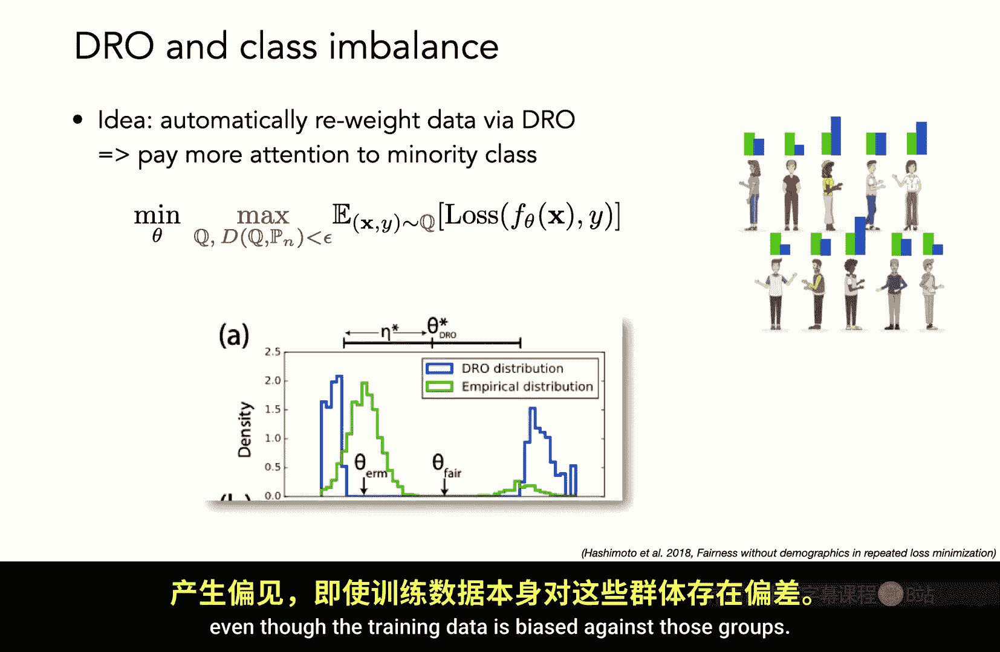

And so sort of in that like worst case distribution shift。

 you could imagine you might only sample kind of those minority groups。

 And then your model performance would be significantly worse if you aren't sort of making sure that you're robust to that。

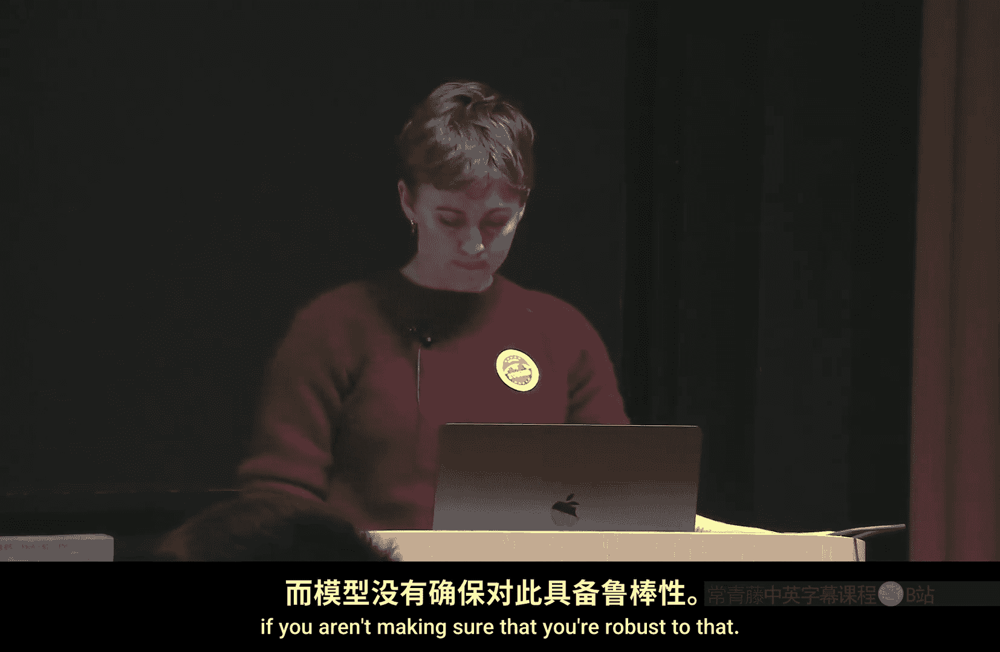

So。What do we do about distribution shift first， you can try distributionally robust optimization。

 or there's many other sort of ways to think about building robustness， sort of extensions of this。

 etc cea that take an algorithmic approach to trying to reduce to trying to make models more robust to these types of distribution shifts or make them more fair。

You can also do things like explicitly learn priors over the distribution shifts that you see。 So。

 for example， subpopulation shift。So this is a case。 This is an example by Oshin McKay。

 where they looked at species identification， and they explicitly learned separately a modular like spatial temporalpoal prior over。

😊，Places and times that then they use to remap the likelihoods of any given probability or any given species based on where the image was taken makes sense。

 This is what ecologists do， right， Often they're categories that look really similar。And if you。

If you just sort of saw the image without any context about where when it was taken。

 it might be hard even for an expert to be able to distinguish them。

 but if you have that additional information， it's quite useful。

 And so this is just addressing this kind of generalization problem as like an image categorization with this kind of specialization that's coming from a prior based on space and time。

So you can think about capturing some of the information you might have about the structure of your domain or the distributions sort of spatially。

 temporal， et cetera within your domain and actually building that directly into your model as a way to do a better job and those models improve species accuracy by like 10% on a naturalist。

You can think about mechanisms like domain adaptation。

 so this is actually an entire sort of category of models that tries to learn given a source domain and a target domain。

 or maybe you don't necessarily have labels for your target domain。

 how to align their representations during training so that you can enforce generalization or adaptation to a new target domain。

 even if you don't have a lot of data or labeled data。

 I'll talk a little bit more about that next lecture。😊，This is pretty interesting。

 You can come up with creative ways to try to diagnose the failure modes of your model。

 which often teaches you more about the biases in your initial training data than anything else。

 But they can be really interesting。 And so there's ways to think about doing that by just string your evaluation。

 So breaking down evaluation per category。😊，Along different dimensions。

 like night versus day or different sort of sexes of the participants。

 assuming you have the labels to be able to do that。

 breakre that down and look at the relative sort of。Maybe call it fairness across the category set。

This is an interesting example coming from Alexander Madri's group。

They actually use modern generative AI models to generate hypothetical counterfactuals to try to understand or diagnose failure modes in in training。

 And so here， for example， what they found one， one interesting example that they found through this diagnosis。

 And they actually were able to demonstrate it on real data。

 is that these models are really good at recognizing plates if they have food on them。

 But if it doesn't have food on it， it's consistently being categorized is like trays or buckets。

So you can try to diagnose the failures， and that might be so that you can try to then collect training data to be robust to those failures。

 It also can just be useful if you're trying to think about how and in what way you should trust a model in deployment。

嗯。But。I would argue that。Probably the best thing you can do in any of these cases is just get training data that's representative of your test domain。

 So in practice， a lot of these algorithmic approaches， these sort of creative。

 like ways to try to train these models to be robust to be effective。

 usually they're just significantly worse than just more training data that's representative of your test domainamine。

 So from like a practical perspective， if you really need something to work well。

 you have to invest in the right kind of training data。

 And if that's something that you just cannot get like for various reasons， various constraints。

 you know， maybe the species is super endangered or you're trying to get a model to work on a planet that we've never landed something on or we're trying to get models to work under the Arctic or in the deep sea where we sort of just are not actually able to kind of collect large scale training data。

😊。

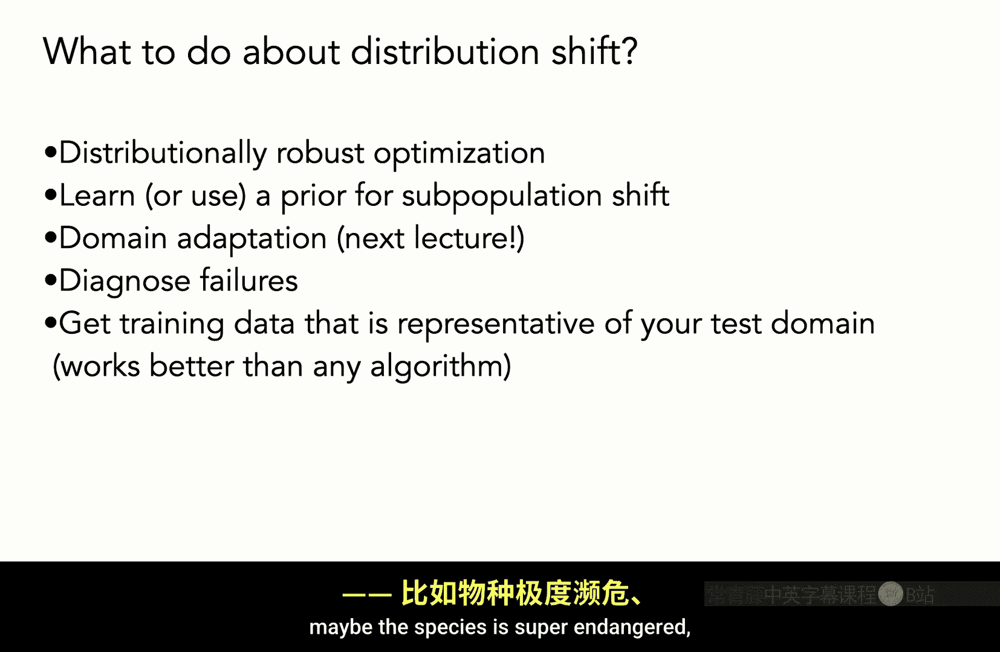

Then you're probably going to have to have a human look at a lot of the data still。

So this kind of like， where do we actually see these things work in practice。

Often it's really just where we have in distribution training data and so this is a really active area of research and you know for any of you that are working on trying to bring deep learning to your own scientific challenges or problems。

 I would totally recommend that you sort of look into this literature when you think about how do I get the model to work where I want it to work。

 but I also think that if you have limited time and effort sometimes it's just worth it to label more data at least practically that's what I've found。

こ。So。In summary， out of distribution generalization is a big challenge。 It's still a big challenge。

 But digging into it helps us understand what neural networks learn。

 And it also really helps us try to understand this very tight and complex relationship between the training data and where we can effectively use models。

 And then we talked about both adversarial examples and distribution shifts。 today。

 Are are any other questions。😊。

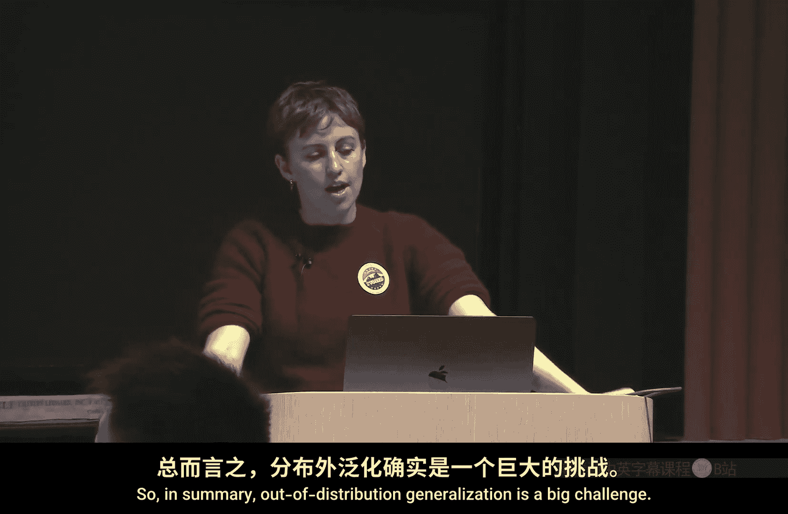

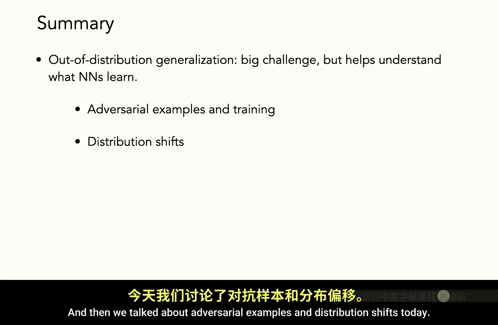

Yeah， does anyone look at like activation functions， like do activation functions change？

How easy is it？The boy。So you mean like things like grad cam。Oh。

 there's like a stark nonlinear area like one'。Gotcha， the question was。

 have people explored how the choice of activation function system like arylo or a giu or something。

 how that affects generalization or sort of robustness？Id bet， but I don't know any literature on it。

I think。My intuition says it wouldn't have a huge effect。

But it would be interesting to dig in and try and see。

 And it might have a bigger effect on simpler data sets than more complex ones。

 So there might be papers that show that that has an effect on sort of like Mnes style training or Cf style training that then might not actually generalize versus like all the other different complicated ways that models and architectures affect performance。

But that's totally just my like best guess。 And I'm actually kind of curious。

 I'm going to go look into it。Does anyone else， Does anyone else know。

 have people looked into robustness and。You。Yeah， yeah， okay。

If this you talk about the more simpleized fine tuning so adding a finding bus examples。

 but would that be more cost saving too？Just like being horse。

 like when you had that noise and then at whatever voice happens and then it' just display way what is。

But just like human切たす。靠水利你三到。で零三とか零三。Right right， so the question was。

 instead of trying to do this type of robust training to like hypothetical different preturbations。

 both to the images or the distributions， Does it make sense to use sort of other types of direct feedback like active sort of human intervention。

 things like human loop learning or possibly something of reinforcement learning or like DPO might be an example direct preference optimization。

 So yeah， people totally do that， it can be much more efficient if you have a specific target data set in mind。

 this idea of like how do you kind of get to a good result on that data quickly is again like a pretty active area of research and people do lots of different things to do that effectively。

 So domain adaptation that I mentioned is one fine tuning if you're talking about supervised fine tuning assuming you have labels already or you can try to be more efficient in collecting the labels to get to that good result on that data。

 But I think a lot of the work I talked about today was really with this goal。

Of being generalizably robust， like robust to any imagined hypothetical change。And of course。

 then the limitation is you don't know the way the data is going to change。

 And so if you know exactly the way the data is going to change， you have a target in mind。

 then optimizing for that efficiently is totally possible。 Does that like distinction make sense。

 So it' maybe the difference between trying to be robust to distribution shifts versus trying to adapt to a specific distribution shift or specialize to a specific distribution shift。

Yeah。Any other questions？Cool， all right。

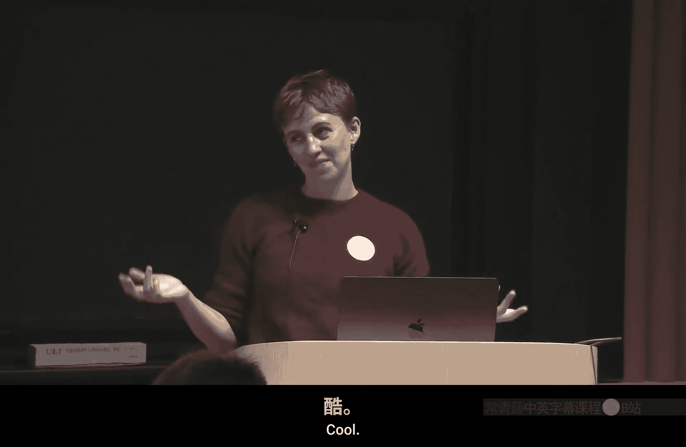

Take the extra time and go vote。

