# 麻省理工学院【中英⚡深度学习｜6.7960-Fall-2024,-Deep-Learning】-p18-P18-迁移学习：模型--BV15QZ4B1E6v_p18-

Let's get started。He。😊，So today we're going to kick off the first of a little two lecture mini series on transfer learning。

 specifically how we think about taking information that might have been learned from a model。

 and then transferring it to some new tasks， some new challenge， maybe some new distribution。

 we talked about distribution shifts last week。😊，嗯。😊，So at a high level。

 the idea of transfer learning is that you want to try to learn。

 even if you don't have very much data。And so we've sort of tried to structure this framing of transfer learning into kind of these different sub areas So first we're going to talk about how you can maybe transfer knowledge from a machine learning model that you have about the mapping from inputs to outputs。

 and so within that we're going to talk about fine tuning and then we'll also talk a little bit about domain adaptation。

And then we'll talk about transferring knowledge about the outputs。

 And so in that case we're going to be discussing knowledge distillation。

 and then we're going to be talking a little bit about foundation models and maybe what this new paradigm is in terms of transfer learning。

 kind of introducing this idea of like in context learning or prompting as a mechanism for transfer learning by just asking。

And then on next Tuesday， we're gonna kind of finish this up with like one further discussion of how we might transfer knowledge about the inputs of the data。

So。

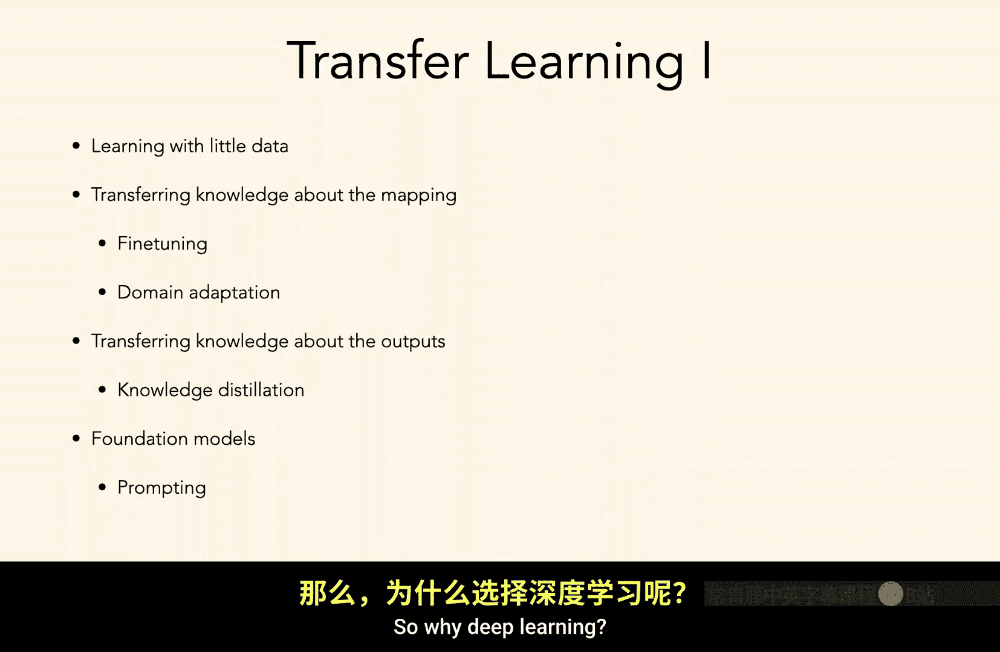

Why deep learning， This is a slide from Andrew Eng， who， of course， I think has a very。

 very famous lecture series on deep learning。And here he essentially is pointing out that deep learning might be different from sort of older standard learning algorithms。

 specifically in terms of how it scales with the amount of data that you have to train on might be a little bit hard to see with the lights as they are。

 but essentially the idea is that many learning algorithms。

 older learning algorithms saturate with some amount of data。

 you just don't see performance continuing to improve。

But we have really not seen that type of saturation as we scale the amount of data that we're giving these deep learning algorithms。

 And sort of next Thursday， you guys will have a lecture from Phil around some of these scaling laws。

 these sort of relationships that people are starting to learn about the scale of the number of parameters。

 the amount of available data。 But one kind of high level。诶。

Recent analysis that was done seemed to suggest that with the current capacity of machine learning models we have。

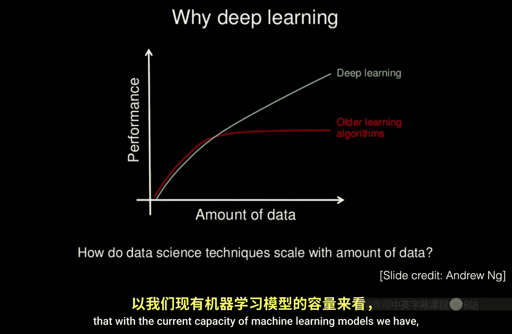

We， we basically。Have far more capacity than data。 So essentially。

 the idea that there's a lot more room to scale on the data dimension still before we're really hitting the capacity of our largest deep learning models。

And that's talking about billion data point data sets。

 things that are like on the order of scale of the entire internet。

 we're still not hitting the actual computational capacity of these models。嗯。So。

Few shot learning is the idea that you can maybe learn。Even if you have very little data。

So it turns out that humans are shockingly good at this。

 We're really good at kind of recognizing patterns and translating them。

 even to things that we've never seen。So here， if I tell you that that symbol up at the top is a Dx。

 these are made up， right， This isn't real。 But if I tell you that's a Dx。

 can you guys tell me which of the ones below is also a Dx。Yeah， second row second。Second。

 row second from the right， yeah， right， it looks like a tax。So， okay。😊，What about this？

Which on the bottom？iss an example of the same concept as the item in the box。Someone else。Yeah。

 second。rightYes， so those are both segways， right。

 but then this kind of begs this like interesting question because。

There's potentially ambiguity here。 If you only have this single example and you're telling me which is the same what you made was the guess that was probably most similar。

 right because the orientation of the wheels and the structure。

 but maybe the thing I was looking for was instead。

 actually I wanted you to tell me all the things that had two wheels instead of four or one。

 And so one of the things that's challenging when you're doing this sort of few shot learning type of scenario is with less data。

 it can be harder to understand without ambiguity， what the boundaries of maybe the categories of interest are。

 So if I showed you three examples， one was a segue， One was a scooter and one was a bicycle。

 And I said， okay， finding me the ones that are that are also in this category。

 you would would have been much easier for you to sort of understand okay。

 she's looking for things with two wheels。 or know at some different level of granularity。

 maybe I was trying to just learn wheeled things in which case I might need to have again。

 more diverse examples that cover sort of the space of the。

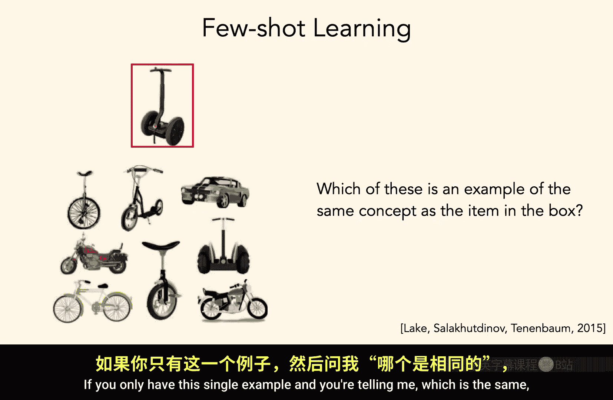

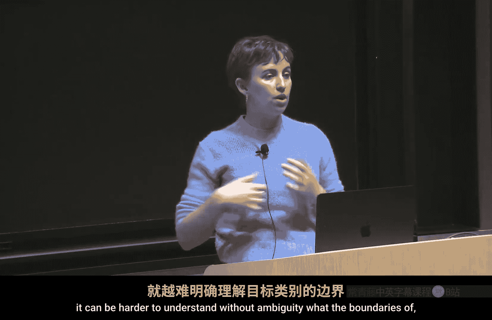

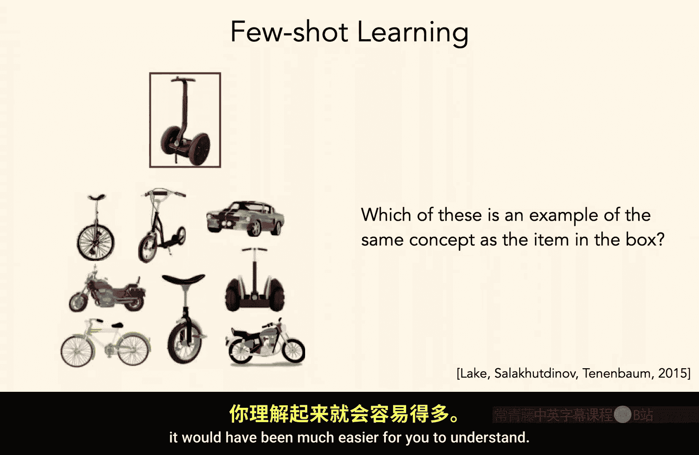

cept I want to learn。So。Dshot learning really is just this idea that we can learn to maybe generalize from our past lived experience how to recognize similarity and patterns in a useful way。

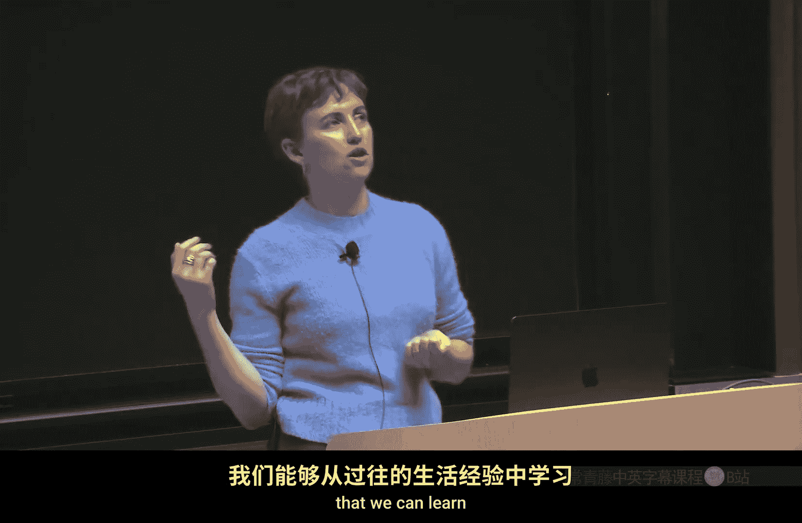

So。Up to this point， a lot of what we've talked about with deep learning is essentially youre。

 you're gonna have a data set and you start with with an empty slate， right？

 And then you're essentially trying to learn sort of。Some physical rules， some concepts。

 some dimensions of similarity that are useful for a specific task。But what humans do， instead。

When they try to learn something new is we really have a lot of prior knowledge right coming from our experience in the world from the time that we're incredibly young。

 we're sort of physically embodied in the world， learning about concepts like physics。

 like structure， we're learning through the entirety of our education and just in our experience in our lives。

 like how to think about these measures of similarity and difference and different people can have different sort of mental models of the world。

 this actually comes up a lot in currently when you're thinking about scaling large scale data labeling。

That actually， if you're getting data labeled from people from different cultures。

 they might actually have different mental models than the one that you intend in your culture right so that there's this idea of like you know my mental model is based on some prior and we don't necessarily know or there really isn't a concept of which mental model of the world is correct。

But these mental models are built and， and they kind of capture sort of representations of things。

 kind of models we have of like how the world operates， maybe different skills。

 And that means that we're basing anything we learn on top of a bunch of prior knowledge。

 basically like systems that are really well posed to learn new things。 And actually。

 a lot of what you're doing in college is learning how to learn， right， you're。

 you're learning how to learn new things efficiently。 And so。😊，There's this question of like。

 how can we give deep learning models or deep networks similar access to prior knowledge。

 And so a very， very simple way to do that is just。Pretrain them on other tasks or on prior tasks。

 right So the idea that you can send your neural network to school and you can try to get it to learn how to learn。

 And the way that you might do that is maybe training on a huge amount of data with some other sort of set of categories that might not be the thing you're really explicitly interested in。

 but it's things that you have data for at scale。And then you can use some mechanism to transfer that knowledge from the pretrain nets so that you can solve new tasks。

 And so one view of this idea of like learning from little data or transfer learning is actually the point of deep learning is to enable us to be able to do this type of problem solving with little data。

 So you're trying to learn these representations， these models that have a good sense of what's what's useful。

 what is a good thing to build on top of we want to learn。

So that's kind of the motivation for talking about transfer learning， right。

 So when we think about a model in general， usually， you know。

 we have some big system and it will map some set of inputs to some set of outputs in some very fun。

 complex， nonlinear way。😊，嗯。But we're thinking about。What actually are we transferring right。

 and so you can think about transferring some knowledge about the relationship， for example。

 from the inputs to the outputs。You can also think about transferring knowledge in different ways。

 right， We can think about transferring knowledge about biases in a model。

 You can think about transferring knowledge about an optimizer。

 perhaps like how do we optimize models We can think about maybe transferring knowledge about potential error modes or ethical risks or societal implications of models。

 So well really be focusing on pretty simple mechanisms to think about knowledge transfer。

 But I do think that there's a lot of kind of more broad sets of transfer or sort of this idea like sharing information in a valuable way that are really not understood or not solved。

 right， So。

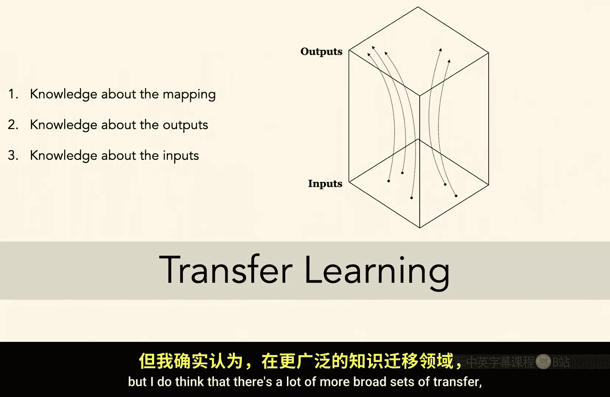

One thing that we still haven't really figured out what to do。

 how to do is building an agent that's able to actually learn some intrinsic motivation about how to explore in the world。

 which then could be transferred to a new agent， which would let them explore more efficiently。

 this idea of like transferring motivation within a robotic agent。

 So there's a lot of ways that you know， we have these kind of brute force knowledge transfer mechanisms that we'll talk about。

 but I think there's a lot of space still to explore， in the machine learning research area。

 just in terms of the best ways to try to share information and transfer knowledge。 Yeah。

 how much of that is like limited。😊，Like my very basic understanding。

The challenges in say like reinforcement learning is that it's it's more of an issue of like sample efficiency and like thinking back to 2012。

 like one of the breakthroughs wasn't really that the algorithms changed， but just that they。

It's the GPU and that's sped up the training process。🤧How do people think that the bottleck？

Is the algorithm or the ideas around how to do this versus just like we're not computational？

So the question is basically like what's the bottleneck in terms of knowledge transfer。

 is it fundamentally algorithmic or might it be related to instead like computational efficiency。

 and you brought a really great example of essentially how figuring out how to use GPUs effectively was a huge breakthrough in terms of progress across many different areas of deep learning。

 reinforcement learning being one of them， but basically anything else as well。嗯。😊。

I think it's a little bit of everything。 And this question is the sample efficiency。 Like， I。

 I would not say that we have good algorithms for sampling data efficiently or for learning from that sample data efficiently。

 Like， I mean， we have algorithms that do it。 But I feel。

 I feel like there's a lot of room to improve。嗯。

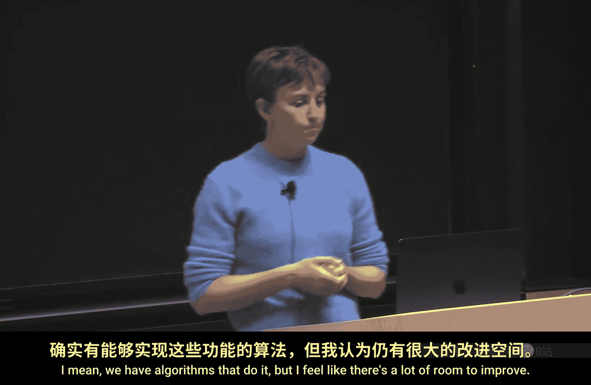

Cool。So we're first going to talk a little bit about this idea of transferring knowledge from the mapping。

 So essentially， like transferring knowledge from the model you've learned itself。

 how you go from inputs to useful outputs。So， you know。

 a simple example of this would be something like， okay。

 I have a lot of data on music with associated genres。😊。

And the idea being that being able to recognize a genre is potentially useful， right。

 It's teaching models something about the structure of music。

 something about what makes different songs similar to things being of the same genre kind of argues that they might be similar in some way。

And then maybe what you want to then adapt or sort of transfer that knowledge to is something where you have a lot less data that's specifically predicting。

 let's say， like your individual preferences for songs， right。

 So maybe you know you can do genre recognition on the entire cadre of music on Spotify。

 and then if you actually want to learn how to predict what songs you're likely to enjoy that you're going to prefer。

 you might only have a much smaller set of data， which is like all the songs you've ever listened to。

 which is， of course， not even close to all the songs that exist。

And then the actual testing would then be taking this sort of fine tuned model。

 You can see they have this like F prime and using it to actually predict on new music。

 whether you're going to like it or not。 And then， I don't know。 see。

 Do you like the music that it's suggesting for you。And so this is kind of that broad。

 simple thing in terms of like what we call fine tuning and at a very high level。

 it's that youre pretraining your network， you're sort of set of weights and biases on some task A that's a pretraining task and that will result in some parameters for your model W andB weights and biases then you initialize a second network with some or all of W andB。

 and so there's like these kind of interesting question of like how much knowledge about the mapping you want to transfer so usually like maybe the very final layer of a model that's going to be pretty specific to the pretraining task so often it doesn't really make sense。

 especially if the sort of output shape is not the same you cut that off you know you add some different final layer on but maybe you really only want those early layer features to be captured and so you actually let the model sort of。

Initialize it with less of the initial initial model。

And then you think about training that second network on some task B。

 And so now you look at some slightly adjusted parameters， W prime and B prime。 And the idea is like。

 then then you have。This like learned representation。That is essentially an encoder。

 And that's what we're transferring。 right， So you're taking the representation。

 learn from the initial model that's encoding something useful about your data。

 And then you're transferring that and then learning how to make use of that useful representation on something downstream。

And we'll talk a little bit about some of these different like empirical like choices you can make here around how much you let the model adapt。

 like how much you let it change from the initial representation。

 but empirically actually as long as like the types of input data are similar。 So images and images。

 for example。 what we often find is that a lot of the structure in the models like weights and biases actually stays the same。

 particularly in those early layers after you've done the fine tuning。

 So even if you haven't explicitly constrained the model not to change that very much。

 which you can do， like keep a learning rate low or freeze some of the network。

 But if you don't do that， you actually find that a lot of the structure will stay the same。

 which does seem to argue that that some of that is just universal in some sense。

 it's universally useful for， let's say images or audio。

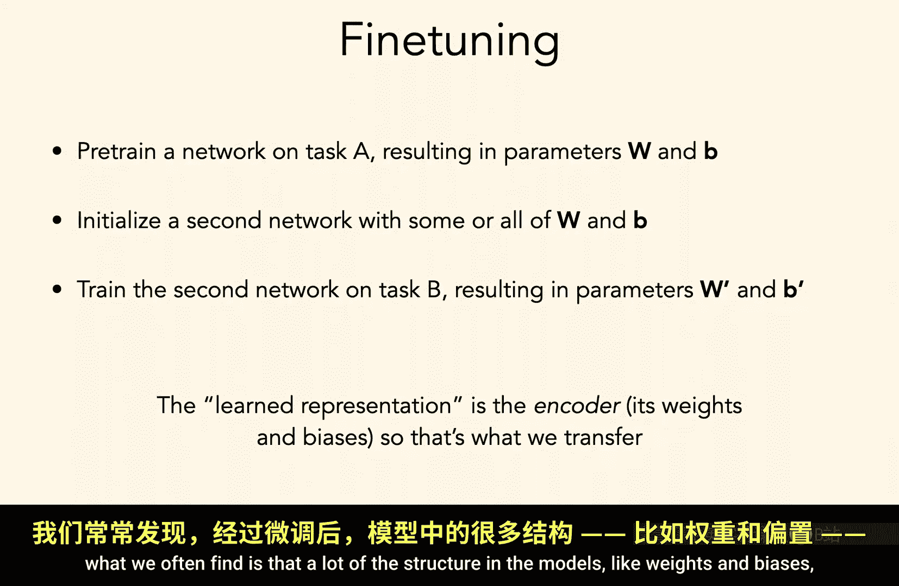

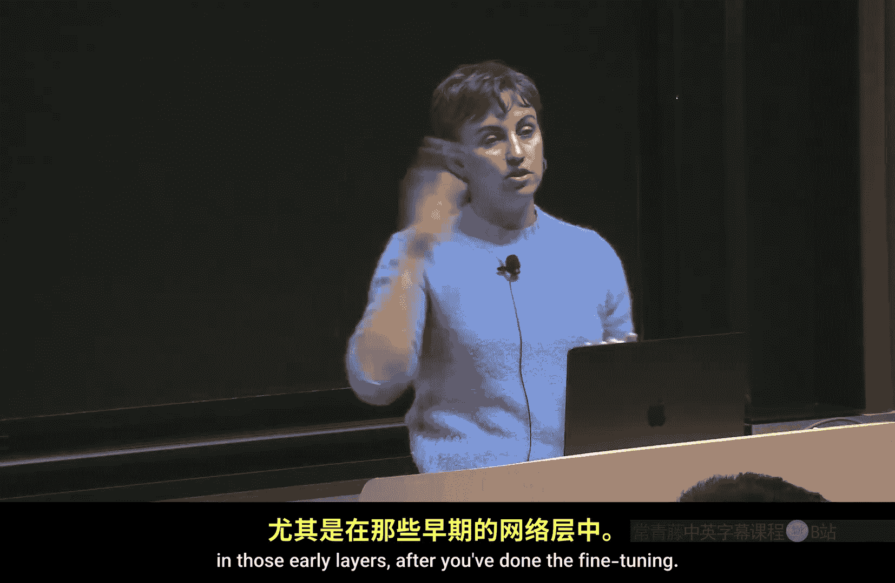

So we previously saw a very specific case when we were talking about similarity based representation learning。

 where we talked about self supervised pre traininging， right？

So here with this self-supervised pretraining， we're not necessarily explicitly or directly training the model to do something we might care about instead we're just training the model to learn something about data similarity and then that ends up when has been shown to be quite useful for training representations that are good for downstream tasks we might care about and one of the main benefits of this type of self-supervised pretraining is the fact that because it doesn't require labels for data。

It's making that sort of pretrain on a lot of data， like a lot， a lot， a lot of data， right。

 The amount of data that exists without any specific label is much larger than any sort of labeled or clean data set。

So here， you know。You think about contrasted pretrain。

 and then maybe you're gonna to test it on some sort of new recognition task。 But instead。

 you could think about fine tuning a model。Which is how you take those initial representations and transfer them to then actually learn how to do that new recognition task。

Okay， so now I'm going to get into a couple like just pretty simple but pretty practical considerations。

So what if you're pre traininging。On。Some images， and you're predicting whether they're wheat or corn。

And then now we want to fine tune。Our model。But now。

We have an X prime and a y prime that are not the same。So essentially。

 we have a model and our initial model was trained on images that are RGB。

 and it was trained to predict two categories as the output。

 And now the model we actually want is going to actually take in images that are just grayscale。

 So we only have a single dimension。 and we want to predict on outputs that have an additional category。

 So like the structure of the model itself is actually a bit different。Essentially。

 if you're changing either your input dimension or your output dimension or both。

So one kind of very simple mechanism that you can do。

Is you can add kind of like a glue into the model， which is just like a way to kind of transfer data through to get it into the right format So then when you're doing your pretraining if you know that your downstream task is not going to have necessarily the same structure you define these new sort of like z's。

 which are maybe models or even just like a few simple layers。

 for like connected layers that have you that enable us to then map each input and output to the same dimensionality and so you would do this where you need it right like if you're still gonna have RGB images。

 but then all you're doing is adding one more output dimension。

 well then you know one thing you can do is you can take the final output layer of your initial model and you can learn some re projection to project it into more dimensions or you can do what I talked about sooner and you could kind of consider this Z to be like that final mapping from your representation that。

Encoder to the number of categories you want to predict。

 And then you can just swap that out and maybe learn some different different one that' now in this new model。

 So you're just essentially defining points within the structure of your model that give you a bit of flexibility。

 So now like this F1 goes to F1 prime。 those will be different from each other。 F3 goes to F3 prime。

 those will be different from each other in terms of their structure。

 like the actual number of layers weights or of size。 But then the F2 can stay the same。

 So like the vast majority of the structure， you're not actually changing。

And this actually comes up quite a lot。Particularly for like some types of data that have maybe more input dimensions。

 So most image models are pretrained on things like Imnet or you know these days lie on where you have huge amounts of RGB data。

 But then say you're someone who's working in robotics and you have RGBD you have this additional depth dimension It's often true that you can still get a lot of value in doing transfer learning from models trained without depth。

 But now you have to kind of figure out how to add this additional depth dimension during your fine tuning effectively。

 And so often the way people will do that is they just learn some sort of additional encoding that takes that and sort of maps it into three dimensions。

 or sometimes depending on how much data you have， whether you can really learn that type of mapping。

 you do some sort of like strange just like very simple model of how to transform one input dimension into another。

 So if you're working with like very highscale hyperspectral satellite data and you have models that are pretrained with three。

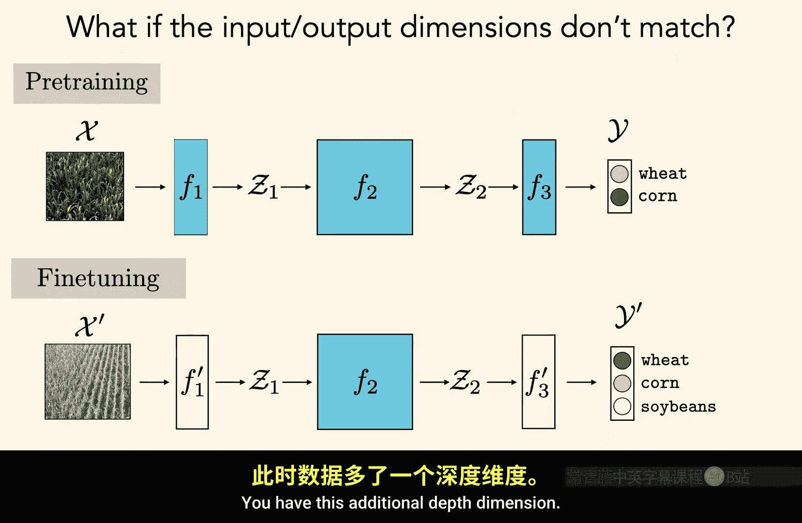

han inputs sometimes people will just run something like PCA and take the like principal components of the three most informative principle components over all those hyperspectral bands and use that as their three channel input when they're fine tuning because the ability to actually learn all of those 380 different input layers effectively is one computationally very expensive。

 And two， if you don't have a lot of data， that's a lot of parameters to learn。

 And so that can be tricky。Yeah， so we're talking about sort adding or changing the stacks。Every会还是。

再发句。就す。In the width actually its just like the input size would change。Sa if you had that too。

Additional channels。でた。Like concatenating kind。Yeah， I mean。

 so definitely like a lot of these models will assume some sort of fixed input size and then say maybe you want them to train the model in a bigger input size。

 That's another way that you can think about building like this little F1 that will take a larger input size image and then learn how to get it to that smaller input size that the pretrained model was trained on。

嗯。But I think the only way to think about changing the width dimension is in terms of like the spatial extent。

 right？For of input not in terms of the throughput of being。Oh。

 you mean like actually changing the structure of the model itself。

 I guess like stacking on top of the look。Yeah， I mean。

 so one of the things we're trying to get across here is that you can kind of treat these things as like modular building blocks。

 right， And so you can take like a building block that someone else has built。

And then stick it in and then， you have to figure out what blocks you need to add to the system to maybe get that building block to be useful for you。

 But the point being that a really well traineded building block。

 if that analogy the is making sense， a really well trained building block is still useful。

 and it's maybe worth coming up with this like modular structure that will make that work for your problem。

嗯。😊，But like as soon as you start actually trying to mess with that building block。

 like changing the weights and the biases within that block， it gets more complicated。

 There are people who look at doing it。 And actually。

 this sort of entire area of like model compression is kind of changing that structure by removing stuff to make it more efficient。

 And we'll talk a little bit about that later in terms of adding more stuff。I don't know。

 I haven't seen a lot of work in that space， but I think as soon as you' are adding more stuff。

 the value of the pretraining starts to go away， if that makes sense。

Because then like you've changed the structure of the mathematical formulas。够。So。Essentially。

 we're just trying to figure out how to make things useful， right。And so in practice， in practice。

 we'll essentially just。Learn mappings for any new stuff we add to make this work for our data。

 and so those new things would need to be done initialized from scratch。

 but that's a lot less parameters that need to be sort of learned from scratch than if you're sort of going end to end from scratch。

 starting from that blank slate。And if you really don't have much data。

 you can also think about copying weights for that initialization。 So， for example。

 in that RGBD case， sometimes what people will do is they will take the RGB channels that were learned from the original model。

 and then they'll staple on an additional channel， and they'll initialize it with。For example。

 like just like the blue channel parameters with the idea that， like。

 maybe there's some value in what's been learned for another channel that might still be transferable again。

 like。This is all kind of like。No one really know。 like no one， no one has like a perfect。

Sort of set of heuristics for like if this is your data， this is the best thing to do。

 and this is really where the idea of like designing a benchmark for your data set where you understand how to do comparison across like some of these different choices so you can try things and see how they're affecting performance in your model。

 that's where it starts to become really important because most of the time。

 like if it's some custom problem， some little dimension of the system will probably be somewhat customizable and it's hard to say what's like the best structure for a system without actually doing some testing。

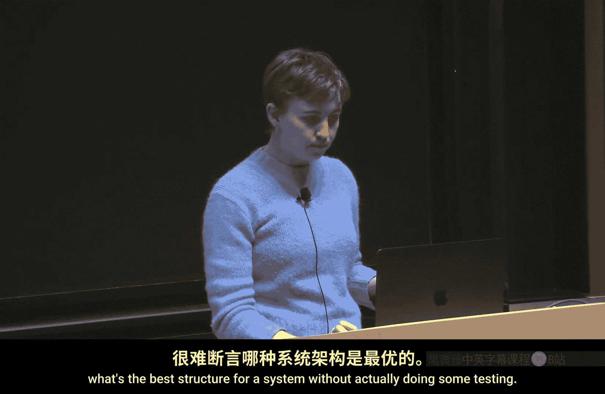

So。One of the issues is that if you only have a little bit of data。

And you let the entire model train and you train it until that loss is all the way saturated， right。

 Like we really have like， we don't have anything else we can learn。

We run into that catastrophic forgetting problem again。

 that thing we talked about a bit when we're talking about sequences where it's like somehow the thing we learned from the original data we learned too long ago。

 the model' weights get changed too much。 and you essentially lose capacity So this definitely happens more with smaller models than big models。

 interestingly， But in order to avoid kind of overfitting on a really small amount of data for your specific task。

 there are a few different mechanisms that people use to try to kind of strike that right balance right。

 learning enough about the new task that you can special。

 we're not forgetting too much about this general useful representation。And so a couple things。

 you can think about freezing most of the network。 So basically saying。

 I just want to keep most of this model exactly the same。 And only training， for example。

 the final layer an initial things at the beginning that you need to have that are new you can explicitly use really small learning rate。

 So basically just not letting the model move too much in any direction at any training step。

You can use what's called early stopping， which is essentially you use a validation set and you make a decision about which model weights to keep based on the best performance on your validation set with the idea that essentially you just haven't let the model train too much so you sort of stopped it before it can forget too much about the original pretexax task。

Or another mechanism and one that tends to work pretty well。 though， of course。

 there's some complications in terms of data balance that you have to strike。

 So sort of sampling effectively is to just continue to train on the original data as well。 So。

 essentially， if you have access the original sort of pretext training data。

 then as you're fine tuning， sort of continuing to add some of that pretext some of that original training data is good。

 But， of course， there's a complexity here， which is like。😊，Alright。

 But if you have different input types and different goals， this becomes harder and harder to do。

 right， If you were doing like contrastive pretrain and now you're trying to do classification on top of those representations。

 still continuing to have the contrastive pretrain is a little bit more complicated。

But a lot of these choices， like these types of things。

 assume that you have some sort of good representative validation set that your benchmark is well posed for your task。

 This might not always be possible where you might see distribution shift sort of going forward。

 And so it really does become quite important to like think about measuring relative performance as close as possible to like your representative problem。

 right if you want to actually use the model on some data。

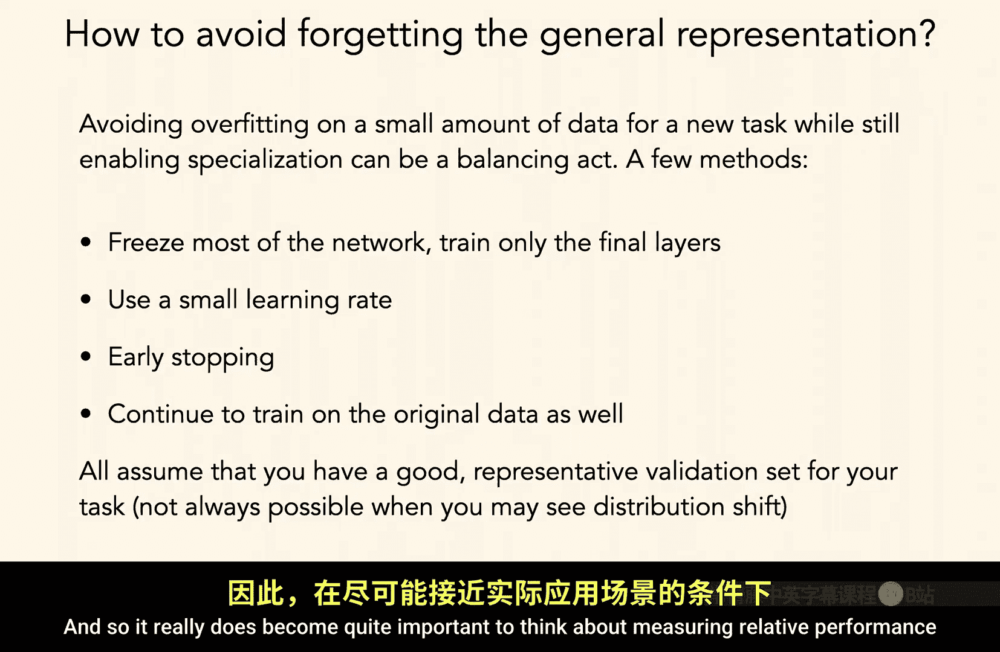

Defining measuring progress is just difficult and complicated and important。

 And this is now I' going be on a soapbox a little bit。

 But one of the things that drives me absolutely crazy about modern machine learning is that we're obsessed with the idea of bolded numbers and tables。

And so this kind of begs the question that like you can represent everything about what a model does with one single number that sort of captures every dimension of importance to that model。

 And I don't think that's true。 I think we need nuance。 And honestly。

 usually like people will this is bad behavior。 people will pick the metric that their model does best on right they're like。

 this makes us look the best。 So we're just gonna like show that one in our paper and we're not going talk about the fact that for some of these other metrics we don't do as well。

 I really love it in a machine learning paper when people are honest about their flaws。

 where you're like， hey， all right， we see some really great progress in these sections。

 And then you have a really nice limitations section。

 thats like realistic and captures the dimensions of where there still is space to make progress。

 Maybe it's just personal preference。 I'm a little bit allergic to salesmanship。

 So I don't like it when I read a paper and I'm like。😊，I don't know， man。

 like I think you're sleeping some stuff under the rug。Essential。

 you do not want me to be your reviewer number two。嗯。Yeah， so okay。

 so we'd like to avoid forgetting the general representation。

 And here's some like engineering hacks that you can take if you want to try and do that。

 But then there's also this other kind of area of research that specifically。

 it's called domain adaptation。 And the idea here is that maybe you have some source domain and you have a target domain。

 And then you want to learn to do well on your target domain but you also want to essentially make sure that the representation spaces of the source and target domain are well aligned。

 And this shows up a lot when you have sort of these types of distribution shift problems that we talked about before。

 but it also can be used for sort different types of fine tuning essentially one of the motivations here is that maybe if you sort of force these feature spaces to be well aligned generally that you can learn usefully how to map you know learn that mapping with much less data。

 and one way that people do this is they actually they learn how to get the model from。😊。

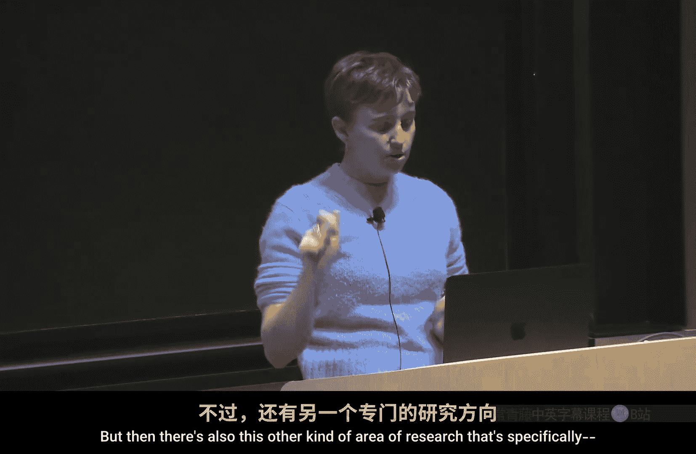

The the source domain to the outputs， and then they try to learn a projection or a mapping from the target domain to the source domain。

 So you basically are learning how to map into the domain space where you had a lot of data and then you can use the same model to actually do your prediction。

And there's lots of different ways to try to force these representation spaces to be aligned。

 but one kind of large set of them takes an adversarial approach。

 so here you have both source and target data during training。And， well。

Your training for every input you want to predict the category you care about。

And you also want to predict the domain that it came from。

 something about the distribution or sort of sort， So a classic example of a data set in this sort of domain adaptation space is theres a data set of different types of。

Different types of like technological hardware。 But one data set is from Amazon and one is from ebay。

 right So you can think that like， okay， the way that people take pictures for Amazon are very like nice and clean。

 And then the way people are taking pictures for ebay is maybe like on their messy desk。

 And so there， what you're trying to do is you're trying to predict like what kind of computer it is it。

 And is it from Amazon or ebay。 And then this is where it gets adversarial。

 What they do is they flip the gradient。😊，From the domain predictor。

 So you're essentially trying to train the model to be as good as possible at predicting the category while being as bad as possible at predicting the domain。

 which tries to force essentially the representations across the two domains to align。

And then the interesting thing is you can kind of extend this to where you might not actually have category data for the source and the target。

 right， So， so maybe you had a bunch of category data for the source。

And now all you have for the target domain is just the knowledge of what domain it came from。

 you can think about trying to still keep really good at predicting the category。

 but be really bad at predicting which domain it's from。

 and the hope is that there even if you only have a very limited amount of labeled data in your target or even sometimes none。

 you might still be able to learn something useful that helps you find the right categories in that target domain。

And then this is kind of expanded into this whole area of unsupervised domain adaptation。 where here。

 the idea is you might have data， but no labels from the target domain， right？

 So now it's like you want to make a model that's as good as possible on some set of data。

But you don't necessarily have any training labels。

Now why would we have that so here's an example actually from our own research where we have a bunch of labeled source data and in this case the labeled source data is sonar images or sonar video from rivers with fish and we're trying to count all the fish that are somethingming upstream so we can make good sustainable fishing policies。

And we have some rivers where we have a bunch of labeled data。

 But we want this to work on sort of any river or if something changes about the river。

 they move the sensor。 We want it to still work， even though there's that distribution shift。

And so here what we're trying to do is learn from labeled source data and unlabeled target data。

 how to get a model to work better on the target。So how have people done this in the past。 Well。

 so the very， very sort of simple version of this would be you take your target data set。

 you run it through a model that's been pretrained on source。 and then you maybe just calibrate it。

 you pick some threshold where you say， okay， any prediction over this。

 we're going to treat as ground truth。Okay， so。That's one way to transfer knowledge， right。

 You just use a model from a different domain and hope it works。

 turnss that it doesn't usually work very well。So this kind of motivated this idea and this is a mechanism to do sort of distillation。

 which we'll talk about a little bit more later。 But what if instead we make a new model that we're going to call a student model and we're going to use those predictions on the target data as weak supervision So we'll use the predictions that our model trained on the source data gives and then we'll try to train a model to predict the same thing。

And the idea here is that maybe your student model is able to kind of learn something useful that is better than just taking those raw predictions。

 and this does work， you get small gainss sometimes over over this the original source predictions。

But this threshold is really， really finicky and hard to calibrate， right。So。

People started adding in other bells and whistles。One thing is you use E M A。

 an exponential moving average to try to kind of regularize the way that the weights change within the student teacher model。

 So you let the teacher model itself also update sort of slower。And then finally。

 you can also introduce additional training on the source data。 So there。

Maybe you're letting your student model learn from the source data and from the target data。

 And then you can add in a bunch of fancy stuff like instead of explicitly taking the predictions with a threshold。

 you can use a softm。 you can use a distillation loss so that you're learning to instead of match the prediction。

 match the distribution over the outputs。 and you can try to use some explicit feature alignment between source and targets。

 such like basically trying to make sure that the features are overlapping as much as possible。😊。

Lots of fancy tricks here。Kind of complicated。 We essentially wanted to point out that。

These components are essentially the main components that people use to do this type of distribution。

 unsupervised domain adaptation。And the point here is that basically every modern domain adaptation architecture is some combination of these components。

 And so if you can kind of centralize and kind of unify the ways that people are actually doing these experiments。

😊，What we found is that you can often be more optimal than any previous approach。 And so these。

 these methods， many of them can be quite effective in certain scenarios。 Of course。

 certain scenarios is a big。Interesting thing there。

 They're almost never as effective as having labeled data for your source domain， right。

 So you just have labels that's better。But if you don't have labels。

 you can actually start to get pretty close to performance。 if you do have labeled data。

 if you do these， if you sort of build these things carefully。

 And some intuition is like why that way might be is that。Essentially。

 the model's able to learn something about the statistics of the target domain that's useful。 right。

 You're shifting the weights towards being representative on those new statistics， yeah。

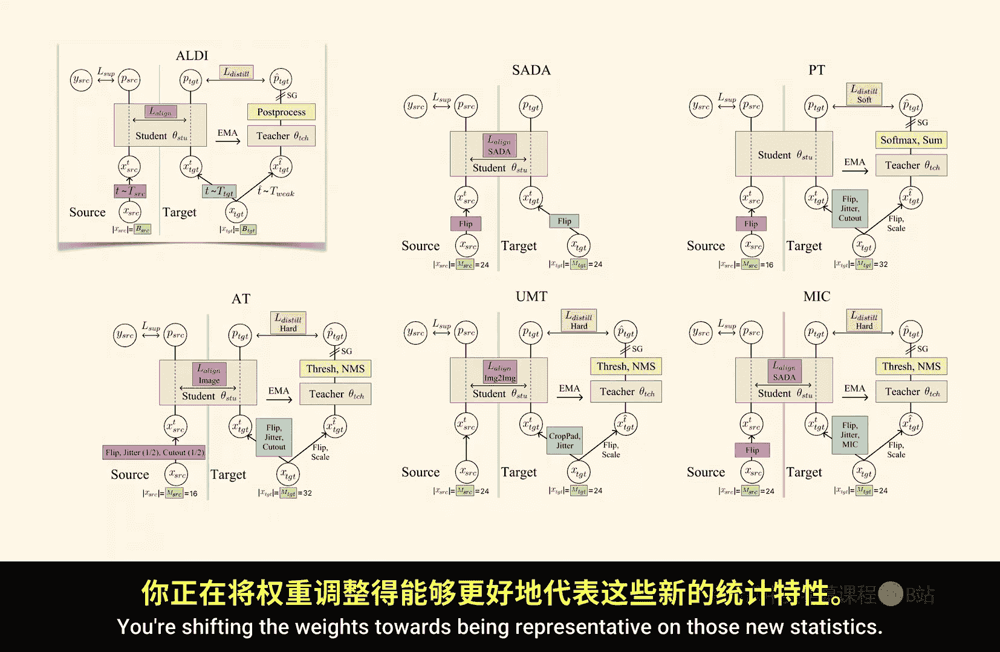

How can you measure。How the performance of this from deployeds and like if you deploy it in a field that you actually。

Leals of anything。他见中有冇。Yeah， this is a really great point。

 I think it's actually the elephant in the room for most of the domain adaptation literature is that they almost always are demonstrating performance in their bold number in their table on labeled validation data for the target domain。

 But this kind of begs the question。 if you have to label data to like do model selection and determine what mechanism works best。

 why don't you just use that labeled data for training right And I think yeah， I mean。

 I think it's kind of like one of these interesting questions。

 And also if you did have some training data。 like how does that kind of fit into this system。

 But yeah， I do think that in the literature in this space， One of the big sort of。😊。

Missing pieces is that you still aren't very good at doing this if you don't have anything to kind of select the best model or calibrate it in any way at all。

cool yeah i guess可能一份咧。The point to reduce costs。嗯哼。😊。

So reducing costs and time are is is valuable here。

 So so maybe like one dimension is you're trying to reduce the amount of like human input you need to get a model to work well。

 But I think probably a better motivated scenario for a lot of these is places where we do not have the right bandwidths。

To be able to actually get the data to where a human could look at it easily。

 So we use these domain adaptation models on these rivers that are like in the remote Arctic。

 where like the way for a human to get there is like fly into Anage， take a sea plane like， you know。

 hike， like it's just like nontrivial to actually get to the sensor。

 And we don't have the kind of satellite connectivity or power that we would need to like。😊。

Get the data to the cloud。 So if you have like these strong resource constraints on your system where you can't necessarily just have a human easily labeled data。

 I think that's where these types of models tend to make more sense。 Similarlyly like if you're。

 I don't know， doing like navigation on the moon or deep sea sometimes we just need models that hopefully can adapt to a distribution。

 But the problem is if you don't have any kind of quality control going in。

 Anything like this that's kind of learning from data where we don't have any sort of true labels has the potential from like a reinforcement learning perspective to kind of like veer off in some catastrophic way。

 and so you can fall into these kind of cycles where the model kind of gets worse and then worse and worse than worse。

嗯。😊，And then the other question is kind of like how much source data you still have to have access to。

 So I think， I think essentially， there's a lot of engineering components to like why you would want to do this and where it's actually effective and what the value add is。

Now。嗯。Yeah， but I think。There's also kind of an interesting dimension here， which is like。

These types of domain adaptation approaches also really benefit from the right starting point。

 So you can almost think of this as like a different mechanism for fine tuning。

 but the performance of these is very， very heavily influenced by the performance of the starting point model。

 So it's almost complementary in terms of like trying to build the most generalizable model。

 the sort of most useful general representation， and then this is maybe a mechanism to fine tune。

 if you have a lot of data that doesn't have labels instead of you know maybe a little bit of data that does have labels。

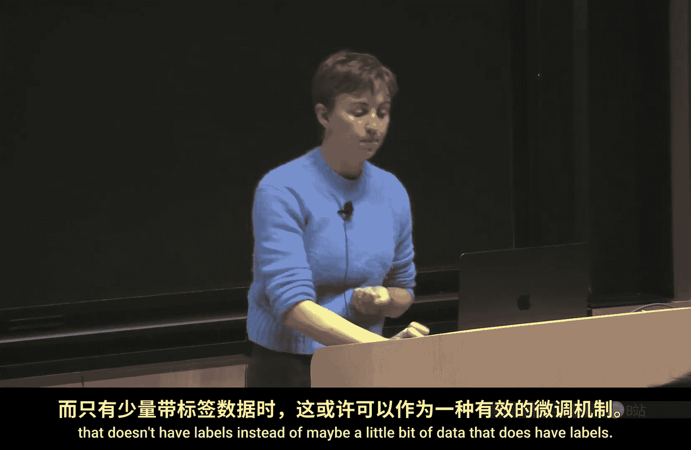

Cool。So。Next， I' going talk a little bit about how we might try to transfer information or knowledge about the outputs of a model。

So。If you recall before， we talked about how you train a classifier with something like cross entropy？

So here， you know， we have some model。 we have an input X， we have some output Y。

 which is like ground truth for that model。 or y is the output prediction for that model。

 So maybe there's a bunch of different categories。 And the one that has sort of the largest prediction score or sort of logit score is cat maybe its taking a softm actually。

 because it's going from  zero to1。 So this is maybe a prediction score。😊。

And then the ground truth is going to be some sort of one hot encoded label， right。

 where we say like， all right， the true label for this input X is cat。

And then we use cross entropy loss that basically tries to get our model to predict a distribution that's as close as possible to this ground truth distribution。

 which is just one for cat and zero for everything else。嗯。

So you could argue that this is also kind of a teacher and a student。So here the teacher is。

The difference between the ground truth and our prediction and the student is kind of the way that we're capturing that distance。

 And so the idea of knowledge distillation is essentially now we have some big pretrained model。

We're going to assume that that model is fixed， right， so we have this little lock on here。

 so it's a locked model。And then we want to learn some student。

Where so now we go from X to Y teacher， we have a model that goes from X to Y student。

 and then the way that we try to get this model to kind of distill is we want the difference or the distance between the teacher model's predictions and the student' model's predictions to be as close as possible。

So now maybe your teacher model has this distribution。

 and maybe it's predicting that cat is quite high， but it's also predicting that tiger is quite high。

 right so。Now， when we're actually training our student model。

We want it to similarly match that distribution。Now。

 does anyone have any intuition as to why this might be useful。

 Like why it might be useful to to train to a model to match sort of a distribution of predictions as opposed to just a ground truth。

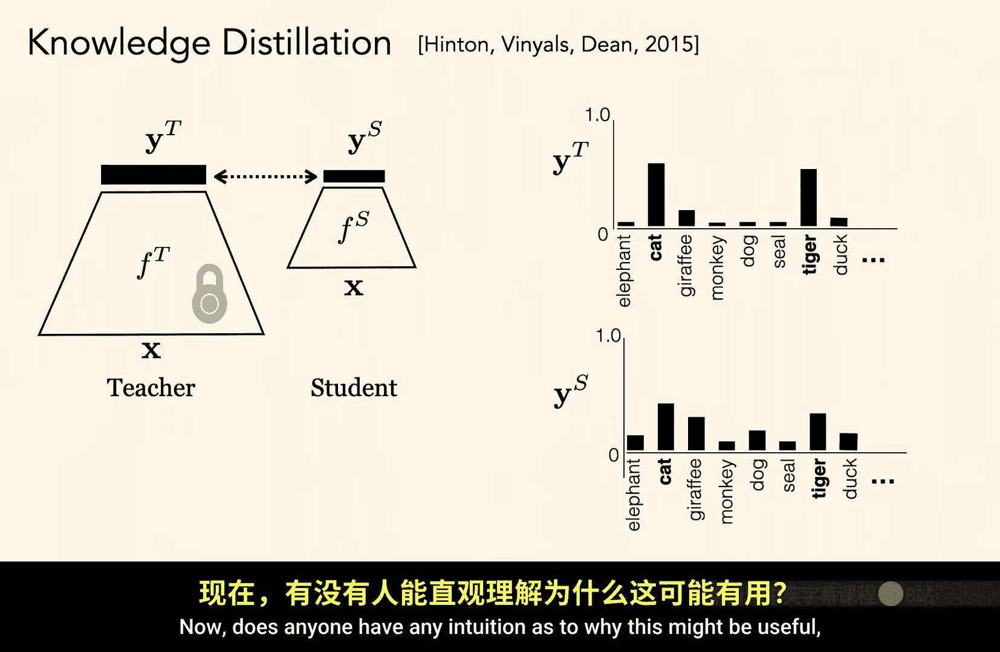

Yeah， maybe the you its smaller。Yeah， so maybe it's a way to get a new model that's smaller。

 can be more computationally efficient and can kind of learn the same thing。

 Anyone having any intuition about why actually like it might be valuable to match the distribution of the outputs。

 Maybe someone new， yeah。I there having the tiger against？Or have。Yeah， exactly。😊，多成一个。すごしもらえて。这是个三个。

大け give。Yeah， so that's exactly the answer I was looking for。 It's。

 it's giving the model some information about the similarity。 So here。

 like cats and tigers are maybe similar， but it's not just the similarity of the category set。

 It's the similarity of what's recognizable in a given input， right。

 So if you have an image of a cat。But it's an orange cat and it's in tall grass。

 you could see how like a model would say， hey， that's pretty similar to a lot of the data I've seen of tigers right。

 And so now what you're teaching the model is not just this is a cat。 you're teaching it。

 this is a cat that looks a little bit like a tiger and that might actually be useful context for a model in terms of learning more than just sort of a set of separable categories。

嗯。And so。诶。There's another kind of interesting point here that I think is important to raise。

 that's not just about efficiency， but is about sort of the modern era of many closed source models。

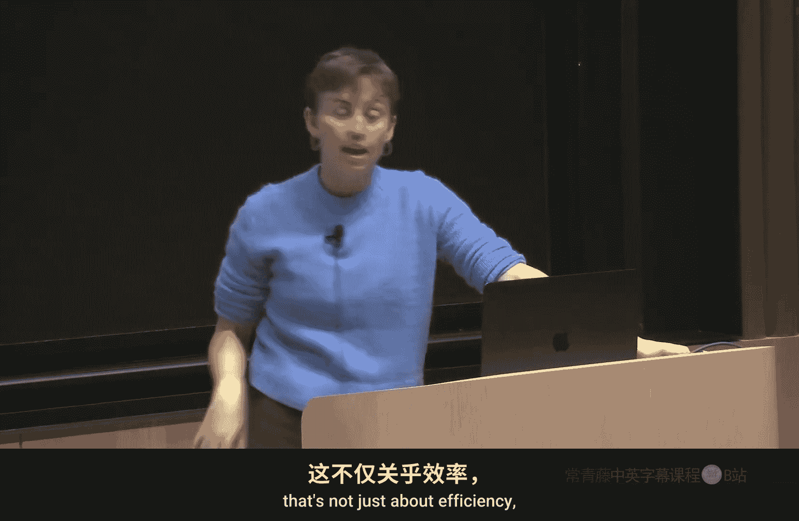

So if you have access to the outputs of a model， it's predictive scores。But not the model itself。

You could arguably learn a model that can match the predictive scores of a given output。

 And this is maybe one of the reasons that a lot of those close source models don't actually give you output predictions over the sort of whole category set。

Cool， so now you can essentially think about doing standard cross entropy。

 But instead of cross entropy being to that binary category。

 it's just between the teacher and the student outputs。😊，And so exactly like what you said before。

 right， you guys are great here。 The label you get for every input might be more informative than just the ground truth cast。

😊，And so this soft target is telling you something about the similarity and what things look like。

 So this is a fun example。 It's not just saying this is a dog。

 but it's saying this is a dog that looks a little bit like a cat。

 and it looks very different from a bear。 And so maybe that's telling you oh， it's like a small dog。

 I it's like I don't know one of those little yappy dogs。

 So this original sort of introductory paper， which is at one of Jeff Hinton's shows that you might actually get lower training accuracy when training this way。

 but you end up getting higher test accuracy on this speech recognition test。😊。

And so the other interesting things， if these soft targets have really high entropy。

 they're giving a lot more information per training case than hard targets。

 and they have a lot less variance in the gradient between training cases is another thing that sort of showed in this paper。

 And so a small model can often be trained on a lot less data than the original model while using a much higher learning rate when you're doing this type of distillation。

😊，But it's not just something you can use to sort of make a smaller model。

 you can also think about learning from a distillation perspective across modalities。

So here maybe you have a teacher that learns to predict categories from an RGB image。

 and then you have a student that only has access to depth。

 so this might be useful if you have labeled data for RGB。

 but you don't necessarily have labeled data for depth。

And so sort of another example of this crossmodal distillation is this model called Soundnet。

 where they have wave forms。And unlabeled video。 And then they essentially are doing object distributions and scene distributions。

 And then they're learning distillation across both。

 There's another interesting version of distillation from a computational complexity perspective where you can actually distill the results of an ensemble。

 right， So often we find that even even in the modern era。

 ensembles over lots of models are often more predictive than any single model。

 One of the arguments for this is kind of a classical one， which is that。😊。

Every model is going to hopefully make the same correct answers more often than they make the same mistakes。

 right And so here， what you can think about is like maybe you have an ensemble that's really great。

 ensemble of three different models。 but they're all kind of expensive to run。

 and you don't really want to be running three models all the time。

 So you can think about explicitly taking that ensemble of model outputs and then trying to distill a model that matches the distribution of your ensemble。

 And again， each model is imperfect in different random ways errors cancel each other out and the truth is shared。

 Of course， this isn't always true， right， because sometimes we have biases and models that are learned from our data that will be consistent for every model。

 So the thing you're not gonna to get out of this is something that's really good at you know the types of corner cases that every single model in your ensemble gets incorrect。

😊。

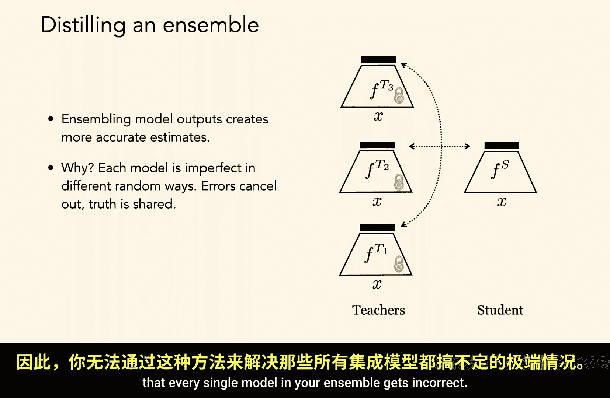

But it can be much more efficient。Cool。So what if you don't just want to distill the outputs？

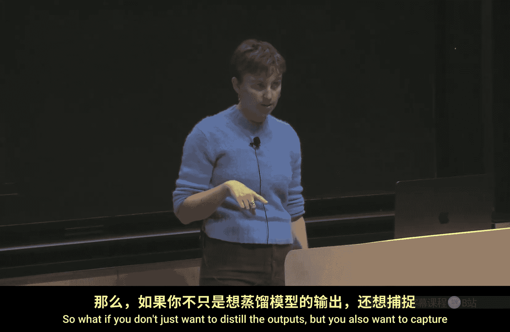

But you also want to capture and distill something about the knowledge of the representation itself。

 right？ So you might want to， for example， match the embeddings at some intermediate point within your model using contrastive training。

 So as opposed to just sort of like matching the logics or the output scores。

 you can actually think about distillation， specifically using contrastive learning But where you want to actually supervise embeddings internal to the model to be kind of invariant to some viewing transformation。

 for example。So that like viewing transformation， we talked about like rotation imvari。

 et cetera before。 But another version of viewing transformation could be the the different views of that representation from the teacher。

 which is a big network versus the student， which is a small network。 Yeah， so in practice。

 when you see this and what you were talking about。

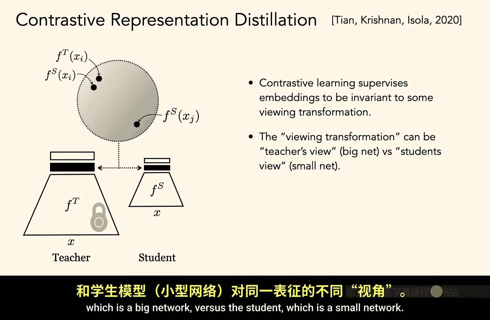

How much smaller than the teacher is the student？Yeah， that's an interesting question。

 In practice how much smaller than the teacher is the student。 So again， in my experience。

 it kind of depends on the data that you're trying to sort of get the model to work well on and how complex it is。

 right， how complex the task is。 So how small you can get a model to be and still be useful。

 often is really directly related to the complexity of the information you're trying to model。嗯。

And there's a lot of different ways that people try to get small models。

 right like if you want a machine learning model to work on your phone。

 it just it just has to be smaller， right， you're not going to put it on00 an H200 scale model on your phone。

But so people use distillation to make small models。

 but they also have a lot of other mechanisms for getting models to be small。

 things like model compression or like quantization， for example， that are doing things or pruning。

 like even just explicitly removing from a model and trying to get the model to work pretty well。

 And then a lot of times methods that work quite well in terms of getting really small models to be really good or some combination of of all of the above。

 right， So like do some pruning， maybe do some distillation etc。😊，じ啊。

Is that basically related to how we see。Clouds， night they have。你家。た了。是差不吧。

So you were asking about if you see sort of these different sizes of models from some of these foundation models。

 like， for example， the Geminni model or some of the open AI， like ChaTT models。

 why they have different sizes。And whether it's actually using distillation versus just training those models from scratch at that size。

They don't tell me their trade secrets， so I don't know。

But I will say the reason that you see these different models put out versions that are small versus big is because they know that different downstream use cases will have access to different resources。

 Often like it's kind of like the big models are better than the small models。

 but you kind of use the biggest model you can afford， you know。

 where a might be a physical constraint it might be a monetary constraint。Now， speed。Cool。Anyway。

 cool。 So here， instead of thinking about like rotations or whatever。

 the two different sort of views that we want to be similar in this contrastive way are maybe intermediate representations from two different models。

 And then the idea is that you try to get this student。😊。

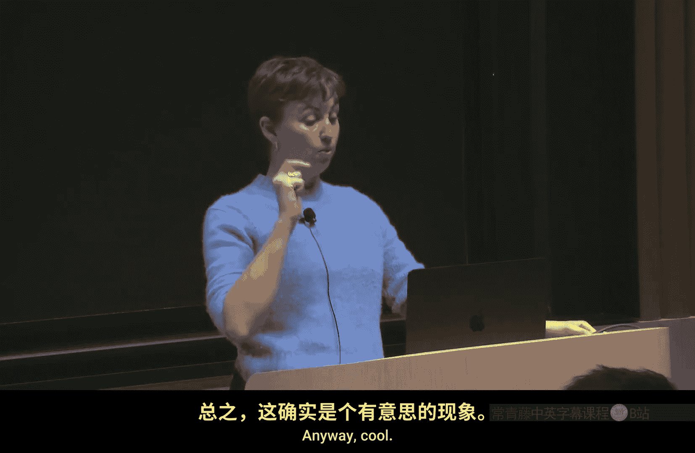

To output embeddings or output sort of a representation for input data that's similar to the teacher's representation。

And there's kind of this cool thing that you can see in the log app space。

 so specifically if you train these to do this like representation distillation。

And you look at the correlation coefficients between the class output logics。

 So essentially the students' logics minus the teachers' logics on C far 10s。

 These 100 classes by 100 classes。 You can see that you get this like much。

 much cleaner behavior when you do this kind of contrastive representation distillation versus just doing standard knowledge distillation。

Cool， so talking again about speed， compression versus distillation so。😊。

There are a lot of different mechanisms for trying to make models small。

So both compression and distillation will give you smaller models with similar accuracy to large ones。

Disttillation will use SGD to train a smaller model to match the characteristics of a large one。

 right so schastic gradient descent。 that process of training can be computationally expensive compression using maybe pruning or quantization to try to reduce the computational cost of a large model that can be much more efficient from a computational perspective。

 So sometimes people want to use compression over distillation just because of like the speed or the computational cost of training。

😊，So。Here is an example from a pretty classic work called optimal brain compression that is essentially doing both quantization and pruning。

 And here they're kind of getting a bit of the best of both worlds so。

Pruning is super computationally efficient because you're just deleting stuff。

 Quaantization can be a little bit more expensive and can also sort of explicitly have some components that feel similar to distillation because you're basically trying to say。

 I want represent sort of intermediate representations to be similar。😊。

And so here they might come up with some sort of interesting combination of like a mask where you're kind of getting efficient sort of global optimal compression in some way。

 but without it actually being computationally expensive。

 Why do you want compression that isn't computationally expensive again。

 because it's cool if you can actually directly compress a model on something like a device right。

 so maybe you don't want to have to do the compression on the cloud。

 you actually need to do the compression on the edge。😊。

And then you can actually get things to be even smaller and maintain accuracy if you let them specialize to a specific distribution while you're compressing them。

 So maybe you have a large scale generalist model and when you need is a small scale specialist model。

 So， for example， a model that only knows about sharks。

 we were able to show that you can really increase the quantization so the amount that you can remove and maintain accuracy if you're letting the model specialize as well。

 And that seems pretty intuitive right， Like if you don't need to keep as much of the original information。

 you can make the model much smaller。😊，Cool。

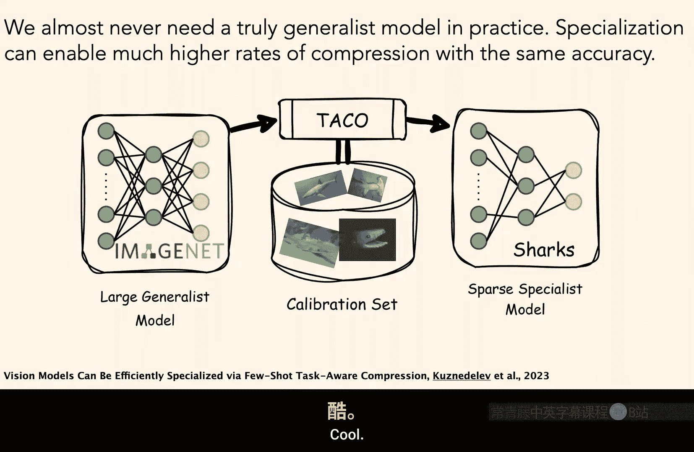

So。Towards the end， we're going to dig into foundation models。So， foundation models。

Is a term that was coined by sort of the computer science department of Stanford。 And essentially。

 it's just trying to。Make sort of a semantic concept for this idea of like really useful transfer learning models。

 right， The idea that you have some models that are。

So generally useful that they end up being really effective。

For a bunch of different downstream tasks。And I think you can kind of。Put。

Like different foundation models and different kind of buckets。

 I would say there's some foundation models that are fundamentally representation learning models where then。

Like， the question is essentially， do you need to fine tune。At all to make the model useful。

 And I would say， as sort of foundation models become more and more general。

You need to fine tune them less and less。Because maybe the set of things that you are interested in is more likely to be within the sort of very。

 very broad distribution that's covered by that original model。And。Mostly。

 if a model doesn't need to be fine tuned， it becomes more accessible， right？

 So this is kind of the power of something like chat GPT or something like C or something like some of these like large scale。

Foundational generative models， for example， like image generation。

Is that to be useful for any given end user for the vast majority of things that people are kind of interested in。

 they don't need to be retrained， right， They're kind of usable off the shelf。

 And maybe one way you think about foundation models is like their use is sort of directly related to what percent of the things people want to do this model can do off the shelf without any sort of specialized training。

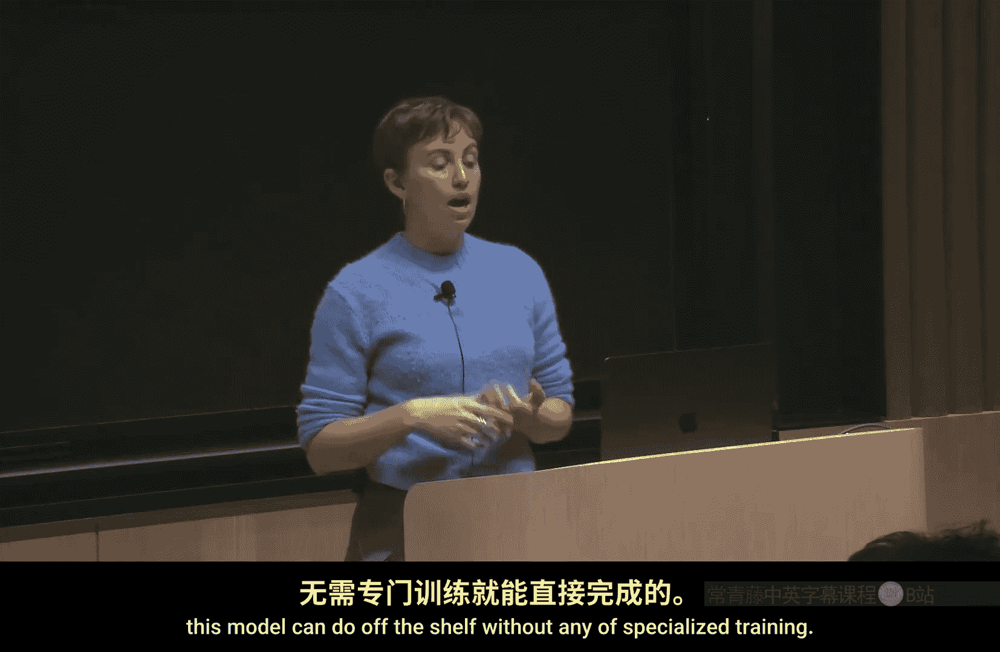

Cool， and I like this quote。 I think this either came from Phil or Bill。 But if I have seen further。

 it is by standing on the shoulders of giants。 It's a quote by Newton。😊。

And this is a fun painting brought blindlin Ryan searching for the Riing sun by Pusson。

 But I think the idea here is that the bigger the foundation maybe the。

 the sort of further up we get as a starting point。😊，So。What does this really mean？Well。

 so this is a plot from Open AI， and it's only going up to 2018。

 I should get a newer version of this that captures how big these models have gotten sense。

 but it's really just tracking the fact that note that this is on a log scale。

 So we're really seeing sort of exponential growth in the size of models over time。😊。

This is sort of the amount of compute。 So going from Alexnet to the Alphago model back in 2018 was a 300。

000 times increase in compute。And， you know， now some of the models we use are in the you know。

 billions and trillions of parameters。 So， again， much， much more。嗯。

And these models tend to be quite generalizable， right。

 these very large models are much more generally useful。AndI think there's。

Some interesting kind of dimensions here。 So one thing is if you look at just computing power usage over time。

 So this one goes up to 2021， you can see that。Academia and even academia industry collaboration that computational power use is staying about the same。

But industry， that's starting to scale pretty significantly。So this。

 you could consider this sort of like a who is kind of big building these bigger and bigger models。

 And definitely， I think industry is a。Well， they're often the only people who can afford it。嗯。

And I do just want to raise。Because it's something that I。

Feel really strongly about that these foundation models aren't free， right。

 So they're definitely not free from the sense of the the companies are paying a ton in compute and in power and in water usage to be able to train them。

嗯。😊，Microsoft， I think， announced that they're spending $80 billion next year on compute。

So that's a lot of money。That's not something that like， you know。

 non industrystry is going to be able to keep up with。

 A lot of that is that Microsoft is actually the ones who are running a lot of the data centers that then other groups like Open AI use。

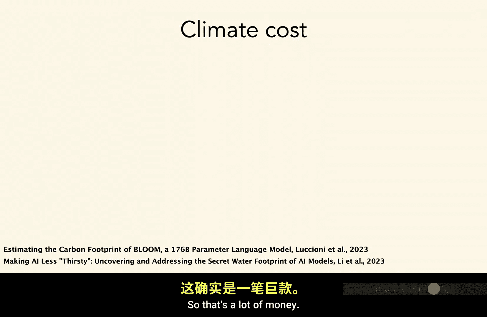

嗯。

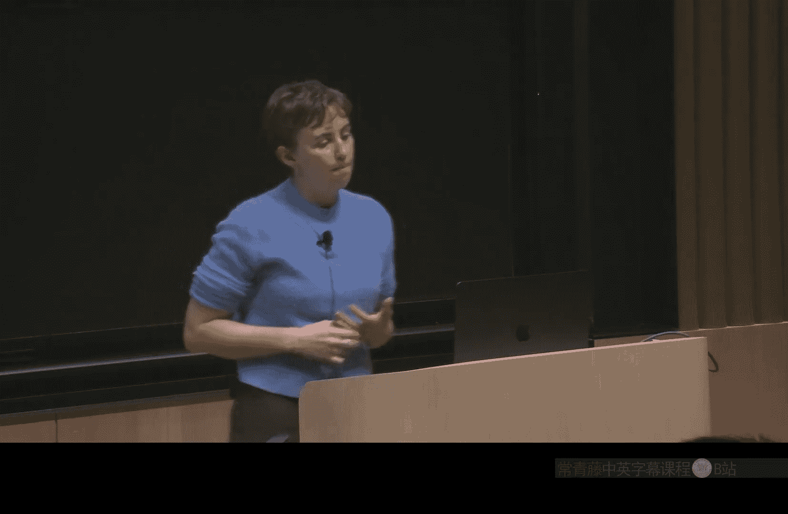

But these also have a cost for us as a society in terms of their climate cost。

 So this is from a paper that was looking at estimating the carbon footprint of 1 hundred76 billion parameter language model from Microsoft。

And they were looking at sort of the entire they were saying， okay。

 if we go from the entire scope of kind of the climate cost of this model。

 that would include things like raw material extractions， so mining， the manufacturing costs。

 the materials， equipment manufacturing， model training。

 model deployment and sort of disposal and end of life of all of this hardware components。

 they were only focused on these three in the middle。 So manufacturing。

 model training and model deployment。And what they found was。

A huge factor specifically in sort of the power consumption and how that relates to carbon emissions is the sustainability of the data center's energy sources。

So even much smaller models can have a much， much higher carbon emission if they're being trained。

On data centers that are not renewable power。 And I actually think that one of the kind of benefits of this。

 like compute boom has been the increased focus on renewable energy and sustainable power within data centers from these companies。

 because it's really well motivated by。By their bottom line， right。

 they're paying a lot of money for this。嗯。But。The climate cost of these emissions is something that they are not necessarily going to foot the bill for。

 right？ And to put this into scale， I mean， I think power usage and electricity is one big dimension。

 But I think water use is another really important dimension。

 I think was GBT 3 was trained mostly at data centers in the state of Iowa。

And the water use in the state went up by 700% while they were training the models。

I read an estimate recently that said that about 50 queries of chat GT is a bottle of water。

And so if we think about now resource access globally。

 we already know that we are running out of water。And， and now， like， you know。

 having these models and sort of who is benefiting from them being successful and then what that means about global society and access to really necessary resources like water is complicated。

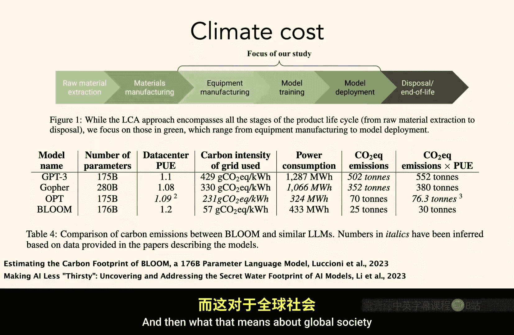

Yeah。😊，4。People who may be not aware like is the water consumption like cooling。

 cooling and then is that water， let's say like I assume they're not using。

 although maybe they are like。On the way and。Does it become unpotable when you use it for cool like is there sort of a？

It soundss like it's bad， like you're not getting the water back。No， usually， I mean。

 I think there are a lot of there's a lot of actually research now into can we do this type of cooling with like seawater。

 for example， or you know what are the effects of like running this water through these cooling systems on like the potability of the water。

I'm not going to speak to that because this is outside of the scope of my understanding of these mechanical engineering systems or like sort of thermal and hydro。

 But I will say I think that there's sort of a booming cottage industry of researchers who are trying to figure out how to make data centers less climate intensive。

 But I'm also sure that like all of you know that like we are vastly outstrippping sort of our capacity in terms of things like power。

 So very， very it's been very sort of big in the news that Google is considering reopening three Mile Island to power data centers。

 right， So we're like thinking about moving back to nuclear power。

 just to keep up with the sort of AI hunger of this。😊，And I like an ethical dimension， like。

It does get complicated， right， because the scale of resources being used I。Versus。

Like who actually is benefiting is a bit messy。 And I think a lot of groups or a lot of companies would have you kind of believe that。

These foundation models are so beneficial to society that it's necessary， but。I。

I'm less clear on that。And one of the things that I want。I want the option for a like a。

A climate friendly search to come back。 Like， I don't want Google to run AI models every time in front of Google something。

 I don't really need the description。 I would love to have an opt in that says， no。

 I want to go back to map produce that was much less computationally expensive。

 Can you please give me the dumber search that's more climate friendly。

 So I've been talking to people about that。 Maybe we'll start to see it。😊，Yeah。It certainly。こな。

they kind of researcher how much。三月诶诶你哋嗰啲债嘅。いやあ。あ優すを。要个你真。The answer。It war。

So the question is basically like， like the sort of time versus like computational trade off。

 if you like。Query chat GT once versus like Google searching，10 different things。I don't know。I yeah。

 I don't know。 I think it depends also on like， you know， how。

 how these things are architectured in terms of like things like just like global similarity search。

 It also is like， how good are you using Google right。嗯。😊，Yeah。

I the thing I would really love to see is more transparency about all of this from the side of companies。

 right， like what actually is the computational cost relative of these different things。

 And a lot of companies are looking at， you know， for example。

 making use of these like different sizes of models and getting really creative about like routing queries to like the sort of less expensive models instead of the bigger ones unless they're more complex。

 So like how do you kind of be efficient with it。 But yeah， I still， I think yeah。😊。

I think there's a lot of room to improve still。

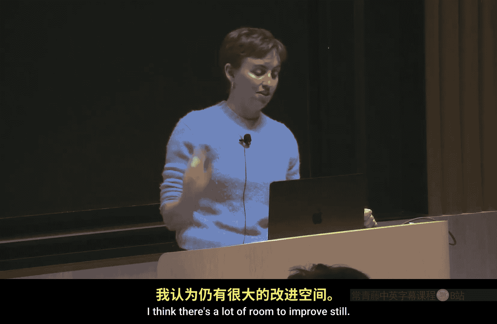

嗯。Cool， so what does it take to train one of these models， These are， again。

 a little bit out of date， Like we have much bigger models now。

 but Dolly2 required 650 million training examples， semi curated text to image pairs。

 DBT3 cost estimated around $4。6 million to train once。

 I'm sure you guys can imagine that we don't find these models once。

 we have to do some hyperparameter searching。 There's like some differences in sort of comparison。😊。

The Paul model had 67 authors， that's like 67 engineers working on this， numbersumb are increasing。嗯。

But the argument， I guess， is these numbers might be small if we think of the result as foundational infrastructure。

 So if you compare this， maybe to the cost of building an interstate highway system or the cost of developing like O S X。

 you know， maybe there's different ways that we should be thinking about what the cost is。

 if this is going to fund be fundamentally infrastructure that is foundational。

And one of the motivations for that perspective is that if we look at scaling as sort of you go up in sort of these different sizes of models and you look at sort the number of model parameters and you look at some metric of performance on a bunch of different tasks of 58 different tasks what you start to see is that you really don't start to see model performance get significantly better where maybe it's quote unquote workinging as well as an average human on some sort of set of these tasks until you have much。

 much larger model sizes。😊，My argument would be like， okay。

 now let's do research into efficiency to get these back down。

So what does that actually mean if you're thinking about learning foundation models。 So one。

 you have like tons of data， you have some learner。

 and then you're generating all these different types of models that in many cases。

 are kind of ready to use。😊，So now。Now you want to use or adapt those foundations with little or no data to solve new problems。

So you now might have some adapter， which maybe could be something like an AI agent or it could just be something that's quite simple where okay。

 we just pull in clip。 we have little to no data。 you use your adapter and you generate some app and I would argue that this is a lot of the most recent sort of set of startups in Silicon Valley have been some version of this this like just ask mentality where it's like。

 okay， we take one of these large language models and then we come up with a really clever way to ask it to do stuff for us。

 and it's not really machine learning anymore。 it then turns into this kind of new paradigm of research that people call prompt engineering。

😊，嗯。So what does this maybe look like。 So here， you know， you have something GBD3 at a very。

 very surface level。 It's sort of trained auto aggressively to predict the next characters。

 So color with green ideas sleep curiously。 So now the adapter again becomes this idea of prompt engineering。

 So you say， okay， here's a review。 Now you tell it to fill in the blanks。

 The sentiment in this review is blank and it will fill in the blanks until you positive， right。😊。

And I'm sure many of us have played with the capabilities of these models。 They are shockingly good。

 right， They get better all the time。 You can ask it， dumb stuff。

 like what are the top 10 dishes at a specific restaurant in Cambridge。

 And it will give you a list of dishes and rank them based on who knows what。啊。え。😊，It'll if you say。

 okay， here's a list of primary numbers and ask it to continue。

It will continue that list of primary numbers。 This is where it gets interesting because depending on who you talk to。

 it's either learning complex patterns and learning to like sort of mathematically reproduce them。

 or it's learning to do pattern matching， right， It's essentially just a kernel machine。

 And you've just given it。😊，Everything is potentially ever going to see in terms of its training data。

嗯。And you can also think about what people call in context learning。 So here that kind of outer loop。

 which is like learning via stochastic gradienting descent during supervised pretraining。

 then like the inner loop is just this in context learning where you essentially say here's some examples of what I'd like you to do and then ask it to kind of continue to do them。

😊，嗯。And this kind of starts to feel flavored like metal learning。

 which we'll talk about a bit more on Tuesday。You can also think about its ability to extrapolate。

 So here you show a bunch of elephants that are counting up， for itss icons， whatever。

 And then you ask it， okay， you know， starting with these four cases， you know。Count。

 and it will do so。Or it can do things like translate and translate just from a few examples of English and then Spanish。

But again， like， what is the model actually doing under the hood， I it。

 is it sort of learning something or is it finding the right kind of pattern to match within its training data。

So what does it actually do， Like， how do we actually do good prompting。嗯。It turns out that。

Handcrafting good prompts can be really tricky。 and these models are incredibly brittle to prompting。

 right so。You can kind of give it a different template。And。Ask it sort of very simple things。

 and the behavior of the system will be really sensitive to how the question is asked。嗯。😊。

And there's a funny， someone someone said that it was a little bit like working with a genie in a lamp。

So you're like， ah。

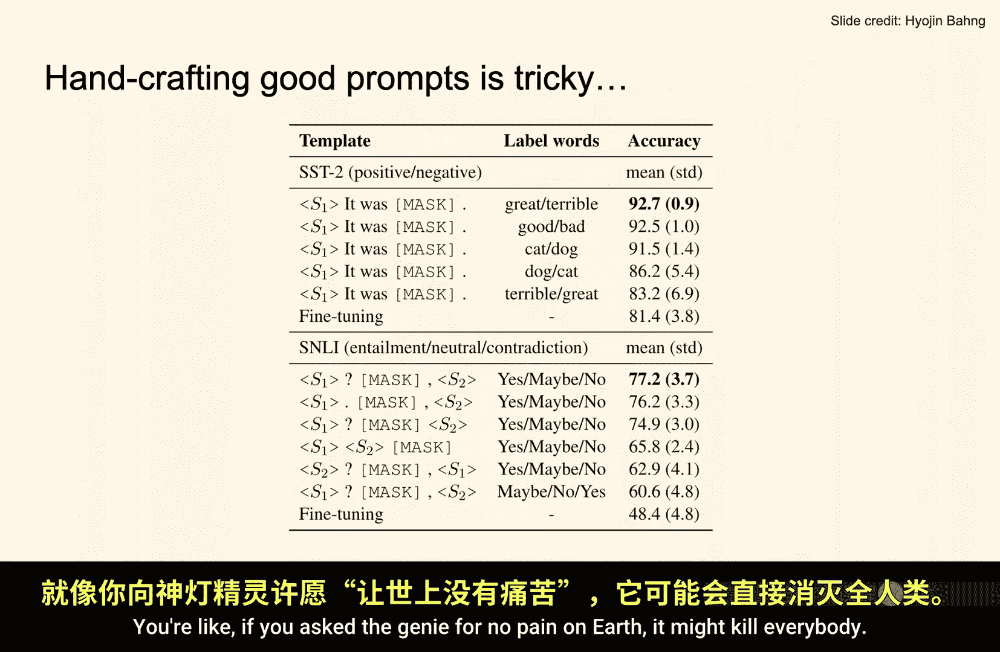

If you ask the genie for no pain on earth， it might kill everybody？

You have to be very careful about like doing this type of prompting。

 And then one of the things that people do is they think about ensembling， right， Okay。

 we'll prompt the model with a bunch of different things。 and then we'll ensemble the predictions。

 Of course， that's really computationally expensive。嗯。

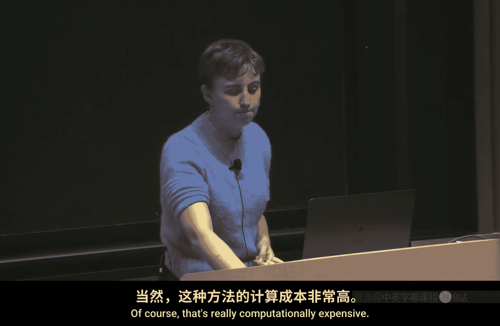

So there's a bunch of research now into how do we actually prompt these foundation models effectively。

 One is this idea of soft prompting， which basically looks at trying to optimize some sort of small continuous task specific vector or like encoding while the language or the model parameters are frozen So here it's like you have some objective it's now kind of back to the normal learning framework。

 but we're essentially just trying to find the optimal words to use as the input to the model。

 And so this paper specifically looks at fine- tuning these input embeddings these little sort of specializer tokens they get prepened to your input test and then they help you optimize the result for some task at hand。

 So the tokens might be somewhat gibberish but they're really good at sort of finding the place in the distribution or helping the model do that pattern matching so that it gets you close to something that's effective。

U。There's also。This idea of like standard prompting， which is like， here's a question and an answer。

 and then here's a new question and then you ask the model to answer。

 and then what chain of thought prompting does is it essentially demonstrates an answer that has reasoning in it so you basically tell the model that when you answer you want it to answer with logic。

And it's more likely than it will give you an answer that has some logic。

 And then it's been shown that the answer is more likely to be right。

 There's also really dumb stuff you can do， which is like， okay， you are very smart。

 And then like ask get a question， right， Like， tell the model， Like you're a scientist now tell me。

 which is like really funny， right， And it's one of the reasons that people start anthropomorphizing these things。

 This， why do you need to like。😊，Give it compliments， but but actually。

 I think it really it's really about finding the right part of the distribution， right。

 you want to find the part of the distribution that's learned from text maybe from scientists and maybe more likely to be correct。

😊，Anyway， this type of chain of thought prompting， we're sort of telling it how to answer。

Was shown to be a。Better using sort of like than standard prompting by a lot and sort of better than the prior best on these types of math word problems。

And then like clip is also a foundation model， right？

 And so this is contrastive learning where you're sort of learning semantic similarity between text and images。

 And so one thing you could do is you could treat this clip model as a representation learning model。

 right？ So the adapter could be a linear classifier built on top of this imagecodings， right。

 And they have shown that you can do that， right， So this is a number sort of labeled images per category。

 But you can also think of it as an adapter where now you just ask， right， So instead of saying。😊。

You know， let's do some fine tuning over the set of categories I care about。 You can just say。

 find me。The text that is most similar to this image that's of the form， a photo of a whatever。

 right and。嗯。This is where this stuff gets really weird because like if you say， okay。

 like photo you have the text embedding of a photo of a dog versus the text embedding of photo of dog。

 those will be different enough that it'll massively change the performance of this kind of like zero shot。

 just ask categorization on clip。So they are very， very brittle。嗯。

But you can also sort of now think about， okay， I'm going to encode a sketch of a banana。

 and I'm going a photo of a banana。 and I'm going to show it this。

 and I'm going to say which one has the closest cosine similarity in that joint text image embedding space。

 And that will tell me which one it matches more closely。

 right So this is more like a sketch of a banana than it is like a photo of a banana。😊。

One of the interesting things， we've been working on some of this like text based query for large image databases for inaturalists。

 its a really large photo repository of species data。 and these clip models are。

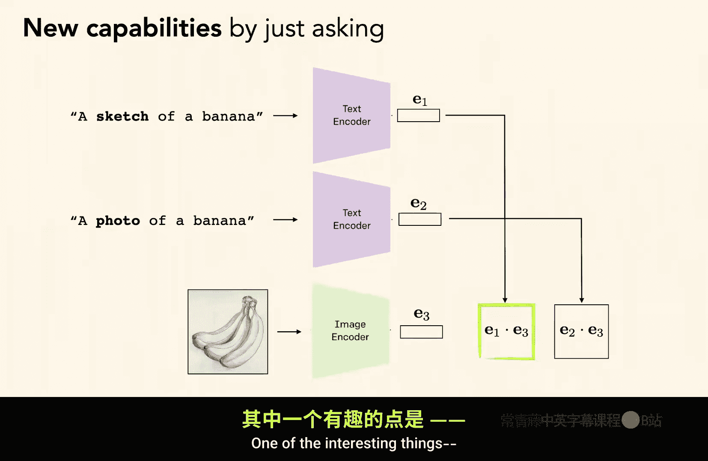

Very good at simple concepts， but they're really bad at composition。

So they're good at os and they're bad at ants。 if that makes sense。

 And one of the reasons for that is you can kind of think of these encodings as almost a bit like a bag of words。

 So if you say like I want find photos of a juvenile bald eagle。

 it will find photos of juvenile things and photos of bald eagles。

 But it's not necessarily going to prioritize photos that are juvenile and bald eagle。

 So that type of compositional querying is like sort of whole another area of research。

 trying to make these models better at compositions。

 and there was a really fun paper in the last year or so that was like teaching clip to say no。

 this is also really bad at like if I say。😊。

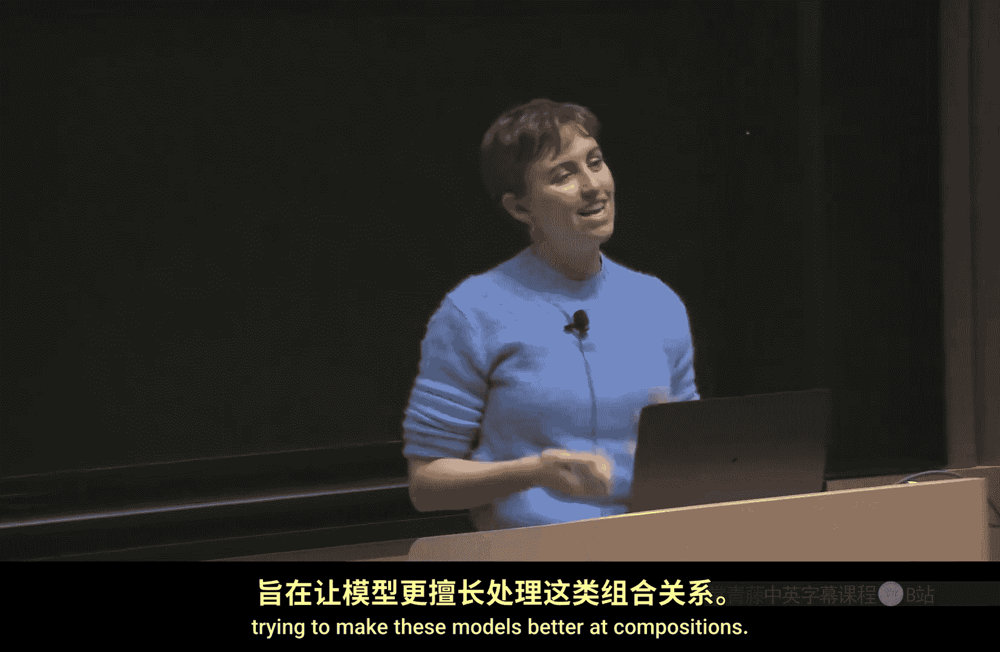

Not a photo of a Baldi gull。 It would just find a photo of photos a Baldigull， right。

 Is that the negation。Cool， so can you think about prompting other modalities， too。

Which is actually kind of fun， it's just like a bit of a psychological drive。

So here's like this idea of like clip prompting。So instead of modifying the text encoder。

 sort of saying， okay， here's some different possible text descriptions and like finding matches。

 you can also look at mechanisms to modify the image encoder with like a visual prompt。

 So here this is an example where they've sort of learned this optimal kind of border thing that they put on the image。

😊，And it's kind of similar to like adversarial noise。

 like we learned about learning adversarial noise。 but this is now like learning beneficial noise。

 It's like， what's the thing that you can add to your image that will maximize the likelihood。

 that this clip model will properly map the correct category。

 which is fascinating right So given a fixed model you can kind of learn from a data。

 like what can you add， what types of noise can you add to the image to actually make the model better at recognizing like dogs versus other things。

😊，And this is noise that helps no matter what the input image is for some fixed data。

 domain or paradigm， right， So you have some training data and you're basically finding some you know。

 constrained set of noise where if you add that noise to any image。

 it maximally improves the prediction for the correct class。

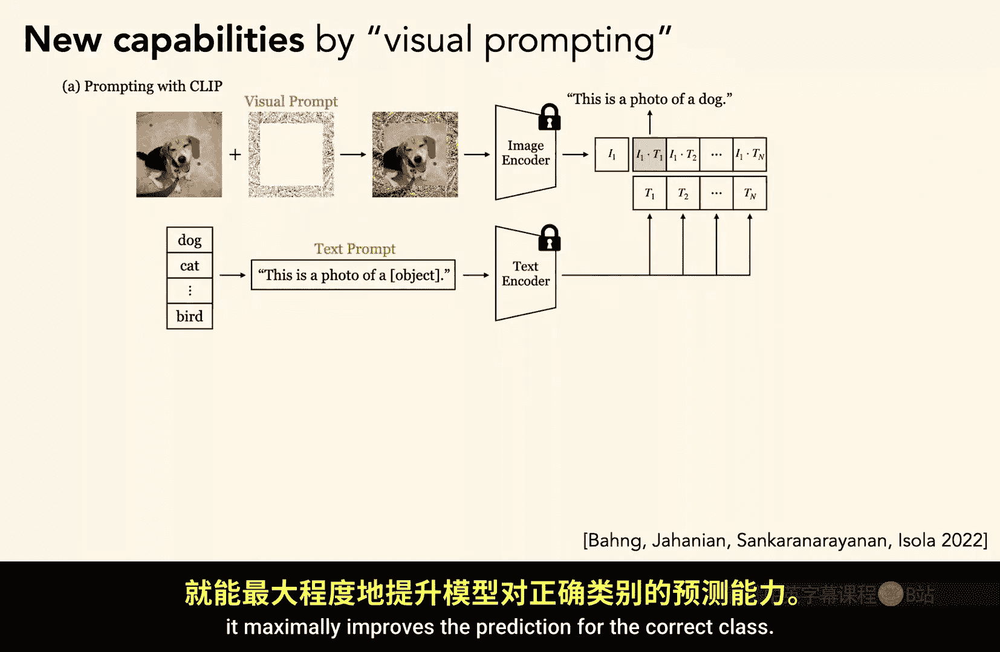

Kind of trippy， right， It's cool。 like but really what it's saying is like something weird about the underlying statistics of the model itself。

嗯。So here it' can it's almost like you're adversarly reprogramming the models。

 so you can also think about loading them in an adversarial way where it's like you find this thing you can add to images that will make it maximally wrong in this clip embedding space。

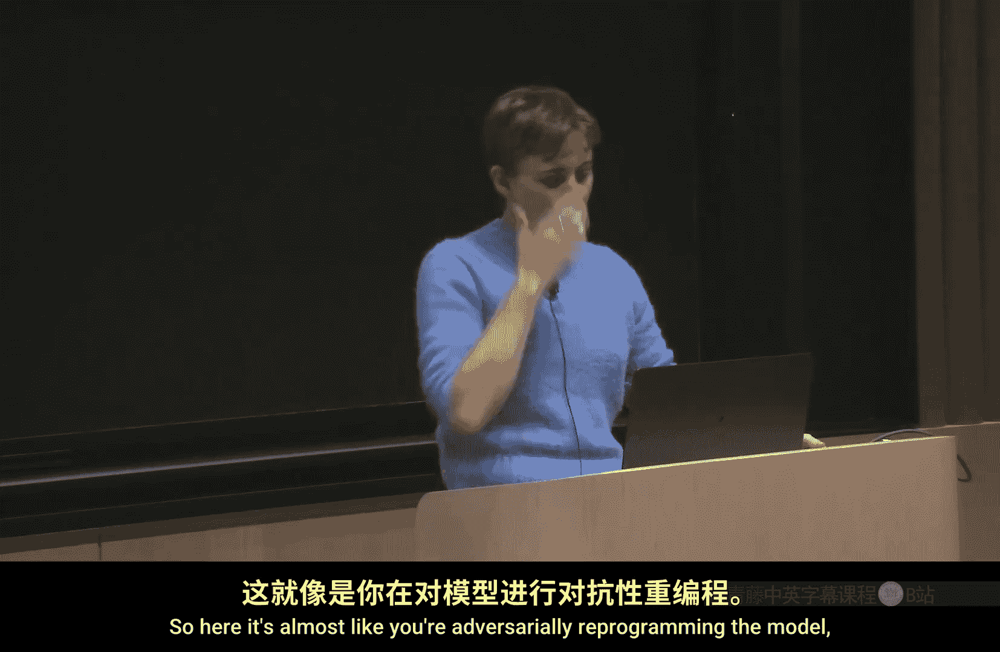

嗯。And this is a really weird version of this。 So here。

 this was an experiment where they basically took a bunch of satellite imagery。😊。

And they found that adding a single bright pink pixel， I don't know if you guys can see it。

 it's like up there， this pink one little pink pixel。

 they found that if they add a single pink pixel to every single satellite image in the same place。

It improves performance by a lot。Right？😊，Did they like check it？Train data set for this model。

 like it statistically。I guess already， you're saying it's for every group。For every class。

But I mean， that's why， like if you have a fixed model and a fixed data set。

 then you can figure out like what is。 And in this particular constraint。

 And I think they were saying like we want to， we want to add a single pixel。

 We want to change a single pixel value to a specific color， like find the optimal version。 and like。

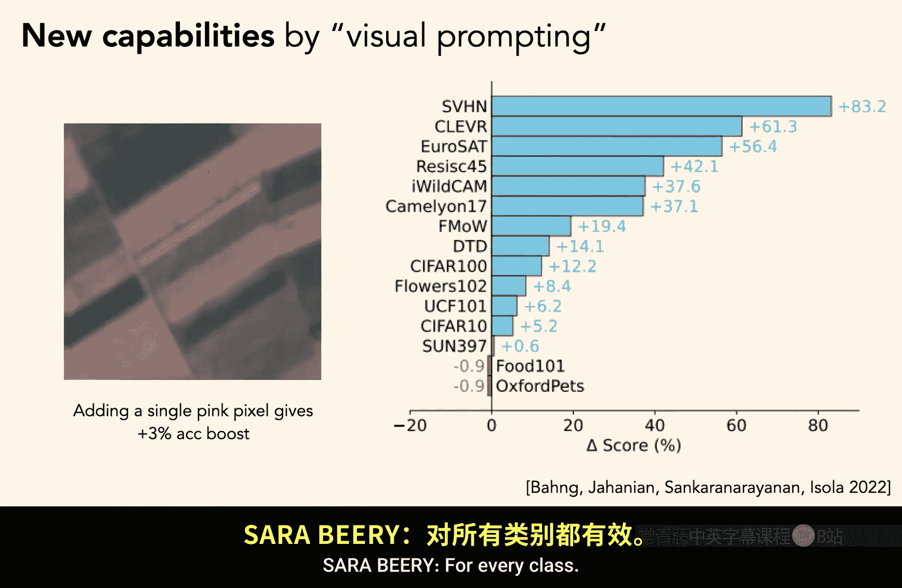

Weirdly， like it， it gives a 3% boost in accuracy across all the categories， right， anyway。

 So so I I think that this type of work， like this is not saying。

 like the best thing to do to make these models work really well is do like one of these weird tricks like this。

 I think it's more enlightening about like what the heck these models are learning。

 right Like how kind of fragile and complex the statistical representations are。😊。

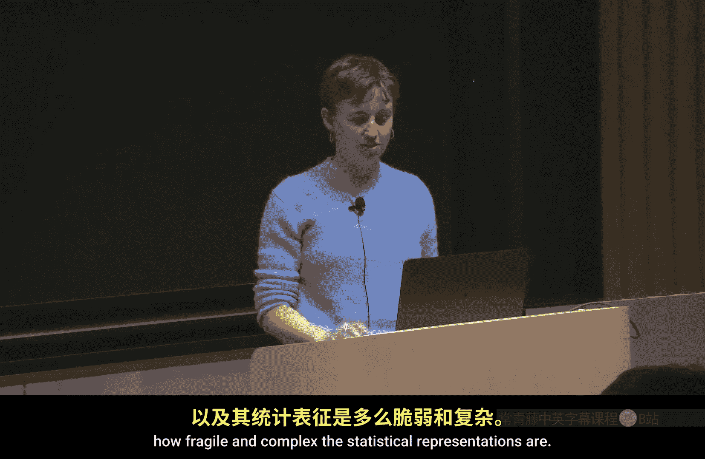

And you can think about this like adaptation happening on the inputs on the mapping or on the outputs。

 right this type of like promptbased adaptation。 So you can take these like pre-trained models and you can do fine tuning you can take pre-trained models and you can just sort of like learn some linear layer that does some reproduction or you can try and do this type of like visual prompting where you're explicitly adding something to the top of an image。

 And then now it's sort of getting a better prediction。😊。

And there's a bunch of interesting stuff where people show that you can do this like visual prompt tuning for these really large models。

 that can be useful even when the model weights or the logics are not available， right。

 It's kind of like distillation。 right， If if you， you just add things to the input。

 See what the output is。 you don't need access to the underlying model to kind of find this type of visual prompting that's valuable。

😊，And then there's another fun version of this， which is like fill in the blank style tuning。

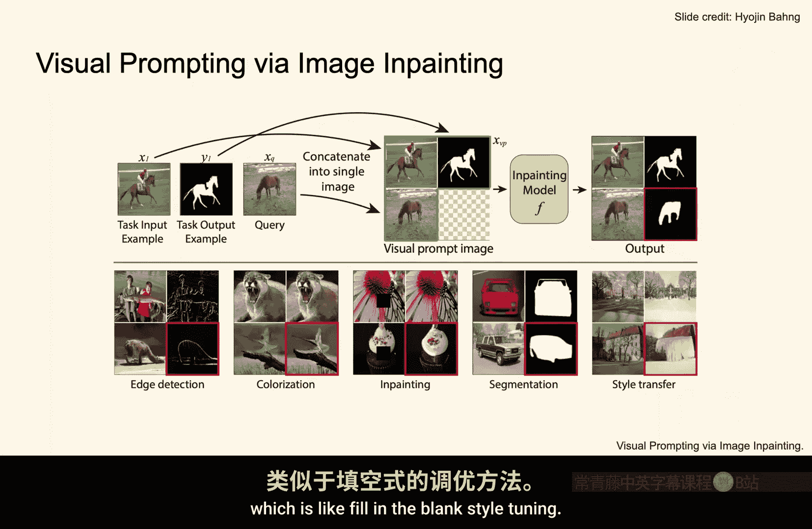

So basically， these people figured out how to get an image model。

 an image foundation model to do segmentation。Va like in context prompting。

 So they made these little grids of images where they would show an image with an example of a segmentation mask for a class and then another image。

 And then like have this like empty area。 And then they would use like an in painting foundation model to get it to sort of like prompt you to do segmentation。

 even without sort of being explicitly trained to do segmentation， right。

 And then they showed this for many different types of things。 So like edge detection。

 colorization in painting。 You're essentially asking these models you're prompting them like with here's an example of what I want。

 with like one sort of case。 And then it's just giving you the kind of correct label across a bunch of different possible downstream types of categories。

 So these foundation models really。😊，Have a lot of capacity， right。

 And there's so many creative ways that we can sort of try to harness that capacity that I think people have looked at。

And there's some interesting resources if you guys are interesting， interested。

 So in the last minute， sorry we're kind of running late today， combining foundation models。

 So you can learn foundation models and adapt them。

 but you can also think about kind of taking these combinations of foundation models and building things that are kind of now modular and top of again like these building blocks right So you want to do something that's like text to image。

 you can take Vq gland and clip right you can plug pretrained models together。

 I think we showed this early on And so this is really just thinking about plugging these different image foundation models together。

 you have some image generator， you have a clip model that's got this similarity foundations and semantic meaning between text and images and then you can do something like optimize this little embedding vector or like this sort of latent space vector to get an image that maximally matches that text prompt。

😊，And there's a bunch of sort of。Recent work on sort of this like text based image generation。

And Dolly2 is a good example of that， where essentially they have like a clip objective。

 and then they also have kind of this prior that helps them do decoding slightly more efficiently。

Cool， so today we talked about learning with little data， transferring knowledge。About the mapping。

 the outputs and a bit about foundation models will follow up on Tuesday and。Don't be too sad。

 but think twice about Chattti。系。😊。

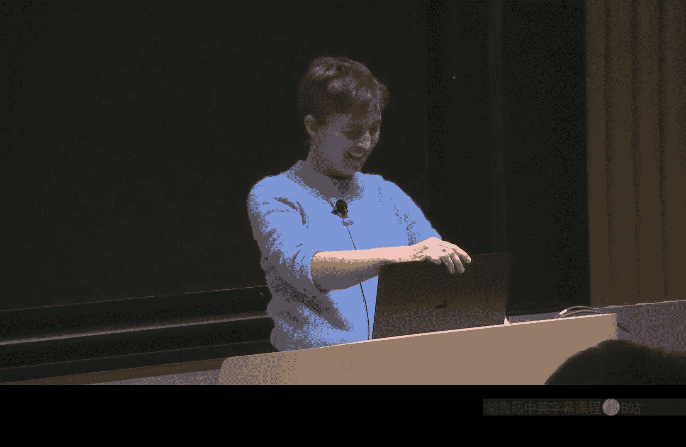

