# 麻省理工学院【中英⚡深度学习｜6.7960-Fall-2024,-Deep-Learning】-p19-P19-迁移学习：数据--BV15QZ4B1E6v_p19-

We're going to finish up our short series on transfer learning today。

And the other sort of logistical thing I did want to bring up is I know that project proposals are due this Friday during our instructor meeting today。

 we put together a rubric for those project proposals just to try to give you guys a little bit more structured understanding of what we're going to be evaluating those on。

 So that's up on Piazza。 and essentially it's like out of 10 and there's sort of five different things that are each worth two points。

And then the other thing I wanted to say is that this is actually my shockingly already my last lecture of the semester。

 like I don't know where the time goes， but it has been really awesome getting to lecture you this semester。

 and I will probably see you towards the end of the semester anyway but。yeah， time flies cool。

 So today， continuing that thread on thinking about how we can transfer knowledge specifically within the constraints of these deep learning models。

 these deep learning systems today we're going to be specifically talking about how we can transfer knowledge about the inputs to the system。

 And so we're going spend some time thinking about how you can think about generative models as another way to capture information about data inputs。

 And then we're also going to talk a little bit about models that learn to learn so this idea of metal learning and how you can kind of build models that are almost designed to be good at transfer learning。

 like designed to be good at sharing information or learning new things。😊，Cool， so。

If we're thinking about knowledge as knowledge about the inputs。

 like maybe one way to think about this is if you know something about the distribution of inputs you're going to expect。

 maybe there's a way to actually use that to direct or accelerate your learning right or even sort of directly target a specific type of learning。

😊，So。You have a data set， right？And then we spent quite a few lectures with Phil talking about this ability to learn how to generate data from that same distribution。

 this idea that you can use generative modeling， and so now that gives you access to some model that then is able to sample from that distribution。

And so here at a first glance， this might not seem that interesting。

 you had data and then used it to train a model that mimics the data that you already had right。

 but you already had the data， so how does it actually help like how are you going to get more information out of a system that's sort of been trained to model from a specific distribution？

嗯。But one of the interesting things that you can kind of。

Think about this as is assuming that generative model is kind of very good。

You can almost think about the model itself as a new way or a new sort of mechanism to access data going beyond the capabilities of the initial training data set。

 so maybe you call it data plus plus right and what is that additive value that you're getting from a data generator that you might not get from the data itself。

And here's like an interesting quote。 So this is from the release of the first stable diffusion model。

 They said that this release is the culmination of many hours of collective effort to create a single file that compresses the visual information of human into a few gigabytes。

 and that sounds pretty awesome So essentially it's the idea that actually a generative model is is a really cool form of data compression right you can take that generative model and you can go from some latent variable to sort of anything on earth。

 like any sort of visual all visual information of humanity then that is a shocking compression of sort of everything。

 you think about even just the storage capacity of like all the images on the internet versus the storage capacity of a stable diffusion model。

😊。

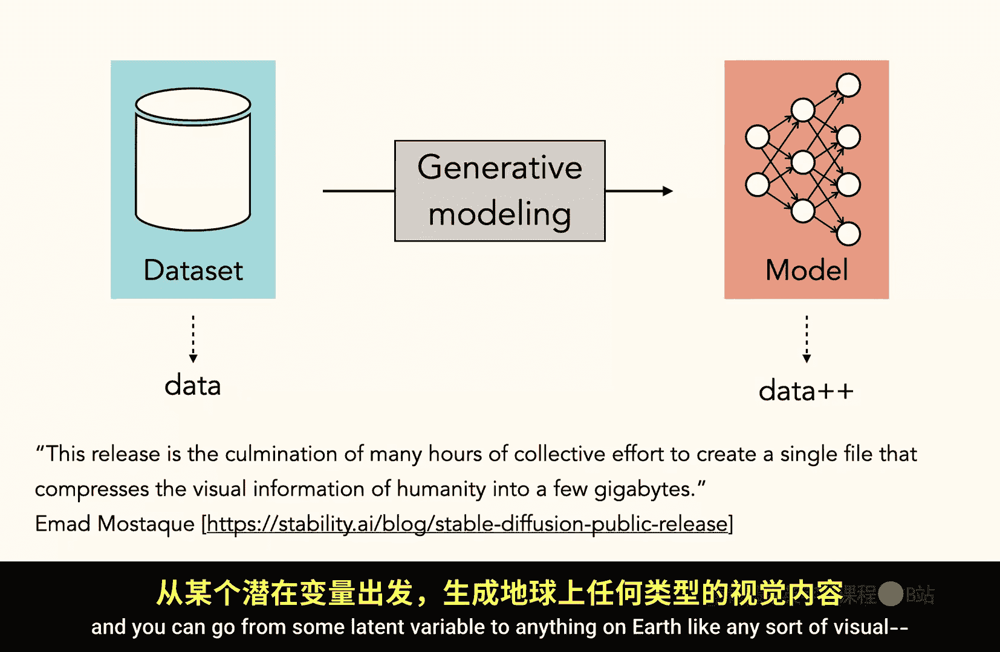

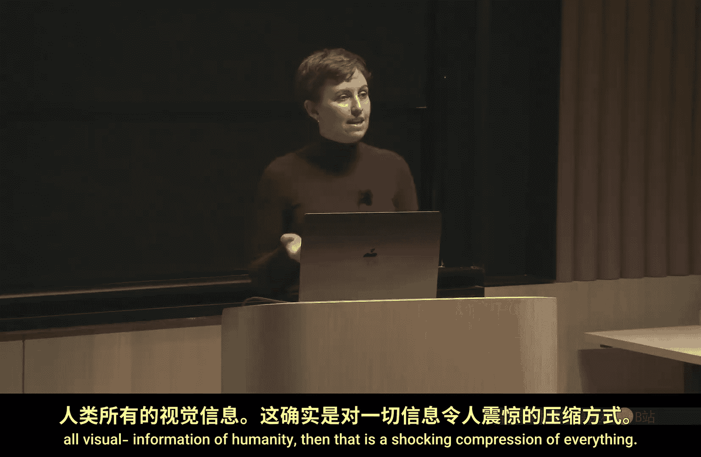

That's a significant difference in terms of what you're capturing。So。Here。嗯。You know。

 how do we think about what data plus plus means and and how do we think about data as maybe like like an object。

 right。So。If we start with you know， some X， which is the set of the original training data。

 which is little X。Z， which is a set of latent variables that can correspond to the original training data learned by our generative model。

嗯。The mapping from。Z to x。 so this is basically the mapping that goes from some latent variable to a gene data point。

 that's G。 that's the generative model we've learned。 And then if you also have G inverse。

 essentially this inverse mapping that lets you go from data to its associated latent variable you can actually define these。

 you can take these and define operators over those objects that enable us to do things to the generator of and sort of the system of data plus generator of data that we couldn't easily do to the data itself。

 so for example。You can think about interpolation over a data right， you know。

 pretty standard definition of interpolation。 But now you can think about maybe some if you have one set of one sort of set of this like X。

 Maca X is's kind of like some data set， some latent space。

 a generator for that latent space to data in the inverse。

 if you have one of those and you have another one that's for some sort of different data。

 possibly or different generator， you can think about interpolating between the two right So some interpolation between those two things would generate a new one。

And you can think about manipulation， right， You can think about how you might add some bias term to that that would give you。

 again， some whole new kind of object for accessing and interacting with data。

You can think about composition。 So here， you know。

 how do you actually kind of compose two things is， of course。

 different from interolating between two things。 So now if you like essentially art。

Taking this space where you have just these different data products or data objects。

 you can think about really combining them and manipulating them in interesting ways。

 you can also think about optimization right so how you might actually be able to explicitly find some set of you know generator data laden space inverse generator that's optimal for some given dimension of optimality。

And you can imagine sort of taking that and bringing it to bear on many。

 many different sort of research domains or problem domains that people are interested in and things like graphics。

 like visualization， data augmentation， counterfactual reasoning。

And all of this work is kind of somewhat in progress， actually。

 so these are just some examples of papers that start getting at these mechanisms of interpolation。

 manipulation， composition or optimization over generated data objects。So。

If we think about this space of generative models。So here， you know。

 this is now just visualizing what we' were just talking about。 We have some set of latent variables。

 So these are maybe the controls， right， This is kind of the way that you control what you want to generate。

And maybe you've made some reasonable constraints in your system so you can ensure that Z is。

 you know， normally distributed now。You have some generative model G。

That will take any point in that latent space。And then synthesize an image， right。So here， now。

 if you sampled a different point in latent space， then you would sample a different image。And so。

 now。Given the relationship between like dimensionality of movement in latent space and the image it's generated。

 you can think about this as a mechanism of control。

So maybe if you move along some controllable snippet of the manifold of natural images。

 you can explicitly do things like find some latent variable in your latent space。

 some dimension in that latency that corresponds to something like pose for this bird。

Or orientation in some way， right？ And so maybe there's like different dimensions。

Of like this control and latent space that can specifically to disentangled factors of variation or change in the space of those real generated images。

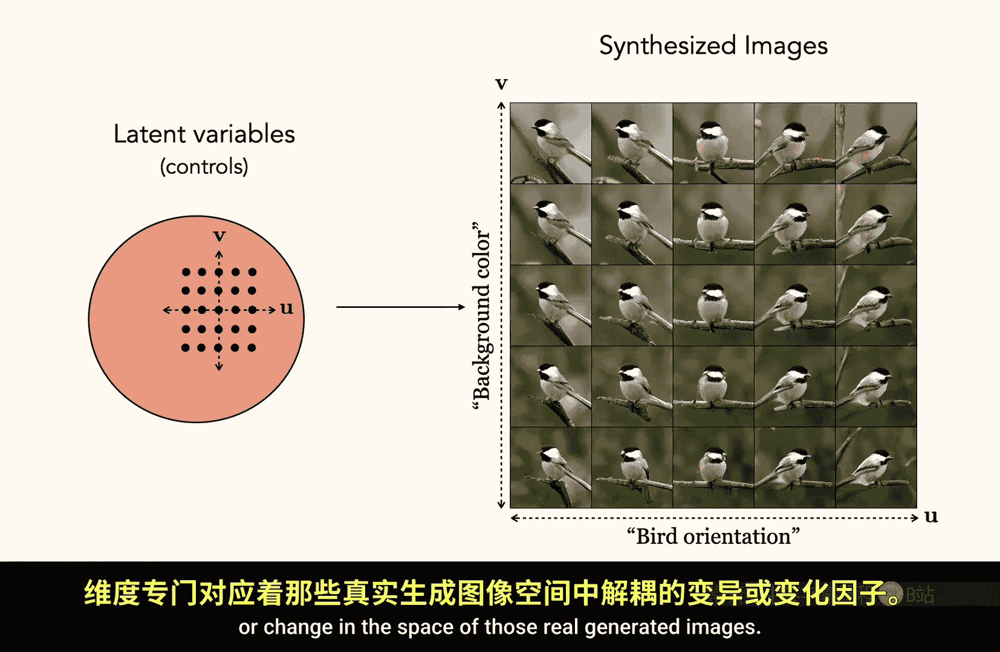

And so if you can find， yeah。Just to be out on that site， just suppose that the true dimensions are。

And you see usually the case。So your question is， are you supposing that these dimensions in this kind of latent variable space are linearly independent？

So I think the assumption here is that there is some decomposable directions that are kind of maybe。

 you know， some projection of this where you can find orthogonality and that orthogonality then corresponds to some very clean。

 like specific。Like variables of variation in the real image space。In practice。Sometimes。

 particularly for certain types or certain sort of categories of generative models， this is true。

But it's not necessarily easy to find， right， So you people will kind of。

Do this like cherry-pic thing where they're like， hey。

 we found a dimension where if we move in this dimension。

 you can see that it changes from day to night and we'll talk more about some of these。

 but I think one of the kind of challenges of this is particularly as these latent spaces get higher dimensional。

 being able to really explicitly disentangle these dimensions of variation in a clean way can be very difficult and can be highly heuristic。

没有。

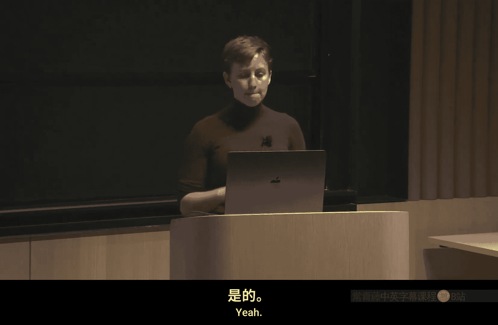

嗯。Cool， so if you have that， if you have this kind of like model that takes you from data to what we're calling data plus plus。

 and you can map you know now from your actual image now into the latent space itself。

 This is that G inverse。 now you have the ability to ask these interesting counterfactual questions。

 like what would it look like if， you know， assuming that you have these measurable and sort of actionable dimensions of variation。

😊，So here now you could say， okay， what would it look like if you know we moved around in this latent space。

 like how do these different dimensions correspond to different maybe things within the manifold of real images？

So there's some work where you can actually show that you can improve。

Your ability to categorize something by building an ensemble。

Over different generated variations of that input data in some manifold。

 and so you get some essentially improved accuracy and robustness by taking a real input image and then figuring out where that corresponds to in latent space and then moving around sort of nearby in the neighborhood of that thing to find some maybe different poses。

 different orientation， slightly different realistic manipulations of that input image and then taking an ensemble。

 So it's almost like you're building some robustness into your categorizer based on some interesting dimensions of data augmentation。

 almost like test time augmentation within the generator itself。Which is interesting， right。

 So there's some nice work that shows that like， okay。

 actually exploring dimensions of latent space can give you something that actually is more than the original training data。

 though I think an interesting and important point here is like there's so much kind of knowledge baked into this。

 right， like。😊，The fact that something nearby in that image space should be reasonably maybe the same category。

 not actually break a category boundary in some significant way seems important。 And you know。

 I often try to point out like some of these assumptions that are built in some of the ways they might fail。

 So if you are just trying to understand something like cat， this is probably very reasonable。

 if you're trying to understand something about maybe a breed of cat。

 these dimensions of variation might start to get more confusing in terms of breaking that class boundary because to me。

 as somebody spends a lot of time thinking about animals。 the first image and the one in the middle。

 actually look like different breeds， that difference in the morphology with the extra length of the ears to me。

 if that's this type of cat， the fine-grained level of categorization you're interested in。

 this might actually be more confusing and potentially break that robustness。

 So there's always some fundamental assumptions about what you're actually trying to do that are kind of built in the dimensions of variation that are good or bad for a given problem。

嗯。And then you know there's this question of like how do you discover these dimensions in a latent space right？

 So one interesting thing you could think about is if you're trying to discover an interesting dimension of variation in a latent space。

 there's ways you can do it experimentally you take an image of something。

 you take an image of the same thing at night， for example。

 and then you look at where those both map to in latent space and then you decide you like calculate the vector of direction that goes from one to the other。

 So you've almost calculate a vector of direction that should correspond to this specific type of counterfactual。

And so then you can think about sort of explicitly finding things like dimensions of variation that zoom out on an image or zoom in on an image or brighten it or darken it。

So they have like in this case， they were able to sort of find corresponding specific shifts in the image that can be used to then control images and ones that are input agnostic right So now you can kind of find this optimal direction or dimension of variation by just kind of like cropping images。

 And then you sort of take an ensemble of like the directions for each of those。

 and maybe you can find something experimentally right And so here you have these dimensions of zoom。

 You can find dimensions that correspond to shift even across different input sizes。

You have dimensions that correspond to brightening an image and then you have things like corresponding dimensions of darkening an image。

 though here this is interesting because I would say that this is really capturing some very specific bias in our data right because clearly people are not taking pictures of volcanoes in the dark that aren't erupting right So when we try to make it dark。

 it thinks it needs to erupt right there's like this clear bias that is built into the training data。

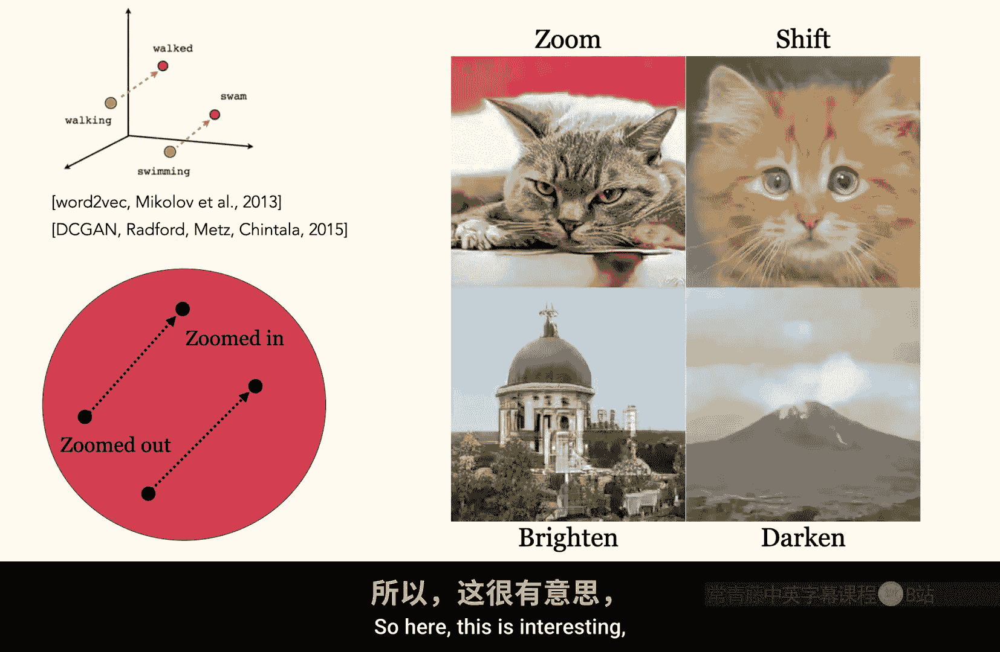

And there are some other cool examples of this for other types of modalities as well right So there's actually a really famous example from like word tove。

 which is like an embedding model for words like semantic meanings。

 where there's like a direction in the latent space of models that will correspond to changing the tensets of the word so you can move in that direction and go from swimming to swam and go from walking to walked by taking sort of this moving the same direction in that latent space for words so these types of examples of disentangled dimensions of variation in latent space can be discovered from many modalities and have been discovered for many modalities。

😊。

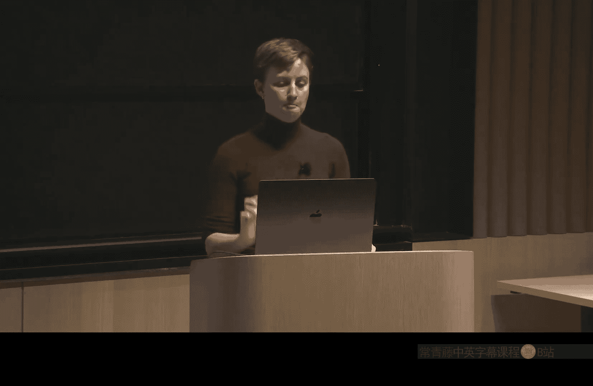

嗯。And then there's kind of like these explicit， you know。

 latent space vectors that are disentangling these factors of variation， right。

 So you have things like winter to spring or turning on the lights going from day to night。

 the volcano eruption vector。 though again， you'll note that it's like you're more likely to get like more aggressive looking eruptions at nighttime than during the day。

😊，So。There's been a lot of research into how to efficiently discover these dimensions of variation within a alert latent space。

 these disentangled dimensions of variation， so let's look at that in a little bit more technical detail。

So you can take a G like a generator or sail network。

And you can walk in a straight line in a latent space and visualize what it looks like to walk in that straight line。

 And it kind of works， but it can be really cherry picky。

 So like some of those like directions correspond to stuff that just looks like trash。

Or is just not easily disentangleable into something that we can interpret。

 And then there's some like sort of fancier versions of a game like style ga。

 where they actually explicitly noticed that。Sort of any layer of the model。

 any of those intermediate representations also represents a latent space for the model right and so they determined that there's actually earlier layers in the model that are better quote unquote latent representations than the Z representation that sort of initial input representation and so so then we'll try and talk about why that might be like why it might be better to actually think about their latent space from somewhere intermediate in the model versus like explicitly with that input latent vector。

嗯。So。If we have some natural image manifold X， so some nonlinear data space。嗯。

And now we sort of have some starting point。 So so this is the corresponding point in that data。

 sort of natural image manifold， corresponding to this bird， this blue bird。

 Maybe you have another point here。 This is corresponding to this fly。

 So if you think about linear interpolation between these two points。 arguably。

 you're moving off the manifold of real images， right。

 You're kind of like there's there's stuff in one end and in the other that sort of our more realistic looking。

 but there's sort of direct linear interpolation in image space just gives you stuff in the middle that's basically these like obvious kind of just additive images。

 right， And it doesn't look anything like any realistic natural world image would。

 just doesn't match the statistics of real natural images。 So instead。

If we have some sort of latent space that we've， you know。

 now we've learned this data plus plus representation， now we can。

 we have a latent space that's sort of well behaved and we can map from that directly to that natural image that natural image manifold。

Then you can imagine that interpolating linearly in the latent space would correspond to a nonlinear interpolation in that data manifold space。

 but it would ensure that you're mapping within the manifold of real natural images the whole way。

 right， because by definition， we've constructed something where any point in that latent space will map to the natural manifold。

 So now if you do that same interpolation。 this is from a paper called Big Genda in 2018。

 you do get stuff。That at least looks a little bit more like natural images。

 but they might not really map to reality， right like you get some like really weird things like this like half bird。

 half fly thing， or basically the model's just doing its best right It's doing its best to sort of find some way to reasonably interpolate between these two things and can stay within the constraints of that trained natural image manifold mapping。

嗯。But that Z space， so this sort of Z space here where we're mapping like from one point to another in a linear way might not be the best way to sort of organize the data to interpolate along。

 And so let's look at why that might be。 So it goes back to the lecture from VEs。

 if you guys remember， you have this data distribution that maps to a latent distribution and you have a latent distribution。

 the maps to a data distribution。 And so at the bottom we're sort of coloring the correspondence between those two spaces。

 essentially like if you're going to map these three things back and forth。

 So here like if I say like the same color on the natural image manifold of like green， for example。

 would match the same color green in the latent space。So now。

Let's visualize what happens as this gets trained。 So here if we're watching this thing get trained。

 you can kind of see how it's like going from the natural image manifold to that latent space。

 it's almost like you've taken like something and try to crumple it into a ball And so even though we've said explicitly that like okay everything in that latent space should correspond to something on the natural image manifold actually there's like this weird stuff here right where theres there's like danger zones where we're essentially here like it's gonna to be closer to the natural image manifold。

 but if you're going from here to here like there's gonna maybe be seams in that linear interpolation that will correspond to like pretty jarring sort of shifts where things like that are nearby in latent space could potentially be quite far away from each other in data space And so essentially that like Z representation if you're doing linear interpolation。

And across that seam， it could be unnatural， and that might be one of the kind of ways to motivate the sort of discovery that they found in the Sky gun paper。

Which is essentially that using some intermediate representation somewhere in between that's not quite fully convex。

 but maybe like a little bit less distorted， so some like kind of intermediate thing where you're possibly less likely to kind of jump across a seam or sort of fall into some danger zone basically just somewhere in between might be the right place to interpolate and get things that look more realistic and kind of behave more in a more friendly way and empirically in qualitatively that's sometimes true。

It's our favorite way to say things， right， sometimes， but。

 but it does actually sort of correspond in some nice ways， right， So here this was a work where。😊。

They took that W space， that sort of intermediate space and they demonstrated that they could use it using this sort of this is a work called style space to very cleanly isolate and disentangle these dimensions of variation。

 and they got some really nice qualitative results right So here they're able to vary things the level of granularity of like hood styles or headlight types or body colors or background。

 So。Yeah， so it does seem to suggest that basically by removing some of those like。

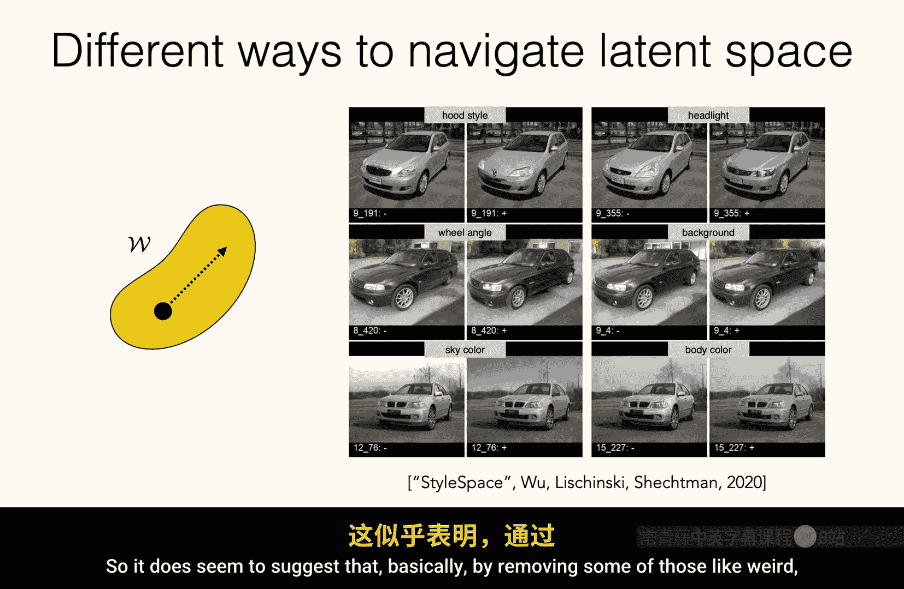

Weird， badly behaved portions of linear interpolation by moving to this more immediate space is beneficial when you're trying to find these disentangle dimensions of variation。

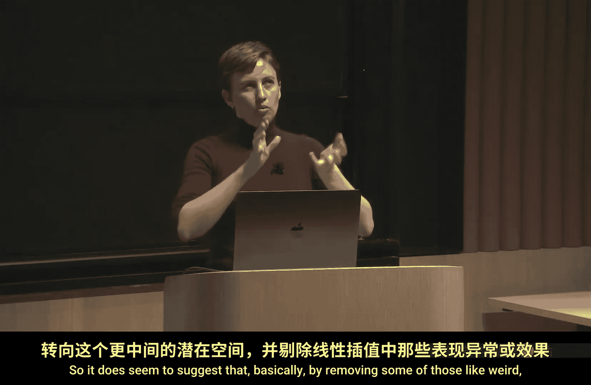

Cool。So。Now let's talk about how you would label this generated data right so you have a label for all your real images。

 well maybe you don't， but assume you do assume that the data you started from that you're training this generative model on you had labeled and now you have you know some space in here that corresponds to that real data。

 but then there's a lot of other space that corresponds to purely generated data right。

So the argument here is that by construction that things that are close together in this manifold should be semantically related。

 and so if you don't move too far on the manifold， you should argue that the category should stay the same。

Or at least this is the assumption right And so then you can have kind of this you can rely on the normal inductive bias of machine learning that assign similar labels to nearby points if it's reasonably well semantically clustered So here。

 if you know， for example， these are real data points where you know they true label。

 then you could assume that things sampled from those similar data points would actually correspond to similar things and so here you know maybe in this sort of region。

 yes， there's dimensions of variation that are captured and but they're not changing the underlying semantic meaning of the object itself。

 these small variations are more corresponding to these dimensions of variation in the context in sort of maybe the scene the visualization。

 but it's not changing the category that's being captured。

And so this was explicitly explored in this paper called Dataet GAN。

 where they basically trained a GN on one type of data。

And then they wanted to solve a new task related to that data。

 so specifically labeling the parts of a car with semantic segmentation。

And so then what they did is they use stylegan to efficiently label data in terms of like the semantic segmentation labels。

 which can be quite expensive by defining an additional labeling arm。

Which is essentially the output of a style ga with just a few examples。

 And then you can use that model to generate a really large data set of images and corresponding labels。

 there are weak labels， but they're labels that are sort of explicitly based on this well structured。

 well aligned latent space。And then you can train a part segmentation model in this synthetic data and test it on the real data and show that it's actually beneficial。

 So being a little bit more specific about this。Essentially。

 if you're trying to train that labeling arm。They do that using the latent space and then just a really。

 really small number of manually labeled examples。And this is valuable。

 particularly because semantic segmentation labels are really expensive。

 How many of you have ever actually tried to label data for semantic segmentation。

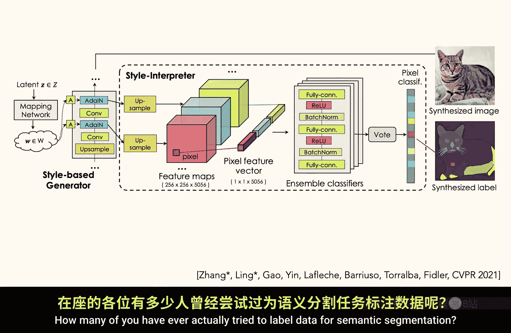

Yeah， it sucks， right， Like it's super slow trying， especially like。

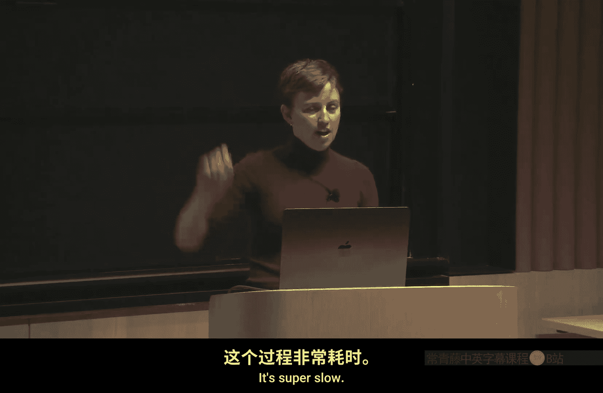

The parts that are really fine grainined are like the boundaries of objects。

 it just takes forever to really try to get it very correct。

 And so being able to kind of efficiently benefit from just a few of those and then be able to generalize well is pretty valuable。

 So essentially here you map human labels in the pixel space through the network to some of these intermediate features that have some sort of maintained spatial relationships and arrangement。

😊，So basically， you take the original data， and then you run it through what they're calling a style interpreter。

 But it's essentially something like a style again。

That gets you a representation of like these specific pixel vectors that you can then train a model。

 a really efficient model， predictive model to map between those features and part labels。

 So essentially， it's like relying on the fact that training this generator force the model to learn a really well behaved。

 well aligned representation space in terms of these dimensions of variation and similarity。

And then they could show that you could really efficiently train these accurate predictive models because the features themselves were better organized and more semantically meaningful than the pixels that you might be starting with。

 So instead of trying to sort of go from images and pixel labels to a trained model that generates pixel labels。

 given this input image， you basically take the input image。

 run it through to some intermediate feature space and then you've trained this really lightweight predictive model to go from those features that are learned by a generative model to the correct semantic segmentation。

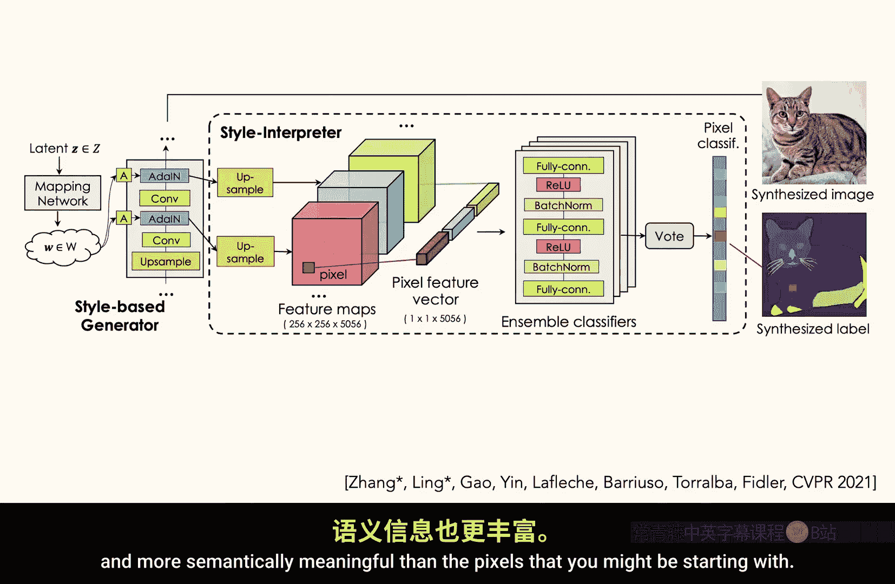

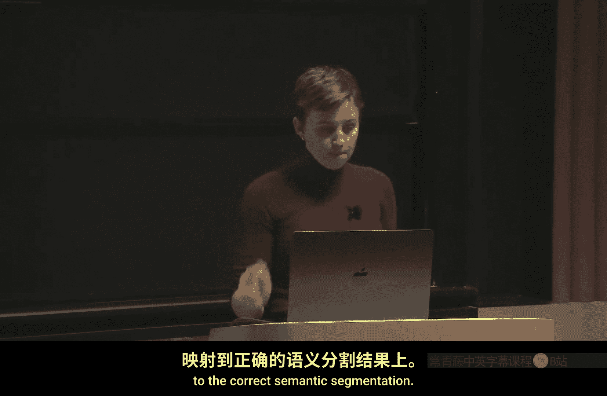

And they had some pretty nice examples of how they were kind of able to do this and qualitatively and quantitatively they were able to show that this worked quite well。

 and they got this kind of nice result， which is that a single labeled G image was worth about 100 labeled regular images。

 just in terms of the training efficiency versus the same amount of accuracy。😊。

And these types of things are increasingly commonly explored。

 particularly for these types of labels that are really expensive to collect。And this。

 this interestingly， like this question of like， how do you efficiently train these types of things based on well learned representation spaces or foundation models。

 even ones that are not necessarily generative， has also been really well explored。

 And so these days， if you're trying to do semantic segmentation。

Most most people start from something that's called SAM， the segment Anything model。

 which is a model that relied essentially on building a really large like data set using some pretty cute hacks for self-supervision。

 you take an object and you use copy paste augmentation to guarantee that you kind of have that correct mask now in a bunch of different relationships and orientations。

 you use some similar ideas from something like Dno V2 that really captures finegrained semantic meaning in those feature spaces。

 and then you're able to learn a really generalizable and robust segmentation model on top of that。

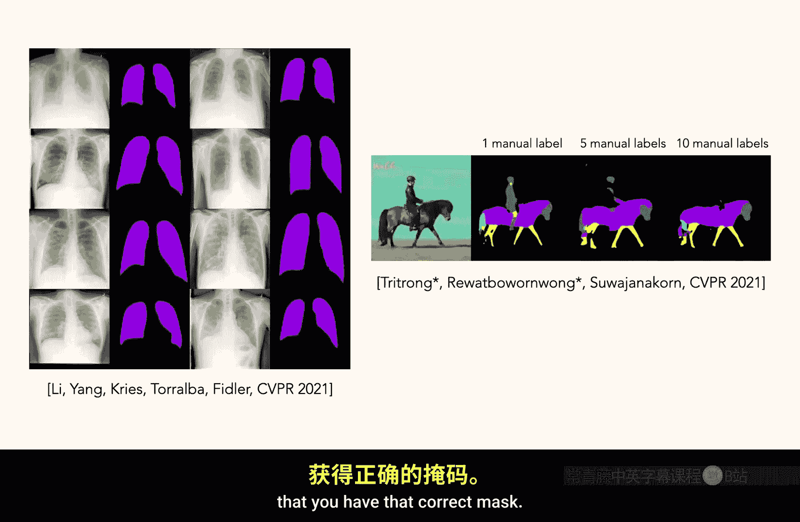

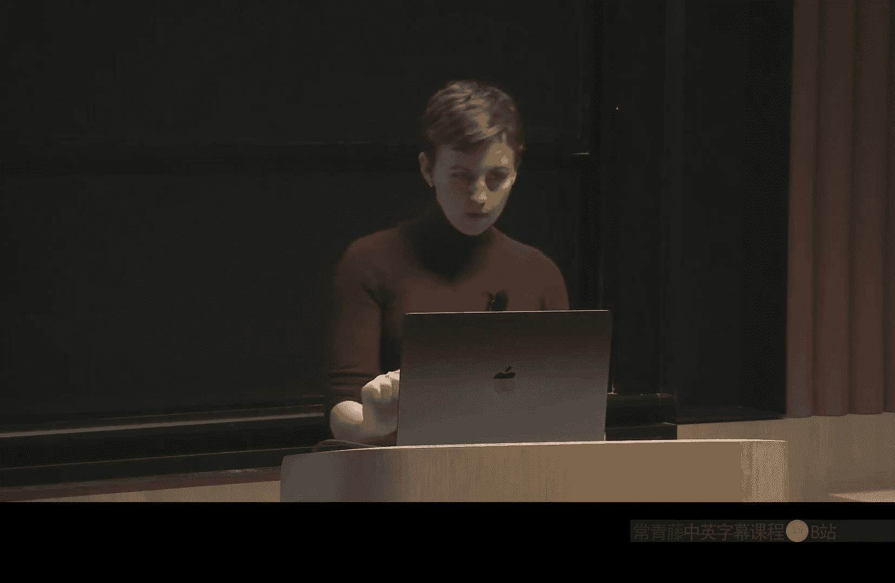

Cool， so。Then you can also about think about how these generative models like data plus plus approach can start to teach you how to explain things or sort of increase the interpretability of some of these dimensions。

In standard classification， we take an image。 We run it through a classification model。

 and it tries to predict cat， right， It's like， okay， tries to predict a category。

But now the question is kind of like， can we say something interesting about why the image was classifiedified as a cat using this ability in this data plus plus space to explore counterfactuals。

So here you take the cat， you take it from this data space and turn it into this quote unquote。

 data plus plus space where now you have some maybe encoder， some generator。

 so you're mapping through essentially your G inverse and then through your G to get the same data。

But now what you can do。Is you can look like from this predicted class using from the sort of generator looking at the classes that are predicted。

You can now explicitly try to pertuurrb in the latent space to understand how that would cause your prediction to change。

 So this gives you some ranking of the sort of changes in the latent space and manipulations of these latent variables that maximally lead to the idea of changing a concept。

 so it helps you understand what maybe sort of features of this image are most identifiable as the category of interest And so here this like style X it's like almost like stylespace explanation approach tries to find the top K stylespace directions。

 So these like latent space directions of variation that will most affect which class the model predicts。

 And so here there's some like interesting stuff right you can look at like what happens if you open the mouth of the thing and it turns out that that is a really strong dimension of variation for moving the prediction from cat to dog probably because dogs。

Tend to pant a lot more than cats do。This was very cute interpolation。You can also look at。

s sort of changing something about the size of the pupils relative to the eyes。

 and that also shifts the probability that you have somebody like a cat。

Or you can think about sort of changing how pointy the ears are。

 And that also tends to correspond from an explainability standpoint to why the model thinks it's a cat versus something else。

 right？ And so this kind of gives us this sense of like。

It's it's just another mechanism to try to probe the underlying things that the model has learned or is understood。

 right， And you can imagine that this does tell you， again。

 something about the underlying bias in our training data。

 because there are many cats that have ears that are kind of shorter like that， right， There's。

 there's like British short hairs have short， short ears just like that， but。More often than not。

 something that has long， pointy ears is a cat and maybe something that is shorter folded over ears might be a dog。

 So it's， it's capturing some dimensions of bias， I think， in the data as well。嗯。

And so you can think about this in terms of like how we generate maybe class specific explanations。

 So here， if you have something like a perceived age classifier。

Then you can start really probing these like weird dimensions of bias and see how that affects the perceived age of a model。

 So now the model is predicting an age， right。And so。

One of the things that's kind odd here is you'll see specifically that like thicker eyebrows are corresponding to more youthful age lighter skin is corresponding to more youthful age。

 though also you'll note that it's like lighter but also sometimes less textured which is like one of these dimensions not a super super disentangled dimension of variation or something like adding glasses or you know very obviously going to like gray hair。

 so these were all things that were sort of learned in terms of finding these dimensions of variation that corresponded to specific types of prediction and it maybe makes sense like older people might be in terms of like your data bias more likely to have white hair like that that something that's actually pretty ubiquitous but you could also imagine that some of these dimensions of variation would not be something you would want a model to necessarily learn right。

These might capture dimensions of bias that may be related to the fairness of the equity of a model that we deploy。

 So what do you actually do with what you learn， right？Well。

 so one way we could look at this is like， instead of taking it looking at things like these dimensions of variation from you know。

 Internet images， can we take it to scientific data or medical data。

 So here this is using that same type of explainability mechanism from like from the generative model to try to understand how to categorize different retinal fundus images。

😊，And here we're showing sort of the top four examples of things that real doctors are looking for。

 and then how you might actually change that image maximally to correspond to something predictive of a specific disease。

 for example。And this is quite interesting because it does actually if you show these to a doctor。

 it does correspond with the types of even very fine grainined features that a doctor might use to actually categorize a specific type of disease。

 so from that sense， from an explainability standpoint。

 it's almost a way to build trust in a model because an expert would say okay yeah， no I do agree。

 I do agree that that is a reasonable dimension of variation that I also would correspond to a specific type of disease it's almost a reassurance that the model isn't picking up too many odd other correlative factors that might be things that we don't want a model to correspond to。

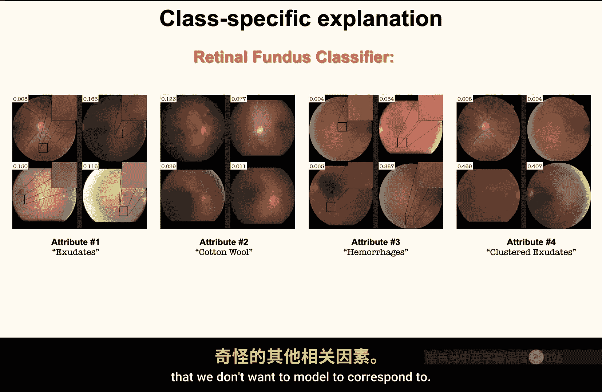

But of course， one of the really big limitations of all of these approaches is that you are required to figure out how to。

You have to discover those latent space variations and then manually analyze or define what they might correspond to and that takes a lot of effort right so getting to the point where they had these examples of kind of like these specific dimensions of variation that corresponded really well to these real diseases。

 I'm sure it took a lot of handcrafting and a lot of time。

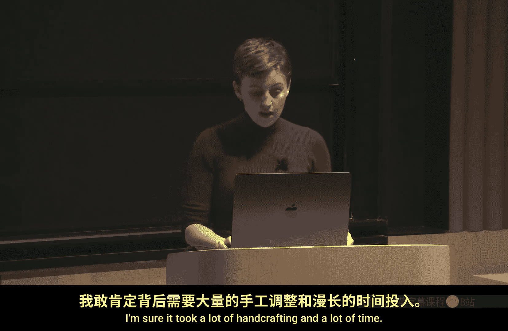

And so recent work tries to do similar types of counterfactual reasoning or understanding。

 but here actually just using text conditioning for sort of modern diffusion models or other types of conditioning using diffusion models that give us really simple and interpretable mechanisms for control though of course there's not always perfect alignment between like maybe your text control and what actually gets generated by the generator but it does make this ability to test these counterfactual hyposes。

 just hypotheses in many ways like pretty efficient。 So I showed this work actually before。

 but this is work where they specifically looked at using almost like human intelligence to generate possible counterfactuals using text conditioning on generative images and then explicitly testing quantitatively the performance of models given these different sort of human human derived counterfactuals and they showed that you know it's a really nice way to。

😊，To do essentially like interfaces with your data sets。

 basically using the generator trained on top of data as a direct investigation mechanism or interaction mechanism with the underlying real data itself。

 understanding the dimensions of bias。Cool。And then I think there's also this question of， like。Okay。

 the data， the generated data is potentially useful for explainability or for a data set exploration。

 But it isn't also useful for。Representation learning， right， like。

 can you learn from generated data in the same way that you might be able to learn or maybe even in a better way that you might be able to learn from real data。

And this is where it gets kind of complicated。 So here's a work where they basically said， okay。

 you have some data X。And then you're going to train a generative model on top of that data。

And the idea is somehow the generative model trained on top of the dataset is going to capture either the same information as the data or maybe arguably slightly more information than the underlying data。

 and then that might actually be able to be useful for representation learning。

 So here kind of similar to that other example with the multibi enssembling from GNs。

 they're explicitly looking at your ability to generate maybe the same real image from different perspectives or from different views。

And then use that as the input to contrastive learning models。

 So here trying to learn a representation space where， you know， you're saying all right。

 here's two images from the same sort of category here's one from a different category。

 and then you're training that contrastive style loss。Yeah。

 so does this like training from scratchers just seem transfer learning？Yeah。

 that's an interesting way。 it's an interesting question， right， I mean。

 arguably this is a mechanism of transfer learning assuming that。

 well I guess to get to the original model， Was that built on some？T。

Which original model we're talking about kind of like a system here， so。So this generative model， so。

Let's assume for the sake of simplicity that this is trained from scratch on that， because otherwise。

 it gets even more complicated to understand， right， And this actually。

 I think is one of the one of the difficulties currently when people are trying to understand whether we can。

 like there's， there's this kind of like broader meta argument going on in the community of like whether it is possible。

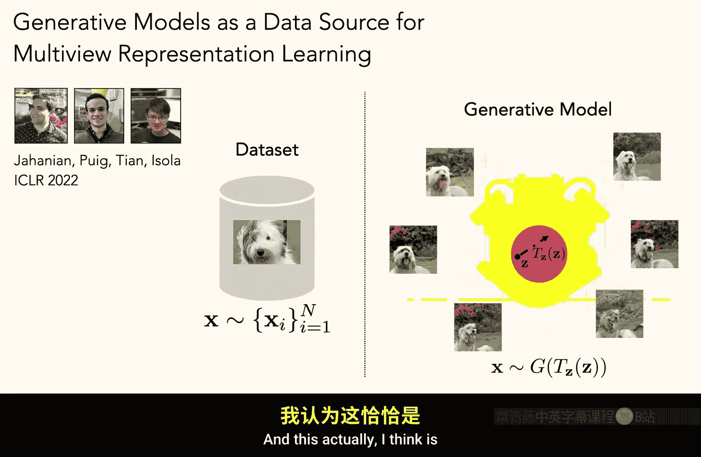

To get more information out of a generator trained on data than the underlying data itself。

 It's basically from an information theory perspective。

 it's like how how could you possibly create something from nothing。

 right if you have the data and that's all the information you have。

 you couldn't maybe get more information out of it。 But then there's kind of the counterar。

 which is actually like our architecture design and like the design of the training systems builds in knowledge that would not necessarily have already been built in and actually。

 you could argue that the construction of things like convolutional neural networks， fundamentally。

 are an injection of additional knowledge beyond just the underlying intermediate data， right。

 we're building knowledge into the design of our architecture is and our loss functions based on our understanding of what。

 for example， structure we expect to see。 So convolutional neural networks。

 basically say we expect there to be local structure and images。 And so then the argument is like。

Isn't data augmentation like a mechanism。 Like you could argue that random flipping is a image generation。

Algorithm， right？ I mean， depending on how you want to define that semantically， it is， right。

 You've taken an image。 You've used some algorithm to generate a new image that you guarantee like still has fidelity to the class that you care about。

So。Right， And then like things like。Like this kind of copy paste。

 like cut and paste style data augmentation。 that's even getting maybe closer to something like a learned generative model because now you're like building explicit assumptions about like taking foreground objects and putting them on different backgrounds。

 This is like a really useful mechanism for increasing the robustness of machine learning models just like kind of these engineering hacks about how we manipulate the data during training And then maybe the argument is like how is that any different from something like learning a generator that can interpolate maybe in something closer to the image manifold so。

😊，It's a bit semantic。But I， anyway， I， I， I've actually been thinking about this a lot。

 I have a grad student who's been looking at whether we can。

 I really really specifically want to be able to learn。

Maybe using generative models to do a better job， a more robust job of recognizing rare things。

But now you've really gotten yourself in a chicken and egg problem because because the thing is rare。

 it's hard to train a generator that does a good job of generating it。

 And then sort of the reverse is also true。 And there have been people that have shown that you can improve rare category categorization using generative models。

 but they cheat and they train the generative models on a lot of data， so。So far。

 we have been able to find ways where you can get some gains in very specific constrain scenarios。

 but it's not just sort of naive and simple。

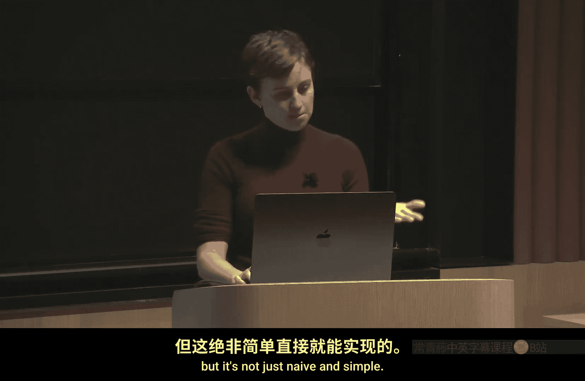

Anyway。The point here is that you can take the sort of classical contrastive learning approach where we're using kind of our like knowledge based image generation。

 where we've like done these specific types of warping or whatever random cropping。

 flipping to the initial image color j in a way that we know doesn't necessarily break the category boundary。

 We still want it to be the same thing。And here we're instead going to move just a little bit in some latent space to create now this mapping in data space through what should be the manifold of real images and then use that as your transformation for your contrastive learning model。

 yeah。

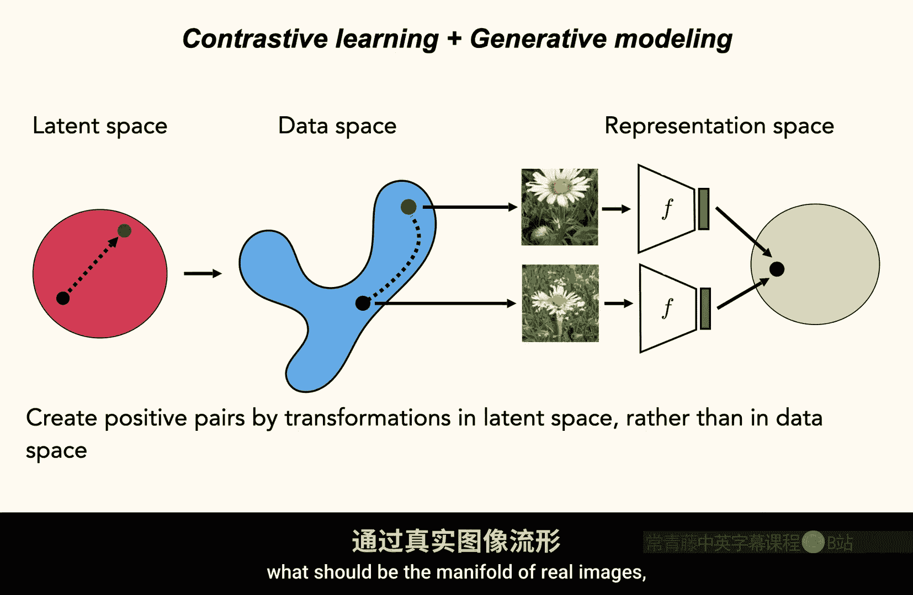

Good question about this， which kind of relates back。Talked about like the idea of small local。space。

Is that like a， I mean， intuitively right if you have just a 2D latent space and a 10 plus classification problem？

Mmagine this very naive pie chart that has like 10 slices。They has to exist。Cate。

So is this just a probabilistic argument that like in a high enough dimensional latent space。

 the odds that you would sample a location where the。When shifts is like so unlike。

That you can get away with this kind of approach to training。Or even， I would even go beyond that。

 And I would even say， like， as long as。As long as you define some dimension of movement。

As long as most of the time， it's not crossing a class boundary。

 if it does cross a class boundary a very small amount of the time， still。

 by the way we train these models， it's almost likell the noise will come out。

 it's almost a mechanism for regularization。You know， of course， there's counter arguments for that。

 right， like if it depends on kind of how egregious those boundaries are and how frequently you're classing them but。

Yeah， I would say like as long as like if you want to make like a probabilistic argument and you want to sort of map that to something that's like a physical area argument。

 like the area of the model where moving in a small amount corresponds to a reasonably like maintaining the category boundary。

 relative to the areas where you are crossing category boundaries as long as that ratio is quite large。

 than I imagine you would still learn something useful， even if sometimes it's wrong。

 It's just like how in the standard contrast of learning objectives。

 we did see some improvement when you could explicitly remove these like false， positive。

 false negative type things where within your batch， you would have maybe like two images of dogs。

 and now they're being treated as a different category during your representation learning you're explicitly saying those things should be far apart。

 though they actually represent the same category but that's still。

Like if you could remove all of those， the models did train better， right， there were。

 there were like these nice examples where you could show if you removed these kind of false characterizations by using supervision。

 for example， you got better representation learning。

 but the models still able to learn useful representations， even when those do exist in there。

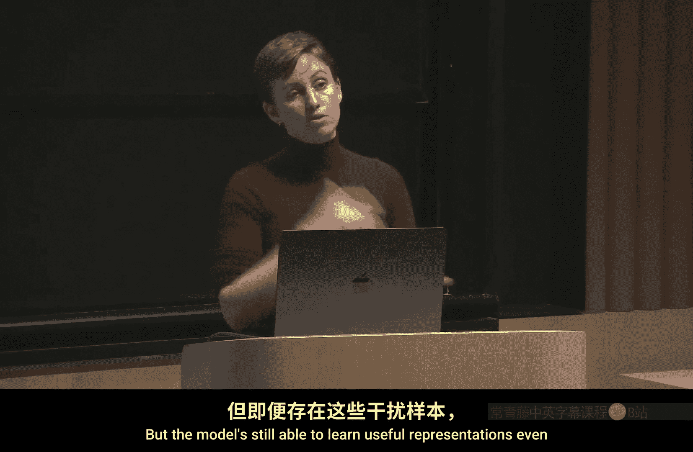

有。嗯。Cool， so yeah， now here it's just a different mechanism for constructing these positive pairs to train your contrastive learning algorithm。

And so here， as opposed to sort of your standard SCLR type views where you have sort of two views of the same thing where it's maybe like cropped from different areas or warped in terms of the color。

 Now you're taking latent views， right， you're taking sort of some ball around the real image and any dimension you would move in that ball。

 you could argue would be a different view of the same thing。And then， you know， now。Now。

 just how we might say， okay， these are all different views of the same thing for the purposes of contrastive learning here。

 you can say these are all different views of the same thing。 Now。

 one interesting dimension here is kind of just generally， is this question of like。

Diversity versus fidelity when it comes to the usefulness of training signal。

 This is also something I've been thinking about a lot， so。

It's probably more useful to know that two things that are more different from each other are。

 in fact， the same than it is to know that two things that are almost identical to each other are。

 in fact， the same。 So， for example， if you look at this middle set here where these are all American Robbins。

The pose of this American Robbin。 and basically all of these is nearly identical。

 The construction of the image， the sort of orientation， et cetera of the image， is almost identical。

 There's not a lot of diversity here。And so actually， from a learning signal perspective。

 this might be less useful， arguably， than something that。Also does something like random flipping。

 right， And so I think there is this kind of interesting challenge with these generative models broadly。

 with GNs with diffusion models， etc cetera。 even with some of these like personalization style models that are trying to kind of do a really nice job of capturing something specific。

😊，Often there's almost like a Pareto frontier with these models when it comes to this tradeoff between diversity and fidelity and so you can't get the model to generate things that are really diverse。

 maybe in terms of their their context or their scene structure without giving up fidelity you end up in this space where you can generate a Robin that's sort of positioned differently in the scene。

 maybe flying different pose and you can try to force the model to do that and it will。

 but it probably won't actually be very like Robin like anymore。

 if this is kind of the input image that you're working from。

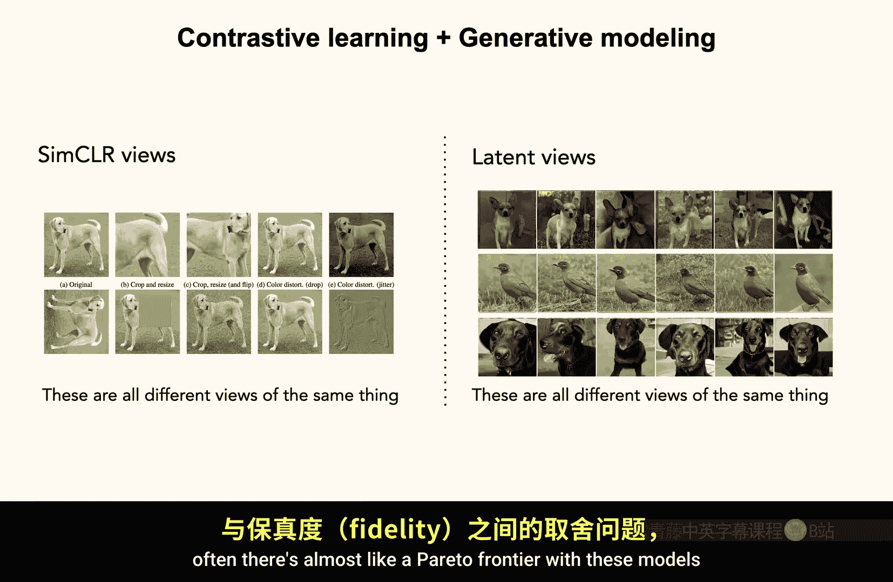

yeah。觉得雷。When you're like lean around。You would like picture that just say that。

The image is around that like。How do you know how far it can go？

I it the same for late classes group and like imagine or late classes？That's like。Yeah， yeah。

 So the question is basically， how do you know how far you can go in the latent space and have it still mapped to the same category and does that distance correspond is that is the optimal amount of distance you could go for any given category the same across all categories。

 So I would say like experimentally in a lot of these papers。

 They' they're using this as a hyperparameter， right， They're basically saying like all right。

 we're going to define some radius in some， you know， something like。You know， cosine distance。

 and we're going to sample within that radius， and we're going to test for different radiuses or radii。

 And then we're gonna pick the one that does the best on our test data。嗯。

That's a bit like disappointing because I actually think that's a really interesting question， right。

 Like， how do you determine how far you can go before it crosses a class boundary。

 And almost by definition， there's some， theres you start getting into these really messy questions。

 particularly as these， these models are able to generate things that are realistic looking， but。

But impossible。 So so me and Phil actually argue about this quite a lot If you had a picture of your mom。

But she had another eye in the middle of her forehead， is it still your mom？Right？

What do you guys think， is it still your mom if she has three eyes？哦。There's not a right answer here。

 right。 And so if some of the dimensions of interpolation you can move into are still kind of like realistic looking。

 but actually impossible。 So maybe if you think about this from a species categorization perspective。

 you take like this American robin and then you make the chest， you know。Gray， instead of red。

 like that's not a real bird。So now you have things that look like birds。

But they don't actually correspond to any real category of bird。

And so then what should that be categorized as， right。

 And so somehow like understanding the boundary of a class。

A really important component to being able to do that is having representative data from all the dimensions of real variation for that class。

 So you can define what the reasonable class boundary is。

 That's one of the reasons that fu shot learning is so hard because it often means we don't have a good。

 well understood representation space of the boundaries of the real class。 And so we don't know。

 right， if you've never seen a picture of a bird as a juvenile。

We don't know what the sort of real class boundary should be。야。不是。Classification as like。

Like clip was almost a better idea。They're just saying that you should learn to embed。

Text descriptions of images close to that。And you can capture more。おはい。

Like to your point about the Robbin chest。Imagine we have like an albinno rock。That's so a Robin。

And be like Dev as a Robin， but from your definition of like the classification perspective。

You know doubt I think you're right that。For a specific type of plastic。

To find that class is the extent to which not。So isn't this just like a shortcom？Yeah， yeah。

 So the argument is basically like this， this challenge of like kind of being able to understand category boundaries is maybe a limitation of the。

Underlying philosophical concept of trying to categorize things with some sort of list of specific categories。

 And actually， there's like。If you really want to get like deep into it。

 There's a lot of literature from， from philosophy about the concept of categorization like。

 and there's kind of like these explicit。Difference is of opinion when you look at historical philosophers around the idea that it's possible to sort of。

Categorize something as a list of all its attributes， right versus like， you know。

 So so you could say， okay， a robin is a bird with a black face and a red chest and like yellow feet and。

 you know， a around sort of structure and and a yellow eye with a black pupil。

 And so there's this idea that like any， any object can be defined as like a list of sort of characteristics you're looking for。

And then if you have the kind of mapping of these set of characteristics to sort of the things you care about。

 then that's all you kind of need。My argument is kind of like that's the clip approach in a way。

 because you're trying to learn something about the relationship between sort of like textual semantic concepts and things and images and there's been a lot of work senseense clip that actually tries to really explicitly ground semantic concepts from text into the visual components that corresponds to。

 but I think the argument is that no matter what， if you give me a list of like a fixed list of attributes and you try to map that to a category。

 you can basically come up with a counterex that breaks it。Right。So， and then like。

 there's the question of like， where do you want to draw the boundaries that somehow has to be rely related to some goal。

 So I'm getting really philosophical here， but。So if I showed you like an apple and。A bell pepper。

And like there was a green apple and bell pepper and a red apple and bell pepper。

 There's like multiple reasonable ways to split the set of groups， right。So in the end。

 it always just comes down to like what do you really need the representation space to do for you and then what types of dimensions of variation do you want to capture there。

And then that， like。Like the albino Robbin example is a great example of like ways that we are very good at generalizing。

 but I would actually argue that models like C still cannot capture effectively。 And so yeah。

 and then and then you could tell me if you were a bird expert。 Oh。

 actually that looks like it might be an albino Robbin， but that's actually this other species。

 And I'd believe you because I don't know。Yeah， so I think this is really fascinating。

 I think it starts getting at like some really interesting kind of meaty questions about like。

 what do we really want from representations。😊，And what does it really mean to kind of like move through a representation space。

 but so here like again， kind of going back to this idea of like if you contrast of learning from real data based on some sort of heuristic set of rules that we say don't break the class boundary versus if you do it from generative data based on some experimental set of parameters around how far you can move in any given direction。

 that you're able to now， instead of going from some data space to a representation space。

 go from some latent space into a data space into a representation space。😊。

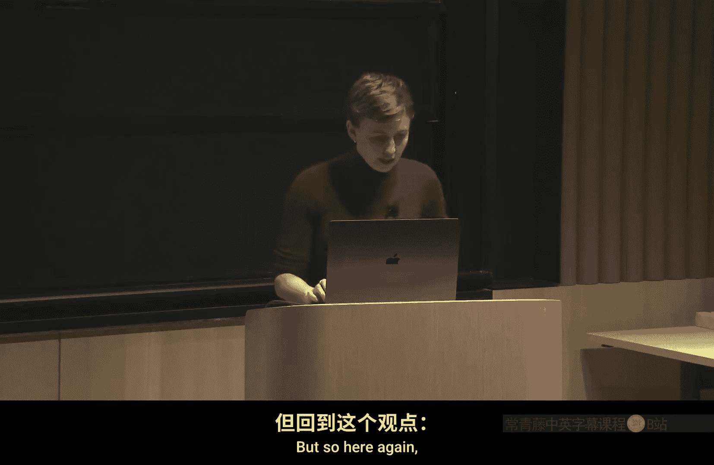

And they were able to show that if you're doing sort of linear transfer from I at 1000。

 you can get 43。9% top one accuracy here。But sort of only using real data to train these models now mapping through these kind of information like bottlenecks and way of these like different types of latent spaces。

 you can do pretty well。 you can get like 745。7% accuracy。

 But then if you add in that ability to move in that latent space， the accuracy goes up to about 42。

6。 So here you'll note neither of these are as good is just training on the real data themselves。

 So clearly there's like some limitations in terms of the mechanism。

 But the argument is that if you were able to kind of build the system effectively。

 the ability to interpolate and kind of have these reasonable dimensions of variation within that original latent space could potentially add a lot of value right this is like like a pretty significant boost in performance。

😊，So then the argument is that these like deep generative views is like one dimension of variation。

 just different sort of viewpoints can improve contrastive learning beyond only using standard data augmentation。

 and if the generative model is high quality， you could even potentially outperform learning from real data。

But that， of course， means that we need the generator to be high quality。

 which it's not for many things that are uncommon。One of the things that is kind of fun if you try and play with these models is like looking at what they understand and trying to get them to break out of their priors。

 So there's some classic examples of this， like if you ask models to generate a bunch of pictures of birds。

 if you ask it to generate orioles， it'll give you baseball players right there's like this semantic like prior that gets broken by the training data in really interesting ways。

 but then there's also other interesting stuff， like if you ask the model to generate a two can with a short beak。

😊。

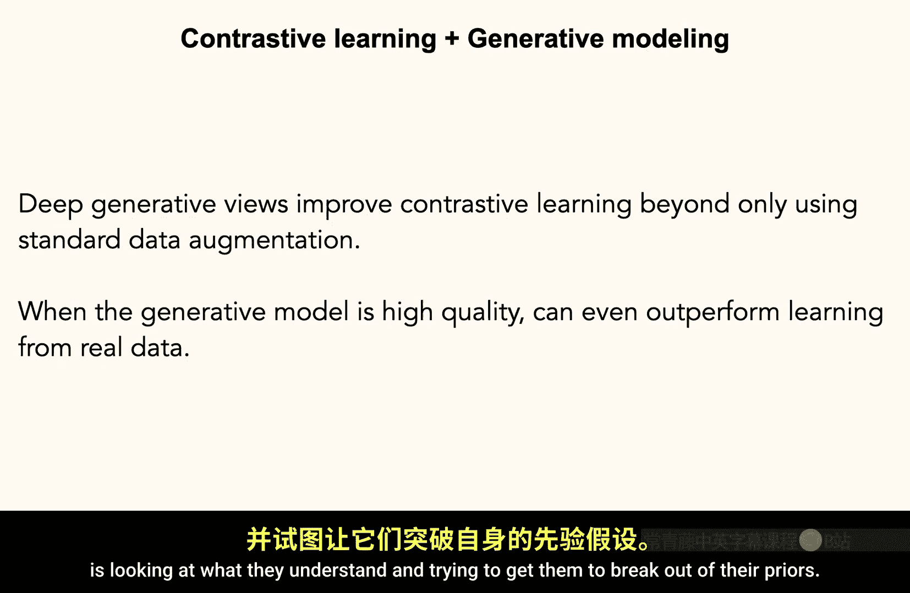

It's really hard to get it to do it。 It just won't。 like it's like， no， no， no。

2 can somehow overpowers like these mechanisms of like morphology。

 And I've also found that they're much better at generating dimension。

 They're much better at changing texture than shape。

So it turns out the models seem to have learned really strong shape priors that are hard to break out of for any given category。

 but they've gotten quite good at kind of like swapping textures for a category。 So you can say oh。

 like you know make a baseball but make it furry。 And it's like okay， it swaps the texture just fine。

 if you say make a baseball but make it like star shaped， it gets a little harder。

 And I think that's really interesting。 I think it's interesting to think about like why shape might be encoded in a stronger way than texture。

 And there's some recent work that showed some really nice like in this sort of space of like trying to build effective data augmentation through generation。

 it just came out just ECCV。 they basically use the scene structure。As a fixed thing。

 So they mask out sort of the entire dimension of the scene。

 So now you're guaranteeing that you're gonna have a realistic scene because it's a real one， right。

 So maybe you have like two dogs sitting on a bench。

Now the way that they actually do their generation to get these new cases is they take each individual object and then they change it to a different instance within the data So you basically say I'm going to learn some personalization model for every individual dog in the data and then I'm going to condition on the mask that I have and generate it with that instance So they basically call it like instance augmented generation and they do get some really nice results and what it is is basically it's breaking these correlations between scene structure and individual objects in a really kind of realistic way and the images do look reasonably correct right？

But it's really the shape thing gets weird again。 So you can take because that data set has bird defined as a category。

 you can take any bird of any shape， and you can replace it with the texture essentially of a different bird。

 But birds are very different shapes。 So it'll take something like a little round bird。

 And then it'll sort of try to squash an eagle into that shape。

 And this is something that wouldn't happen if the granularity of their categories in the sort of labeled space was a little bit more fine grained。

 right And again， it's just built in assumptions about like the amount of shape variation you might have within a given sort of defined category of interest from a human perspective。

😊。

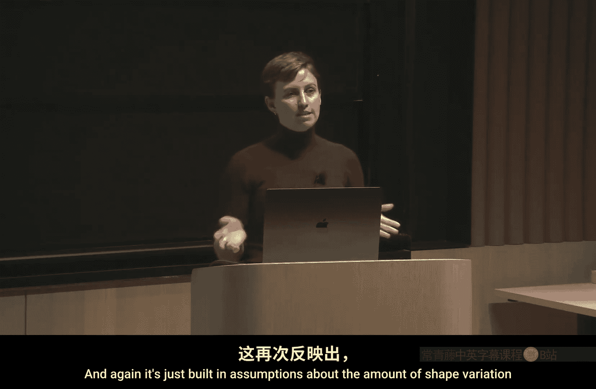

Anyway， it's enough philosophy for now。 So essentially， data plus plus says that。

You might be able to sample from an implicit generative model and use it to act like some sort of decorative or interactive or。

Like mechanism to get data with extra functionality。 And so you can define operators on that。

 things like interpolation， extrapolation， manipulationulation， composition， optimization。

 and you can use it to label data potentially quite efficiently。

 So the argument here is that maybe everything you can do for regular data。

 you could also try to do with kind of this generation generation augmented data。

 And it might work better。 But I think there's still a lot of research that needs to be done in this space to really。

😊，To really like， achieve the benefits that we think there's potential for。

 We need generators that can learn with less data， and we need them to。

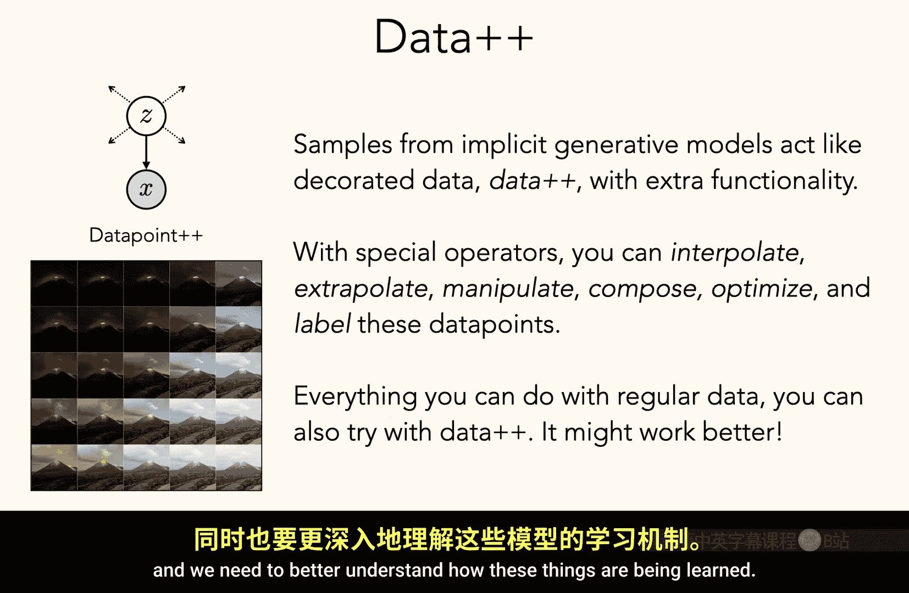

We better understand how these things are being learned two so I'm just curious to note how can we figure out there's biases in the training like in this case we correlate darkness equals volcano eruption without seeing the images because this is we can see visually but if the data size so large we can't see it and the second one is how do we prioritize diversity versus accuracy so the example game of a little bird with an e features but it's in size of little bird is it great because it allows me to train。

Things that aren't even possible to maybe my testing data won' improve。

 but so far with personalityity does that think this gender data back。Yeah。

 so it's kind of like that question about the third eye in the middle of the forehead。

 like if you start adding random eyes to your mom and it makes the model more robust at recognizing your mom in real data。

Is that a problem？So I would so with relation to the first thing that was like， for example。

 that data set interfaces paper was a mechanism that tries to use the fact that you can interact these systems with text to probe biases efficiently without needing to explicitly look through all the data。

 So I think there's like ways people have thought of using generative models to help you find biases efficiently and then with respect to the second one。

 I think it basically depends， right like。So I。There's like some work that tries to demonstrate that even for like really fine grain things like bird species。

 you can learn to generate data that is like accurately of that bird species by using a classification model as like guidance for the generator。

 but essentially what that means is then you you're building a generator that's optimized for a given classification model。

 And you can take that to its logical extreme because it essentially means you can map out like the boundaries of that classification model。

 like really explicitly moving into spaces that aren't super realistic。

 And then you can maybe get better。Like better performance for a given manifold or sort of a given representation space。

 but it might not always correspond to things you want。So， for example。

 you get like better performance on crows when you add in images where it's like bigfoot with a crow texture。

 And it's like it kind of gets to this weird question of like。

 we're getting better results on our test data。 But is it actually going correspond to better results in practice。

 like in you know， beyond this sort of fixed set of test data。

 And I think that that gets kind of hard to quantify。

 So we're good at optimizing for metrics on test data sets。

 But I think it's much harder if you're sort of moving to the real world You could imagine it might actually be better in some way to have things that aren't like。

😊，Like。I guess like different in ways that are like like weird and not realistic because maybe in the real world。

 you might be more likely to encounter something that actually does look a little bit like a small eagle。

 but it's actually something else entirely。 So maybe the openendness of the real world makes the question of like maximizing the potential within a kind of a fix to like closed world setting a little bit less translatable。

But yeah， I don't know if that kind of makes sense。 I sort of ranting。 but I， I， I do think that。

What is useful is going to be directly related to your task。So for different types of tasks。

 for different goals， useful data will be different。Yeah， is image domain the bulk of where？

Cutting edge research is being done for this topic。Or is that like a pedagogical reason？

Why am I showing a bunch of image examples， it would probably be harder to do these evaluations on tax because we got to each。

Each one and ceiling。Yeah， that's interesting。 So there definitely is research on like generative text as data augmentation。

 But I think， I think you're right that it's kind of harder。

 Like class boundaries and text is like a little bit harder to define。 And like also。

 I could imagine like you think about like generative like songs， for example， like maybe。

 maybe it's like part of it is just like the nuanced， like messy space of like what a category is。😊。

But there definitely is work on both generating data and using generative data for training in the text space and in like the audio space and many other modalities as well。

 lots of work actually classical work that used like generated data for training in like medical imagery because often we had so few real data that like really carefully handcrafted like synthesizers of data were quite effective there is kind of a much broader kind of interesting debate currently about what's called model collapse or like manifold collapse where essentially if you start training a model on more data that's generated than data that's real。

 which is a very clear concern today because more and more of the text on the internet is generated text as opposed to real text。

 there's an entire line of research that essentially shows that once you kind of go too far down down the sort of ratio of like more of the data being generated than real。

 it becomes kind of a vicious cycle and you can have these。

Ts of like model collapse where you start to lose parts of your distribution that were captured in the real data because of the kind of distribution of the generated data based on the likelihood。

 and there's like fascinating。 It's a pretty active area of research right now。

 this question of like what does it look like to have models trained from generated data and what are the kind of failure modes that that can result in。

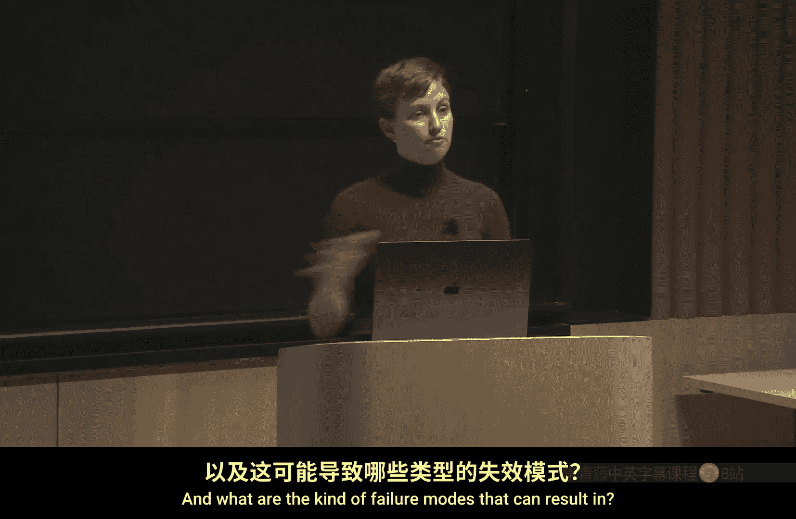

Cool， so in the last little bit， I'm going to talk a little bit about learning to learn quickly。

So this idea of like not just what is a mechanism for transfer learning。

 but actually how do you learn a model that is good at transfer learning。

 a model that adapts quickly So here the idea is that maybe instead of just taking sort of a classical approach where you have learning。

 which is this middle part， where you have a data， a learner。

 you get some parameters and then at inference time， you take your data。

 you run it through a model with parameters and you get predictions you add this meta layer on top of taking a bunch of different datas and training some sort of meta learner that has a different set of hyperparameters that then you transfer to any given learner and dataset。

And so one of the kind of seminal works in the space was this work called Mammal by Chelsea Finnn stands for Model agnostic Meal learning。

 And so so far we saw transfer learning as given some prior model and representation。

 How can we quickly adapt it And this was the first work that sort of tried to ask could we learn to do transfer learning effectively。

 So now consider you're doing fine tuning。😊，Given some initialization， we update it with SGD。

 Mammal tries to learn an initialization such that it's easily adaptable with just a few steps of stochastic gradient descent。

And so if you look at this algorithmically， essentially you now are doing like a double loop in your optimization。

 So starting with your initialization。😊，For any given sort of data set that you're going to train over。

 you now run a few steps of SGD and then compute loss after those steps。

And then you back up through that back to your initial sort of meta learning initial set of parameters。

So how do you actually back prop through something that's now like an inner loop within your sort of larger loop？

嗯。So if you're doing one step of stochastic gradientding descent。

You essentially can consider that like a forwards pass over x plus the backwards of the forwards of x and theta plus theta essentially you remember when we took a single part of a model and then we showed that if you wanted to do back propagation。

 you could basically like unfold it and it was essentially one big forward pass of like going through forward and then backward of a model so now if you want to do two steps of stochastic gradientding descent。

 like again， you're kind of like nesting this。And so then essentially this is saying that you can back prop through like backward。

 So if you're going forward and backward through a simple network。

 I don't know if you guys remember this。 So that here's like that forward pass。

 then you have your backward pass。 and then here this is where we kind of unfold it。

 And so now you can show that like doing forward and backward through a simple network is just one forward pass。

 And then you can do this like meta backward through everything。 So it's possible。

It's just expensive。 essentially， is is the main point here because you're basically taking those sort of nested loops of forward and backward and you're just stretching all of them out and you're now getting like what is sort of a very。

 very deep network that you're going to optimize through。Now。

 this type of computational effect complexity often means that the relative benefit of these types of metal learning models。

 though， like nice in theory。 And you get like really nice gains on sort of maybe simple problems。

 It's often just too computationally expensive to really deploy。

But there are a few examples of how people have actually used these types of meta learning for real world applications。

So in this case， like you know， in practice， I was saying the gains of the method。

 something like model diagnostic metal learning are often not worth the additional computational cost at training time。

 and sometimes can be worse than just like pretraining on a bunch of on all of those different data sets and then fine tuning。

😊，But Gabby Sang introduced this geospatial embedding essentially like a bit of a task specific tokenizer within that meta learning objective that encoded some kind of task- specific context and they showed that that giving this like task specificity within that metal learning loop did give them some really nice gains when they were looking at crop type categorization for corn in a bunch of different countries so here like these are know a comparison of a bunch of different types of methods。

 but you can see sort of at the top is kind of like versus metal learning or just pretraining a model like there like it's about the same。

 but this task conditioning that gives your model the ability to kind of specialize effectively。

 maybe to a given country or part of the world end up being pretty effective。😊，This is maybe。

 I don't know if you guys remember。 but we talked a bit about this idea of maybe learning a prior when we're talking about distribution shift。

 This is maybe a different mechanism of trying to learn something like a geospatial prior or some sort of like useful contextualization so that your model can actually。

😊。

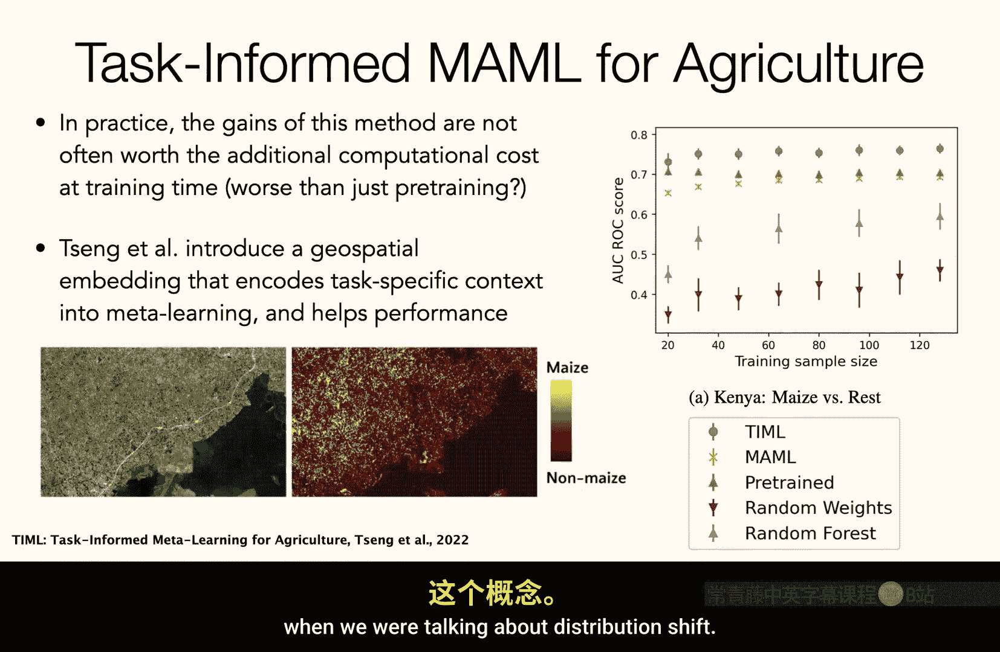

Build some knowledge about how it should adapt for like specific types of problems or types of tasks。

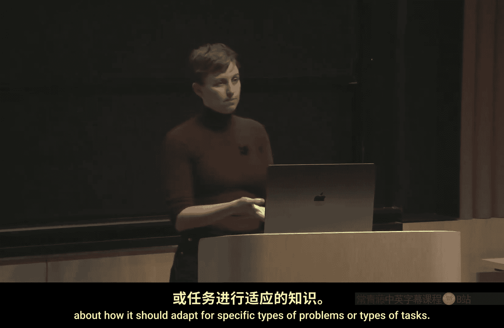

And so there's also this question of like meta learning by sequence modeling so definition of learning。

 maybe we have like a sequence of you know， input and ground truth。

 input and ground truth for a bunch of things and then you output some function such that if you give it a new input。

 it'll give you a new ground truth。😊，So maybe this is kind of like that example we talked about we were talking about autoaggressive modeling for large language models where we could say like。

 okay， we're going to show you an example of English and the translation in Spanish I'm going to show you another example English another example of the translation in Spanish Now if I show you something in English。

 the model would sort of automatically generate the translation in Spanish this idea of like sequence-based in context learning。

😊，And so。Here if you have something like recurrent neural network。

 the state plus the parameters of that recurrent neural network or something like an autoaggressive model like predicting the next word is F right that current state and then you apply that F to your new input。

 you're basically saying predict to the next thing and so then the hidden state of that RN and that recurrent neural network is a model that arguably learns to learn right it takes some statistics of the sequence in general that enable to predict what should come next and this really is I think what GT and a lot of these modern autoaggressive models are doing it's kind of a version of meta learning at large scale and you could argue that in context learning is kind of just another mechanism of sort of meta learning because when these models are being trained you're showing them a lot of different possible tasks or sequences and then asking them to learn how to really quickly and efficiently generate answers like what comes next for new。

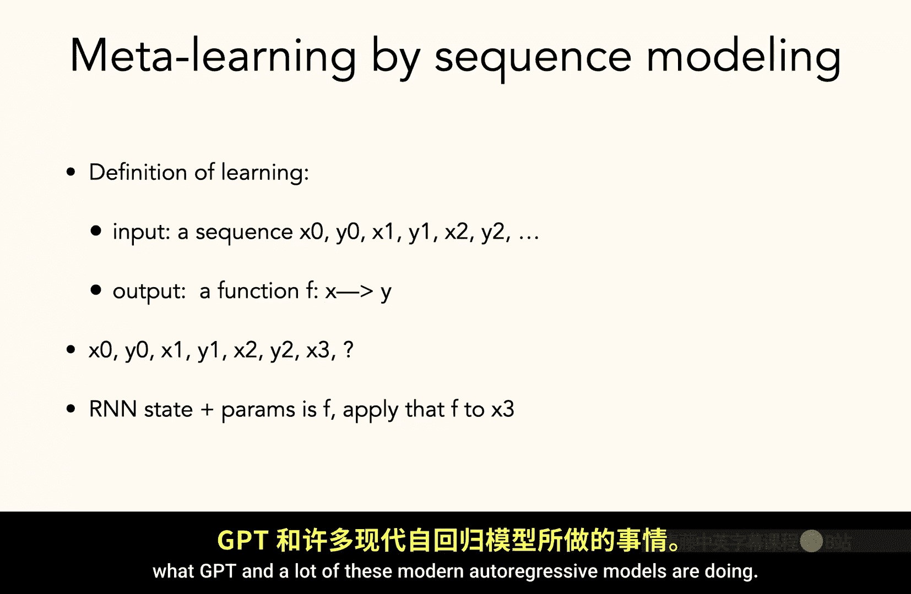

Sequences so this， you could argue that there's a pretty similar motivation and potentially a much better actual output when you think about meta learning through sequence modeling as opposed to meta learning through this kind of like inner and outer loop of training。

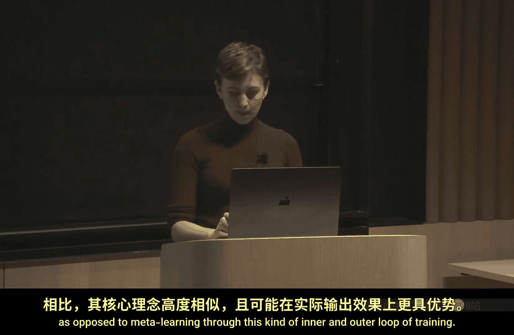

Cool， so。It'sThe end of the lecture I ahead for today。

 we learned today about generative models as data and some of the pros and cons of that。

 And we also talked about learning to learn or meta learning。 And like I said。

 it's my last lecture of the course today。 So it's been really fun teaching you all。 and hopefully。

 I mean， I'll be around， but。😊。

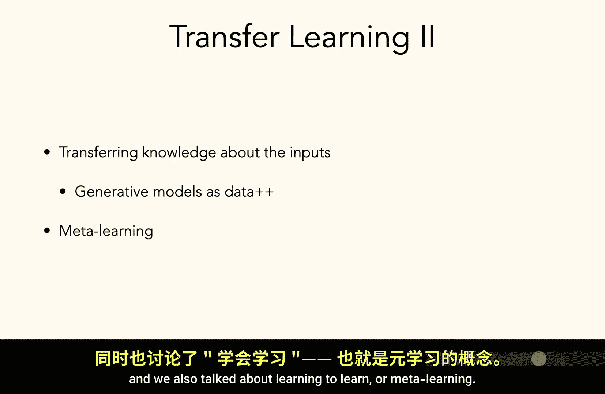

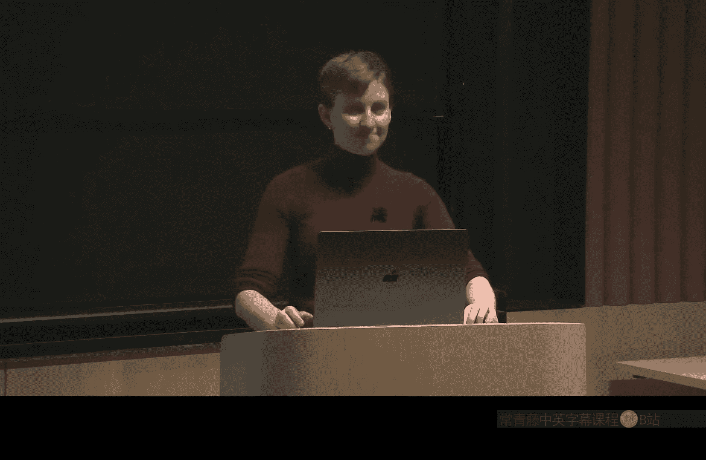

