# 麻省理工学院【中英⚡深度学习｜6.7960-Fall-2024,-Deep-Learning】-p20-P20-缩放定律--BV15QZ4B1E6v_p20-

Okay， so today we're going to talk about scaling loss。

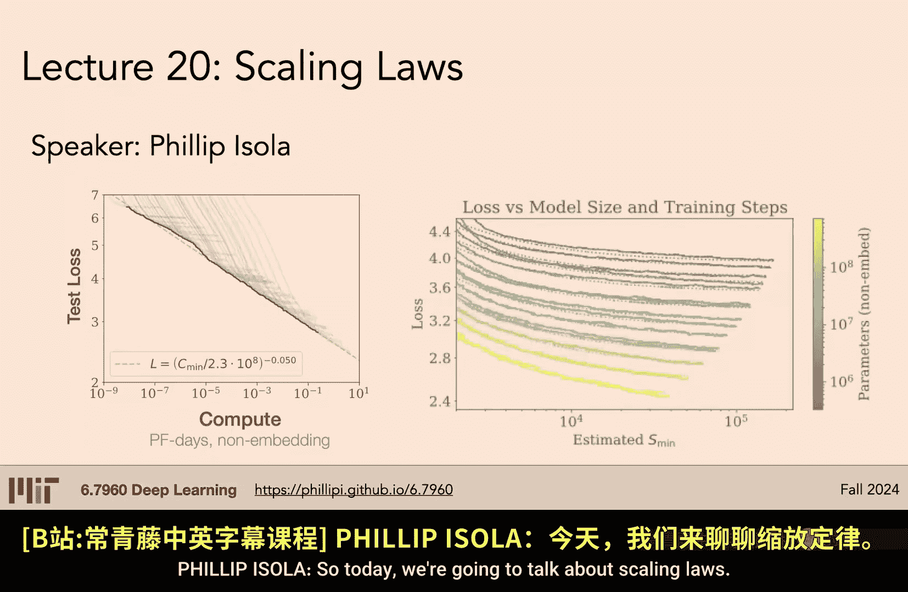

And this lecture is you know， we're at the final few weeks of this semester。

 So this is we're moving into territory， which is much more kind of ongoing science。

 Like I'm going talk about recent papers and results that are empirical in nature for which we don't know if these results will really。

 you know， hold up stand the test of time。 But this is the latest。

The latest research on deep learning and a lot of the next few lectures will be of that flavor。Okay。

 so what are scalinging laws， why do we care about scaling and deep learning？And the。

 the reason is that。Deep learning is something that works really well once you have a lot of scale。

 once you have a lot of data， a lot of， you know compute， a lot of flops， a lot of parameters。

 big models on big data with large machines that' that's kind of the regime in which deep learning is winning and doing very well。

And a big part of this story of deep learning is how do you scale things to make efficient use of the resources that you have？

And a remarkable thing that's been observed is that sometimes the way that models behave as they scale is quite predictable。

 And so you can define these scaling laws， which are predictions of if I double my compute。

 how will the model behave， if I double my model size， how will the model behave。

And if we can identify those types of laws， then this will be really useful for planning our resources and our extrapolations into the future。

 We can predict what next year we will bring， how competent will be the models of next year。 Well。

 if we have a law of how does the performance change as a function of data points。

 then we can we can know how well the models will perform next year。

 and that that's very useful for us to plan。

So here is one example of a scaling law。That people have noticed。 this is from an opening eye blog。

 and on the X axis， they're plotting gear and on the Y axis， they're plotting the scale of the。

Of the compute that's used to train each model， so。This is saying that as years go on。

 the amount of compute that we use to train models is increasing as some kind of exponential。

 or it may， in fact be a power law in this case。 basically， for every additional year that we go on。

 we get a kind of。Big increase in the amount of compute that we use in these models。

 So this should be reminiscent of things like Moore's Law。

 So Moore's law said that we double the number of transistors in our machines every two years or however much it was。

 And this scaling loss says that every year we actually， every three months。

 I think you double the amount of compute that you use to train the models。Okay。

 and I think this law has actually been increasing。 the slope is actually increasing a little bit。

 so it's not quite even three months now that it takes to double the amount of compute it might be even less。

Okay， see this ends in 2018。So deep learning predictably is using more and more skill as time goes on。

 and now we want to understand how that relates to the model performance and at what scale will we achieve what types of abilities。

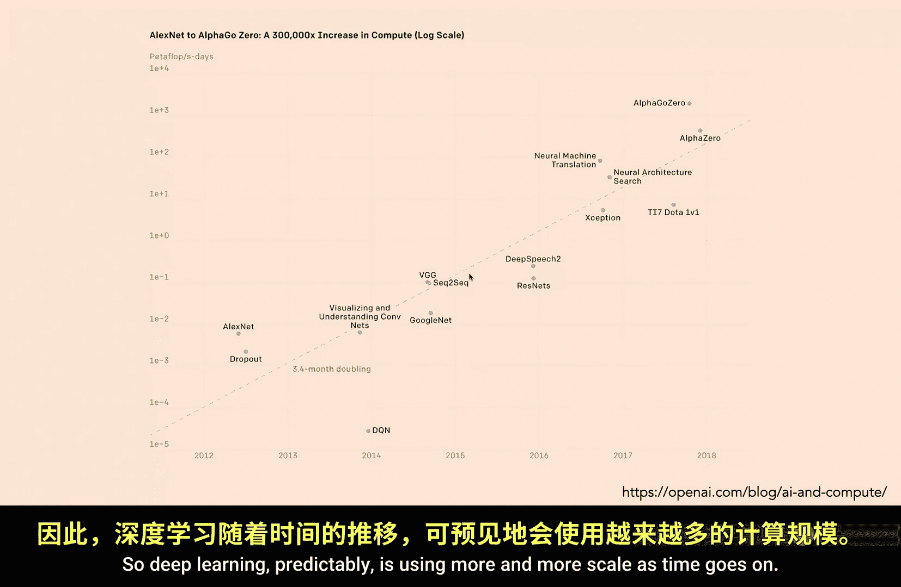

So another motivation for studying these questions comes from this really influential essay called the Bi lesson from Richard Suttons。

 who raise your hand if you've read this， it's one pager。 Yeah， so you should all take a look at it。

 It caused quite a splash in the field when it came out in 2019。

 A lot of people really didn't like it。 A lot of people loved it。

 but I think there's a lot of truth to it。 And it's an important lesson for us to understand and take to heart。

 Despite some nuances and caveats that you can add to it。

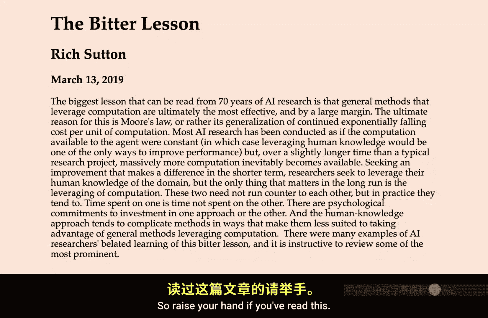

So what Rich Sutton was saying is that he's an AI researcher。

 He's been working in the field for a long time。 and what he observed is that all of our clever ideas and algorithms。

 most of them don't really pan out。And the only thing that systematically pans out is designing simple algorithms that scale well。

And so he's basically saying that you need to think about how models scale as a function of resources in order to identify the winning models。

 because as time goes on， whatever the ranking， whatever model is doing better or worse than any other model。

 it doesn't really matter what matters is how they'll scale because eventually as time goes on。

 the one that scale better will win， right？So it was a little bit of a critique of all of the clever algorithms in the field。

 like no， it turns out that the really simple algorithms turn out to scale better and those are taking over。

So。Interesting essay， but it has really led us to take skill quite seriously。Of course。

Scaling laws and thinking about how algorithm scales as a function of resources is not at all new。

 It goes back to the foundations of computer science。 So in intro Cs or in algorithms。

 you learn about asymptotic analysis， Big O notation， right， that's a scaling law that's saying。

For how does my time complexity of an algorithm scale as a function of the input complexity。

 like if I have a graph I'm trying to find shortest path as a function of the number of nodes in the graph。

 how does the model's behavior， how does the algorithm's behavior scale。

 how long does it take to define the shortest path？So this idea of asmpotic analysis。

 looking at as resources or complexity or as some parameter of the input scales up。

 how does some property of the model scale。That that's that's like a standard part of computer science。

 And it's very much something that you want in order to make predictions about the future because things are scaling。

 that's kind of the bottom line。

Of this graph here is that things are scaling。 Eventually， they might saturate。

 We might not have any more resources， but we're not really anywhere near to that point， so。

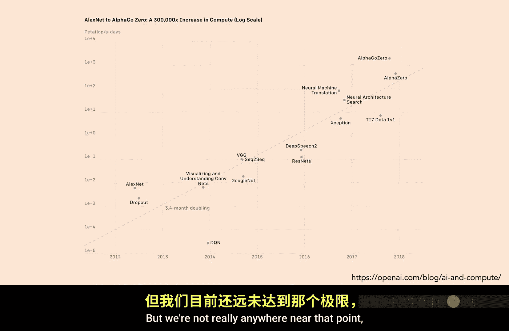

We need to be able to predict how things will scale。Okay。

So one of the kind of fundamental questions of。

The study of scalinging laws is。If I have a budget of compute or a budget of hardware。

 how should I optimally allocate that budget？So。Let's see。

What model should I train on how much data in order to make the best use of my budget？Okay。

 so here is a scaling law， another scaling law from O AI that they used to decide on how to train the G4 model。

So now we have on the X axis is the compute。And the Y axis is the performance of the model。

 So the performance is measured in bits per word。 So this is like the something related to the cross entropy of the next word prediction。

Okay， so lower means that I'm making more accurate predictions。

And as I train my model with more compute。 So more flops， more steps of H GD， more know gradients。

 more， more updates。 So compute is now measured in just like flops on the hardware。

 And that is related in a complicated way to the number of tokens that I observe the depth of the transformer。

 like all these things affect the compute。 But we're just measuring it all in flops。

 Like how many floating point operations do I do on my hardware。Okay， so as I use more compute。

 of course， I will get better models with lower loss。And。So in order one here is like。A pet of flop。

 I'm not entirely sure what the access is， but this is a lot， a lot of compute。And。

If you read this paper and saw that training G4 cost， you know。

$10 million or however much a cost to do one training like a petaf flop of compute was a million dollars。

 let's say， then you might have thought， well， obviously。

 they did a hyperparameter sweep and they tried a lot of model variations。

 if if it took a million dollars to train the final model。

 It must have taken 100 million to design it， right， But that's not actually the case。

I don't know how much it took to design it or run the final model， but they did this trick。

 which is they don't design it by sweeping hyperparameters and testing models at this scale。

 They design it。At 100th the scale， or maybe in this case， it's。Yeah， not sure 1000， Yeah。

10110000 the scale。So they do all of their design and hyperparmeter sweeps and appellations and model comparisons at small scale。

 They do it at multiple small scale， and they。😊，Find this curve that will predict performance as a function of compute。

 and then they extrapolate that curve to the skill that they'll train their final model at。

And if they， they can predict that the final model will get such and such a score。

 they will choose the model that will get the best score by running these curves for a bunch of different variations。

 they'll then they'll choose the model that they predict will have the the lowest score at the scale that they actually care about。

 And then they only train once at that massive scale。

 So that's the strategy that a lot of companies are using now。 Yeah， question in the back。

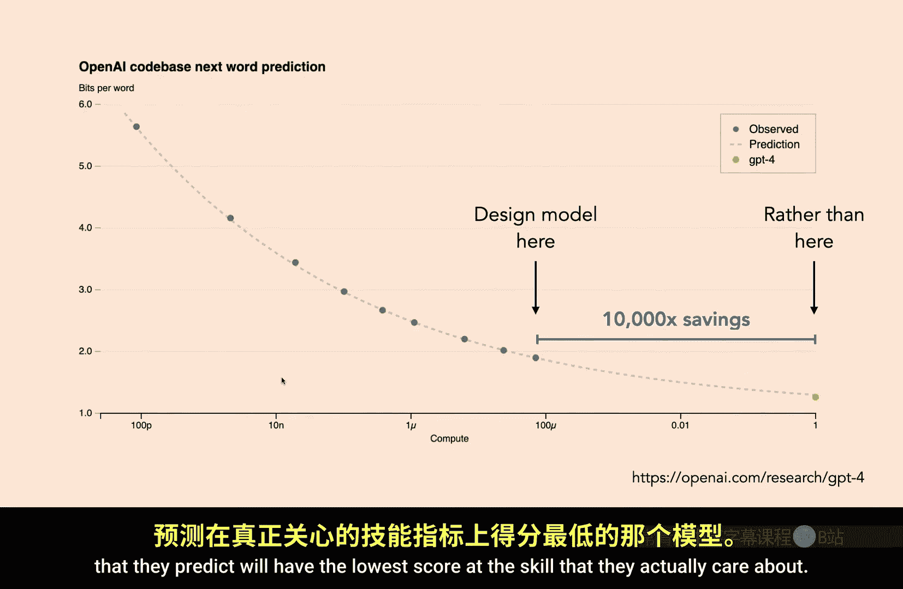

My question is computer。Proport of time， will I just take it into account。time。Yeah。

That's great question I compute proportional to time。 So here you are。

You you're just kind of flattening all， all uses of compute into just flops。

 So flops could be allocated sequentially or in parallel。

 So compute does not have a direct relationship to time。 So twice the compute can be twice the time。

 or it could be twice the number of GPUs in parallel。

 So this is just measuring compute in terms of flops， which can factor into different。

Map end onto to time。有。This is wrap。感す。So I'll get to that。 it's a graph for a consum of data。

I don't know for this graph in particular， but usually for scaling laws， we will try to say。

We're going to predict the performance at a given compute level for the optimal amount of data for that compute level will kind of optimize over other factors when we make one of these graphs。

 but I'll show you that in more detail。Okay。Okay， and these types of scaling laws。

 they don't only appear for the， the loss。 So this was the bitsper word as closely related to the loss function of next character prediction。

It's like the amount of information the amount of uncertainty you have over the next word essentially measured in bits。

But what if we try to predict performance in terms of something more meaningful。

 like how many problems you pass on some math test or some benchmark。

And it turns out that there are also fairly predictable trends in scaling laws for the downstream performance。

 not just for the loss。Okay， so a lot of scaling law research is on predicting the loss on the training set as a function of resources。

 but you can also make scaling laws for like test performance or for downstream performance in other senses。

 according to other measures。ok。So this was capability on 23 coding problems。 And again。

 you have this nice curve。 And what I'll tell you is that these curves turn out to be power laws with respect to the underlying resource。

Okay， so skilling laws。呃 our。Things that try to predict some parameter of interest。

 So oftentimes the test loss as a function of the amount of data you train on。

 the amount of compute you use， the number of parameters in your model。

 these critical resources that you care about。And what you're going to try to do is select these resources。

 These will inform you on how to select these resources so as to get the lowest possible test loss。

 So that's why we care about scalinging laws， because they tell us。You know。

 what should the batch size be that will achieve the lowest cost when I scale things way up？

The lowest lost my skillkeletons way up。Okay， so for a given architecture， how much data。

 what model would be needed to get a target performance。

 If I know I need to be like 99% accurate on my self-driving car assessment。

 then can I predict what scale will I have that？ And that would be useful for regulatory bodies。

 I want to tell them like in 2025， we'll have 99% performance。

 And you can start planning around that。Okay， so it's good for making predictions about the future and planning ahead。

 It's also good for choosing parameters that maximize performance at a given scale。Okay。So generally。

 well， the kind of scaling laws we'll look at are going to be of the form as a function of parameters。

 and we'll look at number of， as a function of resources。 So we'll look at N。

 the number of parameters and D， the number of data points。Okay， so Ds data points now its not depth。

These terms are all overloaded。 D could be a lot of things， but here it's not dimensionality。

 it's not depth。 It's data points。Okay， so we're going to try to find what is the optimal number of parameters and what is the optimal number of data points for a fixed compute budget C。

So C is going to be the flops that are required to train a model of size N on a data set of size D。

So roughly to， you know， train a model with n parameters on a data set of size D will have something like n times D amount of flops。

 It might be a little more complicated than that， but。Every additional data point。

 I need proportionally more flops， every additional parameter I need proportionally more flops。Okay。

 so for a fixed compute budget。If I want to minimize my performance。Sorry。

 I want to minimize my loss。 So maximize performance。Then， okay， there we go。

Then what should I set how， how big my model be and how many data points should I train on， Okay。

 so I can train a really big model on a few data points for the same cost as a small model on a lot of data points。

 So what should I do， Should I train a huge。

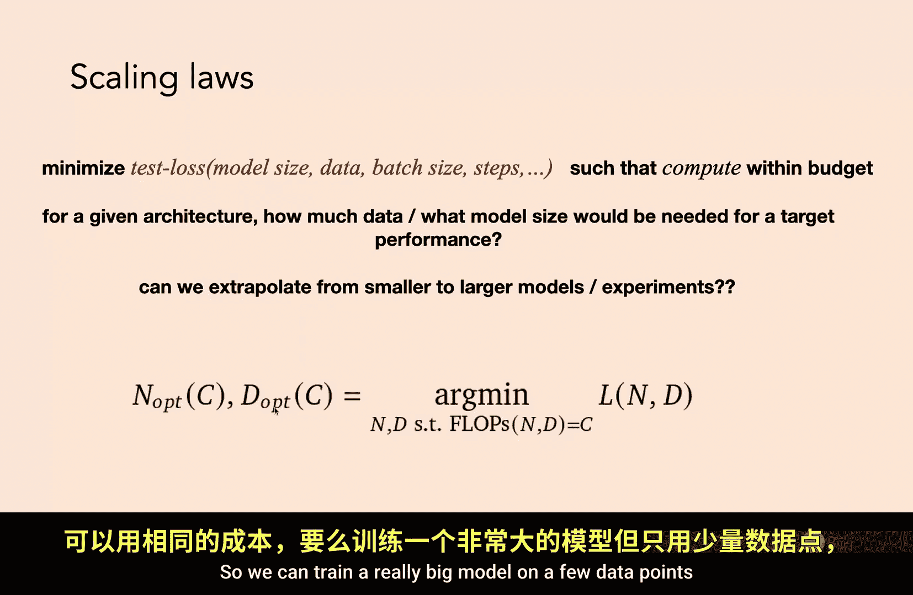

Tllion parameter transformer on 1010 data points， or should I train a 1 million model parameter transformer on a million data points。

 like those might have roughly the same cost in terms of flps。

Okay。So the paper that really introduced or popularized the idea of scaling laws for neural Nes was this one from Jared Kaplan and Sam McCamlish and folks at Open AI。

This team subsequently peeled off and formed the company Anthropic。

 but a few of them say it opening eye。 So basically the two big AGI players or two of the big AGI players are you know。

 it's the schism of this team。 And so the scaling laws are a huge part of the philosophy behind those two companies。

 and also part of their success， I would say。Okay， so they studied scalinging laws in 2020 or so or maybe this is like 2018 for autoregressive transformer models with language models with a transformer。

 and they tried to solve the equation I had on the last slide How should how big should the model be and how many data points should we train it on if we have this compute budget。

 Maybe they have a billion dollars worth of flops that they can allocate and they want to know how should we spend that billion dollars。

Okay， it's measured in flops， not dollars。 So again。

 there's a lot of different transformations you'd want to apply in order to really ground this out in raw economics。

 But flops is the one that this paper looked at。Okay， so they trained on some data sets of web text。

 This is just next character prediction。And they varied a lot of different properties of the model。

 like the model size。 How many parameters does it have， the data set size of D。

 How many tokens are you training it on， And they also tried other things like the batch size。

 We'll come back to that at the end of this lecture。 the shape of the network。

 What's the aspect ratio。 like the depth of the network compared to the the depth compared to the width of the network。

 So they looked at all these factors。 It's a really rich paper。

So we assigned this as a reading because it's just a beautiful piece of science and full of insight。

 A lot of the findings have been modified since they found their empirical fits to the data。

 and there's better empirical fits in recent years。

 but it's a good lesson in how to do this kind kind of work。

 And there's still a lot of great insights in the paper。😊，Okay。So here's how they computed。

 here's how they estimated compute。 So they said that I said that compute should be something like number of parameters times number of data points。

So they use that as their rough approximation to compute。 again。

 this is just an approximation to how GPUus actually run。

 but number of parameters because it's going to depend on things like what's the precision of is a 16 bit number you know these things there's a lot of details that matter。

 but basically compute equals number of parameters times number of data points observed。

 So number of data points is batch size times steps of gradient descent right？

 So that's batch size time steps of gradient descent。 And then times parameters。

 that's like how many flops。 And then for some reason you multiply by 6。

 I don't quite know where that comes from。But that's like the constant that turns the units into flops。

Okay。So they ran these for petafloop days， like they ran this on a lot of compute。Okay。

 so the main finding of this paper is that there is a power law relationship between the test loss and the resources。

 either the number of parameters or the number of data points。Okay， so resource X， again。

 that could be data or parameters or even compute。And Tela， Tes laws are related by this。

 this type of power law， which is。A you know one over the resource value to the alpha exponent。

 So alpha is a constant that will depend on other properties， you know， properties of the data。

 the world， the task， their architecture， but for a particular know architecture， particular task。

 like language modeling with the transformer， then we'll have some alpha that can be estimated。

 and that's the parameter of the power law。Okay， so what what does the power law say。

 It basically says if I like， if I double my resources， like I double my number of data points。

 my loss should go down by。like if I double mylash down by two to the power。

 the power is alpha is the parameter of the power lot that describes its shape。

If I quadruple my data points， my loss should go down by four to the negative alpha。

So let's say the alpha is one just for simplicity。 Then it's like。

 if I double my number of data points I train on， then my loss will go down by half， right。

 So two to the negative one will be my loss goes down by half。 If I quadruple， my loss goes down by。

嗯。말요。So my loss becomes the fourth。Okay， so that's the idea of a power lot。If I skill my。

 my resource， I will skill my。My loss。Okay， so if if alpha is like 2， then I will。

 if I double my resource， then I'll get2 to the negative  two So my loss will down by one fourth of its previous value。

Okay， so。Here's the empirical fit that they found。 So on the Y axis is going to be the test loss and on the X axis is going to be the number of tokens that they train on。

 So that's the data set size。 Remember， this is autoaggressive transformers。

 So tokens is we tokenize the words。 And we're just predicting next tokens。

 So this is how many tokens we predict。One important point here is that we're not taking into account multi epoch training。

 So remember， I could have a data set of some size， but revisit data points multiple times。

 So what does that count on， How do I measure the number of tokens。 This is all one epoch training。

 So it's very easy。 It's just I visit each data point exactly once。

 And so the number of tokens that are that are processed is exactly equal to the number of tokens in my data。

O。So this is a log log plot。 So a power law on a log log plot looks like a line with a slope。

 which is equal to the exponent of the power law。Okay， so。There's a great fit。

 That's like that was the first main finding that empirically。

 there exist a power log relationship between data， size and test loss， okay。

So what are the equations down here， so this is the test loss as a function of the data size。

We're going to have it'll be one over data size to the alpha。And alpha here， it turns out。

Empirically， to be about 0。1。And they also have this Dc， which is some constant。

 This is another parameter of the power law that just is going to change the offset of this line。

RightSo think about take a log log plot is like take a log of this side and a log of that side。

 That's what we're reply plotting one against the other。If we take a log of this side。

 then the exponent just becomes we multiply。 is's like the slope。Of log of what's in on the inside。

 And log of this over that is log of this minus that。 So this is just a constant offset。

 That's like an offset。On the Y axis is like the Y intercept。

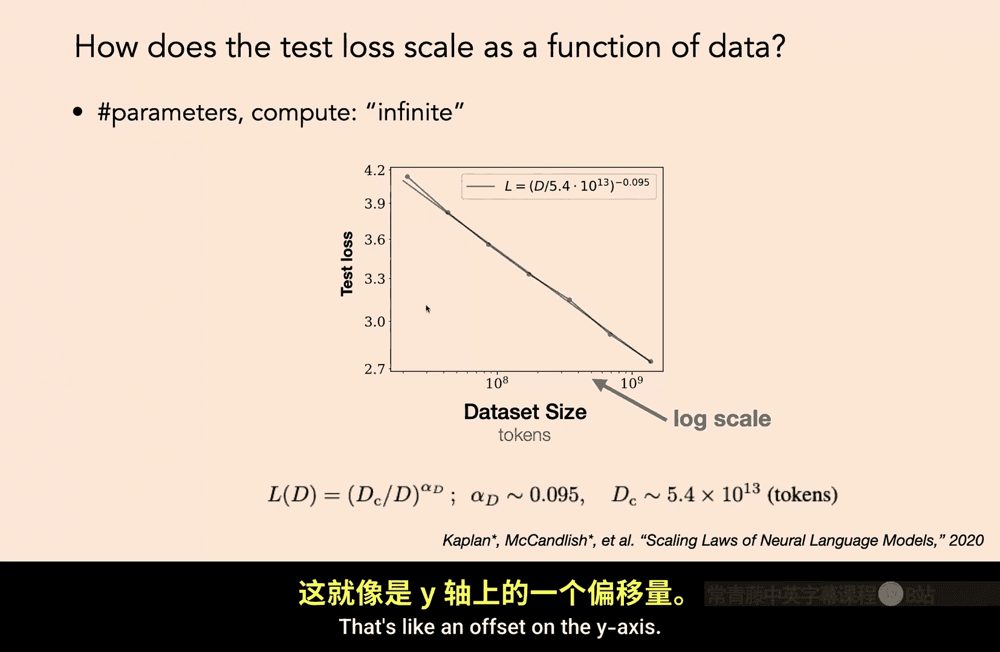

Yeah， question。谁？虽然现在我从。The form of the loss function is it important。 it is。

 And I think people observed power laws with respect to both cross entropy。

 as well as mean squared error。 like different loss functions will result in different power laws。

 but they。That can be explained by power laws。 In this case。

 I think we're looking at like cross entropy type loss。Okay。So next word prediction。

 like cross entropy， yeah。The nature。それそれ。这这边做审大。Yeah。

So how does the attention length relate to this？Pt， Id I。That's not really showing up here。

 I think they're choosing some fixed attention。 context length。

 You could also drive skill laws with respect to context length。

 I believe people have looked at that， too。 So as I scale my context， How does performance change。

 Can I predictably say that if I want performance to be 100% 99% accurate。 What's the context I need。

 there probably are skill laws like this。 I can't think of off the top of my head。

 But that's not what they're looking at here。 So I believe they're either choosing a fixed context length for all the models are comparing。

 or they might maybe in some subjectction of the paper， they try different context length。

 I don't remember。Okay。So all of these things are simplifications of saying let's。

 let's pick one setting。 this transformer with this context length with crossenttropy loss。

 and let's measure how it scales with respect to one interesting parameter。

 And will that hold for an R N with， you know a different with an MSE loss。 Maybe maybe not。

 So you should always kind of keep that in the back of your mind。

 This is characterizing one popular family of models。 But there are other models outside that family。

 And we don't yet know how well these laws will extrapolate。Let's go here。

Is there any empirical interpretation of like the value of DC， does it represent actually something？

Does yeah， does D C represent something meaningful。 So I would say we're just。

 we have an equation with two free parameters。 and we're finding。

 we're trying to explain points with two free parameters， right？

 And we say that a good explanation of a set of points。

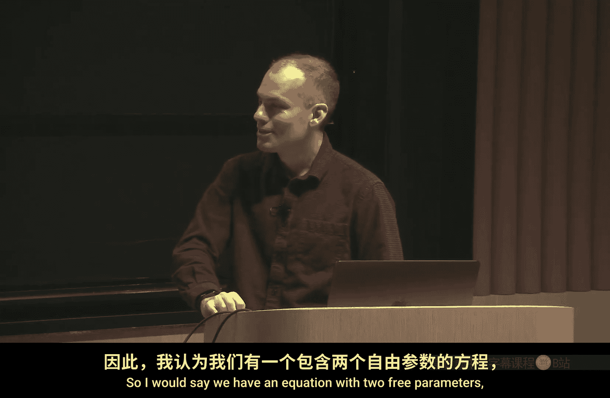

It turns out to be a slope and an offset on a log log plot。

 And what's interpretations of that offset。

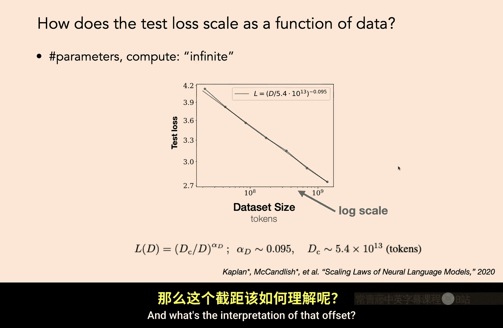

I'm not sure if I have a crisp explanation， yeah。Yeah。

 I was just wondering if there's a discrepancy between the formula at the top the plot and then the order。

Oh， I see。 interesting。 So do we flip， This is D U over。

The offset， and this is offset over D。But there's a negative here。 Yeah， so I think it's。

 it's consistent。

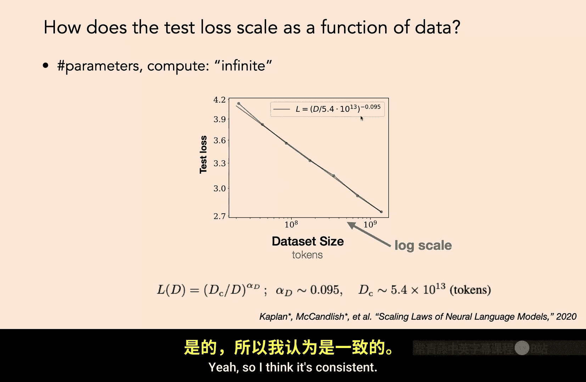

Yeah。Maybe we'll get to this later， but I'm just curious like why do you have some intuition for why？

an exponential。Yeah， I'll get to a theoretical。Model for why this would emerge。

But I would say I'm not sure if I trust the theory behind this。 I think that's still ongoing。

 I would say it's more just empirically a power law fits the data better than an exponential。

Do you feel like this is probably one？architectureSo in the theory that we'll get to。

 it comes out of just high dimensional statistics， like if I'm trying to fit a function in high dimensional space。

 then there's a dependence on the dimensionality。And that will， that will turn into the alpha。

 So I think it's something that's。More related to just like。High dimensional statistics。

 And it is to data distribution。 Like it's not specific。

 These power lawss show for all kinds of data distributions，Okay。Power a lot of relationship。okay。

 so I， I I said that that's true for the dataset set size。

 What about for other things like as I scale the number of parameters in my model。

 the weights of my model， how does test loss behave。 And it turns out that's also a power loss。

 So that empirically， the dots are empirical measurements， and the line is at best fit。

So you know， you can say this sounds like some physical law that we're driving from first principles。

 It's not really， it's much more empirical。 It's like science。

 We observe we want to understand the relationship between number of parameters and test laws。

 So we just start plotting the points。 that could have come out as some parabola or something crazy。

 But it turned out to come out as a line on a log log plot。 So that's what LED people to say， oh。

 that's well explained by a power law。 Why this is more of an open question。

 we'll talk about some reasons。

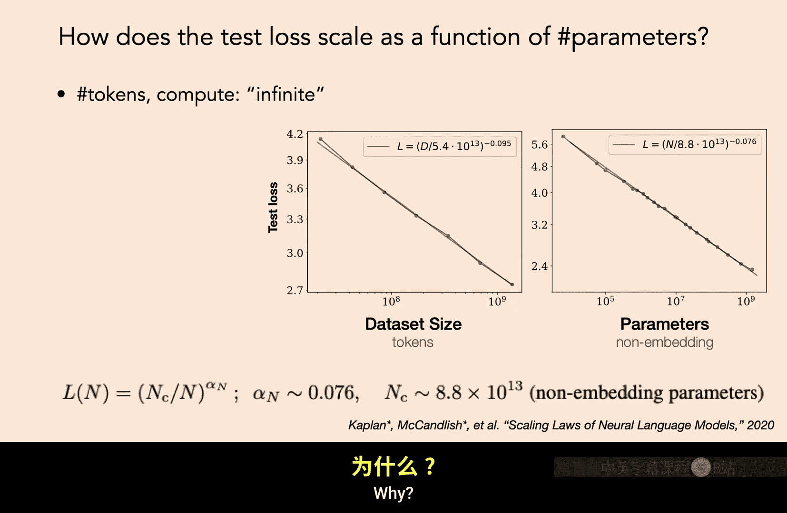

Yeah， just one question based on the。The two expression。

 does it mean that it's better to increase the data set？L than us。Yes。

 so is it better to increase data set size or number of parameters。

 What can you in first think about it， We're going show the answer in a minute。Okay。

And same for compute。 So now we have three power laws for if I scale the compute。

Test loss behaves as a power law with respect to compute。 If I scale the dataset size， same thing。

 but notice that each of these power loss has a different constant offset and a different slope。

So that will have implications about how to optimally allocate our resources。 We， you know。

 we want to go down on the Y axis。 We want to get lower loss。

 And so we can get lower loss by increasing data set size or or number of parameters。

 And if those have equal cost， then we would prefer to。We'd prefer in this case， to increase our。

Data set size。 okay， I might be saying that wrong。 Let me wait until I get to the slide。

 So I make sure to say it correctly。So。In this plot， what I am pointing out these blue curves。

 So what are these blue curves， These blue curves are。As I scale my， my compute。

 it turns out I also need to change the amount of data that I train on。

 and I need to change the number of parameters。Of the model。 So it turns out these power laws don't。

 they， They show up as like the preto front of， the frontier of all of the different curves。

For different specific models of different specific sizes trained on different amounts of data。

 So it's like if I optimally use， I use an infinitely large data set with an infinitely large model。

 or I pick just the perfect model size that will minimize the test loss。

Then the frontier that I arrive at is a power lot with respect to compute。

 And I think it's the same for these other these other factors as well， so。

If you are starting to like look for a power law and you take one architecture and you just scale the compute。

 You won't see a power law。 You'll see one of these blue curves。

 What you need to do is you need to tune the dataset size and parameters for every level of compute。

 And if you tune them optimally， then the frontier you'll arrive out as the power law。

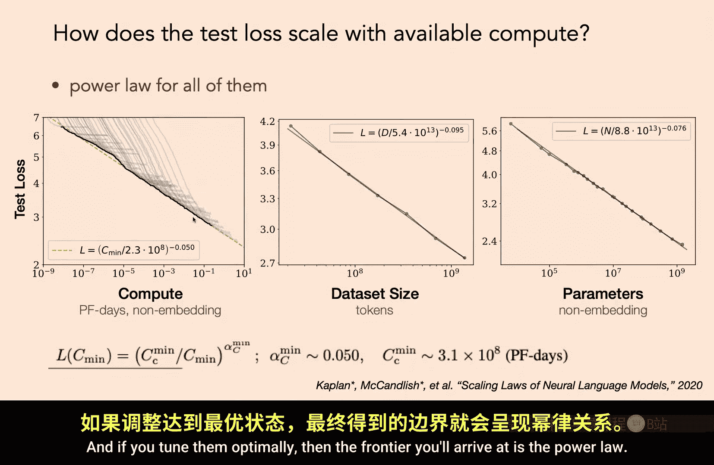

Yeah， sorry what。So one blue line is like， I take one data， a fixed size， one model。

 a fixed number of parameters。 and I train it with different amounts of compute。

 And I plot out with the losses。

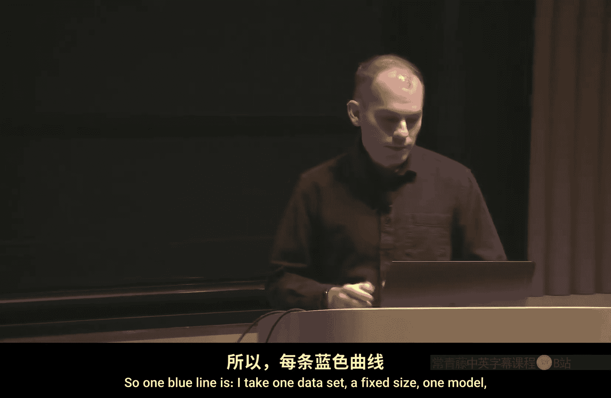

And you can see that they start to maybe even overfit a little。 It's like as I add more compute。

I I'm no longer decreasing the loss， maybe even it goes up a little bit。

 or there's not very much evidence of overfitting here at kind of plateaus。But for a bigger model。

 I need to scale up the amount of data I train on proportionally。And then if I scale it up。

 then I can use that more compute to get a lower loss。 That's the point。

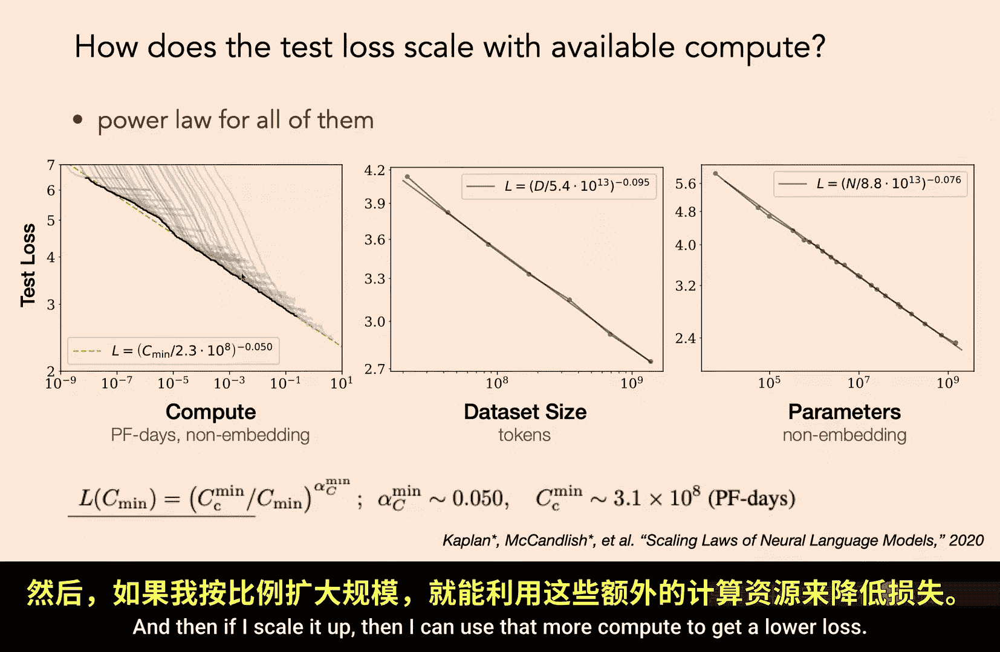

Okay。

Cool。So。Yeah， finding one is there's a power lab relationship between each factor and performance when all other factors are set optimally。

Finding number two is that you can actually understand the relationship between。Prameter count。

 number of flops and data set size that will achieve the best performance。Okay。

 so this is really the point that I was just making。

But maybe it'll be a little bit clearer on this slide。 So on the y axis now。

 we have the loss and on the X axis， we have the token。 So same thing as before。

But now each of these curves is going to be a different model size。

So what you're seeing is you get power law behavior。 If the model is sufficiently large。

 but if the model is not very large， then adding more tokens to your dataset doesn't improve performance。

So you kind of have to set your model to be large enough that it can， you know， fit all those tokens。

 And if it's a small model， then if it's like a linear model， it can only find a linear fit。

 It just doesn't have enough capacity。Okay， so you have to scale your dataset size in tandem with。

 or you have to scale your model size in tandem with your dataset size in order to observe the power line and get。

 get your best possible test loss。Okay， so we can actually now model L the test loss as a function of both。

And the number of parameters， the model size， and D， the data set size。

 And now we have a more complicated functional fit。 Again， this is just。

We have empirical measurements， and we're trying to find a simple function that fits them。

And it turns out it's like this power law of both factors with， you know， some nested exponents。

 So is this something fundamental， I this does theory predict this not in this paper。

This is just a simple equation they found that explains the data pretty well。

But it it's like a power law in terms of the， we have these constant offsets and then it's the power law with respect to the data size and with respect to the model size。

But there's an interaction between them。Okay， so empirically， they made some measurements。

 other people make other measurements。You don't need to worry about what those numbers mean exactly。

 But this is just the the fit they found to the data。One of the。

 there might be a little bit of reading of tea leaves here。

 Like one of the famous quotes from some physicist， maybe John L Neyman or somebody like this。

 was that， you know， with5， with five parameters， I can fit an elephant。

 I don't Any physicist know who said that。

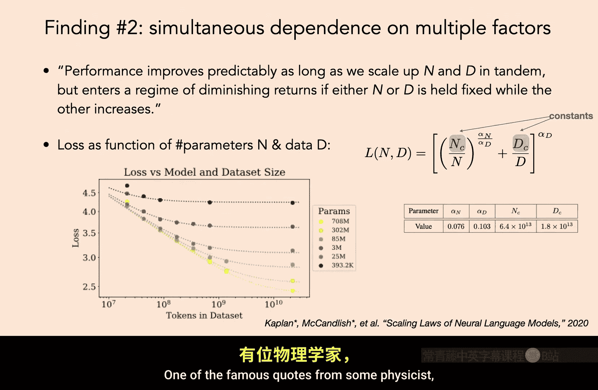

Anyone does anyone know yeah。Anderson。Okay。So， so， yeah。

 I just attribute everything to in physics to Neyman or Einstein's， but it's probably wrong。

 It's probably Anderson。 So， but yeah， with five parameters， you can fit an elephant。

 like an elephant is a complicated shape， but with 5，5 free parameters。

 like you can make really complicated shapes。 So here's what like。😊。

1，2， N N D are not pre prim。 there's constant N， C，D C， alpha N this 5， right， so I can fit another。

 So maybe they're reading key leaves with this functional form。

 Maybe there's other functional forms that could do just as well。Okay。嗯。

So we can do the same type of analysis now with respect to not model size and data set size。

 but model size and number of steps of gradient descent。Okay， remember。

 these are are three kind of fundamental resources， model size， data set size。

 and compute like number of steps that we take。嗯。Well， a number of steps will be related to compute。

It'll be like a number of steps times to batch size this compute。Okay。

 so they found this even simpler functional form for explaining the relationship between the test loss and these two parameters。

So now it just becomes a sum of two power laws。And that's plotted on the left here where we have the like amount of compute that you need。

Versus the test loss and。You， you get kind of a power law， but you need to。

 if you increase the number of parameters of your model， then you'll get a lower loss。 And again。

 you to reach that frontier， you need to increase the number of parameters。

 And if you increase the parameters sufficiently， then you'll reach a frontier that looks like a power law just in terms of the number of steps of gradient descent。

Okay。Yeah， some constants in that equation too。Okay。So。Here are some implications that they derived。

 So， so they， they fit all these， these relationships。

 and then they got these exponents and these constant offsets。 And they said， well。

 based on those exponents， what can we say about how we should， how large should we make our model。

 What batch size should we make the model have， etc。And they said that。The number of。

So the number of， let's say that you have compute resource C。

Then the number of parameters that you'll want should be proportional to C to the 0。7。

 and the number of data points that you'll want to train on should be proportional to C to the 0。27。

Okay， take these numbers with a grain of salt because。

They change with different models in different eras。

But they tell us some recipe for in order to get the， the minimal loss。

Then it will be better in this case to increase my， Well， okay， I。

 I should set my parameter account to be。higherigher proportion of my total compute count compared to my data set size。

 So I should train。 the implication is essentially， I should train。

Relatively big models on relatively small data。So I should train a billion size parameter model on a million size data set。

 And that would be。The best。AWai to minimize my test loss according to this law。Okay。So。

People have studied this in a lot of different context。

 And I just want to give a flavor of the other power laws that people have found。

 So it's not just about autoregressive transformers。

 There's these power laws have showed up in computer vision and reinforcement learning in a lot of areas。

 Here's a paper on vision power laws。 So they are fitting a。😊。

I think a vision transformer to do or a computer vision model。

 I think that might have tried a few architectures。

To do CFR 10 classification or some other type of classification problem。And here。

 they're plotting the power law two dimensions。 So we have our loss on the y axis， and we have our。

Our data set size and our model size on the two other axes。 So this vertical axis is the loss。

And there's kind of a power law in both dimensions， but they interact in a weird way。 So， again。

 it's not something that you can like easily wrap your mind around。

 But we do have a simple functional form， which is just， it's sum of these two power laws。Okay。

 so same as they found in language modeling。One of the questions that you might have with this kind of reading tea leaves。

Concern is。Do these power laws actually make predictions that extrapolate across orders of magnitude。

 If I fit them on some subset of my data at some scale。

 do they make predictions that are valid on held out data at larger scale。And the answer is yes。

 so in this paper， they ran this experiment where they fit the model on these green points。

 so they they kind of measured， they have models of different size。

 but they did this out of distribution like held out tests。 So they fit the model on some scale。

 and then they scaled up the model to a larger scale。 or in this case， it might be a smaller scale。

But you can do another direction。 So you fit the model on these data points and you ask。

 does it make valid predictions for models that are of a different scale， And it does。 Okay。

 so we're're not just， you can do cross validation。 We're not just reading tea leaves。

That's really all that this says。Okay。AndSo finding one。

 we have a power lot relationship between resources and performance。

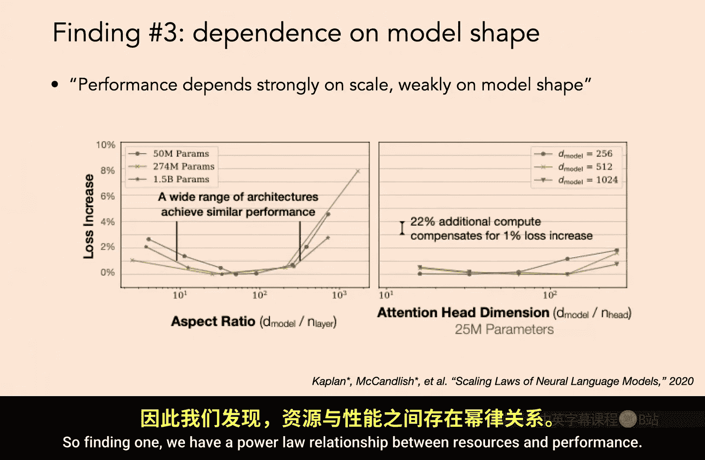

Finding two。