# 麻省理工学院【中英⚡深度学习｜6.7960-Fall-2024,-Deep-Learning】-p22-P22-度量化深度学习--BV15QZ4B1E6v_p22-

Hi， everyone。 So today， I'm actually just gonna tell you about some of my research。

 which is about deep learning。

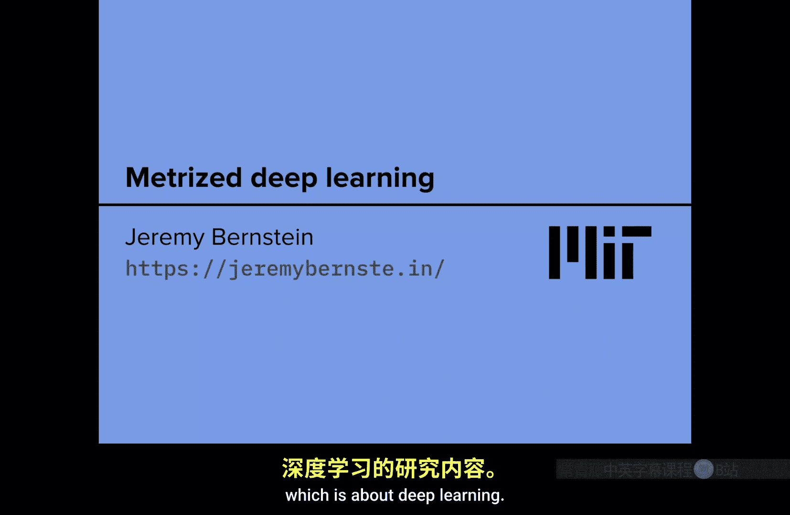

And。Again。You can like take everything， you know， like you don't have to fully trust me in this lecture。

 and maybe you should be skeptical。嗯。Okay。So the idea that I want to talk about is， is the idea of。

The way that we build neural networks is kind of like a Lego set where we have all these little pieces。

 all these building blocks， and we piece them together， and we couldn' build。Transformative。

 for example， but we could take these pieces and we could build something else。

 There's definitely this like modular structure。So if that's kind of how we build neural networks。

 why didn't we also build a theoretical understanding of them in， in exactly the same way。

And arguably， like， if you want to have a theoretical understanding of deep learning that really applies to any neural network that you actually find in the wild。

 you sort of。You better build the theory in the same way that you build the neural network。

 Otherwise， how can it possibly hope to describe actual neural networks that you find out in the wild。

So what does， what does that mean to build the theory in the same way that you build the neural network。

嗯。So the idea is like。If you think about like an individual peace level logo， like。

 imagine if you had like a full theoretical characterization of of that single object。

 which is maybe reasonable because it's kind of a simple， so simple little piece。Then。

 then if we think about what are the operations that we have for like combining。

Little pieces of likego。 It's a build。Build more complicated structures。 And like the。

 the two that we're gonna think about is like。What we call a series combination or like putting one on top of the other。

嗯。Or a parallel combination， which is like putting them side by side。And then， then we should ask。

What properties of an individual La piece do we actually care about or of an individual layer in a neural network？

 What do we care about。嗯。So， a layer in a neural network has an input。It has ways。And an output。

And the， yeah， the question that we're gonna， gonna ask is how the thing that we're really gonna care about is how sensitive is the output of the layer in this case to。

 to both changing the input。 So you think about adding a perturbation of the input。

Or what if we put up the weights。The question is。How much does that output change and。

 and think that the out， the output， the change in output gets one gets contributions both from the。

Changing the inputs and the changing the weights and potentially the interactions of those two things。

And what I want to argue is that， first of all， no one understands this。

 It's like a really basic question of the about neural networks that， you know， no one。

 no one teaches you about it。 No one understands it。But it's a really important question。But like。

 for a variety of different reasons。 But one of them is optimization， because if you think about it。

 training on your own network involves changing the weights and changing the weights at all the different layers。

嗯。And another reason you should care about this question is like things like robustness。

 People talk about adversarial examples where you change the input to the network and the output changes like dramatically。

 So it's another question of understanding the sensitivity of the network。And so the way that， like。

 the high level way that I want to think about this question is。

 let's say that we can characterize that information for like an individual piece of the network。

Can we extend this understanding to combinations。So if we， if we， if we put the。

 the bricks or we put the layers in， into a series combination。

That's a little more complicated because now there's two， you know， each of。

 each piece has its own weight space。If we combine them， we're somehow combining the weight space。嗯。

And similarly， for， you know， putting them in parallel。We get an object with a combined weight space。

And now there's kind of like， to， you think of this as duplicating the input， sending it to both。

To both of the pieces。 And then we get two outputs now。And if you think about it， somehow， the。

 the series combination is somehow a bit more coupled than the parallel combination， but。

We're still gonna think about both of these things。And then if we can really do this。

 if we can really understand。The properties of individual pieces and then how those properties get transformed through combinations。

Then we can really think of， you know， a deep learning library， something like Pytorch or Jas。

you should really think of it like a Lego sta。Where you've got all these layers。

 and each layer should have its own like， theoretical description。And then。

We should have like a system of rules for like， if you combine layers。

 the new object that you get has these properties。嗯。And then once you've got those things。

 you should be able to build whatever you want。 you can go and take this library and， you know。

 build whatever fanciful creation。You like， and that should be allowed。

 And you should have a theoretical understanding of that thing， sort of automatically。

So that's kind of how we're thinking about deep learning。

And there's actually a practical payoff already in in in certain axes。 So I just wanna like。

 tell you a little bit about that because otherwise， you wouldn't know whether you。

 whether or not you should bother listening。 But the， say what I wantanna claim is that。

If you adopt this perspective， it provides an easy way to fix these scaling issues that people have。

 so。We talked a bit about this in， in one of the earlier lectures in the class。

 But you have these issues where you sort of scale the width of building blocks in the network and the whole optimization landscape kind of drifts。

Even though the performance is getting better， the sort of the， the。

The the minimum and the optimization landscape is like shifting。To a different optimal learning。

 right。On。And then actually， people have recently taken some of these ideas and packaged them with some other ideas。

 but。Got much faster training。So this also relates to the homework problem about the。

Sepest designcent algorithms。 But this is all like in the last couple of months， but。

This is showing a comparison of training speed。 And the baseline is， is All M dot C。

 which is like And Copathy is like extremely high performance， like C implementation。

 But with some of these ideas about steepest descent algorithms based on norms and kind of spectral descent type things。

 They actually got like way faster training。 So this is like a huge wall clock speed up in。

 in training by integrating some of these ideas。 So this is just to give you a sense that actually maybe some of this stuff matters。

😊，嗯。岁月。Okay， so far， I've， I've tried to like put across this I。 Oh yeah， go ahead。 question。

 And this should much faster than the other one。 Do they know like why its so much faster or the economy this is。

 but not really sure like why。呃。Part， partly understand why。 yeah。

 we partly understand why like basically the difference between the the。

 the faster curves using this spectral disscent algorithm。

 which is uses steepest disscent under the spectral norm， which was in the homework problem。

 And if you believe that the geometry of an individual linear layer is somehow。

Described by the spectral norm。Then that would explain why。So it's， it's just integrating that idea。

嗯。But we， we'll go a little more into things。 But I first want to zoom out。

 And so we talked about optimization theory early in in the class。

 But I w to try to connect optimization theory to this idea of building neural networks like a。

 like a Lego set。嗯。So， if you remember。Let's say that we have our loss function。

Which is like this L symbol。 And we've got a end dimensional parameter space。

And then the last function maps the set of parameters to a real number。And。

 and let's say that we can tailor expand our lives。So if you remember。

 there's like the first order term。 and then there's the， the Hassian term。

And then there's like higher ota times in the tail expansion。If you remember， what we said is。

 what if we could come up with a norm and like a sharpness parameter lambda such that we can kind of up bound。

 at least we can up bound that second order piece。 certainly the Taylor expansion using this norm。嗯。

所。Yeah， we were saying， what if we could do this， what would it mean。And in particular。

 can we find a norm in a sharpness parameter such that this is a really tight up bound that would also be really great because then we can actually think of using this band as the actual description of the loss function。

😊，Well， if we could do that， what we said and what we spent time on the homework thinking about is。

This thing of called steepest optimization algorithms using particular norms that we can think about。

Pking updates that to sort of minimize this， the linearization of the last plus the penalty term that involves the norm。

 And then we can think， you know， we can think about。If I pick this norm。

 I get this optimization algorithm。 If I pick this other norm。

 I get this other optimization algorithm。So how， how should we actually produce such a norm， Like。

 what is a good norm for a neural network， Why would we favor one norm over a different norm。

 think that's like an important question。U。So that's what we're gonna try to think about over the next。

A few slides。嗯。And just as remember that， so we're trying to produce a norm and a sharpenness parameter。

 such that the second order piece and the tail expansion of our loss function is up bounded by that。

 by that object in the red box。So how are we gonna think about this， Well。

 first that we'll remember that in deep learning， we have a what's called a composite loss function。

 So the total loss is the error measure composed with the neural network。

 So that the error measure is L and the neural network is F。 So it's a composite structure。

 And then also remember that we have something called the Gaus Newton decomposition。

 So whenever you have a composite loss function。😊，Where both parts are either suitably differentiable。

嗯。We， we can decompose the second order term in the last function into two pieces。

 So the first one involves the curvature of the neural network。

 And the second piece involves the curvature of the error measure。So that's that one is just like。

 because we have a composite， we have the Gaus New then decomposition。

So step 2 is now let's suppose that we know a really good norm on the output of the network。

 And maybe that's reasonable because the output of the network is often something。

 It's a simple thing like a vector， like either the network who tends to output a vector or outputs a real number。

 So we can usually come up with like a good norm。

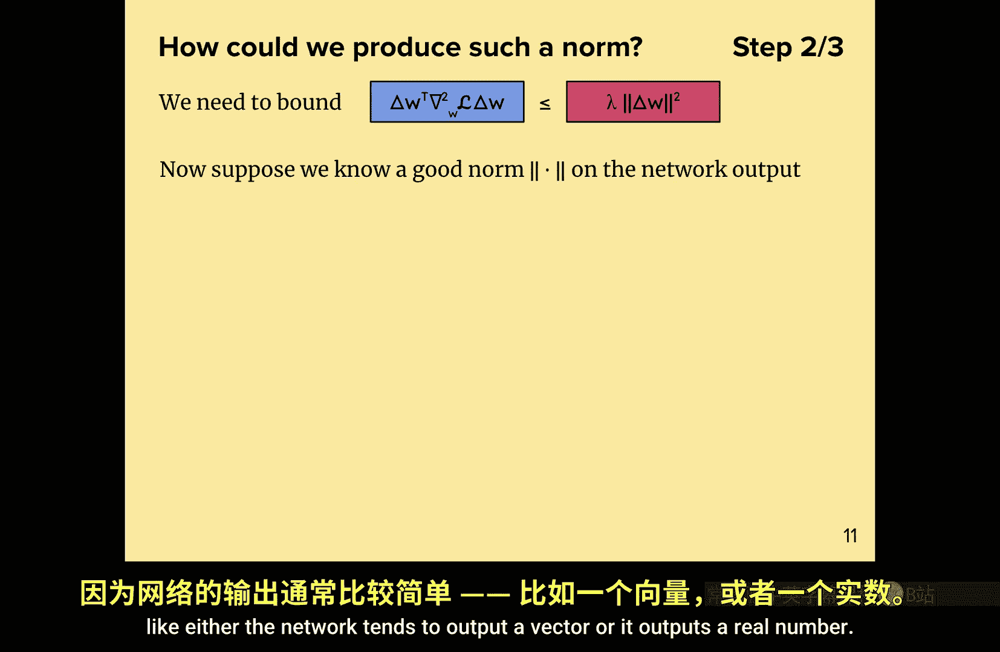

Sorry， what would it mean for a norm to be like bad in this instance？诶。That's a good question。

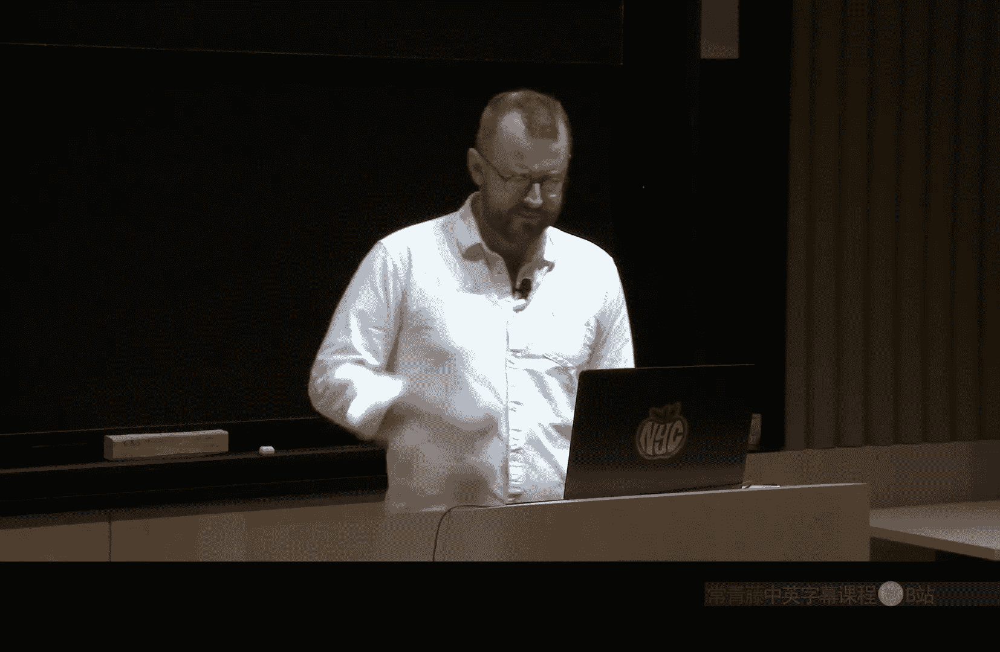

Well， at least at least if you just have the output of the network and it's a vector with the kind of there's no obvious extra structure on that thing other than it's a vector。

 There's only a few norms you would really think of like LP norms， basically。

 But if you have a more complicated object， like a full neural network。

 There's a whole zoo of norms that you might think of。 So its， it's at least， you know。

 like maybe you give the output， the infinity norm， that L2 norm， the R M S norm， the L one norm。

Like， you， there's not many other obvious choices， Lou。嗯。Okay， so that's kind of， that's what I mean。

 And again， I may be wrong about these things。 Theyd be a little skepticical because this is just like the way that。

Yeah， that we've started thinking about it。嗯。So the point is that if we have a norm on the output。

We can u take the Ga's new then decomposition， and then we can actually bounce the。

We can bound the two terms。嗯。Ands。The， the reason that we can do that is essentially。嗯。

Because you can， you can sort of read the term in orange as being a dot product between the curvature of the model and the linearization of the error measure。

 And then you can apply the koshi swartz and the quality to that term。So the， the norm on the error。

 on the derivative of the error measure is actually a dual norm corresponding to the。

 the dual norm of the norm and network outputs。 And similarly， you can think about。The。

 the purple term as being like a vector times a。Mattrix times a vector。

 And there's like a operator norm up a band on that thing。 So basically， anyway， long story short。

you can bound these terms if you have a normal network output。嗯。Okay。

 so that step 2 is like just oppo that you can up a band that turns in the gu need emptycom。

 So like no approximations， just just an upper band。So step 3 is just resting where we got up to。

 We've up bounded the Tus and think our even decomposition。 And then we can now actually re。

 remember our original problem was finding。This red。

 this red box finding this upper band on the second order piece of the loss function。

 But we've actually like reduce our problem， because now， if we can。Upper bound， like the first term。

In orange。With a norm using a norm on the weights。 So if we can produce a norm on the weights。

 which upper bounds that first orange term and。If we can produce a norm on the weight space to upper bound。

This last term in， in kind of purple。嗯。That if， if we can do that。That will。

 you can plug those into the upper band on the Gaus and eveny composition。

 It will give us an upper band on the curvature of the overall loss function。

 So we kind of reduced the problem， which we didn't really know how to solve now into。

At at least the different problem。 And then the question is， can we， can we solve that other problem？

 And then I've just rid beneath these。To expressions that the first one is asking that the network is lips smooth。

In， in its weights。 And the second one is asking that the network has just literally it continuous in its weights。

I'll just like， pause。Briefly。So it's just to say that we've。

 we started out with a problem about the overall loss function。

 We up abandoneded this thing with the Gaussian human decomposition。

And then we related the terms in that to properties of the network。啊。I have it like more。

 This is supposed to be a more pictorial or somehow visual description of what's going on。 But so we。

 we， we said that we reduced to wanting to have these conditions on our neuro network work。

So a a norm on the weight space such that we can， such that the network is lipst smooth and。

 and lips it continuous in that norm。So if it looks at smooth or in looks continuous。

 that guarantees the existence of such alphas and doltas。Yes。

But fing armor is first existence of something。Well。

 you could take these actually as the definitions of which' smooth and which it's continuous。

 And once you have them in one the。You can automatically produce them in any other norm because the。

 all the norms are equivalent。 But， but it may be a much tighter guarantee in one norm than another norm。

 So we really wantanna find the norm on the weight space， such that these。These conditions hold very。

 very tightly。But just to describe pictorially what's going on， so。We've got a neural network。

 and we think about passing an input into it， and it has weights。And it has an output。

And what you can think of doing is actually Taylor expanding the neural network。In its ways。

 So remember， previously， we were Taylor expanding the loss in the weights。

 But now we've sort of mapped things to actually just thinking directly about the network。

And these lipstick conditions are asking for upper bounds on the terms in the Taylor expansion。

In a particular norm。So can we produce a norm on the weight space such that we get a nice compact a nice。

 convenient upper bands on these terms。 And so forgetting everything that we talked about about optimization。

 just like directly looking at this slide and just directly thinking about it。

 Would't it be great if we had a norm on the weights that could predict the magnitude of these terms in the Taylor expansion。

 It if we had such a norm， it would mean that like whenever you were gonna change the weights of the on neural network。

 you would have a direct way to predict how much the output of the network can change up to first and second order。

 So its just like a direct argument that having such a norm would be a really useful thing to have because we can now predict what a network is going do in response to changing the weights。

 And then all of the precceeding argument was saying you know。

 one of the use cases for having having these relationships is that we can build an optimization theory around them。

😊。

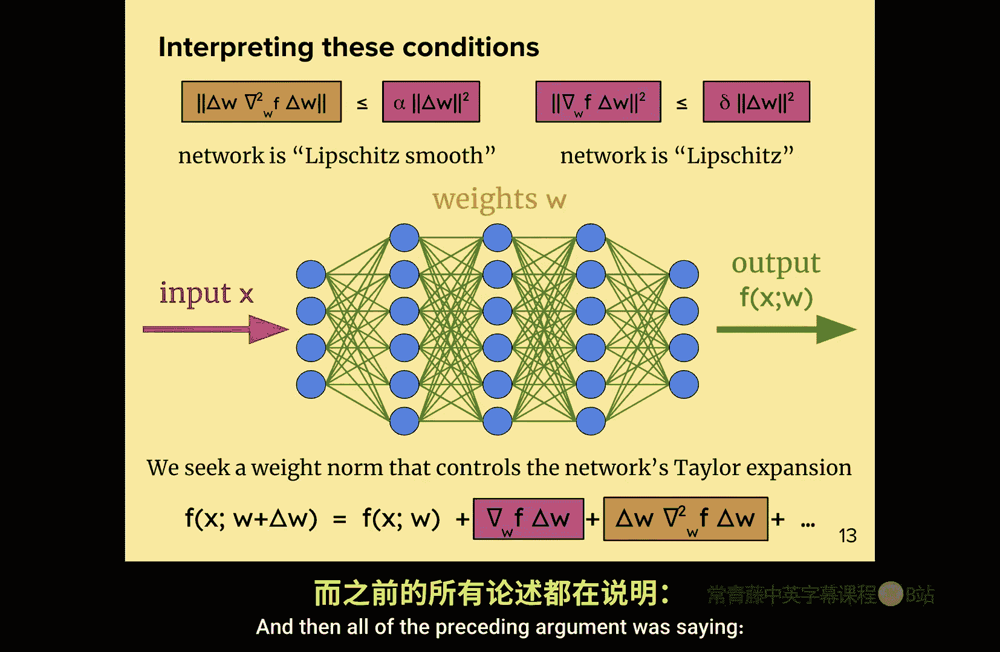

But they can be useful for other reasons as well。 Like。

 they're useful any time you want to be able to just predict what changing the weights of your network is gonna do to the overall function。

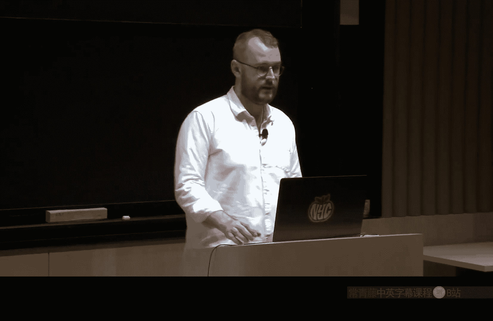

Okay， so we what we've tried to argue is that having these conditions would be useful。

 and it would help us build an optimization theory。 But it seems like actually， how。

 how and earth would we produce a norm， which is a really good norm for this reason because it seems。

 you know， the neural networks are really complicated So how how are we gonna do that seems。

 seems really。 have this of something Yeah， what I'll say is that a lot of classical optimization。

 once you start to get into it， is all about。😊。

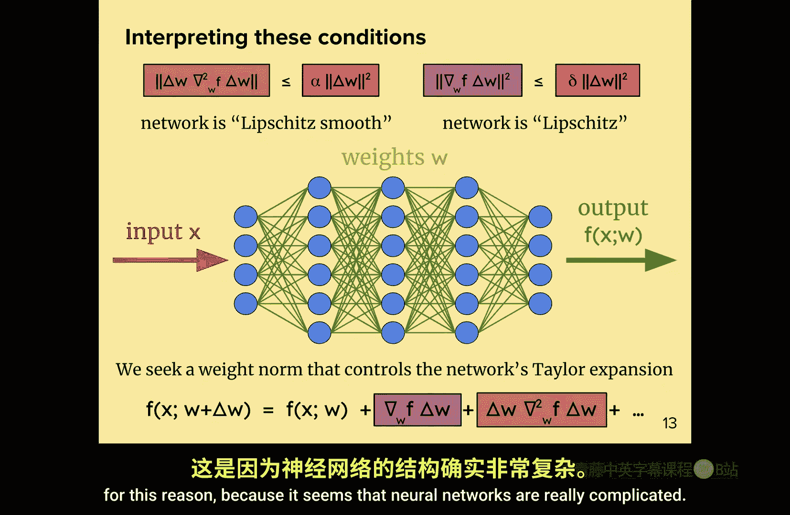

Finding a distance measure for your problem。 And like。

 once you've got a really good distance measure， you can start to design like， clever algorithms。嗯。

AndPeople have that idea in deep learning， but haven't really like， it's not really borne fruit。

 I would say， but it is a very classical idea to do this， this general thing。 And then there is opt。

 you can look at composite optimization theory and like， there's lots of papers about it， but。

I would say that iss not really like， yeah， Bo through in the deep learning， but。

But it's definitely that idea is， is very abundant， I would say。That's why， if you think about。

 that's why we have different norms。 like， why do we have the L 1 norm and the L2 norm。

 Because like somehow they're supposed to like characterize the structure of different problems。

 Like if they didn't， we would just only have one of them。

 So that that's like why there's a whole zoo of norms is to like somehow use them to characterize different problems。

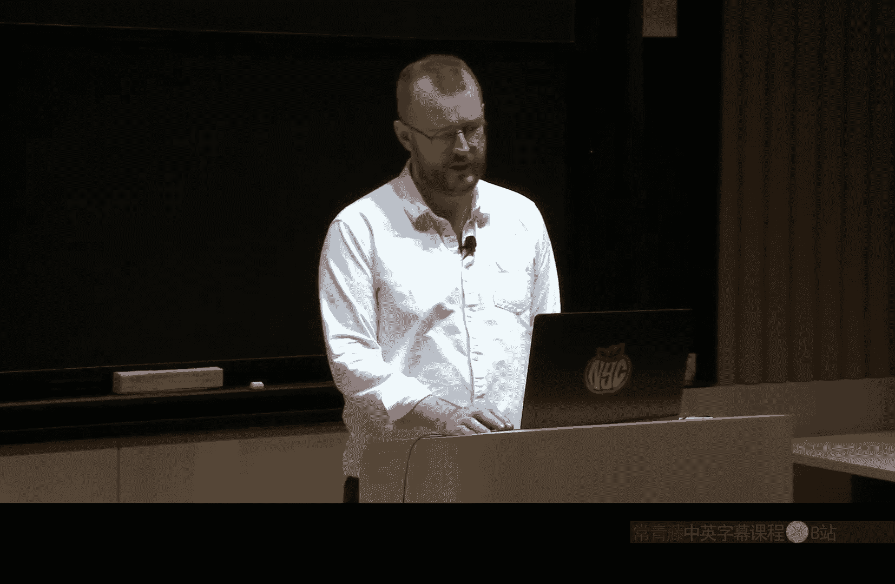

So the way that this is where the whole Lego thing comes back again， because it's like， how。

 how on earth are we gonna come up with a norm and the weight space of our whole network？ Well。

 what if we can break it up into into stages， so。If， if we first think about the activation spaces。

 again， like those are more like simple， just vectorctors in a simple network。 So， you know， that。

 as we said， we can it's kind of easier to give those norms because like。

 there's not that many options like L 2， L infinity， L 1， R M S。呃。Now。

 let's think about the tensor spaces， like the matrix spaces， for example， in the network。

 Once we've picked norms on the activation spaces， there's actually a way to induce a something called an induced operator norm。

 But there's， there's a procedure for taking two norms on the input and output of a linear operator and coming up with a norm on the operator。

 It's called an induced operator norm。😊。

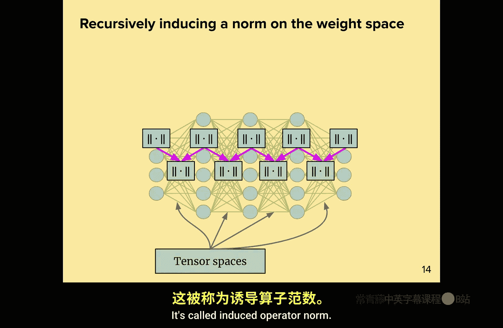

So the activation hooks usually don't have weights。Yes， so I guess what are we arming？

Oh so when I talk about activations， I just meant the feature vectors。 But then if you think about。

We can think of a act like if yeah。 So I， I just met in the feature vectors， but。

When it comes to including， if you want to think of a like a reun on linearity as a Lego block。

 it will just be a Lego block with with the weight。 The weight space is just the zero vector space。

 So it just has like a trivial weight space。

Okay， and then。But what we really， we really need a norm， not on each individual layer separately。

 Although that's kind of already an interesting thing to think about is like what norm would we give to each individual layer。

 But we really want a norm on the full weight vector。

 So we we really need a procedure if we're taking all of these layer wise norms and like combining them into one like kind of mega norm on the whole on the whole neuro on that。

😊，So that's what we tried to figure out how to do。 But we also like， So， that's this idea of。

Starting with very granular norms and then sort of combining them until we have one norm that describes the full weight space。

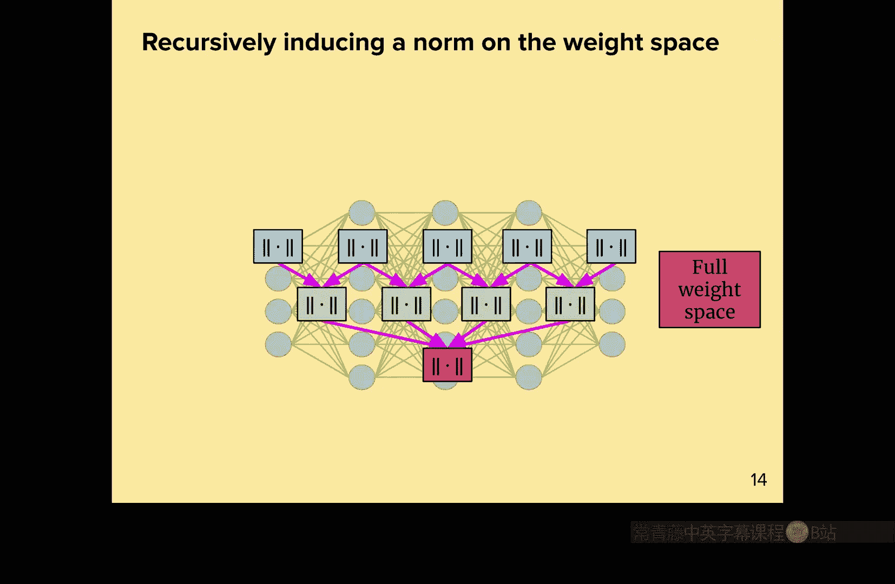

Okay yeah。So part 2 of the talk is I'm gonna try to make this more like a formal procedure。

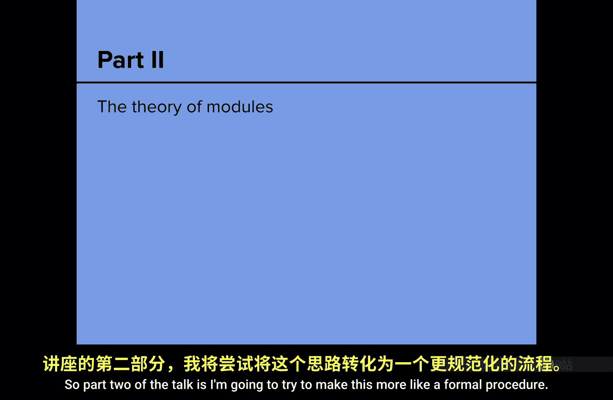

So we call， we call this， the theory of modules。And so this is another perspective unlike this Lego idea。

 But there's something called combator pattern in programming。嗯。

Which is the idea of building complex structures by taking simple things and combining them。

 And you think that there's like an abstract type。 and you， you can build very simple things。

 which are members of that type， and then you combine them。

 and you get new things which belong to that type。嗯。So for us， the， the type。

 the abstract type is something called a module， which has inputs， weights and an output。

 And that can be an individual layer in a neural network。

 or it can be a whole neural network that would both of those things would be modules。嗯。And then。

Given two modules， we have these combination rules。 So there's like composition。

 which is like series combination。And， and concatedination is the name that we gave to like parallel combination。

嗯。And and again， it's just like the Lego bricks。 It's like putting them on top of each other or putting them next to each other。

嗯。Okay。And this is just to show you， like， actually。

 you can build like interesting little you can think of them also as circuits。 But like。

 if you want to add three modules， you can put them in parallel and then you can compose them with like an addition module。

It's， it's like a kind of little circuit。Salar multiplication。

 you can take a module and you can compose it with a special module， which just multiplies by scalar。

嗯。And then， you know， you can combine these things to build a residual block。

I'm say it kind of just looks like this。 So it's like。Some compositions， concatenation and some。

 some concateations and compositions。 But essentially。

 then you could think about taking that little circuit and composing it with itself a bunch of times to build a residual network。

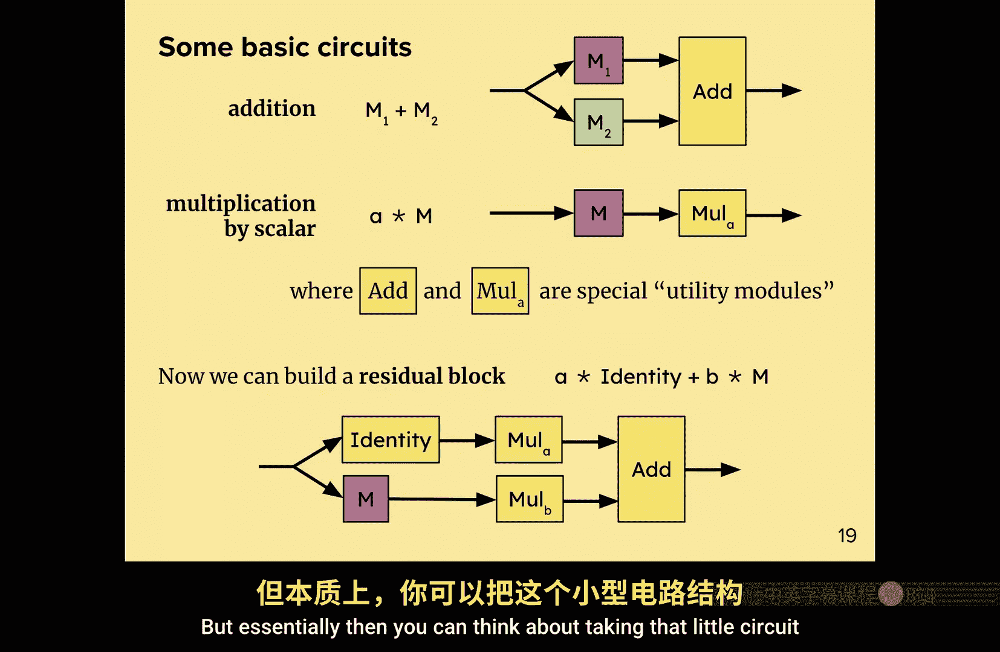

嗯。And this is just to give you an idea that actually。

 those simple kind of binary combination rules are actually enough to build all the neural networks that you want to build。

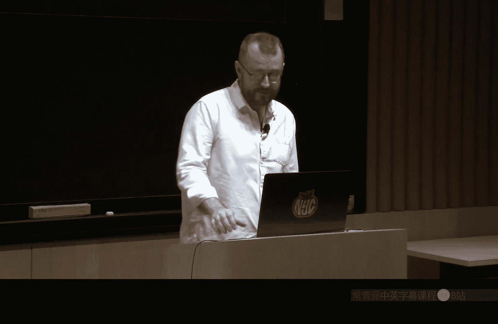

Well， I guess it' adding。I guess we could just have modules that have templates on。Yeah。

 we would if a module having two inputs， we would think of as like the input as being a single tuple。

So like， the input space can have whatever structure you want。这个太美法。Yes。

 it just has to be a vector space， but like in the abstract sense。嗯 okay。

So this is to say that we can build。 Okay， then we have this kind of categorization of。

Different types of modules that we find interesting。 So atoms， this is the name that we give to like。

嗯。The simple layers that you write by hand， like a linear layer， a convolution layer。

 and an embedding layer。Bonds are just the ones with like the kind of trivial weight space。

 So things like non nonlinearities don't have weights。 And like a functional attention is。

 is like the part of attention without the weights。

 And then you could like compose it with some linear modules and so on。

 If you wantan to build an actual attention module。And then compounds is the name that we give to。

 like。Anything you build by combinations。And this is just a recap that what we really， you know。

 what we've said that what， the thing that we care about or the thing that we want to know about is the sensitivity information。

 if I change the inputs and I change the weights。How much does the output change。

 can we predict how much that output changes It from knowing how much we change the inputs and the weights。

And can we do this in particular for any module， So let's suppose that we can do it for the basic building blocks。

 Can we do it for any compound module or any， anything built from。You know。

 anything built from our Legos that is the analogy we were making。嗯。四。😊，Have quite a。

 So I worked recently with like a pure mathematician， basically。

 So it's like quite an abstract at a formal way of going about solving this problem。 But essentially。

 we've kind of。Come up with these definitions。 So just to remind you。

 a module is something with inputs， weights and an output。 But we also give it some metadata。Like。

 it's forward function。A sensitivity number， which is supposed to measure。

The input output sensitivity。 So it's one of the lips constants。 A mass。

 The mass is supposed to be a kind of hyperparmeter which sets how important this module is compared to other modules。

 how much it will contribute to learning。And then we're asking that it should have a norm on the weight space。

And anything with these attributes is a。Is a valid module。 But because we only， you know， in our。

 in our library， we don't want to have really horrible functions。

 We wan to have like nice functions that， you know， people can use。 And。

 and so that's why we have the second definition， which is。a module being well normed。

 So these are the good， the good modules， the ones that we actually like to use and that we w to include in our library。

嗯。So for a module to be well known， it needs to have a a notion of a norm on its input space and a norm on its output space。

Which corresponds to roughly it saying you want to know how the inputs behave and how the outputs behave or how you want the outputs to behave。

嗯。And then we'll basically say that a module is well known， if it's。嗯。

If it's one lip shift in its weights。And if it's lipsticks in its inputs。

 where the sensitivity number assigned to the module is the lipsticks constant。嗯。

So the way that we're thinking about this is like， when we say that a Lago brick has a theory associated with it。

 it basically means that a Lago brick。Has these attributes。 And like the。

 the second definition says that the attributes are based on constraints with respect to each other。

And if， if， if the Lego brick satisfies these constraints， like， we'll put it in our library。

 And if it doesn't， we'll just throw it out because we didn't like it。嗯。

So I w to give you some examples of， of what this actually looks like， so。These are some。

First of all， the linear module， like the， most classic。Does a matrix factor to multiplication。

We'll say that it has sensitivity1， a mass1。And we'll give it this kind of funky norm。

 this like rescaled spectral norm。And then we need to ask， is this module well normed or not， like。

 do we want to put it into our library or not。And so the claim is that if you set the input and output norm to be the RM S norm。

 which is kind of natural choice for feature vectors inside an neural network。

Then the linear module is well known if it has bounded inputs and if the weights are bounded。嗯。

So I yeah， I'm still kind of thinking about this topic。 But it's， it's kind of interesting that。

 you know， one of the basic things that in an actual neural net that you do is like you normalize all the feature vectors everywhere。

 like explicitly。 people that really know why they're doing that。

 other than like somehow intuitively， it's gonna make things more stable and stop things blowing up。

 But this is sort of pointing out that if you wan to have lips guarantees for a linear module。

 the inputs and the weights must be bounded。 If that're not， it can be kind of arbitrarily sensitive。

😊，嗯。Okay， so a useful counterpoint is an embedding module because at first glance。

 it sort of looks like it's kind of the same thing as a linear module。 You can write it as a。

A matrix vector multiplication。 The difference is that you sort of think about an embedding layer in a neural network is you pass in like a one hot vector。

 and it picks out one of the columns of the matrix。

 And that's the embedding that corresponds to that token。 So there's。

 it has an embedding layer has like a very different semantics to a linear layer。嗯。And。

 and we express that。One of the ways that it gets expressed is by giving the weight space of an embedding module a different norm。

So you are linear module。And similarly， when we， when we ask it， if the module is well norms or not。

 we'll put a different norm on the input space。 And we。

 the way we think about this is that the input vector to an embedding layer is a one hot vector。

 which is a bit like a probability vector。 So we give it the L1 norm。um。And then it's basically with。

 with that choice of input norm and output norm。It's well known then there in the same conditions of like。

Unit inputs and， and unit weights。还是。Trying to figure out the well norm module definition before。

There's a diamond like a ver square。That means。Contract over any tensor indices。

 which are shared between the。It's， it's just like a tenular contraction。Does that make sense。

 It's like。If， if there' are two vectors， it's a dot product。 If it's a matrix in a vector。

 it's a matrix vector multiplication。

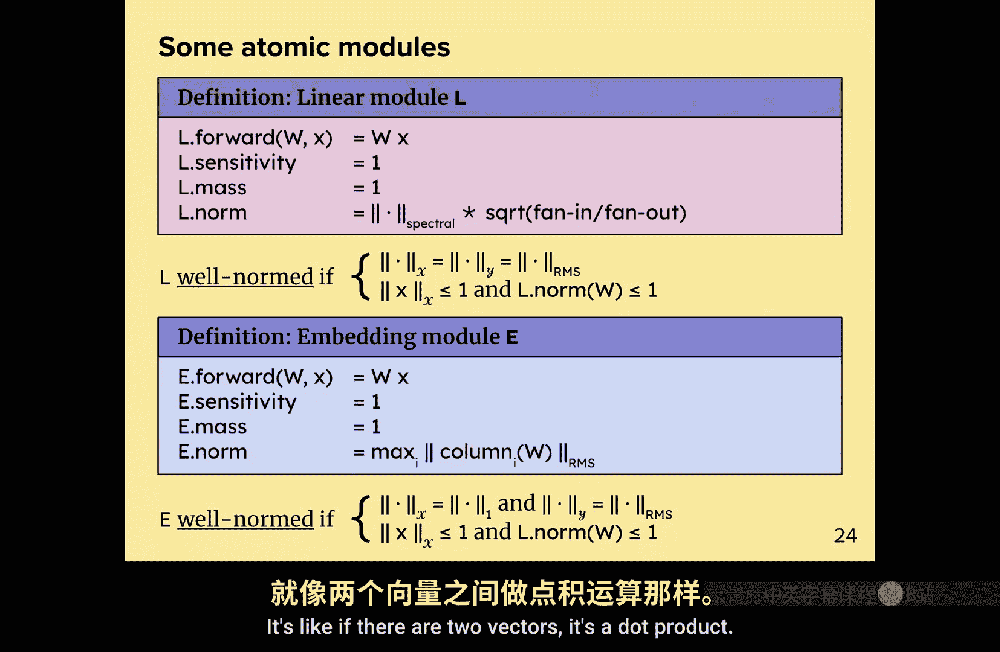

If it's a matrix and a matrix where the indices are the same， it's like sum over the cha indices。

It's just like a， it's just like a。The objects in a neural network have a like a whole zoo of different shapes。

 And it's like hard to come up with a notation to like， express that。

 So it's just like a shorthand for like， figure out what kind of multiplication you actually w to do here。

Why。Do you not run into issues？When you optimize this with lane。

Boundary value problems for let's say， like you're at the boundary of。

That space being less than or equal to one and your gradient is like trying to push you。

Outside of the boundary。Yeah， that's a great question， so。

That the short answer is we've not actually implemented this part really faithfully yet。

 So when we actually implement it at the moment， we just let everything go outside the boundary。

 But I w to do that。 And like， and the idea is to design like manifold optimization algorithms where the weights stay on this on this like wellknow manifold。

 And then because of that， that gives you guarantees about how the outputs behave。

 And then you can think about those the inputs to the next layer。

 And like there's a way to make everything consistent。 which just haven't haven't done it yet。😊，嗯。

But so， yeah， so far， it's like。Different aspects of the whole theory seem to be like kind of useful。

 but there's not like a complete version， which is everything。

 where everything is consistent in practice。

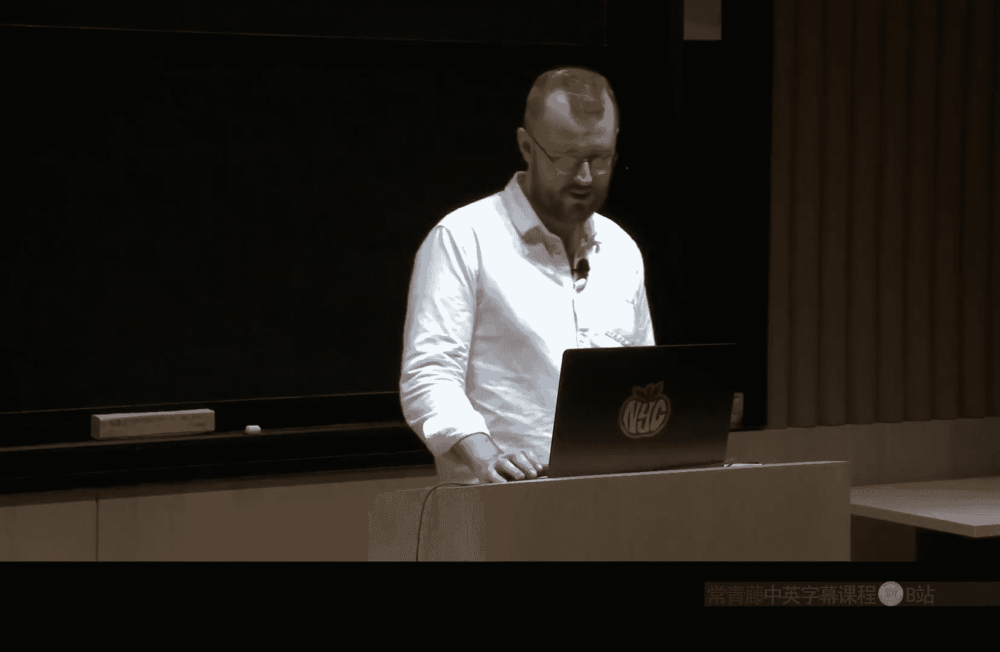

So the reason for setting up those abstract definitions of what is a module and what is a wellknow module is that we want to have combination rules which automatically somehow automatically preserve those properties。

 So if you take two wellknow modules in your library and compose them to think the new thing that you get is automatically satisfies the definition of being wellknow。

嗯。And so the， the， the types of things that we want to show are that。

 the combination rules are associative。 So if you do like， compose a chain of things， like you。

 you get the same fundamental object， whichever order you take those compositions， for example。嗯。

We want the space of modules to be kind of closed under。Combinations。

The space of well known modules to be closed under the combinations。

And then we want that mass parameter that that one of those attributes to sort of allow us to tune how。

 how much different modules contribute relative to each other。 And like intuitively。

 think about that is giving you the freedom to tune learning rates at different way if。

 if you wan to do that。And so。We came up with these rules。 So， again， these are just definitions。

 And the， the kind of style of of， of what this is is like， come up with really。

 really clever definitions。 And then everything else is， is easy。So the， the。

 the definitions are kind of the hard part。So for composing modules or like。

Putting modules in series， like。You compose the forward functions， which seems kind of natural。

 The sensitivity， which is supposed to be the in， the input to output lipsts constant。

 Those multiply， which is kind of like if you compose things， you multiply their lipsts constant， so。

That's maybe inrud。 Mas is like you have to think about it a little more。

 And then the important thing is that we， we use a max norm。 So when we compose modules。

 we w to have a norm on the combined on the joint weight space。

 and we pick the max norm with a special weighting So there's， there's coefficient P And Q。

 which like weight the two different stuff norms in the max。😊，And P and Q depend on the mass ratios。

 which that's the idea that the mass allows you to tune the importance of the two different modules in the composition。

 And the， the scale of P also couples to the sensitivity of the second module。

 So that's like if you compose two things。 But the second one is very， very sensitive to its inputs。

 somehow the first one should know about that。 because if you're gonna change the weight of the first one。

 you hopefully want to know that the second one is like really。

 really sensitive or it's very insensitive。 So it's like。

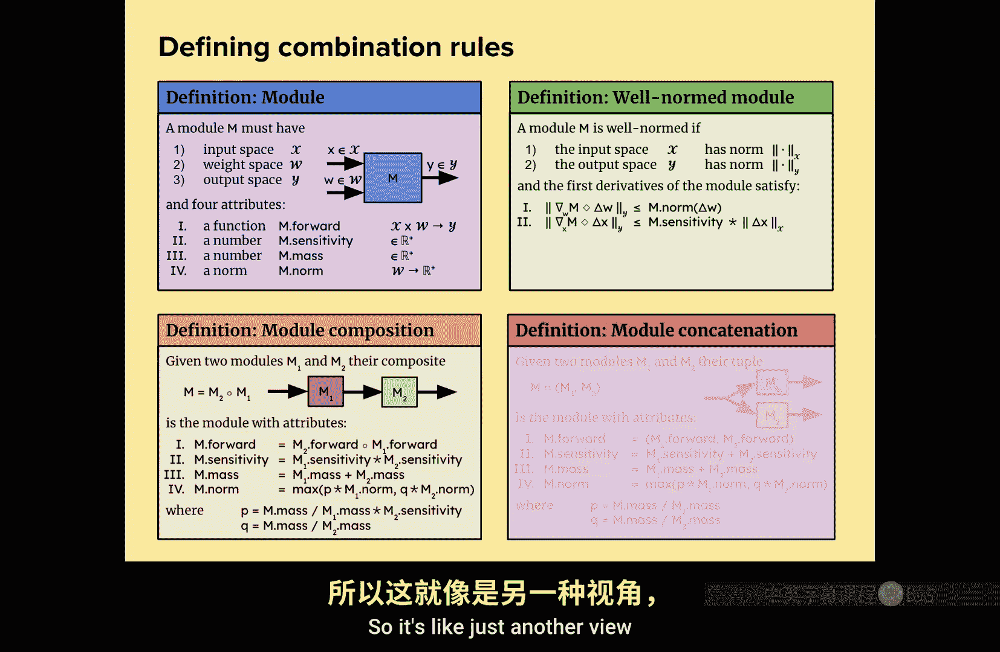

Just another view on， like really trying to character the sensitivity of how things behave when you combine them with each other。

So。We explained the intuition for sensitivity andtive functions whats the meaningtuition？Yeah， the。

 the intuition in mass is like if you， if you just forget about all of this and you say you're gonna train a transformer and you think about the structure of a transformer。

 It's got like the the kind of body of the network is like block residual blocks。

 There's like an embedding layer at the beginning。 and there's a linear layer at the output。

 And then you say， like， okay， now I want to scale the number of blocks。

And let's say you wanna even scale the number of blocks to the point where， you know。

 there's millions of blocks， but there's only one embedding layer and one output layer。

The claim is that like， it's not obvious whether in the limit of a really large number of blocks。

 should you even still be training the input layer and the output layer。

 should they now become negligible because you want all the learning to happen in the middle。

 or actually the embedding layer plays a really interesting and different functional role to the blocks。

 So even if you have a lot of blocks。 you still want to train the embeddings。

 It's kind of not obvious what the answer to that question is like I know， I find it difficult to。

To know。 So that's why there's a degree of freedom， which is letting you sort of tune how。

 how much you want the embedding to be important relative to the blocks。

So it's sort of being defined as the thing that you add up regardless of whether it's a composition or。

Okay， so in that case， could you say if you had a set of blocks？And you doubled all of their masses。

Would that give you the same analysis？Yeah， it， it would， you can analysis goes through。

 but it would just mean that when you train the network。Under this norm。

 using this norm to help you train it that the amount of contributions towards learning of the blocks would double compared to the。

 the the things whose mass you don't double。Oh， but if there's no other thing that。

Then nothing changes， exactly。

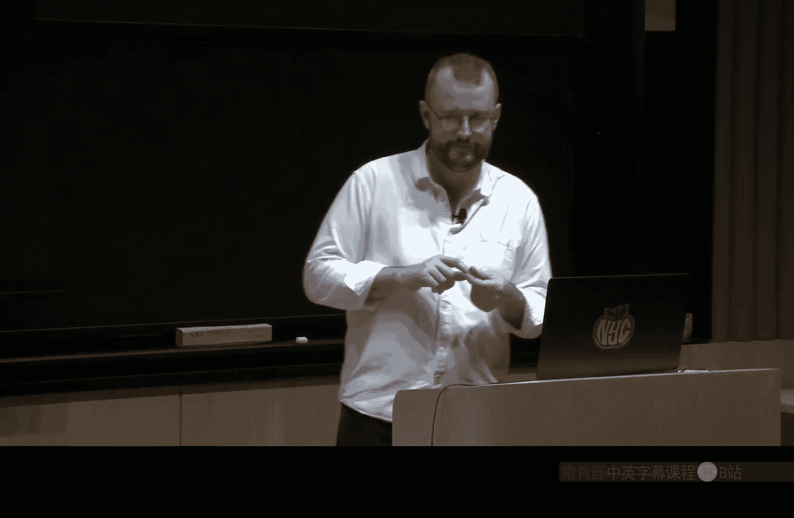

Po question on mass how do you determine the mass of different blocks so I am assuming here that mass incorporates some like。

Itfins the wishness of a certain block in terms of its future representational ability。It's。

 it what its do is is how much that block during training is gonna influence the features of anything that it contributes to any kind of supermod that it contributes to。

 And because we it's sort of like a degree of freedom that we can't really see a theoretical way to get rid of。

 So it's like something you kind have to tune。But when we actually did experiments， we just。

Tune one mass， the mass have all of the blocks together。 So we give each。

If all of the blocks have mass M and there's L blocks， each block gets like mass M divided by L。

 So there's like one number， which is the mass of all the blocks。

 And then we fix the input layer to have mass 1 and the output layer to have mass 1。

So if you have a block that's a linearard that has one mass one and you have a plot as a convolution。

That would also have the same。Yes， and it's like we do that for simplicity because it。

 it's a pain if you， but it's， it's like current understanding is like， you know。

 maybe it would work better if you tune them separately。 But， but you just， you。

 you can tune them in groups if you want to。嗯。So concatednation is kind of analogous， but it's like。

 it doesn't have the coupling because they don't compose with each other。

 So it's a little bit simpler。 But the， the point of。

The point of these definitions is that you can chat。 you like， take these definitions。

 You take the definition of wellknowness。 and you can prove that like。

 if you compose two things that are wellknow， then the composition is also wellknow。

 So they preserve that property。 And， and they have another， there's another advantage。

 which is that you can work this theory through to second order。

 So you define what you mean by the sharpness。 it's a bit like the reciprocal of the smoothness。

But you say that the a module is， is， is alphabeta gamish sharp。 If it's， if it's second derivatives。

 In other words， it's literally it smooth。 If the module is literally it smooth with respect to it。

 It weight norm and input norm。 But because it has， because a module has two arguments。

 we can give it。Like three sharpness coefficients， which correspond to like。Varying just the weights。

 varying the weights and the input or varying just the input。 So that's where there's 3。

3 sharpness cut fishes。 And you can think of these as being like generalized top eigenvalues， so。

oftentimes， when people talk about the sharpness of the Hassian in， in deep learning。

 they just that what that meaning is like。How big is the largest eigenvalue that has seen。

 But somehow that's like a Euclidean concept。And if you don't believe that the。

 like the geometry of the weight space is a Euclidean geometry。

 then you shouldn't necessarily even care about the top eigenvalue。

 and you need some kind of generalized notion。And， and the point is that if， if a。

 if a module is well normed and。Has these sharpness coefficients。

 There's an automatic way to determine what the sharpness coefficients are of。

 of compositions and concatenations。And， and then you can use that to show that the overall last function is。

 is rich smooth。And andm。嗯。

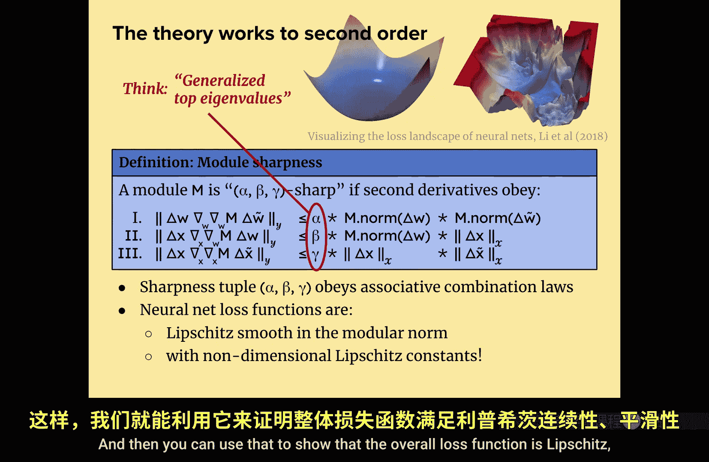

Some， some other things。

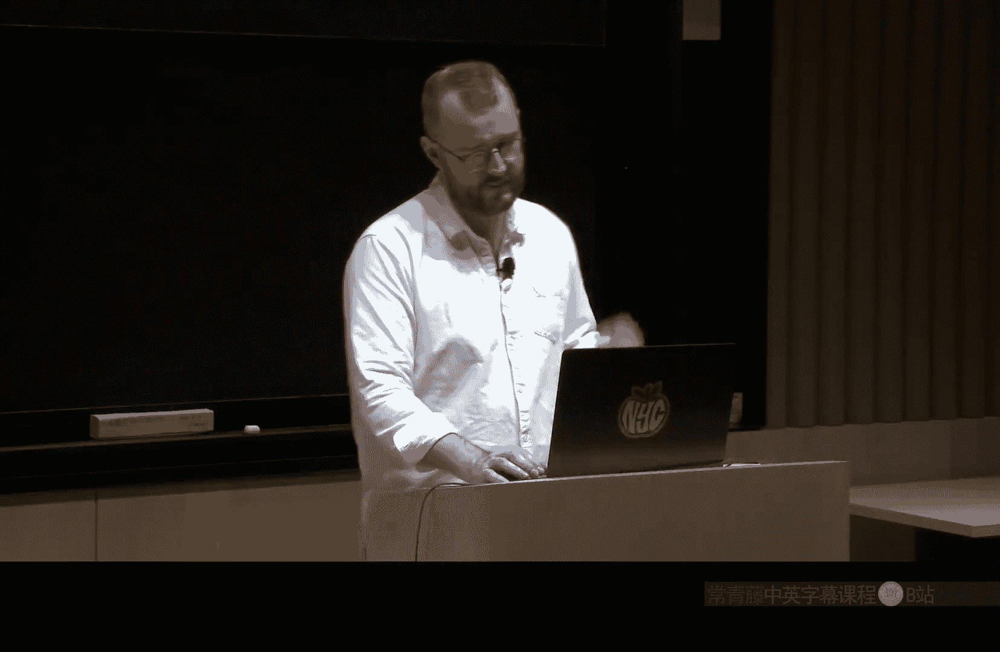

嗯。Be he。So， that was like a lot of。Kind of building a theory and not really clear if it's gonna be useful。

So the， the， the next two parts are like sort of talking about different ways that we've been trying to apply。

This theory。And in some sense， the， the theory is kind of intended to try to solve these problems as well。

嗯。So now I want to think about scaling。 So you like， you want to scale your training。

 You want to make your transformer as big as possible。 And， and that's this idea。

 even in the natural world that like， if， you know， big things with bigger brains。

Suppposed to be more intelligent。 And the African elephant is， I think， according to Wikipedia。

 it's the organism with the most neurons。And then we've got this recipe for。

 for artificial general intelligence。 where it's like。

 get the biggest supercomp that you can then scrape all the data and then train the really big transformer。

嗯。And that's this problem that we， you know， we talked about it in the earlier lecture。

 But the property， the training properties of the system can drift as you， as you scale up。

 So even though， with the case of width， even， even as the network gets wider。

 the performance is getting better， But the sort of optimal step size， which is on the X axis， is。

 is just drifting。And， and， and sometimes if you scale， scale badly in depth。

 like the performance can get worse as you make the network deep。

 So we want to try to have a way to solves some of these problems。嗯。So all theseis been good scaling。

 like， why is scaling bad。Our thesis is like scaling well is actually not difficult。 It's just about。

Really understanding the lipsitz properties of the system， which is the thing that people don't。

 don't really understand。And so。The the thesis is that if you have lipstickitz guarantees for your network。

 which are tight， meaning that it's not like a really loose band that's like kind of useless。And。

 and if the lipsick constants are non dimensionmensal， which basically means。

That as you change the scale of the system， the lips constant is like staying fixed。

 It's not varying。Then， then if you normalize the updates and the corresponding norm， like。

 that will give you good scaling。Its kind of called it a thesis，ca it's not really like a theorem。

 It's just like what we think。嗯。But so， so we want to have lipsick constants for the overall neural network。

 which are independent of the scaling dimensions。And we want。

 what we really want is to believe that the bounds that these lipsts bounds are are gonna be tight。

 and， and the， the amount of tightness that the bounds have is not dependent on scale。嗯。I so then if。

 if we can have that， then the norm on the， on the overall module。Which those bounds hold in。

 If we control that norm of the weighted updates， we'll be able to predict how much the outputs changed。

 So that's like the whole one of the reasons we were setting this thing up， so。If we have。

 in other words， what's， what's the， this is an example。

 This is the example that we mainly think about。 But if the neural network is， is one lip chips。

 meaning that the lipss constant is one。 So one is a really great number。

 which is an example of a number， which is non dimensionsal。嗯。Yeah， that then if we， if we。

 if we control the， the norm， the weight norm of our weight updates。

 we'll be able to predict that output norm of the change in outputs。And this。

 this is just saying that。Just showing you some of the papers that where we wrote about some of this stuff。

 But we broke up the problem into these two pieces。

 What are the properties of an individual layer and how do we keep them under。

Composition and concatenation。 And， and this is just saying that， like， actually。

 someone put a little bit on the homework。 this， this idea that this particular scaled spectral norm is a really good。

Go on for getting rich its guarantees on a， on a linear layer。嗯。

And this is this paper that I worked on with Philip and also with some other collaborators。

 which is about the idea of like combining things。

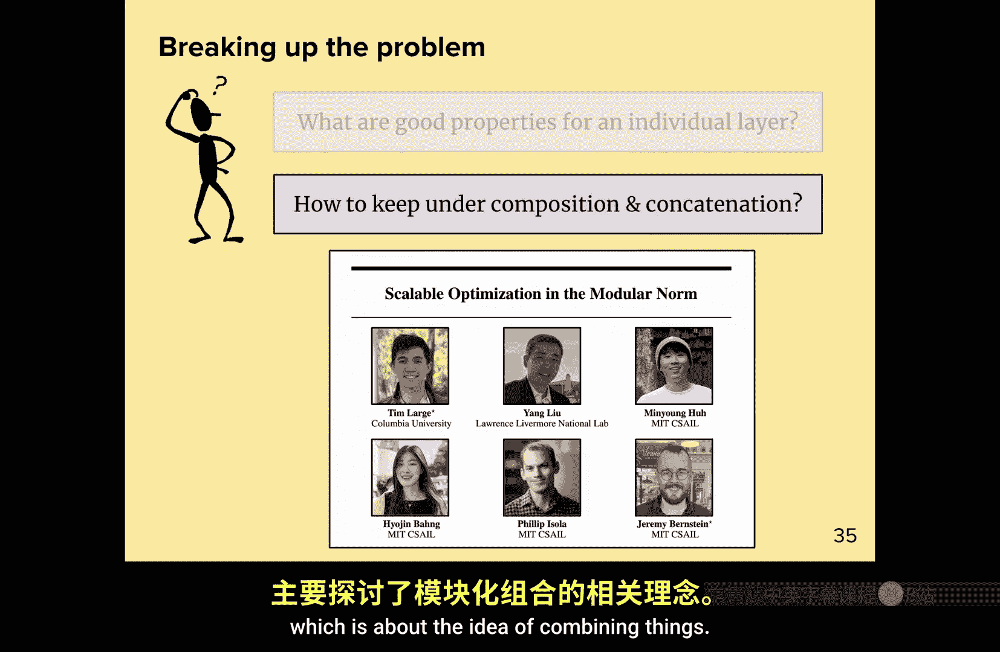

We actually built this software package， which is still like a work in progress。

 But it's the idea that all of those rules， everything that I were showing you can are things that can be programmed。

 So you can actually build this library。 So if you think about it as like building this Lego set where you can combine。

 So this is an example of building a MP by combining you know。

 layers and non nonlinearities to get and this MP would then be a compound module。😊，um。

And then you would automatically get its forward function through taking the composition。

But you also get this normalized function。 So when we compose things。

 we automatically build a norm on the weight space。 And then we can use that norm to like normalize。

And so， this is a kind of。Simple programming example。 And the。

 the claim is that because we did this clever normalization。

 the training will now scale better without needing to reaching the learning room。啊。And you。

 you can basically build it on top of。Different programming language， like different。

 you can be put on top of Pythot。

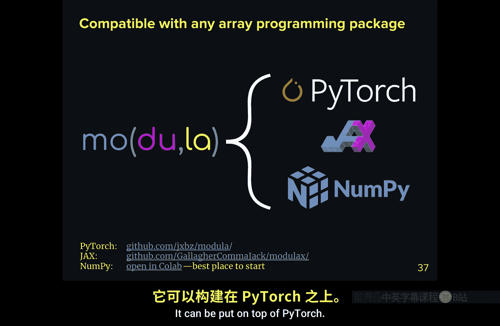

And this is like some empirical evidence， so。嗯。Yeah， what， what we're showing here is。

 is actual width sweep， width sweep。 So we're increasing the width of the network。

And the left plot is like just training nanoGPT。Like， which is coppaths。 like trans，'s very go。

Was I didn mean interrupt。Or I can， okay。Okay， the point is that if you just take like nanoGPT。

 which is this like Github repository and you， you try changing the width。

 like the optimal learning rate is gonna drift。The middle plot is like our own transformer implementation。

 which has some tweaks to the architecture to make it actually lips it。And then， the third plot is。

Adding normalization on top of the optimization。And the point is。

 this is supposed to be saying that by adding this normalization。

 we can fix the drift in the learning way。

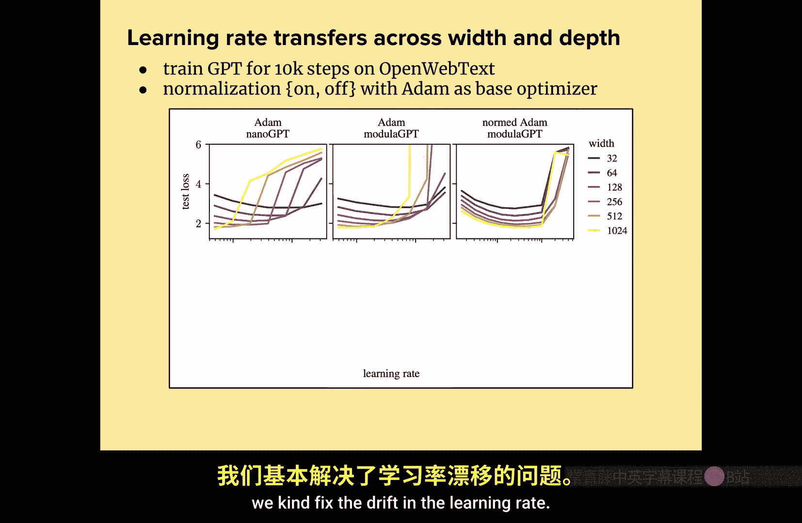

， so I guess from the perspective。My great answer has not been normal。

When you apply the normalmobilization。It's as if you are changing the way。Yes， it， it would。Yeah。

 that's the one perspective。 Yeah， it's learn。 I guess it would be a like changing learning rate。

 But in a way that's functionally dependent on the gradient itself。Yes。And， in。

 it changes the the learning rate in a way which depends on what the architecture of the network is。

 So depending on different layers， willll get gradients rescaled by different amounts。

So learning right here is a scaling of that entire process。

And this is to say that things also work in scaling depth。So the， the。

 the baseline nanoGP performance is like it kind of it's not so bad。 If you just scale depth。

 it works reasonably well， but it's a little bit messier。 And， and this is just。To say that。

 say in the middle plot， which is without applying on normalization procedure。

 Adam coincidentally does pretty well in terms of depth scaling。

 and then adding the normalization on top things stay pretty much the same， actually。嗯。

See this is good because this is pretty much what we built this whole thing to be able to do。

 So it's like kind of we knew these things were gonna work because we sort of had an intuitive understanding of how to do scaling。

 And then we kind of built the theory in order to。Do this。

 So it's like kind of knew this was gonna work。that's just saying we do some other things in the paper。

 But this is。Like， we spent a whole lot of effort to try to build this theoretical framework。

 And the idea that we have now is actually， maybe it's gonna be useful for other things。And。

Something I'm really excited about now is this idea of like duality and what we call modular duality。

😊，嗯。So what does that mean。嗯。And this， this is the thing which LED to the big training speed up。

 So that's where we care about this。 Or one of the reasons。所。If you remember that we have。

 we suppose now that we， we came up with a norm such that we could up bound。

The error and the linearization of our objective function。

And then we remember that because we did this on the homework。

 that you can then derive steepest disscent optimizationim algorithms by like solving the argument of this thing。

 like finding the minimizer of this thing。嗯。And then you remember。

 because you did it on the homework， that you can。Deuple the solution。 So that problem is two pieces。

 One is like evaluating a dual norm。And the other is evaluating a ag max over a set of unit vectors。

嗯。And so we think about the purple boxes as roughly being the step size。 And， and we can call this。

The second thing， we can actually call it a duality map。And what does that mean。It means that。嗯。

The basically， there's this idea in like more classical optimization theory that the gradient is a dual vector。

 and the weights are a regular vector。And the only thing that you're allowed to do with dual vectors and regular vectors is。

 is。Combine them。 Well， basically， the door vector is a linear map that takes a regular vector and returns a real number。

 And that's borne out here by saying that if you have a gradient， the thing that you。

 the thing a gradient is really， really， you know， what it's really good for is taking dot products with weights and and describing the linearization of the function。

 That's the only thing that you should ever really trust the gradient will tell you is。

 is the linearization of your function， the idea that you can take a gradient and just do gradient descent with it is like a generically a bad idea and like something that we should all forget。

😊，So that's like this idea of， of do， and it's like the idea that a do vector。

 even though it may have the same dimensions， like it may technically。

 you could add and subtract them because technically， they have the same dimensions。

 It can still be a bad idea。嗯。So， but， but what we need is a kind of form of a procedure。

 We need a procedure for converting dual vectors like the gradient back to the primal space。

Such that we can add and subtract them， But we should not just directly add and subtract them。

 But this is an example of such a procedure。And， and just， like just looking at this a max。

 like you can what you can think of it as saying is I wantan to take a step of unit norm。

 which maximizes the linear improvement of my。Of my objective function。

 and just like subtracting the gradient from the weights may not solve that problem。 I。

 is that youre big with that because we're doing non nonlinear optimization， Therefore。

 you have no guarantee that that point your gradient plus the set size results in。Well。

 for a sufficiently small step size， it will give you an improvement。

 It may just be really suboptimal because it may not solve like。

 there's a sense in which this thing is like an optimal procedure in the。

 just in the sense that there is an optimization problem here。 There's， there's a max。

 There's an a max。So there's some kind of， the solution to this thing will solve some kind of optimality criteria。

 If you pick the pick a good norm， it's like an optimality criterion that you really care about。And。

 and just， just moving in the gradient direction， there's like saying。

 is equivalent to saying that this is the Euclidean norm。And， and so this， the optimization space。

In neural networks， is's really unlikely to have a Euclidean structure。So， that's the argument。嗯。嗯。

And this is just a picture where it's suggested by some other ideas and optimization。 But it's like。

 you think about the weight space。The gradients， but the space that the gradient lives in。

 you think of it as being a very distorted version。

 So even though may have the same dimensionality as the weight space。

 the things that live in the gradient space kind of maybe are stretched and distorted。

 So we need some procedure to kind of。Undistor them before we gonna subtract them from the waves。

So this is just to say that if you ever， you should never do this ever again unless you're really sure that your space is euclide。

嗯。And， and， and that you should always think， like， what is this like dualization procedure that I。

That I。嗯。That I really need to think through what it is。嗯。In， in a sense。

 this should not be surprising because there's a kind of like， the， you know， everyone tells you。

 if you're gonna do deep learning， you should just use the add and opt it。

 no one ever tells you to use regular gradient descent。

 So there should be some idea that there is intuitively。

 we all know there's something bad about regular gradient descent。

 We just don't quite know what it is。嗯。So， this second thing is supposed to pass the type chat。

And the question is， like。How do we come up with such a dualization procedure for a neural net。Well。

 if we built this， you know， we had this recursive procedure for inducing a norm。

On the weight space of the full neural network。 So maybe there's a corresponding procedure for recurively constructing a duality map。

So that's what we wanted to propose。 So it's the idea that given individual layers。

If you have a norm on the weights of an individual layer， you can solve a duality map for that layer。

And that's， that's what you did on the homework。 because we said that we're gonna give the linear layers。

A spectral norm。 And then we're gonna solve the duality map that corresponds to the spectral norm。嗯。

And then once we've solved those layerwise duality maps， it turns out that there。

 there is like a valid recursive procedure for combining them to come up with a duality map on the flow architecture。

嗯。Which I didn't put write it down in the slides， but maybe it's something fun to think about。

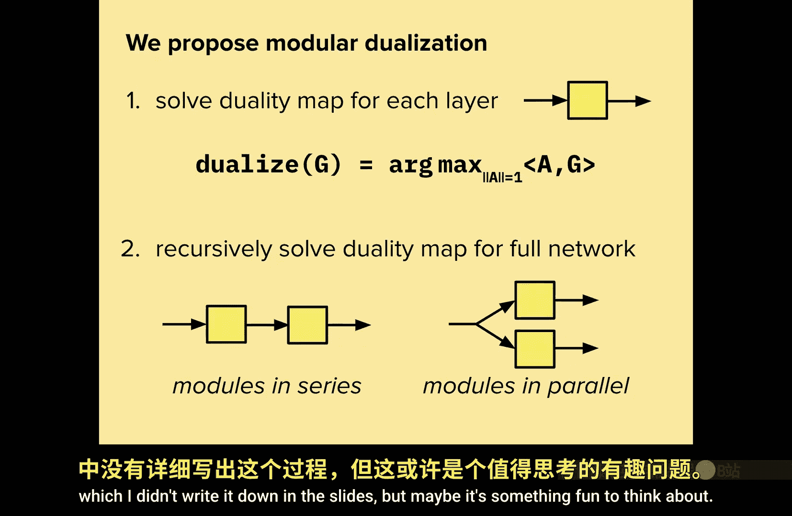

嗯。Okay， so this would mean that the realization of G always has a normal y。

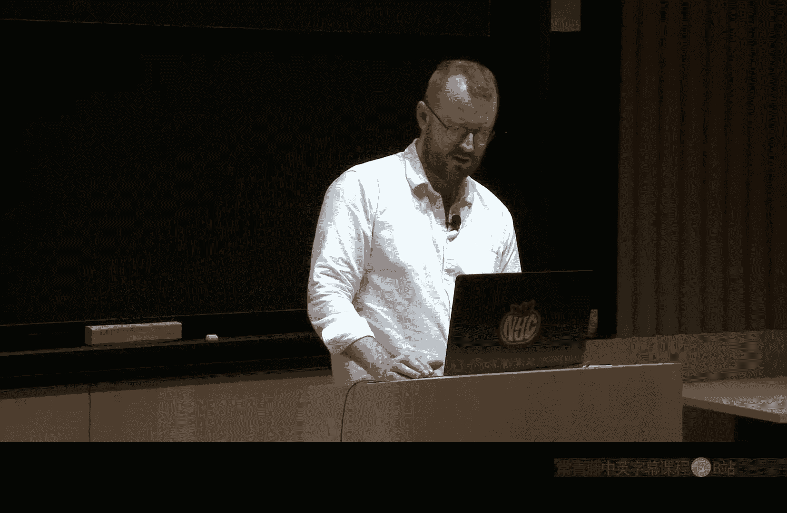

Yeah。It's because we broke up。 we broke things up into two pieces。 So oh。

 so it's a project in that space。So we broke up finding solving this argument man。

We broke it up into like solving an ag map over unit vectors and then multiplying by the dual norm。嗯。

So I say there's also a recursive procedure for computing the dualn。

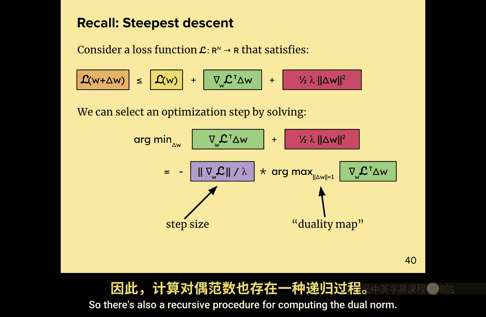

I， I just didn't talk about that on the slide。Okay。

 so I guess I'm interpreting it as we're finding whatever coordinate， the project of the gradient。

Maybe I'm just looking at art Mac。In the next slide， I'm looking at the argument。Inner product。

She's interpreting that as some sort of projection。嗯。It doesn't necessarily have to be a projection。

Actually， maybe it is， in some sense。Yes， maybe it isn't the project。

Definitely the one on the homework was a project。Yeah， I think for norms。

 they probably usually use it for ja。嗯。So yeah， I need to just think through that。 But I I。

 I think you're probably right that this you can think of it as taking the gradient and projecting it to the unit normal。

 but also distorting the direction。

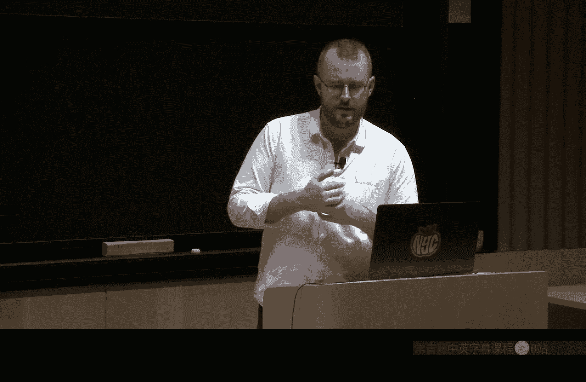

嗯。But yeah， this， this is supposed to be you thinking about it as。You've。

 you've got some lips guarantee and some literate smoothness guarantee， which tell you。

How much the neural network output is going respond to changing its weights。嗯。

And so that in particular， one of the things that tells you is when the second order changes in the network output become important relative to the first order changes。

 So a sensible thing to do is to take an optimization step。

 which squeezes as much kind of juice out of the linearization as as possible while like making sure that the second order network effects don't dominate the first order effects。

 because the gradient really only tells you about the first order effects。

 So that's like an intuitive description。 And like。

 if you can solve that problem for individual layers， how do you。Solve it for a full network。

 And I'm just claiming that there's a reccursive procedure for doing that。嗯。

And this is just to say that， like， to tell you a little backst。

 at least where I became interested in this is because there's like an optimization algorithm that people at Google proposed called shampoo。

 which won this like speed challenge at this like。😊，Industry benchmarking competition。

 But if you like， read the paper。That proposes this method。 Like， you know this， that， first of all。

 the method that they actually use is like totally different to the method in the paper。 And like。

 it kind of feels like。Maybe there's not like a， let's say。

 a complete understanding of what the method is doing。So I just wanted to like。

 look at this method and kind of strip away some of the things which people don't actually use。 And。

 and it looks like the core primitive in this algorithm is basically through linear layers。

 It does this funny gradient transformation。And then realizing that this funny gradient transformation is actually equivalent to that homework problem that you that youll do。

But like， when you read the paper， they don't frame it that way。 So it's kind of interesting。

 but it seems to really speed up the training。嗯。So， so the basically。

 the claim is that hiding inside of this optimization algorithm that people at Google are really excited about is。

 is this like very simple primitive。😊，嗯。And we like from the。

 because we were working on this module and on stuff。

 it's very easy to implement this type of algorithm because we just override the normalized function of a linear module to do this。

 like spectral。spectralral operation。And then I implemented it in like a simple notebook。

 just as like a proof of concept。 and could actually see that。Doing this special normalization。

 it actually leads to training much faster than the thing in the middle。

 which is just like a naive form of special normalization。😊，And much。

 both of them are much and much better than just like vanilla gradient descent。嗯。Okay。

 and then this put， there's like this open source like neural network speed running community。

 and this person Keller， Jordan， like。Made a really。

 really fast implementation of this like spectral spectral dualization procedure。

 It turns out at the moment， it's like the fastest way to train nano GPT on this speed run。

 So it's like seems that's actually like the worry with the technique is like， maybe in principle。

 it's the right thing to be doing， but it's so expensive to do these。

Spectral normalization operations。 that it's kind of practically useless。

 But it turns out there's actually a way to implement this dualization procedure really fast。

 using an I iterative method。

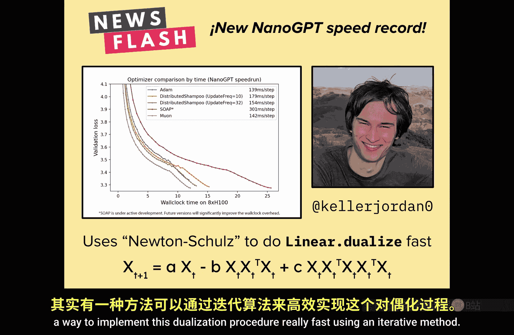

嗯。So this is to say that what I told you， you know， when we wrote this moduleular package。

 we actually kind of did it wrong because。When we said that， we should normalize。

That is actually not optimal。 We should actually do this like dualization procedure。

 and it should kind of recursively compute the dualization based on the architecture of the networks。

 So we still need to update the package。 So do that。

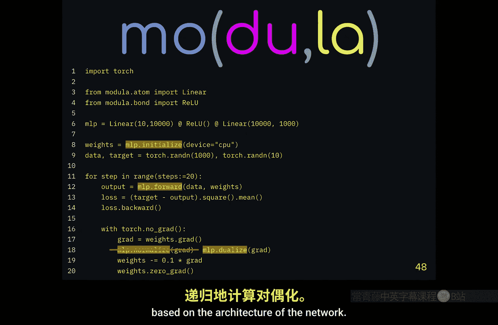

嗯。So， in conclusion。Yeah， I really think， I really like this idea that we should think about building a neural network as building Lago and that you should be able to build whatever you want。

 and you should be able to have have like a theoretical understanding of what whatever you build。

 and it should be based on like thinking about just how you combine individual breaks。😊，And so far。

 like， we've been thinking about these scaling issues。 And now， apparently。

 also'll these like speed record， like training speed records。嗯。

And I I think that this idea has not really like proliferated at all， really。

 But I think it can be more like generally useful idea。 So if you want to save energy and money and。

 and time。 a good way to do that is to make your models really low precision。 But there's like。

 no one has like a theoretical understanding of how precision in a neural network should behave。

 So as far as I can tell， all the research is kind of like。😊，Just， just trying stuff。嗯。

But intuitively， precision and continuity are very closely， like very intimately related concepts。

 because。You need， you if you wantan to quantize as much as you can， you need to know， like。

What discretization scale， the spaces like kind of continuous on or something like that。

 And similarly， the like these classic adversary of robustness things。

 I think should also be related to having a good。Good understanding of the continuity properties of the space。

 So you want to cast these， as questions of module sensitivity。

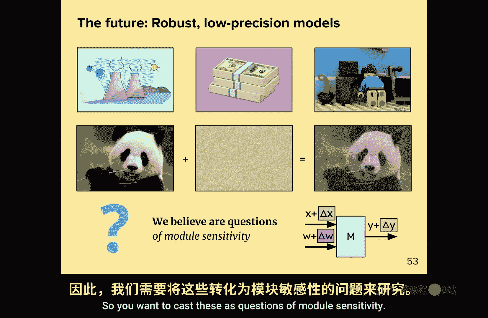

And I， I want to turn this into like a open source project。 So I made this website。

 but it doesn't have very much information there yet， but。

Anyway， that's， that's it。 So yeah， thanks。

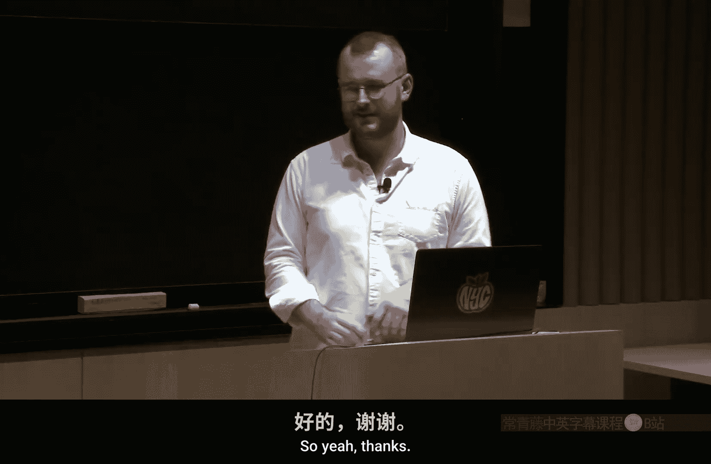

