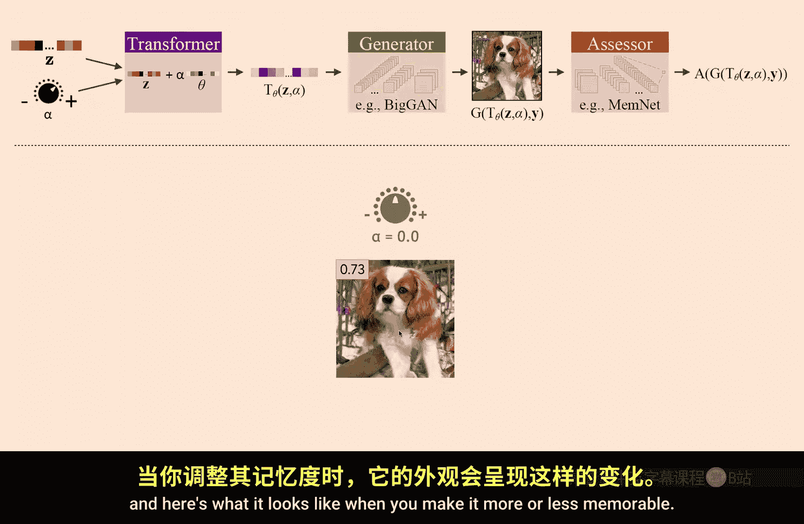
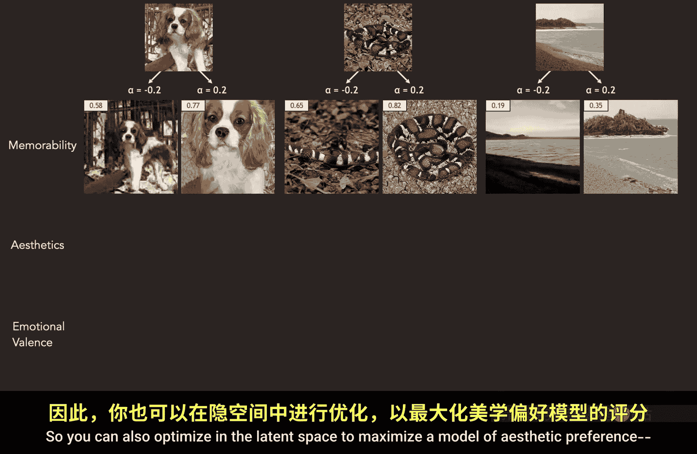
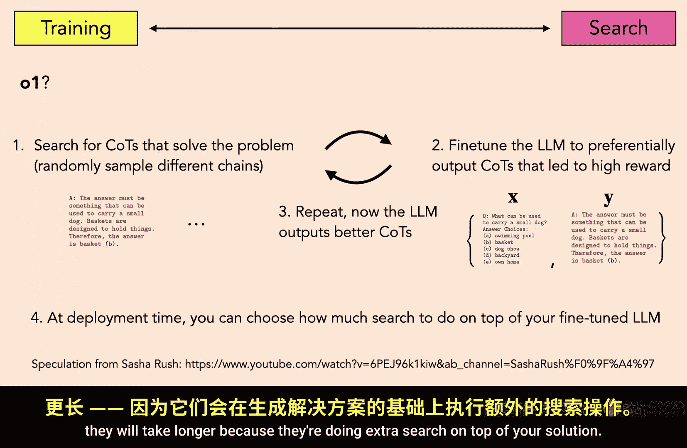

# 麻省理工学院【中英⚡深度学习｜6.7960-Fall-2024,-Deep-Learning】-p23-P23-深度学习的推理方法--BV15QZ4B1E6v_p23-

Okay， hi everyone， welcome。Thanks for sticking through and coming for the last few lectures。

I know things are probably busy。Okay， so today I'm going to give a brand new lecture。

 So this is a topic that wasn't really a big thing。Last year in previous years。

 but this year has suddenly become quite the hot topic in deep learning in AI。Of course。

 the ideas in this lecture are going to be very old， and they've existed for a long time。

 But it just has become one of the new things that's happening in 2024。

 So we thought we really needed to have this as a lecture topic。

 So this is all about what I'm going to call inference methods for deep learning。Give a shout out。

 Some of this was inspired by this tutorial from Sasha Rush。

 And you should definitely check out that tutorial if you're interested in learning more。😊。

And the payoff for this lecture will be that you'll learn how the。

 the very latest models like Open the eyes，01， presumably work。 We don't know exactly how they work。

 but this lecture is my best guess as to how those types of models work。Okay。Oh before I start。

 let me say that on Thursday， we're going to have。The course class lecture will be office hours。

 so we will have the various Ts and instructors here and you're welcome to come to this room and ask us questions。

 use that entire lecture session。 There won't be any talk or any presentation will just be for you to come and get advice on your final projects and work together with everyone。

Okay。So we'll make an announcement about that on Pazza as well。So inference， what is inference。 Okay。

 this is a little confusing if you have taken a statistics class。

 because the definition of inference in statistics is different than in machine learning。

So the statistics definition is that inference is about figuring out properties of a data distribution from samples from that distribution or figuring out properties about a data generating process。

 Maybe it's not characterized as a probability distribution， but some generative process。

 trying to figure out properties of that process， from samples from that process。Okay。

 so what do we call that in machine learning， We typically， it can get into different names。

 but maybe density estimation or typically it's some kind of learning or training。

 So the thing that they talk about in statistics as inferring the parameters that explain the data generating learning process。

 we call that training a model。Okay。So the M L definition of inference is what statisticians call prediction is using the model to make predictions about a new query point。

 So to make inferences in the more colloquial sense about。

The answer to a new question or the interpretation of a new image or the you know。

 whatever data you're processing， using the model to answer questions about that data。O。

So we're going to go with the ML definition， and that's the one that's becoming kind of taking over。

 But， you know， statisticians will still complain about this。

 So be careful when you talk to statisticians。Okay， so here's the kind of outline for。

Some of the topics that we'll see。 Well， I'm only gonna cover some of these today。

 but this is how I tried to parse the landscape of training and machine learning models versus using them to make predictions。

 So training versus inference。And most of this course has been about the training side。 And indeed。

 most of deep learning as a field has been about training models。

On data to learn properties for that data。And the use of those models at test time for， you know。

 what I'm calling inference has been a more minor subject so far in this class。

 it's almost entirely been just a forward pass through the train model。

 That was all you do at test time。But it turns out you can do much more than that at test time。

 and if you do， you'll get a lot of advantage。So we've seen some of these topics。

 but let me just quickly go over this diagram and we'll come back to it a few times in this。

 in this lecture。Okay， so we have two regimes。 We have training and inference。

 So training is what you do in the， in the factory， at the company， it's。

What you do before you actually come across new problems in the wild。

An inference is what you do at test time in the wild on deployment， on device。

 It's what a robot would do as it walks around this room and understands what's going on。

I guess we have those two different phases。And by the way。

 these terms and these distinctions are my own attempt at categorizing things。

 There's a lot of different ways of looking at this。 These are not hard boundaries。

A few of the terms could go under different categories。Okay， so training is also called learning。

 It's called statistical inference。 And in machine learning， we might call it amortized inference。

 meaning I'm going to be kind of am like inferences about solving a problem and training learns a set of weights that kind of directly solves the problem without having to go through the step by step restreaming process。

So it like amortization of the。More extended thinking inference process。Okay。

 inference might go into the prediction or thinking， reasoning cognition。 is I have a new query。

 and I want to understand what the answer will be by thinking through things。As opposed to learning。

 which is more about coming up with like a direct feed forward heuristic mapping from data to answers。

Okay， but there's a lot in between。So the most kind of extreme version of training is pre training。

 And that's what most of this course has really been about。 It's been about representation， learning。

 generative modeling， coming up with foundation models， doing next token prediction on the Internet。

 coming up with a really good set of weights that is generally useful for a lot of tasks。

But then we said that you can also take that pretrain representation and apply it to your problem of interest by fine tuning or transfer learning or adaptation of various kinds。

So pre training given a model。 sorry， given data， learn a model or a representation。呃。The training。

Part of post training or adaptation would be given a model and new data or a new task specification。

 update that model to solve that new task。 And the main method for that is fine tuning。

 But there's other methods like reinforcement learning from human feedback that we heard a bit about in Jacob's lecture。

Okay， then we're gonna move over to the upon deployment side。

 So this dotted line is meant to be now I've taken my AI system。 and it's not in the factory anymore。

 It's not in the server farm。 It's out in the world。 Its being used by a user。 So at deployment time。

 we can also adapt a models behavior。 There's a few ways of doing that。

 We could prompt it with different commands， we could do in context learning。

 which I'll mention again。 But Jacob also talked about in his lecture。

And then there's a few new concepts that'll introduce test time training。

 and there's a few concepts which I won't have time to get to， but are also important。

 Like anytime you have a model that is using feedback in order to update its behavior。

 like a robot walking around and feeling its contact and it the gravity direction direction and then its torques and its joints and so forth。

 It's gonna use that feedback to change its behavior。

 So any time you have this like feedback control， This is like。

Changing the model's behavior based on the test data itself。Okay。

 and then we have the most extreme side of， inference where we're not actually updating or changing the model's behavior at all。

 We're just using the model to search through a space of possibilities and find the best one。

 So given a model in a query， find the best answer to that query。

 And this is where we get to things that are really outside the。

 the realm of traditional deep learning。 But now increasingly popular。

 This is more classical AI search methods like tree search and breadth first search and depth first search and trial and error search and so forth。

😊，Okay。Cool， and then I'm gonna at the end of this lecture。

 talk a little bit about this interesting interplay between search and learning。

Where you can use search to learn new things， and you can use learning to speed up your search over the space of possibilities。

And。One thing I kind of realized is that a very general purpose name for all the methods that do that are basically reinforcement learning。

 So reinforcement learning， we'll come back to this is kind of the idea of using search to improve learning。

😊，Okay， but there's also some more modern things that are really exactly list like the star method and then presumably the O1 method from open AI。

 but we don't really know。Okay， so let me come back to the。

 the bitter lesson that I mentioned a few lectures ago。So the bitter lesson as you might recall。

 is this essay from Rich Sutton。 And he said， you know， the。

 the big lesson in AI has been that kind of hand designed systems with clever。

 inductive biases and handr algorithms。 They just don't work that well。

 there's only really two things that work。 It's simple methods at scale。 And the two。

 the two that we know of are search and learning。Okay。

 so a lot of people have focused on the learning part。 That's kind of the deep learning idea。

 Just collect a lot of data and trying to network to imitate that data。

But sudden specified search as the other option。 And so let's talk about what is search。Okay， and。

 and this is what's happening really in industry right now is this move away from only focusing on train time compute。

 but now using a lot of test time compute or search at test time。So this is a。

 a plot from the blog post on the open AI 01 model， their latest model， and。

What this plot is showing on the on the left is that as I train with more flops。

 I get better results， right， That's the scaling law。

 That's just train time computers like I'm training on more data。

 or I'm doing more durations of gradient descent。 Or this might， in fact。

 be some kind of R L training part of the pipeline。Whatever it is， if I train on more and more data。

 I'm going to get better and better accuracy and there might be some kind of power law that relates my training time to my test performance。

Okay， so notice the slope here is like maybe 0。5。The really interesting thing is they said， well。

 wait a second。 What if I scale up the amount of compute I apply at test time to do intelligent inference or search through my model。

 We'll talk about how that can be done。😊，And they saw that you also can get a power law。 And。

 in fact， the slope in this particular case is even steeper than the train time power law。Okay。

 so the， the big move that a lot of companies are making right now is from only focusing on deploying compute at train time to now deploying a lot more compute at test time。

 not just pass through the model， but many， many passes through the model at test time。Okay。

 so that's a big change from a few years ago。Okay， so what is search。

 I think a lot of you have taken like intro AI and algorithms。 So， you know。

 basically that search is methods from those classes。 But let's， let's go over it。Okay。

 so search is the way that AI used to be done。 So yeah， in 1994。

 maybe Drry Kasparrov was beaten by this trust。Machine called deep Blue， and。

The way that that AI worked was it it was just based on search。

 It had very little or maybe no learning or anything you'd really want to call learning。

 It just did kind of look ahead search。 It said， well， if Casprorov makes this move。

 then I could burst along with this move。 and then he might make that move。

 and I could make this move。 And it looked through this chain of all the possibilities 12102030 moves in advance。

 And it just made this huge， huge chain， the branching factor of that huge huge tree。

 that branching factor of that tree was in chess， however moves。

 you can make at each position in the chess game。So it turned out that chess has not had that biged factor so you could kind of enumerate all possible futures and just take the set of actions will lead to the best possible future。

Okay， so just searching over all the things that you could do。 if any of you play chess。

 you probably do this in your head。 You know， you think about all the possibilities。

 and then you pick the move that will kind of maximize your expected reward against all those possibilities。

Okay， then some years later， AI systems won that go with the Algo system。

 which you've probably heard about。 and Algo also heavily uses search。

 But Alphago uses both search and learning。 So it's one of these methods that uses a combination of the to。

 But I'm gonna focus on the search part right now。 So what they did is they， they again said。

 here's a particular game state。 Let's just expand out the tree of all possible futures。😊。

So the after this game state， my opponent can move in these two locations。

 Maybe there's other locations。 they can move to。 And then I'll descend the tree and say， well。

 if they move here， then here's what I should do。 And I'll kind of search through the space of all these possibilities。

 Now， the branching factor， The number of branches in that tree for。

 for the game of go is much higher than the game of chess。

 And that's why they weren't able to do force search like they did in chess。

 Since did they had to do search with with learned heuristics on top。'll come back to that， too。😊。

Okay， so there's this general observation that there's these two things that just get better with more compute。

 One is learning， and the other is search。 And sometimes they trade off and you can kind of get a good AI system with one or the other。

😊，And this is an interesting paper。From Jones on scaling laws of board games。

 where they actually said， well， we can solve chess either by taking in a million chess games or a billion chess games and learning a mapping from the board state to the best action that Gary Casbrorov would make。

 or we could solve chess by just not having any pretrain like learning of optimal moves。

 but instead just for every game position and search ahead in time and see that tree of possibilities and take the move that maximizes the expected value。

And there's kind of like a trade off， like a preto front， like I can。嗯。Well， yeah， it's。

 it's just a trade off curve。 It's saying that I can do more search。

 and then I can get the same elo for less training， or I can do less search。

 and then I can get the same elo for more training。😊，So there's two different ways of being smart。

 search or learning。And sometimes it's better to use search。

Because I don't have to spend as much time learning。 And maybe it scale better in some sense。

 And sometimes it's better to do learning because in other situations， that might scale better。

 And also learning means that I don't at test time have to do a lot of compute。

 So search as test time learning as train time。Okay。Okay。

 so now let's talk about some search methods that are used in deep learning。

And I'm gonna talk about the these three in particular best event beam search and chain of thought。

 We we already saw a chain of thought a little bit。Okay， so。

The first thing that I want to convince you of is that。The language models that we have。

 which are autoaggressive models。Can be improved by sampling multiple possible completions and picking the best one。

 So why， why can they be improved。 Let's look at how these systems are trained。So this， this。

 this slide is a little bit old。 So I showing an example with an LTM。

 you could replace it with a transformer， but it's， it doesn't really matter。

 let's just keep it as an LTM。 So here we have a molecule。 Anyone recognize what that molecule is。

Somebody knows it。Caffeine， yes， okay， So what we're gonna have a graphnet that process this。

 Maybe youre your final project。 you're putting together different architectures that suit the data。

 So graphnet makes sense on a molecule。 and then we're gonna have an LTM that will spit out a sentence that describes like this is like。

Molele to sentence， right， captioning a molecule。 So it's gonna say， oh。

 this is a mild stimulant that enhances cognitive abilities。Okay， that's caffeine。

So here's how you train that system。 We're going to have a data that we're imitating。 This will be。

 you know， just generative modeling。 So we're going to try to maximize the likelihood of the。

 of the target data， which is just sentences from some corpus。

And we will output a categorical distribution over the next token and sample from that in order to produce sentences。

Okay， so we're going to try to maximize the， the likelihood of the sentence or the character's why at every point in this sequence。

Okay， so just another another picture of that Y is going to be a one hot probability vector。

 and we're going to make a prediction。 I'm going to take the cross entropy。

 That's just doing the pointwise product between the one hot vector and the predicted probability vector。

Okay， so that's cross entropy minimization。 So this is stuff you've seen before。Oh。

 the color changed。 Okay， anyway， so there's this interesting。Thing that you do in transformers。

 this stop being a term。 But in the LSTM era， we used to talk about the way of training this thing as teacher forcing。

 So what does teacher forcing mean， Tea forcing means I'm gonna take the target sentence。

 I'm gonna shift it by one。 just like I would normally do a transformer training an auto aggressiveive model。

 And I'm actually going to tell the the LSTM， rather than just like reading off the entire sentence。

 I will tell it the ground truth previous word at each time step is whatever。

 whatever it was in the training data。Okay， so I'm going to condition each next word prediction on all of the ground truth previous words。

And this is， this is where you can see there's kind of a deviation between how we'll use this system at test time and how it was trained。

 It's trained to predict the next word， given the ground truth previous words。

 But at test time at deployment time， we're going to。

Condition each next prediction on the model's own self generated previous prediction。

So that's the difference。 That means that maximizing the likelihood of the training data。

Will be have kind of a gap from what we really。Would want。

 which is to maximize the likelihood of entire sequences sampled from the the model。

 So it's actually going to be maximizing the likelihood of the models's predictions of every next character or word。

 given the ground truth previous words， which is not what you actually have at test time。Okay。

 so this teacher forcing way of training means that you're not actually going to be maximizing the likelihood of the caption given the data。

At test time， because here's what we do at inference or at test time。

 We sample from the predicted distribution over the next words， Or maybe we do greedy sampling。

 where we just take the most likely next token given the previous tokens。 So first。

 we'll sample the word A。 And then we'll condition the model on that we sampled a。 So now。

 now what comes next a strong and so forth。 And this is how you sample from a autoaggressive language model。

 And again， I'm showing with an LTM， but you do exactly the same thing as a transformer。 right。

 you condition every next token prediction on all the previous sampled tokens。

 You're just writing one word at a time。😊，Or one token at a time。O。So。Now。

 because these are samples from the model， they might differ from the ground truth distribution that the model is trained on。

 And there'll be this kind of， this kind of draft that occurs。

 The model will produce something that's like a little bit。Different than the true data distribution。

 And then its next predictions will be kind of out of distribution compared to how it was trained。

Okay。Yeah， so then I guess stand。Okay， so the important point here is that auto aggressive。

Greedy sampling。The way that you either either greedy sampling or non greedy sampling。

 But let's say utter aggressive greedy sampling does not maximize the joint probability of the entire sequence。

Okay， so remember， the auto aggressive model is a model the probability of a sequence of tokens。

 and it decomposes by this chain rule as probability of the first token。 then the second one。

 given the first one， This is the underlying probability model of autoag models。😊，Now。

 I really want to find the sequence。 in this case， the caption or the sentence。

That maximizes the joint probability。That my model assigns for the data。Right。

 that will be some sequence。 but with。Greedy sampling。 I will first take the most likely first word。

 and then I'll say， given that word， take the most likely second word and so on， this sequence。

X 1 star， X 2 star， X N star is not going to equal。The optimal joint configuration。

 I've used the same notation， but those are not the same values。 Okay。

 you can construct counter examplesles where that's not the case。Okay。So an observation here is。

 could we do better than greedy sampling， Could we come up with a different way of sampling that gets higher likelihood configurations of the data。

 Yeah， question not equal。sorry， the equal sign is true。

But the argmax solution is not the same for the am over the joint configuration。

 argms over the individual conditionals， yeah。Yeah。

 I probably should have had like a prime or something to indicate that those were different values。

Okay。So。Question for you to think about。 What， what about。

 So this is true for auto aggressive models that if you。Take the samples that maximize the you know。

 the sequence of conditional probabilities。 You don't necessarily get the max likelihood joint configuration。

What， what about for V A， What if you sample from a V A E and you take the。

 the arg max the most likely sample， like you just， you encode and know， it's a Gaussian V AE。

 So the， the most likely sample is， is the mean of that V E。 Do you get the same issue。

What do you think。This takes a little bit of thought。How about for a diffusion model。

If I do de noisy and step by step is my final output。And I I do greedy denoising， right。

 So I'm denoising。 And I'm going to predict the， the most likely noiseless， less noisy image。

 And then I'll do that iteratively。 Will I get。The most likely estimate of the noise noiseless image。

 given whatever I condition on。What do you think。Anyone wna give a， give a guess。It's a little。

 it's a little tricky。Okay， so it's the same exact thing with diffusion models。

 So diffusion models are also iterative step by step in every sampling step。

 you're going to try to remove a little bit of noise， but not all the noise。 And if you do that。

 that that and you， you've。You know， you make your prediction。

 It's going to try to maximize the conditional probability of slightly less noisy。

 given slightly more noisy。啊， then。That won't necessarily result in a sequence of samples that a sequence of denoising steps that。

That maximizes the probability at the end of the sequence。For the same kind of reason。Okay。

But with V AEs， it's not really sequential。 There's just one step。 There's just encode code， decode。

So I think with the VEs， if I'm actually having a V that models a full sentence。

 there's no like sequential process where my sampling could be deviating from the like the most likely sample for the entire joint configuration。

 Okay， something more for you to think about after， after the lecture。Okay， but I will say one thing。

 I I mentioned the diffusion models， because I think there's not as much work。

In trying to do intelligent inference through， through diffusion models。

 there's a lot of work on doing intelligent inference that's better than greed sampling for language models that are auto aggressive。

 but less for diffusion models。 So maybe an interesting open topic for you to work on。

 How do you take higher likelihood samples from a diffusion model than you'd get with the regular denoicing process。

I'm sure there's some work on that， but just not as much。Okay。

 so now let's look at some fancier inference strategies than just doing。

Autregressive greedy sampling。Also， remember that in most language models， you just take you know。

 random samples。 you you， you predict a distribution over the next token。

 and then you randomly sample from that distribution。 And certainly。

 a random sample is not necessarily going to be the most likely sample。

 So if I want to answer a question， like， what is， you know， the caption of this molecule。

 I might get a random description。 That is low probability。 just by chance。

 That's why we want to do better inference to get higher probability samples so we can answer questions more accurately。

Okay。So。嗯。The best event approach is really simple。 It just says， go with your random sampling。

And do it n times。take。And samples from your auto aggressiveive models independently and identically。

 and then evaluate the total likelihood of each sequence that you generated。 So remember。

 when you're sampling these sequences， you're not sampling the max likelihood sequence。

 whichre sampling a random sequence from the distribution。 And。

 but you can evaluate the likelihood of any sequence using the chain rule， right。

 So I can evaluate the probability of whatever sequence I generated by just multiplying all the conditional probabilities under my model together。

😊，Okay， so here I， I sample one sequence， a stimulant that enhances cognitive function。

 And then I run that through my auto aggressive model by just multiplying all the conditional probabilities together。

 And I get  point7。 that I sample another time。 This time， I got a different random sample。

 a stimulant that improve thinking right when you play with the language model。😊，You know。

 type in the same prompt twice。 you'll get two different answers。

 typically because it's sampling from a distribution。Okay， here's another one。

 And and then maybe I'll say， I'll do this n times。

 And I will say this is the one that maximize the probabilityba。

 So this is the most likely caption in my， according to my my model or my data distribution。

 at each time step， when you sample the nextken in the output sequence。

 I it proportion to the probability distribution。 Yeah。Yeah。

 so the way that auto aggressivegressive sampling usually works is。

You output a categorical distribution over the next token。 given the previous ones。

 That's each of the conditionals。 And then you just take a sample from that distribution。

 There's a parameter called the temperature where you can。

 you can scale how flat or spiky the distribution is。 And so if you set the temperature to one。

 then you're taking like unbiased samples from the data distribution。 And if you。

 but sometimes you want to scale it differently in order to get like。Moode seeking behavior。

 like you just want to take the likely samples。I'm going to try with like， oh impossible。

Because I guess。は。Right， good question。 So are you're gonna try with all possible combinations。

 So that's you can make that argument and say， well， if I did try with all possible combinations。

 then this would be， this would， this would work。 like I could find truly the max likelihood sample under my。

 my model。 But that would be incredibly expensive。 So instead， you only you sample from the model。

 And maybe you turn the temperature down a little bit。

 So you take is trying to take like high probability samples。😊，But if you turn it down to 0。

 then it's gonna take the greedy sample。 and that might not maximize probability。

 So you want it to be like a temperature this non0， but not like infinity。

 where you'd just be searching over the space of all possible random sequences。Yeah。

 we may sense to think a a where this is your starting point， but then you improve， for example。

 take this 0。8。Great a small improvement。 We， we take chemicalclo。 You put single in。

 And maybe how you get to perform that。 Yeah， that's， that's a great idea。

 So could you take this solution and then say what if I change one of the words。

 Will I get a better solution。 So in general， this is the whole space of。😊。

Like optimization and statistical inference， like you could do MCMC。

 where you start to like you could do gib sampling。

 You could do all kinds of interesting things where you take your。

 your current solution and you try to just modify one know dimension of it at a time。

 or you try to do hill climbing where you just like look for a local perturbation that improves it。

 So there's just a very rich space of methods that can try to optimize over that sequence to improve it。

 You could take a language model and say， hey， rewrite this in 10 different ways that you think might improve the performance。

 That's another thing that people are doing。😊，Okay。Okay， so， but best event， interestingly enough。

 to my knowledge， this best event sampling is about as good as anything right now。

 And it's like the most naive is rejection sampling essentially， or it's just。you know。

 sample 10 independent things or an independent things and take the best one and reject all the other ones。

 But there's smarter sampling methods。 And one of the other sampling methods thats quite popular is called beam search。

 So this is like a tree search method。 It's a little bit like what you were suggesting。

So here what you do is at every step of your auto aggressivegressive generation。

 you maintain a memory of the top K。Best next words。 And you start expanding out。Not just the。

 the best sample or a single sample， but more than one sample at a time。 So maybe I'll say， well。

 strong or mild or both equally probable。 And then given strong。

 then there's these two other possibilities that are the highest probability possibilities。

 And I'll span this tree out with some branching factor K。 And then at the end of the day。

 I'll just look at the path along that tree that has max probability。Okay。

 so a little bit of a it's like a tree search method as opposed to just like an independent random search method。

But otherwise， it's the same idea。Okay。So again， there's a lot of other fancy search methods that you could use。

 but beam search best event seems to be the simplest and also works about as well as anything。

 as far as I can tell right now。 And beam search is maybe the most popular or slightly more advanced method。

So in language models， you might have an option like beam search on or off。

 so you can try playing with that。Now， what about chain of thought。

 We talked about chain of thought or Jacob Andreas in his talk， talked about chain of thought。

So train of thought。Is I'll refer to it as kind of an emergent or learned search。Right， so。

 so here's an example。 This is just from chat GT last night。

 So I want you to use beam search to solve the following problem。 right， I could。

 I could just use beam search。 I could say， what is  four times 5 plus 10。 That's the problem。

 I could put that from my L LM。 Exp out all the possible sequences of completions and then take the one that has highest probability。

😊，And that might be a better solution。As long as probability is related to actual accuracy on math。

 which it might or might not be， that would be a better solution。But instead， I'll just say。

 maybe if I prompt you， you can do that beamt yourself because you've observed and your training corpus examples of。

Of this kind of behavior。嗯。Or maybe you've been tuned with reinforcement learning and other methods。

 But basically， it does kind of work。 So here's what it does it。

 It output a whole bunch of like preamble that I'm gonna skip。 And then it says， okay。

 here's my beam search of two different sampling trajectories。

 And it turns out I think the better one is the four times 5 plus 10 equals 30。

 So I could go four times  plus 10。 And then I say my next sequence of tokens will be I'll kind of parse that as 20 plus 10。

 And then finally， I'll get to 30。😊，So， so what is chain of thought。

 chain of thought is kind of like doing a reasoning or search process that could be written with a classical algorithm。

 But it's the LM doing it itself and writing the intermediate steps into the。

The text space into its context and then auto aggressivelyly continuing on。Okay。

 so one way of thinking about train of thought。Okay， so that was all about。

How to get higher likelihood。Sequences from an auto aggressivegressive model by doing some kind of search or optimization over the space of possible sequences that are somewhat likely under the model。

 So you're being guided by the model， the model's likelihood。

 But then you're trying to find even more likely configurations。

But it turns out you can do the same exact thing， but not for likelihood。

 but for any kind of scoring function。Okay， so I could say。

 what if my scoring function is like a measure of how like fun or， you know， whatever fun this。 Okay。

 so this caption is not very fun。 It sounds kind of scientific。 Okay， here's， here's one。

 So what is this molecules nature's tiny chileader jumping into your bloodstream with pom poms。 Okay。

 languagegu model gave me that。 I didn't， I didn't come up with that。 anyway， that's more fun。😊。

And then maybe old output emojis。 And that's the best。

 And so now what I can do is I can sample best to N。

 but not according to likelihood or a learned model， But something else， maybe。

 maybe this is in people online。 This like people voting online。 Maybe it's humans。 Okay。

 and then I'll say， okay， I'll take that one。So whatever scoring function I have。

 And this is a really popular thing to do right now。

 This is kind of the basis of what's called reinforcement learning from human feedback。

 where we give humans rate all the sequences， and they pick the best one that the humans rated。

And you could change it to any function。 Here's scientific accuracy。 It's a different function。

 Maybe it downloaded a model of scientific accuracy。 And， and now it picks this as the best。

The best description。Yeah， so this is your score is that another model that you're training。

 It can be it can be absolutely anything。 So something that takes in a sentence and gives you a scalar out。

 it could be another model that you've trained。 It could be a human brain。

 It could be an animal brain。 It could be a formal proof checker。 I'll show you another example。

 This is called this is a really popular type of scoring function called verification。

 verification usually has connotation that you're going to actually like check the output is correct using some formal process。

 In this case， the formal process might be a compiler or a mathematical proof checker or maybe the verifier here。

 So here here we have the input is write a python program to compute the Fibonacci sequence。

 The language model outputs two possibilities， it could output infinite possibilities。

 But I'm just showing too。 And then the verifier could be something that has like it knows what the Fibonacci sequence is。

 it can check。 It can run the program and see if the program。😊，Wch is the Fibonacci sequence。Okay。

 so the verifier in this case， if I have the whole Fibonacci sequence。

 I can check that the output of the LM matches。 And if it does， then I say that that's my solution。

 And I can just do best men in this fashion。😊，And why， why is this a good idea， Fundamentally。

 it's a good idea because verification is easier than generation。

So checking that I correctly solved a math problem or I correctly made code that does has some desirable property is just fundamentally easier than coming up with the code that has that property。

 or coming up with the solution to the math problem。

 So proving a theorem is fundamentally harder than checking that that a proof is correct， right。

 This， this goes back to things like the。The the MP class of。

 of problems that these are checkable in polynomial time。

 but we don't know we expect that they don't have a way of solving the problem in polynomial time as long as P is like will MP。

Okay， so verification can be really easy。 You just， you just， you know。

 check that you actually output the Fibonacci sequence。

 But how did I write an algorithm that does that。 It might not be trivial。Okay。

 another example of this would be， you know， verifying that doing prime factorization， right。

 coming up with finding the prime factors for some big number is is a hard problem。

 But checking that some set of factors multiply to equal the number is an easy problem。Okay。

So a verification can be the scoring method。Okay， so you can do all these same methods。

 not just for language models and auto aggressivegress models。

 but also for other types of generative models。 So I'm gonna take a little aside into some work that I did。

Now， quite a few years ago， but I have， I have slides on it。 so I thought it would be fun。😊，Okay。

 so this is going to be trying to steer models toward human preferences。 So a little like this thing。

 R LHF。Okay， so。What what are the great objectives for AI？

This class is almost entirely focused on just one。Which is given lots of wonderful data。

 just imitate it。Okay， so this is supervised learning。 This is generative modeling。

Maxim like maximizing the likelihood of the data under the model， right。Self supervised learning。

 same thing。Okay， what， what other objectives could there be for training an AI system besides this this was like 90% of the class。

 What do you think， What， what other objective might you want to maximize for an AI system。Okay。

 somebody just。Yeah， I guess say if it's some sort of game thing with scoring。

 you could still try to surpass。Try to beat the opponent win the game if it's a game。

That's a good one。 Yeah， Any others。Yeah， interpretability。Yeah， I。

 I want to make the most interpretable system， right， So。

 so like all of those are usually kind of handcrafted。 But there's this whole other。

 So I just said there could be a lot of things， but。I'm gonna suggest one， but basically。

 all of the other ones go under this area of reinforcement learning in some way or another。

 where they can often be phrased that way。 as you have some other criteria that you care about。

 like be winning the game or being interpretable。 And then you have some score that you design for that。

 And you optimize that score。Okay， so other than， you know， imitate wonderful data。

II'm gonna suggest this one in this， in this section， which is。

 could we make imagery that people find meaningful。

 that they find aesthetic or beautiful or informative or memorable or interesting。😊，Okay。

 so we're going to take a generative model and tune it to make。Outputs。

 a image generator model and tune it to make outputs that humans rate as being more desirable images。

ok。Okay， so let's， let's look at how you can do this search over through the space of generative outputs using a scoring function。

 but not with an autoaggressive model。 but now with a image generator。

 and it's going to be the type of image generator that has latent variables Z and maps Z through G of Z to an output image。

 So that could be agan or the decoder of a V AE or it could be a diffusion model where Z is the noise。

😊，And I'll come to the question in a second。We're also going to have a scoring function。

 which will in this case， be。Drive from clip as just an example。

 So it's going to be an encoder for an image and an encoder for text。 And the score will be。

 how well does the image match the text。Okay， so the text input is what is the answer to the ultimate question of life。

 the universe and everything？I'm going try to maximize the dot product between the text and the image。

 the image encoder and the text encoder are pretrained with the clip objectives。

 So remember that we'll try to make it so that the caption that matches an image will have the maximal dot product。

 So this is basically go and try a search。 If I search over the space Z optimize over Z。

 I'm gonna search over the latent variables that will create an image that matches this text According to the clip model。

😊，Okay， so this is kind of constrained optimization。

 I'm not searching over the space of all possible pixels。 I'm using my image generator。

 I'm only searching through the latent space。 I'm only going to be making outputs that are kind of high probability under the generative model's distribution。

 as long as I'm constraining Z to be high prior probability。 right。

 Remember that things like V AEs have a prior over Z， which is Gaussian。

 So if I just search over like the high probability part of the unit Gaussian。

 Maybe I just search over the unit hyperseor。😊，Then I'm going to be staying within the manifold of high probability images。

 according to the image generator， and I'll find the one that matches this text。Okay。

 so here's what that look like， that looks like。O。So。

This was kind of the first batch of text to image generative models that were really impressive were of this kind。

 This method is called Clip plus V Hugan。 and it was very popular for a year or two in like 2020。

And then it got replaced by diffusion models。 But it was a pretty cool thing to do。 And， know。

 it already worked back then。😊，Okay， there was a question。

And's just really really good question on top May。And we said that。We may have a different。

Have changed you。How is it like let's say have like two things that？For example。I don't know。

 like likelihood plus， I'm saying like create。How often like how can you manage to have？車まる。

prime because I feel like usually they would just create like a last function that would account。

Yeah， but这 wait for example。In the middle of the training， you'll like change the exact function。

Chaす。しまる。Right， so yeah， how， how do you trade off between if you have two different。

Loss functions or criteria。 I care about creativity and I also care about high probability。

 and I care about fairness and not being toxic。 I care about all these things。

 The general name for the field that studies this is multi objectiveive optimization。

 And one way of doing it is you just add all your objectives together weighted by your how much you care about each one。

But sometimes this， it could be like one objective。

 like it just scaled very differently than another one。

 And it's not easy to come up with weights that will give you a good trade off between them。

 So in general， there's a whole set of other techniques。

 And one of the concepts that comes up in that is the preto frontier。

 I want to find like the frontier where。I'm。Yeah， maximizing every objective as much as possible without trading without causing other other loss functions to decrease in in their measure。

 y。So multi objective optimization pre to frontier in terms to look up。Okay。So。Right， so this is。

 that's actually costly。Optimization process。 this is。

 this is test time compute to solve a problem that in 2020， you could not solve that drain time。

 So there are no geneative models that made the text to image with nearly this quality in 2020。

 But clip plus V again or maybe with 2021。 It was whenever it was。

 It could do better because it was using a lot of test time compute to solve a search process at test time。

That， you know， hadn't yet been amortized into a feed forward， you know， generative model。 Okay。

 so this is， this was a fairly weak model。 And it was doing an optimization plus the clip encoder model。

 And that made this weak model much stronger。Okay。Okay。

 so another thing that you can do that's become quite popular is to say。

 why don't we replace the evaluation function with a model of humans。Okay。

 sometimes it's called a reward model。 So， and I'm gonna go back to work now from 2018 or so。

 that was kind of。嗯。Kind of fun。 So basically， what we did in that work is we have a model of how much people will remember an image or not。

😊，And I'm sorry to show you this， this photo because you won't ever be able to forget it。

 This is the most memorable photo in our entire data set， so。I have any actually。

 have any of you seen this photo before。 I've given talks like this a bunch of times。No， okay。

 if you've， if you've seen me talk about memoorability， maybe you would have remembered that photo。

Anyway。So the human looks at this。 We measure how well they remember it using a kind of psychology test。

 like a physics test。And then we model that behavior。

 and then we'll try to make images that are as memorable as possible。So， here was。

The way we measured memory， we had people watch movies with images flashing on and off。

 And they would say whenever they saw a repeat。 And this guy is the most memorable。

 And these are the， the least memorable。 It turns out， people are super memorable。

 So that was the main finding。😊，Okay， so now can we optimize images to be better remembered。Okay。

 this is work that Laura and Alex led。And。Here's how worked。 So basically， you had。

A generative model。And you had a predictor of how memorable an image is。And you had a manipulation。

 a search process that you would do over the late variable space of that generative model。

And now what you can do is you can just actually back， this is all differentiable。 So this。

 this type of search process is in some ways easier than with autoaggressive language models in language models。

 you have to have these tree search， these symbolic search methods。In this pixel。Search problem。

 Everything is differentiable。 So you just can do gradient descent to do the search， right。

 so you can just back prop all the way to the manipulation over the latent variables that will maximize the objective of being more memorable。

😊，Okay， so here's this dog。 And here's what it looks like when you make it more or less memorable。

Okay， so you zoom in and the eyes get really big。 If you make it， that's make it more memorable。

 you can actually measure that。 And people do remember that photo better。😊。

And then if you make it less memorable， it will become kind of grainy and hard to interpret it in small。

Okay。So that we kind of presented as a probe into human perception。

 But this type of method has become more popular as under names like reinforcement learning from human feedback。

 where you're trying to。Make language models output data that humans。

 a model of a human ends up saying is good data and is like preferable or aesthetic or meaningful or nont or fair or whatever。

Here， so here's a few more examples。 So you can also optimize in the latent space to maximize the model of aesthetic preference that's in the middle or to optimize the model of emotional。

Sorry。That in the middle row is aesthetics。 and on the bottom is emotional valence。

 So each of these concepts is a little bit different。 You can kind of visualize them in this way， so。

Kind of simple symmetric structures。 big centered objects are easy to remember。

 So this is the most memorable version of that snake。

 But the most aesthetic version of the snake is actually more like as is depth of field effect It's a little bit hard to see。

 It's that kind of a three quarters angle。 The most aesthetic landscape is gonna be really saturated。

 But the most memorable landscape will make everything big。

 Like people remember things when they're big。 The most aesthetic dog is like really cute。

 but doesn't have this big head， but the big head in the big eye make it more memorable。

 So you can kind of see and interestingine differences you're just optimizing searching through this space of generative possibilities to find the one that maximizes a score function。

😊，Yeah， is the significance from this result really is kind of decoding how brain works already That was the intent of the paper was it was more like a psychology paper。

 but I'm trying to connect it here to the。The trend of just optimize human preferences。 But yeah。

 that， that's exactly the intent，I wonder how much。And the research。

The representation of the objects in an image versus how the image looks was evaluated in terms of how the model understands whether the aesthetic or the emotional balance is connected with the dog or the layout of the picture I wonder if there were any like。

Takeaway。Yeah， I would say look up the paper， it's calledganniize。It has longer analyzes the keyword。

So what factors determine aesthetics from immorability。

 Is it layout or is it the central central object or is it。

Some of the other properties that color is at shape。 We have some analysis of that。 But general。

 generally， I would say it's like。The main object matters the most And being centered。

 So layout does matter。 Being centered helps a lot and being close up helps a lot。

 like in the loss function， there wasn't some sort of。

There wasn't some sort of characterization of where the object that we're interested in is in the image。

 it was just a older。Yeah， so the， the loss function is simply a neural net that is trained to predict。

To regress how likely a human is to remember this image and it's fit to human data。Okay， yeah。

 question over here。The perception。 So when we're running things where it's subjective to Cuba perceptions like this one and mobility aesthetics。

 we're measuring something to what extent we need to account for like cultural differences or。As。

Yeah。Yeah， so to what extent is this dependent on culture age， you know， individual characteristics。

 So in psychology， there's this this term individual differences。

 which is about all of those factors is like there's one set of factors that are common and shared across all humans and there's other factors。

 you model humans as being a common piece and a piece is individual to them。

And this is only looking at the common piece。 And we we didn't do any controls on culture。

 age or background。 Like， I think there's statistics on the participantic demographics in the paper。

 But we never made any comparison。 that would be really interesting， but oftentimes。

What you might want to do is find the common thing that characterize a general population first。

 And then， and then the second order effect is maybe younger people like this more than that and older people like that more than this。

 And it's kind of a secondary effect。 So I think that would be really interesting in future work。O。

So。Right， that was a little bit of a tension into。Memorability and， and aesthetics， but。

The point is that if you have a really good generative model。

 then you don't have to just use its raw output。 So you can actually optimize and search and take different samples and do multiple rollouts and。

Change the latent variables。To maximize some function of interest。

 either the likelihood or a different scoring function。Okay， well。

 there's also a new paradigm to do all of this stuff， which is。

What I think Eric Jang nicely described in this blog post as the just ask paradigm is the prompting paradigm。

 It's the chain of thought paradigm rather than doing beam search。 You can say。

 just ask a model to do beam search， Don't actually do it。

 Just say do beam search or let's think step by step。

 Now it's going to do some kind of sequential reasoning process instead of having to hard code some sequential reasoning process。

 So chain of thought is like just ask for like symbolic search over， you know。

 reasoning that's written in language And can we do the same。

 Just ask for this kind of continuous reward optimization。

 I have some like aesthetics reward function。 Can I just say。

 give me an image that's aesthetic level 10 aesthetic level 11。😊，Okay。

 so interestingly out this kinda， this kind of works。

 So here was just another fun example from a few years ago。😊，So here is a prompt Dolly 1， I believe。

 which is a painting of a mountain next to a waterfall。 You get some okay paintings， right。

 But what if I say a painting of a beautiful mountain or a beautiful painting of a mountain next to a waterfall。

 It's a little bit more saturated。 It's a little more beautiful。 It's I steered in the direction。

 The the model has interpreted as being related to beauty and aesthetics。

 What if I say a very beautiful painting of a mountain next to a waterfall。😊。

It's gonna a little better， right， What if I say a very， very like now 2，2 units of reward， right。

A little better， still。Okay。How about how many times gonna do it， do you think， What about like very。

 very， very， very， very， very， very。It's definitely more beautiful， right。Okay。

 so then you can go extreme。I think it kind of maxed out around there。 So these models。

Did learn this conditional distribution of。Conditioned on the reward I want to achieve。 what is。

 what should the output look like， I don't actually have to necessarily search explicitly for reward and maximizing images。

 I can just tell it。 I can just tell it， conditioned on this reward。

 you should make a painting that matches that reward。😊，Okay。

 so people have shown this in a lot of different context。 Now。

 here's another fun one from John Barren。 He says this is a level 2 Ruuben。 And now he says。

 make me a level 1 to the，1 E 15 Ruuben。 Okay， so you can check out these things。

 There was another trend a few years ago called make it more。 You just take an image and you say。

 make it more X。 make it more X， make it more X。 You keep on doing it。

 And eventually it always devolves into this like picture of the universe。 That's like the most。

 this is a 1 E 40 Ruuben。😊，And in this sequence of tweets， you can， there's more。

 There's like level 2，5，10 and so forth。 And it does kind of scale。But there's， there's， you know。

 it's not perfect。 Like this is these emergent abilities， these learned abilities。

 They're not like the abilities that you get by doing mean wellinterested search algorithms because they're just gonna depend on what the model。

 how the model learns from the data to do that type of search。

 So it's gonna depend on the data distribution， which was trained。

 It's not going to be something we have guarantees or proofs for。

 So here we say one E negative 40 rubin。 and doesn't make a tiny， tiny rub。

 It instead makes this like microscope because it has that connotation。

 That's what the data told it to do。Okay。Yeah question so understand this for images on the first slide you had just prompt for in the text form for a chain of thought and like beam searched。

 I think。Do you explicitly have to code that into text models if you want to implement？

That kind of search at the end because of the auto request nature of it。Yeah， do you have to。

 do you mean， do you have to like have the language model trained in a way that anticipates that you'll be using it with beam search。

Yeah， that， that could potentially help。 I think a lot of these search algorithms are meant to be kind of very broad use that。

Whatever any auto aggressiveive model will be improved by this generic。

 like best event search approach， right， It's very safe。 But if you have some search approach。

 which is more like。My search will be prompt the system to let things step by step。

 Then that will depend a lot on how it wass trained。 And you want to kind couple those two processes。

 You want to make sure that the language model was trained on data。

 where whenever it said lets things step by step， it had a really good like reasoning process。

 And that was an empirical discovery that that works well。

 but you could also design your data and in conjunction with the search algorithm if you want to do。

We'll talk a little bit about that， at the end。Okay， so that was all about search。 Now。

 let's go into inference methods that actually change the model's behavior。Maybe update its weights。

 maybe do something else。And then they kind of update the model's behavior。In。

 in such a way that over time， during the test sequence。

 like maybe I have a self driving car driving around it getting smarter and smarter as it drives around the city。

 So it's actually a different model at the end of the trip than it was at the beginning。

 It's a smarter model at the end of the trip is learn something。😊，Okay。

 so there's a lot of methods that do this。 The first I'll mention is in context learning。

 But this is just a reminder。 So in context learning is I have a data sequence that I'm processing。

 and the sequence includes examples of desirable behavior。

 So the sequence is like a supervised learning sequence， input X output Y， another input X。

 another output y。 So X1， Y 1， x2， Y 2， and so forth。 And then at the very end of the sequence。

 I have x query。 and I have and the language model。😊。

Not aggressive model should learn to complete that sequence。 And what would be a natural completion。

 It would be to follow the pattern。 And what is the name of following a pattern of X。

 Y example pairs， The name of that is supervised learning。 So in context。

 learning is just the definition of supervised。Learning， that's learning to do supervised learning。

It's a transformer that is learn or an auto aggressive language model。 in this case。

 this learning to do supervised learning。 The supervised learning is the problem of taking a sequence of X。

 Y examples followed by a query and outputting the answer to the query。Okay， so we saw that before。

 So I want to now talk about a slightly。Different way of doing that。

Which is called test time training。So there's this really interesting paper from a few years ago that tried to understand what it is in context learning doing。

Is in context learning a learning algorithm like the ones we know。

 like gradient descent on the supervised regression loss。

 or is in context learning something fundamentally new。And they set things up like this。 They said。

 let's let F parameterized by theta be a transformer。X is a query。 and C is the context。

 So the context is gonna be the in context examples， X， Y demonstrations。

 And then we have a new query。 We want to complete it based on the patterns in the context。Okay。

 so we're going to rewrite。F of x comm context。 That's like， you know。

 you can catate the context with the query。 That's the input to the language model。

 We're gonna rewrite that as another function。 F of x with parameters， theta prime。Okay。

 and we're gonna try to see if these two things can be equal。Okay。

 so what's the relationship between theta and theta prime， right。

 There's some way of taking all the information in the context and the the attention mechanism and getting rid of all of that。

 But somehow of baking it instead into a set of weights that has the same effect。 right？ Okay。

 let's say that the transformer is infinitely big。 These are universal approximator。

 So this approximator can certainly approximate that appromator。 This is a universal approximator。

 right。But what's the relationship between theta and theta prime。

And the really interesting thing that they showed is that there are cases where the relationship between theta and theta prime is theta prime is gradient descent on theta with respect to a particular loss function。

Okay， so I take my theta from my original transformer。

I then do gradient descent to update the parameters， according to some loss。

 which is dependent on the context。 The context is part of that loss。

And I will get a new transformer that when not showing any context at all。 just via the weights。

 it will output the same result as the original transformer with that context。

 So what they're saying is that this original transformer with this context is doing something like what you would have gotten if you just a gradient descent on that context with respect to the weights。

It's a little confusing。 Does it make sense。So， in certain cases。Okay。

 they showed this for like one layer， you know， linear self attention。 it's not the full picture。

 but they showed this for a simple toy case。And in certain cases like that one that they showed。

 you can express in context learning as gradient descent over the context examples to update the final mapping from the query to the answer。

 where that mapping is only specified by the weights and biases of the， of the transformer。

 not by the context。😊，Yeah。Is the argument something to the effect？Showing that。

Activations within the transformer after having processed the context。

Could be computed as the original with gradient de depth exactly yeah。

So I didn't dig too much into this paper。 I don't remember if it's purely an empirical argument that they show this or they actually prove the cases under which it works。

 But you can do either one。 I think that if they prove something that's for like a linear case and something very simple。

 But there's a lot of follow up papers to this， too。I just remember this is very similar。

paper I read， and I think it's so an in enforcementment attorney。

When you give human correct interventions and you assume that those interventions are intentional。

Ud your leads， days on the intervention， days of similar methods。

And they don't take the gradients they just do a difference between trajectories and feature counts。

What。I was wondering if。Is this the same sort of idea or？Yeah， okay。

 so the question is in in virtual reinforcement learning。

 there might be similar methods where you have like。

Implicitly defined functions defined by the reward。 I think。

 I didn't think more and parse that question a bit more。 But I would say， yes。

 I think there should be connections to that。Okay。Okay， so basically。

 this raises this very tantalizing question。 Well， if in context， learning is somehow related to。

 or even in some cases， equivalent to gradient descent over the context。

Why not just you gradient the center for the context that might have some advantages， right？

 So what are the advantages it might have。 Well， one is that in context。

 learning is learned to learning。 There's no guarantees on its behavior。

 It's just going to behave in a way that depends on the data distribution it was trained on。

So in context learning might not converge。 It might not be that it doesn't have these properties like gradient descent has gradient descent。

 If I take small enough step sizes， we'll always find like a local minimum， right。

 In context learning， there's no guarantee that if I show it more and more context。

 it will get better and better or will find a local minimum， at least。So it's less well understood。

 It' something that is learned， and we don't have as much control over。

 We only control it via the data。Okay， and the learning process。Okay。

 so if I can replace in context with gradient descent。

 then I might have an object that has better guarantees that I can understand better。Additionally。

 gradient descent can leverage more test time compute than in context learning。

 because in context learning is just forward feed forward pass through the transformer。

 But gradient descent can be an iterative optimization algorithm that does forward and backwards。

 That's more compute。 And it can do it many， many， many times。😊，So， you know。

 one thing you want to look out for is how can you leverage compute。

The more compute you can leverage， oftentimes will be some scaling in law with that。

 So gradient descent has this possibility of leveraging more， more compute at test time。Okay。

 but theres possible disadvantage is gradient descent is not the smartest learning algorithm。

 In context， learning could learn something that takes better updates。

 better steps than gradient descent。 So it could be better than gradient descent。Okay。

 but the papers， the theory papers suggest that maybe it's not that much different than gradient descent。

 but that's still only for simple toy models， maybe in huge language models。In context。

 learning is actually a smarter than gradient decent。 that could be a possibility。Yeah。

When you say do ingredients gradient descent over the context， are you suggesting？啊，喂。

Retrain the model on input sequences where you have this context included。

 or are you talking about like there's prompt optimization papers where you have some like prefixed tokens and then you do gradient descent to optimize like the prefix tokens。

Youre downstream right， So the question is， are you doing gradient descent on F X comm C or F X。

 I think essentially， I mean， there's a few ways you could do it。 But in this case。

 I'm suggesting gradient descent on queries without context and trying to。

Use the context examples just to improve the mapping from the query directly to the answer without the context。

But other ideas are are good， too。不是。Yeah， I was thinking intuitively about this other assertion。

Ofgra descent over context learning。Is it not fair to say that there's a limit to how much you can train the model just like an expert can do a PhD in multiple fields。

 if you do it in one and you gain the tools to develop logical reasoning。

Capabbilities and inference time might be the more adequate。Please do learning it。Yeah。

 so I think the question is like。If you do learning that training time。

 then you have to be a generalist。And maybe there's an infinite number of like scenarios that might come across。

 And how can you learn to do well in all of them。 But if you do training at test time when you have a context of very related examples you're given。

 then you kind of on the fly learn a specialized skill。

 And you don't have to have memorize like the infinite number of things you need to do。

 And I think that's exactly why people like in context learning and and test time compute。Y。

 that's a good， a good point。Okay， so。Anyway， the name for this is test time training。

 that's one of the names that's emerged for this thing。

And the idea just roughly is you're gonna update the weights of your model as a function of the test query or maybe the entire test set。

 you might have a sequence of of test queries。The test query could include these in context examples。

 And so you do， you update on the basis of those。 You train on those。

But there's also another more extreme scenario where the the test query is just an X it doesn't have。

 You don't get supervised in context examples。 So can you still do test time training when I just get like a single photo at test time or maybe like a movie at test time or maybe a book at test time。

 It turns out you can。 I have no， I just have like an image。 I don't have an image and labels。

 I just have an image。 Can I improve my performance at predicting the label of an image。 So it's not。

 it's not really in context supervised learning anymore。

But you can do self supervised test time training。 And， and this paper from you Sun and。

 and folks did that。 It's really cool。😊，So what they did is they said。

 I have a system that's going to try to， you know， label a photo。 Here's X。

 and it's going try to predict the label bird。 And I can decompose that system into like a first trunk of the network。

 and then a task specific head。And I turns out that trunk of the network， I can train。

With a self supervised head， as well。Okay， so I'm going to up update the weights of F。

In order to make them do better at solving a selfsvised task， like masked auto encoding。

 So this is an M E， a masked autoenr。 I remove some patches。

 and I try to predict the missing patches。I will do that to learn to kind of fine tune F。

 I might have a pretrained F， and I'm going to try to fine tune it on the test example with a self supervised loss。

And then I will simply have a better representation。

 And this can actually improve your performance on correctly identifying that this is a bird。Okay。

 so test time training can be done with an unsupervised objective at test time。 And this is a。

 you know， very general purpose thing you can do。 You're just adapting to your test scenario。

 It was exactly like the point that the student over here was making that。

You can't pretrain for everything。 So let's say you go to Mars。 You wna on the fly。

 adapt your representation to be more sensitive to red。 or， you know。

 somehow the distribution of images looks different。 And you don't have to have labels。

 You can just adapt your representation and get better performance。

So there are you updating the wait。You're updating the weights to F only。 And then Gtask。

I believe G test stays frozen， but maybe you have to do some stitching operation。

How do you introduce？Yeah， so I think it， I'd have to look into the paper。

 I don't remember the details。 but I think it's just kind of， if you don't。

 if you don't change F that much， just percur it slightly， there's a regime in which it works。

 If you had trained F with a really big learning rate and changed the weights entirely。

 then no guarantees that the showcases in which it works。Okay。So test time training is really cool。

 And here's a paper from about a week or two ago， which is a really exciting new result。

 This is from folks at MI T。 So maybe some of you know them。

 Jacob Andreas and Yo Kim are the professors and。😊，And then the students。

And what they showed is that there's this challenge called the Arc challengell。

 which is supposed to be a really hard challenge for deep learning to solve。

And the arc challenge is cases like this， that you get in context examples。

 You get a few examples of input and output。 and humans can look at this last one。

 and you can answer what the， what the pattern is。 It's not trivial。 But if you think of it。

 you can get like， you know，50% or maybe higher on this， on this benchmark。Okay。

 so expert humans can get like 80%，90%。嗯。And。This challenge is kind of meant to fool the deep nets of a few years ago。

 because the deep nets of a few years ago didn't really do any search or test time optimization。

They just learned a general purpose rule that would map from data in the training set to correct answers in the training set。

And so people thought， well， we'd better to solve problems like this。

 We need to do symbolic reasoning。 We need to do search。 We need to add all these fancy methods。

And what they showed in this paper is you can get pretty far by only doing this test time training method。

So， you simply。Do the regular test time training with supervised examples， not say self supervised。

 You just update your， you， you pre train a model to be generally good at this type of pattern recognition problem。

And then you， given the few example in context examples。

 you update the model to do better at those in context examples。

 gradient and descent on these supervised examples。And then you apply to your test query。

 and you get the right answer。And if instead， you do like fine tuning is a training time optimization。

 so fine tuning is not on the in context examples， but it's not like the training set。

Of similar problems， Then it doesn't work as well， because the in context examples are the most relevant。

 This is exactly about， you know， your special， you can't learn to do everything at train time。

 So instead you wait until test time， you see the most relevant examples and you fit to those examples。

 But you just fit to them with gradient descent。Okay。

 so I thought this was kind really interesting because this arc challenge says， you know。

 A A G I stalled new ideas are needed。 But this paper is kind of saying wait a second。

 maybe a little bit of a new idea needed。 But actually。

 they got the highest performance that's been reported so far。😊。

And they did it with kind of old methods。 They did it with gradient descent， supervised learning。

 Now， it happens to be on the in context examples。 That's a new idea。But otherwise。

 and they have some other tricks in the paper。 But otherwise， it's fairly like。Old old methods。

 And it's kind of interesting。 It raises the question to me that do we really need like fancy new symbolic reasoning methods or maybe great descent is still like。

The workhorse and is still， even for inference time。

 gradient descent is one of the best things that you can do， yeah。Sorry。

 I'm maybe just a little confused on what they did。

 so did they just feed in the two examples like and then the next one and say like。

 what should this be？Yeah， no， so it's not， it's not like it's a transformer that takes these in context。

 that doesn't work as well。What they're doing is they are。

 This is the training set for a new phase of learning with gradient asscent。

So they're simply feeding in this single image。Look at the output。

 penalizing the difference from this single image， backroping the the loss to update the parameters of that mapping and then doing it on this single image and doing that some number of times。

Make sense。 They're， they're just supervised learning。 Like imagine that its， there's no。

 there's no transformer that's processing in a context in this case。 Yeah， isn's that， I guess。

 like in a sense， cheating， like looking at your。Test loss。 Well。

 that's that's not cheating according to this challenge。

 The name of the challenge is given a few examples of a new pattern。 App that pattern to a query。

 a test query。 so they don't have the answer to the test query。 only this is for a human。

 This is exactly how the challenge is stated。 Here is example behavior。

 What is the correct behavior on this new query。 And they don't get to see the answer on this new query。

 They only got to see the answer on the examples。 So this is the definition of the problem is' not cheating。

Okay。Cool。But humans can do 80%，90%。 maybe French Swch Malet who made it could probably do like hundred% on this。

 So 62%， maybe we're not quite there yet。 but that's interesting that you can go pretty far。Okay。

 so for the final few minutes， I want to talk about this。Really exciting current way of doing things。

 which is to use search and inference and optimization at test time。😊。

To come up with better solutions and then distill those solutions back into the pre traininging。

Kind of the base model itself。 So fit to those learn， those optimized solutions。And then， repeat。

So this is how you can use search to give better examples to train on。Okay。

 so it's really a simple idea。 That's an old idea。 It's been around for， you know。

 since the beginning of AI。 I guess， in some way or another。 It is， okay。

 come up with multiple answers。 Now we have some way of doing best event or research or some kind of optimization to find。

better answers than the LLM output by default。 And now I can simply take that better answer and call it a training pair for supervised learning to fit the L M to directly output that better answer。

😊，So I'm just improving my performance。By。My own model search all plus to search algorithm。

 Like it's sometimes people call these like self improvement or recursive self improvement。

 iss just a model that is。Initially， kind of crummy。

It does some optimization or a verification process to come up with better solutions。 And then it。

Trains on those better solutions to be a better model。Okay。So you might be wondering， well。

 wait a second， like the information came in through the verifier here。 And that that is。

 that's one of the powerful ways that a model can improve。

 And you might not want to call that self improve。 That's like improving with an external verifier。

Sometimes people kind of mix the terms and might still call that self improve。

But you could also have this verifier be a model itself。 It could be a learn。

 like rums easier to learn to verify than to generate。

 So if I can learn to verify easily and quickly and then use the verifier to improve the generator。

 And then it's purely self improvement。😊，Okay。So you can also do it the other way around。

 So you can use search to improve learning and use learning to improve search。

 And this is basically like the fundamental concept and what， you know， reinforcement learning。

 which we didn't really have time to cover。 But I'll just tell you the basic loop in reinforcement learning。

😊，The loop is， you search。 Let's say you're playing the video game， Mario。

So you have a few actions you can make。 You want to jump over that。Whatever that thing is that yeah。

 that tunnel thing。That pipe。 Okay， you want jump over that pipe。

 So you're gonna search for random action sequences until you find one that will get a high score in the game。

😊，So jumping will turn out to get a high score。Then you're going to take that。 you searched。

 You found the good sequence， right， the good sentence。 Here's the good sequence of actions。

And now you're going to fit a neural network to directly predict that sequence。

 So now you're gonna say in that situation。My search algorithm found that it was good to jump。

 So I'll， I'll train a neural network to directly go from that。

 I don't have to do a search process anymore。 Now I can just directly map。

 It's called a policy that directly map from the state to the optimal action。Okay。

 and then I will repeat the process。 Now I'm gonna to repeat。

 and I'm gonna to guide the search to be preferentially doing things that the neural network thought were good。

 And so I'm not going to search over random sequences， but sequences that the model。

 the policy already thinks are good sequences。And then that iteration just keeps on improving。

And if you have， you know， some score in the game with like a reward function and reinforcement learning。

 then this， this will， you know， provably get to maximal reward under some conditions。Okay。

So that's kind of the name of the game in reinforcement learning。

Reable mining sort of assume something that might seem simple， but that might not be general。

 or at least I don't see it as general， which is this ability to engage in subway。

 which you have high virtue of being in the game environment， but might be hard to。

So how are some ways that can translate that to more？General examples of yeah。

 so how how this has interaction in a world。 There's this a reward function the world that's giving you。

 how could we do this for something like just improving reasoning in a language model。

 I'll show you in a second。Okay， but I'll just say that， yeah。

 there's a lot like this is just all of reinforcement learning。 This is kind of the thing you do。

 This is how alpha go works， right， You do some tree search over the possible moves you can make。

 You find the best move according to the search。 And then you kind of back up that。

 that solution into a heuristic， which is able to predict without， without expanding the tree。

 Its able to predict what if I were to expand the tree。 I。

 I would have found this solution a good solution。 So therefore， that's a good， good note to be at。

 I won't go into the details of this。 But it's a search process that then gets distilled back into a learned heuristic。

😊，Okay。Another one that does this。 And now we're getting to how you this can just improve general purpose language models and reasoning is called star。

 So what star does is you start with a language model。You ask a question。 It produces it。

 it's prompted with a kind of chain of thought。 So it says， tell me your steps of thinking。

 They call that a rationale， and then produce an answer。And it says， if I got the answer wrong。

 which I， I can check， they assume they have some way of checking if the answer is right or wrong。

 So they have a verifier here。If I get the answer wrong， then I will， I'll do something。

 I I won't talk about the bottom branch， but if I get the answer right。

 then I will reinforce that behavior。 I will take that answer and that rationale and say that was a good answer and rationale。

 And then let me train my language model to preferentially produce these good rationales。

 These good changes of thought that lead to the good answer。 if they get it wrong。

 they also have this hint operation that tries to give them some signal。

 but maybe that's not critical。Okay， so this is what a lot of people seem to think that this O1 model does。

 So I'll leave， I'll end the talk on this kind of speculation of cause this is， you know。

 the latest open AI thing。 But I think that we have a pretty good， you know。

 Sasha Rush gives this as one of his candidate。😊，Explanations for O1。

 But I feel like it's got to be something basically like this。 So one is you search for。

Chains of thoughts that solve the problem。 But you're going to randomly sample different chains of thoughts。

 So some chain of thoughts sample， you know， some， it's like beam search， right。

 I' Im looking over all the possible different ways the language model could start reasoning and thinking aloud until it comes up with the answer。

And now， I'm going to。Find the ones， according to some scoring function that actually got the right answer。

 And then I'll fine tune my language model on to directly output those good chains of thought。😊，Okay。

 how will I verify if I got the right answer， It could be a learned verifier。

 That's another language model， or it could be some kind of humans on the Internet that are saying this is correct or that is incorrect。

 or it could be， you know， a compiler or proof checker that actually symbolically checks if you're correct or incorrect。

 We don't know。And then I just repeat。 So now the LM gets better at outputting better chains of thought。

 And that makes my search converge on a narrower space of really good chain of thoughts。 But I still。

 I can still sample different possibilities in that space。

 see which ones are the best to repeat the process It just reinforcement learning applied to reasoning with the language model。

😊，And at test time at deployment time， you can just use your fine tune LLM or you can use your LOM plus additional search on top of it。

 And that's why if you run01 or any of the other models that do this type of search。

 they will take longer because they're doing extra search on top of your solution。

 that also improves things。

That feels like more round of， so how could this be more efficient as a claim？

How this feels like more res has it more efficient。 So they're not。

 I don't think they're not claiming it's more efficient。

 They're claiming it achieves higher accuracy。 So by thinking more by doing a lot more compute on every single query to come up with better and better answers。

 you can kind of distill that back into your base model， that base model will be just as efficient。

 But if you use that base model in conjunction with。Additional search on top。

 You can always see as much search as you want。 You can do infinite search on top。You know。

 under some conditions， if you do best of N with a like very uniform prior and you do infinite search。

 then you'll be the best of all worlds。 so this is just a way of using more compute to get better answers。

😊，On the previous side， it just assumed a new。Training set of question rationale and answer。

 is there any idea on like the scale of。Like that training set that's needed at visible。 I。

 I think that this might have some supervised rationales or some seed。 But then。

 it can generate its own。 The language model will output a rationale。

 and the good rationales that LED to the correct answer get added to the training set。

 So it generates its own rationales。Do you know what they started out though to I don't remember。

 but I， I think they only had like a handful or， you know， some human written rationales， y。Okay。

Cool， so that's， that's the latest greatest thing in AI。 We don't know exactly how it works。

 but it's very much a cool frontier。 So I will end there。😊。

