# 麻省理工学院【中英⚡深度学习｜6.7960-Fall-2024,-Deep-Learning】-p24-P24-PyTorch教程--BV15QZ4B1E6v_p24-

So I guess we can get started。 We're going to be going over some of the basics of Pytorrch today。

 And you guys are gonna be using Pytorrch many times with all of your P sets。

 And I think if you keep doing deep learning in the future， everyone's using Pytorch。

 And so lots of projects， research projects and real industry projects are actually using Pytorch。So。

There's a few things to know about Pytorch and a few of the sort of more important things are that Pytorch is fast。

 So we're able to run Pytorrch on GPU。 and this allows us to actually complete powerful deep learning models by actually running these things within a reasonable timeframe。

 So GPs really speed up the ability to perform operations that we use within these machine learning models and Pytorrch supports that ability。

 So you may have used something like nuy before， where Pytorch and Ny has sort of similar data operations。

 but we were able to use GPU and speedup within Pytorch。

 The other thing about Pytorch is it supports autograd。

 So we talked about gradients a little bit in lecture today。

 but autograd is basically the idea that we can compute the gradients automatically as we sort of iterate through our models。

 And so Pytorrch makes this very easy for us makes it very intuitive and simple for us to actually train and update the weights of our models。

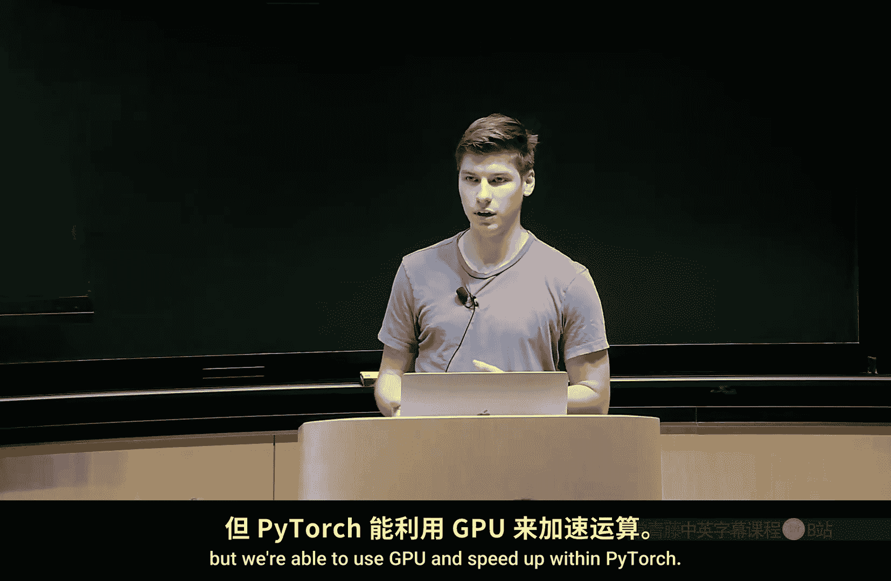

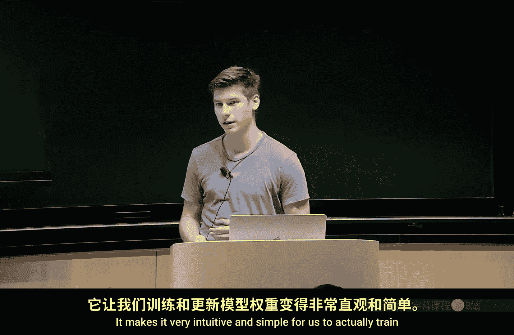

So that's sort of a few reasons of why we use Pytorrch。 It's a great library。

 And I think you guys will hopefully enjoy it。

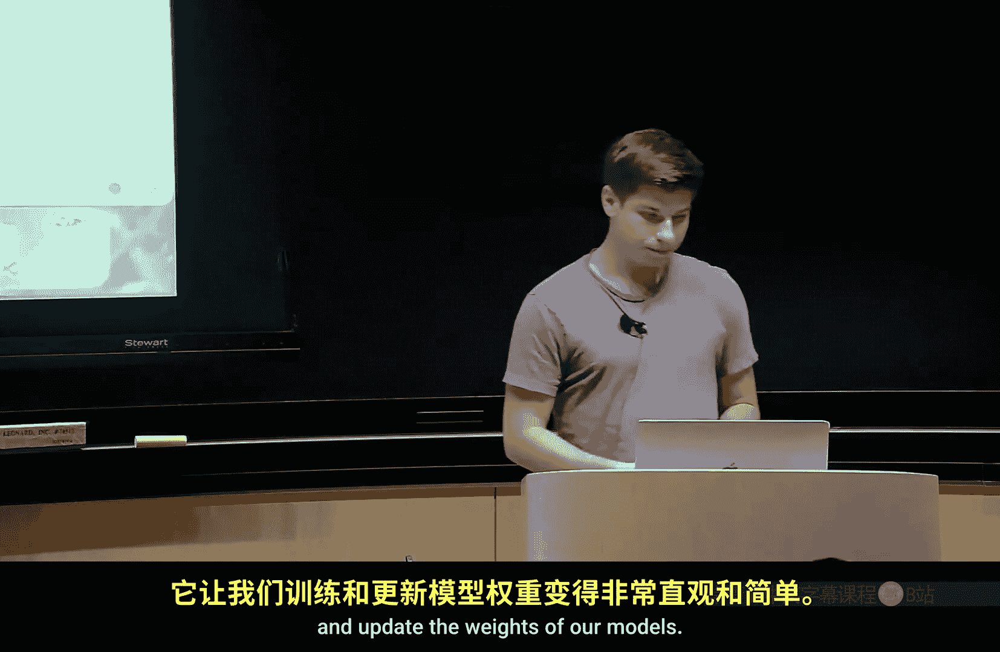

So today， just sort of a quick overview of what we're going to do。

 I'm gonna go over some sort of intro stuff of just like how we use Pytorrch tensors and how some of the simple operations on these tensors。

 And then we're going to go through a little bit about autograd and a little bit about sort of how we can train a model。

You'll go into a lot more depth on some of the P setss。 But overall。

 this should give you a good start to be able to understand how it actually works behind the scenes and how you're going actually be able to use it well on your P setss。

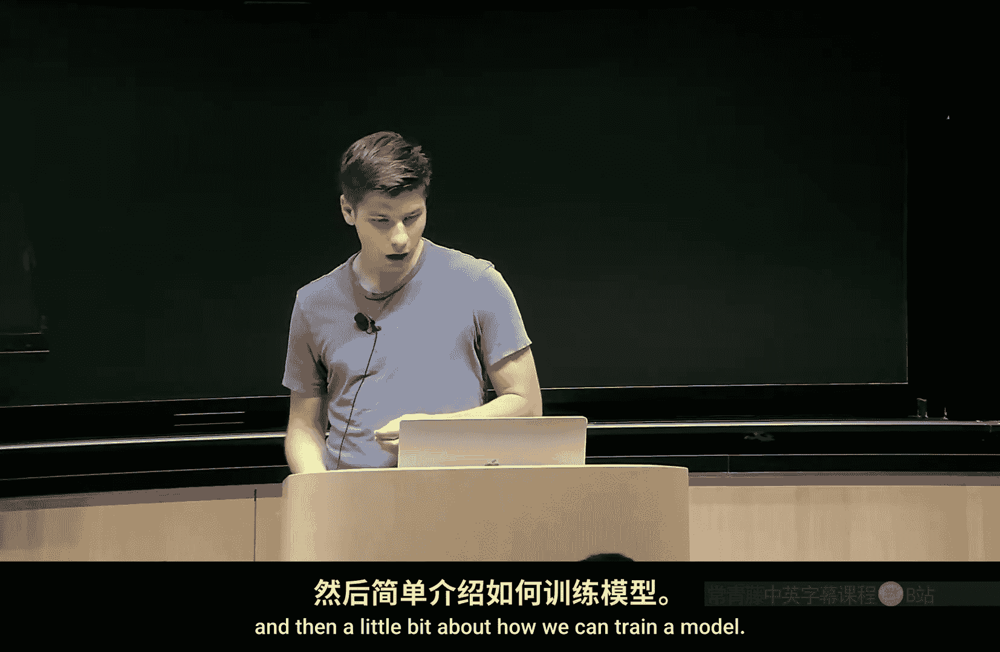

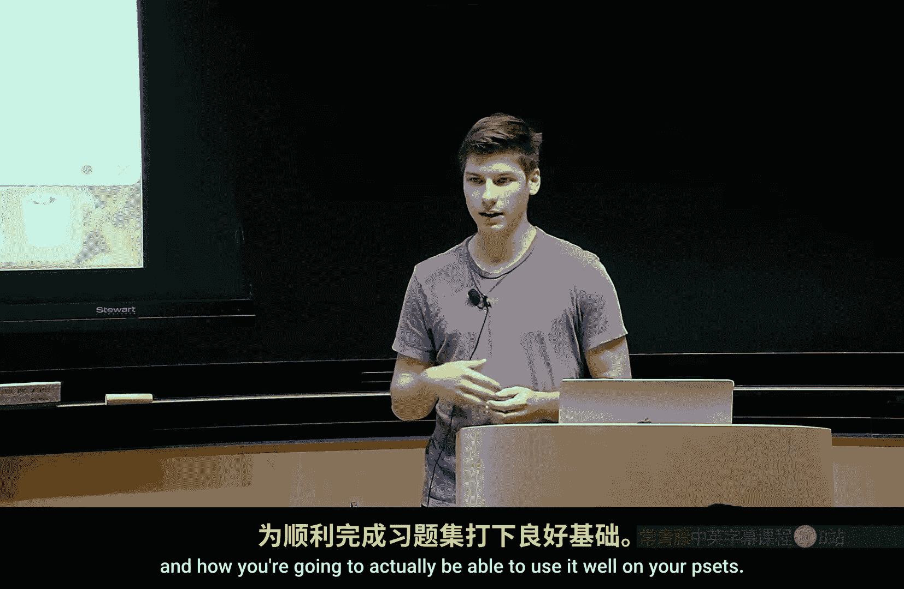

So just to start off， how many people have used Pytorrch。

 Maybe you could raise your hand if youve used Pytorrch。

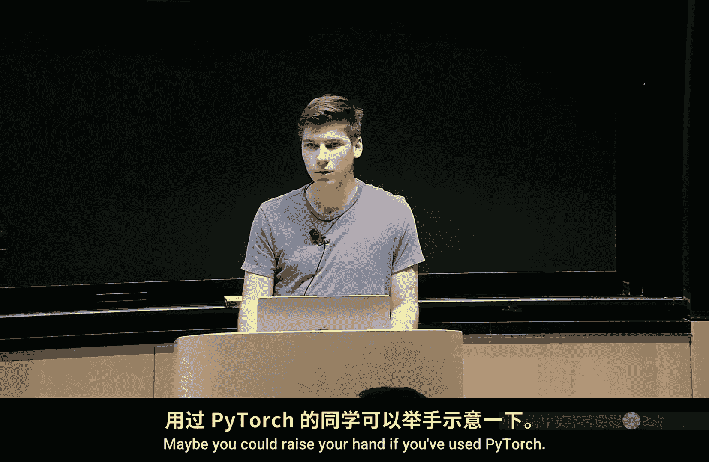

Okay， so we definitely have a lot of newbies to Pytorrch， I guess。 And that's that's totally fine。

 I think you guys will be able to pick it up and be able to totally be totally fine throughout the course。

 So yeah， let's get started。 If you guys want to pull up this notebook。 you can。 It's on the piazza。

 I posted。 It's probably one of the latest posts。😊。

And yeah， we'll get started。So the first thing we have to do is we have to do a few imports。

 Pi torch can be imported by importing torch here。啊。And then we import a few other things as well。

 just to。Help with this visualizing and， and creating tensors。Yeah。

So the first topic we're going go over is Pytorrch tensors and Pytorrch tensors is basically where we can actually store data within Pytorch。

 So if you ever added some input data that you wanted to put into a machine learning model or if you wanted to sort of compare some outputs。

 these outputs are going to be represented as Pytorrch tensors。

 And so the first thing we'll go over is how we can actually initialize a tensor。

So the first way we can do this here is just directly from data。

 You're probably not going actually do this too often。

 but it's good to know all the different ways that you can do。 So if we just have a Python list here。

 where have inputs 1，2，3， and 4， we can create a tensor directly from that data。

So if we run that cell， we see that we create a tensor， a tensor object here。

 which is sort of the same structure as that nested list that we saw before。

The next way we can do this is we can also transform and create tensors from a numpay array。

 So numbm， did we have a question back there。Oh， you can't see。嗯。Is that a little better。One more。

Good。 so yeah， we can create tensors from Ny arrays。

 Ny arrays are obviously another common way we can store data in Python。

 and tensors and N arrays store sort a lot of the same structure。

 So we can copy directly from Ny arrays。 and it actually can sort of use the same memory in the system for both the tensor and the Ny array。

 So if we do the same thing here， we're copying the same data。

 And we can create a tensor with this torcht from Numpy。😊，Function。

The next way we can create tensors is if we wanted to sort of create a tensor with a specific shape and specific values within it。

 we might want to take create a tensor of all ones or a tensor with random numbers to sort of initialize some sort of model。

And what we can do here is use this one's like if we wanted to make a tensor of the same shape as another object。

 But there's also operations。 I think I have that that's next that where you can input a specific shape。

 and then R like will， will give you。How random number between 0 and 1 in each element。Moving on。

 yeah， we can create tensors of specific shapes here using R ones， zeros。 And you can also。

 there's also more that you can find in the documentation of different types of initializations of each element that you can do。

 So yeah， we can also define tensors with a specific shape。

 So if you didn't already have a tensor defined that you are interested in the shape。

 you could say create tensor。

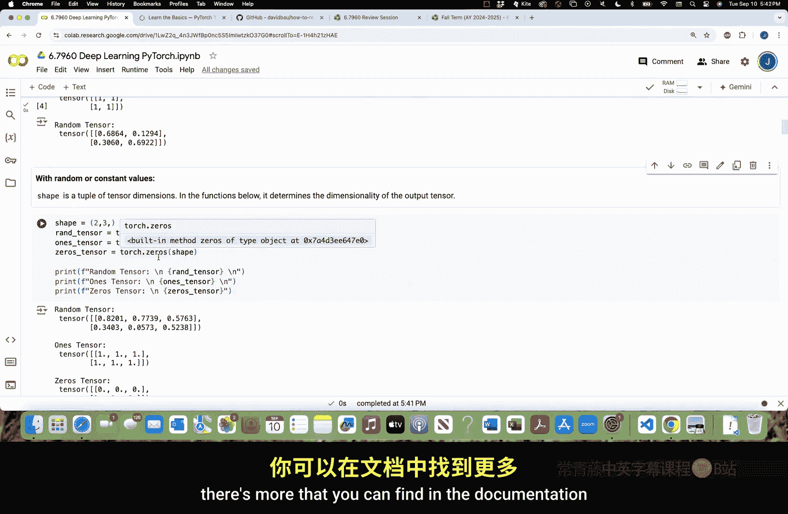

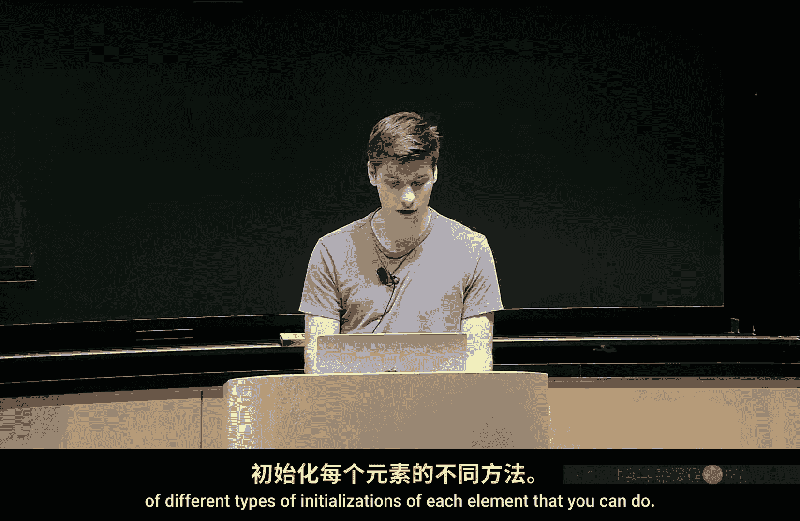

Of size2 by 3。 And we can do that in a few different ways here。 We can do random。 We can do ones。

 zeros。 there's a few other options。 There's a few attributes of a tensor that are good to know。

 So the first one that we've seen already is this the shape。

 So if we make a random tensor of size 3 by 4， we can get the shape by doing dot shape。

Next thing to know is the data type。Most of the tensors you're probably going to be using and that we use as inputs to machine learning models are going to be float 32。

 So that's a 3032 B float。But you might see integers as well in some situations。

 But the float  32 is generally used because it's the fastest。 and GPU hardware is optimized。

 to use that。The last thing you see here is the device。

 We can get the device the tensor is stored on by doing dot device。

And this is important if you're using both CPU and GPU。

 So we can only do operations between tensors that are on the same device。

 So if you have one tensor that's on a CPU and one tensor that's on a GPU。

 you won't be able to do any operations between the two。

 You'd have to move one to the other device before you can actually do any operations between them。

 and so。You might， you will probably be frequently be finding out like which device your tensors are on and then moving them to to the device you actually want them to be on if you wanted to。

 to do some operation between the two。Right，The next thing we're gonna to talk about is just some of the basic operations that we can perform on tensors so we can do things like to modify a tensor or create a new tensor based on the tensor input。

And these are are pretty simple operations that include things like adding tensors together or multiplying them that we can do to。

 to get different data that we want。So if we look in an example。

 the first thing we'll do is let's just create some sort of input tensor。

 And this notation here is basically going to create a tensor of 101 equally spaced numbers from 0 to 5。

 And so that might be something that' if we're interested in seeing the effect along a specific range in this case。

0 to 5。 And if we wanted to see that that worked， we can print the first five things the next by just indexing in the same way we would in nuy or other Python。

Environments。So we can also get the last ones by doing negative 5 to the end， which。

You may have seen other Python libraries。So let's try and perform some operations on this。

 this tensor。 So if we wanted to say graph a sine wave or a cosine， we could do。X dot sign。

 that will perform perform sign on， on each input in the tensor。

 We can also do something more complex， like doing X to the power of X dot cosine to create a more。

 more interesting。Output。We can also subtract tensors。

 so if we can subtract those two outputs or just find the specific value within that tensor。

 So if we wanted to find them in， you could also find max mean standard deviation， stuff like that。

 If you wanted to find sort of some characteristic about a tensor。

We can also use tensors with Maplotlib。 So maybe some of you have used Maplotlib in other cases。

 and we can directly input these， these tensors and create plots with Maplotlib。

 So we see here that some of our， our transformations of x from0 to 5。

 and we can see how those different transformations occurred。

So there's a lot of different operations we can do。

 I'm obviously not going to be able to go through all the， all the different operations。

 but just know that you can sort of apply some of these vector operations to tensors。 and you'll。

 you'll just get a tensor as the output。Another thing that that might be important is you can clamp tensors。

 So if you say we're worried about your outputs going too far in some direction。

 you can use dot clamp and then some specific range to actually get a specifically clamped output so we can see this plot here of that kind of transformation And so yeah。

 there's lots of different transformations that we can do。

 I'm not going to be able to go through all of them。

 but just know that if you want to do some sort of operation or transformation on a tensor。

 there's probably some ability to do it and you'll just have to look up the documentation。

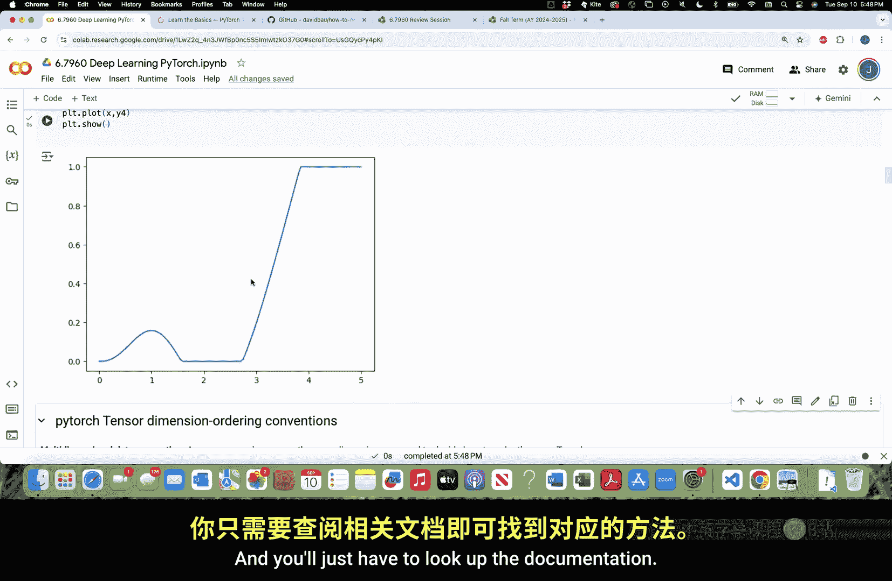

Okay， moving on， we're going to start talking about how we can deal with multidimensional data。

 So we're going to be doing with frequently sort of some sort of data input that's in a batch。

 And I think we talked about batches and lectures today。 but basically。

 we create a batch of some sort of inputs。 and generally。

All what we do to represent that is where we include the batches the first dimension。And then。

This example is for an image。 So you might do the channel of R G and B as the second dimension and then the rest of your data and so on。

 But in general， I think the most important part there is that the batch index is generally the first dimension。

Okay， moving on， we can look at some of these tensors of higher dimensions and see how we can play with their shapes and see how these this affects things。

So if we create a random tensor， we're going to do this shape representing sort of two images here。

 So we have two RGB images that are， are 5 by 4。And we can create this random。

 just say the random numbers。 They're not obviously not following RGP format。 but。

 but that's O for this example。One thing we can do is permute dimension。

 So if we were interested in in swapping the dimensions X and Y within our image。

 we can use this permute command。And so what you do is you basically just order the dimensions how you want them to be ordered。

 So if you wanted to keep the batch size the same and then the RGB dimension the same。

 we'd say 0 and1 because those are are indexed as so。And then if we wanted to swap， say the X and Y。

 we'd just swap the dimensions that they were originally in in our primud statement。嗯。So。

If we run that， we see that we get we originally had a shape size of 2，3，4，5。 but in this case。

 we've swapped the four and the five with our dot permute command。

Another thing you might frequently do is reshaping。 And so there's a few different ways to this。

 The first is with dot view and。This is generally the more efficient way。

 but there's also dot reshape， and it has pretty much the same functionality。

And basically what we can do is we can input specific shapes that we want。 So in this case。

 we're just keeping the batch size。 and then the negative one basically just means that we're gonna have all of the rest of the data that we had included included in one dimension。

 So we end up with a shape of just two and 60 because this negative one was is the rest of the data in each the rest of those dimensions。

 next thing to know is indexing。 So Pytorch does indexing pretty much the same way as nupi does。

 So if we wanted to say get something like the first row。 we can just input a specific number。

 So that would be 0。 And if we wanted to。Get the first column。

 We can use this colon to represent all of the rows， and then the0 to represent the first column。

 as that's the second， second dimension。And then if we want to get the last thing。

 similar to other Python methods， you can just use negative one。

We can also use these this slicing to assign values。

 So if we did wanted to assign the first column or I guess the second column to0。

 we could do this using this assignment。 Next thing we might want to do is join tensors together。

 so we might want to combine different maybe batches or specific elements to create a larger tensor。

And so we'll go through two different ways here。 The first first is just concatenating。

 So we use this torch dot cat operator。 Then we import input。Our tensors in a list here。

We also define a dimension that we want to concatenate along。 And basically。

 what this will do is itll just add all of these。And put tensors together along that specific dimension。

 So we see here we have this tensor that's a 4 by 4。 and we。

Concatenate the three tensors together along the first dimension dimm equals 1。

 or end up with a 4 by 12。 And you can sort of see how this this works out with our。

 our second column and our tensor all zeros。The next thing you can do is torch dot stack。

 And instead of concatenating along one dimension， you're going to actually create a new dimension。

 So say if you had。A few different inputs。 and you wanted to create a batch。

 You might a stack along dimension equals 0。 and you'll end up with sort of an additional dimension at the the start here。

 Okay， next thing we can do is things like matrix multiplication。

 So there's a few different ways we can do this。 All of these operations here。 do the same thing。

 I think using the at symbol is probably the easiest way。 But you can pick whatever you would like。

 And this just performs matrix multiplication as you would expect。 And so。In this case。

 we made this tensor， and we'll just apply matrix multiplication to it。

We can also compute element wise products。 So that will just be the multiplication symbol or this tensor dot mo。

 And so that will do just an element wise product。 So if we had this tensor of。1，2，3，4。

 we'll just end up with the squares。Element wise product。Next thing to know is we can do some。

 use some aggregators to find some different statistics or。Values within our tensors。

 So we can do things like some mean。Max min， stuff like that。

 and get the value along a specific dimension or along the whole tensor。

 So that kind of concludes the overall tensor part of this。

 definitely going a little slower than I was hoping， but I'll try and get through as much as we can。

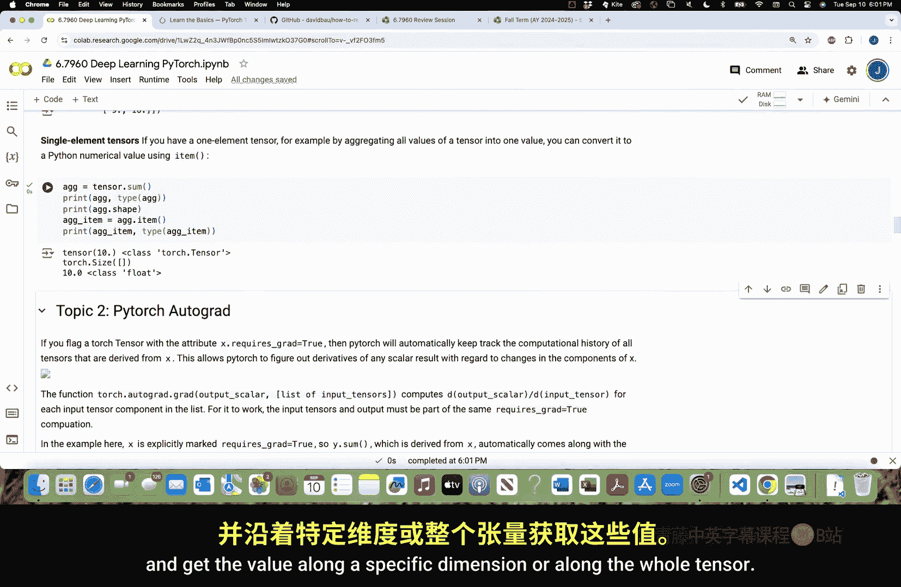

So the next thing to talk about is the autograd of Pytorch。

And Autograd is one of the most important parts of Pyttorch because it all allows us to actually compute gradients and update our models so that they can actually learn and produce reasonable outputs。

And so we can first use autograd to just calculate a simple gradient of a vector。

 So we think we saw a similar example here before where we made this X。

 which is the values between 0 and 5。 And then we applied an operator on this。

 So we're squaring it and then taking a cosine here。诶。And we can find the。

The derivative of this by using the autograd features of pytorrch and so。

If we want to take a derivative， we actually need to have a scaleal or as a， as a output。

 So we take the sum here， and then we can use this torch do autograd。

Of that output with respect to X to get our actual derivative here， D Y by D X。

And so this is sort of the， the back end， like how。

How you could specifically calculate one specific gradient or one derivative here。

 But when we're actually doing a model， Pytorch takes care of exactly like which derivatives we need。

 We don't have to do these really specific calculations of which which differential we actually want。

 But we can see in this plot here that we have our。Our you know。

 x squared cosine where we we end up with a shorter period as we go to the right。

 and then we can see our our gradient here where we you know it is it's the correct gradient of that value。

 we can do this with another function here。 So if we have a polynomial。

 And we want to compute the gradient。 we can do this in the same way as we previously did。

And we can run this， and we can see the result is， is's the same。 We we end up with our， our plot。

 and we have our gradient of our plot as well。So these are are， you know。

 this really specific way we can calculate this exact gradient。

 but Pytorch allows us to actually just calculate all of the gradients altogether。

 And so we don't need to specifically calculate one gradient。 instead。

 we can just do a specific command。 And we will get all of the gradients that we want。

And so that's what you'll actually be doing if youre you're running a Pytorrch model。

 you won't need to calculate and store each different part individually。And so if we look at this。

 we have the same example as we had before， but instead of of doing our autograd and using the brackets of Suusa before。

 we can just use this dot backward， and that will store the gradient of each part within the tensor。

 And so if we just get use dot grad。 we can actually get the specific gradient using the dot backward command。

So you'll never do the autograd dot grad that we had up here。

 You'll always use the dot backward to just calculate all the gradients that you need。So yeah。

 as I was mentioning， if you aren't going to use the gradient， you shouldn't calculate it。

 and we can use。 I don't know if you have it listed here， but you would say torch do nograd。

 And that would allow you to， to not use the gradient and speed up your computation。嗯。Oh， yeah。

 here we go with Torch。 nograd。That would。You years。Okay。

The next thing we're going to talk about is optimizers。

 So we figure out how we can calculate a gradient。 But the next thing we need to do is actually use that gradient to。

 to optimize some function， some loss function， something like that。 Okay。

 so this naive gradient descent， obviously， it works for this scenario。 But in a lot of cases。

 we want to be more adaptive。 and speed up our training。

 So I think we saw stochastic gradient descent in lecture。But this is another method。

 We import this optimizer。 And if we do optimizer dot step， it takes care of the the gradient update。

 So it will use the gradient and it will update the weights of our model。So if we run this， we see。

 again， you know， our model minimizes， maybe it got to the minimum a little faster。

 And then it's jumping around a little bit。 This is just some， some little toy examples。 So we don't。

 we're not too， too concerned exactly about what's happening。Okay。

 the last optimizer here we're going look at is atom。 So atom is a pretty common optimizer。

 and it sort of adaptively does a lot of the steps。 and it generally is the most efficient。

 So a lot of people use that in real scenarios as opposed to just naive gradient descent or or sarcastic gradient descent。

 So we can run this one。 It's sort of the same structure as。As the S GD。 But we see in this example。

 it's it's not quite doing as well as some of the the simpler ways。 But in general。

 this is a pretty good method of optimizing。I think we can sort of try and get through a quick bit of neural networks and how we can use pytorch for neural networks。

So obviously， that's a big part of deep learning is is neural networks。

 And so there's a lot of modules within Pytorch that we can use to create networks from just really simple M LPs to more complex models。

So the first building block that we see here is the linear layer。

 And so this is basically just going to do a transformation from one dimension to another dimension with linear。

With O linearar transformation。So we can generate that and we can set the number of input features。

 the number of output features， along with a bias term as well。

And so we could just run an input through our， our， our linear network。

 Wed put an input of size 3 and get an output of size 2。 So yeah， then we can。

 we can pass an input to that。 And we see we had an input of 3。

 And then we end up with an output of size 2。We can also use a batch。

 so we have an input of four inputs of size 3 here， and natively， it'll just work to support that。

 and we get four outputs of size 2。If we can take a look at some of the weights and bias of。

Of this linear layer， we can just get the， the actual numbers。

 So these are the numbers that is going multiply the， the inputs by to to actually get an output。

 And then the bias terms are added to the， to the outputs。

And you'll note there requires grad equals true on this tensor here。

 which shows that it's calculating the gradient as you go along。We can。

 we can set specific things like the bias to0 if we wanted to。 And then we。

 we can see that our outputs will not add that bias term at the end。

We can look at some of the parameters。Just if we do this net dot name parameters。

 and that will get the exact values within those， those weights as well。

And we can see that we set it to 0， and the bias term is now 0。Yeah， we can。

 We can look at a few different features， the shapes of our， of our。Of our weight， we can。

 can load them。We canSo yeah， we saved the the weights， and then we can load the weights here。

So I'm trying to go， let's see if we can get to something a little more interesting。嗯。

Maybe if we wanted to calculate a loss。 So if we're trying to optimize this linear layer。

And let's say， we wanted to just。Kind of a dumb example。

 But if we wanted to just always output one comma1。

 we could try and train our linear layer to always output one comma 1。 So if we see here first。

 we get an output and it will calculate this loss where we're doing squared loss here。嗯。

And we could use the lost up backward to get the gradients。

 and then we could use those gradients to update our linear layer。So here we could。

 if we wanted to actually train this model to learn to always output one comma1。

 we could do an update loop。 So here we're just looping， doing a batch input。

 and then calculating the loss。We're getting the gradient here with lost up backward。

 And then we're just using gradientcent to update our parameters。 And we can see if we run this。嗯。

We should get a graph of what our loss is。 So we end up with these the following weights。

 So you can see our the weights within the linear layer just went to 0， and our bias went to 1。

 And so our loss went to near 0 because we've learned to always output1 comma 1。

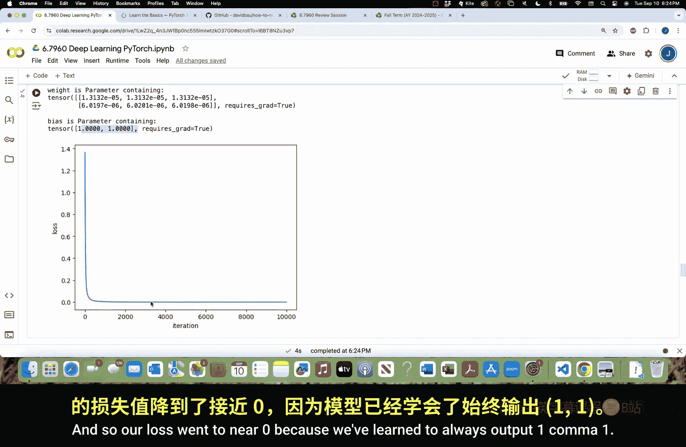

Okay， I'll try and work through maybe one more part here， but feel free to to go if you need to go。

嗯。So the last thing I want to talk about is that we can create a more complex network using this sequential command。

 and this will combine different layers together。 So here we see a combination of linear and relu layers。

 So Relu is the activation that we've seen in lecture。

 and then we can combine this together with this sequential framework。 And so。

This actually creates a little bit of a more interesting network that we can use to create outputs。

So we can see the different parts of this。 We have sequential parts。 We have linear parts， Reello。

 and then continuously， we're creating a network。 I think this one's， yeah， three layers in size。

So we can use this to train a more interesting model。

 So here what we're trying to do is we're trying to train a model that takes an input in the space。

A2D input in the space， negative 2 to 2。 And it's going to try and output。

Try and classify points as either above a sine wave or below a sine wave。And so。

What we do is we want to use the atom optimizer here， we have a classified target。

 which is going to say like is our input either above or below the sine wave。

 and that's going to give us our loss。When we use this crosscentroppy。

 because we can actually generate what the actual target is。嗯。

So what we do in this loop is we're iterating， we're generating a target， a batch。

 a batch of random inputs。We're classifying those random inputs as， you know。

 either above the sine wave or below the sine wave。 And we're calculating a loss using cross entropy。

 which is a loss typically used for a classification model。 and basically。

It's going to give a higher value if your， if your classification result is worse and a lower value if。

 if it's better。嗯。And then we continue with this iteration。

 We're doing lost up backwards to get our gradients， and we're doing a optimizer step。

 And then this last bit here is just giving us some information about our accuracy。

And so if we run this， I didn't create。I'm sorry。Must if not ran another cell above。

must have not ran a few cells above。诶。But， basically。If we want to run this。

 we're going to be able to train a model that is able to classify these points as either above the sine wave or below the sine wave。

Let me see if I can find。Where that's not loaded。Not sure where that is。嗯。But。Yeah， I think。

It little strange， but。嗯。I think， yeah， we'll just leave that there。

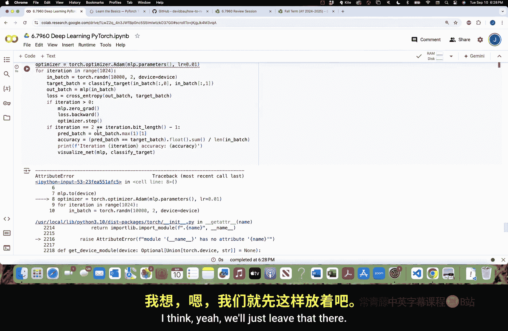