# 麻省理工学院【中英⚡矩阵微积分及其在机器学习中的应用｜2023-18.S096-Matrix-Calculus-For-Machine-Learning】-p01-P1-Introduction-and-Motivation--BV1wbSNBkEQM_p1-

So welcome everybody to this IAP class on matrixtrix calculus。

 I'm Professor Al Eelman and the other professor who the other professor is Stephen Johnson who's going to have he had to go out of town and so we're going to take advantage of Zoom technology to so they could give lectures remotely。

 we did some testing of the audio and the video so hopefully it'll work out just fine。嗯。

So maybe just a quick introduction。Oh， good， good。 Yes， Stephen recording。I I already started。

 Allright。 Thank you for the reminder。 Yeah， so I even put the two reminders on the blackboard。 Yeah。

 so that was reminder number one。 good， Okay， so。😊。

Let's see so both of us are in the math department。

 I'm also in CL and I run the Julia lab over in CL and my own research involves both mathematics as well as computing software。

 Stephen， you want to say a few words quickly about yourself。 Hello everyone。

 so some of you may remember me if you took 1806 in the spring。

 Im going do 1806 in the spring or in the fall with me or in the fall。

 So there's two or three beforehand。 Okay Yeah so so those those people who took 1806 with me will have gotten one hour of these 16 hours of lectures。

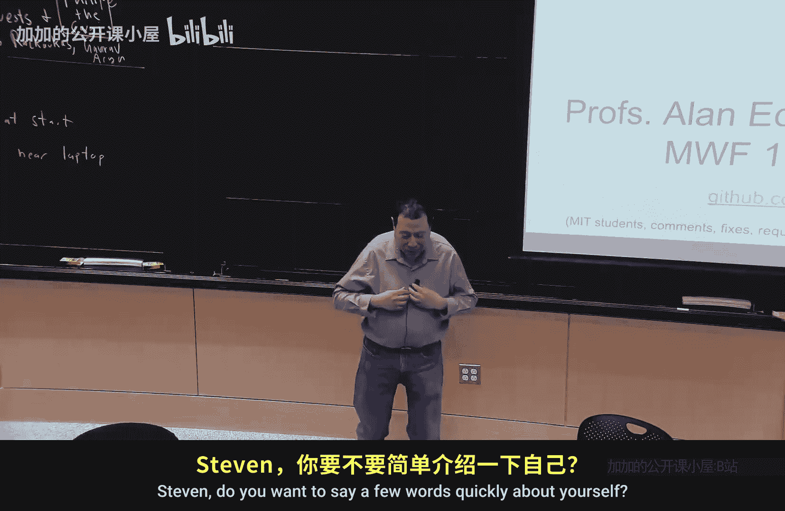

That we're going to do this IEP that'll be familiar。

 but yes I'm also in the math department I'm also in physics and you know I come into matrix calculus through a lot of PDE constraint optimization mainly。

 but I've also worked with Julia。Which will also be used on the problem sets。And。

So I'm sorry I can't be there with you in person， I'll be missing。

 I'll be doing it remotely for the first week and a half and then I'll be back in person。

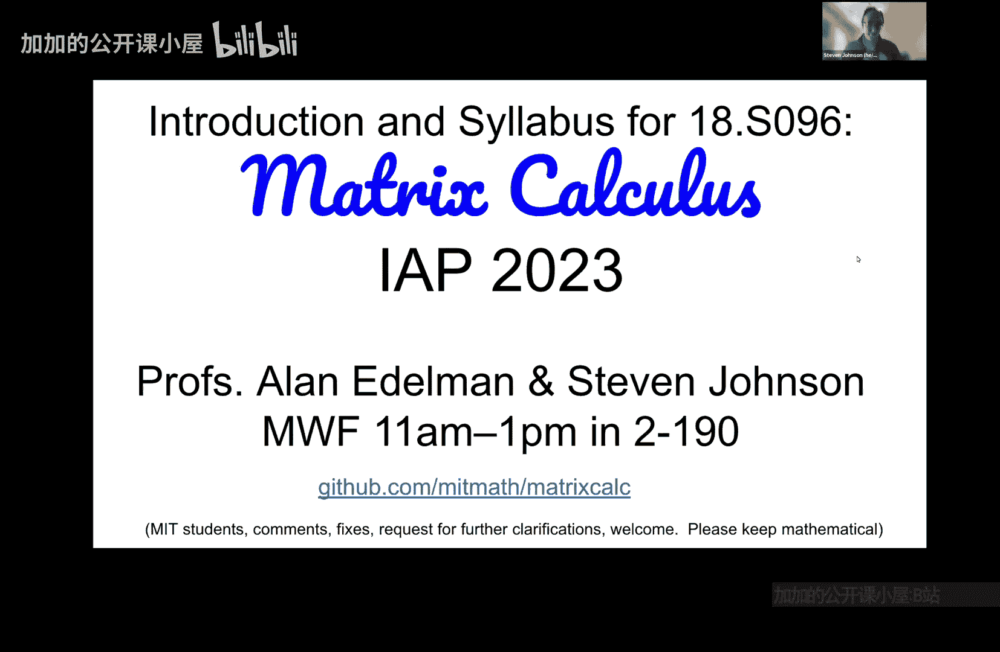

In person。Okay， so let me quickly show everybody the Github site that we're gonna to be using。

 Where did it disappear on me。HowWhere did it go。Oh there it is。 Okay， so， oh， no。

 that's not the right one。This was another course。 Allright， I think we should just dive right in。

 So let me go ahead and do that。So。So yes， here are the lectures， the problem sets three units。

 and we assume people are familiar with linear algebra and not much more。 Okay。

 and there's no assumption that you've already used Julia before。 But of course。

 if you've taken 1806 with Professor Johnson or some other courses you may already be somewhat familiar。

 But you could easily learn the kind of Julia we're using here is sort of basic calculator， Julia。

 and so you won't need to know much。Okay， so let me delve right in into where does matrix calculus fit in。

 So if you look at M I T's course catalog， which I've copied over here。

This is replicated probably in universities all over the planet， right。

 There's single variable calculus is like the first semester of calculus and it's required at MIt for all undergraduates to take 1801 and learn how to take the derivative or an integral of a function of one variable。

 and then there's that second semester of the sequence 1802 where you learn vector calculus or multivariate calculus。

 right， And so you you learn the basic definitions of a gradient or Jacobian and that's kind of this whole 1802 thing。

 And like I said， this is in every university around the world。 Okay。

 I bet everybody in this room has gone through these two classes one way or another or learned it on the streets or something。

 So。😊。

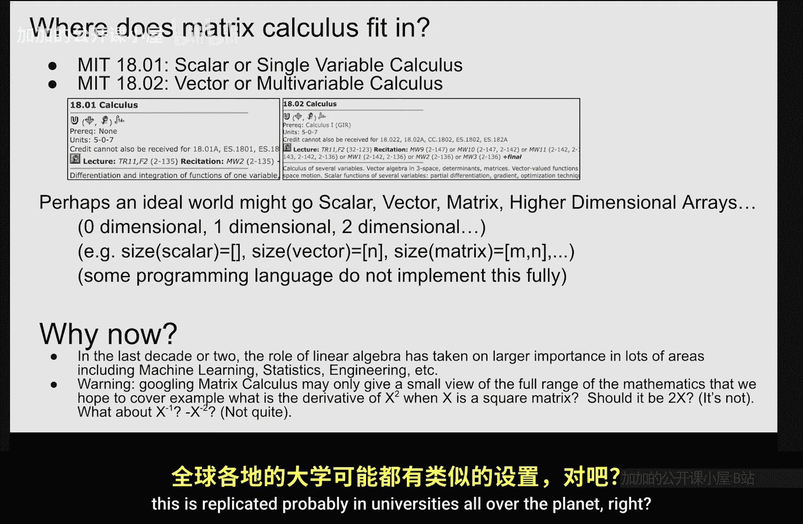

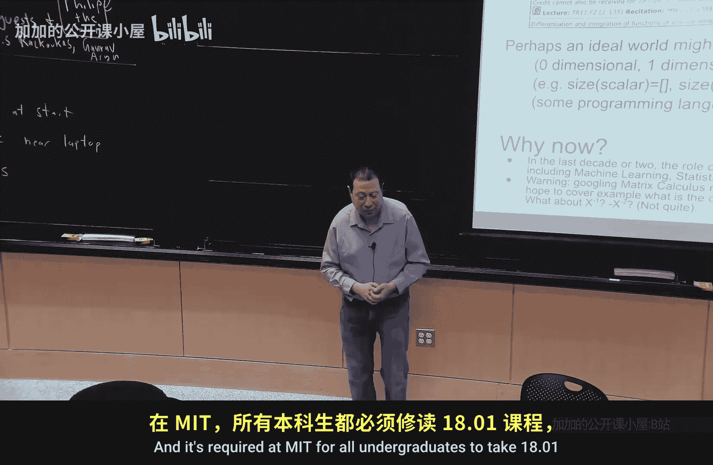

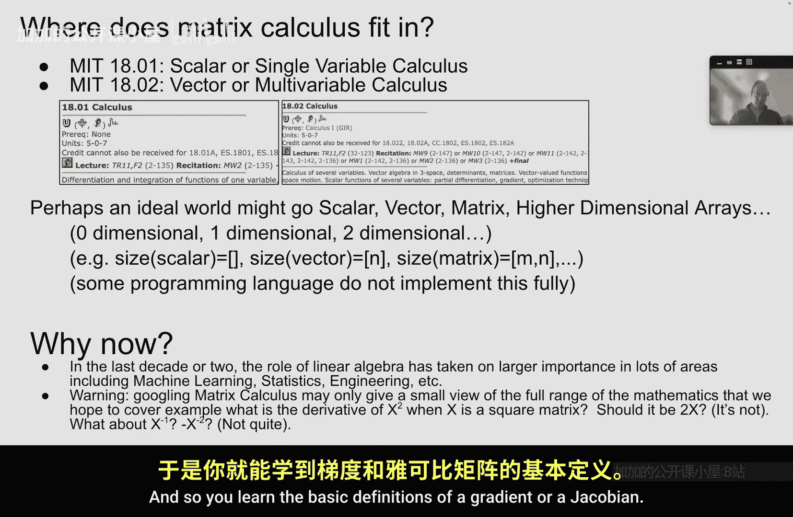

So， so it seems to me that there's actually a sequence that that's sort of being cut off completely arbitrarily。

 right， the sequence should go scalar， vector， right， So that's 1， two dimensions， matrix。

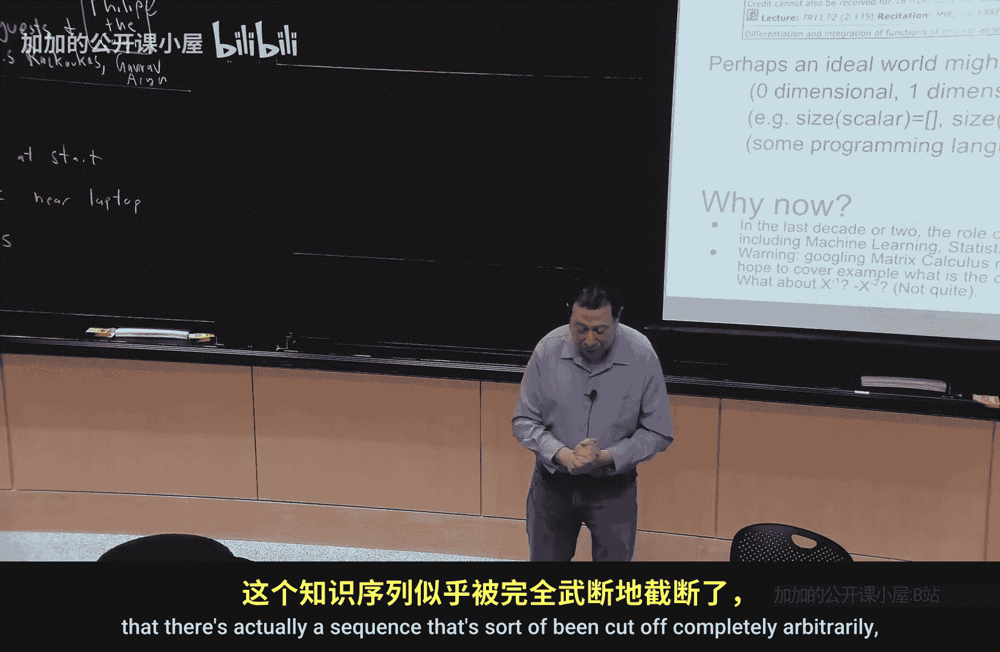

Right， scal is zero dimensional vector is one dimensional。es matrices are two dimensional。 and then。

 of course， higher dimensional arrays， right， It just makes sense that。

That that these objects are you should be able to do calculus on any of these objects。

 when you talk about programming languages， for example， some。

 but not look every programming language has two dimensional structures and more， arrays。

 So if you're familiar with Matlab， it does not have a one dimensional array。

 People talk about n by one column vectors in one by n row vectors， but they really just matrices。

 right， other languages have one dimensional arrays。 Some even have zero dimensional arrays， right。

 So these are the things that you find in programming languages， So in this is， this is Julia。

 the size of a matrix， for example， has two components。 The size of a vector has one component。

et cea， so。

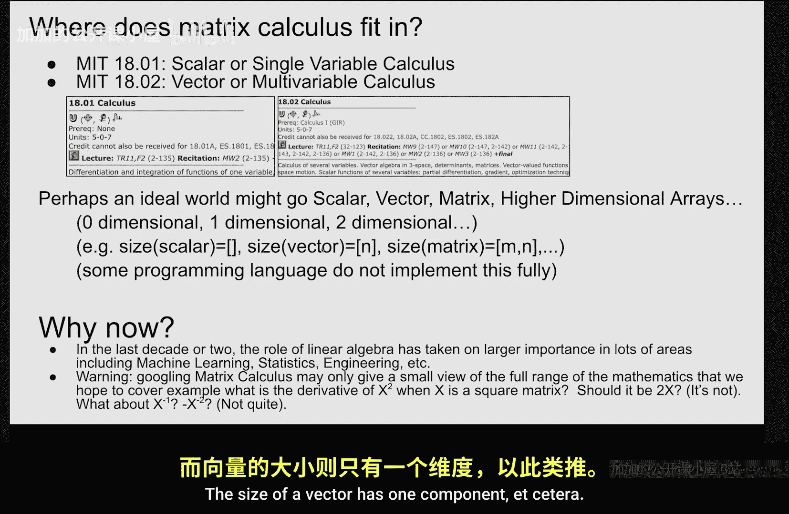

It seems to me， I've been teaching at MIT now。 I don't even want to count the years wherere pushing on 30 years now for me。

You know， when I started here， linear algebra was not what it is today。 I mean。

 maybe you have no I don't know if you folks know。 but linear algebra was this thing to avoid。

 it was this like required course。 maybe and a few people needed it。

 perhaps but I think because of machine learning and statistics and lots of other reasons。

 linear algebra has gradually sort of taken over a much bigger part of today's tool you know know tools for lots and lots of areas you know compared to to when I started 30 years ago。

 And so machine learning statistics， engineering， know。

 everybody needs linear algebra and and so it stands to reason that you'd want to be able to do calculus on matrices and and higher dimensional objects。

 especially because everybody these days， they're doing machine learning。

 I don't have to tell you because everybody in MIT is already doing it。 machine learning。

 you want to take you need to take gradients and you need to take gradients of complicated objects。

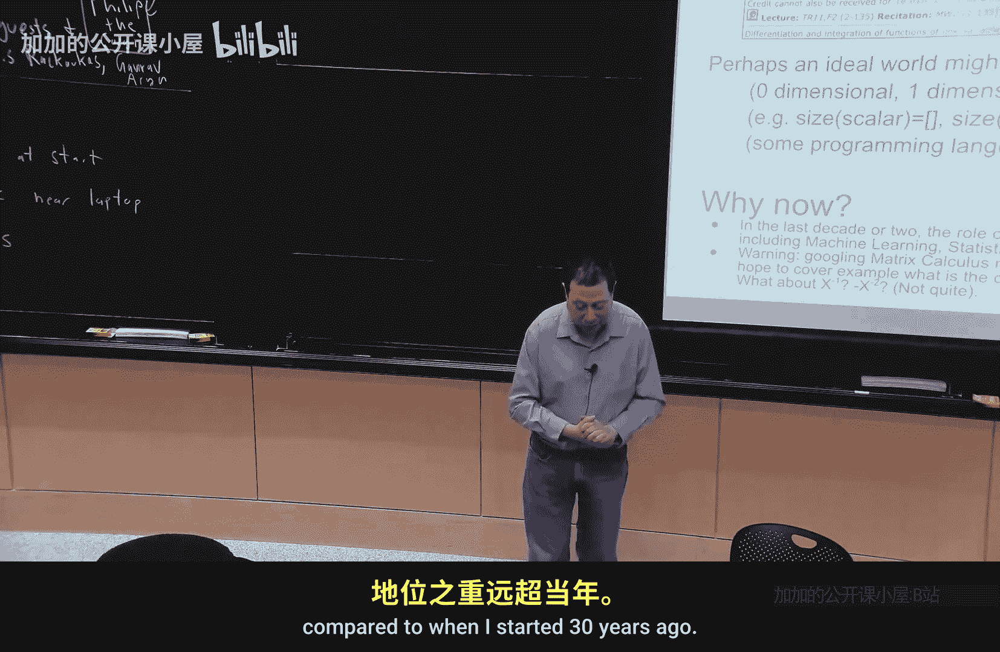

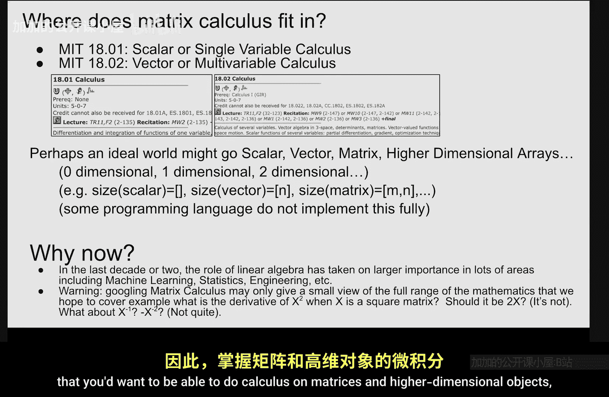

Right， so you want to do gradient descent。 You need to be able to do this sort of thing so。

I but I've always been interested in matrix cculus。

 I was just know I was like calculus to begin with。

 And I thought the idea of doing calculus with matrices just seemed like I was like linear algebra。

 I thought it'd be sort of fun to marry calculus and linear algebra。 and I used to go to the library。

 And then when Google came along， you Google matrix calculus。 And up until fairly recently。

 I was rather disappointed with what I found matrix calculus was I found like three books。

 I think with a title matrix calculus。 And the moment I opened the book I realized， no， no， no。

 this is not what I wanted at all I wanted to be able to to do the kind of calculus we did in college。

 know 181，182 calculus， but on higher dimensionional objects。

 so you know here's a little bit of a quick question for all of you to think about if you don't already know the answer。

 you might ask yourself， for example， suppose you have the function that squares a matrix what should the derivative be。

 I mean， in fact， if you've never done this before， you might。😊。

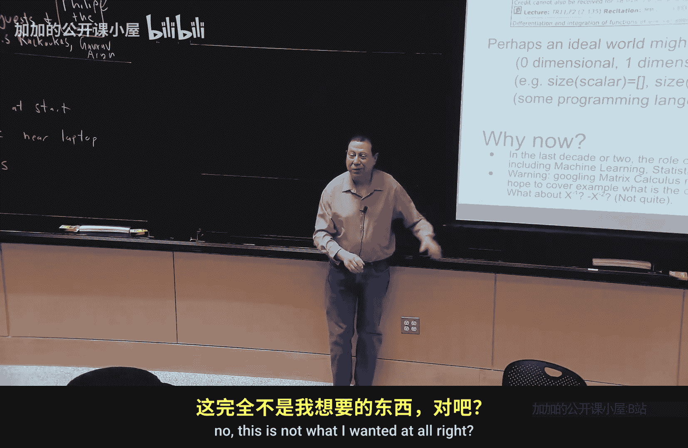

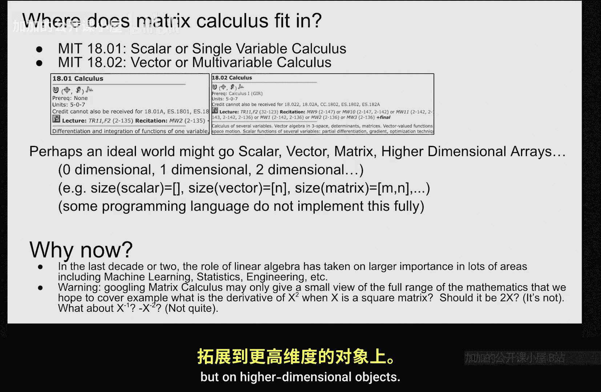

Even know what it should look like， right， Should it be， Should it be 2 x like the scalar case， Well。

 I'll tell you right now that that's not correct when x is not a scalar。嗯ello。And， you know， then。

 you know， of course， you could ask about， you know。

 what is the derivative of the matrix inverse or what is the derivative of the matrix inverse squared and so forth。

 Or yeah， is is the derivative of x inverse the same as negative xm to。 And the answer is no， So。

 so the point I want to make。 the first point I want to make is matrix calculus is not。

 it's more complicated than scalar and vector calculus。 It's not。It's not a lot more complicated。

 but it's unfamiliar to everybody who hasn't studied it。 That's what I want to say that。

 that you can't just say， oh， I know vector calculus。 I know scalar calculus。

 It's probably just some simple generalization。 So my first message to you is， no， it's not。 I mean。

 you can master it。 Youll， you'll learn it during this IP course。

 but it's not just the it's not just a simple， obvious generalization。

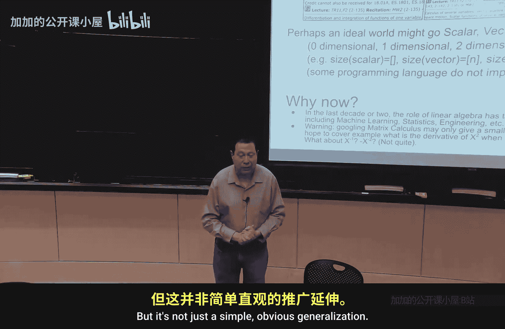

Okay，And so as far as applications go， this is a bit of a collage that Stephen put together from a year or two ago。

 So you could just look at this yourself。 But I think you all probably you're all here for some reason。

 So you probably already all know the buzzword。 but machine learning， parameter optimizations。

 stochastic gradient descent， automatic differentiation， back propagation。 right。

 So these are all the reasons for doing matrix calculus and this little collage here。

 you could just see the places where things are happening you know， in various parts of the web。

 Okay so you can take a quick look yourselves。

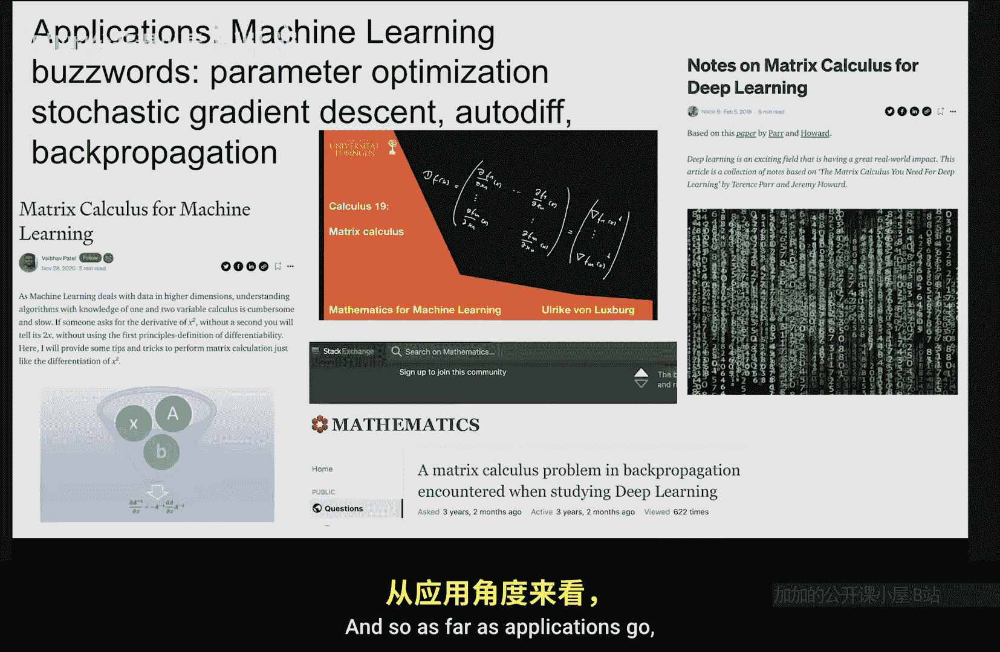

，The， the part that interests some of us are the applications to physical problems， as well as。

 you know， machine learning and statistics。 And so， for example， in the upper left here。

 you have this so calledled topology optimized aircraft wing where， you know， in the old days。

When people used to engineer an airplane wing， But what they would do is they would just pick a design。

 and then they would just somehow figure out the aerodynamics。 And if they wanted to try again。

 they would take another design and figure out the aerodynamics。

 But now with faster computers and machine learning techniques。

 you could have the computer decide what is the you know you can optimize for whatever you want。

 know， minimize fuel or minimize metal that you use or whatever it is you want to optimize for。

 And you can let the computer figure out the shape。 And so that becomes a big optimization problem。

 And that becomes that gets called topology。