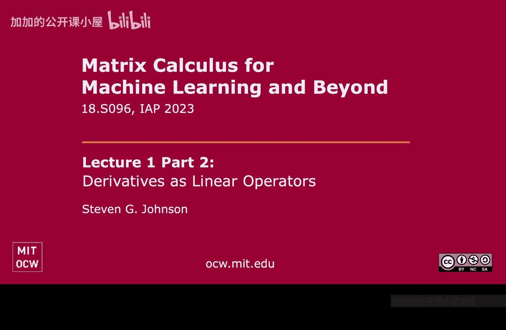
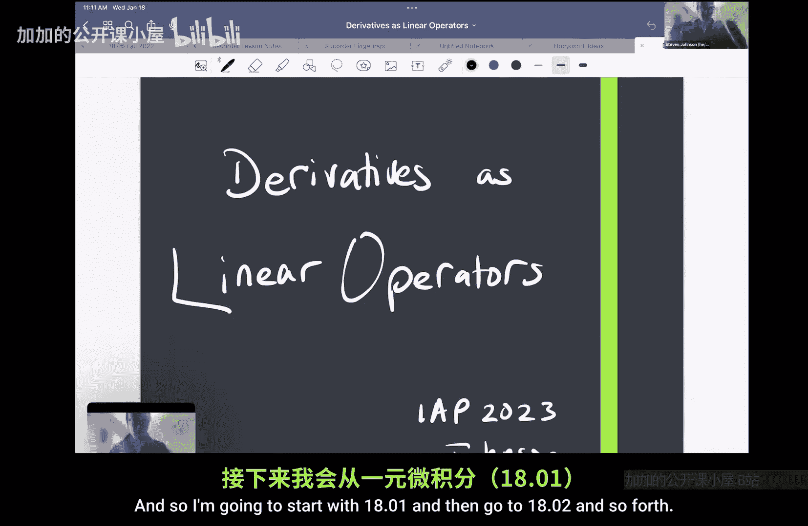
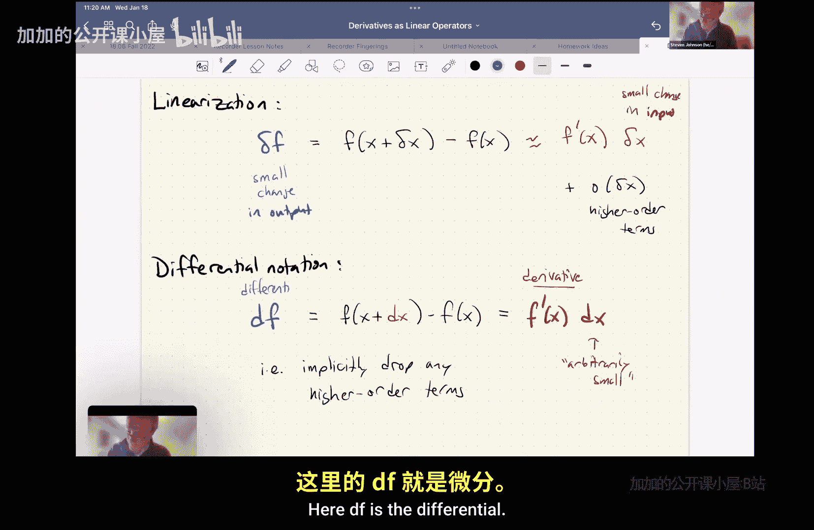

# 麻省理工学院【中英⚡矩阵微积分及其在机器学习中的应用｜2023-18.S096-Matrix-Calculus-For-Machine-Learning】-p02-P2-Derivatives-as-Linear-Operators--BV1wbSNBkEQM_p2-

So I want to revisit the things that Alan talked about。

 but just you know a little bit more slowly and more just try and lay out the rules for you as clearly as I can and what we're going to try and do is。

Again， just revisit the notion of a derivative。To try and write it in a way that we can generalize to other kinds of objects and so i'm going to start with H01 and then go to 1802 and so forth so as Alan said。

 you know the key notion of a derivative it just I think it's it's easy to get so good at taking derivatives like you know knowing the rule for the derivative of sine or cosine or x squared you' so good at doing them that you forget what they are right and so the very first thing you learned about a derivative。

Is that it's the slope of the tangent。 But what that really is。

Is linearization right so you have some arbitrary maybe nonlinear function f of x。

And you're at a point x。And near that point you're going to approximate the function with the straight line。

 that's the tangent， so it's really the linear approximation of F。

And then if you move a little bit away from x， so let me call that deelta x， so not D。

Delta is going to be a finite change。D is going to be infinitesimal pretty soon。

But if you move just a finite amount， a little finite amount delta x away。

 of course the function value changes。But in a linear approximation。

The the new function value is a red dot here， so that linear approximation is you if you're taking the function。

F of x at x plus delta x。The new value is f of x。And then this linear thing is just the slope。

 which we call f prime of x times delta x right it's just the definition of the slope it's the little change in y for a little change in x right and of course these two terms are not exact right this this red dot doesn't exactly match。

Where you are in the real functions， so there are also corrections。

 but the corrections are higher order there are terms that look like deelta x squared delta x Q。

 maybe maybe if the function is not higher， it doesn't have higher derivatives。

 it might have like square root of delta x so deelta x to the 1。1。

But these are all terms that are like going to be like higher powers of delta x terms that if delta x is sufficiently small。

 these terms will become more and more negligible compared to this linear term and there's a nice notation for this from that's used a lot in computer science less so in outside of that but it is used in calculus as well maybe not in 1801 is this asymptotic notation in computer science you probably many of you will have seen big O notation here I'm going to use a variant called little O notation so this is not a capital O this is lower k o so these terms we call little O of delta x it's a little O of delta x it denotes any function that decays that goes to0 faster than linear faster than than delta X so delta x squared goes to0 faster than delta x as delta x goes to zero。

As I should say as。As deelta x goes to zero。喂。And so you look at this thing and this probably looks a lot like a Taylor series。

 right you do a Tayloror expansion of f of x plus deelta x around F of x is the first term。

 this is the second term， the third term， remember is like one half F double prime deelta x squared or something like that。

RightBut that's the wrong way to look at this。 a Taylor series is a much more advanced concept。

 It's something you get to much later in calculus and for good reason because not not every function even has a Taylor series that converges this is more basic this is really the definition of a derivative the derivative is the linearization right if you make a small change in deelta X the change in in F is a linear term plus smaller stuff right and that smaller stuff only gives you a Taylor series if it's basically a polynomial right it it might be a smaller stuff like deelta X to the 1。

1 in which case it doesn't have a Taylor series but this is always true this is just this is what it means to be the sub of a tangent right and so。

😊，Then the nice thing about this as Alan says is this this notion， if we keep the Dlt X on the right。

This is going to be much easier to generalize to other kinds of x'es that are vectors or matrices or even other functions。

 other kinds of things so this is the linearizationops。So we're going to have a Delta F。

Which is which I'm going to have to define。Oops， let me put it in black and define as F of x plus delta x and again。

 the delta with the Greek letter delta is not infinitesimal。

 it's just a small number doesn't so it's just a number。Right。This is that thing， right。

 but I'm going to drop。Terms。Higher order terms so there'll be an error there so this is。um。Well。

 yeah， so let actually let me put this another way， so this is it's going to be approximately。

F primeed of x。Delta x。Plus， high order terms。 this is this is the higher order。

So this is a small change。Change。In the input。Of the function。And this is the resulting small change。

In the output。嗯。And this is going to be the definition of the derivative that the derivative is whatever you do to Delta x。

😊，To give you to first order， to give you the linear change in the output for a small change in the input。

It's a little annoying though to keep these O's right around so we keep always having to whenever we have a finite change in the input and a finite change in the output this is never exact。

 this is an approximate relationship and we have to keep saying plus high orderor terms plus high orderor terms plus little o delta x and it's annoying so it's easier。

To use to switch to differential notation。All right， and it's going to change my delta to D。So Df。

Is going to be。Of x plus dx。Minus F of x。And're going this is going to be f primeed of x dx where this is I'm just going to write equal right so we can think of this as this differentialiable this differential in Dx as being arbitrarily small。

So it's really a limit， some kind of limit， of course。

RightAnd so what you can also think of it as really， it's just this。

 but I'm just implicitly going to drop any higher order terms。Yes。That's how I like to think of it。

so we don't have to get too fancy with defining differentials I mean this is a definition right this is just shorthand for this where I don't have to write plus Lilo Delta X all the time。

See。嗯。喂。And so it's important to keep in so this F prime to delta x， this is the derivative。Here。

DF is the differential。

So if I ask you for。The derivative I'm asking for F。

