# 麻省理工学院【中英⚡矩阵微积分及其在机器学习中的应用｜2023-18.S096-Matrix-Calculus-For-Machine-Learning】-p03-P3-Derivatives-in-Higher-Dimensions：-Jacobians-and-Matrix-Functions--BV1wbSNBkEQM_p3-

Alright， well， welcome to the second lecture for this IP class on matrix calculus。

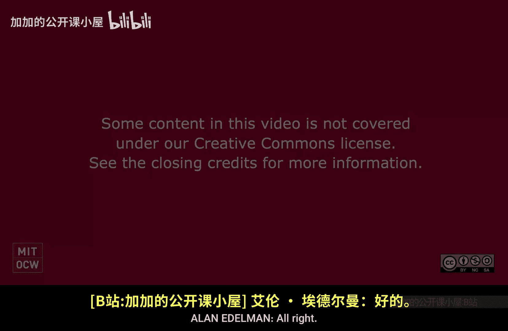

Okay， Stephen， do you wantna say anything before I start on nonlinear versus linear maps。

So Philip's gonna help out right away。 So here's a picture of Philip。

 the Corgis right over there in case you haven't seen him yet。 And， yep。

 and you folks could actually grab your favorite photo。 You don't have to。

 you don't have to use a corgi。 You can have any photo you like。 So here in Julia。

 I'm just uploading this picture of Philip。 And I've got a few different transformations of a Corgi。

 And the reason why I'm showing this to you。

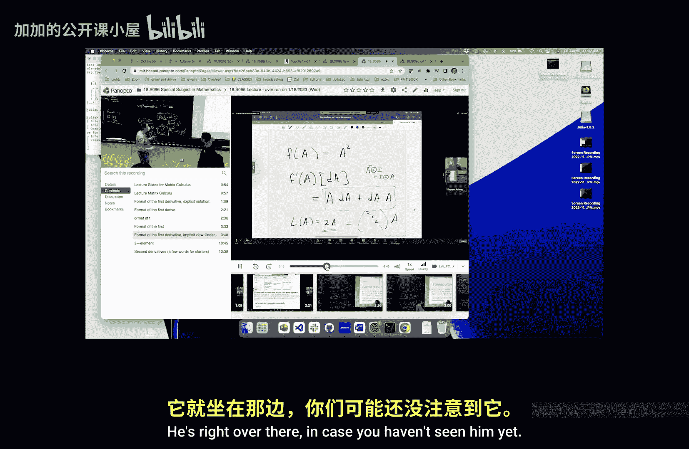

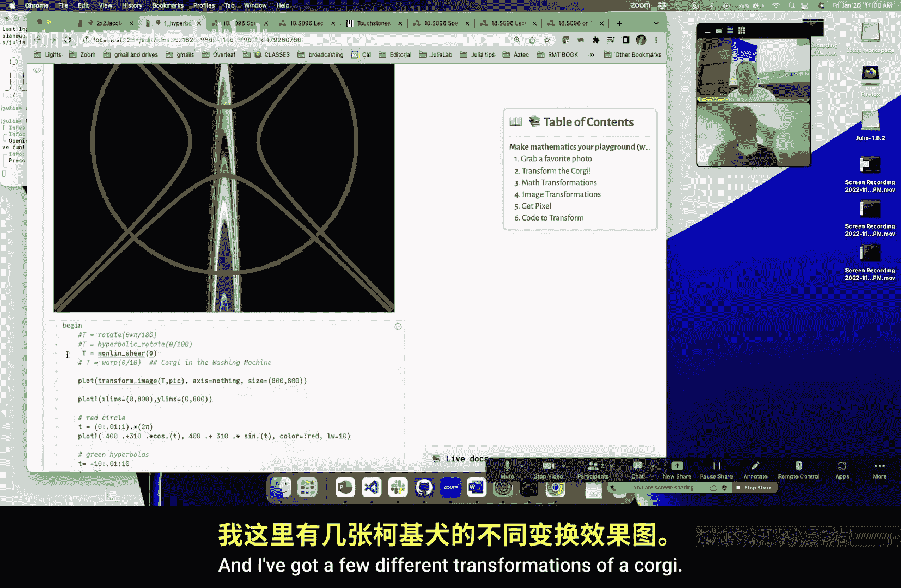

Is because。It's come to my attention that not everybody has a fairly good。

AViual intuition as to the difference between a linear and a nonlinear map or even even a map。

 So here， So let's go ahead。 Let me just ask a real quick， simple question for starters。

 So here I'm just rotating。

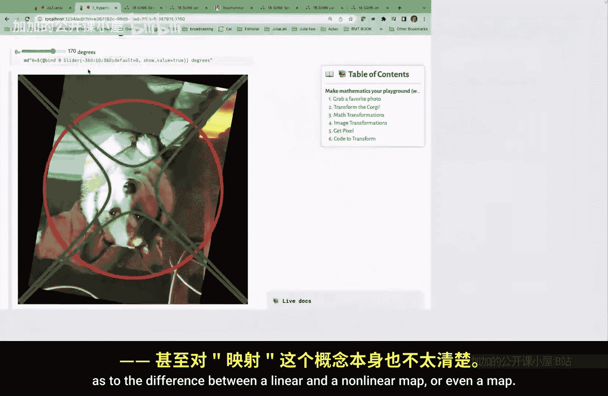

Right， so I'm rotating Philip。 He's gonna get dizzy。Okay， no， he's not gonna get this heat。

 No animals harmed， so。So， so， so， allright， if I'm talking about maps from vectors to vectors。

 from R N， it's usually R N as in Nancy to R M as in Mary， okay。

What are M And N for this sort of transformation。That's an easy question。Not a trick question。

So what are M And N for here I， So think of this as a transformation from the original upright picture to the rotated picture。

 What are M And N。

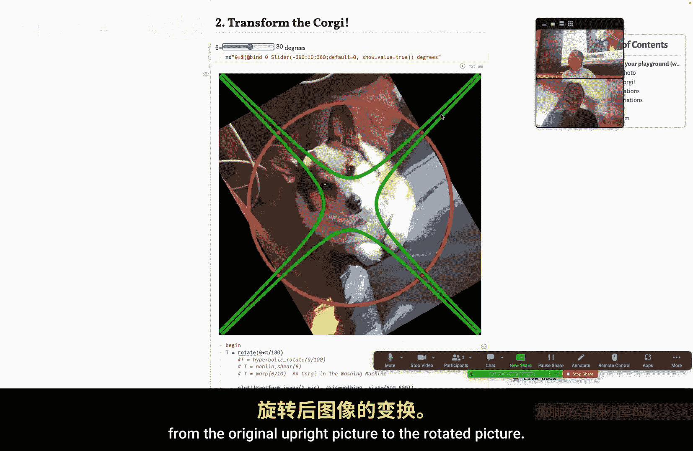

That's an easy one。Oh， gosh， no， I'm not even thinking that way。 That's too fancy。 Not that you're。

 in some deep sense， you're probably right， but， but for the purposes of this class， you're way off。

So let's try again。So emminent are the， are the dimensions of the vectors。So。When anybody。

 I thought this was easy。 maybe maybe the fact that it's not easy is telling me something。

I think the question is that is it the transformation of the image you're talking about or the transformation of the coordinates of the image that you're talking about。

 does that make a difference？So let' right so is it image in an image out or coordinate it in and coordinate out。

 which one are you talking about， does it matter？About the inverses of each other？

Answer either question that Steven just said。What do you guys think。

Or is the question just not clear？Yeah， it's from R 2 to R 2。 That's whatever， whatever， I mean。

Don't overthink the question， right， I've got。Right， I've got this Julia。

 I'm gonna hold up my phones。 Stephen， maybe you can see I've got this Julia sticker， right It's。

 it's in the plane， this plane， this twodial plane of of the phone， right。

 And this rotation is a is a mapping from R 2 to R 2。 I mean， if you want to focus on。

 I suppose if if I have the origin in the middle of the phone， right， and I rotate。

 this is a linear map， right。😊，Yes Alan， you could also talk about the transformation that takes the image of the corgi in and gives the rotated image of the corgi out isn't that what I was that that was exactly the that's but then the vector space is the number of pixels in and the number of pixels out。

Al right， this is going down a rat hole that I don't want to go。 I don't agree。 And， but I think。

 yeah， this， this is all I really wanted to do are right。 I'm going go to the blackboard。

I'm going to go to the blackboard， then。And。Let's turn on the lights on the blackboard here。

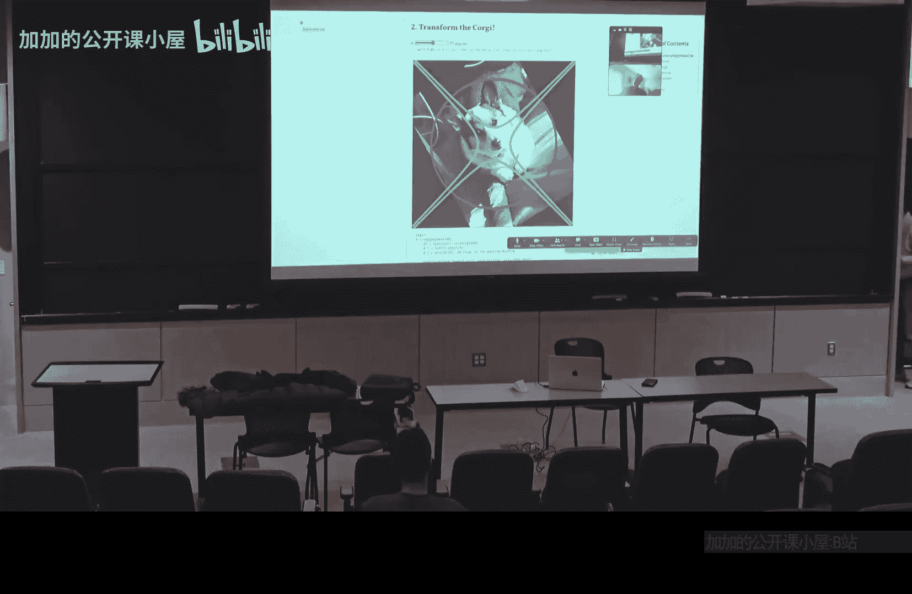

All right。So。For years in linear algebra classes， and I'm sure you've seen this。People will write。

R 2。Right， and then they would put down， if it's linear algebra， you'd have a matrix a。Right。

 and people would would， you know， you would draw a vector here， like a vector X。Okay。

 and then you would have the image plane also R2 in this case， right， And X goes to A X。

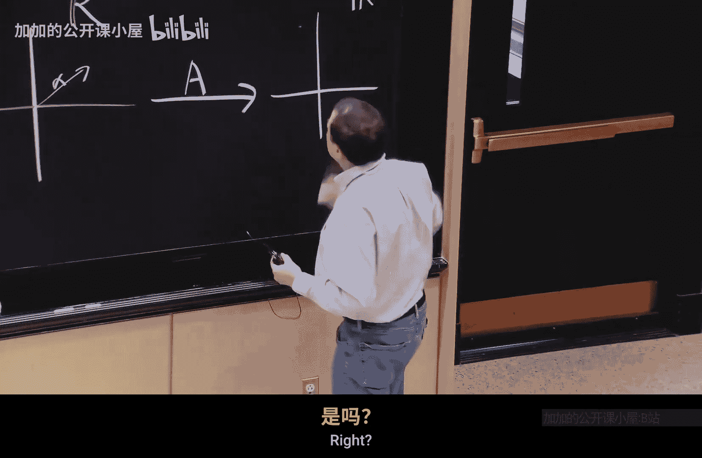

Right， and if you have another vector， y。That might go to。AY。

And you've all seen this in a linear algebra class， right？Okay。

 and if anybody is familiar with the cover of Gil Strang's book。

 which maybe I should just bring up while we're at it。

 so if you're familiar with the cover of Strang's linear algebra book。

 which is the textbook that's used right here at MIT and all over the world， one of the versions。

Of the book has these houses， this one right here。Okay， so maybe you've seen this version。

Right here with the。 And this is meant to indicate the transformation of a house， right？

 And so you have a house。Right， and， you know， some windows and a chimney or something。

 I don't know what you have。 And the image， let's say， I mean， just to be clear， if this house。

 if this house was a square and this is your everyday general matrix。

What would the image look like over here。Just generally speaking。

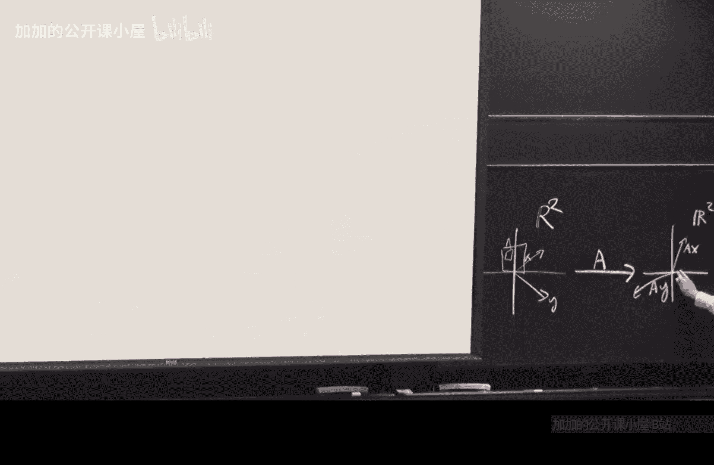

If you transform a square with a matrix， what does it look like？Just what shape。

It's a word you learned in high school or elementary school。' it's not a hard question。

It's a parallelogram of some kind， right， I mean， I don't know where it'll be。

 but it'll be some sort of right， the square will become a parallelogram of some sort。

 I don't know where it'll be。 The square window will also be a parallelogram of parallel parts and you know。

 that little chimney or I don't know what that is。 know。

 we'll sort of get skewed in some way as well， right。

 And this is what happens when you take every point。 I mean， I didn't want to get into pixels。

 I mean， I mean， just every point in the plane is being transformed to another point in the plane。

 right， And this is， this is what we would call a linear map。

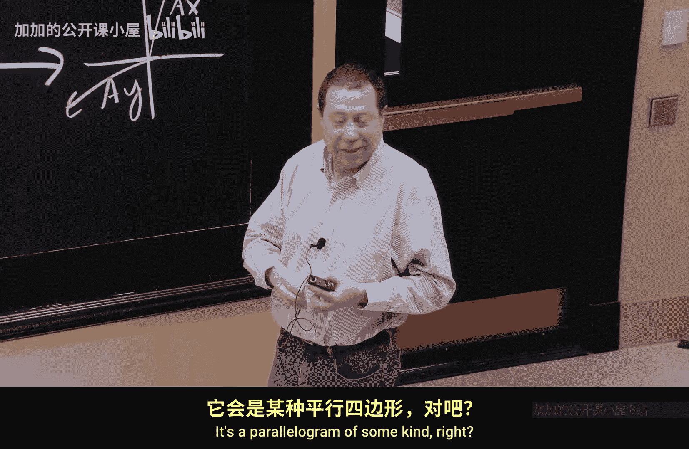

From R 2 to R 2。Right。Lunar map from R 2 to R 2。It emphasizes about a matrix。

 not the fact that a matrix is just a 2 by two， know，4 elements。

 It emphasizes the fact that a matrix is something that transforms space。Okay。

 and that's all I wanted to say。 And I， I thought that this was sort of a basic element of linear algebra。

 I'm a little worried that's the way I asked the question。

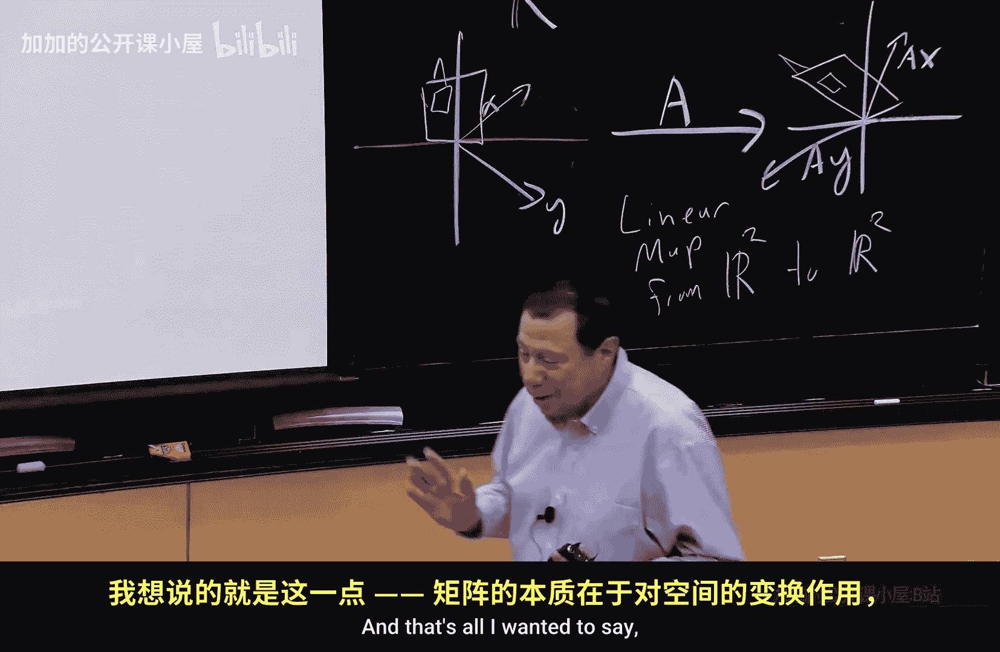

Wasn't clear to people。 So if I had。A picture of Philip over here。

 which I can never draw a good picture of Philip。Here's a Minecraft， Philip。Right， so。

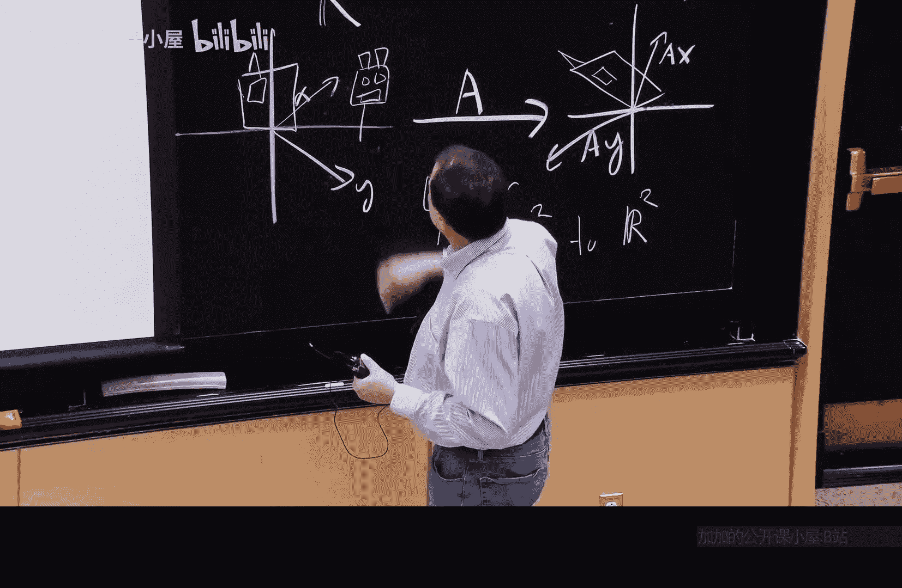

It's a terrible Minecraft picture of Philip。 right。

 It would get transformed to some skewed version of of Philip on the other side， right。

 And that's what a linear map is。Okay， so am I saying things you don't know， you all know this。

 right。Okay， so。So， with that understanding。呃，我。Go back， turn the lights down low again。

So with that understanding， I just wanted to show you a few linear and nonlinear maps and， you know。

 not over not， not， not to。Not to spend too much time on this。 but， but maybe it's worth it， so。Yeah。

 so a rotation is a linear map from R2 to R2。Is there still any confusion about pixels or any other nonsense。

 I just want to think of。Of。To be very， very clear， I'm just thinking of every point。

 this is the center。 His little black nose here is the center of， of the plane。

And you can always draw a vector。 I guess， oh， I could use Zoom to draw a vector。 This is great。

 Let's take a。😊，Let's， let's draw a vector right here。Right， so if I' met the origin in every point。

 like the tip， Well， I can't draw a straight line， but that's my fault， right。

 But this is meant to be a vector right to the tip of his ear， right。

 And then that vector will stay where it is。 But if I rotate。The plane say。If， you know。

 let's not rotate that much。 Let's rotate。To，2， to， maybe 30 degrees。 right。

 You see that his ear has moved 30 degrees。 whoops， whoops， whos， right， everybody， with me。

 any questions。Okay， let's， let's not belabor this point。 So the next thing I wanted to do。我呃。

The next thing I wanted to do， let's just clear this is show you some other linear transformations。

 So instead rotating a little bit too simple， so another linear transformation is this hyperbolic rotate。

 so let me just switch to hyperbolic rotate。Yeah again， forgive me， I just forgot my glasses today。

So I'm kind of weaning this a little bit。 So hyperbolic rotate is a little less familiar to a lot of people。

 So， so when you rotate just to say something also， I think very obvious。 Yeah， when I rotated。

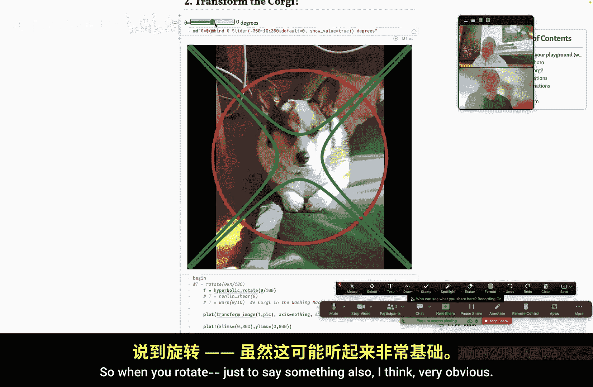

You see the red circle。 What happens to Philip's ears as I rotate。

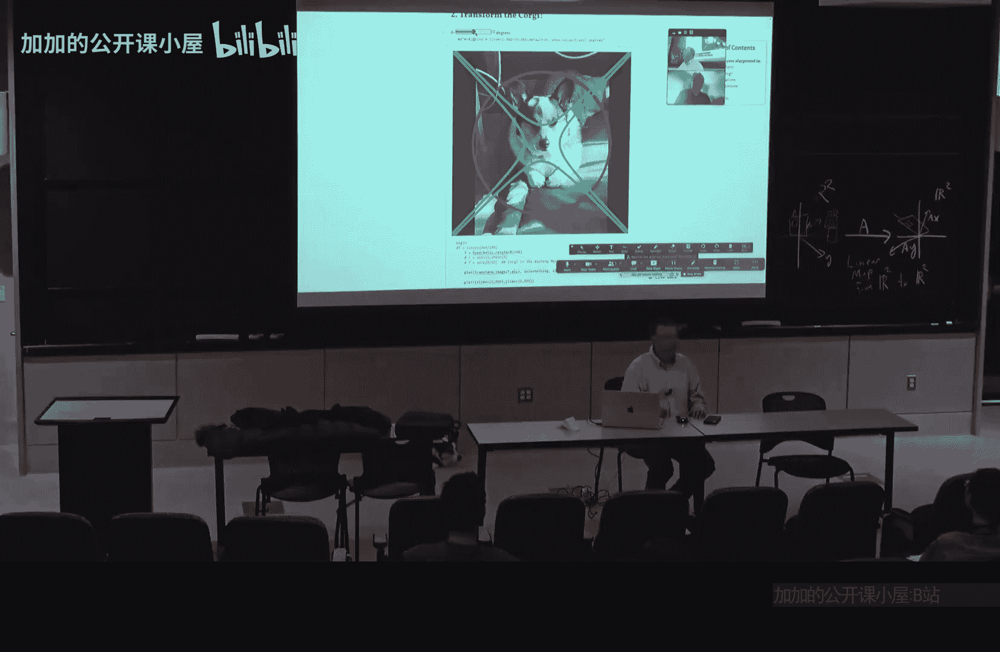

They， if I rotate the ears， follow the red circle， right， They just。

 they just sort of move along the red circle。 Okay， if now I want you to now focus。

 I'm now doing hyperbolic rotate。 I want you to focus on his eyes。

 You see the eyes are on a hyperbola。Okay， so as I you'll notice that as you move。

 his eyes always actually， this is this is what's called a hyperbolic rotationation。

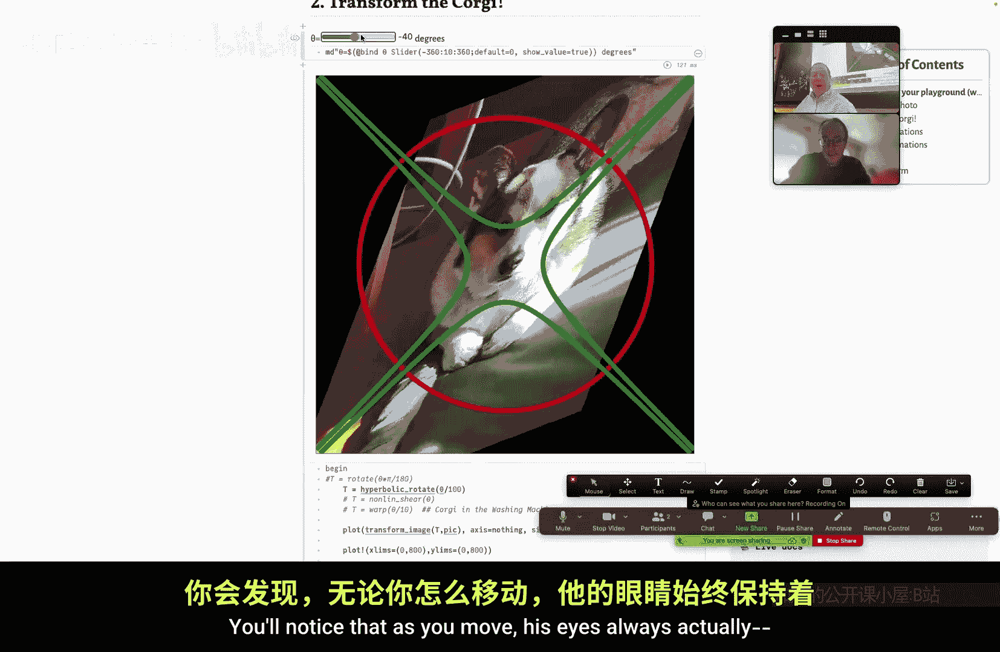

And is。