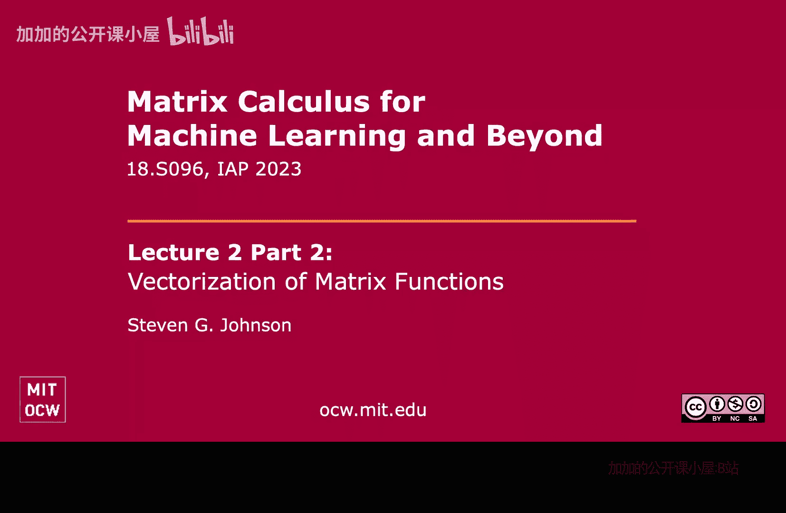
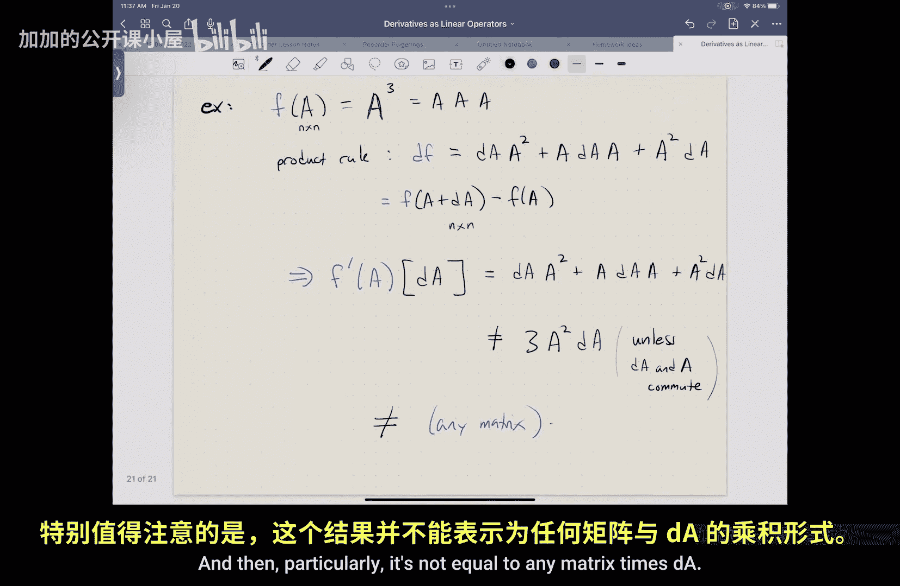

# 麻省理工学院【中英⚡矩阵微积分及其在机器学习中的应用｜2023-18.S096-Matrix-Calculus-For-Machine-Learning】-p04-P4-Vectorization-of-Matrix-Functions--BV1wbSNBkEQM_p4-

So。I want to briefly start to talk about going beyond 1802 derivatives we've already gone I would say beyond 1802 in the sense that they they never do the they have Jacobians maybe but they never really do the chain rule they never really write。

You know， even even this definition in where is it go back， you know。

 saying that the change in that change in the function is the Jacobian times Dx。

 which I view as the derivative that almost the definition of the Jacobian。

they never really do that they never really do like or multidimensional tailor expansion or something like that。

 but now I really what we want to do in this class go really beyond the02 to have functions where the inputs and outputs。

Are not just column vectors necessarily or scalrs， but they could be other live in other vector spaces。

In sort of more general vector spaces。嗯。So let me give an example。And you probably learned in 1806。

 hopefully that remember that a vector space is not just a column vector。

 it's really more abstractly anything you can add and subtract multiply by scalarrs。😊。

And so there are other things that you can put in vector spaces， you can think of as vector spaces。

 and so for example， would be matrix。😊，Inputs。And or。Outputs。For example， suppose we have。

The function。F。That takes a matrix。Its input and suppose it's a suppose it's a。

an N by n matrix is input， so now there's n squared inputs。

 it's an n square dimensional vector space if I allow arbitrary matrices。And I could say。

 for example。F of a equals a inverse， right？Or。A cube。Or even more complicated things， for example。

 I could say f of a equals you take a matrix's input and you get the u。

 the upper triangular matrix from gas elimination。这。If you do gas elimination。

 let's assume then we have to restrict ourselves to maybe to non singular matrices or something。

 you take a matrix in and it gives you an upper triangular matrix out。😊，哎的。

Or you could also have things， these are things with matrix outputs。And matrix inputs。

You could also have scalar outputs。But you have matrix inputs。嗯。

And what kind of functions would those be， so for example， the determinant？😊。

It's a perfectly good function that takes a matrix in and gives you a scalar out or the trace。😊。

Or you could have even more complicated things， you could have or Sigma one of a the largest singular value。

You take a matrix in， you compute the singular values， take the largest one。

that's a number it's a function that takes a matrix in and gives you a scalar out。right。

Or many other examples and so we're going to see how to take derivatives of things like this。

 we'd like to be able to take derivatives of things like this。😊。

And so let let's do a couple of them they're not that hard to actually analyze the simple ones determinant to trace is actually pretty easy I won't do that but determinant is a little bit more complicated but Alan's going we're going to show you some clever tricks for that pretty soon and matrix factorizations like SVD or gas elimination are also a little bit tricky but once you see the trick it's not so bad but things like A inverse and A cubed are actually pretty pretty straightforward so for example。

😊，Let's do F of a。Is。A cubed。嗯。So if we do， I think actually Alan already did F of a equals the a squared。

 but now we'll be cubed right so now we can just do the product rule。😊，RDf。

This is a cubed is just a times a times a。And again， I'm going to assume these are square matrices。

 otherwise you couldnt multiply them by themselves。Yes， my have。are blue。嗯。

Should I put my matrix input as red？Right。嗯。And what's the product rule， well。

 it just it's just three terms， I have a D。Times a squared。Plus A times D。Times a。

Plus a squared times d does everyone see that so I can just take the D of this term d of that term d of this term and a is no longer a constant matrix a is not is not a fixed parameter it's the input you know parameters so I can remember so this is all this is。

Is just saying， suppose I take at my function F and I take a， and I add。

An arbitrary change this is an arbitrary end by n matrix with little entries。

 infinite testimally small entries and I asked how much does the function change， does a cube change？

And again， dropping terms of that's proportional to D squared or higher。嗯。So。

It's nothing too mysterious it's just asking how does it to change。

 keeping only linear terms that's what the derivative means？And if we keep only the new terms。

 we get these product rule， we get these three terms。 So our F prime。Is a a？Is a linear operator。

And I think this is one of the cases where it's really useful to have the square brackets。😊，Here。

Right because its not it's not anything multiplying a at D in the left。

 it's the linear operator that takes any little change D。

 any arbitrary change there and returns this matrix， returns a squared。And。嗯，那 correct。

The middle term oh yeah， the middle term is no square， thanks。Good nailen's back。

I noticed that this is very much not equal to what you would get for if there were a scalar。

 the derivative of a cubed would be 3a squared D。would be equal， of course， yeah。

 when would it be equal， right？Unless what？D A and。Anyone guess？For particular perturbations， D。

 what what kind of special you may not have picked it up on the microphone。

 but there was an answer that D and a commute yes。Yeah， so unless D and a commute。

 which is not true right you know， so if you're interested in perturbations that are proportional to a right or something like that right or some power of a。

 something that commutes with a， then you can use the 3 a squared D they could basically commuting matrices is almost act like scalrs right but I think people find it kind of surprising that that this is kind of the。

This is the derivative of a cubed in really simplest form， I mean you can't there's not much。

There's nothing you can do to simplify that any further yeah and it's particular it's not equal to any matrix。

Times times times D。

I can't just multiplying a matrix D on left my matrix is a linear operation。

 but I cannot write this linear operation in this。