# 麻省理工学院【中英⚡矩阵微积分及其在机器学习中的应用｜2023-18.S096-Matrix-Calculus-For-Machine-Learning】-p05-P5-Kronecker-Products-and-Jacobians--BV1wbSNBkEQM_p5-

So a quick problem。

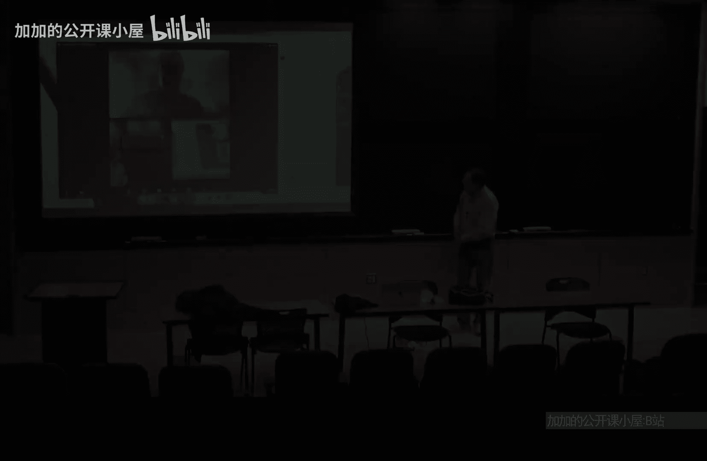

You might want to grab a pen and paper。I think it's not that hard， but let's just ask。

Let's say we have this function， which is just the two norm of x。From R N to R。Right。

 so everybody knows this function， of course， it's the square root。Of x1 squared。Up to X n squared。

Right， so a vector goes in， a scalar comes out。And my simple question is。What is the gradient。

Of this function。And the reason why I'm putting this up in part is because I suspect everybody in the room can do this the 1802 way with indices and if you'd like to do it that way because that's where your comfort is。

 that's fine but I think the real challenge is if youre to kind of exercise what you've learned so far is to see if you can do this without indices。

 that what I call the grown-up way there's no right and wrong。If you get the right answer。

 that's fine。But of course， I think that the comfortable way is。

 is well comfortable for everybody and the grown up way takes some practice。So。Let me put this up。

 and I'll go through it in a moment。A simple question， the gradients of this function。

I think the 1802 way might be to start with the first component， but pretty quickly。

 you realize that every component is the same， right， So you， you might start calculating。

 for example， D D X 1。Of the square root of x1 squared plus x1 squared。Right and。

usingsing all the calculus， you remember， the derivative of something to the one2 is the same thing to the negative12。

Right， and then you would。You would get2 x1， so this would be1 times 2 x1。Right。

 and you would have x1 over the square root。Of x1 squared plus xn squared。Okay。

 and it wouldn't take you long to realize that if you did X 2， there's no real difference。

 And before you knew it， you would find out that。The gradient， of course。

 would be the vector x divided by its length。That gives you every And that would be what I would call the 1802 way。

 it is not so bad。But in this class， we're trying to see if we can avoid using indices。

 sometimes you can't， many times you can， right， And so we want to emphasize the ability to not use indices。

Okay， and so。I don't know。Has anyone already written it out or convinced themselves they could do it without indices yet？

Has anyone done it yet？But you think you can do it。So， so。I'm going to write down。

R is equal to the length of x。Okay， and。And therefore， our our squared is x transpose X， right。

 This is sort of the。The linear algebra way to set things up。

And then I'm just going to take the differential of both sides and get2 RtR。

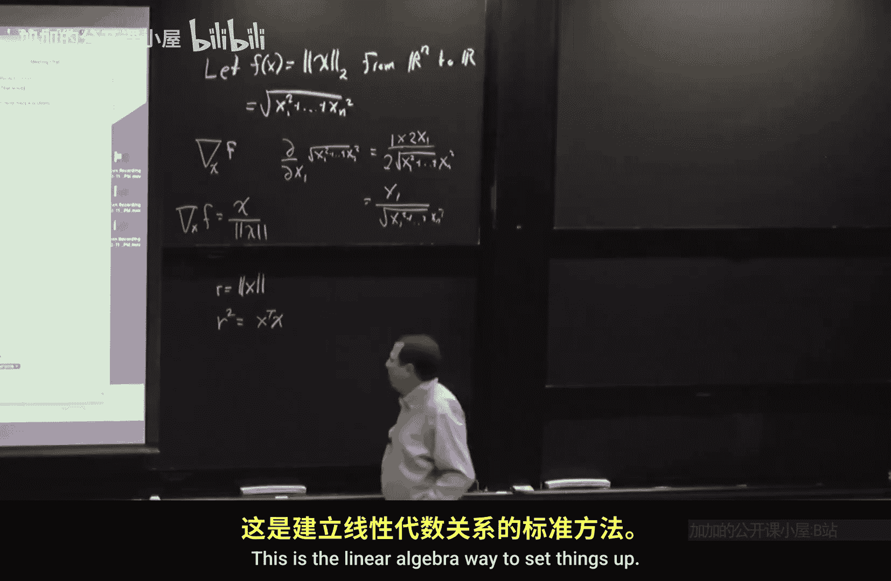

Equals and we we know this's differential。 so I can just write it down。 But if you forgot it。

 you can get it yourself。Right， so oh sorry， this is D R。

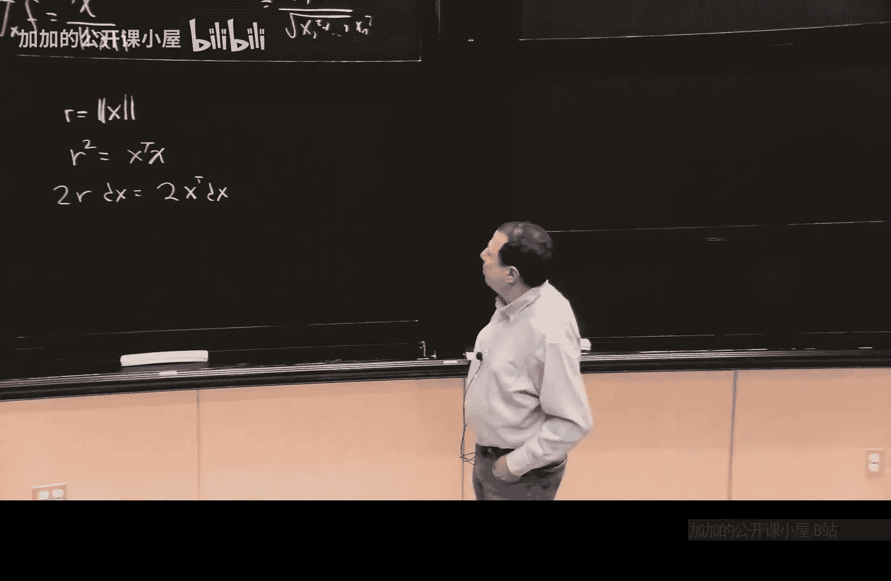

Is2 x transpose dx。Right， and so therefore。DR is equal to x transpose over R dx。

 and then the gradient。

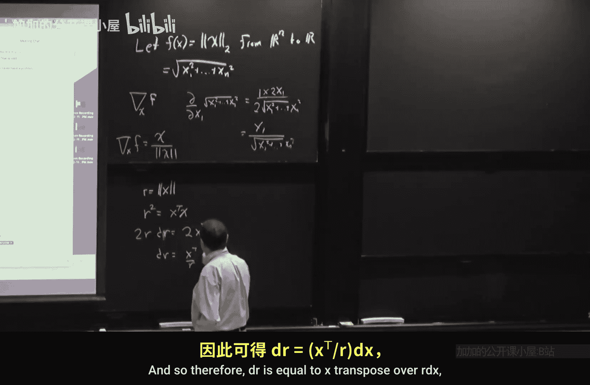

Is the transpose of this， which is x over R。Okay， so no indices that was kind of the trick here just to be able to do this sort of thing without any indices。

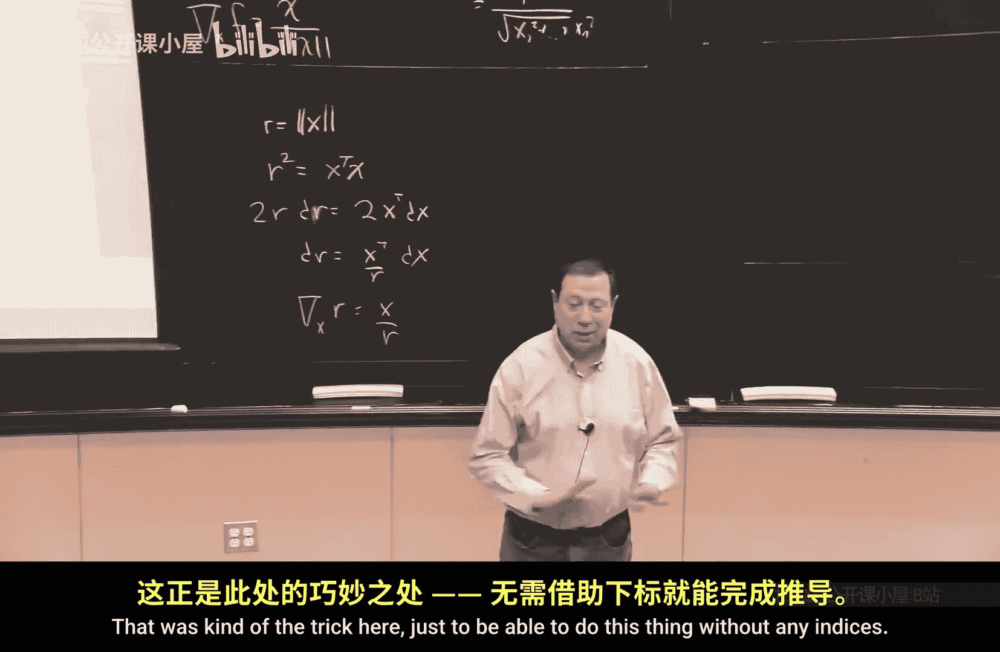

，K of like it's sort of like superpowers for vectors and matrices。Like I said， this isn't hard。

 What happens， though， is as things get a little more complicated。

 have being good at this sort of the non index approach gets more and more valuable。

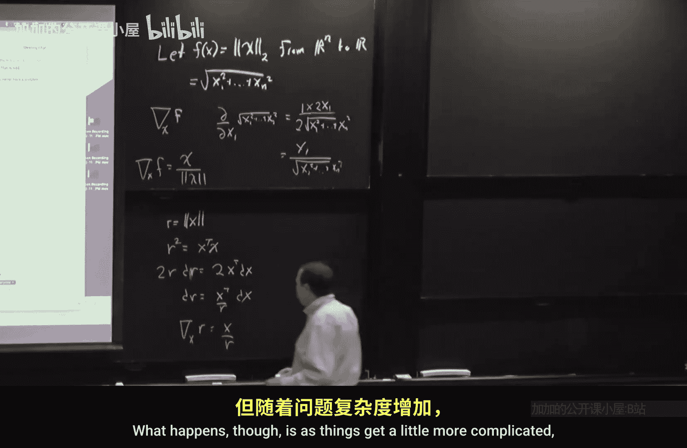

Okay， so that's。 there's no one right way to do it。 You could， you could grind it through。

 no matter how complicated。 I bet you all can do it。 But this is the fun way to do it。All right。

 there's this thing over here。 Any questions about that。Okay。

So I don't know if you've looked at the homework yet。

 but the first problem has the transformations of the plane with the Corgis and we're looking for two by two Jacobian matrices and in one case theres。

In part D， where there's the warp， there's a matrix function of x。

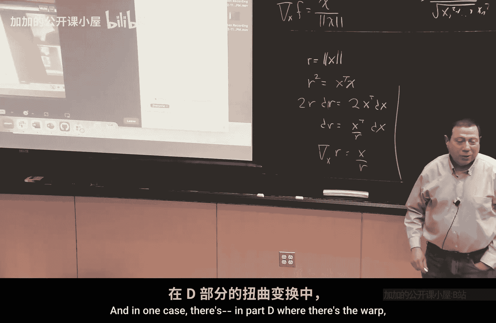

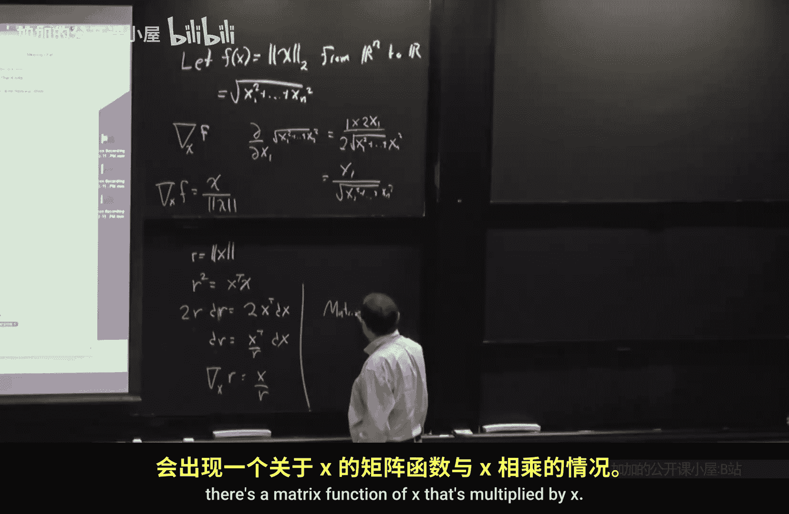

That's multiplied by x。If the matrix didn't depend on x， the Jacobian would just be the matrix。Right。

But because the matrix depends on x， there's going to be two terms， right， There's going to be。

Roughly D matrix。对。The X times x plus this is kind of the。The template。Right，And somehow。

 a D X is going to come out of this term as well。 And so this term is the easy one that would if the matrix of constant right。

 and this one takes a little bit more work， right， So that's problem D on your homework。

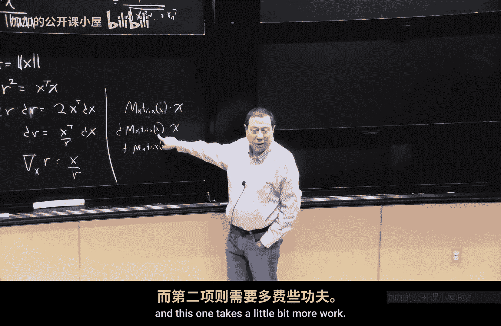

In the first part。

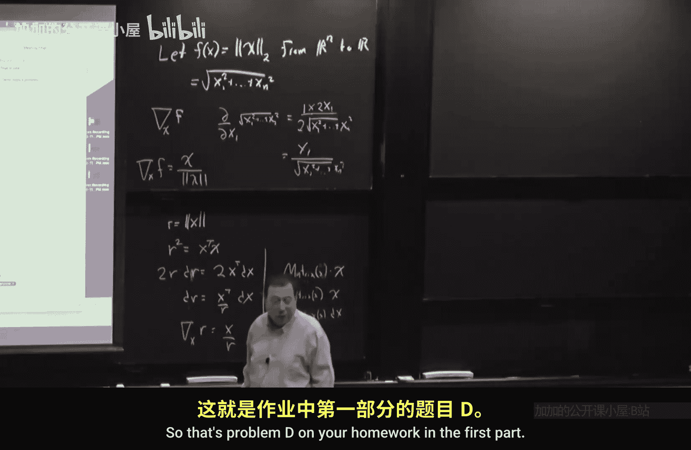

All right， good。嗯。Okay， well， then I'm going to go back and do what I was starting to do。Last time。

 and I think it just makes sense to go back to the beginning since we've had a whole weekend since。

Last time。Okay， and so matrixtri Jacob in。 So in this this， this Julia notebook here。 And by the way。

 if anybody has questions about Julia， if you feel free to ask about that as well， but the。

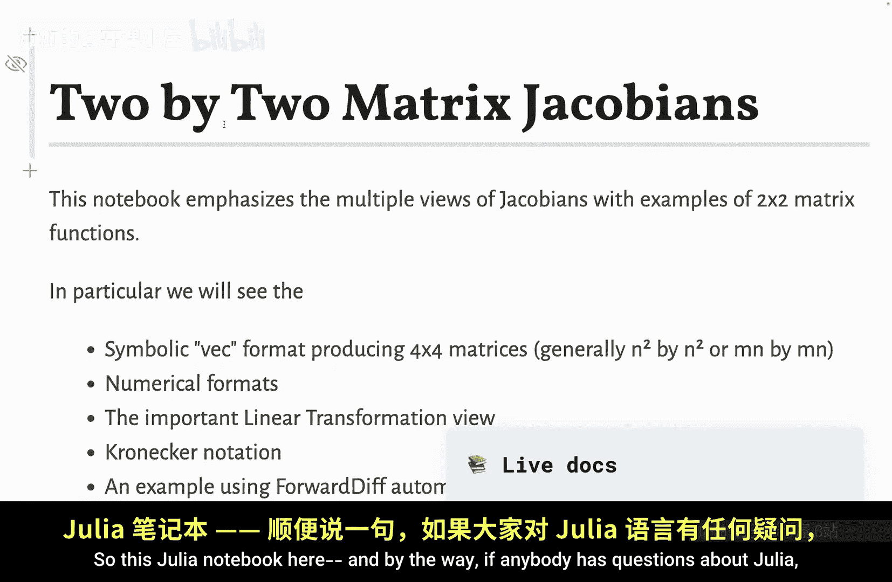

The goal here， this is a this blackboard example is a scalar function of a vector。

And I'm really excited about functions where the input and output are actually matrices themselves。

 right， so， you know， matrix square， matrix inverse we've seen matrix cube I like to think of the L decomposition as as a function of matrices。

 I don't know if you've ever thought about it， but the L decomposition or even the eigeniccomposition of a matrix is is a function from matrices to。

😊，Pieces of matrices， in， in effect。

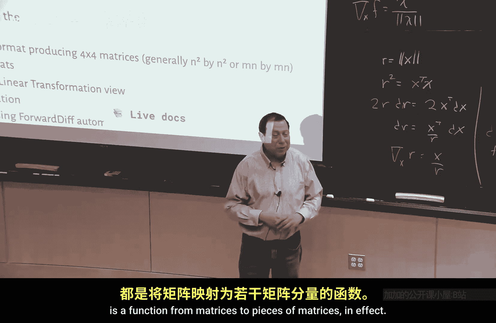

So we'， we'll see how that goes through。 Allright。Let me。Go back to the beginning here。

 just very quickly。 We're using Julia symbolics， which is kind of fun to do。Okay。

 and this shows up later。 I don't know why it's at the beginning。 so we'll just get by past it。

 but here's the matrix that we'll work with a lot。 This is the symbolic matrix that has P Q R S going in the column major order。

 Okay and so I just declared P Q and R and S to be variables as well as theta。 So。

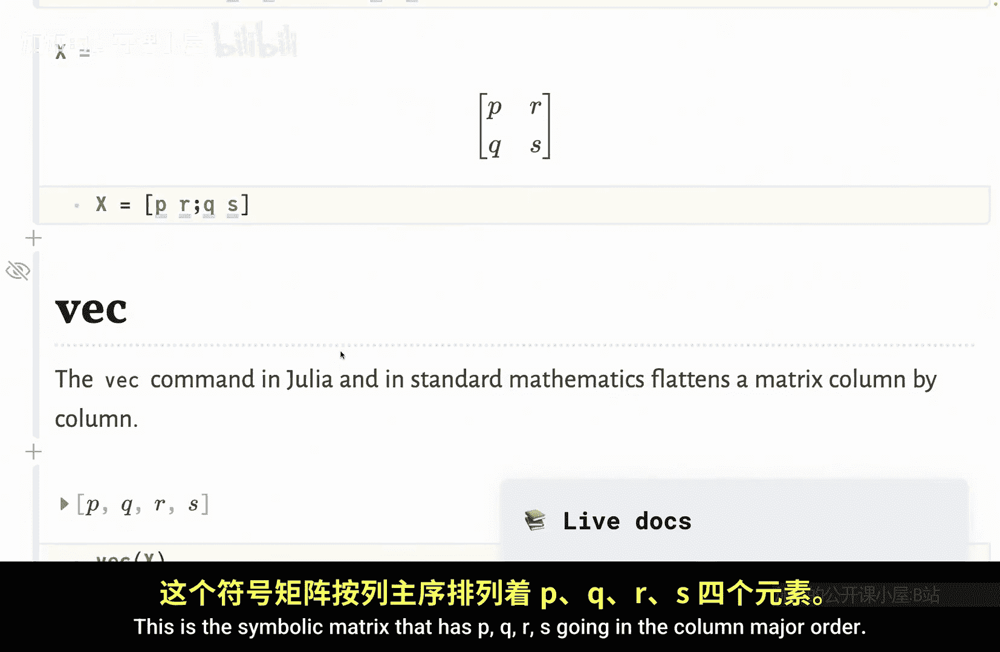

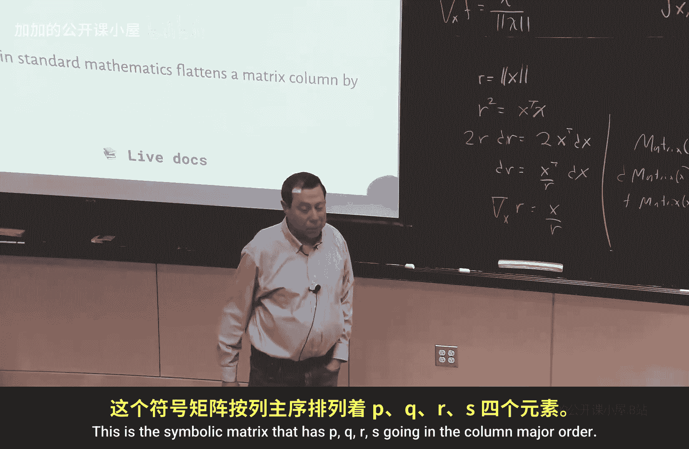

Julia lets me put them in as elements of matrices。 Okay， so simple thing。

 And last time I introduced the Vck command。Which basically squashes a two by two matrix or any。

 in fact， any matrix down to a vector。 It's all you do with Vec in case you missed it last time is you take the first column and stack it on the second column。

 stack it on the third column and so forth。 And this is， again。

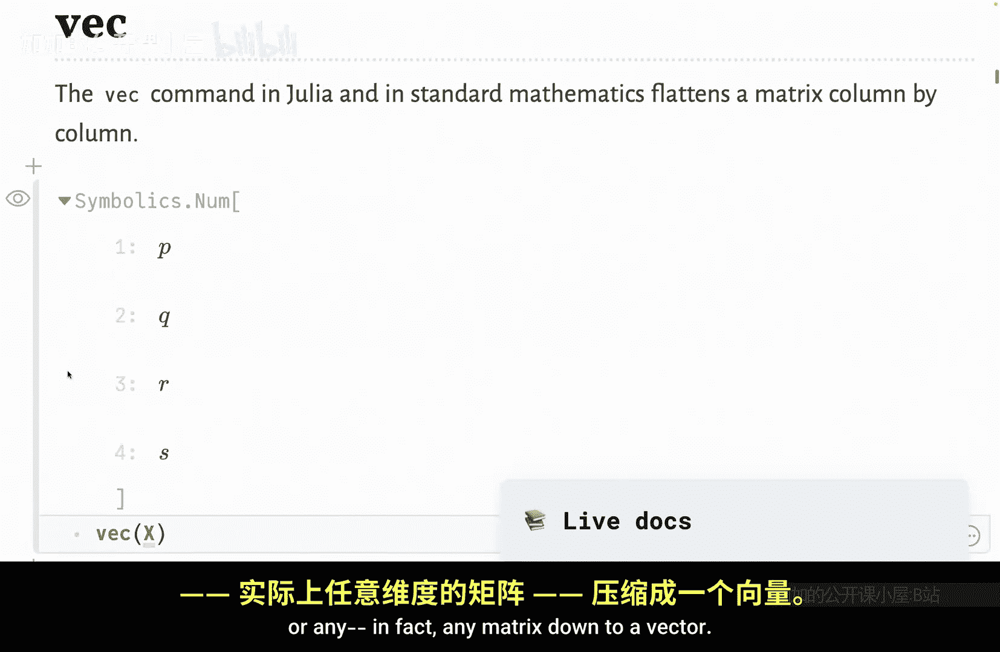

What we show students。Because it's concrete。But as far as I can tell。

 you never really need to beck things other than maybe in your mind， right， but I mean。

It it's another one of these comfort things that I don't think you really have to do in practice。

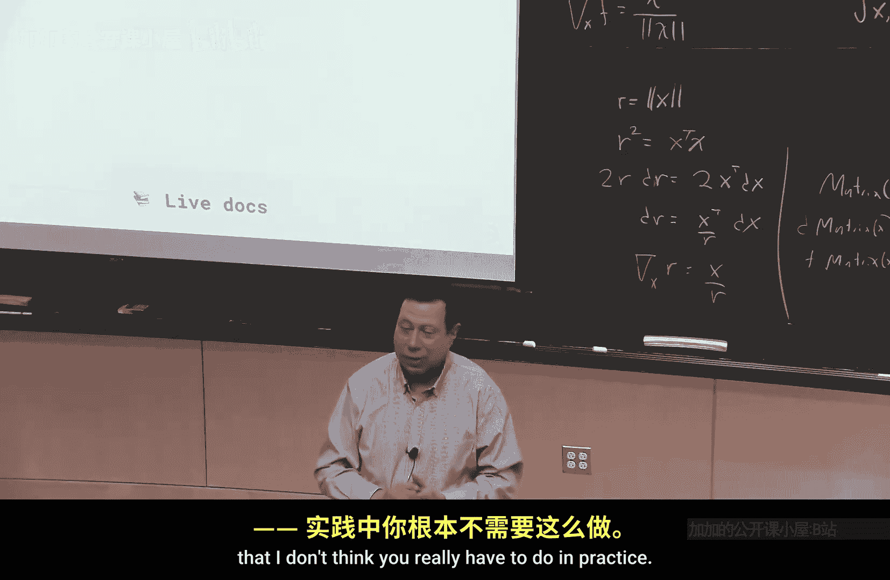

Okay， but it does have a way of。Of， of of allowing you to use one notation for many， many things。

 So there's the V command， just squashes or matrix。Okay， and。

And here's the matrix square of a two by two matrix。 All of you can do this。 Just take that P， Q。

 R S matrix and do that dot product D thing。 and you get the matrix square， which we conve。Right。

 and。Maybe I'll make this just a little bit smaller so I can get a little more real estate。Yeah。

 so okay， good。So this is the Vc of the matrix square and so one way to think of matrix square is a function from R4 to R4。

 it's the input are the variables P QR andS， and the output are these four functions of P QR and S。

 the p squared plus QR all the way down to QR plus S squared。Right to that。

That's a function that takes R 4 to R 4。 But really。

 we all know it's a function from 2 by  two matrices to 2 by 2 matrices， right。

 R 4 to R 4 is just a crutch。😊，It's really two by two matrices to two by two matrices。

And so we can calculate the Jacobian of this thing。Today。

 and I'll just remind you that the Jacobian is nothing other than all the derivatives of each of these four expressions with respect to all of the four input variables。

 P， Q， R and S。Right so， so this output P squared plus Q R belongs to the first row。

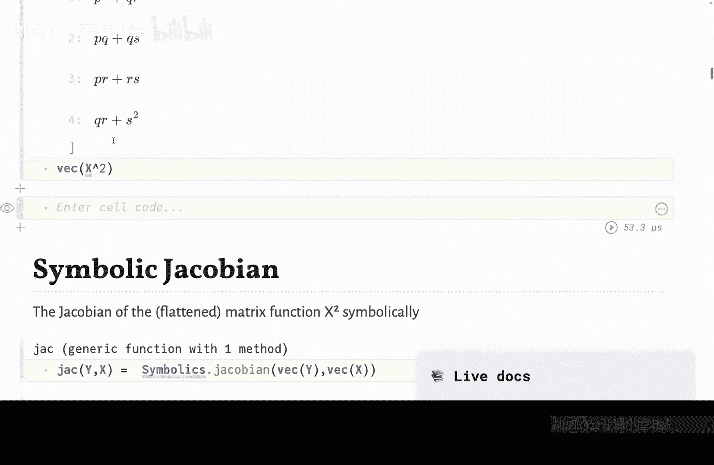