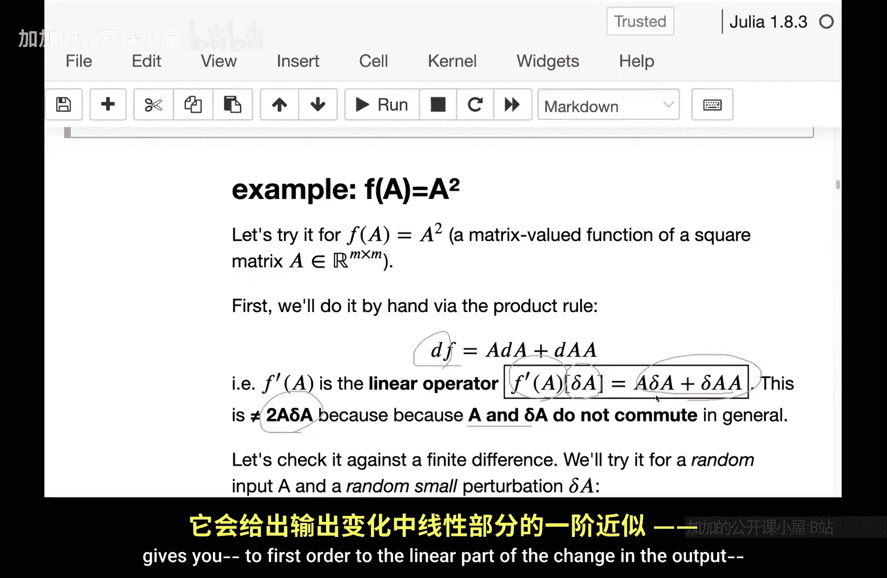

# 麻省理工学院【中英⚡矩阵微积分及其在机器学习中的应用｜2023-18.S096-Matrix-Calculus-For-Machine-Learning】-p06-P6-Finite-Difference-Approximations--BV1wbSNBkEQM_p6-

You know， so Alan talked to mention fine differences as something that that automatic differentiation is not doing。

 but I do want to talk about fine differences because they do come up。A lot when you。

When you're talking about computing derivatives on the computer。So。And as you mentioned。

 we're going to spent a lot of time talking about automatic differentiation。

 which is this amazing technology where you can take a program that computes a function and will basically compute the derivative analytically in some sense for you。

 but how it does it takes a little bit of explanation。😊。

And this is great if you hand computing derivatives。

 even though you might think the rules are simple as you see from the homework when you get the more complicated functions especially involving vectors and matrices。

 it's quite error prone。😊，And it's a common source of bugs if you're doing numerical optimization。

 root finding， sensitivity analysis， all of these things on where on computers where you might want to differentiate a really complicated calculation so AD is a great alternative it's extremely reliable if it gives an answer's。

😊，It's probably correct。Unfortunately there's still a lot of cases where automatic differentiation doesn't work。

 where for example， it's code， that calls external libraries and other languages that the automatic differentiation can't handle。

 or even in a given language， usually they can only handle a subset of the language。

And those other cases where even if automatic differentiation could work。

 you need to really give it a little help in order to use it effectively。

 basically any kind of problem where you're computing an answer approximately。Like for example。

 you're solving a nonlinear equation by Newton's method。😊。

If you try and use automatic differentiation， even if it works。

 it wastes a lot of effort basically trying to not only differentiate your function and computing。

 but trying to exactly differentiate the error in your approximation。

 so it tries to propagate the derivatives through every step of the Newton's method。😊，And so。

It turns out you can usually do much， much better if you know what function you're actually trying to compute and we'll talk about that a little bit。

So。You know， in the cases where automatic radiation fails completely or where automatic differentiation works。

 but it's really suboptimal like you like the replace portions of it but other with a more specialized method。

Often you only need to give it a little bit of help。

So what you do is you take the one piece of your program， the one function。

 one subrtine that it fails on。Or where it's doing a poor job on and you do a manual differentiation of that。

 but then you let it handle the rest of it， your program know and our ADD systems are very good at the chain rule。

 they're very good at basically if they know the derivatives each piece。

 they can propagate derivative through the whole thing。

So on Julia there's a package called chainin rules for this if you're using Python with Autograd or JaX。

 you do it by defining a custom Jacobian vector product or vector Jacobian product and we'll talk about these as well。

But the end result is you often find yourself doing at least some manual derivatives of complicated things。

 and as I said， it's very error prone。😊，And so you really need to check it。

 you have your program to computes derivative or you're doing homework and you think you've differentiated some complicated expression that we've given you。

It's a really good idea to check it。And the usual way to check it is using finite difference approximations and so remember。

When we look at the derivatives， you should think of it， this is really。

 it's a way of computing the small change in the output， DF for a small change in the input。Dx。

And mathematically we like these D's to be infinitesimal things， but they're really， you know。

 you can think of these as an approximation in the case when you have a finite delta x and we actually started in the opposite direction we started with imagining imagining a finite small change delta X and that gives a finite small change delta F。

😊，And in both cases the linear approximation is f primeed it's F so this if it's an infinitesimal change in the input then this is exactly F primeed dx or linearization。

 if you have a finite small change dx， then the change in the output is approximately。😊。

The derivative。Times this。Right and so。If you just look at the left hand side。

 this is easy right if you have a function that computes F of x， you can just。😊。

A very small delta x compute f of x plus delta x minus f of x take a difference and it should be approximately equal to your derivative times times that are operating on that change deelta X plus higher order terms which are negligible if you can make this deelta x small enough and we've actually Ellen has done a whole bunch of examples of this sort in the notebooks so far but I want to dig into this in a little more detail。

😊，So this is a finite difference approximation。😊，For the change in the output。Very conventionally。

 people put the if Delta x is a scalar， people often put the deelta X on the bottom there。

And do you think of it as a？Did I write that in yeah， I should write that in。

 but if you put the deeltas in the bottom there。😊，then because if it's a scalar。

 you can just say f prime of x。Is approximately。F of x plus delta x。Minus f of x。Divided by deelta x。

 So this is probably the form。 it's sort of the more conventional form to see this kind of approximation in as an approximation for the derivative。

😊，Rather than the approximation for the differential。😊，I had the Df。

But you know we try to push this format here because this one works even if delta x is not a scalar。

 we can't divide by right you have a vector for example。

 or a matrix or something like that and this is a linear operator F prime is linear operator acting on Delta X right so this is still accurate right so if you have if you have a program that computes F and and then you can easily compute the change in F oops I compute the change in F。

For a small change in the output。And then you can compare that to what you think is your derivative that you worked out laboriously by hand。

 maybe or if you're lucky， you have an automatic differentiation， you operate that on Dt X。

 so you should get approximately the same thing。😊，So this formula here。

 as it says here is this is called a forward difference。

 it's called forward because you kind of perturb x in the plus direction。😊，If DelTtex is positive。

You can also do a backwards difference。😊，F of x minus f of x minus delta x。

 which is also approximately f prime of x dx， it doesn't really matter which one you use that but if I tell you forward difference here。

 the immediate questions like what's the backward differences can I just point out that the backwards difference is not the same sense of backwards as in backward mode differentiation or reverse mode yes。

 we're going to talk about forward and backward mode differentiation。

 those are totally unrelated to forward and backward differences？So yeah， so and as I said。

 there's a lot of forms and we'll talk about maybe some more sophisticated forms of it than for and backward differences。

You can do them the ones that give you higher accuracy for a given Dlta X。

 but they're generally a last resort as a computational scheme。

 but they're a first resort as a quick check， right they're a really。

 really easy to do really kind of brain dead and know they're hard to get too wrong。

 so if this is a good match for your F primeed of XBX that's a really good sign。Right right。So。

Let's just start out with an example or there's an example we've seen a few times in the class。

 which is f of a， so a is not going to be a square matrix。And f of a is just a squared。😊，Okay。

 and we saw from the product rule several times that Df。Is ADA plus DA？

Which is not the same thing as2 ADA， like the first year calculus rule for scrs because。

A and Delta A don't commute， we've seen this many times。😊，So F prime here is now。

The derivative is really a linear operator that gives。

A small change in the input gives you to first order。You the linear part of the change in the output。

 a delta a plus Dlta Aa。

Right？