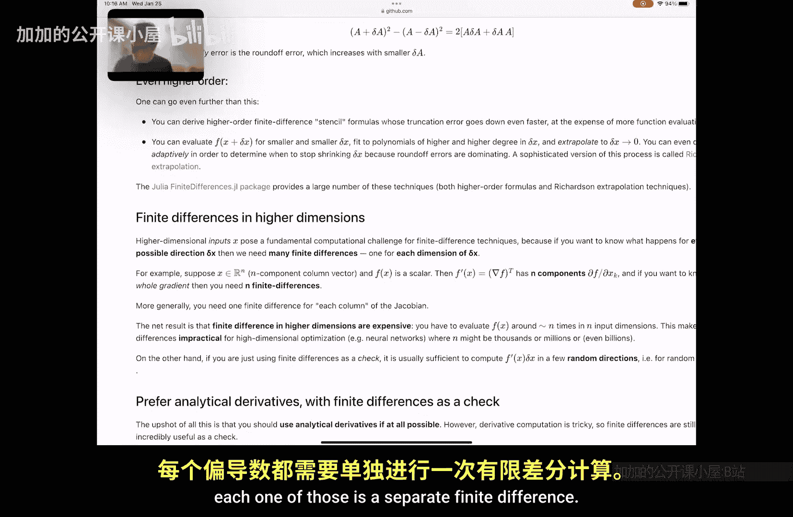

# 麻省理工学院【中英⚡矩阵微积分及其在机器学习中的应用｜2023-18.S096-Matrix-Calculus-For-Machine-Learning】-p07-P7-Gradients-and-Inner-Products-in-Other-Vector-Spaces--BV1wbSNBkEQM_p7-

So I wanted to start today just by finishing up a couple comment on a couple of additional things from last lecture。

 so last lecture we talked about fine difference approximations in particular I talked about。

The most obvious approximation， which is just from the definition of the derivative where you approximate Df by know prime F prime of x dx our linear thing the exact derivative for infinitesimal dx by just f of x plus dx minus f of x for know some finite delta x not non infinitefinsimal right and if you divide both sides by by delta x the more familiar form was this ones this is called a forward difference approximation。

And we show that this has an error in it that goes， decreases linearly with Dx。

Until DXent becomes really small and then becomes limited by roundoff fairs。But I wanted to mention。

 of course， there are other ways of approximating derivatives by differences。

Some of which are even more accurate， they're called higher order find a difference。

 so that forward difference are first order because the error goes linearly with the x。

The most famous next improvement would be approximate F prime Dx。

By instead of f of x plus dx minus f of x。😊，We take f of x plus dx minus f of x minus dx。

And since now you've basically doubled the interval because you're going from minus dx2 plus dx。

 you have to divide by two。Or if x is a scalar。😊，So then you can just divide by deelta x this is the second form is the more familiar form of these center difference approximations。

Which is you divide both sides by Delta x， which only works of delta x as a scalar and you get f primeed is approximately f of x plus2 dx minus f of x minus dx divided by2 dx so again2 because you're going from minus dx to plus dx so the overall interval is2 dx。

So it turns out that the error in this case， instead of going linearly with Delta x。😊，Is。Qudratic。

 I guess this should be order delta x squared I had left out the x， I I'll fix that later。Um。

And the reason it goes quadraically is this is called second order accurate。

You can derive it in a variety of ways， but one way to derive it is you just you just plug in the Taylor expansion for f of x plus dx and f of x minus dx。

And what happens is because this is symmetric， right， it's F of x plus dx minus F of x minus dx。

 all the terms with。😊，With even powers of Delta X in the Taylor series all cancel right。

 because if it's an even power， like remember the there's there's F F plus F prime D X plus。

F double prime Dx over two and so forth， that's your Taylor series Dx say F double prime Dx squared over two。

 sorry。Anything with an even power of deelta x， it doesn't matter if it's plus dx or minus dx。

 it's the same thing when you square it or take the fourth power and so forth。

 so when you subtract these two terms they cancel and so the error becomes the next order term assuming it's at least three times differentiable。

So in terms of this center difference formula， the error in the derivative goes like delta x squared。

 or if I multiply both sides by delta x， the error in the difference goes like delta x cubed。😊，Right。

And and we can check this， we can plot it for sine x so I did this I plot for sine X。

 we're going to take approximate it at x equals one by either。

The first order difference sine of1 plus something minus sine of1 over s or the center difference signine of 1 plus S minus sine of 1 minus S over2 s。

I don't know why I called it S there。And I'll plot it as a function of deelta x。😊。

And the forward difference。I is the blue right that goes proportional to linearly with Dlta x that's the blue line is just a plot of delta x for reference linear。

And the center difference is the red dots， they go quadraically with Delta x。

And which is the and the straight red line it's just a power law quadratic with deelta x。

 of course again this is a log log scale， so power laws turn into straight lines until in both cases。

 once they hit sort of the machine precision， the error starts getting worse if you make the delta x too small。

😊，And in both cases， you know， so you know you want so you want to have a delta x that's that's small but not too small like 10 of minus five in this case for the quadratic case or10 of minus maybe 10 of the minus yeah five was about where they。

is the error is minimum in this case。And there in fact， there are even higher order differences。嗯。

You if you take even more points， in some sense what you're doing is basically taking multiple points and fitting it to a polynomial。

And taking the slope from that so as you get to add even more and more points you can fit to higher and higher order degree polynomials and get higher order difference formulas that give even smaller error for the same size of deelta x。

😊，Another even fancier thing to do。is you can start with just some deelta x and then compute a sequence of delta x is that you keep like dividing it by two or something。

And each time you divide it by two， you fit it to a higher degree polynomial and you're extrapolating the slope to deelta x equals0。

And it turns out there's a way to do this adaptively， so you keep decreasing deelta x by say。

 a factor of  two。And you go to higher higher polynomials。

 but there's a way to watch this and figure out that at some point when deelta x grew is too small。

 you can notice that the air is getting worse and you can stop so you can adaptively find like the optimal delta X and the optimal order。

To extrapolate extrapolate as accurately as possible and the fancy version of this is called Richardson extrapolation so it's a really nice technique for extrapolating functions i'm not going to go into it in more detail。

 but it's a fun thing to look up there's I have a package for it in Julia and there's a Julia package called finite differences DaL that has zillions of different finite difference formulas including Richardson extrapolation that can get you know pretty high order accuracy but。

😊，Anyway， so I wanted to mention those。😊，And the other thing I wanted to mention。

Was what happens when you go to higher dimensions so so higher dimensional inputs。

 so suppose instead of just an x is a number。You have x as a vector or something like that。

So of course， this formula still works。We can still approximate。

F prime dx by F of x plus dx minus f of x， and there are still higher order versions as well。

 right we can no longer divide by Dx， but that's not a big deal。

But each finite a difference if x is a vector。😊，Each finite difference basically only gives you the derivative in one direction in that space。

So think of， you know， if for example， if F is a scalar。A scalar valued function and x was a vector。

 then what you really want is the gradient right and every component of the gradient is the derivative in one direction in that space。

😊，And。But every finite difference only effectively gives you one component of the can give you one component of the gradient。

can only give you the derivative in that direction Dx。

 So if you want the derivative in all possible directions and x is n dimensional， you need。😊。

N finite differences。 So for example， if you want every if x is an RN and F is a scalar and you want every component of the gradient and has n components。

 you want each one of those partial derivatives， each one of those is a separate finite difference。😊。

So you need n finite differences。😊，And so what happens is this gets very expensive so if you have three parameters fine。

 you need three finite differences， but if you have a million parameters。

 then you need to take fine differences a million times you need a million different delta xs。😊。

And if F is a very expensive function。😊，Like evaluating a neural network。

And this is horrible right evaluating a neural network a million times is very expensive right so the net result is that in high dimensions this becomes incredibly impractical to compute fine differences if you really want all the derivatives all the derivatives in all directions which you want for things like optimization。

😊，So you really， really need to do derivatives analytically in high dimensions in order for。

