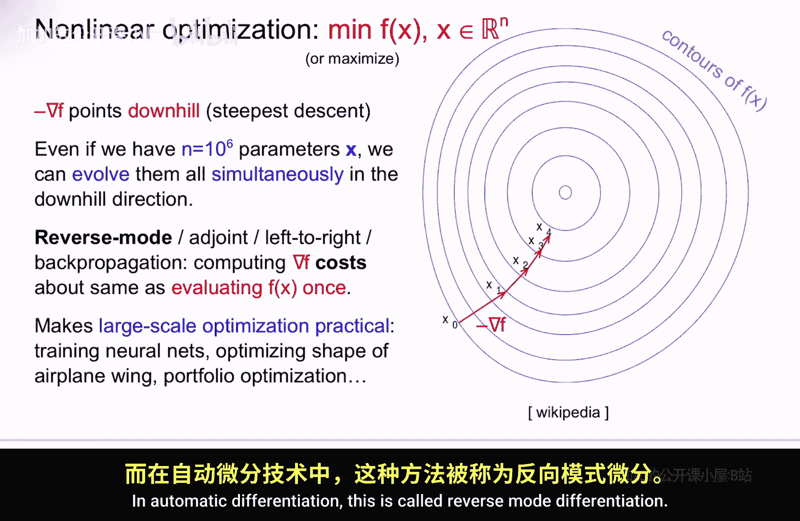

# 麻省理工学院【中英⚡矩阵微积分及其在机器学习中的应用｜2023-18.S096-Matrix-Calculus-For-Machine-Learning】-p08-P8-Nonlinear-Root-Finding,-Optimization,-and-Adjoint-Gradient-Methods--BV1wbSNBkEQM_p8-

Okay， so I think we can get started so the next part I'm going to show some slides so talking about some applications as usual these slides will will be posted later today to the GiHub page。

And also you know the handwritten notes also from the first part will also be posted， in fact。

 they're probably already posted。So today now I want to talk about some like remind you of why we're computing derivatives in the first place and so we talk about some things at a high level in lecture one and I want to just drill down a little bit and also talk about more about computation of derivatives。

Okay， so。So one basic use of derivatives is to solve a nonlinearar equations and you all learn this probably in first semester calculus if you have or scalar function。

 f of x that takes a scalar in and gives a scalar out and that's some nonlinearar if it's linear。

 obviously you can solve it， if it's a quadratic， you have a quadratic formula。

 but if it's some arbitrary function like sine of cosine of x or something like that。

 like some complicated thing。You might not be able to write a close form solution。

But there's a nice way to get the solution approximately to any accuracy you want as many digits as you want know very quickly if you know at least roughly where the root is and that's Newton's method and what it really is is it's really a linear algebra technique it's really taking the function approximating it。

By a line by linear function， and then once it's linear it's easy to find the root and that gives you an approximate root and use that as a guess right so this is。

😊，That's the three steps here， so if you're solving f of x equals0。

 that F of x is this blue curve on the right。Then you linearize with your derivatives。

 f of x plus dx。😊，I delta x side it' not infinitesimal。

 is approximately f of x plus f prime of x d delta x， that's what the derivative is。

And then if we treat the equation on the right， the linear problem as an approximation for a real problem。

 that one's easy to solve， so we can set that linear thing equal to zero， solve for delta x。

 and it's just minus f over f primed。😊，And so that gives us a new x。

 so that's our guess for the solution is x plus delta x。

 which is the same thing as x minus f divided by f prime。😊，Of course。

 it's not an exact route because the。You know this linear was only a linear approximation。

 but it gets this closer to the root so that on the right is a nice animation from Wikipedia that shows this process。

 you know starting from a few x's where you start with an x what you're doing is approximating function by its tangent that's the red line and that gives you the next x and so you start with its x and the x1 on the right gives you the x x2 and then you linearize it you get another x x3 and then another x x4 and then。

Very， very quickly， once you start getting close， this convert is extremely fast。😊。

If you're far away it can be a little unpredictable， but once you're close。

 it turns out it's actually amazing it doubles the number of decimal places in every step so if you have it to one digit on the next step you'll have it to two digits。

 then the next step four then eight and then 16 and then you know you run out of digits on your computer very quickly so it's really really a great algorithm。

😊，You know goes back thousands of years， the Newton's algorithm。

 but you can see that it's as soon as we write it this way。

Then we should be able to see that the same thing works for multidimensional functions。

 so if we have a function that takes a vector in a vector out。

 so suppose x is a vector in R in I don't know why that comes out in that weird font here。

So you have n equations and n variables。😊，So it's important you have to have the same number of equations and variables。

 but now they're nonlinear if there's some arbitrary nonlinear function and you're trying to find a root。

😊，Right， and。Then you do exactly the same thing， you approximate f bilinear function。

 F of x plus dx is approximately F of x plus f prime of x to delt x。

And that' that's what we've been seeing over and over again， this is the definition of F primeed。

 is that linearization？😊，Hoops in this。This always happens when I display on the computer。

Let me see if I can。And for some reason this display gets screwed up a little bit on and how do I get out of this？

Yeah， so it it looks fine here in non presentation mode。So what do we do。

 we approximate f by a linear thing and now we know how to do that for adding vector space。And then。

For example， x as a column vector， then F primeed as a Jacobian matrix。

You set this linear approximation equal to zero。And you solve it for delta x and that's just a linear equation that's just a 1806 thing linear algebra thing。

 so now delta x is you move after the other side and you multiply both sides by f prime inverse。

 deelta x is minus f prime inverse times to f of x。

 so it's just the inverse of the Jacobcoian matrix。😊，Times F with the minus sign。

And so that's our new x， our new x is this x x original x plus this delta x。

 which should give us a root if it were linear。So it's just the new x is x minus inverse Jacobbian times f。

So you solve one linear equation with a Jacobian and you get your new X。

And of course this is an approximate route， but you're just repeating the process。

 it's much harder to to picture this in higher dimensions。Compared to the 1D case。

 but but it works amazingly fast， it says the same thing you solve the linear system in each step。

 it doubles the number of digits in each step。And with the caveat that you need a starting guess close enough to the root。

 if you start very far away from the root， it can be kind of unpredictable what this what this does there's in fact it can even make these amazing fractal patterns so if you Google newton fractal there's a nice。

A nice Wikipedia page on this that has lots of beautiful images of what Newton's method does if you start far away from the root in higher dimensions it has this weird fractal pattern。

 but usually so you have to have some some rough idea where the solution is。😊。

But then you can polish it off super fast。Right。So that's an announcement。

 so this is a great application for Jacobians and for derivatives in general。

 of equations that take vectors in and give vectors out。😊，Right。

And the other even more famous application， I would say， is optimization。It's optimization。😊。

You have a scalar functions， you have a vector in and a scalar out。And you're trying to minimize it。

 for example， or maximize it maximizing minimizing is just flipping the sign。All right。

 so for example， machine learning， you have a you have a big neural network。

 x is a million parameters in your neural network。😊。

And the thing you're trying to minimize is the loss function that basically you evaluate your neural network。

 compare its output to what you want its output to be and you take like some norm of the difference right and that's your F right it's the error in the neural network for as function of the parameters and you want to go downhill and make that error as small as possible。

And so that。K point is if you can take the gradient of this and now we have a general definition for any vector space。

 any scalar function， if we have a do product， then we can define a gradient。

And that that gradient then points in the uphill direction or minus gradient points in the downhill direction。

 which is called the steepest descent direction。And the most basic idea。

And there's many many complications on top of this。

 but the most big basic idea is you just go downhill right imagine you're in the mountains in a fog you can't see anything。

 but if you want to find the bottom of valley， you just go downhill right you might not find the deepest valley might might you're going to find the closest valley right there might be a deeper valley someplace else but you'll find a local minimum。

Right， and。Even if you have a million parameters as you have， very commonly in neural networks。😊。

This allows you to kind of evolve them all simultaneously in the downhill direction right you want to update all in your million dimensional space。

 you want to go it in this direction right you don't want to optimize each variable one at a time because that'll take forever if there are a million variables。

😊，And as we're going to talk about over and over again。

 that it turns out that when you have a scalar function of vector inputs。

 you can compute all million derivatives or all n derivatives。😊。

The gradient with about the same cost as evaluating the function once so evaluating the function say as a big neural network。

 you have to evaluate that once to get your loss function。

 It turns out you can get the derivative of that loss with respect to all million inputs with。😊。

Essentially the equivalent of one additional function valuation， so for neural networks。

 this is called back propagation。😊，in automatic differentiation。

 this is called reverse mode differentiation， this is also called adjunct methods。😊。

