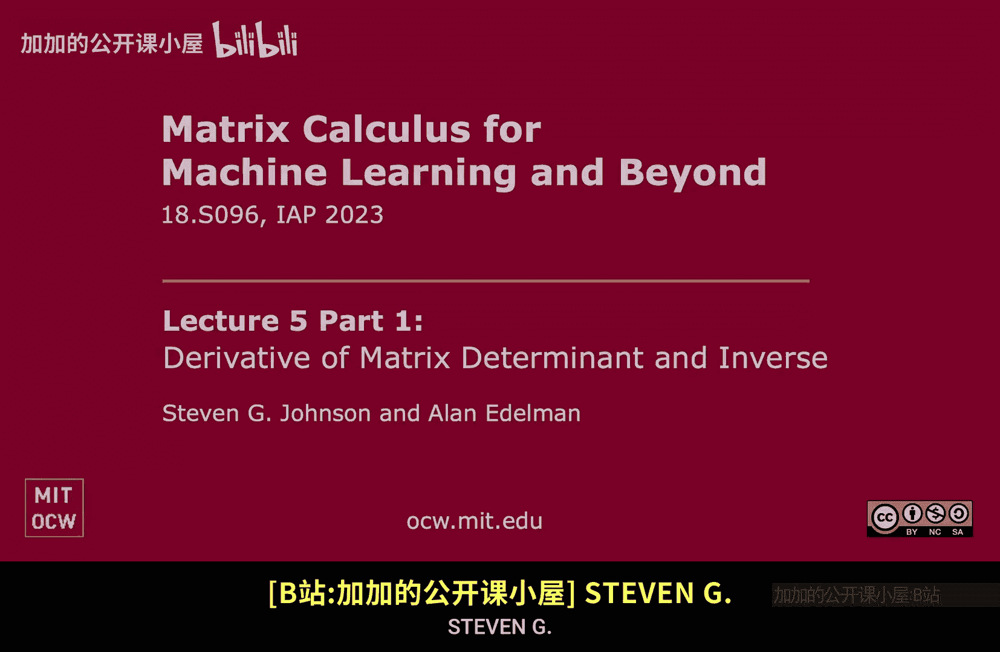
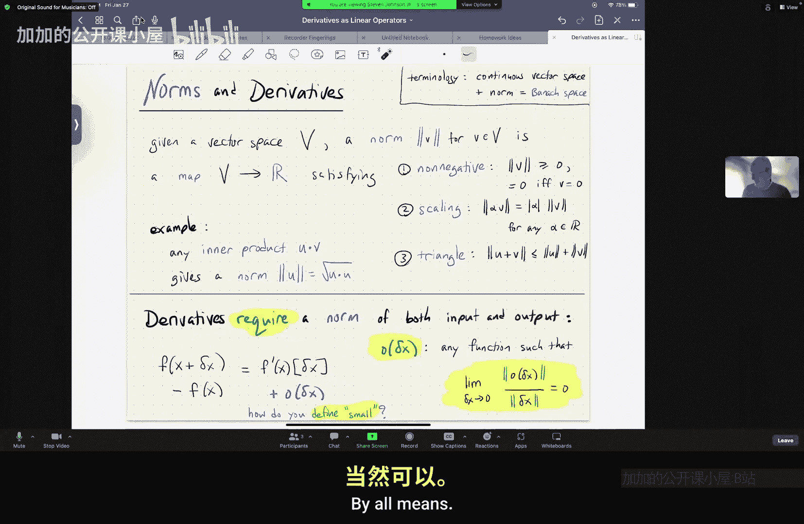
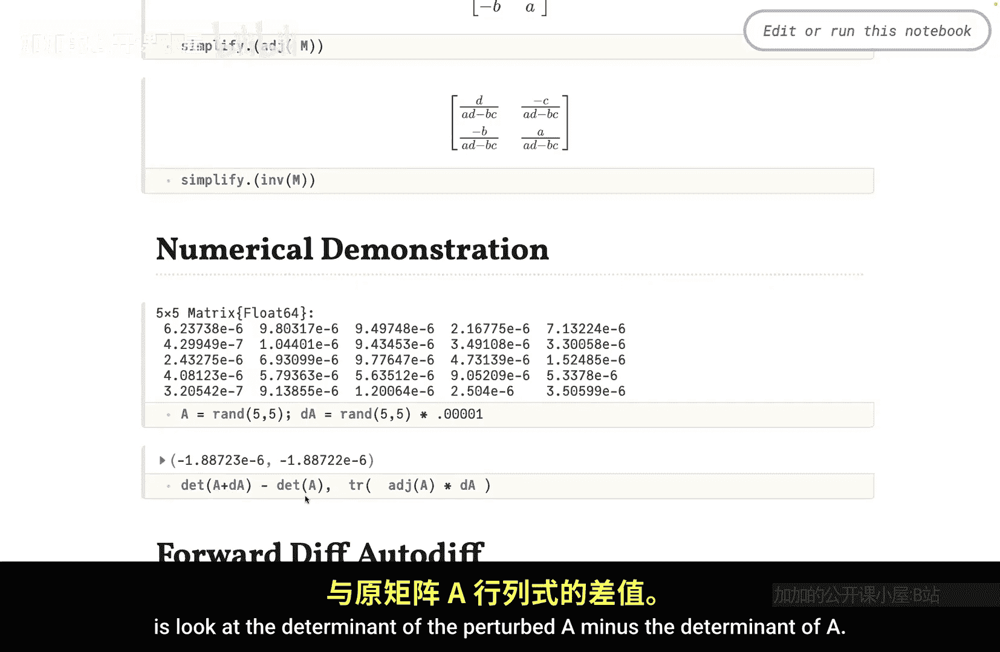

# 麻省理工学院【中英⚡矩阵微积分及其在机器学习中的应用｜2023-18.S096-Matrix-Calculus-For-Machine-Learning】-p09-P9-Derivative-of-Matrix-Determinant-and-Inverse--BV1wbSNBkEQM_p9-

Okay， so last time I talked about how in order to find a gradient， you need an inner product。

So that way， if you have a scalar function of a vector， the gradient is defined。

 basically the derivative has to be a linear function that takes the vector in and gives you a scalar out。

 So this turns out this has to be if you have a dot product。

 this has to be a dot product of something with the X。Then we call the gradient。

 So the gradient is the thing with the same shape as x that we take the dot product with the X to get the F。

But so what I didn't mention is， in fact， not only did we need a dot product to define a gradient。

Actually， we swept something under the rug earlier。

 We actually need a norm in order to even define a derivative in the first place。 right。

 So a norm is if you have a vector space， a norm is some measure of the length。

Of the vector or measure of distance， and a norm takes in a vector V and gives you out a scalar。

And technically to qualify as a norm， it has to be you know this map has to be non negative。

 it can't be negative， it can only be0 of v is0， if you multiply the vector by 2。

 it has to multiply the length by  two or if you multiply the length by negative two it has to multiply length by two basically absolute value of any scalar。

 it has to satisfy something called the triangle inequality。So usually we most commonly。

 we're going to get a norm just from an inner product。 So once you define an inner product。

And we talked about those last time， you can even define inner products of matrices。

 You get a norm for free。 You can take the norm。I's just a square root of the inner product itself。

 And this satisfies all these properties for an inner product。 So the reason I mentioned this。 Oh。

 and by the way， the just cultural note。 So if you have a continuous vector space with an inner product。

 we call that's a Hilbert space。 You have a continuous vector space with with a norm。😊。

That's called a boonic space。 So， you know， don't this fancy sounding name。

 but it just just means you have enormous， You can press your friends with your fancy mathematics。

 but that's all it is。Yes， so， so the reason I wanted to mention this is that really the definition of the derivative that we used earlier。

Implicitly requires us to have a norm。 So it actually is both the input and the output。

 So it really only applies to Bock spaces。So the reason for that is remember I define the the derivative to start with is if you look at the change in the。

Output F of x plus delta x minus F x for not an infinite testimal。

 but a finite deelta X that may be small。Remember， the we define the derivative as the linear part is the linear operator that gives the change to first order。

 which means we dropped any term that's we call it little O of deelta x。

 any term that goes to 0 faster than deelta x， right， So any term that's small。Compared to this。

 right， but。In order to define what it means to be small， you need a norm。 like how how you know。

 if I two vectors， a column vector。 And I want to say。

 is this column vector smaller than that column vector， How do I check it， I I check the length。

 right， you need， you need， you need to map it to a real number to get to get this a distance or a smallness。

 right， So formally， the definition of this little Oda D X。It is basically any function。

Such that the norm of this over the norm of deelta x。Goes to 0 as deelta x guess even goes to 0。

 In fact， even to define a limit， you need a norm of deelta x， because you know。

 if you've taken the 181100， there's this epsilon deelta meaning of a norm of a limit。 Sorry。

 it's like the。This you can make this arbitrarily small for， you know。

 you can make this less than equal to epsilon for all epsilon greater than 0。

 I'm not going to go through the definition。 If you've seen the definition of a limit。

 there's some absolute values in there that for vector spaces have to turn into norms。

 but basically it's just experiences。 everyone's seen the definition of Delta epsilon limits。

 and no one really understands it。Yeah， is that there？Maybe some of you guys really do。

 but most of us don't。Yeah， I mean it to be fair， it took people 2000 years to figure it out right they really the concept of a limit in an infinitesimal was a big struggle in mathematics going back to these you know the ancient Greeks。

 you know xenos， paradoxes and so forth right so it really took a long time for people to nail down with this men。

 but yeah you need to be able to have a length a norm of the output。

Because this has the same shape as the output， these are the same shape as F。

Right to say that these terms are small compared to delta x。

 which you also need a norm of delta X right so just implicitly。

 you always need a norm of all of these things to define it and usually we're going to get it because we're going to define in most cases。

 we'll define an inner product。As well'll want that anyway because if we want to take derivatives of scalar functions we want to be able to write down gradients。

 but this is what you really need So anyways I just wanted to to this is something we swept under the rug in the beginning。

 but since since we defined Hilbert spaces and I mean so I thought I should define a bionic space I mean I'm still sweeping some things under the rug like I'm sweeping what does it mean for it to be continuous under the rug but。

But， I wanted to throw it out there。 That's all I wanted to say。Yep。

 any questions about that questions？B all it。

Okay good all right， so this is just a little notebook and if we really need this isn't a live version so I can't really do anything。

 but I have a feeling that this will be good enough。

 but if we need the live version we can just press a few buttons so if I understood correctly last time you got the answer for what is the gradient of the determinants。

Is that right。 Did you derive this formula that it I did not derive it。 I just gave the answer。

 I you gave the answer。 And there's a few different formats。 Did you。

 did you write give it the first one， determineinate a universe transpose。 Yeah， Oh， the， the。

 the gradient is。The determin of a times that's the second one， right。

 So the first one is the cofactor of a， which is one of those linear algebra terms that。

You may or may not remember this is the one。 and just another term is the aggregate of a transpose。

 which is the。The adjective of matrix is the inverse of the matrix divided by the the。

 the determinants。 So the determinant multiply by the determinants， right？ So it's it's， it's so。

Let's see。 And of course， if you have the gradient， then did you write down this version as well。

 last time the the D of the determinants， Well， I the D of any matrix function。 So yes。

 it's the I define the dot product， major stop product。 So right， right， I see。

 So D determinant will be the the trace of whatever formula you have over here。 This formula。

Right times D A D transpoposed transpoposed to times yes， right sorry， let me clear my head。 Yes。

 the trace of this thing transpose times T right that which is the element was it's just like the dot product。

 you all get that。 It's just like the vector dot product。

 you multiply corresponding elements and you take the sum。

 whenever you have the trace of a transpose B as Stephen is writing very nicely over here。

 that's the a dot B。 So so if we know the gradient， then the D has to be this formula。

 and I'm letting I'm just defining the aggregate right here so that I can have it handy as Stephen was saying。

 it's just the determinant times the inverse this is just a definition。

 and then there's the cofactor matrix， which is the aggregate of a transpose。 So I'm just using。

I'm using this once I've defined this one to define this one。

 I just get to do the equality right so this defines these functions and here I've sort of written it every which way the inverse in terms of the the co-factor。

 the aggregate in terms of the the determinant you know the inverse in the cofactor。

 oh you get it all three possibilities are written here okay so for two by two matrices。

Here's a two by2 matrix and here's the cofactorctor matrix it' some of you will recognize that when you form the inverse of a 2 by2 matrix。

 the determinant goes into the denominator and the thing that goes into the numerator。

 you're all good at two by two inverses， do you know that by heart。

 like when you be able to do it in your sleep， you switch the A and the D and you negate the B and the C。

呃。Well。Let's see， you negate the B and the C， but I'm also doing the transpose， right。

 So here it's right。 so you negate the B and C and transpose because it's the cofactor。Okay。

 for the aggregate， you just take the minus。 And anyway， these are all the formulas。

 Here's the inverse， right， So the inverse is the aggregate divided by the determinants。

doing all this numerically just for fun， so numerically here's a random matrix and here's a random perturbation what we're going to do is look at the determinant of the perturbed a minus the determinant of a right so there's the numerical value and by the way I know Stephen has recommended always using things on the order of square root of epsilon to make the perturbationss 10th to the minus eighth and he's right。

