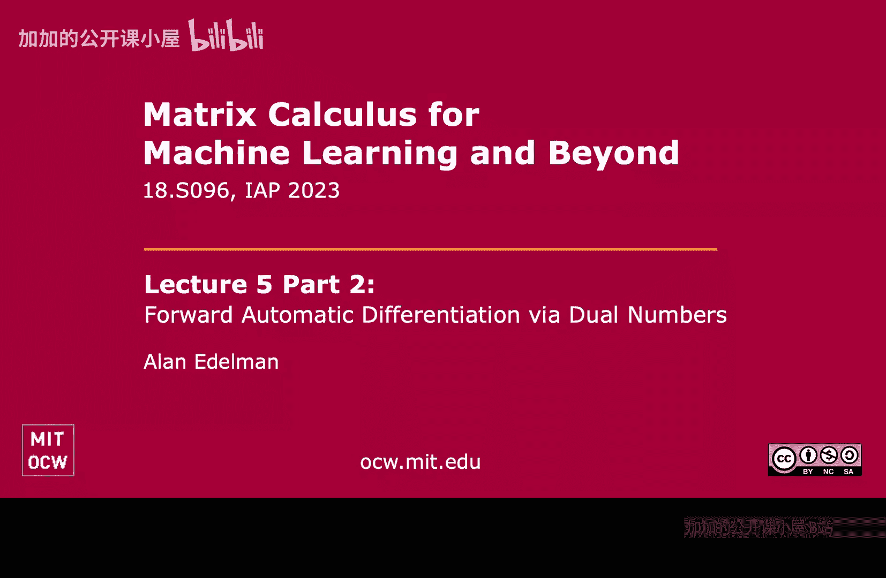
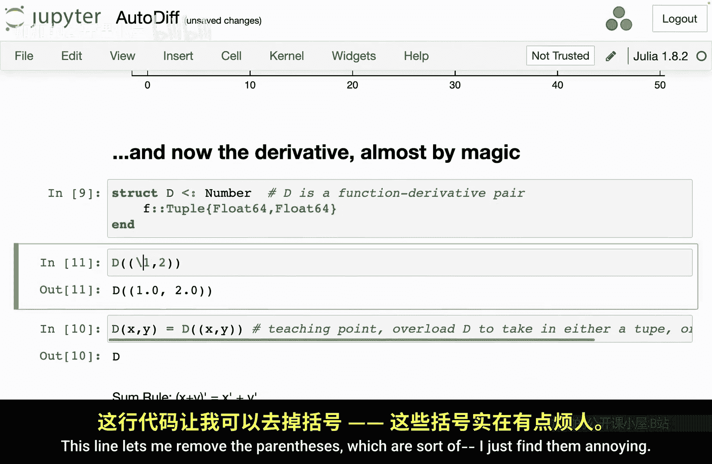

# 麻省理工学院【中英⚡矩阵微积分及其在机器学习中的应用｜2023-18.S096-Matrix-Calculus-For-Machine-Learning】-p10-P10-Forward-Automatic-Differentiation-via-Dual-Numbers--BV1wbSNBkEQM_p10-

Okay， so this is。Just to let you know what this notebook is and isn't。

 this notebook is kind of meant to let you see how automatic differentiation is kind of magical in a way that's kind of the real purpose。

 you'll start to get a bit of a feel for how forward mode works。

And what I like to emphasize is to what extent this is possibly more computer science than mathematics。

 Like we all have this notion that， you know。know whatever courses that are now being taught in computer science that maybe used to be taught in math courses like probability statistics。

 I think everybody agrees that calculus lives in math departments all over the world right lots of other math subjects are being hijacked by engineers。

 computer scientists and so forth， but calculus that's sacred right that belongs in mathematics right Well。

 here's a case where calculus is as much of a computer science topic as it is a math topic and I think that's kind of what fascinated me most about this。

 oh gosh， I first put this together in 2017 is it really 2023 now， six years later。

 well so it's an oldD but goodie， but I promise you you'll like it just to say and I do like to tell people that I used to go to conferences and I would hear people talking about automatic differentiation people talked about it before it was hot。

 I mean it became hot because the machine learning but a couple of decades before machine learning。

People would do it and they would do it on the sidelines。

 nobody paid attention back then didn't It didn't have sort of the big excitement that it has today。

 But I would go to conferences。 and you somebody would get up and talk about it。 And I don't know。

 I would read my email or tune out or work on my own math or something。

 I didn't really pay attention。 And so I missed the boat。

 I didn't appreciate that what I thought was most important about automatic differentiation。

 And know I just made I made a jump in my mind of what it is right and I figured it was something symbolic like maththematica。

 Wolfra alpha， know you know we've all memorized tables of derivatives here's a small table of derivatives。

 know I figured that if I could memorize it when I learned calculus then a computer could be taught to do these things Also So maybe that's what it is。

 that's great。 I could do it。 a computer could do it better than me。 I didn't care。

 turns out that's not what automatic differentiation is。 So then I said to myself。

 maybe I got it wrong。 I'm just't guessing anyway。 And I don't really care。

 But maybe it's you know some sort of nu。😊，Difference like we do to check our answers， right。

 And so you know there's。I want the derivative at this point X right so I can do a forward derivative and get the slope of the tangent or I could do a backward derivative。

 get the go backwards and get the slope of this， I guess it's a Ccanant to be technical but the slope of this line or I could even do a central difference which connects these two dots and the whole big deal of course when you do that if Stephen explaineds what's a good delta in math。

 you want the delta go to zero that's the very limiting definition of a derivative but on a computer if delta gets too small as you've seen。

 you get that catastrophic cancellation happening and so numerical analysis is kind of about what's a good delta and Stevens basically said that something on the order of two to the minus 26 which is the square root of double precision machine epsilon is a good rule of thumb where you might remember that curve where the error went down like an absolutes of value sign as it got smaller and then it went up again and。

bestest one was at the bottom。 That's the best Delta X。

 But the key thing that's interesting is that automatic differentiation is not this。

And it's not that。RightAnd like， so what could it be， right？

 And the way I like to show people of what it is。And。

Is I like to start with a simple example of it in action， right， And this is where at first。

 it's gonna to look like magic， right， nothing up my sleeve。

 And then I will explain to you how it worked。 So I'm gonna take one of the oldest algorithms。

 you know， one of the oldest interesting algorithms known to mankind。

 Babylonian square root algorithm， which I think maybe you've all seen。 But if you haven't。

 you start with a guess T to square root of x right So I've got a t。

 which I'm hoping is close to square root of x。 Now right and if I take t and X over t。

 if t was too small， X over t of course will will be kind of on the large side。

 right if t was guess between t and x over t ones on the large side， ones on the small side。

 So why don't we just take the average， And then this is something we could keep doing。

 and that's the Babylonian algorithm that converges to the square root of X。 very simple algorithm。

 know it was known for thousands of years， how complicated， could it be。😊，NoBut， but you know。

 I still think it was pretty clever the Babylonians。 I mean， you know， they didn't。

 they didn't have Julia。 I mean， you know， I thought it was pretty clever。 So in any event。

 I'm going to， just for simplicity sake， I'm gonna start at one for no reason。

 I'm just doing an example。 So I'm gonna start it at one。 right， So I have one and x over one。

 and I'll take the average。 And then by default， I'll do 10 iterations of t plus x over to you over2。

 right， so。😊，You know， even if you don't speak Julia， I think this algorithm is easy to understand。

 just it's an input X。 And by default， we run 10 times。

 but you can give an argument and make it run more times。Okay， and so let's go using forward diff。

And let's take the。Let's， let's， let forward， let forwardative do it。 And， of course， we。

 with our modern view of the world， we know how to take square root， everybody in this building。

 everybody in this institute could take the derivative of square root。 It's， it's one half over。

 over the square root。 And so， you know， we。😊，We get the derivative。 But before we do that。

 let's actually make sure that the code works you know。

 let's actually check the Babylonian algorithm that I wrote。 So here's。

The second one is Julia's built in square of pi， and here's the Babylonian calculating the square of pi。

 And I guess this is pretty convincing that the Babylonians knew what they were doing， right， I mean。

 we could do the same thing with two， could run the Babylonian algorithm except for some little bit over here。

 you know maybe the last bit would basically get the same answer with Julia's built in square root and the Babylonian algorithm。

Okay， and。Let's， let's， let's skip this for a minute。Okay， and。I think that's not important。

 So just checking the algorithm for the moment， not even the derivative。

So I'm actually going to plot。The a few iterates of the Babylonian algorithm， just so you can see。

 So the first iteration， maybe remember was one plus x over 2， right， It's a。

 I still want to call this a linear function。 But in this class， I have to call it an ae function。嗯。

Yeah， I don't know what the real terminology is。 When。

 When do I get to say that a first degree polynomial is a linear function。

I think there's a context as to whether I'm calling it a map or a function。Right， but any event。

 this thing's a， however you want to call it， right the first step of the Babylon onlyian algorithm。

 iteration1 is given x compute 1 plus x divided by2。 and that's the first degree function。

RightThe second iteration I'm plotting it is here right and then it gets closer and closer to the sideways parabola。

 which of course is the square roots。 In fact， by iteration5。

 you can't even see much of a difference with your eye right so iteration4 is the purple and iteration5。

 you can't even see it because the black paras on top of it right and so just to kind of convince you that the Babylonian algorithm works。

 And anyway I like plotly I love doing this all day I can go left and right and look at these numbers。

 I love this So I like interactive things Okay now。Now， what I'm going to do is in。

 let me see how many， how many I changed this over the years。 So 3，4，5，6 in about 9 lines。

I'm going to create a function that will calculate the derivative of the Babylonian algorithm。

And nowhere will I teach it like that like one half over the square root of x， right。

 I will not do that。 I want， you'll see there'll be no finite differences。

And there will be no symbolic like I'm not it's going to be by magic。

 but we're going to get the right answer。 So you ready。 So I'm going to do it in nine lines。

 So here's three lines。 I'm going to create a Julia type。 I'm going to call it capital D。 later on。

 maybe some of you have heard this word D is for dual number。 So that's why we're going to call it。😊。

Use the D。 and we're basically going to keep a function derivative pair， an ordered pair。

 And so this is nothing but a container to be able to， to keep two floats， right。

 But which floats am I going to keep， Im I'm going to have the value of a function at a point and the derivative of that function at a point。

All right， I've used up three of my9 lines， and everybody agrees。 There's no finite difference。 no。

 no symbolic answer， right， So I've got six more lines here。 Oh， here， this is。呃。Yeah。

 let me just show you what I've done here before I do anything else。 So if I wanted to。

If I want to create one of these objects。I would have to put in a tuple like D of 12。

 This line lets me remove the parentheses， which are sort of I just find them annoying。

 So this line doesn't count。 but you see I've got this dual number。

