# 麻省理工学院【中英⚡矩阵微积分及其在机器学习中的应用｜2023-18.S096-Matrix-Calculus-For-Machine-Learning】-p11-P11-Differentiation-on-Computational-Graphs--BV1wbSNBkEQM_p11-

So you've already seen a little bit of the story of forward mode and reverse mode from Steven last week。

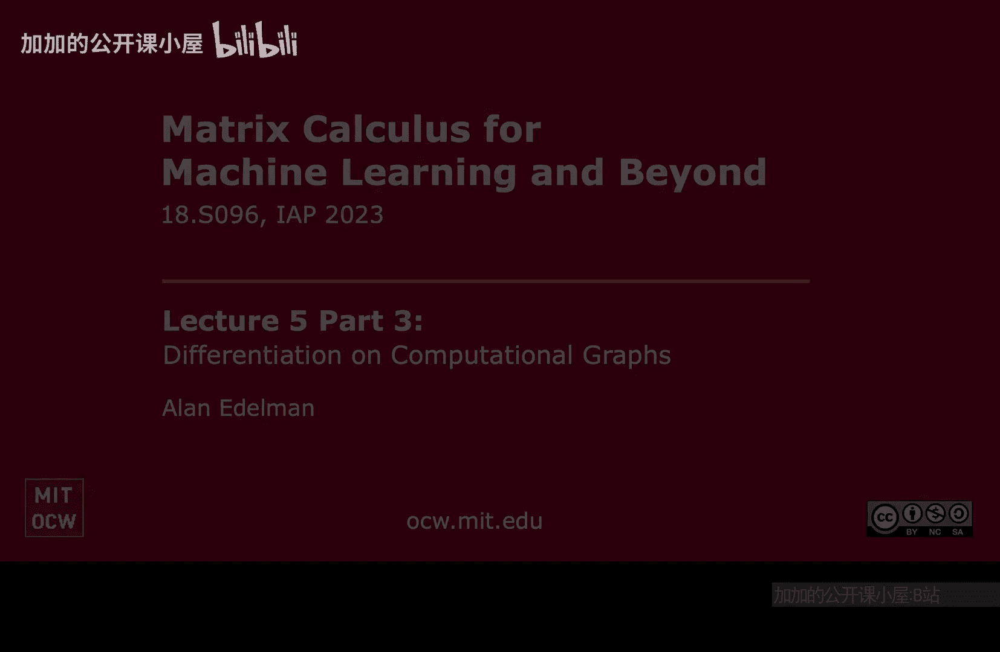

One version of the story is that you're multiplying derivatives or Jacobian matrices or something like that。

 and of course you've heard Stephen say that matrix multiplication is associative and so you can go left to right or right to left。

But it matters what order you go in terms of the complexity of the computation that you know one order might be an n cube computation and another order might be an n squared computation right and so you saw an example of that right and in some fundamental sense that describes the entire story of forward and reverse mode but in a way I feel like it hides more than it reveals right and the story is。

In some sense the entire story can be reduced to that but I feel like that's not enough to fully understand and so I put together this example that I used in my class last semester and I just going to pull it all out i'm just going to grab a simple example from calculus and kind of show you what's really going on and so I want to take the simple example there's nothing special about it I just randomly came up with it where I'm going to just input in X and a Y。

Okay， and I'm going to have three lines of code， so to speak three computations that are going to happen。

 I'm going to take a to B sine x。No reason whatsoever I'm going to take B to be a divided by y right and then I like I like you know x and y going in and z being the last letter being the final output so Z i'll have it be b plus x right。

You can see how that kind of looks like a computer program right as I mean it feels more like a computer program than mathematics where you know you're writing inequality。

 it looks like a sequence of steps where where at every step you at least you have the variables that came before right what is a computer program in the edge right it's a formula where on the right hand side you know the value of everything and so on the lefthand side you could define the thing right that's what you know a computer program basically is all right one could have a problem like you know one create this problem which is say you find the derivatives right find。

DZ Dx。You know， or find DZDY。Okay and you know， this is pretty simple。

 I mean you all know how to do it， I mean let's let's just。Let's just implement it。All right。

 so how might you do this， well let's see so Z。

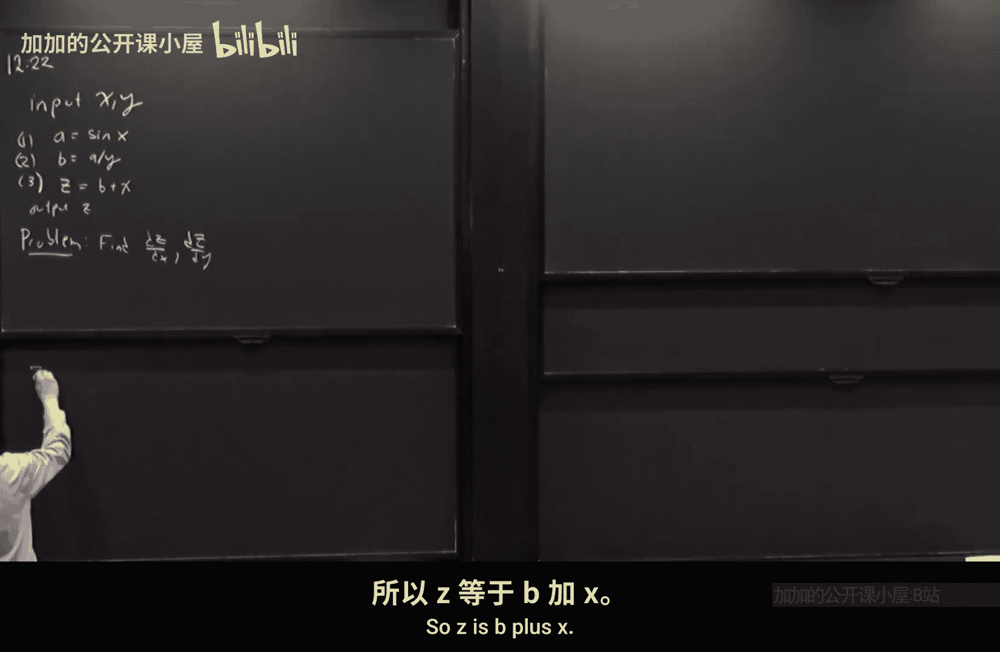

Is B plus x let's kind of figure out what's going on here B is a over y， so this is a over y plus x。

RightSo again， everything in terms of the x's and y' is right a is sine x， so we have sine x over y。

Plus X。Right and then now that we have everything in terms of x and Y， we're all very good at this。

 TZDX， of course， the actual answer is cosine x over y。Plus plus y， right and an NTCDY。Is what is it。

 it's a minus signine x over y square。Okay， no controversy to this all simple stuff。

 I mean if my colleagues caught me doing this to you advanced students。

 they would make fun of me right this is just baby stuff。

Right but let's kind of establish a little bit let's take a good look at what we just did let's kind of take a close look at this sort of thing and let me introduce。

A computational graph let me kind of draw a picture of the computation we just did。

With a computational of graph， so let's write that computational of graph。And by the way。

 these notes are online， I'll put a pointer up。But a terrible handwritten version one day I'll pick this up better but we'll have a computational graph the graph will be a dag I' know what that word means directed acyclic graph which basically means that that there are arrows and all the edges and there are no cycles right that that's what a computer program is it's how do you build a next variable from a previous variable and and if you ever look left word all the data is available to you right so that you don't get an error right and so I like to people are not completely standard as to how they draw computational graph it drives me crazy I'm going to take the convention and that I'm going to put the variables at the variable names as nodes so my input nodes are X and y and let's see if I look at step one over there the first thing I'm going calculate is a so that's going to be a vertex or a node and while I'm at it I'm going to draw。

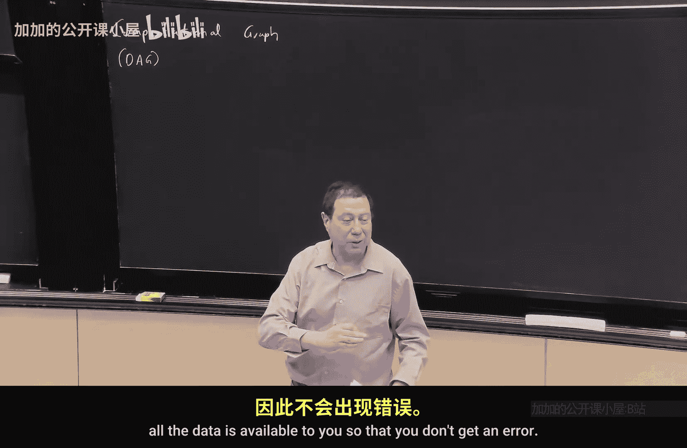

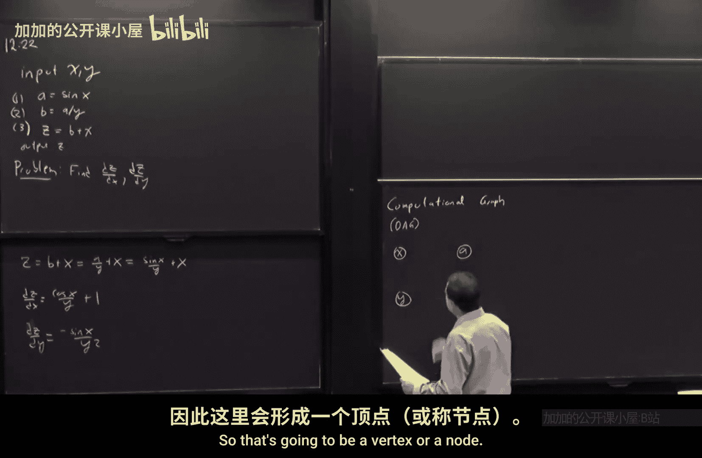

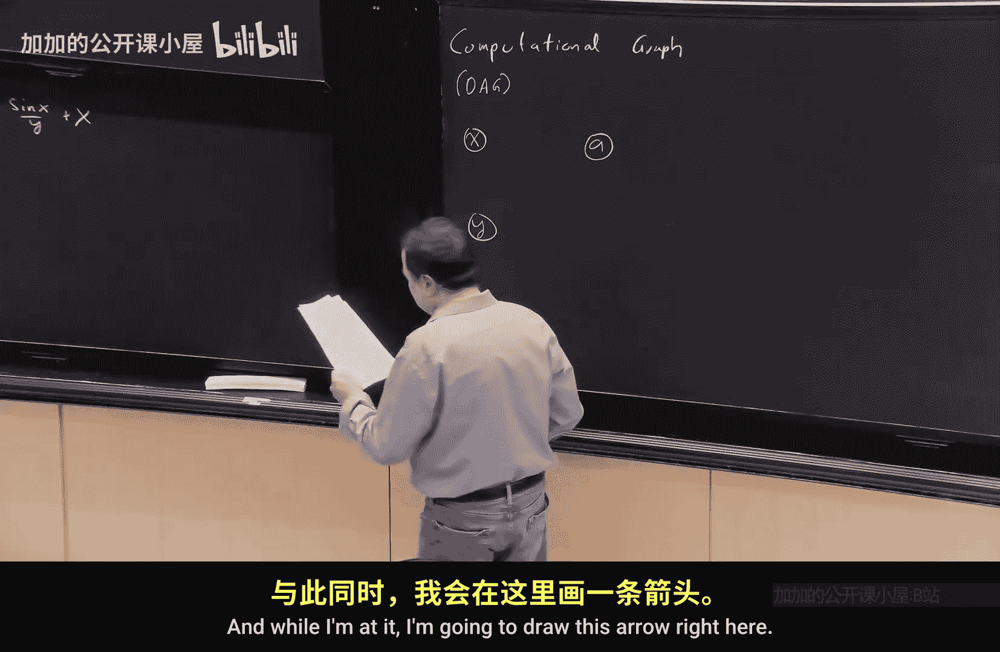

This。Parrow right here。Okay， and what I'm going to put on that arrow is not。

I'm not going to put the the the I mean you could draw the computation the sign。

 but what I'm going to do is actually put the derivative on the arrow okay and so I'm going on the arrow i'm going to put the function cosine x right so the derivative of those's just this。

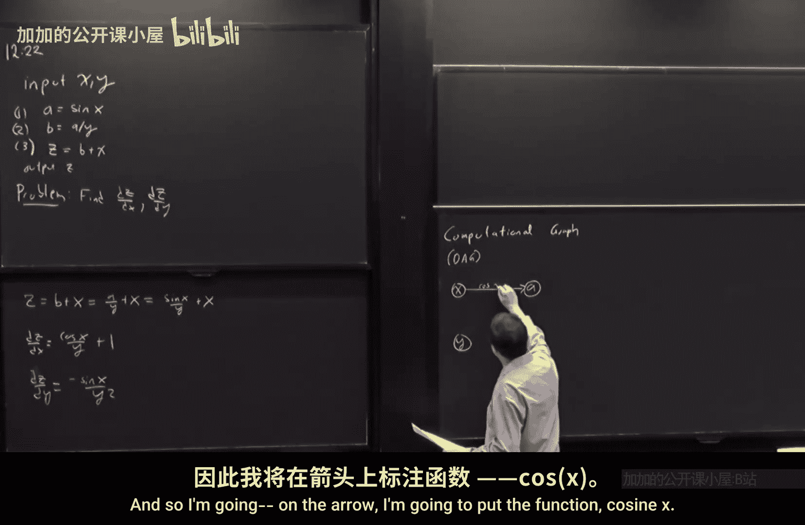

The way to read this is the rear of the v with respect to x is what's on this arrow。Okay。

 so this is D D X okay， let's go another step B is a over y so I think you've got the idea now that B is going to be my node。

Okay， and I'm going to calculate DBDA， what is DBDA？What should I put here as the function？

I want DBTA I want the derivative， I always want the the one step derivative between this variable of this variable so I want the if I make if I vary a a little bit right what do I multiply by？

With DBDA？1 over y good right let's just I started with a over y and I take a little respect to a so that's one over y good all right and but we also have a DbDY so let's put an arrow like that。

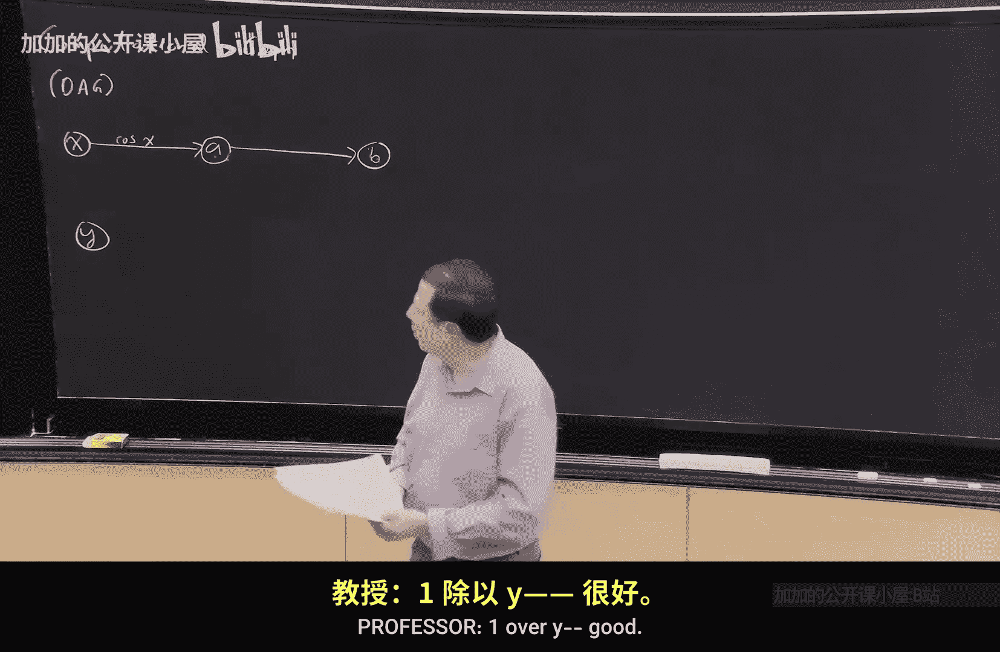

And what's DBDY again， simple questions， but keep you guys awake， keep me awake。Let's DBD。

a over y square right negative a over y squared。Good， and finally we have a Z。And Z depends on B。

 and it also depends on F。

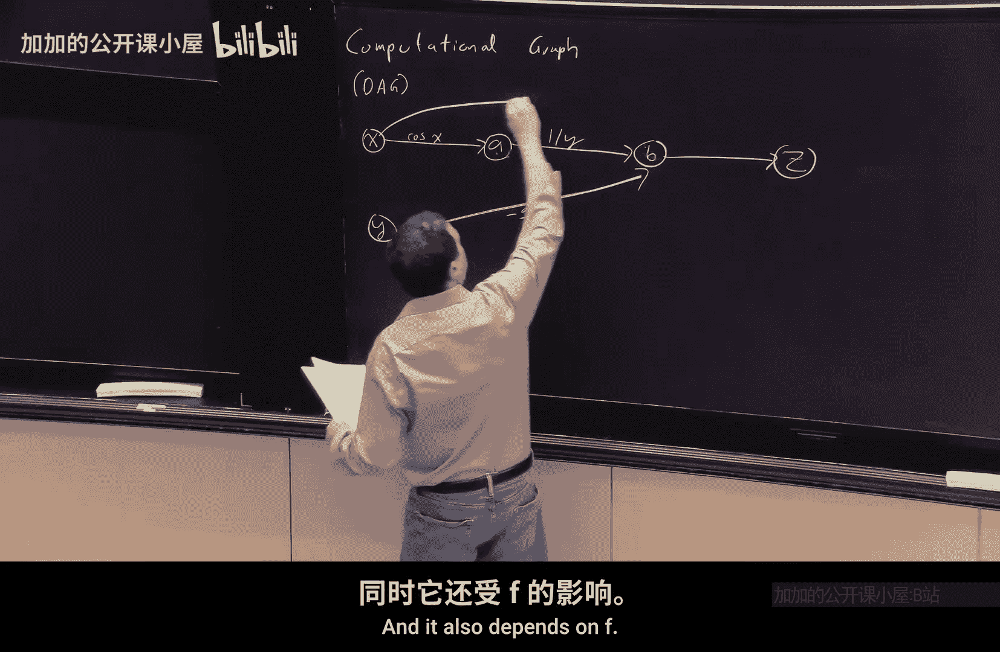

， so we have a dependent。That goes back to the beginning with the。

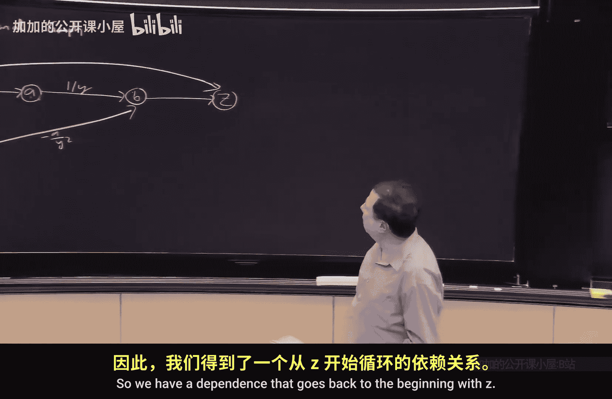

Right， and so let's see what what are DZDB and DZDxs if kind of the same answer to both。

What DC CDB and what DC CDDX？Come on， first great question really。Right。

 they're both one Db is one because Ex is one right because D is just b plus x。

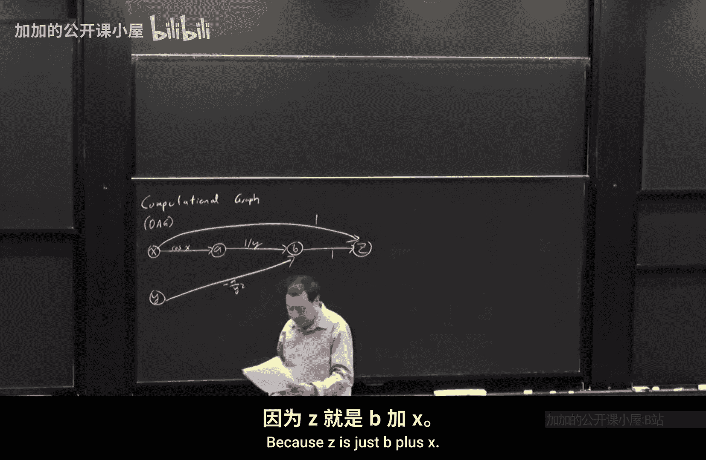

Okay， so derivatives on the edges， you see you get the point that derivative is labeled on the edge derivatives on edges。

Just to write it down for you。And。You know， and it' it's just I like to think of this as a one step derivative。

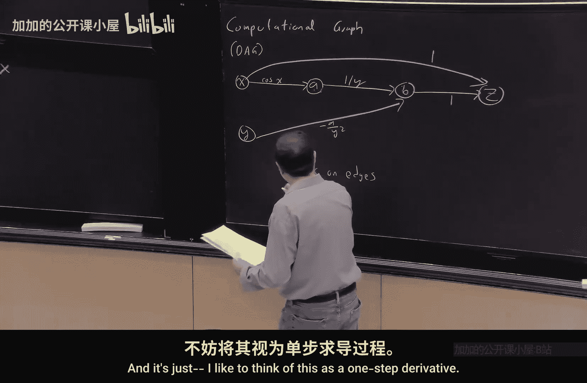

Right so it's like it's it's a derivative of one line of code if you like right it's i'm not putting in the I'm not putting in the full。

You know， the full long range derivatives， I'm just putting in the one step derivatives。

RightSo right in other words， I'm not putting in this thing。

 which is the full derivative it's just the one step that I'm of putting in and I want to sort of kind of put on the graph。

What we just did to well， let's get the answer now， okay， so I claim。

That one way to get the actual answer is to think of it graphically， that you could start。

Over here at x and we want to head to z okay， and we're going to look at all the paths that'll take us from x to z right there's one path that goes like this。

Okay， and then there's another path that goes like this right so there's two paths that'll take us from x to Z。

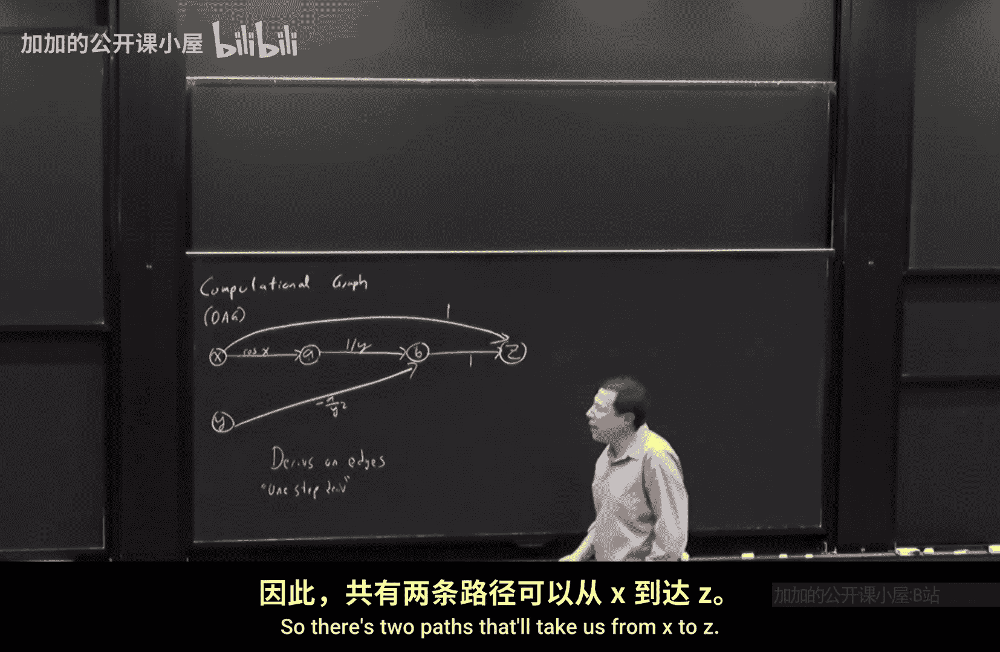

And what I'd like to do is basically walk along the path。

And then write down the derivative I see as I go， Okay。

 and I'm going to write it I'm going to write it right to left。

 so let me let me start walking from x to a along this path。Okay， when I go from x to a。

 I pick up a cosine x。All right， so this is step one。I pick up a Co X。

 then I have to step over from a to B， so I pick up a one over y。

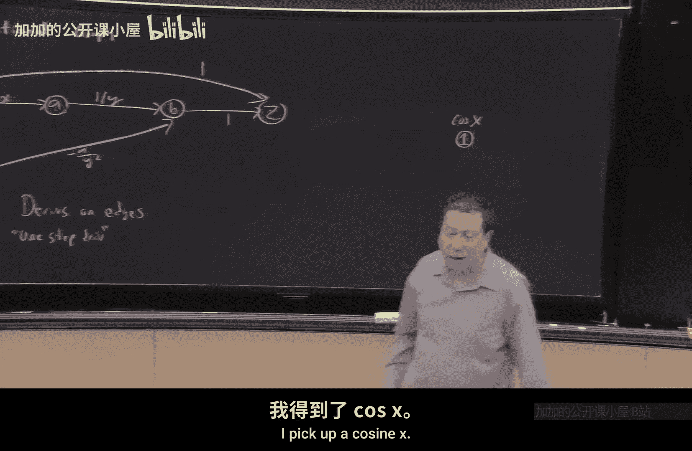

Right， so that's my step too。Okay， and then finally， when I go from B to Z。

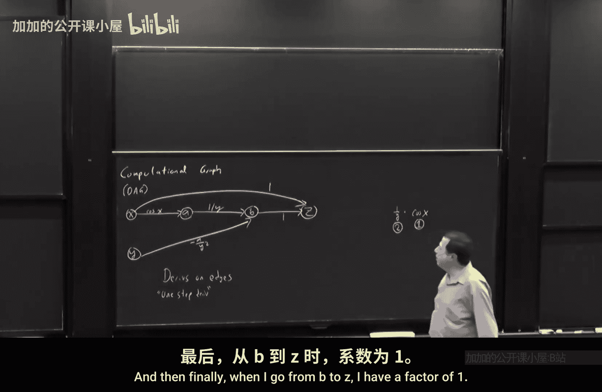

I have a factor of one。