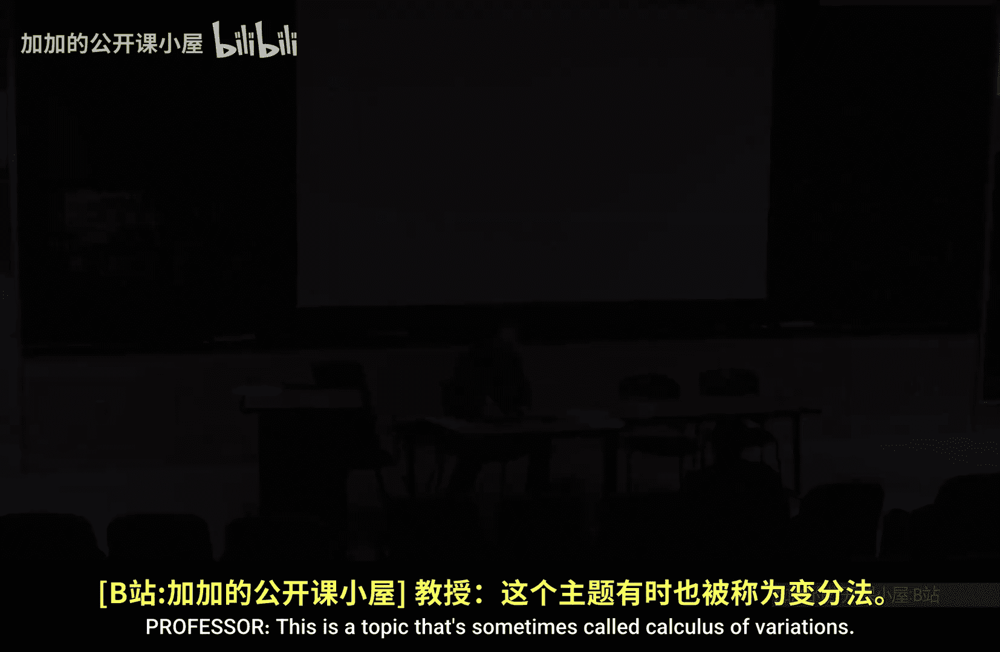
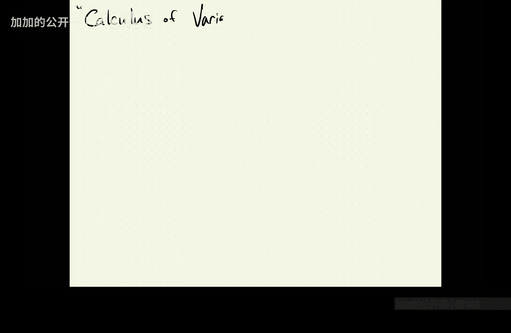
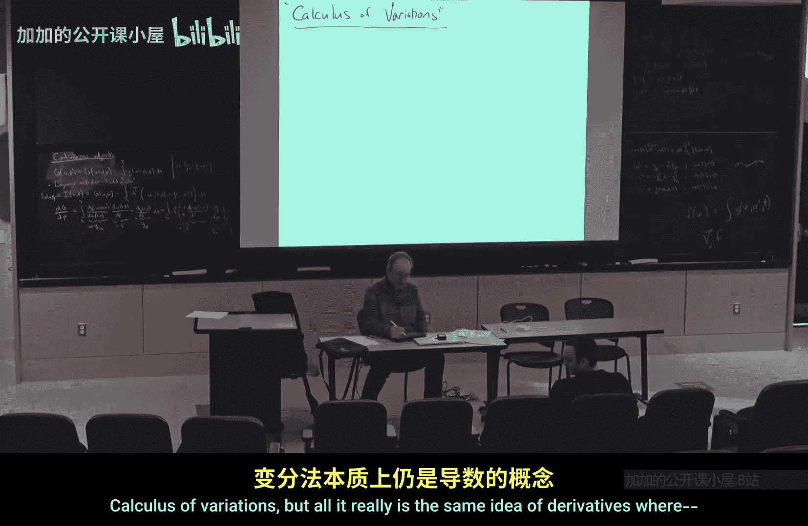
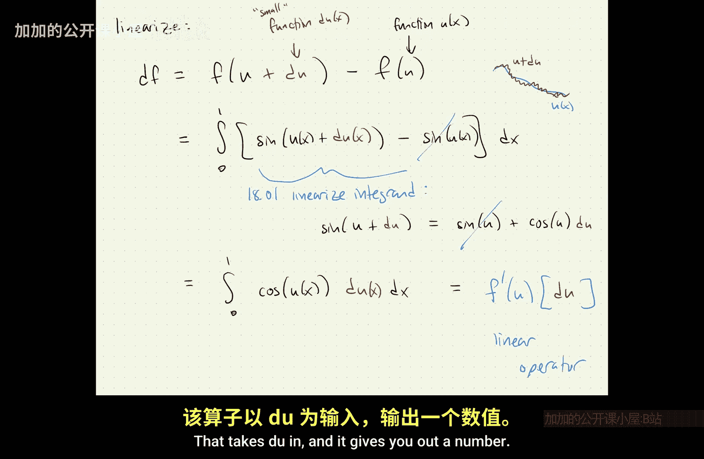

# 麻省理工学院【中英⚡矩阵微积分及其在机器学习中的应用｜2023-18.S096-Matrix-Calculus-For-Machine-Learning】-p13-P13-Calculus-of-Variations-and-Gradients-of-Functionals--BV1wbSNBkEQM_p13-

This is a topic that's sometimes called calculus of variations。

 That's sort of the classic name for it。

And it。Cookie， are you causing trouble？ok。K Cal comes variations。

 But all it really is is the same idea of derivatives where you know， So we're gonna have F of U。

Pina plus D U minus F of U。That's our D， F。It's going to be。I'm going to call it F prime of U。Do you。

😔，That'ss the same formula。It's。Except that now。Where。You。Is in a vector space。Of functions。

And usually and usually F is a scalar。F of U is just a real number。 Okay。

 so we're gonna take a function。 map it to real number。

 And it says this is one of the things when I teach 1806， I come back to periodically that。

 you know vectors are not just column vectors。 even matrices。

 You can even think of functions as as a vector because you can take two functions。 You can add them。

 You can take and get another function。 You can take two functions and multip them a function multiply by two and get another function。

 And so a lot of the things you can do linear algebra for column vectors you can do for functions。

 you can talk about linear operators on functions。 like a derivative is a linear operator and function。

 You can talk about。😊，Orthgonal functions and dot products or functions。

 and Grham Schmidt on functions and eigenfunction。 If you do quantum mechanics。

 you do lots of things with eigenfunctions， right， So， you know。

 it's the same all the the same kind of concepts。 You have to be a little bit careful with functions。

 they can do crazy things that column vectorctors can't like they can oscillate infinitely fast or they can blow up or do things like that。

 So if you want to do rigorous math with functions。 You spend a lot of time。😊。

Kind of nailing down the space of functions that are not terribly behaved。

 I'm not I'm not going to do that。 I'm not I'm just going to be kind of implicitly。

 I'm going write down an integral functions of a function。

 I'm gonna implicitly assume that we're dealing with functions where that integral is defined。 So。

 you know， that's things like that， right， so。So for， let me just do an example。Right。

 so let's do you。Of x。Is a function。You know， from。You know，0 to one。Right， x is in 0 to1。

To real numbers， right， It's just， just， here's。Here's x equals 0。 x equals1， and U is some。Function。

 right。U of x。诶。AndAnd let's suppose that F。A you。I need to write down something that that takes in a function and gives me a number。

I think there are a few ways to do that， but the one that I want to deal with is just integral。

0 to1 of， say， sine of U of x。D X， let's just start with， that takes in a function。

 gives me a number。 technicalnically， it doesn't work for all functions where you could have functions where this。

where this integral doesn't exist or something like that。 So implicitly。

 I'm limiting myself to the space of functions where the integrals work。Right。

And what I want to do is find out what is the。ThatWhat is the gradient of F？And what is F prime also？

喂。With respect to you， of course， it so now it's back to a function。

And it's going to be exactly the same definition for it to take a derivative。 I to take a derivative。

 I just need to linearize。 I need to ask， how does F change for a small change in the input， right。

 Linearize it。And then to get one step further to get a gradient， I'm gonna need a dot product。

 But let's，'s before we do the， the。The gradient and the top part let's just linearize， right？

So we're going to take Df。We take F of U， remember u is a function。By the way。

 this is sometimes called a functional。啊嗯。It's something that takes in a function and gives you a number。

But I'm sorry， and I'm going to and here I need the F of U plus D。Minus F of U。

And the key thing to remember is that this is a function。You of x。啊。It's a terrible X。

 And this D U here。This is also a function。 You could think of it as a small。Function。D U of x。

 right。And as I said， last last lecture， to get some notion of small。

 we're gonna to need a norm of a function， but pretty soon gonna have dopos of function。

 So I'll have norms as well。 So that me sweep that under the rug。

 But it's just like a little perturbation， right， So you， you're taking you're taking you know。

 U of X。😊，呃。U of x， and you're adding。You know， some arbitrary little change to this This is a U plus D U of X。

It change change that function by a little bit anywhere you want。It has to be small。

 And then so we can drop terms that are go like D U squared。系啊。And so what is this。

 So this is integral from 0 to 1。And I said F was sine of U D of X， D X。 So this is。Looks like。

Sine of u of x plus du u of x。Minus sine of x。D X， I'm just plugging that into my F。

 My F was integral s U。And I'm going to ask， how much does that integral change for a small change in U。

 and I want to linearize it。So I want to write this as a drop every term that goes like do squared or higher。

So。And of course， the point is all they need to do is linearize this， Lineize the in。Right。

 that thing， sine sorry， And this is not sine of x。 This is sign of u of x。系。Okay， so I want to。

 I want to linearize this。 What is sign， So s。Sine of， of U plus D U。Right， that's equal to。

Sign of u。Plus， the derivative， which is cosine of u times d。

RightThis is just because this is D U of D U is a function。 But D U of x is just a number。Right。

 at each X， I have a small change in U of X。 So this is just ordinary， you know，1801。Right。

Linearization or come from lecture， lecture one of this class， right， So if， or this could be a。

 you know， yeah， anyway， So this is just a number ordinary linearization。 And then， of course。

 this term here。Cancels that term。So what this is is。Integs0 to 1。Of what's left， cosine of U of x。

Do you。😔，The X。And this is exactly a This is a linear operator。 This is F primeed。Of you。

I think on D U， right， So get sorry's again， I should put a D U of x。I is I， is I clear I。

 if I plug in any function here， any change。In my， my you。This is clearly linear in that。

 Like if I double this， it doubles the integral。 Like if I add two things here。

 it adds two things in the integral。 So this is this， this is a linear operator。 This is， we're done。

From that takes D in， and it gives you out a number。

Right， this is my dearf。So， so， so， you know， once you get used to this as being。You know。

 the definition of a derivative。And you can always fall back on this when you as some crazy object。

 matrix function， whatever， as long as it's a vector spacer technically。😊。

