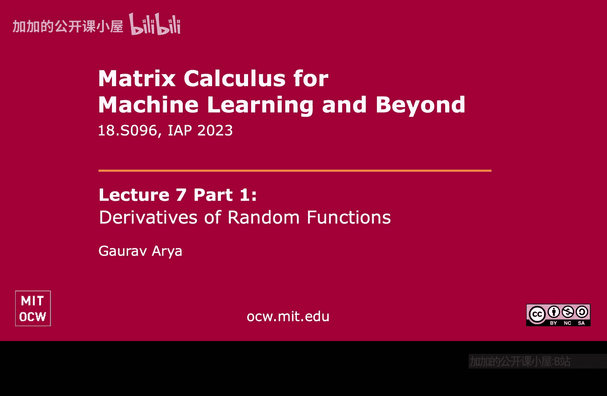

# 麻省理工学院【中英⚡矩阵微积分及其在机器学习中的应用｜2023-18.S096-Matrix-Calculus-For-Machine-Learning】-p14-P14-Derivatives-of-Random-Functions--BV1wbSNBkEQM_p14-

So today for the the first half of the lecture， we're gonna to have a guest like another guest lecture。

 Goravariria， who's actually an undergraduate M T。 but he's done research projects with me and also research projects with Alan Aelman's group。

And。He's done some really interesting， you know， recent work on differentiating random functions like you flip。

 you program， you flip a coin and 50% it does。 It gives you signine，50% chance it gives you cosine。

 So what does it mean to differentiate such a thing。 And how do you do it automatically。😊。

So I thought be we thought that would be a nice topic for half a lecture。

So he's in Hong Kong right now， but he's going to give a guest lecture。

So I think we can get started Goth。Okay。Yeah， so can you hear me all right？Can everyone here。Good。

 yes。yeah， so I'll try and repeat any questions and things like that。So I'm a junior at MIT， so yes。

 Professor Johnson said， I did a Europe with Professor Johnson previously and recently I've been doing Europe in the Jlia Lab。

 which is mybe professorfessor Edelman。And today I'm going to be talking about derivatives of random functions。

So I'm going to try and。诶。这 is。Which makequis， that's not want to do。Yeah。

 so I wanted to start by this giving a bit of motivation。

 So I'm going to just before I go into the random functions， I'm going to。😊，Right this function。

 which I think you all probably know。How to differentiate better than I do at this point。

 So here a is a matrix。And so this is a matrix accepting function。 Can you read this all fine， Yep。

 we can see it。 And yeah， yeah， so this is a function with matrix input and matrix output。

And the reason I want to go through this again is just to sort of set up an analogy with how I with differentiating random functions like what are the broad steps that one takes in like when you're faced with a function like this。

 like the essential complication is that your input and output spaces are much more complicated and they're not like realtorreels like in single variable calculus。

 so when you want to differentiate a function like this。

It becomes a lot harder to just do it super mechanically。

 you know like you might do for single variable calculus。

And it becomes a lot more appealing to sort of go back to the fundamental questions that you ask when taking a derivative。

So the first might be something like， you know， ultimately， the derivatives are about。

When you perturb the input slightly， how does the output pertrbbed like a map from like input wiggles。

 the output wiggles？That the first question you might ask is just you know， if I per the input。

 how does the output change？So。hich are the inputs。How does the output， how does output change。

 like what's the sensitivity of the output for respect to the input。So for the case of this function。

 what you've done in a class is you may have written something like this。

 like you might have used this nottation DF， which is like the differential math。

' basic test notation。Yeah， right， that's the notation， yes， yeah okay。

 and you would have replaced a sort of with a plus the so the a is sort of like your wiggle and the input。

This is a differential， so we subtract off the original a square。嗯。

You can sort of you can expand this out。 So the A square is cancel say you've done this。

I' sure quite a few times。Then we have this the squared turn here。And this， you know， right now。

 I know that the next step you're probably eager to do is going to cancel lots the D square。

 but just like this on its own is sort of like the answer to question one like we're not worried about。

You know， neglecting the higher order terms or like forming the derivative。

 but just just thinking about how do we write down the change of the output。

 it's like this is and this is your function。So this is your answer to question one。

And then the second thing is you have this sort of， you know， this differential。

And you want to figure out what terms can you neglect here， like so what terms do I keep。

 what terms we neglect， because really our goal at this point is to form this derivative。

Which sort of the idea of the derivative is to capture。

The sensitivity of F respect to a to like the first order。

 like the most important effects of the first order。And we have to drop the rest。

So the second question is what terms to neglect？嗯。嗯。Yeah， and here you sort of， you know。

 you can just cross off at the A squared like that's a higher order term。

 so you can sort of justify it that way and your derivative operator becomes this math。From the， A。

wo。What's left here， right， D times a。Plus， a times the。

So I sort of just wanted to separate out these two steps because both of them are kind of non trivial in the case of random functions。

 So like the first is just。Thinking about this map from input perturbations to output perturbations。

 and the second is， okay， great I understand that， but now what terms should I neglect to like form this derivative？

Does that sort of this make sense， are there any questions， any questions。

 no people are shaking their heads all right seeing this so that is a matrix to matrix function。

But sort of the idea there was just thinking about， you know。

 a function with a more complicated input space and a more complicated output space。

 So now we're going to shift our attention to。You know， another case where， you know。

 we're trying to generalize a notion of derivative to more complicated spaces。And this time。

 we're considering functions which are random。So more concretely。

I am going to write our random function with a capital the letter X。

Which already might be a bit suggestive because capital letters are often used for denoting random variables。

And indeed， this is a random variable valued function， so like as a map。We might write。

That it takes in some input。And it spits out。Exentine。Where x of P。Is a random variable。

And I'm going to keep to the output space is pretty complicated。 So you know。

 I'm going to keep the output space fairly simple。 The input let's assume is just a single real number。

 So P belongs to theeleels。So yeah， so now we want to ask the same question like how so for our matrix function。

 we started with this map from a to a square， and we got as our answer for the derivative of another map map from D to D times a plus a times D。

And now we want to ask， you know what is a useful notion of the derivative， first of all。

 like what is our know our notion of differential， like how does how does the perturbation of the input affect。

 you know like if every time I run this function， I get a different value， if it's a random function。

 like what is a useful notion of like sensitivity of the output and so forth。

 so we want to you know do the same process on this random function。

So does everyone you know what he means by a random variable， like I said。

 suppose you flip a coin and if it's heads， you return one and if it's tails you return zero that would be why did I actually show some examples。

 so let me first writeite them down？So we could have。Let's say， random variable。

So and one crucial thing is， you know， so this is a random variable value function。

 so it's actually like a whole family of random variables indexed by a parameter P。

So let's say one example you could have is x of P。Could be following the Bnoulli distribution with probability P。

 This is your example of probability P of heads and otherwise tails。Then maybe another example。

 so that means so with probability P， you return1 and a probability1 minus P， you return zero。

 for example， exactly yeah。And maybe another example。

 so I'm going to write the exponential distribution here and I'm not hoping to really you know say what it is。

 but the point is this one's a bit different in nature from the Beruloli because it's sort of like a continuous distribution and I'll show you how samples from that distribution look like as well。

So， let me just。Try。