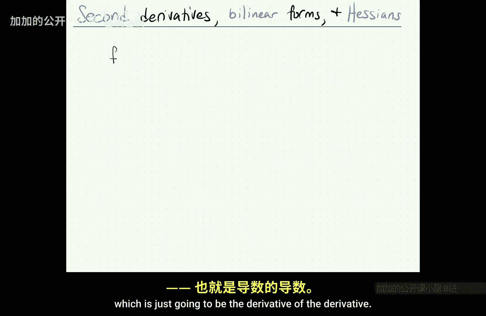
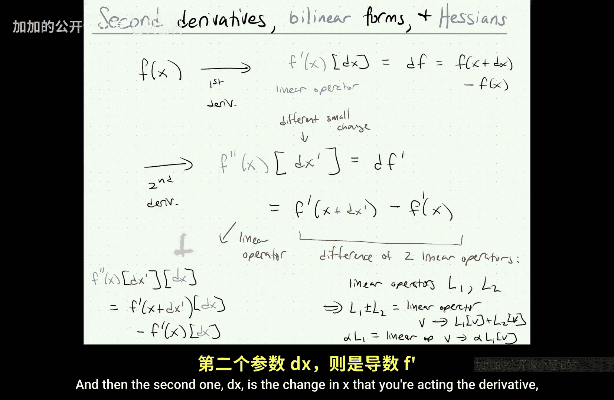
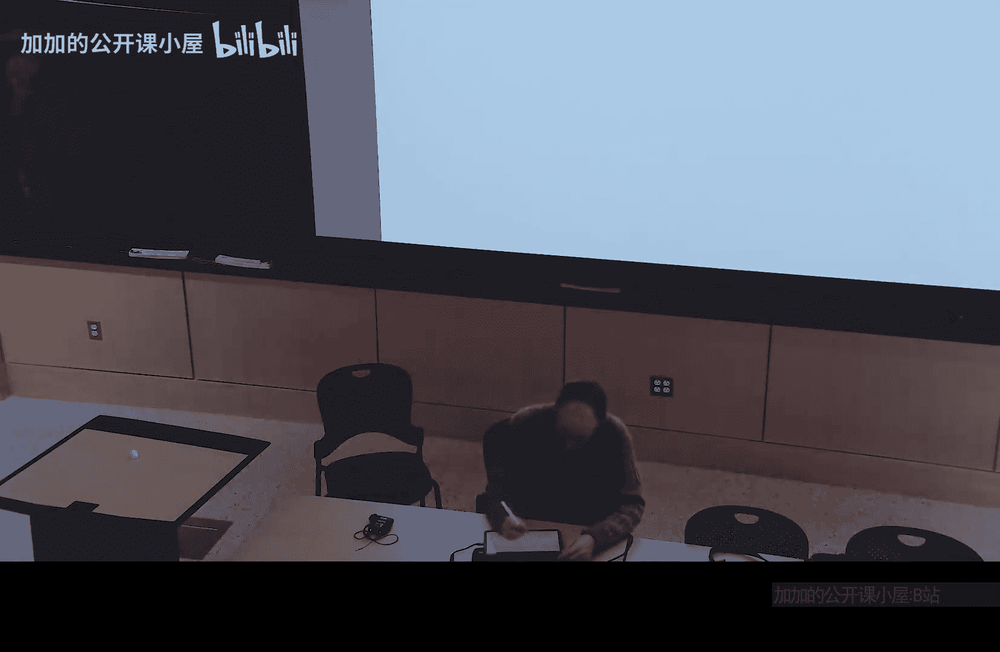
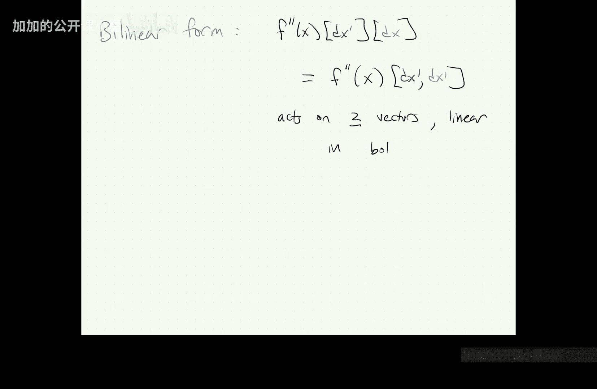
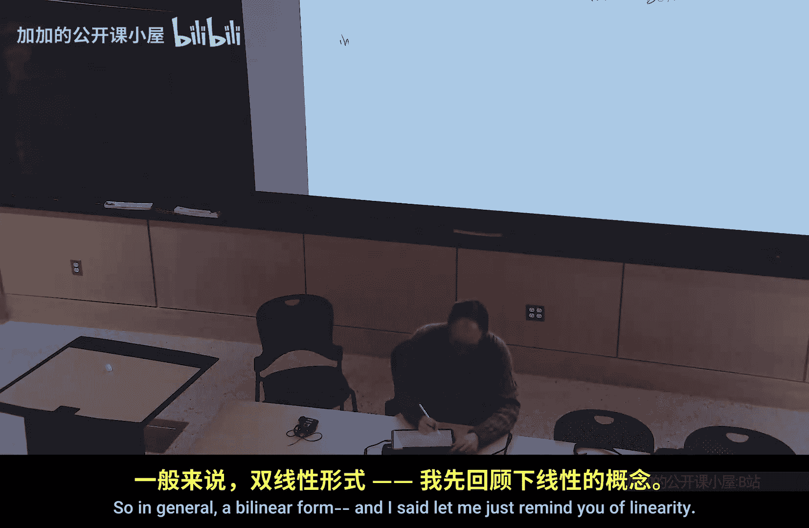
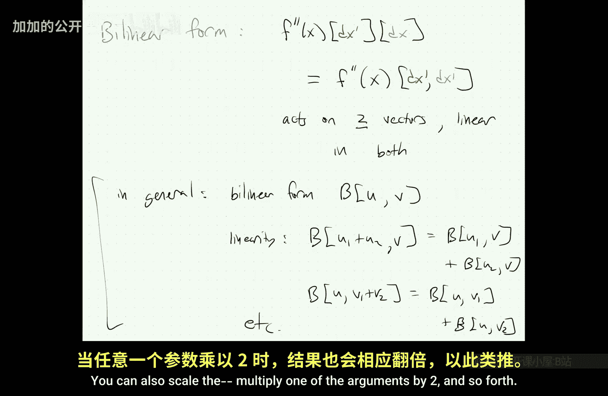

# 麻省理工学院【中英⚡矩阵微积分及其在机器学习中的应用｜2023-18.S096-Matrix-Calculus-For-Machine-Learning】-p15-P15-Second-Derivatives,-Bilinear-Forms,-and-Hessian-Matrices--BV1wbSNBkEQM_p15-

Okay， so let's get started。

So。As I said， I I want to do second derivatives， which is just gonna be the derivative of the derivative。

But。when you have functions from you know， matrices to matrices or something like that。

 you have to think a little bit carefully just to make sure we understand what kind of thing the second derivative is。

So remember when we take basically the， the first derivative。Right， what， what we have is this。

 this linear operator。F primed。OfX。That takes in a little change。and gives us you know， a D F。

 which is the F of x plus D X minus F of x to first order， right， the dropping higher order terms。

And so it's really natural you know。To define the second derivative。You say deiv。

As the derivative of that。 So what should。What， what should。F double prime B。诶。F double primeed。

Of of x。Should take in this call， Let me call it A D X prime。 It means that it's not a derivative。

 just means a different。Let me put it in here。In red， is gonna be a different。Small change。Right。

 so prime here is not derivative。 It's just different。 Okay， it till there or something like that。

 but。We overload the prime a lot in mathematics。 right， So what should it be， Well。

 it should be the derivative。 I mean， it should be exactly the same thing it should be。

 It should be D F。pririme。Right so it should be F primed。Of X plus D， X prime。mininus。F primeed of X。

She should look exactly the same。But now let's think about what this means。

So this F prime here is not a number anymore。 this is could be a number， but in general。

 it's a linear operator。系。So， this here。Is the difference of two linear operators。

RightAnd what does it mean， to add and subtract and take differences of linear operators right And we did a little bit of this in problem set 1。

 you can think of linear operators themselves as a vector space。

 right you can just like we can take functions you know， sine x plus cosine x is another function。

 right， So so we can take think of linear operators as a vector space as well。

 So if you if we have linear operators。呃。Operators， operators。L 1 and L 2。

Then what we mean by their addition， L 1 plus L2， or plus a minus。Is the linear operator。

That takes a vector V。And gives you L 1 of V。Plus， L2 of V。哎。And the same thing， if you。

 if you multiply a linear operator by a scalar。That's the linear operator。

That sends a vector V to alpha times L 1 a V。Right， so， so and this shouldt be familiar。

 right So if I take two matrices and I add them， youd actually know what that you say， oh。

 that means you add the elements element wise。 But where does that rule come from。

 that adding up two matrices element wise is exactly the new matrix that acting on a vector gives you the first matrix times the vector plus the second matrix times a vector if I take a matrix and multiply it by3。

 You can say， oh， you multiply all the entries by 3。

 But why it's because if I take that's the linear operator that take takes a vector。

 it's equivalent to multiplying it by that original matrix and then multiplying it by3。😊。

RightSo that's where those rules come from。 Just like the rule for multiplying two matrices。 Oh。

 row times columns。 why， because that's the new， that's the new linear operator that is equivalent to multiplying by the first matrix by the right matrix。

 and then then by the left matrix， right， That's where these rules come from。 right。

 So this thing here。Is， is now so what we really mean by this is this。Is a linear operator。Right， so。

嗯。Right， that。This is the difference of two linear operators。 This is。

 These are linear operators that take in a D X and give you a。Something else give you A D F， right。

So the difference of these two things is a linear operator that takes into D， X， not a D X prime。

 a D， X， and gives you。And gives you something else。 So this is， this is a linear operator。

That takes in what can call it F double prime。Right， of x。It takes in a D X prime。That takes in。

 So another input。 we can take it， write it as it takes in an input， D， X。ys。

And what it gives you is。F primeed of x plus D X primeed。Acting on。Dx。Minus。Minus F prime of x。

 acting on the X。Does everyone see So， So， so this。

F double prime is gonna be it's just copying down the formula for the， for the derivative。

 except applying it to F prime。 But then so this is the， the linear operator you get。

When you take the original linear operator at F at a slightly shifted x minus minus F prime of x。

 So this is a linear operator that acts on a D X。 And what it is is。

 it's just the linear operator that takes this on D， X minus this and D X。

But then if you think about this object now， this object now takes two inputs。It takes the change。

It takes the change in X， you know， where D X prime is the change in where you're taking the derivative。

哎。And then。The second one， Dx is the change。

You know， in X that you're acting the derivative F primeed on。So this is called a bilinear form。

， so we have， we， we're gonna have F double primeed。That's taking of X。 that takes two inputs。

Dx prime。And。The X。But writing those two pairs of brackets is a little bit annoying。

 So let me just write one pair of brackets and just give it two arguments。哎。

And it actx on two vectors。And it's linear in both。Right so in general， you know， bilinear form。

RightIt， let me just remind you of linearity， you have a bilinear form。Form， you know。

 call it B that takes in a vector U， and it takes in a vector V， right， with and and linearity。

Means if you take like B of U1 plus U2， that hadop comma V， that had better equal B of U1 v。Plus。

 B of U2 v。But it also has to be linear in the second argument。B of U， V1 plus V2。

Hast to equal B of U v1 plus B of U V2。Et cea。You can also scale multiply one of the arguments by two and so forth。

 right If I multiply both of the arguments by  two， if I do。

