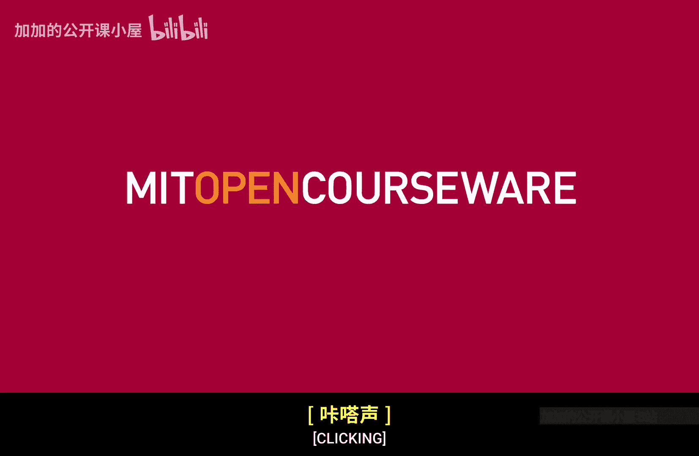
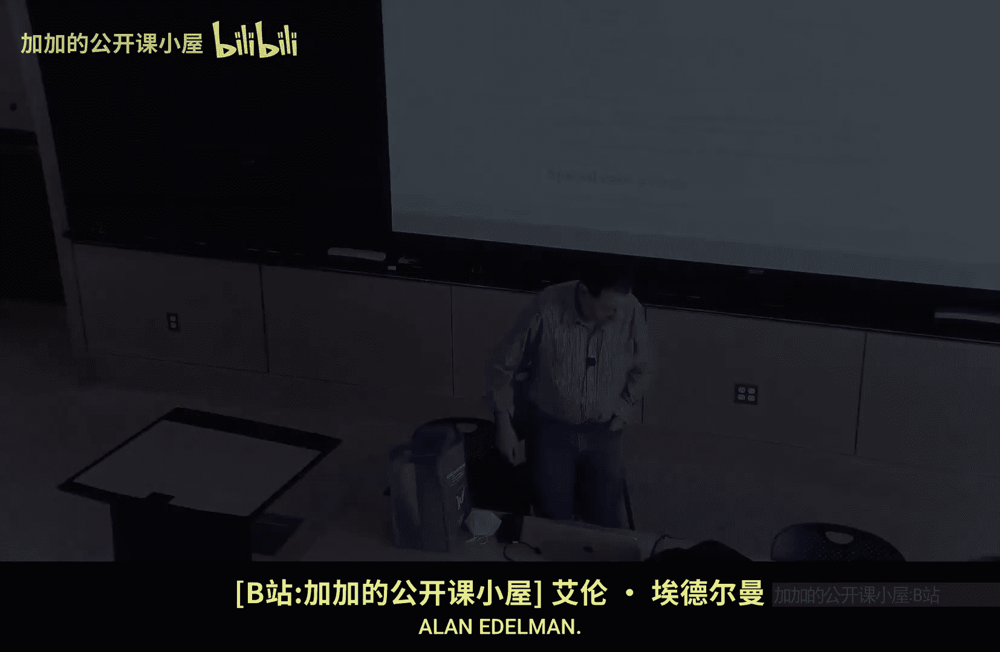
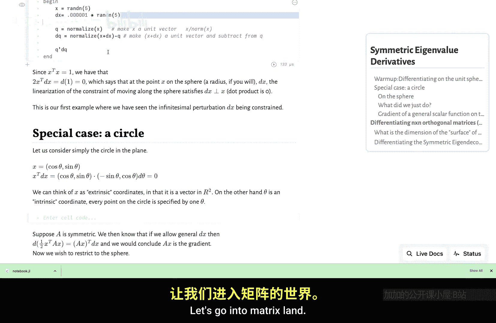

# 麻省理工学院【中英⚡矩阵微积分及其在机器学习中的应用｜2023-18.S096-Matrix-Calculus-For-Machine-Learning】-p16-P16-Derivatives-of-Eigenproblems--BV1wbSNBkEQM_p16-

Today， the plan would be， I'm going to talk a little bit。

 I've got this notebook from last year talking about taking the derivative of such matrix quantities as eigenvalues。

 and so that what's going on here is that the big story is orthogonal matrices may play a role if you have symmetric eigenvalue problems and so we have constrained problems。

 which is something we haven't really talked about yet。

 so we'll talk about differentiating under constraints a little bit then I will use the blackboard and you might remember from over a week ago。

 I think it was where I was talking about forward and reverse mode differentiation on the blackboard and we made it through forward but we never made it through backwards or reverse mode and so the plan is to kind of remember where we were and go back and do that。

 and Stephen had the idea of the last 10 minutes at the end of class we'll talk about the things that we haven't talked about。

 we've already figured out that in principle this class could go on for another week or two but of course IAP is coming to an end this week。

So， but there's so much more that we could do。 So here。

 let me just kind of go through this a little bit quickly。 So ultimately。

 I want to think about orthogonal matrices， right， you all know what orthogonal matrices are Q transpose  Q is the identity。

 but kind of to go slowly。 and it's a bit of a warm up。

 Let me just talk about differentiating on the unit sphere。 Okay， so the unit sphere。

 And then right it's like the sphere is like a baby version of an orthogonal matrix， right。

 It's one column of an orthogonal matrix。 So let's talk about being on the sphere。Okay。

 and just as a， as a reminder， if you are。Restricted。Fly， what's going on？

 It's something about the sunbeams。He like it， He like， oh， it somebody's reflection。

 isn't mine or somebodys reflecting their phone， and Philip is going chase it。一。He's really part cat。

Somewhere genetically or something。Yeah， he will， he will chase it。Yeah。Okay， thanks for big。

 Thanks for。Al right， Where was that， Yes， So you all know that if you move along on a circle。

 then tangents on the circle or place or are are orthogonal。 right。

 if you think of the vector of where you are from the center， tangents， of course， are orthogonal。

 and that's true in N dimensions that if you move around along a sphere in n dimensions。

 your position vectors is from the origin and then the velocity is always going to be orthogonal or tangent to the sphere。

 right And so all of a sudden now we're talking about up until now。

 derivatives were free to be in any direction， all of our little Dx's that we've seen or D's or whatever you want to call it have always been free to be in any direction you like。

But if you， if if your point is restricted to a surface like the sphere。

 then somehow your D X is restricted to being tangent to the sphere。 Now， right。

 It's not in any direction anymore， right， We're not。

 we're no longer interested in radial directions because that they don't even exist， right。

 We're only interested in tangent directions， because they describe movements on the constrained surface。

 right， And so we need to figure out how to accommodate these sorts of tangential directions， right。

 And so。So， so， so here I'm。Kin of just showing you roughly what， what it would look like。

 But the way， is the sun drowning this out or is it okay。I'm wondering if this one should close。

Or at least the， the little。Or partially close。 It looks like there's a lot of glare from the sun。

 I'm happy to see the sun。 Don't get me wrong。😊，We'll take as much of it as we can get this。But a。

 yeah， that might be a little bit better。Right， so just to kind of show you how you construct sort of the right kind of DQ here。

 right So by the way， did people know the trick for generating a random vector on the sphere？

 So if you so the question is。Youd like to pick on the sphere。 You'd like to pick a point uniformly。

 right， uniformly means that like no matter how you rotate the sphere that how you're picking。

 it doesn't matter， right And the trick to doing that is is to take X to be a standard normal。

 Like here I'm doing five dimensions。Right，So X is a standard normal。

 And then you just all you have to do is normalize。

 which makes it a unit vector and properties of the normal distribution have it that it's invariant under rotations。

 And so Q is invariant on the sphere， And so that's the simplest way to generate a random vector of unit1 that actually is uniform on the sphere。

 If you took R， which is you wouldn't get the right answer。 it's very special to take R N。

 which is the normal distribution。 So Q is is。On the sphere。 And if you take a little D X， you know。

 you guys know me by now。 I like to type 00001， something like that。 If you take a random direction。

 of course， it won't be tangential to the sphere， so。

What I'm doing is I'm normalizing it and subtracting it from Q to kind of see， you know。

 So so this is， this is a random nearby point from X on the sphere。

 And I'm gonna see its distance from Q。 And I will observe that Q transpose D Q is you know。

 heading towards 0。 Okay， so that's basically saying that that that， I mean。

 I hope you all see the picture。 But here， let's draw the picture。 Maybe that be even better。

 So here's the picture。😊，Right， I've got my cu over here， and I've got。My。

My Q plus DQ just a little bit off。From here。 And so this this is basically the Dq。

 And what I'm showing you is numerically things you that is' easy to believe in your mind is that this is a right angle right that Q transpose Dq is 0 So this right angle over here is the same thing as saying Q transpose Dq。

Is zero。 Any questions about that。that's all pretty intuitive， right。

The tangents are orthogonal to the radio eye。No matter what the dimensions。Okay， and。

There's a math way of， of describing this。 You don't just need your geometric intuition to see it。

 You just do the obvious thing if you're。Restricted to this sphere， if x transpose x equals1。

 then we could take our usual rules to differentiate， right， So if we differentiate， we have。

 we have D X transpose X plus x transpose D X。 And Steven spent a lot of time in the first week。

Reminding you that x transpose Dx and Dx transpose X are the same thing。

 they're just dot products so we can combine them to get two x transpose Dx is the derivative of the constant1。

 which is0。 And so here we get this is a constraint on the perturbation right。

 It says that Dx is orthogonal to X。 those are the those are the only dx is where're allowed。

 we're not allowed to go in any direction， only those that are orthogonal to x or what we're going to consider if we want to restrict ourselves to a sphere。

Okay， so that's。That's working with constraints。 So this is our first example。You。

 we can even do it here。 Here's just just a little exercise， just to kind of check。

 He supposeose X is restricted to being on a circle， right， So X is。

So x is a vector in two dimensions， but it's it's parameterd by theta over here。

 And so it's living on just a pure circle。 If you wanted to calculate x transpose Dx is a kind of quick check just to show that it all。

 I just like seeing that it works。 I mean， again， there's nothing fancy here。

 But X is the vector of cosine theta sine theta。 D X just by taking simple ordinary derivatives is minus sine theta d theta and cosine theta d theta。

 we could pull out the d theta。 and you can see that this do product is obviously know minus cosine sine plus sine cosine。

 It's obviously0。 so。And。And then there's， there's a little bit of math gossip。

 maybe just as a side story。 if you'd like to hear a little bit of math gossip。 So the， the。

 the X vector with its two coordinates。It's sometimes called an extrinsic vector， right， It's， it's。

 it's living in this plane， right， The the， the single theta coordinate。

 the the one dimensional you know， the the circle is， is。

 is the perimeter a circle is a one dimensional object， right， those are。

 that's what's called intrinsic coordinates that here we are just parameter。

From the theta point of view， there's nothing but the circle， right X has two coordinates。

 and we have to constrain it。 And mathematicians you started out doing everything extrinsally。

 And then they discovered that intrinsic was better。 And nowadays。

 many pure mathematicians will tell you， you've got to do things intrinsically。 it's so much better。

 But I'll tell you from computational viewpoints， I think extrinic is actually better in the end。 So。

 I'm not convinced of what the pure mathematicians will tell you。 So you get to decide。

 But whatever variables work。😊，It is fine for you。嗯。Okay。

 so now what I want to do is move into matrix land。 We want to grow up。 This was simple circles。

 Let's， let's。Let's， let's go into。

Matrix land。 And， where are we going。What are we doing here， let me just remember。Oh， right， okay。So。

 so not yet。 yeah。 So we， we're taking another baby step Matri land for the moment。Alright， so。

 so I'm going to restrict myself to symmetric。