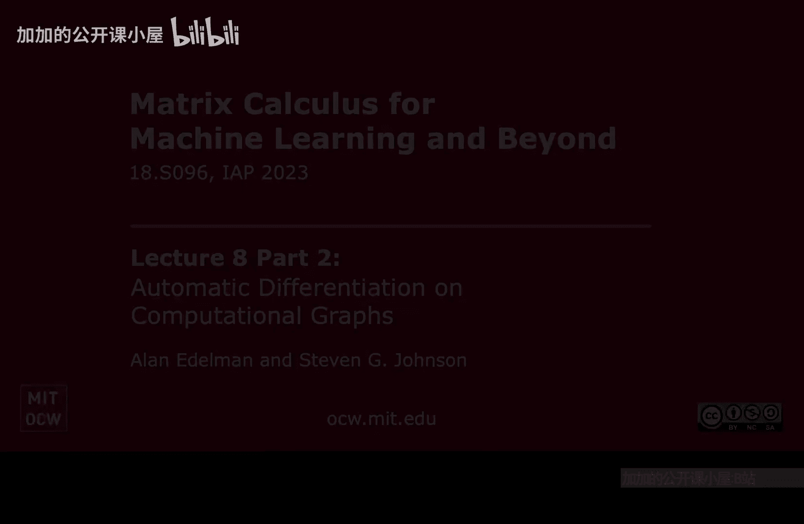
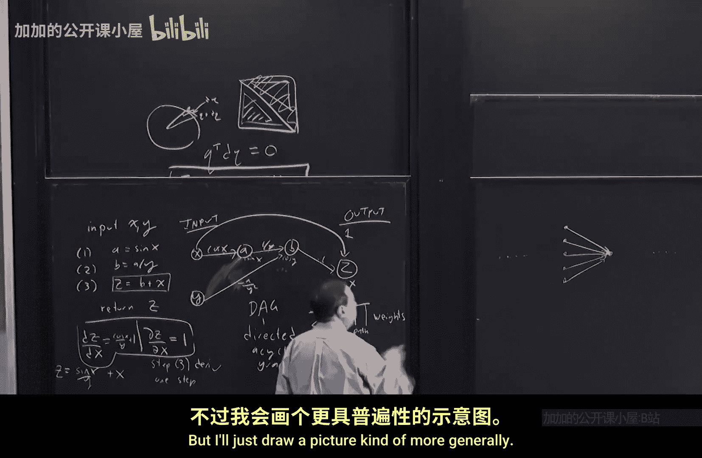

# 麻省理工学院【中英⚡矩阵微积分及其在机器学习中的应用｜2023-18.S096-Matrix-Calculus-For-Machine-Learning】-p17-P17-Automatic-Differentiation-on-Computational-Graphs--BV1wbSNBkEQM_p17-

And。I just。Since I think it's been over a week。Let me just kind of remind you that the sort of toy problem that I put up about a week ago。

 when the problem was where I was going to input X and Y。 Maybe you will remember this。And。

I had a kind of a program， if you will。 I kind of think of this as sort of steps in some software。

 if you like， where I take A with sine X。And B is was nothing special here just。

Illustrating a number of things。 C is B plus X。 And I was going to return。Z as the answer。 Okay。

 and maybe you all remember that there was this。Graph that I drew that kind of illustrates a little bit of what's going on。

 I put the。Inputs， in fact， I put all the variables in circles。Right， and so there was A。

 There was B， and I'm going to end up with Z。Right， and I just， I just put the， the。

 the local derivatives and。Stephen， I want to ask you if you would like or hate this notation。

 a notation that I think I've seen some people use。 But again。

 nobody's consistent in this field right now。 I kind of like the idea that。That。That here let's。Then。

 and I don't want， I don't want to get into placeholder notation。 But if I were to talk about。

If I were to talk about， I want to make a distinction between。D， Z， D， X and partial Z。

 and partial X。Okay， and。呃。嗯嗯。To be clear， this 1， I want to equal 1。

 And I want to think of it as like a one step derivative。 It's， I look at this formula alone。

And I don't want to think of B as being dependent on x， which in fact， it is。

 But I'm pretending B is not dependent on x。 And I'm just looking at sort of what I would call the the step three derivative or the one step derivative。

As opposed to。The， the actual derivative， the one that puts it all together。

 And we wrote it down last time。 What did I say it was that that， you know， the。Z。

 if you put it all together with sine x over y。Plus X， right。 And so deep， this thing。

 the thing that we actually want to calculate is cosine x over y plus y。 So my question for Stephen。

Was， what do you think of this notation， You like it， Okay， anybody want to object to the notation。

So I like the idea of partial being a partial。 Like， it's not the whole set of steps。

 It's just like one step。 It's par， the partial truth。

And then the derivative being sort of the whole truth。 Okay， And so what I'm putting。

 what I'm going to put here are all the partials， right， So I'm going to put down the the cosine x。

 which is the derivative a with spec to x and the one over y goes here， right？ And there's a。

 there's a one that goes here。 But there's also a one coming from here。 And。Let's see。

 What else did we have。And we had a minus a over y squared。Over here。Okay。

 and maybe it's also useful sometimes to write down。What these things are equal to。

 I'll just sort of stick this below the circle。 I don't know if the printing is too small。

 but I'll just do it anyway， cosine y and。B plus x is here。Alright， so this is where we were。

 I think， when I left off last time。That just to show an example。

 how a program is a sequence of transformations of， variables。 and for a program to work。For。

 for a program to work。If you're at any time you're at a node。

 all of the inputs have to be available unknown to you， right， so you may。

 you may never stop to think about this property of a computer program。 But it's sort of obvious。

 right， that I can't execute B， unless I know A and Y， right， I can't execute Z。

 unless I know B and X， right And so you know， the very nature of a computer program。

 is that this thing is going to be a a dag。 That's the word。 maybe most of you know that work。

 It's a directly directed acyclic graph。 which in simple English means that wherever I am。

 all the inputs are moving sort of left to right。 they're moving from the beginning to the end。up。

That could actually be relaxed。 And you could have an implicit method or something。

 And most of what I'm talking about will still work under such situations。

 But I think for simplicity， let's stick to dags and things going left to right。 Okay， yep。😊。

let's see the did I Oh， because it doesn't。Thank you。There。

If you want the honest reason as to why A depends on why is I left my glasses home today。Thank you。

Better。Good， good catch。Alrighty。That's why it depends on why。Alrighty， good。So that's where we were。

 And let's see， how far did we get in all this， so。I think we got as far as saying。

Sort of the bit of the general。Situation for the forward derivatives。 let's see。Yeah。

 how far did we get？So， so。So the goal， as you remember， is。For every input。

 so the inputs are over here and for every output。 So we have two。

 in this example of what two inputs in one output。Somehow calculating the derivative can be thought of as basically multiplying the pathways。

 If these were matrices you have to do in the right order。 if it's scalrs。

 you kind of get to ignore that a little bit。 but we want to multiply the pathways and add up。

 add that up over all the paths， right so whether it's forward or backwards or any other way。

 our goal is to look at all the paths between X and Z and then multiply the weights。You know。

 here there's just one weight and then add up over all the paths。Okay， and so it's， it's， it's。

 it's really the sum。Over。Ps。From input。I to output J。Of the product。Over the path。Of the weights。

So I'll just kind of say it like that。 I hope it's clear what this's meant。

 That's really what's going on， right？ And some people would tell you， it's just the chain rule。

 and they'd be right。I'm not a big fan of just the train rule because not not that not that there's anything wrong about it。

 but I feel like you don't really see what's going on。 if you just say just the train rule。

 but if you look at it on the graph， the computational graph。

 I think it's much easier to see what's going on okay。So， so， and it really doesn't matter if you。If。

 you know， if you， if you really have the graph in front of you， I mean。

 its sort of the human thing to do， it really doesn't matter if you if you multiply this times this times this or if you did it in the other order。

 right， it just doesn't matter。 You just need to the product of the weights can happen in any order and you can use sosociivity to your benefit any way you like。

Okay， and just so it's completely clear。I drew this symbolically。But on any computer。

 when you're doing automatic differentiation， everything here is gonna be， you know。

 most of the time a number， I would say 99。9% of the time。All of the variable。

 everything that you would see would be a numerical value。Okay。

 so I just don't want any confusion that， that I did it symbolically because if I put a whole lot of numbers here。

 I don't think I'd make the point as well， right， But on， on a computer。

 when you do automatic differentiation， everything it's， it's all numerical。

 It's not finite differences。The way you get to the edge weights are never finite differences。

 but it is all numbers。Okay， usually like floating point numbers of， you know。

 double precision or something or maybe， maybe not。 but， but， you know， floating point numbers。O。

So then we talked about how。This thing really works。And which， which of these。

 Which of these do I want to tell you。So猪。Forward last time。Yeah， I did forward last time。

 And maybe I could sum up for it。 I didn't say it last time。But maybe it's just。

It's worth saying that。呃。When you do forward。You have。You might have。A node coming at your next step。

 So you're， you're in the middle of。You're in the middle of， of doing forward mode， right。

 And I'll draw a little picture， like。Here I only had a case where like a point depended on two inputs。

 but I'll just draw a picture kind of more generally， like I'll write it like five inputs。

 but you know， this could also be。

